<!-- 本機 PDF：papers/2014-The%20neuronal%20architecture%20of%20the%20mushroom%20body%20provides%20a%20logic%20for%20associative%20learning.pdf -->

# The neuronal architecture of the mushroom body provides a logic for associative learning

**蕈狀體的神經元構造，給出了聯結式學習的一套邏輯**

| 項目 | 內容 |
|---|---|
| **出處** | eLife 3, e04577 (2014). doi: 10.7554/eLife.04577 [全文（PMC 免費閱讀）](https://pmc.ncbi.nlm.nih.gov/articles/PMC4273437/) |
| 日期 | 刊出 2014-12-23；投稿 2014-09-03・接受 2014-11-05（PDF 第 1 頁）。修訂日期 PDF 未印。eLife 是單篇編號（e04577），沒有起迄頁；PDF 共 47 頁 |
| 通訊作者 | Yoshinori Aso（asoy@janelia.hhmi.org）、Gerald M. Rubin（rubing@janelia.hhmi.org）。PDF 只有英文名 |
| 作者 | 共 11 人：Yoshinori Aso、Daisuke Hattori、Yang Yu、Rebecca M Johnston、Nirmala A Iyer、Teri-TB Ngo、Heather Dionne、LF Abbott、Richard Axel、Hiromu Tanimoto、Gerald M Rubin。**未標共同第一作者**。分工（作者貢獻欄）：Aso 構思、split-GAL4 篩選、取像、分析與寫作；Hattori 設計並執行 PA-GFP 實驗；Yu 開發影像對位軟體；Johnston、Iyer 備樣與取像；Ngo split-GAL4 篩選與取像；Dionne 分子構築；Abbott、Axel 分析與寫作；Tanimoto、Rubin 構思與寫作 |
| 機構 | Janelia Research Campus, HHMI（美國 Ashburn）；HHMI, Columbia University；Columbia 大學醫學院神經科學系、生理與細胞生物物理系、生化與分子生物物理系（紐約）；東北大學生命科學研究科（仙台；PDF 第 1 頁誤拼為 Tohuku）；Max-Planck Institute of Neurobiology（德國 Martinsried） |
| 資料庫 | 92 個 split-GAL4 品系在成蟲雌腦與腹神經索的共軛焦影像全疊層：http://www.janelia.org/split-gal4 （圖 2 圖說、方法）。無公開程式碼 |
| 補充資料 | 圖補充圖 13 張（圖 2 有 7 張；圖 3、5、10、14、15、18 各 1 張）、影片 1–6、補充檔 1（92 個 split-GAL4 品系與其標記細胞型的對照矩陣）。**PDF 只印出這些補充資料的標題與 DOI，不含內容；本庫未取得。** 凡依賴它們的內容標 ？待查 |
| 編輯／審查 | 審查編輯（Reviewing editor）Leslie C Griffith（Brandeis University）。eLife 2014 年的審查信是否公開，PDF 未載 |
| 姊妹篇 | 正文多次引用的「accompanying paper」是 Aso et al. 2014, *eLife* 3:e04580（MBON 的價值編碼與行為），即本庫的 [[s-aso-2014-mbon-valence]]。庫內各頁把本篇稱為 **Aso 2014a**、把姊妹篇稱為 **Aso 2014b** |

> 與本庫有關的作者：Aso 與 Rubin 也是 [[s-aso-2016-dan-cell-type-rules]] 的兩位作者、[[s-hige-2015-heterosynaptic-plasticity]] 與 [[s-ichinose-2015-reward-recurrent-circuit]] 的共同作者；Tanimoto 也是 [[s-ichinose-2015-reward-recurrent-circuit]] 的作者。本篇是庫內 **九篇來源**（Hige 2015、Ichinose 2015、Aso 2016、Felsenberg 2017、2018、Handler 2019、Dylla 2017、Kaldun 2025、Huang 2024）引用的解剖與命名出處。
>
> **本篇為 CC BY 開放取用**（PDF 第 1 頁：「This article is distributed under the terms of the Creative Commons Attribution License, which permits unrestricted use and redistribution provided that the original author and source are credited」；未註明版本號），版權屬作者（Copyright Aso et al.）。圖片可在標明出處的條件下自由使用與散布。本庫仍依規定只給全文連結、不放 PDF；每張圖下方標明出處與授權。

---

## 為什麼重要

**這是本庫大半頁面的上游出處。** 庫內反覆出現的那些名字——γ1pedc、α2sc、PPL1-γ2α′1、PAM-α1、MBON-γ4>γ1γ2——全部來自這一篇；「蕈狀體的葉分成 15 個區室，每格一型 DAN 加一到兩型 MBON」這句話也是。在這篇之前，蕈狀體的細胞型有好幾套互不相通的名字（MB-MP1、MB-V2α、MB-M4、MB-AIM…），同一顆細胞在不同論文裡叫不同的名字，而且多數驅動品系同時標到很多型，讀者無法知道某個行為結果該歸給誰。本篇做了三件事把這個局面收掉：把蕈狀體葉內的細胞清點完（7 型 KC、21 型 MBON、20 型 DAN）、給它們一套**以所在區室命名**的系統（MBON-α1 就是樹突在 α1 的輸出神經元），並做出 92 個只標一到數型的 split-GAL4 品系。庫內 [[e-split-gal4]]、[[e-mb504b]]、[[e-mb099c]] 幾頁追問的「某個品系到底標到誰」，問的就是這套工具。

**它把「區室」從描述升級成可操作的單位。** Tanaka et al. 2008 已提出每條葉分五段，但沒有確定各段的 MBON 與 DAN 如何對應。本篇用對位到同一個標準腦的方式，證明 21 型 MBON 的樹突彼此幾乎不重疊、剛好鋪滿葉，而每型 DAN 的軸突末梢對齊同一格。於是「一格＝一個學習單元」不再是比喻：要改某一格的 KC→MBON 突觸，就找那一格的 DAN。[[s-hige-2015-heterosynaptic-plasticity]] 的越界測試、[[s-aso-2016-dan-cell-type-rules]] 的逐格規則比較、[[s-huang-2024-dopamine-memory-dynamics]] 的 γ1pedc／α3 分工，全部站在這個前提上。

**它也留下了兩個本庫一直在追的開口。** 第一，MBON 的軸突與 DAN 的樹突一起擠進腦中五塊相同的區域（CRE、SMP、SIP、SLP、LH），作者據此預言 MBON 可以回頭推動 DAN——這正是 [[t-mbon-dan-feedback]] 整條線要驗證的事，而本篇提供的只是「影像重疊」，不是突觸。第二，三型 MBON 把軸突送回蕈狀體的其他區室，使 α 葉的讀出成為四層前饋網路；本篇把它當成「更新舊學習」的可能機制，但完全沒有做行為或生理實驗。本篇全文沒有任何統計檢定，也沒有任何行為量測（`grep -i 'p <|p=|test|significan|learning index|performance index'` 全文；見「問題與限制」第 7 點）——它是一份地圖，不是一組結論。

---

## 論文摘要（原文與中譯）

> We identified the neurons comprising the *Drosophila* mushroom body (MB), an associative center in invertebrate brains, and provide a comprehensive map describing their potential connections. Each of the 21 MB output neuron (MBON) types elaborates segregated dendritic arbors along the parallel axons of ∼2000 Kenyon cells, forming 15 compartments that collectively tile the MB lobes. MBON axons project to five discrete neuropils outside of the MB and three MBON types form a feedforward network in the lobes. Each of the 20 dopaminergic neuron (DAN) types projects axons to one, or at most two, of the MBON compartments. Convergence of DAN axons on compartmentalized Kenyon cell–MBON synapses creates a highly ordered unit that can support learning to impose valence on sensory representations. The elucidation of the complement of neurons of the MB provides a comprehensive anatomical substrate from which one can infer a functional logic of associative olfactory learning and memory.

**中譯**（本節為忠實翻譯，非自撰內容）：

> 我們辨識出構成果蠅蕈狀體（MB，無脊椎動物腦中的聯結中樞）的神經元，並提供一份完整的圖譜，描述它們可能的連結。21 型蕈狀體輸出神經元（MBON）各自沿著約 2000 顆 Kenyon 細胞的平行軸突，張開彼此分隔的樹突叢，形成 15 個區室，共同鋪滿蕈狀體的葉。MBON 的軸突投射到蕈狀體之外五塊各自獨立的神經氈，並有三型 MBON 在葉內形成一個前饋網路。20 型多巴胺神經元（DAN）各自把軸突投射到一個、至多兩個 MBON 區室。DAN 軸突匯聚到分區室化的 Kenyon 細胞—MBON 突觸上，造就一個高度有序的單元，可以支持「以學習賦予感覺表徵價值」。釐清蕈狀體的全部神經元，提供了一個完整的解剖基礎，讓人得以由此推論聯結式嗅覺學習與記憶的功能邏輯。

---

## 科普文

想像一間郵局要把信送到全城。城裡有兩千個投遞員（信就是氣味），但他們不是按地址分組的：每個投遞員手上的地址是隨機湊成的一把，而且**每隻果蠅湊法都不一樣**。這聽起來像一團亂，可是這團亂正是果蠅學習的起點——因為沒有先天的意義，所以「這個氣味代表什麼」只能靠這隻果蠅自己的經驗寫上去。問題是：意義要寫在哪裡？這篇論文的答案是，寫在投遞員交信的櫃台上，而櫃台只有幾十個，還整整齊齊地排成一列。

**先交代三種角色。** 果蠅聞到氣味時，觸角上的嗅覺神經元先活化嗅葉（antennal lobe）裡的「嗅小球」（glomerulus，同一種受體的神經元匯聚成的小球）。嗅葉有 51 個嗅小球，每個派出 3 到 4 個投射神經元（projection neuron, PN），全腦約 200 個，把訊號送進蕈狀體（mushroom body）。蕈狀體裡約 2000 顆 Kenyon 細胞（Kenyon cell, KC）接收它們：每顆 KC 平均只伸出 6.4 個「爪」去抓 PN，而且抓到哪幾個幾乎是隨機的。KC 的軸突（送出訊號的長枝）像一束平行的電線往前延伸，組成蕈狀體的「葉」（lobe）。在葉上，蕈狀體輸出神經元（MB output neuron, MBON）伸出樹突（接收端）去接這束電線；多巴胺神經元（dopaminergic neuron, DAN）則把末梢伸進同一段，送來「剛剛發生了好事或壞事」的訊號。

**難題：怎麼知道「意義」被寫在哪一段電線上？** 如果 MBON 的樹突散佈在整條葉上、彼此交疊，那就沒有「段」可言，學習的結果會糊成一片。作者要回答的是一個很樸素的解剖問題：蕈狀體的葉裡到底有幾種細胞、各自占哪裡。

**解法一：把表現範圍縮到一兩型細胞。** 一般的基因驅動工具（GAL4）會同時標到幾十種神經元，看起來一團亂。作者改用 split-GAL4：把開啟基因的 GAL4 蛋白拆成兩半，各由一段不同的調控序列控制，**只有兩段序列都開著的細胞，兩半才湊得成完整的 GAL4**。他們先掃過 7000 個既有 GAL4 品系的腦部表現樣式，挑出有可能標到蕈狀體細胞的，做成約 400 個「半套」品系，再兩兩相配、篩了超過 2500 種組合，得到 400 多個在蕈狀體強表現的組合，最後選出 92 個最乾淨的品系。平均而言，同一型細胞在那 7000 個品系裡有 12 個標得到，作者據此認為這次篩選已接近「把能找的都找到了」。

**解法二：用另一種完全不同的方法驗證有沒有漏。** 遺傳工具再乾淨，也只能找到「剛好被某段序列標到」的細胞。所以作者又做了一種叫光活化綠螢光蛋白（PA-GFP）的實驗：讓全腦神經元（KC 除外）都帶上一種平常不發光的 GFP，用雷射只照蕈狀體的葉，照到的那一段會發光，而發光的分子會擴散到整顆細胞，於是「有伸進蕈狀體的細胞」就會整個亮起來。這一招找到的細胞和 split-GAL4 找到的幾乎一樣，另外多出兩顆遺傳工具沒抓到的 MBON——所以作者認為清單大致完整。

**結果：葉被切成 15 格，整整齊齊。** 把所有影像對位到同一顆「標準腦」之後，21 型 MBON 的樹突各自占一塊、彼此幾乎不重疊，合起來正好鋪滿三條葉，形成 **15 個區室**；每型 DAN 的軸突末梢也對齊同一格。於是每一格都是一個獨立的小單元：同一條 KC 電線經過每一格，但每一格有自己的「好壞訊號供應商」和自己的「讀取者」。**一條氣味訊號沿路被貼上十幾個不同的標籤，而每個標籤可以被獨立改寫。**

**代價一：讀出的維度被壓得很扁。** 2000 顆 KC 的訊號，最後只由 **34 顆 MBON**（分屬 21 型）送出去——比嗅葉的 51 個嗅小球還少。所以 MBON 幾乎不可能還在表示「這是哪個氣味」；作者認為它們表示的是「該靠近還是該走開」這類狀態量。換句話說，蕈狀體先把氣味攤開成高維度的稀疏碼（為了能分辨很多氣味），再壓回極低維度的行為偏好。

**代價二：「一格一單元」不是完全乾淨的。** 有三型 MBON 的軸突並沒有離開蕈狀體，而是繞回葉裡、送進別的區室；還有一型 DAN 的樹突長在葉裡，接收其中一型 MBON 的輸出。所以 α 葉那幾格的讀出其實疊了四層（KC 直接到 MBON，加上三層 MBON 轉手），而 γ 葉的 γ1、γ2 疊了兩層。作者認為這種多層結構正好用來處理「例外」：先學會「這一類氣味都是壞的」，之後若發現其中某個氣味其實安全，就可以靠中介的 MBON 把原本那組訊號壓下去，而不必把整個類別重學一遍。

**代價三：輸出又全部擠在同一個小地方。** 34 顆 MBON 的軸突末梢幾乎全部（99%）落在蕈狀體之外的五塊區域；而 DAN 的樹突有九成也長在其中四塊。作者由此提出一個推測：這幾塊地方就是「學來的價值」和「天生的價值」碰面的地方，傳遞糖、電擊這類訊息的上游神經元在這裡一邊叫醒 DAN、一邊直接驅動本能行為，而 MBON 把學來的判斷接到同一批下游細胞上。這是一個看起來很合理的圖，但本篇只有「影像重疊」這一種證據。

**最容易被誤讀的一點：這篇畫的是「可能的連結」，不是連結體。** 本篇全部的連結都靠光學顯微鏡：兩個細胞的螢光在同一塊體積裡重疊，就記為「可能有突觸」。光學顯微鏡的解析度遠大於突觸，兩條神經纖維可以緊鄰而不相連，所以論文自己用的詞是 potential connections（可能的連結）。真正逐一追蹤突觸的電子顯微鏡連結體要到 2017 年（幼蟲）與 2020 年（成蟲 hemibrain）才有。引用本篇時，「MBON 的末梢與 DAN 的樹突重疊」只能讀成「有機會相連」，不能讀成「相連」。

---

## 專業文

### 本頁用語

本頁各節可單獨查閱，故把反覆出現的詞集中在這裡。

| 詞 | 意思 |
|---|---|
| 蕈狀體（mushroom body, MB） | 果蠅腦中負責嗅覺學習與記憶的構造，左右各一。由萼部（calyx，KC 樹突所在）、柄（pedunculus，軸突束）與葉（lobe）組成 |
| KC（Kenyon cell） | 蕈狀體的內在神經元，約 2000 顆／半腦。每個氣味只活化一小群，哪一群活化就代表哪個氣味 |
| MBON（MB output neuron） | 蕈狀體輸出神經元。本篇的定義是「樹突在蕈狀體裡」的細胞，不管它用什麼傳遞物質 |
| DAN（dopaminergic neuron） | 多巴胺神經元。依細胞體位置分群，**PAM** 群在前內側、**PPL1** 群在後外側；本篇另列萼部的 PPL2ab |
| 葉（lobe）、區室（compartment）、基本分區（elemental subdivision） | KC 軸突束組成 γ、α′/β′、α/β 三條葉；每條葉沿長度分 5 個區室（共 15 個）；每個區室再依「哪幾型 KC 的軸突經過」細分成基本分區（全葉共 37 個，Tanaka et al. 2008 稱 synaptic unit） |
| pedc（柄核心） | 柄（pedunculus）遠端的核心部位，α/β KC 的軸突從這裡分岔。它不算在 15 個區室裡，但有自己專屬的一型 MBON 與一型 DAN，所以常與區室並列 |
| 嗅葉（antennal lobe, AL）、嗅小球（glomerulus）、PN | 嗅覺的第一個中繼站；51 個嗅小球各派 3–4 個投射神經元（PN，全腦約 200 個）到蕈狀體萼部與側角 |
| 側角（lateral horn, LH） | PN 的另一個目標，一般認為負責先天（不需學習）的氣味反應 |
| CRE／SMP／SIP／SLP | 蕈狀體之外的四塊神經氈：冠周區（crepine）、上內側／上中間／上外側前腦。MBON 的軸突與 DAN 的樹突大量集中在這裡 |
| split-GAL4 | 把 GAL4 拆成 AD（啟動）與 DBD（抓 DNA）兩半、各由一段調控序列控制的驅動品系；兩半都在的細胞才有作用（見 [[e-split-gal4]]） |
| PA-GFP | 光活化綠螢光蛋白。平常不發光，被特定波長的雷射照過才發光；發光分子會擴散到整顆細胞，可用來找「有伸進某個區域」的細胞 |
| MCFO（multicolor flp-out） | 隨機讓少數細胞各帶一種抗原標籤、顯成不同顏色的技術，用來在一個品系標到多顆細胞時分出單顆形態 |
| Syt::smGFP-HA | 接在突觸小泡蛋白 Synaptotagmin 上的標籤，優先堆在突觸前末梢，用來判斷一顆神經元的輸出端在哪 |
| nc82 | 認突觸前活性區蛋白 Bruchpilot 的抗體，是全腦影像對位時的參考染色 |
| 對位（registration）／標準腦 | 把不同個體的影像變形到同一顆參考腦（本篇為 JFRC2013），才能把分別拍的細胞疊在同一張圖上比位置 |
| 潛在連結（potential connection） | 兩個細胞的螢光在同一塊體積裡重疊。這是光學顯微鏡層級的推定，不等於突觸 |

### 一、概述

**主要問題。** 蕈狀體的葉裡到底有哪些神經元，它們彼此的空間關係是什麼？更精確地說：KC 的軸突束上，MBON 的樹突與 DAN 的末梢如何分段，分出來的段是否一一對應？

**重要性。** 蕈狀體的學習模型要求「多巴胺在局部改寫 KC→MBON 突觸」，但在本篇之前，沒有人確定局部到底有多局部、每一格由誰負責。先前的研究（Ito et al. 1998；Tanaka et al. 2008；Mao & Davis 2009，即本庫 [[s-mao-2009-dopaminergic-neuron-types]]；Pech et al. 2013）各自描述了一些「子域」，但如引言所說，這些研究「沒有確立子域之間精確的解剖關係」。本篇要的是一份完整清單加一套能操作的遺傳工具。

**發表當時的領域現狀（2014）。** 引言引的座標如下：KC 分 γ、α′/β′、α/β 三大類（Crittenden et al. 1998；Lee et al. 1999）；每顆 KC 平均 6.4 個樹突爪、各由一個 PN 支配，而且組合近乎隨機（Butcher et al. 2012；Murthy et al. 2008；Caron et al. 2013；Gruntman & Turner 2013）；氣味只活化稀疏的一小群 KC（Turner et al. 2008；Honegger et al. 2011；Campbell et al. 2013）；DAN 的活動是學習所需，而人工活化 DAN 可以取代真的獎懲（Schwaerzel et al. 2003；Claridge-Chang et al. 2009；Aso et al. 2010, 2012；Burke et al. 2012，即本庫 [[s-burke-2012-octopamine-dopamine-reward]]；Liu et al. 2012）；KC 上的 D1 型多巴胺受體是形成嗅覺記憶所需（Kim et al. 2007）。葉的分段最接近的前身是 Tanaka et al. 2008 提出的「每條葉分五個子域」，本篇的 15 區室與它一致。

### 二、方法

本篇是純解剖學論文：全部資料來自固定腦的共軛焦影像與對位，**沒有行為、沒有電生理、沒有活體成像**。

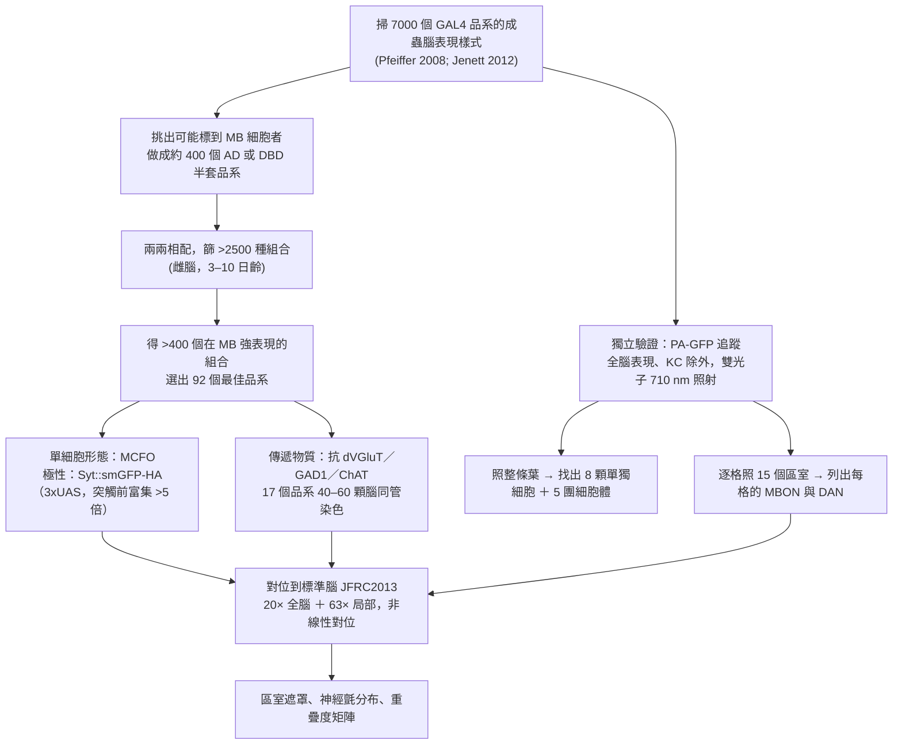

**遺傳工具。** split-GAL4 的兩半分別是 p65ADZp 與 ZpGAL4DBD（Luan et al. 2006；Pfeiffer et al. 2010）。除了 Janelia 的增強子片段（Jenett et al. 2012），作者另以合成單胺類傳遞物質的酵素的調控序列做了半套品系：酪胺酸羥化酶（TH）、多巴脫羧酶（Ddc）、色胺酸羥化酶（Trh）、酪胺酸脫羧酶（Tdc2）。**命名規則（補充檔 1 圖說）：所有 ZpGAL4DBD 都插在 attP2；品系名末尾的字母代表 p65ADZp 的插入位點——A 為 su(Hw)attP8、B 為 attP40、C 為 VK00027。** 所以 MB043B 與 MB043C 是同一對增強子、AD 插在不同位點的兩個版本（見「問題與限制」第 5 點與整合建議）。

**報告基因與取像。** 篩選用 pJFRC200-10XUAS-IVS-myr::smGFP-HA（attP18）；高解析與極性分析用 pJFRC225-5xUAS-IVS-myr::smGFP-FLAG（VK00005）＋ pJFRC51-3xUAS-IVS-Syt::smGFP-HA（su(Hw)attP1）。**Syt 構築刻意只用 3 份 UAS**，把表現量壓到讓突觸前富集達 5 倍以上。取像：20× 物鏡體素 0.56 × 0.56 × 1.0 µm 拍全腦，63× 油鏡體素 0.19 × 0.19 × 0.38 µm 拍局部；大型細胞型最多拼 5 塊。KC 細胞體計數用 UAS-nlsLacZ 標核，以 0.1 × 0.1 × 0.1 µm 體素取像，先減去膜標記訊號、再用 FluoRender 的 3D 元件分析兩階段門檻計數。

**PA-GFP 追蹤（本篇的獨立驗證）。** 3–7 日齡雌蠅的腦取出後浸在生理鹽水中，以雙光子顯微鏡（60×/1.0 NA 水鏡）操作：925 nm 用來看、710 nm 用來活化（物鏡後 2–3 mW），像素 0.24–0.39 µm、停留 2 µs、每像素掃 4 次，每輪間隔 10–30 秒；目標體積切成 8–15 個 z 層、層距 2–5 µm。**照整條葉重複 30–60 輪，照單一區室重複 90–120 輪。** 照整葉時以 NSyb-GAL4 ＋ MB247-GAL80 讓 KC 不表現；照單格時改用 Q 系統（NSyb-QF ＋ MB247-QS），並以 split-GAL4 驅動 myr::tdTomato 標出要照的那一格。事後以抗酪胺酸羥化酶或抗多巴脫羧酶（DDC）染色，判斷被照亮的細胞是不是 DAN。**作者自陳的限制：** 樹突散佈多個神經氈、在葉內只有稀疏分枝的細胞（章魚胺神經元、SIFamide 神經元）無法穩定顯現，因為照到的體積只占它們體積的一小部分。

**對位與量化。** 標準腦 JFRC2013 以與實驗樣本完全相同的固定與脫水流程製備，再縮放成 0.38 µm 等向體素。每顆腦拍兩次（20× 全腦、63× 局部）：先用 nc82 參考通道把局部影像貼回自己的全腦影像（以 FFT 最大正規化互相關求位移），再把全腦影像仿射對位到標準腦，最後以對稱微分同胚演算法（Avants et al. 2008）做非線性局部對位。**只有對位品質最好的約 25% 樣本被用來做圖譜。** 神經氈遮罩由 Ito et al. (2014) 的定義對位後人工修邊；區室遮罩由支配同一格的細胞平均後（3D 高斯模糊 sigma = 2）人工劃界。分布圖（圖 18E）先把各型訊號正規化、依五組（麩胺酸／GABA／乙醯膽鹼 MBON，PPL1／PAM DAN）平均，再算各神經氈遮罩內訊號占全腦的百分比；圖 19C 用 10 × 10 × 10 體素（每邊 3.8 µm）的立方塊。重疊度（圖 20）用 Cachero et al. (2010) 的方法，左右腦分開處理，**平均每個細胞型組合有 17.4 對影像**，矩陣中每格是這些配對的平均值。

### 三、結果

#### 3.1 篩選規模與「是否找齊」的論證

掃 7000 個 GAL4 品系 → 做約 400 個半套品系 → 篩超過 2500 種組合 → 得 400 多個在蕈狀體強表現的 split-GAL4 → 選 92 個。作者提出兩條「接近完整」的論證：(1) 平均每個細胞型在那 7000 個品系裡有 **12 個**品系標得到，表示篩選接近飽和；(2) 獨立的 PA-GFP 追蹤找到的細胞與 split-GAL4 的清單相符，只多出兩型 MBON（後來在 VT-GAL4 收藏的 VT999036 裡找到）。標 MBON 或 DAN 的品系通常只含少數幾顆形態幾乎相同、左右對稱的細胞；標 KC 的品系則含 **75–600** 顆。

**最終清單（表 1、圖 3）：蕈狀體葉由約 2200 個神經元構成——7 型 KC（約 2000 顆）、21 型 MBON（34 顆）、20 型 DAN（約 130 顆）。** 另有 2 型內在神經元（MB-APL、MB-DPM）與 10 型外來神經元（章魚胺、血清素、GABA、SIFamide 等）支配蕈狀體。驗算：2000 + 34 + 130 = 2164 ≈ 2200 ✓；20 型 DAN ＝ PAM 14 型 ＋ PPL1 6 型 ✓（萼部的 PPL2ab 兩型不計入葉）。

#### 3.2 七型 KC 與它們的細胞數

| KC 型 | 細胞數／半腦 | 樹突在哪 | 軸突層 |
|---|---:|---|---|
| γd | 約 75 | 腹側副萼（vAC） | 柄最外層；γ1–γ4 的腹／前層、γ5 的背層 |
| γ main | 約 600 | 主萼 | γ 葉主層（約占 γ 葉體積 75%） |
| α′/β′ap | 約 210 | 主萼 | α′/β′ 的前層與後層（單顆同時分枝到 β′2a 與 β′2p） |
| α′/β′m | 約 140 | 主萼 | α′/β′ 的中層 |
| α/βp | 約 90 | 背側副萼（dAC） | α/β 的後層（最早生成，pioneer） |
| α/βs | 約 500 | 主萼 | α/β 的表層 |
| α/βc | 約 400 | 主萼 | α/β 的核心層（最晚生成，分枝最少） |

**加總 2015 顆，與「約 2000 顆」相符**（75+600+210+140+90+500+400）。五型的樹突在主萼、兩型（γd、α/βp）專在副萼；副萼不接收嗅葉 PN 的輸入，因此被認為承載非嗅覺訊息。四個神經母細胞各自都貢獻全部七型。

#### 3.3 21 型 MBON、34 顆細胞、15 個區室

以高解析影像加上突觸前標記判定極性後，作者辨識出 **34 顆 MBON，分屬 21 型**：14 型每半腦只有 1 顆，6 型 2 顆，1 型（MBON-β′1）8 顆（驗算 14 + 12 + 8 = 34 ✓）。MBON-β′1 是唯一每隻果蠅顆數會變的型（7–9 顆，平均 8.0，SEM 0.17，n = 12），而且 24 顆單細胞中有 3 顆在 β′1 的樹突非常稀疏。

傳遞物質（圖 9、表 1）：**麩胺酸 7 型／8 顆、GABA 4 型／11 顆、乙醯膽鹼 8 型／13 顆、2 型未定**（驗算 8+11+13 = 32，加 2 型未定的 2 顆＝ 34 ✓）。

分區（圖 10–13）：21 型 MBON 的樹突彼此幾乎不重疊、合起來鋪滿三條葉，**形成 15 個區室**（γ、α′/β′、α/β 各 5 個），另有柄遠端核心（pedc）由一型 MBON 與一型 DAN 專屬支配。**13 型 MBON 只進一個區室，8 型進兩個**（13 + 8 = 21 ✓）；16 型只在一條葉內取樣，即只接收三大類 KC 中的一類；**8 型的樹突進一步限縮在區室內的特定層**（例如 MBON-α2sc 只取表層與核心層的 KC、MBON-α2p3p 只取後層）。對位後在**四個區室交界**看到樹突之間的空隙，而突觸前標記 Bruchpilot 的染色顯示那些位置的突觸密度較低（圖 10—補充圖 1）。雙色標記與 MCFO 確認了 **12 個受測交界中的 11 個**（β1 與 β2 之間因為缺品系沒測）。包鞘膠細胞（ensheathing glia）只出現在三條葉之間，**不出現在同一條葉的區室之間**。

**收斂比。** 34 顆 MBON 要讀 2000 顆 KC；MBON 的數目比嗅葉的 51 個嗅小球還少。單一 MBON 的收斂比可從約 **2300:1**（MBON-β2β′2a，兩側的 β2 與 β′2a 合計）到約 **90:1**（MBON-α2p3p，只接 α/βp 的 90 顆）——前提是「每顆 KC 在它經過的每個基本分區都形成突觸」。

#### 3.4 20 型 DAN 與它們與區室的對齊

split-GAL4 找到 **20 型 DAN**（PAM 14 型、PPL1 6 型）、超過 100 顆。PPL1 的每一型只有 1–2 顆，PAM 的每一型最多約 20 顆。**17 型只投射到一個區室，3 型投射到兩個**（17 + 3 = 20 ✓）。DAN 的軸突末梢同樣鋪滿整條葉，而且與同格 MBON 的樹突大面積共存（圖 11G–I）；鄰格 DAN 的末梢彼此清楚分開（圖 11E）。

**PAM 的數目有三套，差距不小（圖 5 圖說）：** split-GAL4 共標到 **98 顆、14 型**；抗多巴胺免疫染色估 **115–135 顆**（Liu et al. 2012）；逐格 PA-GFP 計數相加得 **約 154 顆**。作者自陳 split-GAL4 在 PAM 少約 30%，並認為這些多出來的細胞投射樣式與已知型相似，可能是近緣亞型，或某些 split-GAL4 在表現上有隨機性。**作者也自己註明 154 這個數字是高估**，因為跨兩格的型別（PAM-γ4>γ1γ2、PAM-β2β′2a）被重複計入。

#### 3.5 三型 MBON 與一型 DAN 把區室串起來：前饋與回饋

三型 MBON 的軸突送回葉內，而且都送到自己樹突所在那一格以外的區室（因此資訊單向流動）：

- **MBON-γ4>γ1γ2**（麩胺酸）：樹突在 γ4，末梢到 γ1、γ2。
- **MBON-β1>α**（麩胺酸）：樹突在 β1，末梢到 α1、α2、α3（α3 中集中在表層與後層）。
- **MBON-γ1pedc>α/β**（GABA）：樹突在 γ1 與柄核心，末梢到兩側的 α/β 葉與對側柄。

**12 型 MBON 只接 KC、不接其他 MBON，屬單層讀出**；γ1、γ2 的輸出是兩層；α1、α2、α3 的讀出是**四層**前饋網路。另有一型 DAN（PAM-γ4<γ1γ2）把樹突長在 γ1、γ2 的葉內，正好對上 MBON-γ4>γ1γ2 的末梢，形成一個含多巴胺的回饋迴路（圖 17D、G–I）。

#### 3.6 輸出的匯聚區，以及 MBON→DAN 回饋的解剖基礎

對位後量化 38 個腦區（圖 18E）：**MBON 的軸突末梢有 99% 落在蕈狀體葉與五塊神經氈——CRE、SMP、SIP、SLP、LH**；**DAN 的樹突有 90% 落在其中四塊（CRE、SMP、SIP、SLP）**。四型 MBON（皆為乙醯膽鹼型）投射到側角，即負責先天氣味反應的區域。

在這些匯聚區裡，作者用重疊度矩陣（圖 20A–C）看出三類潛在連結：MBON 末梢彼此重疊（可能共用下游細胞，包括不同傳遞物質的 MBON 重疊，例如乙醯膽鹼的 MBON-α3 與麩胺酸的 MBON-α1）；DAN 樹突彼此重疊（可能共用上游輸入）；**MBON 末梢與 DAN 樹突重疊**——其中有些是同格的回饋（例如 MBON-γ5β′2a 的末梢與 PAM-γ5 的樹突），有些跨格（MBON-γ2α′1 的末梢與 PAM-β2β′2a 的樹突）。作者據此提出圖 21 的匯聚區模型。

### 四、討論

**主張一：蕈狀體葉的基本計算單元是區室。** 證據強。三條獨立線索一致：MBON 樹突鋪滿且互不重疊（對位＋雙色標記）、DAN 末梢對齊同一格、交界處突觸密度較低。弱點是「單元」的功能含意完全未測——本篇沒有任何生理或行為資料，區室是否真的是獨立的學習單元，要靠 [[s-hige-2015-heterosynaptic-plasticity]]（越界測試）與 [[s-aso-2016-dan-cell-type-rules]]（逐格行為規則）這類後續研究。

**主張二：KC 的亂序輸入與極端收斂，是為了「先攤開、再壓扁」。** 這是把本篇的數字（2000 顆 KC、每顆 6.4 個隨機爪、34 顆 MBON）接到既有理論上的詮釋，引 Perez-Orive et al. 2002、Huerta et al. 2004、Caron et al. 2013 等。論證合理但不是本篇測出來的；「MBON 表示狀態量而非氣味身分」當時還沒有生理證據（正文引的是 Hige et al. 未發表）。

**主張三：多層前饋網路使「學習例外」成為可能。** 這是純推論，作者自己用的句型是「Consider a learning scenario…」。本篇沒有測三型前饋 MBON 中任何一型的功能。※ 推論：這條線索後來在 [[s-felsenberg-2018-memory-extinction]]（MVP2 ＝ MBON-γ1pedc>α/β 抑制 M4β′／M6）與 [[s-huang-2024-dopamine-memory-dynamics]]（MBON-γ1pedc>α/β 回饋到 α3 的 DAN）得到功能證據，但那兩篇走的是回饋到 DAN 這一條，不是本篇強調的「MBON 直接抑制下游 MBON」。

**主張四：匯聚區是學來的價值與天生價值相遇的地方（圖 21）。** 證據最弱的一條。依據只有影像重疊與「DAN 由 US 活化」這個引用來的前提；本篇沒有找出任何一個同時接收 MBON 與 LH 輸入的下游細胞，也沒有電子顯微鏡層級的驗證。論文用的字眼是 postulate（提出假設）。

**主張五：蕈狀體在無脊椎動物腦中是個例外，形式與功能上接近脊椎動物的皮質。** 這是結論段的大圖像，依據是 KC 數目大、彼此等價、輸入不定型，與其他昆蟲腦區的小而定型相反，並引 Strausfeld 2012 說 KC 數目隨行為複雜度增加。屬於合理的類比，不是本篇的資料。

### 五、問題與限制

**1. 全部連結都是光學顯微鏡層級的「潛在連結」。** 作者自陳用詞是 potential connections。兩條纖維在同一塊 3.8 µm 立方體內都有訊號，不代表相連。圖 20 的重疊度是任意單位（arbitrary units），沒有校準成突觸數。

**2. PA-GFP 會漏掉某些細胞，作者已列明。** 樹突遍布多個神經氈、在葉內只有稀疏分枝者（OA 神經元、SIFamide 神經元）測不到；NSyb-QF 在部分 PPL1 與 PAM-α1 表現很低，所以**這兩群是否被 split-GAL4 標齊，本篇無法判斷**。

**3. PAM 的細胞數沒有收斂。** 98（split-GAL4，14 型）／115–135（抗體）／約 154（PA-GFP 相加，作者自承高估）。表 1 中 PAM-γ4 與 PAM-β′1m 兩型的細胞數欄是空白，因為它們只能和同一品系裡的另一型一起計數，所以「約 130 顆」無法由表 1 逐列加總驗算。

**4. 樣本只有雌性成蟲。** 篩選、極性分析、對位圖譜與 PA-GFP 全部使用雌蠅（3–10 日齡；PA-GFP 用 3–7 日齡）。本篇沒有檢驗雄蠅，也沒有討論性別差異。

**5. 命名與品系的對應留了兩個坑。** (a) 短名系列編到 **MBON-22**，但頭條數字是「21 型」——第 22 個是 MBON-calyx（MB-CP1），樹突在萼部與柄，被歸為「非典型」而不計入 21 型。(b) 品系名末尾字母代表 AD 的插入位點，所以 MB043B 與 MB043C、MB062B 與 MB062C 是同一對增強子的不同版本，**不能當成同一個品系引用**（本篇表 1 的 PAM-α1 寫 MB043B，而 [[s-aso-2016-dan-cell-type-rules]] 用的是 MB043C）。

**6. 補充資料全部未取得。** 13 張 figure supplement、6 段影片、補充檔 1（品系 × 細胞型的對照矩陣）在 PDF 裡只有標題與 DOI。**這表示本篇最有用的那張表——每個 split-GAL4 品系到底標到哪幾型——本庫沒有拿到**；表 1 只給了反方向（每一型可用哪些品系）。凡需要「某品系標到幾型」的問題（[[syn-contradictions]] 1.4、1.5）都因此無法靠本篇關閉：？待查（補充檔 1 與 www.janelia.org/split-gal4 的影像）。

**7. ⚠️（單篇自身不一致與數字陷阱，本庫稽核）**

- **(a) 傳遞物質與葉的對應，正文的通則與表 1 不符。** 正文寫「乙醯膽鹼型 MBON 在垂直葉（α、α′）、麩胺酸型在內側葉（β、β′、γ）、GABA 型在兩者交界」，但表 1 與圖 14 的 MBON-α1、MBON-β1>α 都是麩胺酸型而樹突（或末梢）在 α 葉，MBON-γ2α′1 是乙醯膽鹼型而樹突有一半在 γ2。這是**趨勢敘述被寫成分類規則**，不是編碼錯誤，但照字面引用會出錯。
- **(b) 「跨葉」的 MBON 是四型還是五型，兩處算法不同。** 圖 12C 圖說寫「四型 MBON 的樹突跨越葉的邊界」（γ5β′2a、β2β′2a、γ3β′1、γ2α′1），圖 17J 圖說寫「八型接收超過一格的輸入，其中**五例**位在不同的葉」——第五例是 MBON-γ1pedc>α/β（γ1 ＋ 柄核心），即把柄當成另一條葉來算。兩句都對，但數字只差在 pedc 算不算，引用時要指明。
- **(c) 「十型 MBON 的品系只標一顆」與「十四型只有一顆」並存。** 表 1 註腳寫「有十型 MBON 的對應 split-GAL4 品系每半腦只標一顆細胞」，而正文寫十四型每半腦只有一顆。兩者可以並存（一個品系可能同時標到兩型、各一顆，例如 MB083C 同時標 MBON-γ3 與 MBON-γ3β′1），但論文沒有說明，容易被讀成矛盾。
- **(d) 方法一句出現「176 個 split-GAL4 品系」。** 全文其他地方的數字是 92（選定）與「超過 400」（強表現的組合）；176 只在「17 個品系有非神經組織表現」這句出現，沒有交代這 176 是哪一群。另一邊，補充檔 1 的圖說說「這些品系中除 MB062C 外都沒有觀察到中樞神經系統以外的表現」。兩句的分母不同（176 vs 92），不是互相否定，但併讀會誤以為矛盾。
- **(e) 本篇沒有任何統計檢定。** 已 `grep -iE "p < |p=|p-value|t-test|anova|significan|statistic"` 全文（含圖說）：只有 ± 標準差／標準誤與 n（PA-GFP 的細胞計數、MBON-β′1 的顆數），以及三處把 significant 當形容詞用的句子。這對一篇解剖圖譜是合理的，但**不能把「split-GAL4 與 PA-GFP 的計數相符」當成經過檢定的結論**——例如背側內側群 4 vs 5.4 ± 1.2（n = 13）、前外側群 8–10 vs 5.9 ± 2.0（n = 8），後者是 PA-GFP 比 split-GAL4 少，作者以 β′1 樹突稀疏來解釋，但沒有檢定。
- **(f) 「15 個區室」與「37 個基本分區」是兩個層級，常被混用。** 本庫已逐欄數過圖 12A：基本分區共 37 欄（含 pedc）✓。引用「15」時要確認指的是區室而非分區。

### 六、未來

**論文自陳的方向。** (1) 這 92 個 split-GAL4 品系是為了後續的功能實驗而做的（表 1 以粗體標出「最適合行為實驗」的品系），姊妹篇 [[s-aso-2014-mbon-valence]] 即是第一批。(2) 圖 21 的匯聚區模型需要找出實際的下游細胞。(3) 跨區室的前饋網路可能支持更複雜的學習策略，待檢驗。

**本庫關注的後續。** 本篇留下的開口，庫內已有幾篇接手：區室是否為獨立單元 → [[s-hige-2015-heterosynaptic-plasticity]]（越界測試，陰性）與 [[s-cohn-2015-coordinated-neuromodulation]]（跨格小幅反向效果）；各區室的學習規則是否不同 → [[s-aso-2016-dan-cell-type-rules]]；MBON 回頭推動 DAN → [[t-mbon-dan-feedback]] 整條線；前饋 MBON 的功能 → [[s-felsenberg-2018-memory-extinction]] 與 [[s-huang-2024-dopamine-memory-dynamics]]。本篇同時是本庫 [[syn-contradictions]] 4.4（兩篇對同一型神經元命名不同）指名要收的那份命名參考資料。

**尚未被回答的。** (1) 區室交界的突觸密度較低，是真的有物理屏障，還是只是兩型樹突的邊界？本篇只看了 Bruchpilot 染色，沒有量 KC 在交界處的突觸。(2) MBON 末梢與 DAN 樹突的重疊，哪些是真的突觸？本篇之後的電子顯微鏡連結體（2020 年的 hemibrain，本庫未收）才能回答。(3) 兩型只靠 PA-GFP 找到的 MBON（γ1γ2、γ4γ5）在表 1 中傳遞物質為 N.D.，至今庫內沒有任何一篇用到它們。

---

## 圖

> 本篇主圖 22 張全部收錄（數量跟著論文走）。13 張 figure supplement 與 6 段影片不在 PDF 內，只在專業文中依標題引用。所有圖都從 300 dpi 整頁渲染裁切，裁後逐張用 Read 檢查四角與分格字母。

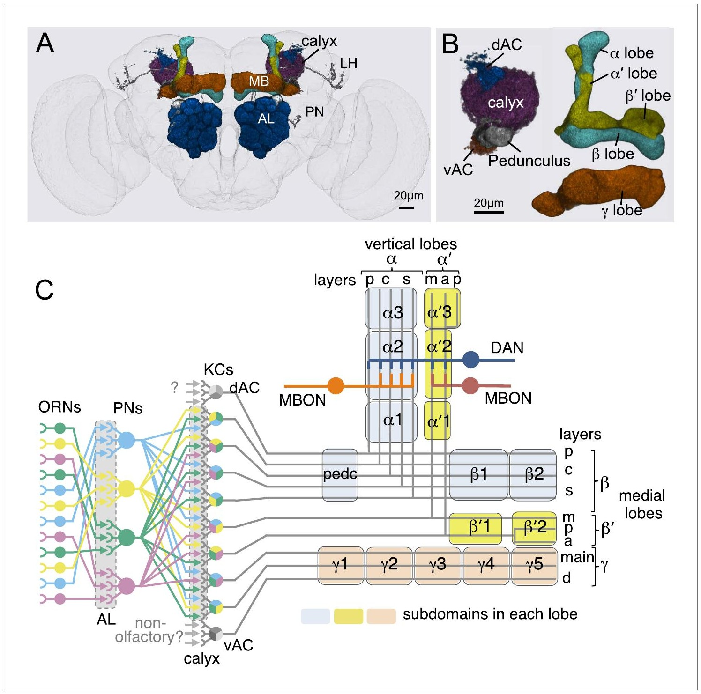

<small>圖片出處：Aso Y, Hattori D, Yu Y et al. *eLife* 3:e04577 (2014)，Figure 1。CC BY（版權屬作者）；全文見 [PMC](https://pmc.ncbi.nlm.nih.gov/articles/PMC4273437/)。</small>

> **原圖說（Figure 1）：** Anatomy of olfactory pathways in the adult fly brain. (A) An image of the adult female brain showing the antennal lobes (AL) and subregions of the mushroom bodies (MB; see panel B for more detail). The image was generated using a 3D image rendering software (FluoRender). The 51 glomeruli of the AL extend projection neurons (PN) to the calyx of the MB and the lateral horn (LH). There are a total of ∼200 PN; 6 from the DL3 glomerulus are shown. See Video 1 for an introduction to olfactory circuit. (B) Subregions within the MB. The γ lobe, calyx, and pedunculus (ped) are displayed separately from other lobes; their normal positions are as shown in panel A and Video 1. Color-coding is as in panel A. See below for a detailed description of dorsal accessory calyx (dAC) and ventral accessory calyx (vAC). (C) A schematic representation of the key cellular components and information flow during processing of olfactory inputs to the MB. … A small number (generally 3–4) of PNs from each of the 51 AL glomeruli innervate the MB calyx where they synapse on the dendrites of the ∼2000 Kenyon cells (KCs) in a globular structure, the calyx. Each KC exhibits, on average, 6.4 dendritic 'claws' (Butcher et al., 2012), and each claw is innervated by a single PN. There is little order in connection patterns of PNs to KCs. … Dendrites of MBONs and terminals of modulatory dopaminergic neurons (DANs) intersect the longitudinal axis of the KC axon bundle, forming 15 subdomains, five each in the α/β, α′/β′, and γ lobes (numbered α1, α2, and α3 for subdomains in the α lobe from proximal to distal) (Tanaka et al., 2008). Additionally, one MBON and one DAN innervate the core of the distal pedunculus intersecting the α/β KCs (pedc, see below). There are seven types of KCs; five of the seven types have their dendrites in the main calyx, while those of the γd cells form the vAC and those of the α/βp cells the dAC. The accessory calyces are thought to receive non-olfactory input since they do not receive input from the PNs from the AL. Different KCs occupy distinct layers in the lobes as indicated (p: posterior; c: core; s: surface; m: medial; a: anterior; and d: dorsal). Some MB extrinsic neurons extend processes to only a specific layer within a subdomain, defining elemental subdivisions in the lobes, or 'synaptic units' as proposed by Tanaka et al. (2008).

**圖說中譯：** 成蟲腦嗅覺路徑的解剖。(A) 成蟲雌腦影像，標出嗅葉（AL）與蕈狀體（MB）的各次區域（細節見 B）。以 3D 影像繪製軟體 FluoRender 產生。嗅葉的 51 個嗅小球派出投射神經元（PN）到蕈狀體萼部與側角（LH）；PN 全腦共約 200 個，圖中畫出 DL3 嗅小球的 6 個。(B) 蕈狀體內部的次區域。γ 葉、萼部與柄（ped）另外畫出；其正常位置如 A。配色同 A。背側副萼（dAC）與腹側副萼（vAC）的說明見後。(C) 蕈狀體處理嗅覺輸入時，關鍵細胞成分與資訊流的示意。……51 個嗅小球各派少數（通常 3–4 個）PN 進入蕈狀體萼部，在那裡與約 2000 顆 Kenyon 細胞（KC）的樹突形成突觸。每顆 KC 平均有 6.4 個樹突「爪」（Butcher et al., 2012），每個爪由單一個 PN 支配。PN 與 KC 的連結樣式幾乎沒有秩序。……MBON 的樹突與調控性多巴胺神經元（DAN）的末梢橫切 KC 軸突束的長軸，形成 15 個子域，α/β、α′/β′、γ 三條葉各 5 個（α 葉的子域由近而遠編為 α1、α2、α3）（Tanaka et al., 2008）。此外，有一型 MBON 與一型 DAN 支配柄遠端的核心，該處與 α/β KC 交會（pedc）。KC 有七型；其中五型的樹突在主萼，γd 的樹突形成 vAC、α/βp 的形成 dAC。副萼被認為接收非嗅覺輸入，因為它們不接收來自嗅葉的 PN。不同的 KC 在葉中占據不同的層（p 後、c 核心、s 表面、m 中、a 前、d 背）。有些蕈狀體外來神經元只伸進子域中的特定層，因而界定出葉中的基本分區，即 Tanaka et al. (2008) 所稱的「突觸單元」。

**解讀：**
- **C 圖是整篇論文的骨架，也是本庫所有區室圖的祖先。** 要看的是兩件事同時成立：橫向的 15 個方框（區室）與縱向的七條 KC 線（層）。本篇後面的「37 個基本分區」就是這兩個軸交出來的格子，不是 15 的細分而已。
- **「pedc」在這張圖裡被畫成與區室並列的第 16 格，但論文的頭條數字是 15。** 庫內多篇引用「15 個區室」時，γ1pedc 要算一格還是兩格的歧異（[[s-aso-2016-dan-cell-type-rules]] 圖 5B 數出 12 格、正文寫 11 格）就源自這裡：本圖把 pedc 畫成獨立方框，但不計入 15。
- **A 圖是雌腦。** 全篇解剖資料都來自雌蠅，圖說明寫出來了，正文沒有再提。
- **B 圖左側把萼部、柄、γ 葉拆開畫**，容易讓人以為 vAC 和 dAC 是分開的結構；實際上它們是主萼旁邊的小突起（見圖 6A、7A 的單細胞）。

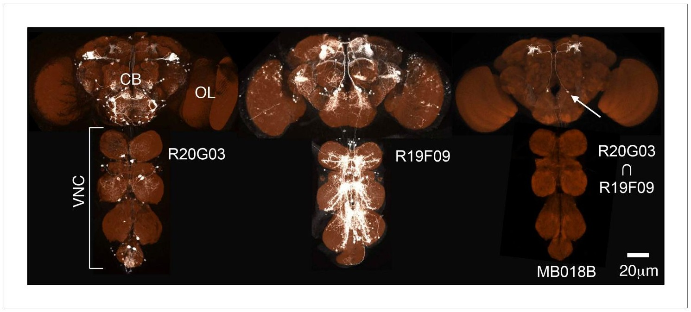

<small>圖片出處：Aso Y, Hattori D, Yu Y et al. *eLife* 3:e04577 (2014)，Figure 2。CC BY（版權屬作者）；全文見 [PMC](https://pmc.ncbi.nlm.nih.gov/articles/PMC4273437/)。</small>

> **原圖說（Figure 2）：** Generation of split-GAL4 drivers for the MB neurons. An example of the use of the split-GAL4 approach to generate a driver line specific for MBON-α′2 (see Table 1 for the naming convention of MBONs and DANs). R20G03-GAL4 in attP2 (left) and R19F09-GAL4 in attP2 (center) both show expression in MBON-α′2 when crossed to pJFRC2-10XUAS-IVS-mCD8::GFP in attP2 and in many other neurons that differ between the two GAL4 lines. The optic lobes (OL), central brain (CB), and ventral nerve cord (VNC) are indicated. The enhancer fragments from these lines were used to generate the fly line MB018B carrying both R20G03-p65ADZp in attP40 and R19F09-ZpGAL4DBD in attP2 (right). The p65ADZp and ZpGAL4DBD proteins are themselves inactive; the reconstitution of an active GAL4 transcription factor requires heterodimerization that occurs only in cells expressing both proteins. This approach, therefore, labels cells in which both enhancers are active. The arrow indicates the cell body of one MBON-α′2 cell visualized using pJFRC225-5xUAS-IVS-myr::smGFP-FLAG reporter in VK00005 (white). Neuropils were visualized with nc82 antibody (orange). Genotypes of 92 split-GAL4 lines and the cell types they label are listed in Supplementary file 1 and raw confocal images are available online (http://www.janelia.org/split-gal4).

**圖說中譯：** 為蕈狀體神經元製作 split-GAL4 驅動品系。圖示以 split-GAL4 做出專一標記 MBON-α′2 的品系（MBON 與 DAN 的命名規則見表 1）。R20G03-GAL4（左）與 R19F09-GAL4（中）兩者與 GFP 報告基因雜交後都在 MBON-α′2 表現，但也各自在許多其他神經元表現，而兩者的「其他神經元」並不相同。圖中標出視葉（OL）、中央腦（CB）與腹神經索（VNC）。取這兩個品系的增強子片段，做出同時帶有 R20G03-p65ADZp（插在 attP40）與 R19F09-ZpGAL4DBD（插在 attP2）的品系 MB018B（右）。p65ADZp 與 ZpGAL4DBD 兩種蛋白各自沒有活性；要重建出有活性的 GAL4 轉錄因子，必須兩者結合，而這只發生在同時表現兩種蛋白的細胞裡。因此這個方法只標記兩個增強子都活躍的細胞。箭頭指著一顆 MBON-α′2 的細胞體（白色，以 pJFRC225 報告基因顯示）。神經氈以 nc82 抗體顯示（橘色）。92 個 split-GAL4 品系的基因型與其標記的細胞型列於補充檔 1，原始共軛焦影像在 http://www.janelia.org/split-gal4 。

**圖說中譯（續）：** 原圖說後半另說明：以 split-GAL4 觀察到的表現樣式，會因所用的 UAS 報告基因而有程度上的差異（圖 2—補充圖 1）；KC（補充圖 2）、PPL1 群 DAN（補充圖 3）、PAM 群 DAN（補充圖 4）、MBON（補充圖 5）與其他調控性細胞型（補充圖 6）的表現樣式分別呈現；作者挑選的是在神經與非神經細胞中脫靶表現最少的品系（補充圖 7）。

**解讀：**
- **這張圖是庫內 [[e-split-gal4]] 整頁的原理圖。** 值得注意的是左右兩張「單用一半」的腦：同一個增強子片段在 GAL4 版本下標到整個腹神經索，交集之後只剩幾顆細胞——這正是為什麼庫內讀到「某某品系標到 N 型」時，必須看的是交集後的影像，而不是任一半的來源。
- **交集也會改變強度，不只改變範圍。** 圖說與方法都寫明表現樣式「在某種程度上取決於所用的報告基因」，且同樣的品系換插入位點後強度差很多。所以庫內比較不同論文用同一品系的結果時，表現量未必相同。
- **本圖示範的 MB018B 就是 MBON-α′2 的品系**（表 1），後續圖 18A、圖 22C–F 的對位示範也都用它。

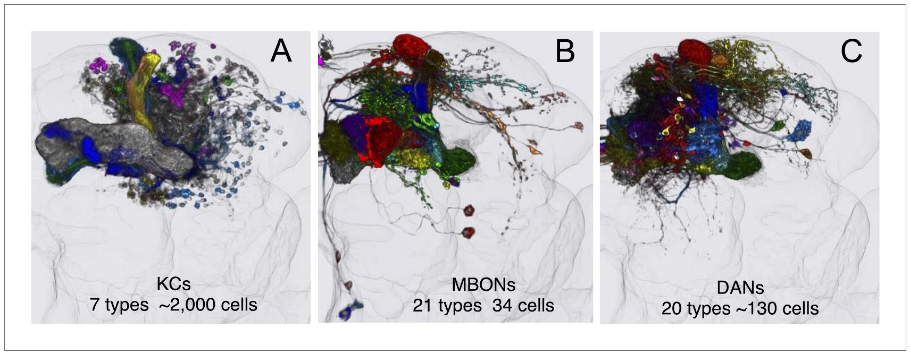

<small>圖片出處：Aso Y, Hattori D, Yu Y et al. *eLife* 3:e04577 (2014)，Figure 3。CC BY（版權屬作者）；全文見 [PMC](https://pmc.ncbi.nlm.nih.gov/articles/PMC4273437/)。</small>

> **原圖說（Figure 3）：** MB cell types. Registered images of KCs (A; Video 2), MBONs (B; Video 3), and DANs (C; Video 4). After alignment to the standard brain and segmentation, different colors were assigned to each cell type, while the outlines of the neuropils of the brain are shown in light gray. These images illustrate the overall extent and position of these cell types in the brain; the morphology of individual cell types can be seen in Videos 2–4. For MBONs, the two neurons found upon PA-GFP tracing experiments (see below) are not included, thus the image represents 19 different MBON cell types. These are the three major intrinsic and extrinsic neuron types innervating the MB lobes. Additionally, there are two intrinsic neurons (MB-APL and MB-DPM) and 10 extrinsic neuron types that innervate the MB; see Table 1 for references. The extrinsic neurons with processes in the lobes include two types of octopaminergic neurons (OA-VPM3 and OA-VPM4) and one type of peptidergic neuron (SIFamide). The extrinsic neurons with processes in the calyx include two types of octopaminergic neurons (OA-VPM5 and OA-VUMa2), one type of GABAergic neuron (MB-C1), one serotonergic neuron (MB-CSD), two types of DANs (PPL2ab-DANs), and one neuron with dendritic arbors in the calyx and the proximal pedunculus as well as in the LH (MB-CP1).

**圖說中譯：** 蕈狀體的細胞型。對位後的 KC（A）、MBON（B）與 DAN（C）影像。對位到標準腦並分割之後，每一型細胞給一種顏色，腦內神經氈的輪廓以淺灰顯示。這些影像呈現各類細胞型在腦中的整體範圍與位置；個別細胞型的形態見影片 2–4。MBON 部分未納入後文以 PA-GFP 追蹤找到的兩顆神經元，**因此本圖代表 19 型 MBON**。以上是支配蕈狀體葉的三大類內在與外來神經元。此外另有兩個內在神經元（MB-APL 與 MB-DPM）與 10 型外來神經元支配蕈狀體（文獻見表 1）。在葉內有分枝的外來神經元包括兩型章魚胺神經元（OA-VPM3、OA-VPM4）與一型胜肽神經元（SIFamide）。在萼部有分枝的外來神經元包括兩型章魚胺神經元（OA-VPM5、OA-VUMa2）、一型 GABA 神經元（MB-C1）、一個血清素神經元（MB-CSD）、兩型 DAN（PPL2ab）、以及一個樹突同時在萼部、柄近端與側角的神經元（MB-CP1）。

**解讀：**
- **三格裡的三組數字是全篇最常被引用的一句話：** 7 型約 2,000 顆 KC、21 型 34 顆 MBON、20 型約 130 顆 DAN。本庫 [[e-mushroom-body]]、[[e-kenyon-cell]]、[[e-mbon]]、[[e-dopaminergic-neuron]] 的規模數字都可追到這裡。
- **圖面寫 21 型，圖說卻說本圖只畫了 19 型。** 差的兩型（MBON-γ1γ2、MBON-γ4γ5）是 PA-GFP 才找到、後來在 VT999036 裡補齊的。引用這張圖時要知道它畫的是 19 型、標的是 21 型。
- **三格都是把許多顆腦的影像疊在同一顆標準腦上的結果**，不是任何一顆真實的腦；所以不能從圖上判斷任何兩型是否相鄰到足以形成突觸（那要看圖 11 的雙色標記）。
- **蕈狀體不是只有這三類細胞。** 圖說列出的 2 型內在、10 型外來神經元（APL、DPM、章魚胺、血清素、SIFamide 等）都不在三張圖裡；庫內寫「蕈狀體的神經元」時若只講 KC／MBON／DAN，等於省略了這 12 型。

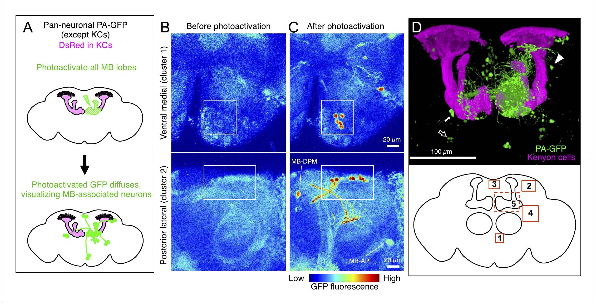

<small>圖片出處：Aso Y, Hattori D, Yu Y et al. *eLife* 3:e04577 (2014)，Figure 4。CC BY（版權屬作者）；全文見 [PMC](https://pmc.ncbi.nlm.nih.gov/articles/PMC4273437/)。</small>

> **原圖說（Figure 4）：** Identification of neurons innervating the MB lobes by PA-GFP tracing. (A) Schematic representation of the experiment. PA-GFP was expressed pan-neuronally, using a synaptobrevin-GAL4 driver, except in the KCs where GAL4 activity was suppressed by MB247-GAL80. Photoactivation of the MB lobes was guided by a red fluorescent protein expressed broadly in the KCs (MB247-DsRed). A two-photon laser was used to achieve three-dimensional precision of the photoactivation. … (B) Baseline fluorescence of PA-GFP before photoactivation in the ventral medial (top; cluster 1 in panel D) or posterior lateral region of the brain (bottom; cluster 2 in panel D). … (C) Fluorescence of PA-GFP after photoactivation of the right MB lobes in the same brain regions as in (B). … (D) MB extrinsic neurons as identified by PA-GFP tracing upon photoactivation of the right MB lobes. … Five clusters of cell bodies comprising more than two cells were detected reproducibly and are schematically indicated by the boxes (bottom): 1, ventral medial cluster; 2, posterior lateral cluster; 3, dorsal medial cluster; 4, anterior lateral cluster; and 5, delineated by the dashed lines, the anterior medial cluster that includes the PAM-cluster DANs. … Eight individual neurons were also detected, which include MB-APL and MB-DPM in the ipsilateral hemisphere, and one MBON-β1>α, one MBON-γ4>γ1γ2 (closed arrow), one MBON-γ3, and one MBON-γ3β′1 (open arrow) in the contralateral hemisphere, because these extend dendrites in the contralateral MB lobes. In addition, one cell body ventral to the calyx (arrowhead) and one cell body ventral lateral to the antennal lobe were reproducibly observed, which represent MBONs not identified in the split-GAL4 lines. The comparison of number of cells identified in split-GAL4 lines and in the PA-GFP tracing experiments is as follows: cluster name; cell counts by split-GAL4 lines, cell counts by PA-GFP tracing (sample size): (1) Ventral medial; 5, 5.2 ± 0.8 (n = 5). (2) Posterior lateral; 14–15, 15.9 ± 2.1 (n = 9). (3) Dorsal medial; 4, 5.4 ± 1.2 (n = 13). (4) Anterior lateral; 8–10, 5.9 ± 2.0 (n = 8). Note that the split-GAL4 line labeling the MBON-β′1 type, which comprises of 7–9 cells in the anterior lateral cluster (MB078C, see Table 1) includes at least three cells that exhibit very sparse dendritic arbors in the MB lobes as examined by multicolor flp-out experiments (data not shown). … It was not feasible to accurately count the large number of cells in the anterior medial cluster (cluster 5) comprising mostly the PAM DANs and several MBONs such as MBON-α1.

**圖說中譯：** 以 PA-GFP 追蹤辨識支配蕈狀體葉的神經元。(A) 實驗示意。以 synaptobrevin-GAL4 在全腦神經元表現 PA-GFP，但以 MB247-GAL80 壓制 KC 的表現。照射蕈狀體葉的範圍，以 KC 中廣泛表現的紅螢光蛋白（MB247-DsRed）為導引。以雙光子雷射達成三維精度的光活化。(B) 光活化前，腹內側區（上；D 圖的第 1 群）與後外側區（下；第 2 群）PA-GFP 的基線螢光。(C) 照射右側蕈狀體葉之後，同樣區域的 PA-GFP 螢光。(D) 以 PA-GFP 追蹤辨識出的蕈狀體外來神經元；KC 為洋紅（MB247-DsRed），被光活化的細胞體與分枝為綠色。可重複偵測到五群含兩顆以上細胞體的細胞群，以方框示意：1 腹內側群、2 後外側群、3 背內側群、4 前外側群、5（虛線框）前內側群，含 PAM 群 DAN。另外偵測到八個單獨的神經元：同側的 MB-APL 與 MB-DPM，以及對側的一個 MBON-β1>α、一個 MBON-γ4>γ1γ2（實心箭頭）、一個 MBON-γ3 與一個 MBON-γ3β′1（空心箭頭），因為這些細胞的樹突伸進對側的蕈狀體葉。此外可重複觀察到萼部腹側的一個細胞體（箭頭頭）與嗅葉腹外側的一個細胞體，它們是 split-GAL4 品系中沒有找到的 MBON。split-GAL4 與 PA-GFP 兩種方法的細胞計數比較（群名；split-GAL4 計數、PA-GFP 計數（樣本數））：(1) 腹內側；5、5.2 ± 0.8（n = 5）。(2) 後外側；14–15、15.9 ± 2.1（n = 9）。(3) 背內側；4、5.4 ± 1.2（n = 13）。(4) 前外側；8–10、5.9 ± 2.0（n = 8）。注意標記 MBON-β′1 型的 split-GAL4（MB078C，見表 1）在前外側群含 7–9 顆細胞，其中至少三顆（以 MCFO 檢查）在葉內的樹突非常稀疏，這可能說明為何 PA-GFP 在前外側群找到的細胞比 split-GAL4 少。前內側群（第 5 群）細胞太多，無法以上述方法準確計數。

**解讀：**
- **這張圖的價值在於它是「有沒有漏掉細胞」的獨立檢查**，而這種檢查在解剖圖譜裡很少見。但它同時暴露了方法的上限：第 5 群（PAM）根本數不清，所以 PAM 的顆數爭議（98／115–135／約 154）在本篇無法收斂。
- **四組計數裡有兩組對不上，而且方向相反**：背內側 4 vs 5.4（PA-GFP 多）、前外側 8–10 vs 5.9（PA-GFP 少）。作者只解釋了後者（β′1 樹突稀疏），前者沒有解釋。**沒有做任何統計檢定**，所以「兩種方法相符」是目視判斷。
- **八顆單獨細胞中有四顆是對側的 MBON**，這是本篇少見地明確點出「有 MBON 的樹突長在對側蕈狀體」的地方；庫內讀到 MBON-γ3、MBON-γ4>γ1γ2 的影像時若看到細胞體在另一邊，原因在此。
- **D 圖下方的示意框是人畫的，不是量出來的邊界**；第 5 群用虛線，正是因為它數不清。

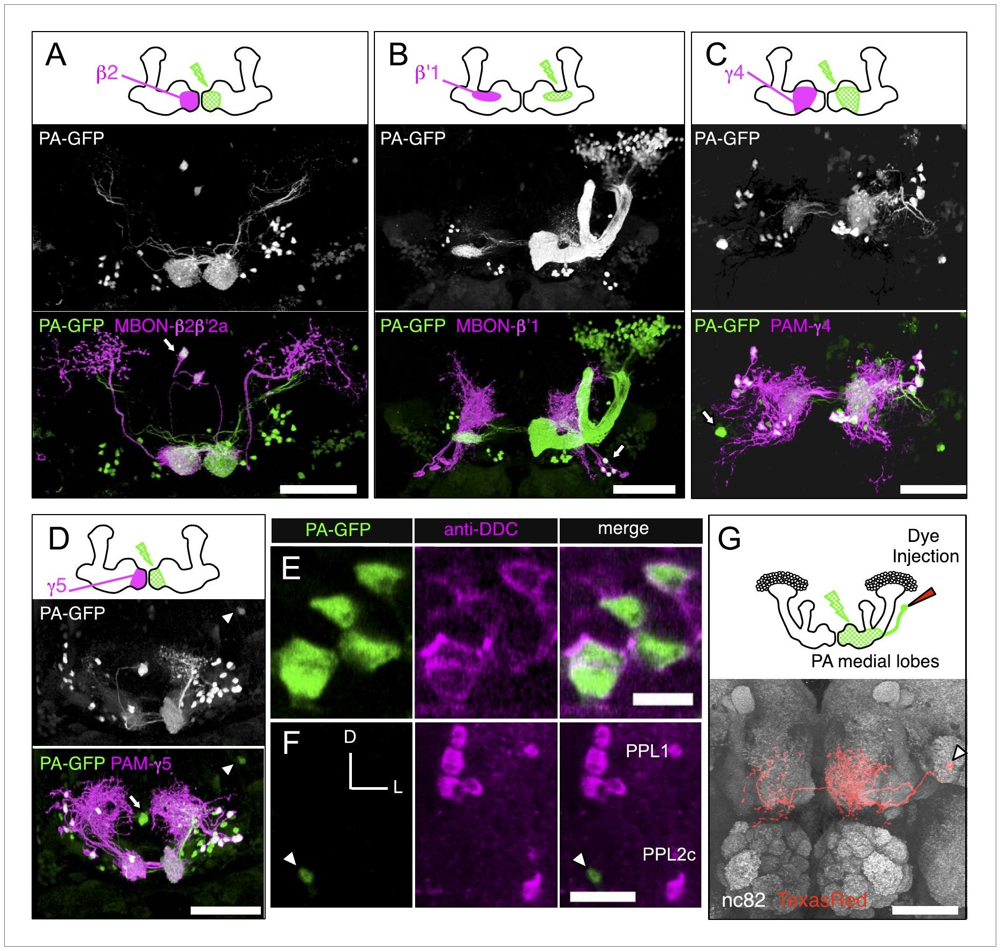

<small>圖片出處：Aso Y, Hattori D, Yu Y et al. *eLife* 3:e04577 (2014)，Figure 5。CC BY（版權屬作者）；全文見 [PMC](https://pmc.ncbi.nlm.nih.gov/articles/PMC4273437/)。</small>

> **原圖說（Figure 5）：** Identification of the MB extrinsic neurons innervating each MB lobe compartment by PA-GFP tracing. We photoactivated each of the 15 MB lobe subdomains, or compartments, individually to provide an independent approach to identify the extrinsic neurons associated with each compartment. … Different split-GAL4 lines (e.g., MBON lines for panels A and B, and DAN lines for panels C and D) were used to drive expression of membrane-targeted red fluorescent protein (myr::tdTomato) to demarcate a specific compartment within the lobes for photoactivation. The photoactivated samples were subsequently immunostained for a marker of dopaminergic cells (tyrosine hydroxylase or dopa-decarboxylase [DDC]) to classify individual photoactivated neurons as MBONs or DANs. (A–D) Each panel shows a diagram of the experiment and a three-dimensional reconstruction of confocal images showing DANs and MBONs innervating the photoactivated compartment. … We identified all of the MBONs found in the split-GAL4 lines by photoactivation of each compartment. We also identified DANs innervating each compartment. We noted additional DANs in the PAM cluster that are not labeled by the split-GAL4 lines (green cell bodies in panels C and D). … The comparison of numbers of DANs in the PAM cluster identified in split-GAL4 lines and in the PA-GFP tracing experiments … is as follows: compartment name; cell counts by split-GAL4 lines, cell counts by PA-GFP tracing (sample size): γ1; 13 (as mixtures of PAM-γ4 and PAM-γ4>γ1γ2 in MB312B), 3.8 ± 1.3 (n = 5). γ2; 13 (同上), 7.8 ± 2.2 (n = 6). γ3; 9 (MB441B), 23.6 ± 6.3 (n = 5). γ4; 13 (同上), 17.3 ± 1.3 (n = 6). γ5; 8 (MB315C), 21.5 ± 1.3 (n = 6). β′1; 14 (as mixtures of PAM-β′1ap and PAM-β′1m in MB025B), 12.8 ± 1.3 (n = 4). β′2; 35 (sum of PAM-β′2a in MB109B, PAM-β′2m in MB032B, PAM-β′2p in MB056B, and PAM-β2β′2a in NP5272), 41.3 ± 6.6 (n = 4). β1; 5 (sum of PAM-β1 in MB063B and at least one PAM-β1 in MB194B), 6.6 ± 1.1 (n = 5). β2; 11 (sum of PAM-β2β′2a in NP5272 and PAM-β2 in MB209B), 18.8 ± 4.3 (n = 5). Thus, by simply summing the number of cells associated with these compartments, PA-GFP experiments identified ∼154 DANs in the anterior medial cluster (i.e., PAM cluster) as compared to 121 cells labeled by the split-GAL4 lines. Note these numbers include PAM DANs innervating multiple compartments (PAM-γ4>γ1γ2 and PAM-β2β′2a) and are therefore an overestimate. The split-GAL4 collection identified 98 DANs of 14 types in the PAM cluster, whereas anti-dopamine immunostaining identified 115–135 DANs in the PAM cluster (Liu et al., 2012). (E) An example of immunostaining for dopa-decarboxylase (DDC) upon photoactivation of a single compartment. … (F) The γ4γ5 extrinsic neuron identified by the PA-GFP tracing and not in the split-GAL4 screen shown in D (arrowhead) is DDC-negative and thus is likely an MBON. … (G) Morphology of the γ4γ5 MBON identified by PA-GFP experiments with subsequent dye injection. … Scale bars are 50 μm in (A–D) and (G), 5 μm in (E), and 20 μm (F).

**圖說中譯：** 以 PA-GFP 追蹤辨識支配每個蕈狀體區室的外來神經元。作者逐一光活化 15 個葉子域（區室），作為辨識各區室相關外來神經元的獨立方法。以不同的 split-GAL4 驅動膜標定紅螢光蛋白（myr::tdTomato），標出要照射的那一格。照射後的樣本再以多巴胺細胞的標記（酪胺酸羥化酶或多巴脫羧酶 DDC）免疫染色，以區分被照亮的細胞是 MBON 還是 DAN。(A–D) 各格呈現實驗示意與共軛焦影像的三維重建，顯示支配被照射區室的 DAN 與 MBON。以逐格光活化，作者找到了 split-GAL4 品系中的所有 MBON，也找出支配各格的 DAN，並注意到 PAM 群中有一些 split-GAL4 沒有標到的 DAN（C、D 中的綠色細胞體）。PAM 群 DAN 在兩種方法下的計數比較（區室名；split-GAL4 計數、PA-GFP 計數（樣本數））：γ1；13（MB312B 中 PAM-γ4 與 PAM-γ4>γ1γ2 的混合）、3.8 ± 1.3（n = 5）。γ2；13（同上）、7.8 ± 2.2（n = 6）。γ3；9（MB441B）、23.6 ± 6.3（n = 5）。γ4；13（同上）、17.3 ± 1.3（n = 6）。γ5；8（MB315C）、21.5 ± 1.3（n = 6）。β′1；14（MB025B 中 PAM-β′1ap 與 PAM-β′1m 的混合）、12.8 ± 1.3（n = 4）。β′2；35（MB109B 的 PAM-β′2a、MB032B 的 PAM-β′2m、MB056B 的 PAM-β′2p 與 NP5272 的 PAM-β2β′2a 之和）、41.3 ± 6.6（n = 4）。β1；5（MB063B 的 PAM-β1 與 MB194B 中至少一顆 PAM-β1 之和）、6.6 ± 1.1（n = 5）。β2；11（NP5272 的 PAM-β2β′2a 與 MB209B 的 PAM-β2 之和）、18.8 ± 4.3（n = 5）。因此，單純把各區室的細胞數相加，PA-GFP 實驗在前內側群（即 PAM 群）找到約 154 顆 DAN，而 split-GAL4 品系標到的是 121 顆。注意這些數字包含支配多個區室的 PAM DAN（PAM-γ4>γ1γ2 與 PAM-β2β′2a），因此是高估。split-GAL4 收藏在 PAM 群辨識出 98 顆 DAN、14 型，而抗多巴胺免疫染色在 PAM 群辨識出 115–135 顆（Liu et al., 2012）。(E) 單一區室光活化後 DDC 免疫染色的例子。(F) D 圖中以 PA-GFP 找到、split-GAL4 篩選中沒有的 γ4γ5 外來神經元（箭頭頭）為 DDC 陰性，因此可能是 MBON。(G) 以 PA-GFP 找到該 γ4γ5 MBON 後，再以染料注射顯示其形態。比例尺：A–D 與 G 為 50 μm，E 為 5 μm，F 為 20 μm。

**解讀：**
- **這張圖說裡藏著本篇最可驗算、也最容易被誤用的一組數字。** 把九格的 split-GAL4 計數相加確實是 121（13+13+9+13+8+14+35+5+11），但 **γ1、γ2、γ4 三格填的是同一個 13（MB312B 的混合細胞）**，等於同一批細胞算了三次。扣掉重複的兩次（121 − 26 = 95）就接近作者自己報的「98 顆、14 型」。**作者只為 PA-GFP 的 154 標註「這是高估」，沒有為 121 標註同一件事。**
- **PA-GFP 的 154 同樣可驗算**（3.8+7.8+23.6+17.3+21.5+12.8+41.3+6.6+18.8 = 153.5 ✓）。所以「split-GAL4 在 PAM 少了約 30%」這句話，分母用 154 時是 36%、用 115–135 時是 15–27%、用 121 vs 154 時是 21%——**約 30% 是一個落在這幾個值之間的概括，不是單一算式的結果。**
- **γ1、γ2 兩格的 PA-GFP 計數（3.8、7.8）遠低於 split-GAL4 的 13**，方向與其他格相反；但這 13 本來就是別格（γ4）細胞的數字被填進來的，所以這兩格根本沒有可比的 split-GAL4 數值。引用「每格有幾顆 PAM」時，只有 PA-GFP 那一欄是逐格量出來的。
- **F、G 兩格示範了本篇唯一一次「找到新細胞型」的完整流程**：光活化 → DDC 陰性 → 染料注射畫出形態 → 再到 VT-GAL4 收藏裡找到對應品系（VT999036）。四顆腦都看到同一形態的一顆細胞。

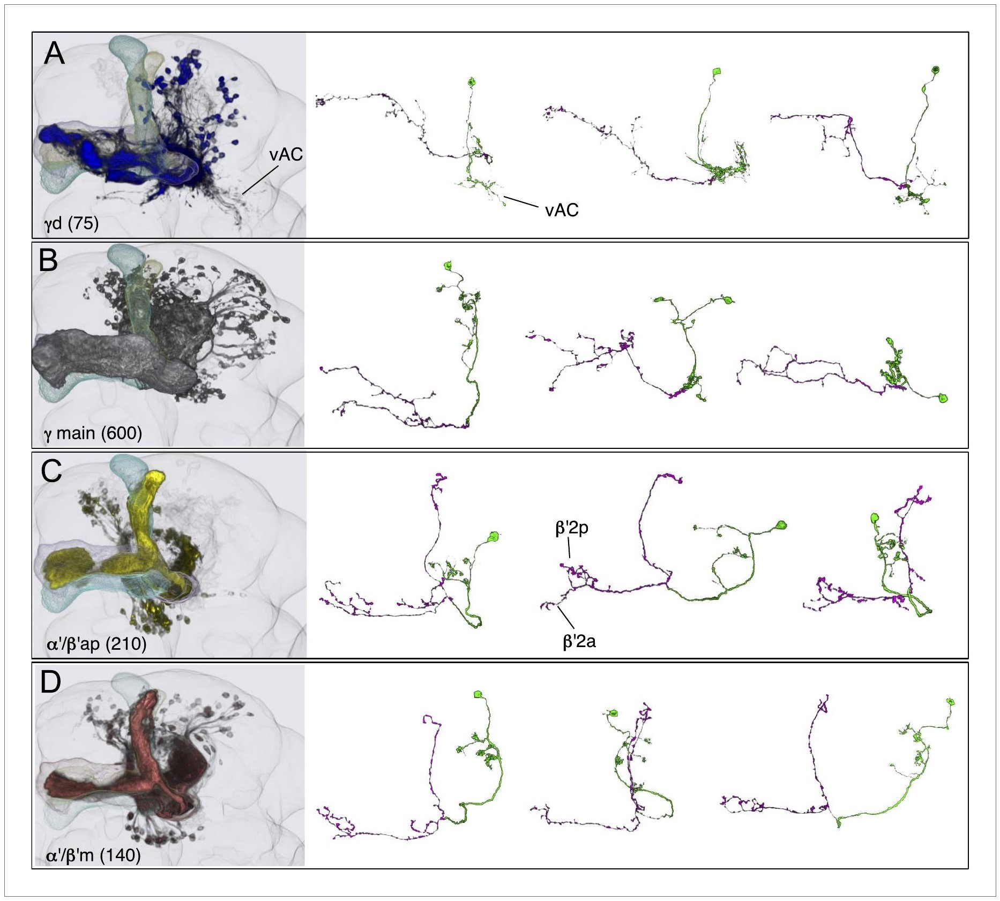

<small>圖片出處：Aso Y, Hattori D, Yu Y et al. *eLife* 3:e04577 (2014)，Figure 6。CC BY（版權屬作者）；全文見 [PMC](https://pmc.ncbi.nlm.nih.gov/articles/PMC4273437/)。</small>

> **原圖說（Figure 6）：** KCs of the γ and α′/β′ lobes. Seven KC types identified by split-GAL4. Representative aligned images of each KC type are shown; the name of the cell type and the approximate number of cells per brain hemisphere are indicated. Three examples of single cell morphologies, segmented from multicolor flip-out experiments, are presented for each cell type illustrating the branching pattern of the KC axons as they project through the lobes. In the single cell images, the cell body, primary neurite, dendrites, and axon in the pedunculus have been false-colored green and axons in the lobes are magenta. … The number of cells of each type was estimated by counting labeled nuclei in split-GAL4 lines and is shown in parentheses. (A) The γd KCs are thought to be of embryonic origin, because they are not included in a clonal analysis that visualized all post-embryonic KCs, and they have morphological similarity to the embryonic born KCs of basal cockroaches. Their dendritic arbors form a protrusion extending ventral lateral to the main calyx, which we named the ventral accessory calyx (vAC). Their axons occupy the most peripheral layer in the pedunculus, the ventral and anterior layers in the γ1–γ4 compartments, and the dorsal layer in γ5. Single cell morphologies reveal that the γd axons have more branches in γ3–γ5 than in γ1 and γ2. The vAC may be devoted to non-olfactory inputs; the major types of olfactory projection neurons from the antennal lobe do not innervate this structure. (B) The γ main KCs have their dendrites in the main calyx and their axons occupy about 75% of the volume of the γ lobes. Single cell morphologies reveal that each γ main KC branches in all the five compartments of the γ lobe. (C) The α′/β′ap KCs have dendrites in the main calyx and project axons to the anterior and posterior layers of the α′/β′ lobes. Single cell morphologies reveal that axonal branches from single KCs project to both β′2a and β′2p, where they overlap with distinct sets of output and dopaminergic neurons. (D) The α′/β′m KCs have dendrites in the main calyx. In β′2, their axons are located in the area between the bifurcating axons of α′/β′ap neurons shown in panel C. In the α′ lobe, their axons are medial to those of the α′/β′ap cells.

**圖說中譯：** γ 葉與 α′/β′ 葉的 KC。以 split-GAL4 辨識出的七型 KC。各型呈現一張對位後的代表影像，標出細胞型名稱與每半腦的概略細胞數；另呈現三個以多色 flp-out 分離出的單細胞形態，顯示 KC 軸突穿過葉時的分枝樣式。單細胞影像中，細胞體、主神經突、樹突與柄內軸突染成綠色，葉內軸突為洋紅。各型細胞數以 split-GAL4 品系中標記到的細胞核計數估得，列於括號內。(A) γd KC 可能源自胚胎期，因為一項可視化全部胚後 KC 的選殖分析未納入它們，且它們的形態與基群蠊類的胚胎期 KC 相似。它們的樹突叢在主萼的腹外側形成一個突起，作者命名為腹側副萼（vAC）。軸突占據柄最外層、γ1–γ4 的腹側與前側層、以及 γ5 的背側層。單細胞形態顯示 γd 的軸突在 γ3–γ5 的分枝多於 γ1、γ2。vAC 可能專責非嗅覺輸入；嗅葉主要的嗅覺投射神經元不支配這個結構。(B) γ main KC 的樹突在主萼，軸突占 γ 葉體積約 75%。單細胞形態顯示每個 γ main KC 在 γ 葉的全部五個區室都有分枝。(C) α′/β′ap KC 的樹突在主萼，軸突投射到 α′/β′ 葉的前側與後側層。單細胞形態顯示單一 KC 的軸突分枝同時投射到 β′2a 與 β′2p，在那裡與不同組的輸出神經元與多巴胺神經元重疊。(D) α′/β′m KC 的樹突在主萼。在 β′2 中，它們的軸突位於 C 圖 α′/β′ap 神經元分岔軸突之間的區域。在 α′ 葉中，它們的軸突位於 α′/β′ap 細胞的內側。

**解讀：**
- **B 圖那句「每個 γ main KC 在五個區室都有分枝」，是「一條電線穿過所有格子」這個模型的直接證據**，而且是單細胞層級的。庫內談「一顆 KC 沿途與 5–6 型 MBON 形成途經式突觸」時，依據就是這一類單細胞影像。
- **C 圖是對「一格一單元」最有力的反例之一：** 同一顆 α′/β′ap KC 的軸突分岔，同時進入 β′2a 與 β′2p 兩個基本分區，而這兩個分區由不同的 MBON 與 DAN 負責。所以「分區」切的是突觸，不是細胞。
- **γd 的 75 顆與 γ main 的 600 顆差了八倍，但兩者在 γ 葉的體積比是 25% 對 75%**（B 圖圖說）——兩個比例不一致，提醒體積與細胞數不成正比（圖 13B 另外畫了體積）。
- 圖說提到 vAC「可能專責非嗅覺輸入」，依據是「主要的嗅覺 PN 不支配這裡」（引 Butcher et al. 2012），**不是本篇測的**。

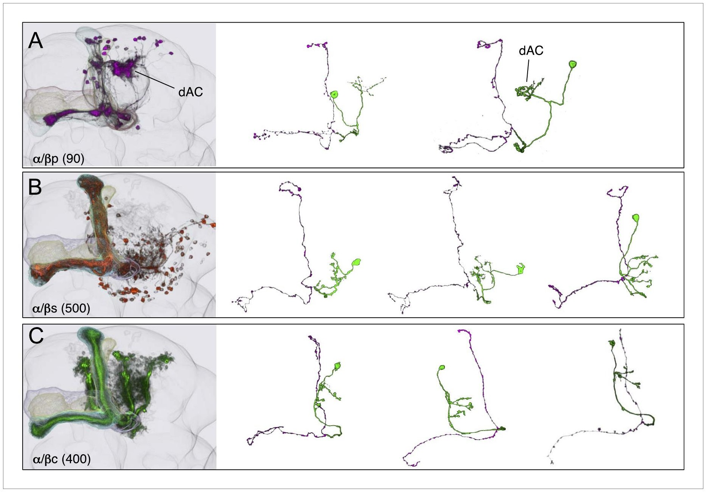

<small>圖片出處：Aso Y, Hattori D, Yu Y et al. *eLife* 3:e04577 (2014)，Figure 7。CC BY（版權屬作者）；全文見 [PMC](https://pmc.ncbi.nlm.nih.gov/articles/PMC4273437/)。</small>

> **原圖說（Figure 7）：** KCs of the α/β lobes. (A) The dendrites of the α/β posterior (α/βp) KCs form a protrusion extending to the dorsal lateral side of the main calyx. This structure has been called the accessory calyx, but we have renamed it as the dorsal accessory calyx (dAC) to distinguish it from the ventral AC (vAC). The α/βp KC axons project to the posterior layer of the α/β lobe. These are the firstborn α/β KCs and are also known as pioneer α/β KCs. The single cell images were segmented from multicolor flp-out (MCFO) brains of MB469B and MB371B. (B) The α/β surface (α/βs) KCs have dendrites in the main calyx and project axons to the surface layer of the α/β lobes where they form a continuous layer surrounding the α/β core KCs shown in (C). Single cell morphologies of cells (from MB185B) reveal that the α/βs KCs have relatively smooth axonal projections in the lobes. (C) The α/β core (α/βc) KCs have dendrites in the main calyx. They are the last born KCs and their axons occupy the core of the pedunculus and the α/β lobes. They can be morphologically subdivided into inner and outer core cells (Tanaka et al., 2008), although the border between the inner and outer core is not well defined and we were unable to make a split-GAL4 driver line that labels only the outer core cells. Single cell morphologies (from MB594B) reveal that the axons of the α/βc cells have the fewest branches of the 7 types of KCs.

**圖說中譯：** α/β 葉的 KC。(A) α/β 後側（α/βp）KC 的樹突在主萼的背外側形成一個突起。這個結構原本稱為副萼，作者改名為背側副萼（dAC），以與腹側副萼（vAC）區別。α/βp 的軸突投射到 α/β 葉的後層。它們是最早生成的 α/β KC，也稱為先驅（pioneer）α/β KC。單細胞影像來自 MB469B 與 MB371B 的多色 flp-out 腦。(B) α/β 表面（α/βs）KC 的樹突在主萼，軸突投射到 α/β 葉的表層，形成一個包住 C 圖中核心 KC 的連續層。單細胞形態（來自 MB185B）顯示 α/βs 的軸突在葉中相對平順。(C) α/β 核心（α/βc）KC 的樹突在主萼。它們是最晚生成的 KC，軸突占據柄與 α/β 葉的核心。它們在形態上可再分為內核與外核細胞（Tanaka et al., 2008），但內外核的界線不明確，作者也做不出只標外核細胞的 split-GAL4 品系。單細胞形態（來自 MB594B）顯示 α/βc 的軸突在七型 KC 中分枝最少。

**解讀：**
- **A 圖的 α/βp（90 顆）是本篇最小的一型 KC，而它決定了收斂比的下限 90:1**（MBON-α2p3p 只讀這一型）。它的樹突在 dAC、不接嗅覺 PN，所以這條通路被認為傳的是非嗅覺訊息；[[s-aso-2014-mbon-valence]] 與後續研究談 α/βp 時都引這裡。
- **C 圖的圖說是本篇少數明講「我們做不到」的地方**：內外核的界線不明確，也沒有能只標外核的品系。所以「七型 KC」這個數字的下限受限於工具——內核／外核沒有被拆開。
- **三型 α/β KC 的軸突是同心排列的（後層／表層／核心）**，這一點讓「區室」在 α/β 葉裡必須再分層（圖 12A 的 α1p/α1s/α1c 等），也是 MBON-α2sc（取表層＋核心）與 MBON-α2p3p（取後層）能分工的解剖基礎。

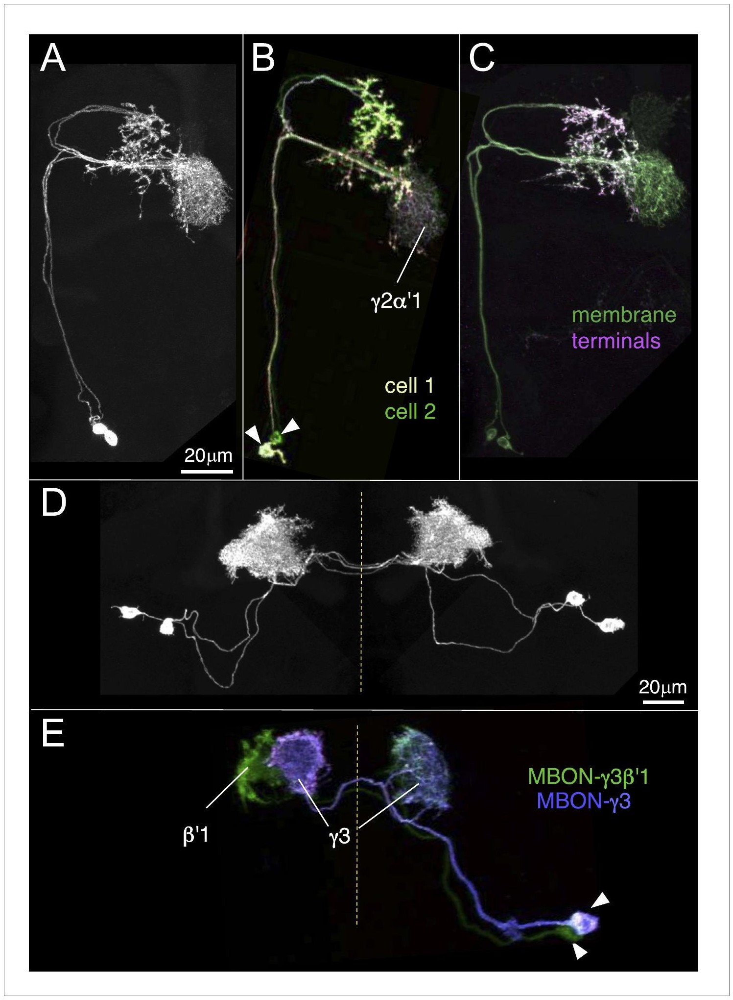

<small>圖片出處：Aso Y, Hattori D, Yu Y et al. *eLife* 3:e04577 (2014)，Figure 8。CC BY（版權屬作者）；全文見 [PMC](https://pmc.ncbi.nlm.nih.gov/articles/PMC4273437/)。</small>

> **原圖說（Figure 8）：** Identification of MBONs and visualization of their single cell morphologies. Each MBON is named according to the compartment(s) in the MB lobes where its dendrites arborize. For example, MBON-γ2α′1 neurons exhibit dendritic arbors in γ2 and α′1 compartments. (A) The projection patterns of MBON-γ2α′1 neurons. Maximum intensity projection confocal images of MB077B driven expression in one brain hemisphere are shown. Visualization with pJFRC225-5XUAS-IVS-myr::smGFP-FLAG in VK00005 labels two MBON-γ2α′1 neurons per hemisphere. (B) Labeling of the two MBON-γ2α′1 neurons in different colors using multicolor flp-out (MCFO). The arbors of the two neurons overlap and are indistinguishable, thus these two cells represent a single cell type. Arrowheads indicate cell bodies. (C) MB077B driven expression of a membrane targeted epitope (green) and a presynaptically targeted epitope (magenta; Syt::smGFP-HA). The fine processes in the MB lobes are typical of dendrites, whereas the processes of this neuron that are outside the lobes end with varicosities containing the presynaptic marker. (D) The morphologies of MBON-γ3 and MBON-γ3β′1 as identified by MB083C driven expression. Using the pJFRC225 membrane-targeted reporter, two neurons innervating the γ3 and β′1 MB compartments in each hemisphere can be seen. Dashed vertical line shows the position of the mid-line. (E) Using MCFO, the two cells in one hemisphere were labeled in different colors. Both cells have dendrites in γ3 in both hemispheres but axonal terminals in just the contralateral brain hemisphere. However, one of them (the green cell) also has dendrites in the contralateral β′1 compartment, demonstrating that these two cells represent different cell types, which we named MBON-γ3 and MBON-γ3β′1.

**圖說中譯：** 辨識 MBON 並顯示其單細胞形態。每個 MBON 依其樹突所在的區室命名，例如 MBON-γ2α′1 的樹突分布在 γ2 與 α′1 兩格。(A) MBON-γ2α′1 的投射樣式；MB077B 驅動表現在單側腦的最大強度投影影像。以膜標定報告基因顯示時，每半腦標到兩顆 MBON-γ2α′1。(B) 以多色 flp-out（MCFO）把這兩顆分別標成不同顏色。兩顆的分枝彼此重疊、無法區分，因此這兩顆屬於同一個細胞型。箭頭頭指細胞體。(C) MB077B 驅動膜標定抗原（綠）與突觸前標定抗原（洋紅，Syt::smGFP-HA）。蕈狀體葉內的細緻分枝是典型的樹突，而這顆神經元在葉外的分枝末端帶有含突觸前標記的膨大。(D) 以 MB083C 驅動表現所辨識出的 MBON-γ3 與 MBON-γ3β′1 形態。以膜標定報告基因可見每半腦有兩顆神經元支配 γ3 與 β′1 區室。垂直虛線標出中線位置。(E) 以 MCFO 把同一側的兩顆標成不同顏色。兩顆在兩側腦的 γ3 都有樹突，但軸突末梢只在對側。然而其中一顆（綠色）在對側的 β′1 區室另有樹突，顯示這兩顆分屬不同的細胞型，作者命名為 MBON-γ3 與 MBON-γ3β′1。

**解讀：**
- **這張圖說明了「細胞型」在本篇是怎麼被定義的**：不是看形狀像不像，而是看 MCFO 能不能把同一個品系裡的細胞拆成形態不同的個體。B 圖拆不開 → 同型；E 圖拆得開（差一塊 β′1 的樹突）→ 兩型。本篇的操作型定義是「在 7000 個 GAL4 品系中都無法再細分者」。
- **C 圖是全篇判定極性的方法示範**，也是本篇能把「樹突在蕈狀體裡」當成 MBON 定義的根據。注意突觸前標記用的是 3 份 UAS 的弱版本（方法），否則訊號會滿溢到樹突。
- **D、E 顯示 MBON-γ3 與 γ3β′1 的樹突跨越中線、在兩側的 γ3 都有**。庫內把 MBON 當成「單側讀出一格」時要留意這個例外。

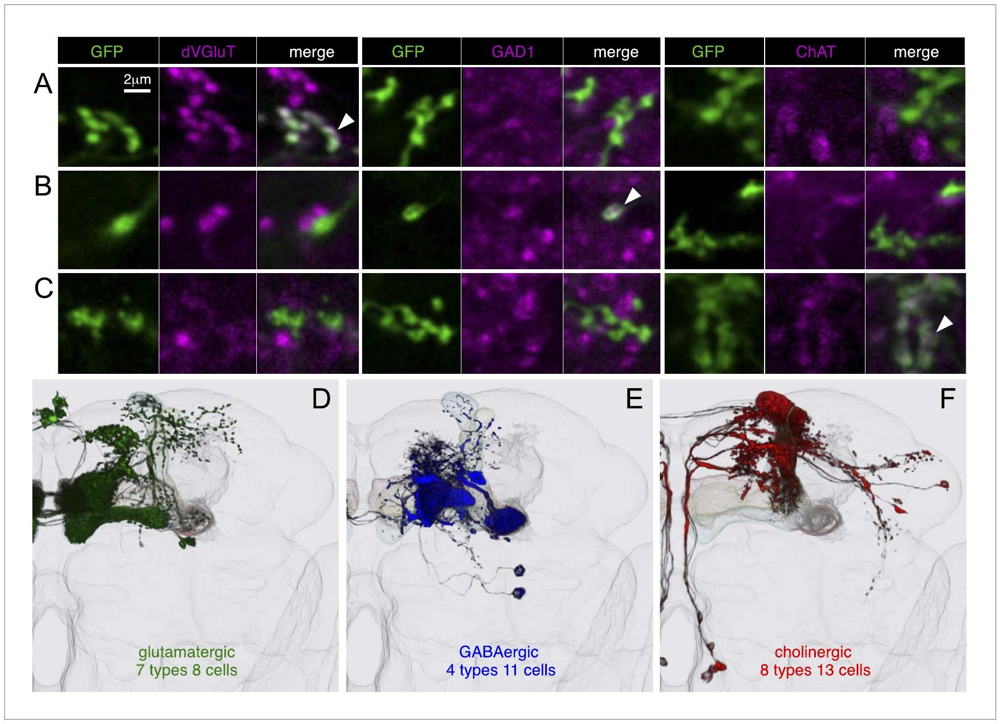

<small>圖片出處：Aso Y, Hattori D, Yu Y et al. *eLife* 3:e04577 (2014)，Figure 9。CC BY（版權屬作者）；全文見 [PMC](https://pmc.ncbi.nlm.nih.gov/articles/PMC4273437/)。</small>

> **原圖說（Figure 9）：** Neurotransmitters used by MBONs. The putative neurotransmitters used by MBON cell types were assigned by assessing the immunoreactivity of their axon terminals to antibodies raised against Drosophila vesicular glutamate transporter (dVGluT), Drosophila glutamate decarboxylase 1 (GAD1), and Drosophila choline acetyl transferase (ChAT). Single confocal optical sections; axon terminals of different MBONs are shown in green and antibody staining in magenta. (A) Axon terminals of MBON-γ5β′2a (MB210B) were labeled with anti-dVGluT (arrowhead) but not with either anti-GAD1 or anti-ChAT, suggesting that this cell type is glutamatergic. (B) Axon terminals of MBON-γ1pedc>α/β (MB112C) were labeled with anti-GAD1 (arrowhead), suggesting that this cell type is GABAergic. (C) Axon terminals of MBON-γ2a′1 (MB077B) were labeled with anti-ChAT (arrowhead), suggesting this cell type is cholinergic. (D–F) MBONs of the same neurotransmitter type were given the same color and are displayed together. (D) Seven types of glutamatergic MBONs. (E) Four types of GABAergic MBONs. (F) Eight types of cholinergic MBONs. The neurotransmitter of the two MBON types found in the VT-GAL4 collection was not determined. Video 5 illustrates the relative positions of these neurons in the standard brain.

**圖說中譯：** MBON 使用的傳遞物質。各型 MBON 的推定傳遞物質，依其軸突末梢對三種抗體的免疫反應性判定：果蠅囊泡型麩胺酸轉運蛋白（dVGluT）、果蠅麩胺酸脫羧酶 1（GAD1）、果蠅膽鹼乙醯轉移酶（ChAT）。圖為單張共軛焦光學切面；不同 MBON 的軸突末梢為綠色，抗體染色為洋紅。(A) MBON-γ5β′2a（MB210B）的軸突末梢被抗 dVGluT 標到（箭頭頭），但不被抗 GAD1 或抗 ChAT 標到，顯示此型為麩胺酸性。(B) MBON-γ1pedc>α/β（MB112C）的軸突末梢被抗 GAD1 標到，顯示為 GABA 性。(C) MBON-γ2α′1（MB077B）的軸突末梢被抗 ChAT 標到，顯示為膽鹼性。(D–F) 同一種傳遞物質的 MBON 以同色一起呈現。(D) 七型麩胺酸性 MBON。(E) 四型 GABA 性 MBON。(F) 八型膽鹼性 MBON。在 VT-GAL4 收藏中找到的兩型 MBON，其傳遞物質未判定。影片 5 顯示這些神經元在標準腦中的相對位置。

**解讀：**
- **圖面上的「型數／顆數」可以逐一驗算：** 麩胺酸 7 型 8 顆、GABA 4 型 11 顆、乙醯膽鹼 8 型 13 顆，合計 19 型 32 顆；加上兩型未定（各 1 顆）＝ 21 型 34 顆 ✓。GABA 只有 4 型卻有 11 顆，是因為 MBON-β′1 一型就占 8 顆。
- **⚠️ 正文把這張圖總結成「膽鹼性在垂直葉、麩胺酸性在內側葉、GABA 性在交界」，但表 1 與圖 14 的 MBON-α1、MBON-β1>α 是麩胺酸性而與 α 葉有關，MBON-γ2α′1 是膽鹼性而樹突有一半在 γ2。** 這是趨勢被寫成規則，引用時不要當成分類標準。
- **本圖判定的是「推定」傳遞物質**（圖說用 putative）：依據是末梢的免疫反應性，不是功能性的釋放實驗。庫內把 MBON-γ1pedc>α/β 當成抑制性來解釋行為時，源頭是這張 B 圖加上後續研究。
- **這張圖也是庫內 MBON 分色慣例的來源**（綠＝麩胺酸、藍＝GABA、紅／橘＝乙醯膽鹼），後面的圖 12、13、17 都沿用。

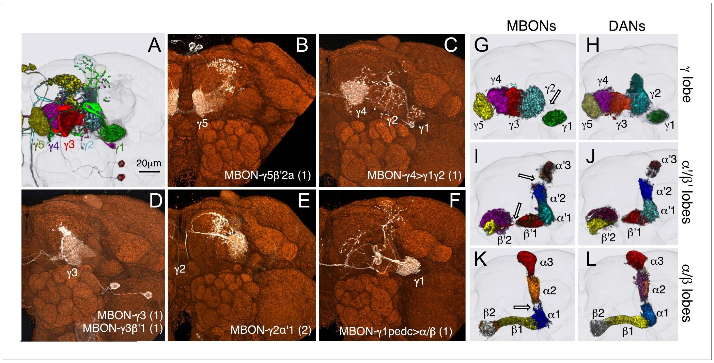

<small>圖片出處：Aso Y, Hattori D, Yu Y et al. *eLife* 3:e04577 (2014)，Figure 10。CC BY（版權屬作者）；全文見 [PMC](https://pmc.ncbi.nlm.nih.gov/articles/PMC4273437/)。</small>

> **原圖說（Figure 10）：** Compartmentalization of the MB lobes. (A–F) Tiling of MBON dendrites in the γ lobe. (A) A registered image of a brain hemisphere showing 5 MBON cell types that innervate contiguous compartments of the γ lobe. (B–F) Confocal images of brains showing expression in the MBONs shown in A; pJFRC225-5xUAS-IVS-myr::smGFP-FLAG in VK00005 and the following split-GAL4 lines were used to generate the images: B, MB210B; C, MB298B; D, MB083C; E, MB077B; and F, MB112C. The cell types are indicated in the panels with the number of neurons of each type in parenthesis; the neurons are shown in white and the nc82 reference stain in orange. (G–L) The dendrites of MBONs and the axon terminals of DANs tile the MB lobes, defining 15 compartments. Dendrites of MBONs (G, I, and K) and axon terminals of DANs (H, J, and L), aligned to the standard brain, are shown for each lobe. The same false colors were assigned to the DANs and the MBONs of the same compartment. The arrows in (G, I, and K) show the four compartment borders where gaps were routinely seen between the MBON dendrites in adjacent compartments; these gaps correspond to areas of reduced synaptic density (see Figure 10—figure supplement 1). Note that the anterior layer of the β′2 compartment contains dendrites of MBON-γ5β′2a (I, yellow) and axon terminals of PAM-β2β′2a (J, yellow).

**圖說中譯：** 蕈狀體葉的區室化。(A–F) MBON 樹突在 γ 葉的鋪排。(A) 單側腦的對位影像，顯示支配 γ 葉相鄰各格的五型 MBON。(B–F) A 中各 MBON 的共軛焦影像，所用品系依序為 B MB210B、C MB298B、D MB083C、E MB077B、F MB112C；細胞型與顆數標在各格內，神經元為白色，nc82 參考染色為橘色。(G–L) MBON 的樹突與 DAN 的軸突末梢鋪滿蕈狀體的葉，界定出 15 個區室。各葉分別呈現對位到標準腦的 MBON 樹突（G、I、K）與 DAN 軸突末梢（H、J、L）；同一區室的 DAN 與 MBON 給相同的假色。G、I、K 中的箭頭指出四個區室交界，在那裡相鄰區室的 MBON 樹突之間經常看到空隙；這些空隙對應突觸密度較低的區域（見圖 10—補充圖 1）。注意 β′2 區室的前層同時含有 MBON-γ5β′2a 的樹突（I，黃）與 PAM-β2β′2a 的軸突末梢（J，黃）。

**解讀：**
- **G–L 六格是「15 個區室」這句話的全部視覺證據**，而它是把分別拍攝的細胞疊到同一顆標準腦上得到的。所以圖上「不重疊」的精度，受限於對位誤差與只取最佳 25% 樣本這兩件事（方法）；真正在同一顆腦裡檢驗相鄰性的是下一張圖。
- **箭頭指的四個空隙是本篇唯一帶有「物理邊界」意味的觀察**，但支持它的是另一張未取得的補充圖（Bruchpilot 密度）。本庫引用「區室之間突觸密度較低」時要註明依據在圖 10—補充圖 1（？待查）。
- **B–F 用的五個品系，正好是庫內多篇用的那幾個**：MB210B（γ5β′2a）、MB083C（γ3／γ3β′1）、MB077B（γ2α′1）、MB112C（γ1pedc>α/β）。這張圖是「某品系標到哪一型」在本篇正文中少數明確寫出來的地方（詳見整合建議）。

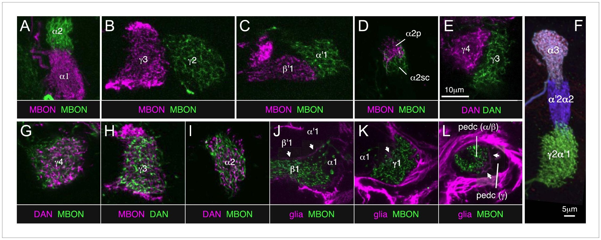

<small>圖片出處：Aso Y, Hattori D, Yu Y et al. *eLife* 3:e04577 (2014)，Figure 11。CC BY（版權屬作者）；全文見 [PMC](https://pmc.ncbi.nlm.nih.gov/articles/PMC4273437/)。</small>

> **原圖說（Figure 11）：** Two-color labeling experiments demonstrating compartmentalization of the MB lobes. (A–E) Two-color labeling of MBONs (A–D) or DANs (E) from adjacent compartments, or in the case of (D), subdivisions of the same compartment. … Clear segregation was observed between dendrites of MBONs or axon terminals of DANs from neighboring compartments. (F) MCFO labeling of a single brain showing the termini in the MB lobes of three types of PPL1 cluster DANs. The image was generated from line MB060B, which expresses in four types of PPL1 neurons. We were able to confirm all 11 compartment borders tested using either two-color labeling or MCFO experiments; we did not have the required genetic lines to test one of the 12 compartment borders (between β1 and β2). (G–I) Two-color labeling of DANs and MBONs from the same compartment. Single confocal slices are shown. The DANs and MBONs coextend, with each densely arborizing in the entire compartment. (J–L) Two-color labeling of ensheathing glia and MBONs. Whereas each of the three lobes (i.e., γ, α′/β′, and α/β) is separated clearly by ensheathing glia, we did not observe glia between MBON compartments within each lobe. … The driver lines used are as follows: (A) MB310C (magenta), R34B02-LexA (green); (B) MB083C (magenta), R25D01-LexA (green); (C) MB083C (magenta), R25D01-LexA (green); (D) MB062C (magenta), R34B02-LexA (green); (E) MB316C (magenta), R48B03-LexA (green); (G) MB312C (magenta), R53C03-LexA (green); (H) MB083C (magenta), R48B03-LexA (green); (I) MB058B (magenta), R34B02-LexA (green); (J) MB434B (green), R16D08-LexA (magenta); (K) MB112C (green), R16D08-LexA (magenta); (L) MB112C (green), R16D08-LexA (magenta).

**圖說中譯：** 以雙色標記證明蕈狀體葉的區室化。(A–E) 相鄰區室的 MBON（A–D）或 DAN（E）雙色標記；D 為同一區室中不同分區的兩型 MBON。相鄰區室之間，MBON 的樹突或 DAN 的軸突末梢清楚分開。(F) 單一顆腦的 MCFO 標記，顯示三型 PPL1 群 DAN 在葉內的末梢。影像取自在四型 PPL1 神經元表現的 MB060B 品系。以雙色標記或 MCFO 檢驗的 11 個區室交界全部獲得確認；12 個交界中有一個（β1 與 β2 之間）因缺少所需的遺傳品系而未測。(G–I) 同一區室的 DAN 與 MBON 雙色標記（單張共軛焦切面）。DAN 與 MBON 共同延展，各自密集分布於整個區室。(J–L) 包鞘膠細胞與 MBON 的雙色標記。三條葉（γ、α′/β′、α/β）彼此由包鞘膠細胞清楚分隔，但在同一條葉內的 MBON 區室之間沒有看到膠細胞。所用品系：(A) MB310C（洋紅）、R34B02-LexA（綠）；(B)(C) MB083C（洋紅）、R25D01-LexA（綠）；(D) MB062C（洋紅）、R34B02-LexA（綠）；(E) MB316C（洋紅）、R48B03-LexA（綠）；(G) MB312C（洋紅）、R53C03-LexA（綠）；(H) MB083C（洋紅）、R48B03-LexA（綠）；(I) MB058B（洋紅）、R34B02-LexA（綠）；(J) MB434B（綠）、R16D08-LexA（洋紅）；(K)(L) MB112C（綠）、R16D08-LexA（洋紅）。

**解讀：**
- **這是本篇唯一在同一顆腦裡檢驗相鄰性的實驗**，所以它比圖 10 的對位結果更硬。但覆蓋率要講清楚：12 個交界測了 11 個，β1／β2 沒測。
- **J–L 的膠細胞結果是一個重要的否定發現**：區室之間沒有膠細胞屏障。所以「多巴胺不會外溢到鄰格」若成立，不能用膠細胞包覆來解釋——這正是 [[s-hige-2015-heterosynaptic-plasticity]] 的越界測試之所以值得做的原因，也讓 [[s-cohn-2015-coordinated-neuromodulation]] 看到的跨格小幅效果不至於難以理解。
- **驅動品系清單本身就是資料。** A 的綠色（α2）用 R34B02-LexA、B/C 的綠色（γ2）用 R25D01-LexA——這與 [[s-hige-2015-heterosynaptic-plasticity]] 用 R34B02-LexA 標 MBON-α2sc、R25D01-LexA 標 MBON-γ2α′1 完全一致，對 [[syn-contradictions]] 4.4 有直接幫助（見整合建議）。
- **F 圖說順帶透露 MB060B 在四型 PPL1 表現**，而表 1 把 MB060B 列為 PPL1-α3 的品系之一。所以「表 1 列的品系」不等於「只標這一型」——這是讀表 1 最容易犯的錯。

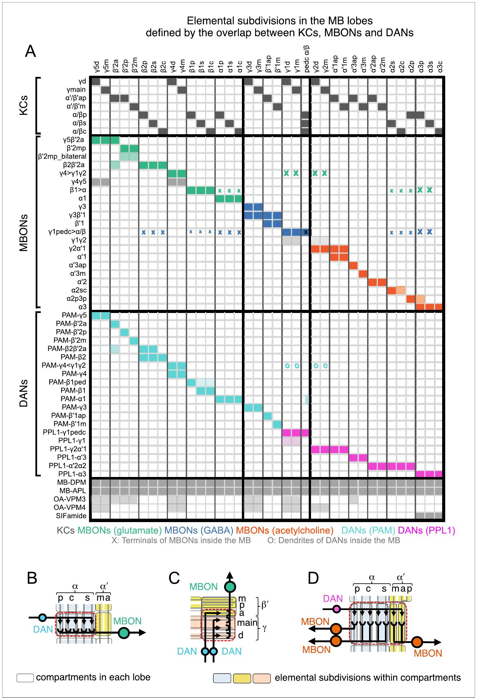

<small>圖片出處：Aso Y, Hattori D, Yu Y et al. *eLife* 3:e04577 (2014)，Figure 12。CC BY（版權屬作者）；全文見 [PMC](https://pmc.ncbi.nlm.nih.gov/articles/PMC4273437/)。</small>

> **原圖說（Figure 12）：** The arborization patterns of individual cell types within the MB lobes. (A) A matrix summarizing the projection patterns in the MB lobes of the KC axons, the MBONs, the DANs, and other modulatory neurons. The 15 lobe compartments and the core of distal pedunculus (pedc) are separated with thick vertical lines, and each compartment is further divided into columns representing 'synaptic units' (Tanaka et al., 2008), elemental subdivisions that are the smallest regions in the MB lobes where a specific set of MBONs, DANs, and KC types overlap. For example, the β1 compartment can be divided into posterior (β1p), surface (β1s), and core (β1c) subdivisions containing the axons of the α/βp, α/βs, and α/βc KCs, respectively. The processes of some MBONs and DANs do not arborize in an entire compartment, but only in a subset of its elemental subdivisions. … The heavy vertical lines divide subdivisions into three groups representing different MBON neurotransmitter types (also indicated by the colors filling the cells of the matrix). … The fully-colored cells of the matrix represent processes of neurons (dendrites for MBONs and synaptic terminals for DANs) that are uniformly and densely distributed in that subdivision; fainter colors represent subdivisions that are innervated only sparsely. In three cases, output neurons send axon terminals back into the MB. Such cases are represented by an 'X' with the size representing the density of terminals in that subdivision. One DAN cell type (PAM-γ4<γ1γ2) has dendrites within (as well as outside) the lobes in the subdivisions indicated by an 'O'. The projection patterns of the GABAergic MB-APL and serotonergic MB-DPM are diagramed; these neurons are MB intrinsic neurons that broadly innervate the MB. Also diagrammed are the projection patterns of the octopaminergic OA-VPM3 and OA-VPM4 and SIFamide peptidergic neurons within the lobes; these neurons have only a small fraction of their terminals within the MB and these sparsely innervate only a subset of the compartments. The following abbreviations are used in the names of the subdivisions: a, anterior; m, middle; p, posterior; d, dorsal; s, surface; c, core; and pedc, pedunculus core. (B–D) Diagrams illustrating different circuit motifs found in the MB lobes. (B) The terminals of a single DAN type (PAM-α1) and the dendrites of a single MBON type (MBON-α1) occupy a compartment. 16 of the 21 MBON types, like MBON-α1, arborize dendrites within just one of the three lobes (i.e., γ, α′/β′, and α/β), indicating that these MBONs receive inputs from only one of the three KC classes. (C) Two DANs (PAM-γ5 and PAM-β′2a) innervate the region occupied by one MBON (MBON-γ5β′2a). One DAN fills the γ5 compartment and the other only innervates the anterior elemental subdivision of the β′2 compartment (β′2a); a single MBON has inputs from the areas defined by both DANs. Four MBON types, like MBON-γ5β′2a, extend dendrites spanning lobe boundaries. (D) A single DAN (PPL1-α′2α2) innervate two compartments (the α′2 and α2), an area covered by three MBON types (MBON-α′2, -α2sc, and -α2p3p). Eight MBON types, like MBON-α2sc and MBON-α2p3p, arborize dendrites further confined to elemental subdivision(s) within a compartment. This suggests that these MBONs receive input exclusively from subtypes of KCs; for example, MBON-α2p3p receives input from α/βp KCs, which presumably carry non-olfactory information. Nearly all DANs have their termini confined to a single compartment; however, we identified 3 DAN types that have axon terminals in two compartments.

**圖說中譯：** 各細胞型在蕈狀體葉內的分枝樣式。(A) 一張矩陣，總結 KC 軸突、MBON、DAN 與其他調控性神經元在葉內的投射樣式。15 個區室與柄遠端核心（pedc）以粗垂直線分開，每個區室再分成數欄，代表「突觸單元」（Tanaka et al., 2008），即葉內「特定一組 MBON、DAN 與 KC 型重疊」的最小區域（基本分區）。例如 β1 可分為後（β1p）、表（β1s）、核心（β1c）三個分區，分別含有 α/βp、α/βs、α/βc 的軸突。有些 MBON 與 DAN 的分枝並不占滿整個區室，只在其中部分基本分區。粗垂直線也把分區依 MBON 的傳遞物質分成三組（矩陣格的填色亦同）。矩陣中填滿顏色的格代表該分區被均勻而密集地支配（MBON 為樹突、DAN 為突觸末梢），較淡的顏色代表只有稀疏支配。有三個情況是輸出神經元把軸突末梢送回蕈狀體內，以「X」表示，大小代表末梢密度。一型 DAN（PAM-γ4<γ1γ2）在葉內（以及葉外）有樹突，以「O」標示。圖中也畫出 GABA 性的 MB-APL 與血清素性的 MB-DPM 的投射樣式；這兩者是廣泛支配蕈狀體的內在神經元。另畫出章魚胺性的 OA-VPM3、OA-VPM4 與 SIFamide 胜肽神經元在葉內的投射；它們只有一小部分末梢在蕈狀體內，且只稀疏支配部分區室。分區名稱的縮寫：a 前、m 中、p 後、d 背、s 表面、c 核心、pedc 柄核心。(B–D) 葉內不同迴路樣式的示意。(B) 單一型 DAN（PAM-α1）的末梢與單一型 MBON（MBON-α1）的樹突占據一個區室。**21 型 MBON 中有 16 型**像 MBON-α1 一樣，樹突只在三條葉中的一條內，表示它們只接收三大類 KC 中的一類。(C) 兩型 DAN（PAM-γ5 與 PAM-β′2a）支配一型 MBON（MBON-γ5β′2a）所占的區域。一型填滿 γ5，另一型只支配 β′2 的前側基本分區（β′2a）；單一型 MBON 同時接收兩型 DAN 所界定區域的輸入。**有四型 MBON** 像 MBON-γ5β′2a 一樣，樹突跨越葉的邊界。(D) 單一型 DAN（PPL1-α′2α2）支配兩個區室（α′2 與 α2），這塊區域由三型 MBON（MBON-α′2、-α2sc、-α2p3p）覆蓋。**有八型 MBON** 像 MBON-α2sc 與 MBON-α2p3p 一樣，樹突進一步限縮在區室內的特定基本分區，表示它們只接收特定亞型 KC 的輸入；例如 MBON-α2p3p 接收 α/βp 的輸入，而後者推測攜帶非嗅覺訊息。幾乎所有 DAN 的末梢都限於單一區室，但作者找到 **3 型 DAN** 的軸突末梢在兩個區室。

**解讀：**
- **這張矩陣是全篇資訊密度最高的一張，也是本庫最該保存的一張。** 它一次給出三件事：每型細胞占哪些分區、支配得密還是疏（深淺）、以及三個特例符號（X ＝ MBON 送回葉內的末梢、O ＝ DAN 長在葉內的樹突）。
- **本庫逐欄數過：矩陣共 37 個基本分區欄（含 pedc）**，與圖 13B 圖說的「37 個基本分區」相符 ✓。引用時請分清 15（區室）與 37（分區）兩個層級。
- **B、C、D 三個示意圖把三種「不對齊」各舉一例**：一對一（α1）、一型 MBON 配兩型 DAN（γ5β′2a）、一型 DAN 配三型 MBON（α′2α2）。**所以「一格一型 DAN 一型 MBON」只是最簡單的那一型**，庫內用它當通則時要註明例外。
- **⚠️ 本圖說寫「四型 MBON 跨葉」，圖 17J 圖說寫「五例位在不同的葉」**，差別在 MBON-γ1pedc>α/β（γ1 ＋ 柄核心）算不算跨葉。兩句各自成立，但不能混用。
- **矩陣最下方四列（MB-DPM、MB-APL、OA-VPM3/4、SIFamide）提醒：葉裡還有四類廣泛支配的神經元**，它們不分格。庫內談「區室是獨立單元」時，這幾條跨全葉的通路是現成的反例來源。

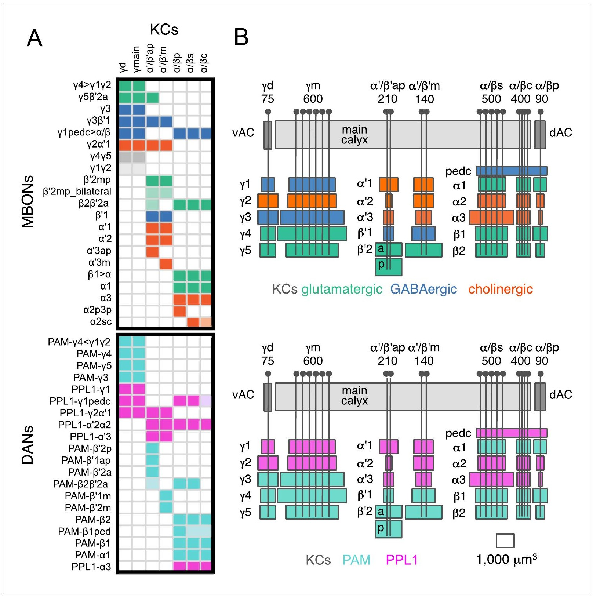

<small>圖片出處：Aso Y, Hattori D, Yu Y et al. *eLife* 3:e04577 (2014)，Figure 13。CC BY（版權屬作者）；全文見 [PMC](https://pmc.ncbi.nlm.nih.gov/articles/PMC4273437/)。</small>

> **原圖說（Figure 13）：** Each KC type transmits information to multiple compartments. (A) A simplified version of the matrix shown in Figure 12A that illustrates the contacts between the individual MBON (top) and DAN cell types (bottom) with the seven types of KCs (columns). Colors of the cells in the matrix indicate neurotransmitter type for MBONs and cluster of origin for DANs. The two MBON types of unknown neurotransmitter type are indicated in light gray. Interestingly, each KC likely synapses with MBONs of all three neurotransmitter types and receives modulatory DAN input from both PAM and PPL1 clusters. (B) Diagrams of the MB lobes. The axons of the seven types of KCs are shown as straight vertical lines without branches and the boxes represent each of the 37 elemental subdivisions defined in Figure 12A. The number of KCs of each type, based on cell counting, is indicated. The size of the box representing each subdivision and calyces indicates its volume, as determined by measurements performed on confocal stacks. The volumes of lobes are not simply proportional to the number of KCs they contain and are not uniform along their lengths, presumably reflecting differences in synaptic density. The convergence ratio from KCs to single MBONs could range from as high as ∼2300:1 (for MBON-β2β′2a that arborizes in β2 and β′2a of both hemispheres) to ∼90:1 (for MBON-α2p3p), assuming that each KC forms synapses in each elemental subdivision. In the top diagram, the color of the box represents the neurotransmitter used by the MBONs that have dendrites in that subdivision. In the bottom diagram, the color of the boxes represents the cluster of origin of the DANs innervating that subdivision.

**圖說中譯：** 每一型 KC 把訊息傳到多個區室。(A) 圖 12A 矩陣的簡化版，顯示各型 MBON（上）與 DAN（下）與七型 KC（欄）之間的接觸。矩陣格的顏色表示 MBON 的傳遞物質或 DAN 的來源群；兩型傳遞物質未知的 MBON 以淺灰表示。值得注意的是，每一型 KC 很可能都與三種傳遞物質的 MBON 形成突觸，也都同時接收 PAM 與 PPL1 兩群 DAN 的調控輸入。(B) 蕈狀體葉的示意圖。七型 KC 的軸突畫成不分枝的垂直直線，方框代表圖 12A 所定義的 **37 個基本分區**。各型 KC 的細胞數依計數標出。方框與萼部的大小表示其體積，由共軛焦影像堆疊量得。葉的體積並不單純與其所含 KC 數成正比，沿長度也不均勻，推測反映突觸密度的差異。若假設每顆 KC 在它經過的每個基本分區都形成突觸，則 KC 到單一 MBON 的收斂比可從高達約 **2300:1**（MBON-β2β′2a，分枝於兩側的 β2 與 β′2a）到約 **90:1**（MBON-α2p3p）。上方示意圖中方框的顏色代表該分區中 MBON 所用的傳遞物質；下方示意圖中代表支配該分區的 DAN 來源群。

**解讀：**
- **A 圖那句「每一型 KC 都接到三種傳遞物質的 MBON、也都接到兩群 DAN」，是本篇對「氣味訊息不會被某一類 KC 綁在某一種價值上」的最強論證**，而且可以從圖上逐列核對。
- **B 圖的收斂比可以驗算：** 2300:1 來自 β2（α/βs 500 ＋ α/βc 400 ＋ α/βp 90 ＝ 990）加 β′2a（α′/β′ap 210），約 1200，兩側合計約 2400；90:1 則是 MBON-α2p3p 只讀 α/βp 的 90 顆 ✓。**但圖說自己寫明這是「假設每顆 KC 在每個分區都形成突觸」下的上限**，不是量到的突觸數。
- **B 圖是本篇唯一給出體積資訊的地方**（方框大小，比例尺 1,000 µm³），而且明講體積與 KC 數不成正比。庫內若要用「某一格比較大所以比較重要」這種推論，依據只能是這張圖，而且很弱。
- **七型 KC 的細胞數（75／600／210／140／90／500／400）也印在這張圖上**，加總 2015 ≈「約 2000」✓。

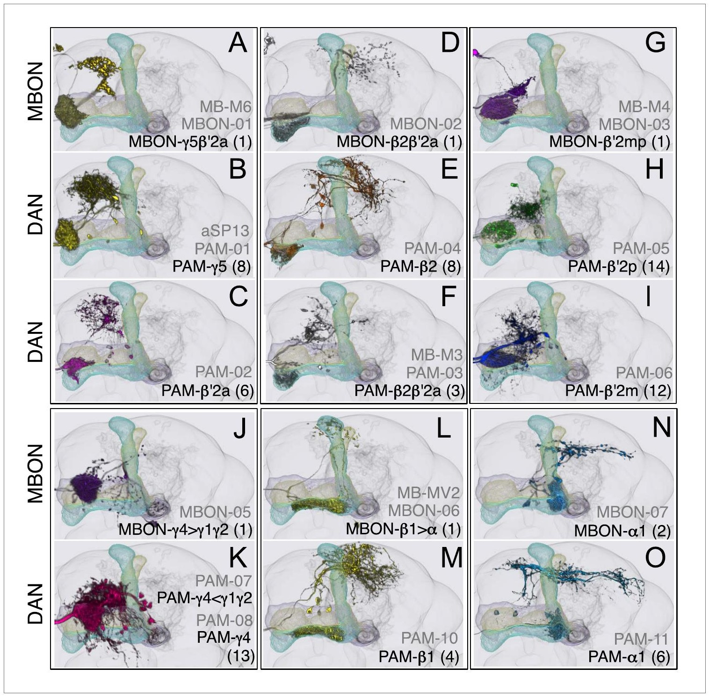

<small>圖片出處：Aso Y, Hattori D, Yu Y et al. *eLife* 3:e04577 (2014)，Figure 14。CC BY（版權屬作者）；全文見 [PMC](https://pmc.ncbi.nlm.nih.gov/articles/PMC4273437/)。</small>

> **原圖說（Figure 14）：** Compartments with dendrites of glutamatergic MBONs. Representative images of neurons that have been aligned to the standard brain are shown. Glutamatergic MBONs and DANs that project to the same compartments in the lobes are displayed together. The names of cell types are given in a standard format that includes information about the subdivisions innervated. Short names based on simple numbering, as well the original name in cases where the cell type has been previously described at the single cell level, are also shown (gray font). The number of cells per cell type found in each brain hemisphere is shown in parentheses. … Except for PAM-γ4<γ1γ2 and PPL1-γ1, DANs have dendritic branches in the ipsilateral hemisphere and axons that bilaterally innervate the same MB compartments in both hemispheres. … (A) The dendrites of MBON-γ5β′2a arborize in the contralateral γ5 and β′2a. The major axon of MBON-γ5β′2a projects ipsilaterally to the superior medial protocerebrum (SMP) … (B) PAM-γ5 neurons. Dendrites of these neuron arborize in the same regions of SMP where the MBON-γ5β′2a neurons terminate, suggesting a possible recurrent loop. (C) PAM-β′2a neurons. (D) The dendrites of MBON-β2β′2a bilaterally arborize in the β2 compartment and β′2a subdivision and its axon projects ipsilaterally to the superior intermediate protocerebrum (SIP) and superior lateral protocerebrum (SLP) … (E) PAM-β2 neurons. (F) PAM-β2β′2a neurons have sparse terminals in the anterior layer of β′2a and even sparser terminals in the core layer of β2. The dendrites of PAM-β2β′2a and PAM-β2 are spatially segregated, suggesting that distinct upstream neurons regulate their activity. (G) MBON-β′2mp arborizes in the contralateral β′2mp; its main axon projects to the CRE and SMP on the same side … A second output neuron, MBON-β′2mp-bilateral, sparsely arborizes its dendrites in the β′2mp compartment and projects dense axons bilaterally. (H) PAM-β′2p neurons. (I) PAM-β′2m neurons. (J) The MBON-γ4>γ1γ2 dendrites arborize in the contralateral γ4 and its axon projects both within the lobes to γ1 and γ2 and to regions outside the lobes. (K) PAM-γ4 neurons and PAM-γ4<γ1γ2 neurons. The image shows a mixture of two cell types; PAM-γ4<γ1γ2 is unusual, in which it has some of its dendrites within the MB (in the γ1 and γ2 compartments). (L) The MBON-β1>α dendrites arborize in the contralateral β1 and its axon innervates the α1, α2, and α3 compartments within the lobes as well as areas outside the lobes; the terminals in α3 are concentrated in the surface and posterior layers. (M) PAM-β1 neurons (bottom). The posterior layer of β1 is more densely innervated by a second PAM cluster cell type, PAM-β1ped, that also projects to the posterior end of the pedunculus. (N) The dendrites of MBON-α1 arborize in α1 and its axons project to the posterior SIP and SLP. Two neurons with identical morphology are present in each hemisphere. Although we observed this cell type in MCFO analysis of the dVGlut-GAL4 line OK371, its terminals showed much weaker immunoreactivity to the anti-dVGluT than the other putative glutamatergic neurons. (O) PAM-α1 neurons (bottom) have terminals that extend slightly outside the area arborized by the dendrites of MBON-α1 to the distal end of the pedunculus.

**圖說中譯：** 麩胺酸性 MBON 所在的區室。圖為對位到標準腦的代表性影像；投射到同一區室的麩胺酸性 MBON 與 DAN 並列呈現。細胞型以含分區資訊的標準格式命名；若該型先前已在單細胞層級被描述過，也以灰字列出簡化編號的短名與原本的名稱。括號內為每半腦的細胞數。除 PAM-γ4<γ1γ2 與 PPL1-γ1 之外，DAN 的樹突在同側，軸突則雙側支配兩邊腦的同一區室。(A) MBON-γ5β′2a 的樹突分布於對側的 γ5 與 β′2a；主軸突同側投射到上內側前腦（SMP）。(B) PAM-γ5。這些神經元的樹突分布於 SMP 中 MBON-γ5β′2a 末梢所在的同一區域，提示可能存在一個回饋迴圈。(C) PAM-β′2a。(D) MBON-β2β′2a 的樹突雙側分布於 β2 與 β′2a，軸突同側投射到上中間前腦（SIP）與上外側前腦（SLP）。(E) PAM-β2。(F) PAM-β2β′2a 在 β′2a 前層有稀疏末梢，在 β2 核心層更稀疏。PAM-β2β′2a 與 PAM-β2 的樹突在空間上分開，顯示調控它們的上游神經元不同。(G) MBON-β′2mp 分布於對側的 β′2mp；主軸突投射到同側 CRE 與 SMP。另有一個輸出神經元 MBON-β′2mp-bilateral，樹突在 β′2mp 稀疏分布，軸突則雙側密集投射。(H) PAM-β′2p。(I) PAM-β′2m。(J) MBON-γ4>γ1γ2 的樹突在對側 γ4，軸突同時送回葉內的 γ1、γ2 與葉外區域。(K) PAM-γ4 與 PAM-γ4<γ1γ2；影像為兩型的混合。PAM-γ4<γ1γ2 不尋常之處在於它有部分樹突位於蕈狀體內（γ1 與 γ2 區室）。(L) MBON-β1>α 的樹突在對側 β1，軸突支配葉內的 α1、α2、α3 以及葉外區域；α3 的末梢集中在表層與後層。(M) PAM-β1（下）。β1 的後層由另一型 PAM（PAM-β1ped）更密集地支配，後者也投射到柄的後端。(N) MBON-α1 的樹突在 α1，軸突投射到後側 SIP 與 SLP；每半腦有兩顆形態相同的細胞。雖然作者在 dVGlut-GAL4 品系 OK371 的 MCFO 分析中也觀察到這一型，但它的末梢對抗 dVGluT 的免疫反應性遠弱於其他推定的麩胺酸性神經元。(O) PAM-α1（下）的末梢略微超出 MBON-α1 樹突所涵蓋的範圍，延伸到柄的遠端。

**解讀：**
- **B 圖那句「PAM-γ5 的樹突就落在 MBON-γ5β′2a 末梢所在的 SMP 區域，提示可能有回饋迴圈」，是本庫 [[t-mbon-dan-feedback]] 整條線在解剖上的起點之一**；但它只是影像重疊，與 [[s-felsenberg-2018-memory-extinction]] 後來在功能上測的 M6→γ5 PAM 是同一對細胞（※ 推論：M6 即 MBON-γ5β′2a，依表 1 的舊名對照）。
- **N 圖的註記值得庫內注意：MBON-α1 的 dVGluT 免疫反應性「遠弱於」其他麩胺酸性 MBON。** [[s-ichinose-2015-reward-recurrent-circuit]] 把 MBON-α1 當成麩胺酸性來解釋，源頭是這裡，而本篇自己對它的把握較低。
- **O 圖指出 PAM-α1 的末梢略微超出 MBON-α1 的樹突範圍**——這是「DAN 與 MBON 完全對齊」這個簡化圖像的具體例外，而 α1 正是 Ichinose 2015 的主場。
- **F、M 兩格顯示同一格可以有兩型 PAM，而且樹突分開**（PAM-β2 vs PAM-β2β′2a；PAM-β1 vs PAM-β1ped）。所以「這一格的 DAN」在 β 葉常常不只一型。

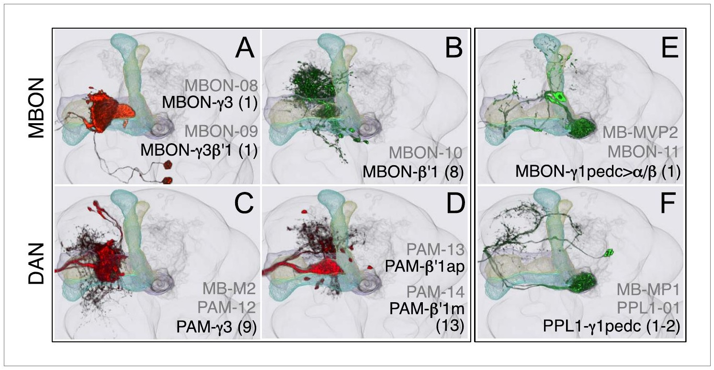

<small>圖片出處：Aso Y, Hattori D, Yu Y et al. *eLife* 3:e04577 (2014)，Figure 15。CC BY（版權屬作者）；全文見 [PMC](https://pmc.ncbi.nlm.nih.gov/articles/PMC4273437/)。</small>

> **原圖說（Figure 15）：** Compartments with dendrites of GABAergic MBONs. (A) MBON-γ3 and MBON-γ3β′1; the morphologies of these cell types are described in more detail in Figure 8D,E. (B) MBON-β′1 (top right); this MBON type is unusual in a number of ways. First, there are, on average, 8 cells per hemisphere (i.e., the number of cells fluctuate between 7–9 in MB057B) compared with one or two for the other MBON cell types. Second, they are the only MBONs from the lobes whose dendrites arborize, in addition to the lobes, in neighboring neuropils (CRE and SMP). Since CRE and SMP contain zones where the terminals of other MBONs converge, these neurons may sum the outputs from a number of MB compartments. Finally, this is the only MBON cell type that projects to the lateral accessory lobe, an output region of the central complex. (C–D) Three types of PAM cluster DANs innervate the γ3 and β′1 compartments: PAM-γ3 neurons (C); PAM-β′1ap neurons; and PAM-β′1m neurons (D). (E) The dendrites of MBON-γ1pedc>α/β (top) arborize in the ipsilateral γ1 and the core of the pedunculus, where the axons of the α/β KCs are found. Its axon projects bilaterally to the α/β lobes and contralaterally to the core of the pedunculus and, to a lesser extent, outside the MB lobes; in α3, its terminals are enriched in the surface layer (similar to those of MBON-β1>α). (F) PPL1-γ1pedc; a DAN of the PPL1 cluster with terminals that overlap with the dendrites of MBON-γ1pedc>α/β. One additional PPL1 cluster DAN innervates γ1 sparsely (PPL1-γ1; not shown, see Table 1).

**圖說中譯：** GABA 性 MBON 所在的區室。(A) MBON-γ3 與 MBON-γ3β′1，形態細節見圖 8D、E。(B) MBON-β′1（右上）；這一型在數方面不尋常。第一，每半腦平均 8 顆（在 MB057B 中介於 7–9 顆之間），而其他 MBON 型只有一到兩顆。第二，它們是葉內 MBON 中唯一除了葉之外、樹突還伸進鄰近神經氈（CRE 與 SMP）者；由於 CRE 與 SMP 含有其他 MBON 末梢匯聚的區域，這些神經元可能把數個蕈狀體區室的輸出加總起來。第三，它是唯一投射到側副葉（中央複合體的一個輸出區）的 MBON 型。(C–D) 三型 PAM 群 DAN 支配 γ3 與 β′1 區室：PAM-γ3（C）；PAM-β′1ap 與 PAM-β′1m（D）。(E) MBON-γ1pedc>α/β（上）的樹突分布於同側的 γ1 與柄核心（α/β KC 軸突所在）。它的軸突雙側投射到 α/β 葉、對側投射到柄核心，少部分到葉外；在 α3，末梢集中於表層（與 MBON-β1>α 相似）。(F) PPL1-γ1pedc，其末梢與 MBON-γ1pedc>α/β 的樹突重疊。另有一型 PPL1 群 DAN 稀疏支配 γ1（PPL1-γ1，未顯示，見表 1）。

**解讀：**
- **E、F 兩格是庫內出現頻率最高的一對細胞的原始描述**（MBON-γ1pedc>α/β 與 PPL1-γ1pedc，見 [[e-mbon-gamma1pedc]]、[[e-ppl1-gamma1pedc]]）。這裡講明了三件庫內常忽略的事：它的樹突同時在 γ1 與柄核心；它的軸突投到兩側的 α/β 葉；在 α3 其末梢偏表層——而 MBON-α3 的樹突也在那裡，所以 [[s-huang-2024-dopamine-memory-dynamics]] 說的「γ1pedc 影響 α3」在解剖上有兩條可能路徑（直接抑制 MBON-α3，或回饋到 PPL1-α3），本篇只畫得出前者。
- **F 圖說點出 γ1 另有一型稀疏支配的 PPL1-γ1**，而表 1 註腳說它只在 TH-GAL4 的隨機標記中看過（Igor Siwanowicz 的個人交流），做不出 split-GAL4。**這就是庫內「支配蕈狀體的 PPL1 是五型還是六型」的來源**：本篇列六型，但其中一型沒有工具。
- **B 圖的 MBON-β′1 是本篇最不像 MBON 的 MBON**：顆數會變（7–9）、樹突伸出蕈狀體外、投射到中央複合體的輸出區。庫內若要找「MBON 把多個區室的輸出加總」的候選，這一型是論文自己點名的。

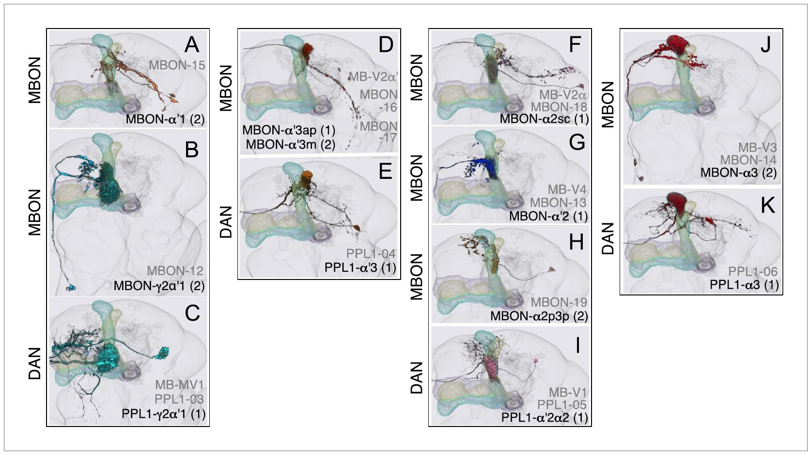

<small>圖片出處：Aso Y, Hattori D, Yu Y et al. *eLife* 3:e04577 (2014)，Figure 16。CC BY（版權屬作者）；全文見 [PMC](https://pmc.ncbi.nlm.nih.gov/articles/PMC4273437/)。</small>

> **原圖說（Figure 16）：** Compartments with dendrites of cholinergic MBONs. (A) The dendrites of the two MBON-α′1 cells arborize unilaterally in α′1. Their thin dendritic branches project through the edge of the α′2 and α′3 compartments. The MBON-α′1 neurons share an axon tract with MBON-α′3ap and MBON-α′3m and terminate in similar region of SIP, SLP, and LH. (B) MBON-γ2α′1. This cell type consists of two morphologically identical cells that project to the CRE and SMP. (C) PPL1-γ2α′1 neuron. (D) The dendrites of MBON-α′3ap and MBON-α′3m arborize in the ipsilateral α′3m or α′3ap, respectively, and their axons project bilaterally to the same regions of the LH, SIP, and SLP. The axonal branches of the MBON-α′3m stop at the LH, whereas the MBON-α3′ap axons extend to a region ventral to the LH. (E) PPL1-α′3 neuron. (F) The dendrites of MBON-α2sc arborize unilaterally in α2sc, and its axon projects bilaterally to the SIP, the SLP, and the dorsal LH. (G) MBON-α′2 projects to the CRE and SMP. A few terminals are also found in SIP. (H) The two MBON-α2p3p cells arborize their dendrites unilaterally in the posterior layer of the α2 and α3 compartments (α2p and α3p) and project to the SMP. The KCs in the posterior layer of the lobes (the α/βp neurons) have their dendrites in the dorsal accessory calyx, a region spatially segregated from the dendritic arbors of other KCs, and their activity is decreased in response to odors (Perisse et al., 2013), suggesting a distinct role for these output neurons. (I) PPL1-α′2α2 neuron. (J) Two morphologically identical MBON-α3 neurons have dendrites in α3 and terminals in the SMP, SIP, and SLP. (K) PPL1-α3 neuron.

**圖說中譯：** 膽鹼性 MBON 所在的區室。(A) 兩顆 MBON-α′1 的樹突單側分布於 α′1，其細樹突分枝穿過 α′2 與 α′3 區室的邊緣。MBON-α′1 與 MBON-α′3ap、MBON-α′3m 共用一條軸突束，終止於 SIP、SLP 與側角的相似區域。(B) MBON-γ2α′1，由兩顆形態相同的細胞組成，投射到 CRE 與 SMP。(C) PPL1-γ2α′1。(D) MBON-α′3ap 與 MBON-α′3m 的樹突分別分布於同側的 α′3m 或 α′3ap（原文如此），軸突雙側投射到側角、SIP 與 SLP 的相同區域。MBON-α′3m 的軸突分枝止於側角，而 MBON-α′3ap 的軸突延伸到側角腹側的一個區域。(E) PPL1-α′3。(F) MBON-α2sc 的樹突單側分布於 α2sc，軸突雙側投射到 SIP、SLP 與背側側角。(G) MBON-α′2 投射到 CRE 與 SMP，SIP 也有少數末梢。(H) 兩顆 MBON-α2p3p 的樹突單側分布於 α2 與 α3 區室的後層（α2p 與 α3p），投射到 SMP。葉後層的 KC（α/βp）樹突位於背側副萼，與其他 KC 的樹突在空間上分開，而且它們的活動在聞到氣味時下降（Perisse et al., 2013），顯示這些輸出神經元有不同的角色。(I) PPL1-α′2α2。(J) 兩顆形態相同的 MBON-α3，樹突在 α3，末梢在 SMP、SIP 與 SLP。(K) PPL1-α3。

**解讀：**
- **⚠️（單篇自身不一致）D 圖的敘述把兩型的分區寫反了：** 句子寫「MBON-α′3ap 與 MBON-α′3m 的樹突分別分布於同側的 α′3m 或 α′3ap」——依命名規則應該是 α′3ap 在 α′3ap、α′3m 在 α′3m。同一句後半又把其中一型寫成「MBON-α3′ap」（撇號位置錯）。這類名稱互換在庫內已有前例（[[s-huang-2024-dopamine-memory-dynamics]] 的 α′3 與 α′3m），引用時要以表 1 與圖 12A 的矩陣為準。
- **F 與 H 是「同一個區室被兩型 MBON 依層分掉」的教科書例子**：MBON-α2sc 取表層與核心層（α/βs、α/βc），MBON-α2p3p 取後層（α/βp）。[[s-hige-2015-heterosynaptic-plasticity]] 記錄的 MBON-α2sc 就是前者，所以它讀到的 KC 不含 α/βp。
- **H 圖說順帶引了一個功能事實：α/βp 的活動在聞到氣味時下降（Perisse et al., 2013）。** 這是本篇少數引用生理資料的地方，也是庫內把 α/βp 視為「非嗅覺」通路的依據之一。
- **C、E、I、K 四格把四型 PPL1 的形態一次列出**，加上圖 15F 的 PPL1-γ1pedc 與表 1 的 PPL1-γ1，正好是本篇列出的六型 PPL1。

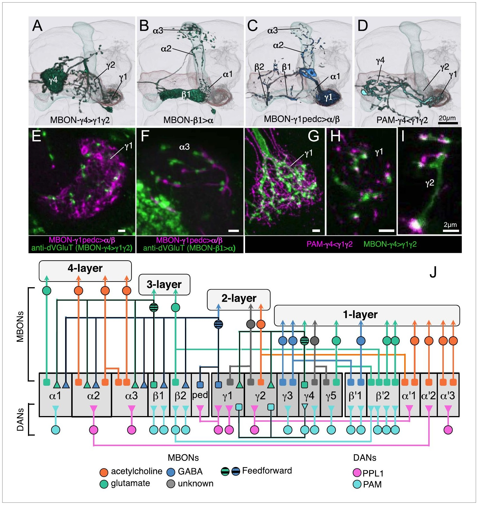

<small>圖片出處：Aso Y, Hattori D, Yu Y et al. *eLife* 3:e04577 (2014)，Figure 17。CC BY（版權屬作者）；全文見 [PMC](https://pmc.ncbi.nlm.nih.gov/articles/PMC4273437/)。</small>

> **原圖說（Figure 17）：** Three types of MBONs and one type of DAN interconnect multiple compartments. (A–C) Registered images of the three MBON cell types whose axons project to other compartments within the MB lobes. (A) A glutamatergic output (MBON-γ4>γ1γ2) from γ4 sends axons back into the lobes that terminate in γ1 and γ2. (B) A glutamatergic output from β1 (MBON-β1>α) terminates in α1, α2, and α3. (C) A GABAergic output from γ1 and the core of distal pedunculus (MBON-γ1pedc>α/β) terminates in the α/β lobes in both hemispheres and in the pedunculus, where α/β KCs bifurcate, in the contralateral side of the brain. (D) A DAN cell type (PAM-γ4<γ1γ2) that has dendrites in γ1 and γ2 and terminals in γ4. This cell type provides potential feedback signals to the MBON-γ4>γ1γ2 (see panels G–I). (E) Two-color labeling of the GABAergic output neuron shown in panel C (MB112C …) and an antibody against vesicular glutamate transporter. The dendrites of MBON-γ1pedc>α/β overlap with glutamatergic terminals in γ1. The likely source of these glutamatergic terminals is MBON-γ4>γ1γ2 shown in panel A. (F) The GABAergic terminals of MBON-γ1pedc>α/β and glutamatergic terminals presumably of MBON-β1>α, the neuron shown in panel B, are in close proximity in the surface layer of α3. … This overlap of glutamatergic and GABAergic feedforward projections suggests that they may cooperatively or competitively regulate the excitatory output of MBON-α3. (G) A substack projection showing two-color labeling of the dendrites of the only DAN (MB312C) that has dendrites in the MB lobes and axon terminals of an MBON in the γ1 compartment (R53C03-LexA). (H and I) Single confocal slices in the γ1 and γ2 compartment showing two-color labeling of the cell types shown in (G). (J) Schematic of the circuits within the MB lobes. DAN inputs (bottom) and MBON outputs (top) from 15 MB lobe compartments and the core of the distal pedunculus (ped) are shown (gray rectangles, middle). Colors indicate neurotransmitter types for MBONs and cluster of origin for DANs as indicated. Dendrites are represented as squares and presynaptic terminals as triangles. Three MBONs, indicated by the heavier outline and striped cell bodies, send axonal terminals (triangles) back into the MB lobes creating a 4-layer feedforward network. See text for details. Eight types of MBONs receive input from more than one of the 15 compartments in the lobes (or a compartment plus the ped) and in five cases those compartments reside in different lobes. As different functions of learning and memory, such as acquisition and retrieval, have been attributed to different KC classes (Isabel et al., 2004; Krashes et al., 2007), MBONs integrating across lobes may function in coordinating different phases of learning and memory. MBON-γ1pedc>α/β and PPL1-γ1pedc innervate the core of the distal pedunculus (ped) as well as the γ1 compartment. Three DAN cell types innervate multiple lobe compartments.

**圖說中譯：** 三型 MBON 與一型 DAN 把多個區室連起來。(A–C) 三型軸突送回葉內其他區室的 MBON 的對位影像。(A) 來自 γ4 的麩胺酸性輸出（MBON-γ4>γ1γ2），軸突送回葉內、終止於 γ1 與 γ2。(B) 來自 β1 的麩胺酸性輸出（MBON-β1>α），終止於 α1、α2、α3。(C) 來自 γ1 與柄遠端核心的 GABA 性輸出（MBON-γ1pedc>α/β），終止於兩側的 α/β 葉，以及對側 α/β KC 分岔處的柄。(D) 一型 DAN（PAM-γ4<γ1γ2），樹突在 γ1、γ2，末梢在 γ4；這一型可能提供回饋訊號給 MBON-γ4>γ1γ2（見 G–I）。(E) C 圖中 GABA 性輸出神經元（MB112C）與抗囊泡型麩胺酸轉運蛋白抗體的雙色標記。MBON-γ1pedc>α/β 的樹突與 γ1 中的麩胺酸性末梢重疊；這些末梢可能來自 A 圖的 MBON-γ4>γ1γ2。(F) MBON-γ1pedc>α/β 的 GABA 性末梢，與推測來自 MBON-β1>α 的麩胺酸性末梢，在 α3 的表層彼此緊鄰。麩胺酸性與 GABA 性前饋投射的這種重疊，顯示兩者可能協同或競爭地調節 MBON-α3 的興奮性輸出。(G) 子堆疊投影，顯示唯一樹突長在葉內的 DAN（MB312C）與某個 MBON 在 γ1 區室的軸突末梢（R53C03-LexA）的雙色標記。(H、I) γ1 與 γ2 區室的單張共軛焦切面，顯示 G 中兩型細胞的雙色標記。(J) 葉內迴路的示意圖。中間灰色方塊為 15 個區室與柄遠端核心（ped），下方為 DAN 輸入、上方為 MBON 輸出；顏色表示 MBON 的傳遞物質或 DAN 的來源群，方形代表樹突、三角形代表突觸前末梢。以較粗輪廓與條紋細胞體標示的三型 MBON 把軸突末梢送回葉內，形成一個四層前饋網路。有八型 MBON 接收超過一個區室（或一個區室加上柄）的輸入，其中五例所涉區室位於不同的葉。由於學習與記憶的不同功能（如習得與提取）曾被歸給不同類的 KC（Isabel et al., 2004；Krashes et al., 2007），跨葉整合的 MBON 可能參與協調學習與記憶的不同階段。MBON-γ1pedc>α/β 與 PPL1-γ1pedc 同時支配柄遠端核心與 γ1 區室。三型 DAN 支配多個葉區室。

**解讀：**
- **J 圖是本篇留給後續研究最大的一張支票。** 它把 16 個方塊（15 區室 ＋ ped）、每格的 DAN 與 MBON、以及三條回送葉內的連線畫在一起，並標出 1–4 層的讀出深度。**但整張圖沒有任何功能實驗支撐**：所有連線都是影像重疊推定的。
- **E、F 兩格是本篇唯一針對「MBON 的末梢落在另一個 MBON 的樹突上」的直接影像**，用的是抗 dVGluT 間接推定來源（「likely source」「presumably」）。所以連前饋這一環，本篇也沒有做到雙色標記兩個確定的細胞型。
- **F 圖提出的「麩胺酸性與 GABA 性前饋在 α3 表層競爭」，是庫內 [[s-huang-2024-dopamine-memory-dynamics]] 關注的 α3 讀出的解剖背景**；兩篇關心的是同一塊地方，但 Huang 走的是 MBON→DAN，本篇畫的是 MBON→MBON。
- **⚠️ J 圖說的「五例跨葉」與圖 12C 的「四型跨葉」差在 pedc 算不算另一條葉**（見問題與限制 7b）。

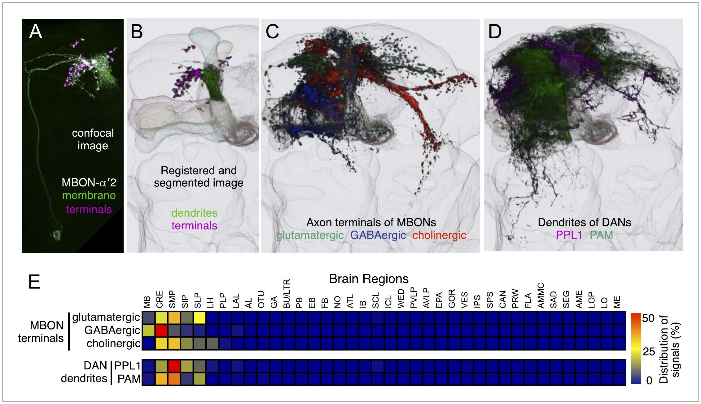

<small>圖片出處：Aso Y, Hattori D, Yu Y et al. *eLife* 3:e04577 (2014)，Figure 18。CC BY（版權屬作者）；全文見 [PMC](https://pmc.ncbi.nlm.nih.gov/articles/PMC4273437/)。</small>

> **原圖說（Figure 18）：** Projection patterns of the MBON axons and DAN dendrites outside the MB lobes. (A) To analyze the projection patterns of the MBONs outside the MB lobes, we first segmented their axon terminals based on the localization of a presynaptic marker. A maximum intensity projection of a confocal stack showing MBON-α′2 neurons labeled with a presynaptic reporter (magenta) and a general membrane marker (green). The split-GAL4 line MB018B was used … (B) An image of the segmented terminals and dendrites of a MBON-α′2 neuron aligned to the standard brain. After registration of the image, synaptic terminals were segmented based on the preferential labeling by Syt::smGFP-HA. Dendrites were segmented based on their morphology and localization within the MB lobe. (C) A registered image of the segmented presynaptic terminals of MBONs showing the areas of the brain innervated by MBONs. The segmented terminals were false-colored based on their putative neurotransmitter. (D) A registered image of the segmented dendrites of DANs. The segmented dendrites were false-colored based on their cluster of origin. (E) Distribution of MBON terminals and DAN dendrites as quantified in each neuropil found in the adult brain (see Ito et al., 2014 for the location and abbreviation for each neuropil). After normalizing the signal intensity from different cell types, we separately summed signals from the terminals of glutamatergic, GABAergic, or cholinergic MBONs and dendrites of PPL1 and PAM cluster DANs. 99% of the MBON terminals are distributed in the MB lobes and five neuropils (CRE, SMP, SIP, SLP, and LH). Colors represent the percent of the processes found in each of 38 brain regions.

**圖說中譯：** MBON 軸突與 DAN 樹突在蕈狀體葉外的投射樣式。(A) 為分析 MBON 在葉外的投射，先依突觸前標記的分布分割出軸突末梢。圖為 MBON-α′2（品系 MB018B）以突觸前報告基因（洋紅）與一般膜標記（綠）標示的最大強度投影。(B) 對位到標準腦後，分割出的 MBON-α′2 末梢與樹突；末梢依 Syt::smGFP-HA 的優先標記分割，樹突依形態與其位於蕈狀體葉內的位置分割。(C) 對位後各 MBON 突觸前末梢的分割影像，顯示 MBON 所支配的腦區；末梢依推定的傳遞物質上假色。(D) 對位後各 DAN 樹突的分割影像，依來源群上假色。(E) MBON 末梢與 DAN 樹突在成蟲腦各神經氈中的分布量化（各神經氈的位置與縮寫見 Ito et al., 2014）。把不同細胞型的訊號強度正規化後，分別加總麩胺酸性、GABA 性、膽鹼性 MBON 的末梢訊號，以及 PPL1、PAM 群 DAN 的樹突訊號。**MBON 末梢有 99% 分布於蕈狀體葉與五塊神經氈（CRE、SMP、SIP、SLP、LH）。** 顏色代表分枝在 38 個腦區中各占的百分比。

**解讀：**
- **E 圖是全篇唯一的定量熱圖，而它的訊息其實是一個「幾乎全空」的矩陣**：38 欄中只有左邊六欄有顏色，其餘全藍。本庫逐欄數過確實是 38 欄 ✓。要看的是「空白有多大」而不是哪一格最紅。
- **三類 MBON 的落點不同：** GABA 性幾乎全集中在 CRE（最紅的一格），麩胺酸性偏 SLP／SMP，膽鹼性分散在 CRE／SMP／SIP／SLP 並且是唯一在 LH 有訊號的一類。**「只有膽鹼性 MBON 投到側角」這件事，在正文被寫成「四型 MBON 投射到側角」，兩者在這張圖上是同一件事。**
- **百分比的分母是「正規化後各型平均再加總」，不是細胞數或突觸數**（方法）。所以 99%、90% 這兩個數字是螢光體積的比例，不能讀成「99% 的突觸」。
- **PPL1 與 PAM 的樹突落點也不同**（PPL1 偏 SMP、PAM 偏 CRE／SMP），這是「兩群 DAN 接收不同上游」的解剖依據，但本篇沒有找出任何一個上游細胞。

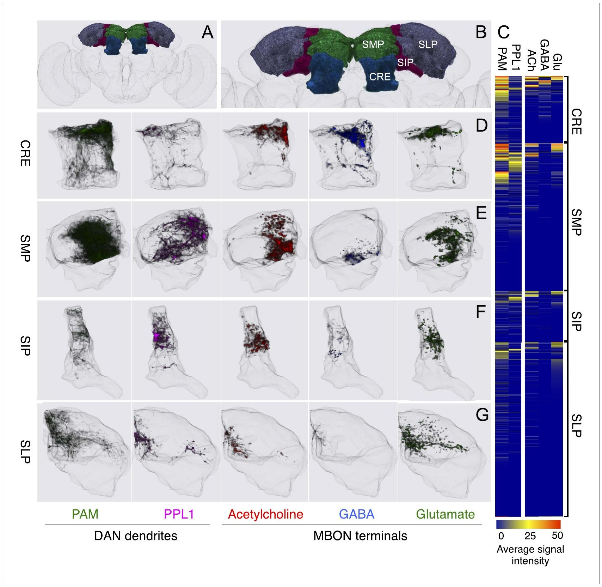

<small>圖片出處：Aso Y, Hattori D, Yu Y et al. *eLife* 3:e04577 (2014)，Figure 19。CC BY（版權屬作者）；全文見 [PMC](https://pmc.ncbi.nlm.nih.gov/articles/PMC4273437/)。</small>

> **原圖說（Figure 19）：** Distribution of MBON terminals and DAN dendrites in four brain areas. (A) Schematic of the brain highlighting the areas that exhibit the highest density of MBON terminals and DAN dendrites. (B) A magnified view of a portion of the brain shown in panel A with the CRE, SMP, SIP, and SLP neuropils indicated. (C) Distribution of MBON terminals and DAN dendrites showing their further clustering within the CRE, SMP, SIP, and SLP. Heat map representations of neurite density were computed separately for PAM and PPL1 cluster DAN dendrites and for cholinergic (ACh), GABAergic, and glutamatergic (Glu) MBON terminals. Each horizontal row shows mean intensities in a 10 × 10 × 10 voxel (3.8 × 3.8 × 3.8 μm) cube for each of the indicated neuronal types (columns), represented in an 8-bit scale (0–255). The rows have been sorted based on the sum of the intensity in each volume for all neuronal types. (D–G) Distributions of MBON terminals and DAN dendrites in the CRE (D), SMP (E), SIP (F), and SLP (G) are shown.

**圖說中譯：** MBON 末梢與 DAN 樹突在四塊腦區中的分布。(A) 腦的示意圖，標出 MBON 末梢與 DAN 樹突密度最高的區域。(B) A 中部分區域的放大，標出 CRE、SMP、SIP、SLP 四塊神經氈。(C) MBON 末梢與 DAN 樹突在這四塊神經氈內部進一步群聚的情形。神經突密度熱圖分別針對 PAM 與 PPL1 群 DAN 的樹突，以及膽鹼性（ACh）、GABA 性、麩胺酸性（Glu）MBON 的末梢計算。每一橫列代表一個 10 × 10 × 10 體素（3.8 × 3.8 × 3.8 μm）立方塊中各類神經元（欄）的平均強度，以 8 位元尺度（0–255）表示；列依所有神經元類別在該體積的強度總和排序。(D–G) CRE（D）、SMP（E）、SIP（F）、SLP（G）中 MBON 末梢與 DAN 樹突的分布。

**解讀：**
- **這張圖回答的是一個比圖 18 更細的問題：進了同一塊神經氈，是不是真的靠在一起？** 答案是「在 3.8 µm 的立方塊尺度上，有些列同時亮」。**3.8 µm 仍比突觸大兩個數量級**，所以這只是把「潛在連結」的空間尺度縮小一階，不是證明相連。
- **列的排序方式（依所有類別的強度總和）會讓「同時亮」的列自動排到上方**，視覺上強化了共定位的印象。這是一個需要留意的視覺陷阱：排序本身不是統計檢定。
- **D–G 四格顯示每塊神經氈內部還有子區**：例如 CRE 裡 GABA 性 MBON 末梢集中在上緣，而 PAM 的樹突分布更廣。本篇沒有為這些子區命名，後續文獻也少用。

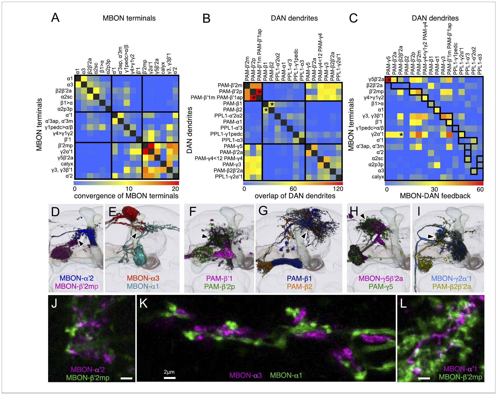

<small>圖片出處：Aso Y, Hattori D, Yu Y et al. *eLife* 3:e04577 (2014)，Figure 20。CC BY（版權屬作者）；全文見 [PMC](https://pmc.ncbi.nlm.nih.gov/articles/PMC4273437/)。</small>

> **原圖說（Figure 20）：** Convergence of MBON and DAN processes outside the MB lobes. (A–C) Matrices showing co-localization of the processes of MB extrinsic neurons outside the MB. Axon terminals and dendrites from each cell type were first segmented and the degree of overlap calculated and displayed in the form of a linear heat map with arbitrary units. For those cells in the matrices marked with an asterisk, images of the overlapping neurons are shown in (D–I). The heavy black lines in (A) and (B) show the three major groups as determined by hierarchical clustering (Ward's method). (A) Overlap of the MBON terminals. (B) Overlap of DAN dendrites. (C) Overlap of the MBON terminals and DAN dendrites. The cells of the matrix outlined by the heavy black lines indicate potential feedback loops where MBON terminals from a compartment lie in close proximity to the dendrites of DANs that innervate that same compartment. Note that the atypical neuron with dendrites in the calyx (MB-CP1) is also shown in panels A and C (labeled 'calyx'). (D and E) Convergence (arrowhead) of the terminals of MBONs from α′2 and β′2mp (D) and of the terminals of MBONs from α3 and α1 (E). The overlap of the axon terminals suggests that different MBONs may target the same post-synaptic neurons. It is interesting that MBONs of different neurotransmitter types exhibit overlapping axon terminals (e.g., cholinergic MBON-α3 and glutamatergic MBON-α1, E), suggesting that the target neuron may be modulated differently by each of the MBONs … (F) Overlap (arrowhead) of dendrites of PAM cluster DANs that innervate β′1 and the β′2p. (G) Overlap (arrowhead) of dendrites of PAM cluster DANs that innervate β1 and β2. (H) Overlap (arrowhead) of the terminals of the MBON-γ5β′2 and dendrites of PAM-γ5. (I) Overlap (arrowhead) of the terminals of the MBON-γ2α′1 and dendrites of PAM-β2β′2a. (J–L) Single confocal slices showing two-color labeling of the axonal terminals of the indicated MBONs. The following split-GAL4 and LexA driver lines were used: (J) MB081C and R25D01-LexA; (K) G0239 (Chiang et al., 2011) and R71C03-LexA; (L) MB026B and R12C11-LexA.

**圖說中譯：** MBON 與 DAN 分枝在蕈狀體之外的匯聚。(A–C) 顯示蕈狀體外來神經元分枝共定位的矩陣。先分割出各細胞型的軸突末梢與樹突，計算重疊度，以線性熱圖（任意單位）呈現。矩陣中標星號者，其重疊神經元的影像見 D–I。A、B 中的粗黑線為階層式分群（Ward 法）判定的三大群。(A) MBON 末梢彼此的重疊。(B) DAN 樹突彼此的重疊。(C) MBON 末梢與 DAN 樹突的重疊。以粗黑線框出的格代表可能的回饋迴圈，即某一區室的 MBON 末梢與支配同一區室的 DAN 樹突緊鄰。注意樹突在萼部的非典型神經元（MB-CP1）也出現在 A 與 C（標為「calyx」）。(D、E) α′2 與 β′2mp 的 MBON 末梢（D）、α3 與 α1 的 MBON 末梢（E）匯聚（箭頭頭）。軸突末梢的重疊顯示不同的 MBON 可能以同一批突觸後神經元為標的。值得注意的是，不同傳遞物質的 MBON 也有重疊的軸突末梢（例如膽鹼性的 MBON-α3 與麩胺酸性的 MBON-α1，E），顯示標的神經元可能受各個 MBON 不同的調節。(F) 支配 β′1 與 β′2p 的 PAM 群 DAN 樹突重疊。(G) 支配 β1 與 β2 的 PAM 群 DAN 樹突重疊。(H) MBON-γ5β′2 的末梢與 PAM-γ5 樹突的重疊。(I) MBON-γ2α′1 的末梢與 PAM-β2β′2a 樹突的重疊。(J–L) 單張共軛焦切面，顯示所示 MBON 軸突末梢的雙色標記。所用品系：(J) MB081C 與 R25D01-LexA；(K) G0239（Chiang et al., 2011）與 R71C03-LexA；(L) MB026B 與 R12C11-LexA。

**解讀：**
- **C 圖的對角線框出的格，就是「MBON 回頭推動同格 DAN」這個假說的全部解剖證據。** 值得注意的是：**對角線並不是整條都亮**——亮的只有少數幾格（例如 γ5β′2a 與 PAM-γ5），而且矩陣裡最亮的幾格是跨格的（例如 MBON-γ2α′1 與 PAM-β2β′2a）。**所以本篇的資料其實比較支持「跨格回饋」而不是「同格回饋」**，這一點與 [[t-mbon-dan-feedback]] 整理的功能結果（同格與跨格都有）方向一致。
- **熱圖是任意單位，三張圖的色標上限不同（20／120／60）**，不能跨圖比較深淺。
- **E 圖與 J–L 的雙色標記顯示不同傳遞物質的 MBON 末梢可以互相重疊**（膽鹼性 α3 與麩胺酸性 α1 在次微米距離內，影片 6）。這是圖 21 模型中「下游細胞被多個 MBON 以不同方式調節」的依據。
- **K 格用的 G0239 是引自 Chiang et al. 2011 的品系**，也是表 1 中 MBON-α3 的品系之一；這是本篇少數使用非 Janelia 品系的地方。

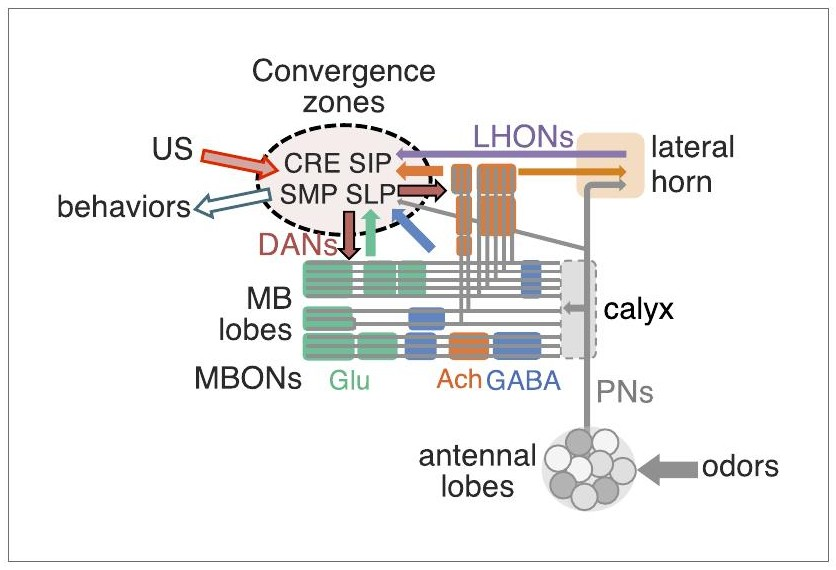

<small>圖片出處：Aso Y, Hattori D, Yu Y et al. *eLife* 3:e04577 (2014)，Figure 21。CC BY（版權屬作者）；全文見 [PMC](https://pmc.ncbi.nlm.nih.gov/articles/PMC4273437/)。</small>

> **原圖說（Figure 21）：** Schematic of the proposed convergence zone. MB lobes consist of three groups of compartments based on the putative transmitter of MBONs (glutamate, GABA, and acetylcholine, shown color-coded). These compartments are interconnected inside the lobes and the MBONs send converging outputs (color-coded arrows) to small subregions within five neuropils: the lateral horn (LH), CRE, SMP, SIP, and SLP. The dendrites of DANs are also confined mostly in the convergence zones within the CRE, SMP, SIP, and SLP. These neuropils, therefore, must receive information encoding the unconditioned stimuli (US), such as sugar and shock, which recruit DANs for memory formation. In the simplest model, these same sensory inputs would activate not just the DANs but also other output neurons of these neuropils that elicit appropriate unconditioned behaviors. MBON, conveying the learned valence of stimuli, might then terminate onto these same output neurons. A subset of projection neurons from the antennal lobe and LH output neurons (LHONs) also converge with MBONs in these zones (see accompanying paper Aso et al., 2014). In this way, learned and innate responses could use a common set of downstream circuits, originating in the LH, CRE, SMP, SIP, and SLP, to drive behavior.

**圖說中譯：** 所提出的匯聚區示意。蕈狀體的葉依 MBON 的推定傳遞物質分成三組區室（麩胺酸、GABA、乙醯膽鹼，以顏色區分）。這些區室在葉內彼此相連，MBON 把匯聚的輸出（彩色箭頭）送到五塊神經氈內的小次區域：側角（LH）、CRE、SMP、SIP、SLP。DAN 的樹突也大多侷限在 CRE、SMP、SIP、SLP 的匯聚區內。因此這些神經氈必定接收編碼非制約刺激（US，例如糖與電擊）的資訊，而 US 正是招募 DAN 形成記憶的訊號。在最簡單的模型裡，這些相同的感覺輸入不只活化 DAN，也活化這些神經氈中引發相應非制約行為的其他輸出神經元；傳達刺激之學習價值的 MBON，可能就終止在這些相同的輸出神經元上。嗅葉的一部分投射神經元與側角輸出神經元（LHON）也在這些區域與 MBON 匯聚（見姊妹篇 Aso et al., 2014）。如此一來，學習與先天的反應就能共用一組源自 LH、CRE、SMP、SIP、SLP 的下游迴路來驅動行為。

**解讀：**
- **這是本篇的結論圖，也是證據最薄的一張。** 圖上每一個箭頭都對應一個「可能」：US 輸入（沒測）、MBON 與先天通路共用下游細胞（沒找到任何一顆）、DAN 被 US 招募（引用自別篇）。圖說自己用的是 must receive、In the simplest model、might then terminate 這類語氣。
- **它仍然有用，因為它把問題講清楚了：** 要推翻或證實這張圖，需要的是「同時接收 MBON 與 LHON 輸入的下游神經元」。庫內目前沒有任何一篇做到這件事（[[s-aso-2014-mbon-valence]] 提供的是行為層面的對應）。
- **圖上把 MBON 依傳遞物質分成三段色塊**，沿用圖 9 的配色；但如「問題與限制」7a 所述，傳遞物質與葉的對應有例外，這張示意圖把它畫成乾淨的三段。

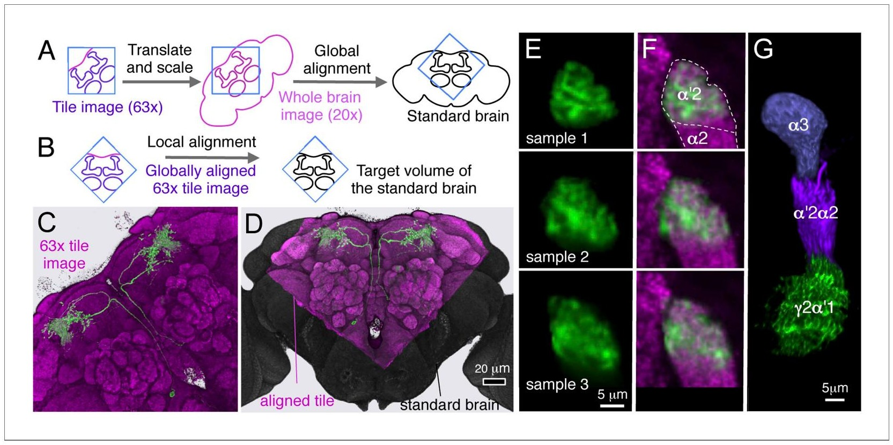

<small>圖片出處：Aso Y, Hattori D, Yu Y et al. *eLife* 3:e04577 (2014)，Figure 22。CC BY（版權屬作者）；全文見 [PMC](https://pmc.ncbi.nlm.nih.gov/articles/PMC4273437/)。</small>

> **原圖說（Figure 22）：** Alignment of partial brain images to a standard brain model. (A) A low-resolution (20×) confocal stack covering the entire brain and optic lobes (magenta diagram) and a single high-resolution (63×) confocal stack of the portion of the brain containing the MB (blue square) are collected for each specimen. The 63× tile image is first aligned to a whole brain image of the same brain by scaling and rigid translation using labeling of the presynaptic active zone protein Bruchpilot by the mouse monoclonal antibody nc82 as the reference. The whole brain image is then globally aligned to the JFRC2013 standard brain (black diagram) by affine registration. In this way the high-resolution tile image is globally aligned to the standard brain and corresponding target volume in the standard brain is identified. (B) The nc82 pattern of the high-resolution tile image is non-rigidly aligned to that of the standard brain. (C) A 63× image tile of a brain (green, MB018B-driven expression pattern showing MBON-α′2 neurons; magenta, nc82 staining). (D) The same tile after alignment (gray; nc82 pattern of the standard brain). (E) Portions of optical slices from confocal stacks of three brains from the MB018B driver line. (F) After alignment, the dendrites of MBON-α′2 neurons in all three samples can be seen to be confined within the α′2 compartment of the standard brain. (G) An alignment to the standard brain of three separately imaged brains, each of which visualized a different PPL1 cluster dopaminergic neuron; compare to Figure 11F, where the same three neurons were imaged in a single brain using MCFO.

**圖說中譯：** 把局部腦影像對位到標準腦模型。(A) 每個樣本都取兩種影像：涵蓋全腦與視葉的低解析（20×）影像堆疊（洋紅示意），以及含蕈狀體那一部分的單張高解析（63×）影像堆疊（藍框）。先以小鼠單株抗體 nc82 對突觸前活性區蛋白 Bruchpilot 的染色為參考，用縮放與剛體平移把 63× 影像對到同一顆腦的全腦影像；再以仿射對位把全腦影像整體對到 JFRC2013 標準腦（黑色示意）。如此高解析影像即整體對到標準腦，並找出標準腦中相對應的目標體積。(B) 再把高解析影像的 nc82 樣式非剛性地對位到標準腦的 nc82 樣式。(C) 某顆腦的 63× 影像（綠：MB018B 驅動表現的 MBON-α′2；洋紅：nc82 染色）。(D) 對位後的同一張影像（灰：標準腦的 nc82 樣式）。(E) 來自 MB018B 品系三顆腦的共軛焦切面局部。(F) 對位之後，三個樣本的 MBON-α′2 樹突都落在標準腦的 α′2 區室之內。(G) 三顆分別取像、各自顯示一型 PPL1 群多巴胺神經元的腦，對位到標準腦的結果；可與圖 11F 比較——該圖是以 MCFO 在單一顆腦中拍到同樣三型神經元。

**解讀：**
- **這張圖是整篇「區室鋪排」結論的方法保證，也是它的限制所在。** F 與 G 兩格是作者提出的兩項品質判準：同一品系的多個樣本對位後重合（F）、分別取像的三型 DAN 對位後的相對位置，與在同一顆腦中以 MCFO 拍到的一致（G）。**G 是其中較強的一項，因為它有一個同腦的對照（圖 11F）。**
- **但方法另外寫明：只有對位最好的約 25% 樣本被用來做圖譜。** 這是合理的作法，卻也意味著圖 10、12、13 的「互不重疊」是在最佳樣本上成立的；論文沒有報告被排除的 75% 長什麼樣。
- **這套流程的關鍵在於「每顆腦拍兩次」**（20× 全腦 ＋ 63× 局部），以繞過「高解析拍不下整顆腦」的限制。庫內若要重用本篇的影像或品系做對位比較，要注意標準腦是 JFRC2013，與後來常用的 JRC2018 不同。

---
## 相關

- [[numbers]] — 本篇貢獻了蕈狀體的規模數字（7／21／20 型、約 2000／34／約 130 顆、15 區室、37 基本分區、七型 KC 各自的顆數）、PAM 顆數的三套估計、收斂比上下限、神經氈分布的百分比，以及 split-GAL4 篩選的規模
- 主題：[[t-dopamine-to-plasticity]]（區室是「訊號限在一格之內」這個問題的前提）、[[t-mbon-dan-feedback]]（MBON 末梢與 DAN 樹突重疊，是整條線的解剖起點）、[[t-timing-rules]]（各格的規則差異建立在本篇的分格上）、[[t-memory-updating]]（三型前饋 MBON 被作者提為「修改舊學習」的機制）
- 概念：[[c-mb-compartment]]（本頁是該概念的出處）、[[c-sparse-coding]]、[[c-kc-mbon-plasticity]]
- 實體：[[e-mushroom-body]]、[[e-kenyon-cell]]、[[e-mbon]]、[[e-dopaminergic-neuron]]、[[e-split-gal4]]、[[e-mb504b]]、[[e-mb099c]]、[[e-th-gal4]]、[[e-r58e02]]、[[e-ppl1-gamma1pedc]]、[[e-ppl1-gamma2alpha1]]、[[e-ppl1-alpha2alpha2]]、[[e-ppl1-alpha3]]、[[e-pam-alpha1]]、[[e-mbon-gamma1pedc]]、[[e-mbon-gamma2alpha1]]、[[e-mbon-gamma4]]、[[e-mbon-gamma5beta2a]]、[[e-mbon-alpha2sc]]
- 姊妹篇：[[s-aso-2014-mbon-valence]]（同一套品系的行為與功能測試）
- 矛盾：[[syn-contradictions]] 4.4（本篇是該條指名要收的命名參考資料；見整合建議）、1.5（本篇的 R58E02-GAL80 實驗與之有關）
- 2026-11-13 第一批整合時補上的連結 — 新開的主題頁：[[t-mbon-to-action]]（MBON 學到的價值怎麼變成動作）、[[t-innate-learned-integration]]（先天與習得價值在哪裡整合）
- 待開頁面：[[e-mcfo]]、`e-pa-gfp`、`c-image-registration`（影像對位與標準腦）、`e-jfrc2013`、[[e-mbon-alpha1]]、[[e-mbon-alpha3]]、`e-mbon-beta1`、[[e-apl-neuron]]、[[e-dpm-neuron]]、`c-elemental-subdivision`（基本分區／突觸單元）、`e-syt-smgfp`、`e-mb060b`、`e-mb077b`、`e-mb112c`

## 出處

Aso, Y., Hattori, D., Yu, Y., Johnston, R. M., Iyer, N. A., Ngo, T.-T. B., Dionne, H., Abbott, L. F., Axel, R., Tanimoto, H., and Rubin, G. M. (2014). The neuronal architecture of the mushroom body provides a logic for associative learning. *eLife* 3, e04577. https://doi.org/10.7554/eLife.04577

本篇為 CC BY 開放取用（Copyright Aso et al.），版權屬作者。圖片擷取自原文，依該授權在標明出處的條件下重製，本庫以教學與評論目的引用。全文請至 https://pmc.ncbi.nlm.nih.gov/articles/PMC4273437/ 免費閱讀。
