<!-- 本機 PDF：papers/2014-Mushroom%20body%20output%20neurons%20encode%20valence%20and%20guide%20memory-based%20action%20selection%20in%20Drosophila.pdf -->

# Mushroom body output neurons encode valence and guide memory-based action selection in *Drosophila*

**蕈狀體輸出神經元編碼價值，並引導依記憶而做的行動選擇**

| 項目 | 內容 |
|---|---|
| **出處** | eLife 3, e04580 (2014). doi: 10.7554/eLife.04580 [全文（PMC 免費閱讀）](https://pmc.ncbi.nlm.nih.gov/articles/PMC4273436/) |
| 日期 | 刊出 2014-12-23；投稿 2014-09-03・接受 2014-11-07（PDF 第 1 頁）；修訂日期 PDF 未印。eLife 文章是單篇編號（e04580），沒有起迄頁；PDF 共 42 頁 |
| 通訊作者 | Yoshinori Aso（asoy@janelia.hhmi.org）、Gerald M. Rubin（rubing@janelia.hhmi.org）。PDF 只有英文名 |
| 作者 | 共 21 人：Yoshinori Aso、Divya Sitaraman、Toshiharu Ichinose、Karla R. Kaun、Katrin Vogt、Ghislain Belliart-Guérin、Pierre-Yves Plaçais、Alice A. Robie、Nobuhiro Yamagata、Christopher Schnaitmann、William J. Rowell、Rebecca M. Johnston、Teri-T B. Ngo、Nan Chen、Wyatt Korff、Michael N. Nitabach、Ulrike Heberlein、Thomas Preat、Kristin M. Branson、Hiromu Tanimoto、Gerald M. Rubin。未標共同第一作者。分工：Aso 光遺傳行為；Sitaraman、Chen、Nitabach 睡眠；Ichinose 2 小時氣味記憶；Yamagata 以 DAN 代替電擊；Kaun、Heberlein 酒精記憶；Vogt、Schnaitmann 顏色記憶；Belliart-Guérin、Plaçais、Preat 長期記憶；Robie、Branson 開放場（Fly Bowl）行為；Aso、Tanimoto、Rubin 構思 |
| 機構 | Janelia Research Campus, HHMI（美國 Ashburn）；Yale School of Medicine（New Haven）；Max Planck Institute of Neurobiology（德國 Martinsried）；東北大學生命科學研究科（仙台）；CNRS／ESPCI Genes and Dynamics of Memory Systems（巴黎） |
| 資料庫 | 驅動品系的共軛焦影像全疊層：www.janelia.org/split-gal4（圖 3 圖說）。無公開程式碼 |
| 補充資料 | 圖補充圖 11 張（圖 3 有 2 張；圖 4、5、6、7、8、9、11、12、15 各 1 張）、影片 1–6、補充檔 1（Fly Bowl 14 種行為的統計表）。**PDF 只列補充圖的標題、不含內容；影片只有圖說；補充檔 1 未取得**。本頁凡依賴它們的內容標 ？待查 |
| 編輯／審查 | 審查編輯（Reviewing editor）Liqun Luo（HHMI／Stanford University）。eLife 2014 年的審查信是否公開，PDF 未載 |
| 姊妹篇 | 正文反覆引用的「accompanying manuscript」是 Aso et al. 2014（eLife 3:e04577，蕈狀體解剖與 split-GAL4 品系的製作），本庫寫作 Aso 2014a；本篇即庫內各頁所稱的 Aso 2014b |

> 與本庫有關的作者：Ichinose、Aso、Yamagata、Rubin、Tanimoto 五人也是 [[s-ichinose-2015-reward-recurrent-circuit]] 的作者；Aso 與 Rubin 是 [[s-aso-2016-dan-cell-type-rules]] 的兩位作者，也是 [[s-hige-2015-heterosynaptic-plasticity]] 的共同作者；Thomas Preat 也是 [[s-gervasi-2010-pka-dynamics]] 的作者。
>
> **本篇為 CC BY 開放取用**（PDF 第 1 頁：「This article is distributed under the terms of the Creative Commons Attribution License, which permits unrestricted use and redistribution provided that the original author and source are credited」；未註明版本號），版權屬作者（Copyright Aso et al.）。圖片可在標明出處下自由使用與散布。本庫仍依規定只給全文連結、不放 PDF；每張圖下方標明出處與授權。

---

## 為什麼重要

> 本節假設讀者已略知果蠅嗅覺學習的輪廓。**完全不熟的讀者可以先看「科普文」一節**；術語另見「專業文」開頭的「本頁用語」表。

本庫幾乎每一頁談到輸出神經元（MBON）時，都有一句「這型 MBON 推動果蠅靠近（或走開）」。這句話幾乎全都引自本篇。蕈狀體的軸突束分成十幾個小格（區室），γ1pedc、γ2α′1、γ4 等都是格的名字；每型 MBON 在其中一格收訊號，所以常用格名稱呼。Hige 2015 說 γ1pedc 的 MBON 推動靠近；Handler 2019 說 γ4 與 γ5 的推動走開、γ2 的推動靠近；兩篇引的都是這一篇。Felsenberg 2017 的「價值偏斜」模型也引它為依據。這個模型說，記憶的價值以 MBON 網路的「偏斜」來編碼：未訓練時，一個氣味對「推動靠近」與「推動走開」兩類 MBON 的驅動大致平衡；學習改變其中一類，網路就偏向一邊。

在本篇之前，學界只知道活化特定的多巴胺神經元（DAN）可以代替懲罰或獎賞。本篇第一次把一整套驅動品系（split-GAL4）逐一拿來做光遺傳活化。一條品系是一種基因改造果蠅，讓特定一兩型神經元帶上工具蛋白；說某品系「標記」某型，就是那型帶上了工具。這一套品系每條只標一兩型 MBON，作者用它們問：「單獨叫醒這一型輸出神經元，果蠅會往哪裡走？」本庫的推理鏈是「DAN 傳好壞 → 多巴胺改寫 KC→MBON 突觸 → MBON 輸出改變 → 行為往哪邊偏」。本篇補的是最後一步：MBON 輸出怎麼決定行為方向。

第二，它提出了本庫各頁反覆使用的兩條通則。

其一，**MBON 的效果依傳遞物質分邊**。活化後讓果蠅走開的，全部是放出麩胺酸（glutamate）的 MBON。讓果蠅靠近的，全部是放出 GABA 或乙醯膽鹼（acetylcholine）的 MBON。

其二，**MBON 被活化時推動的方向，「一般而言」與同一格 DAN 寫入的記憶方向相反**。DAN 分兩群：PPL1 群多半傳懲罰，PAM 群多半傳獎賞。懲罰型 DAN 所在的 γ1pedc、γ2α′1 兩格，MBON 推動靠近。獎賞型 DAN 所在的那幾格，麩胺酸 MBON 推動走開。作者由此推論：多巴胺讓 KC→MBON 突觸「變弱」，最能解釋這個相反。KC（Kenyon 細胞）是代表氣味的神經元。以懲罰為例：這一格的 MBON 推動靠近；若多巴胺讓 KC 到這型 MBON 的突觸變弱，這個氣味就較少推動靠近，天平倒向走開，學到的正是「躲開」。方向相反，剛好吻合。這個推論後來由 Hige 2015 在 γ1pedc 直接量到。

**本頁的稽核發現兩點。第一條在本篇資料上沒有反例，但 25 條品系裡只有 9 條達到顯著，多數 MBON 的單獨活化沒有效果。第二條只在少數幾格有資料可比；而且本庫部分頁面把它改寫成「PAM 支配的格，MBON 推動走開」時，忽略了本篇自己的反例（γ3 一帶的 GABA MBON 讓果蠅靠近）。**

第三，它是一份「哪型 MBON 在哪種學習裡需要」的總表（圖 13）。表中涵蓋：2 小時的氣味—電擊、氣味—糖記憶，顏色—電擊、顏色—糖記憶，24 小時的氣味—電擊長期記憶，氣味—酒精記憶，再加上睡眠。結論是嫌惡記憶集中在少數幾型（γ1pedc 的 GABA MBON 同時是氣味與顏色嫌惡記憶所需），獎賞記憶則分散在許多型。這份總表也是本庫三頁所用品系的出處：[[s-ichinose-2015-reward-recurrent-circuit]]（細胞型 MBON-α1）、[[s-felsenberg-2017-re-evaluation]]（細胞群 V2 群、γ2α′1 格的 MBON）、[[s-huang-2024-dopamine-memory-dynamics]]（品系編號 MB085C、MB093C）。

它的弱點有三。阻斷實驗大多在訓練、保留、測驗全程都阻斷，分不出是寫入還是讀出出了問題。許多結論只靠一條品系。多數記憶圖沒有報告樣本數。

---

## 論文摘要（原文與中譯）

> Animals discriminate stimuli, learn their predictive value and use this knowledge to modify their behavior. In *Drosophila*, the mushroom body (MB) plays a key role in these processes. Sensory stimuli are sparsely represented by ∼2000 Kenyon cells, which converge onto 34 output neurons (MBONs) of 21 types. We studied the role of MBONs in several associative learning tasks and in sleep regulation, revealing the extent to which information flow is segregated into distinct channels and suggesting possible roles for the multi-layered MBON network. We also show that optogenetic activation of MBONs can, depending on cell type, induce repulsion or attraction in flies. The behavioral effects of MBON perturbation are combinatorial, suggesting that the MBON ensemble collectively represents valence. We propose that local, stimulus-specific dopaminergic modulation selectively alters the balance within the MBON network for those stimuli. Our results suggest that valence encoded by the MBON ensemble biases memory-based action selection.

（eLife 的摘要不分 Background／Results／Conclusion 段，照原樣一段。）

**中譯**（本節為忠實翻譯，非自撰內容）：

> 動物會區辨刺激、學習刺激的預測價值，並用這些知識改變行為。在果蠅中，蕈狀體（MB）在這些過程中扮演關鍵角色。感覺刺激由約 2000 個 Kenyon 細胞稀疏地表徵，這些細胞匯聚到 21 型、共 34 個輸出神經元（MBON）。我們研究了 MBON 在數種聯結學習作業與睡眠調節中的角色，揭示了資訊流被分隔到不同通道的程度，並提出多層 MBON 網路可能的角色。我們也顯示，以光遺傳活化 MBON，可依細胞型別引起果蠅的排斥或吸引。擾動 MBON 的行為效果是組合性的，顯示 MBON 群體集體表徵價值。我們提出：局部、刺激專一的多巴胺調節，會選擇性地改變 MBON 網路對那些刺激的平衡。我們的結果顯示，由 MBON 群體編碼的價值，偏置了依記憶而做的行動選擇。

---

## 科普文

想像一個議會。每一次有提案（一種氣味）送進來，二十多位議員（輸出神經元，MBON）各自投票：有的議員投「靠近」，有的投「走開」。平常兩邊票數差不多，提案就交給天性去決定；但如果某些議員事先被遊說過（學習改變了他們聽到這個提案時的反應），票數就不再平衡，果蠅就往多數那一邊走。這篇論文做的事，是一位一位把議員叫起來，問他單獨投票時投哪一邊，再問每一種學習要靠哪幾位議員。

**先交代角色。** 果蠅的蕈狀體（mushroom body）裡有約 2000 顆 Kenyon 細胞（KC），每種氣味只活化其中一小群，「哪一群在活動」就代表哪個氣味。KC 的長軸突排成幾條「葉」，葉沿長度分成 15 格（區室）。每一格裡，一型輸出神經元（MBON）的樹突在那裡收 KC 的訊號，一型多巴胺神經元（DAN）的末梢在那裡放多巴胺，告訴這一格「剛才的事是好是壞」。每一側腦半球的 MBON 只有 21 型、34 顆，是蕈狀體所有計算結果唯一的出口。

**難題一：MBON 送出去的是什麼？** 有兩種可能。一種是「氣味是什麼」：MBON 告訴腦的其他地方「這是蘋果味」。另一種是「這個氣味好不好」：MBON 只說「靠近」或「走開」，不管是什麼氣味。要分辨，作者用了一個乾淨的辦法：完全不給氣味，直接叫醒 MBON。他們讓特定一兩型 MBON 帶上一種照紅光就放電的通道蛋白（CsChrimson），把約 20 隻雌果蠅放進一個圓形場地，四個象限裡兩個照紅光、兩個不照。如果被叫醒的 MBON 代表「壞」，果蠅就會躲開照光的象限；代表「好」，就會聚過去。

**解法一：依傳遞物質分成兩邊。** 25 條品系裡，9 條讓果蠅有顯著的偏好（每條品系讓特定一兩型 MBON 帶上 CsChrimson；「標記」某型即指那型帶上了它）。3 條讓果蠅躲開，全都標記放出麩胺酸的 MBON；6 條讓果蠅靠近，全都標記放出 GABA 或乙醯膽鹼的 MBON。沒有任何一條是反方向。同時叫醒兩組同方向的 MBON，效果多半更強；叫醒兩組相反方向的，效果就互相抵掉一部分，落在中間。作者進一步追蹤每一隻果蠅走到明暗交界時的軌跡：被叫醒「走開」MBON 的果蠅，走到交界就掉頭；但牠們的走路速度和轉彎頻率沒有改變，掉頭的方式也不固定。**所以 MBON 送出去的不是「左轉」「後退」這種動作指令，而是「這邊好、那邊壞」的價值；怎麼走，由果蠅自己決定。**

**難題二：每種學習要靠哪幾位議員？** 作者用另一個工具（shibire^ts，升溫就暫時關掉神經元輸出的蛋白）在學習實驗中把 MBON 一型一型關掉。結果有一個清楚的不對稱。氣味配電擊的 2 小時記憶，只找到一型 MBON 是必需的：γ1pedc 這一格的 GABA MBON（MBON-γ1pedc>α/β；名字裡 > 後面是軸突伸去的地方）。關掉同一格的懲罰型 DAN（PPL1-γ1pedc）也一樣。反過來，作者換用第三個工具 dTrpA1：一種升溫就讓神經元放電的通道蛋白，作用與 shibire^ts 相反。不給電擊、只用 dTrpA1 升溫叫醒這顆 DAN，就能讓果蠅學會躲開氣味。顏色配電擊的記憶，需要的也是同一對 MBON 與 DAN。**同一對細胞負責氣味和顏色兩種嫌惡記憶，表示它記的不是「哪種感覺」，而是「壞」。**

獎賞記憶則需要很多型：氣味配糖要 8 條品系標的細胞，顏色配糖要 5 條，氣味配酒精（果蠅喝醉後，24 小時會偏好那個氣味）要 8 條。三種獎賞記憶都需要 M4/M6 這一群麩胺酸 MBON（樹突在 γ5 與 β′2 格）。

**一個漂亮的意外：睡眠。** 用 dTrpA1 升溫連續兩天叫醒 MBON，叫醒「走開」那一群（麩胺酸）的果蠅睡得少，叫醒「靠近」那一群（GABA 或乙醯膽鹼）的果蠅睡得多。作者的解讀是：環境不好時保持清醒，是合理的。

**模型：天平與骨牌。** 作者把這些結果拼成一張圖（圖 14）。平常，一個新氣味同時推動「靠近」與「走開」兩邊的 MBON，兩邊平衡。氣味配電擊時，懲罰型 DAN 讓 γ1pedc 這一格的 KC→MBON 突觸變弱，推動靠近的 GABA MBON 對這個氣味的反應變小，天平就倒向「走開」。MBON 之間還彼此相連：有三型 MBON 的軸突伸回蕈狀體、伸到別格去，作者推測麩胺酸 MBON 抑制另外兩類、GABA MBON 抑制麩胺酸 MBON。照這個推測，推動靠近的 GABA MBON 變弱時，它對麩胺酸（走開）MBON 的抑制也減少，走開那一邊就更強。一格的改變就這樣像骨牌一樣被放大。**這一層網路是推測：哪條連結存在、是抑制還是興奮，本篇都沒有量。**

**代價。** 第一，關掉一型 MBON 沒有效果，不代表它沒有用。腦有很多備援，一型被關掉，別型可以補上；作者自己也說，他們的設計寧可漏掉、不要誤報，所以許多 MBON 很可能被漏掉了。第二，多數記憶實驗從訓練到測驗全程關掉 MBON，所以分不出 MBON 是寫入記憶時需要、還是叫出記憶時需要。第三，許多結論只靠一條品系，而作者自己在方法裡定的標準是「兩條不同品系都看到才算」。

**最容易被誤讀的一點：** 這篇說的是「**活化**某型 MBON 時，未經訓練的果蠅往哪邊走」，以及「**關掉**某型 MBON 時，哪種記憶變差」。它沒有量任何 MBON 對氣味的反應，也沒有量學習後突觸變強還是變弱。「多巴胺讓突觸變弱」在本篇是一個推論（作者寫的是「最容易解釋」），不是量測。而「麩胺酸 MBON 推動走開」也不是每一型都成立：8 條只標麩胺酸 MBON 的品系裡，只有 3 條達到顯著；只標 α1 格或 β2β′2a 格 MBON 的品系，活化後完全沒有偏好。**引用「某型 MBON 推動靠近或走開」時，要回頭看圖 2C：那一型是由只標它一型的品系單獨活化就顯著，還是只有在一條同時標好幾型的品系裡（例如 MB011B 同時標 M4/M6 群三型）才顯著。**

---

## 專業文

### 本頁用語

本頁各節可單獨查閱，故把反覆出現的詞集中在這裡。

| 詞 | 意思 |
|---|---|
| 蕈狀體（mushroom body, MB） | 果蠅腦中負責嗅覺學習與記憶的結構，左右各一 |
| 原腦（protocerebrum） | 昆蟲腦最前面的主體部分，蕈狀體就位在其中；腦區名稱裡的「上內側原腦」等都是它的分區 |
| 腹神經索（ventral nerve cord） | 果蠅胸部裡的神經束，地位相當於脊椎動物的脊髓；觀察品系表現時會連它一起看 |
| KC（Kenyon cell） | 蕈狀體的主要神經元，每側約 2000 顆。每個氣味活化一小群，哪一群活化就代表哪個氣味 |
| PN（projection neuron，投射神經元） | 把嗅葉（antennal lobe，處理氣味的第一站）收到的氣味訊號送進蕈狀體萼部、交給 KC 的神經元 |
| 萼部（calyx） | 蕈狀體的「杯狀」輸入端，KC 的樹突在這裡接收 PN 送來的氣味訊號 |
| 柄（peduncle，pedc） | KC 軸突離開萼部後先合成的一段束狀結構，再往前分成各葉；它的核心算成一格（pedc） |
| MBON（mushroom body output neuron） | 蕈狀體輸出神經元，收 KC 的訊號、送出蕈狀體。本篇依姊妹篇算出每側 21 型、34 顆（葉上），另有萼部 1 型（MBON-calyx，樹突在萼部），合計 22 型 |
| DAN（dopaminergic neuron） | 多巴胺神經元。**PPL1 群多半傳懲罰，PAM 群多半傳獎賞**（依本篇圖 1A 的整理）。PPL1、PAM 是依細胞體位置分的兩大群 |
| 葉（lobe）、區室（compartment） | KC 軸突成束形成 α/β、α′/β′、γ 三組葉；葉沿長度分成 15 格，加上柄核心的 pedc 一格，共 16 格。每格由特定 MBON 的樹突與特定 DAN 的末梢共同界定。見 [[c-mb-compartment]] |
| 水平葉、垂直葉 | 水平葉是往腦中線方向水平伸的 β、β′、γ 葉；垂直葉是往上伸的 α、α′ 葉 |
| MBON 的命名 | 「MBON-」接樹突所在的格，例如 MBON-α1 樹突在 α1。樹突跨兩格就並寫兩格名，例如 MBON-γ1pedc 的樹突同時在 γ1 與 pedc。三型 MBON 的軸突回到蕈狀體葉內，用「>」接軸突去的格：MBON-γ1pedc>α/β（樹突在 γ1 與 pedc，軸突到 α/β 葉）、MBON-γ4>γ1γ2、MBON-β1>α。每型另有編號 MBON-01 到 MBON-22（表 1） |
| 格名後的小字尾（a、mp、sc、ap、m、p3p） | 同一格裡再細分的子區，例如 β′2a、β′2mp 是 β′2 格內不同位置，α2sc、α2p3p 是 α2 格內不同位置；細分方式見姊妹篇 |
| bilateral | 指該型 MBON 投射到左右兩側，而非只在同一側，例如 β′2mp_bilateral |
| 細胞體群（cluster） | 細胞體聚在一起的幾型 MBON，作者推測來自同一發育來源。本篇常用的四群：**M4/M6 群**（麩胺酸；γ5β′2a、β2β′2a、β′2mp、β′2mp_bilateral）、**MV2 群**（麩胺酸；γ4>γ1γ2、β1>α、α1）、**V3/V4 群**（乙醯膽鹼；γ2α′1、α′2、α3）、**V2 群**（乙醯膽鹼；α′1、α′3ap、α′3m、α2sc、α2p3p）。另有 γ3 群（GABA；γ3、γ3β′1、β′1、γ1pedc>α/β） |
| 傳遞物質 | 神經元放出的化學訊號。本篇的「麩胺酸、GABA、乙醯膽鹼 MBON」都是姊妹篇判定的「推定」傳遞物質（表 1 欄名 putative transmitter）；γ1γ2、γ4γ5 與萼部 MBON 未判定 |
| split-GAL4、驅動品系、「標記」 | 一條品系是一種基因改造果蠅，只讓少數幾型神經元帶上工具蛋白；說一條品系「標記某型」，就是那型細胞帶上了工具。品系名如 MB112C。一條品系標記哪幾型，決定活化或阻斷時影響了誰。本篇用了 31 條（表 2）。見 [[e-split-gal4]] |
| AD、DBD | split-GAL4 把開關拆成兩半（AD＝活化區，DBD＝DNA 結合區），只有兩半同時出現在同一顆細胞才會啟動表現。把兩條品系合起來用，就是讓一隻果蠅同時帶兩組 AD 與 DBD，因而通常會多標到一些非目標細胞 |
| LexA | 另一套與 GAL4 平行、互不干擾的表現系統，可用來同時以兩種顏色標記兩群細胞 |
| 非目標表現（off-target） | 品系除了目標細胞外，也標到了其他細胞 |
| 效應子（effector） | 由品系帶進細胞、真正改變細胞活動的工具蛋白，如 CsChrimson、shibire^ts、dTrpA1。「強效應子／弱效應子」指同一工具表現量高／低的版本 |
| 報導基因（reporter） | 只會發螢光、不改變細胞活動的蛋白，用來看一條品系究竟在哪些細胞表現 |
| 基因組插入位置（attP2、attP16、attP18、VK00005） | 把構築插入果蠅基因組的指定地點代號；P 元素則是另一種隨機插入的方法。插入位置會影響表現量 |
| 5x／10x／20x UAS | UAS 序列的重複數，數字越大表現量越高 |
| CsChrimson | 照紅光就讓神經元放電的通道蛋白（光遺傳活化）。見 [[e-cschrimson]] |
| shibire^ts（Shi） | 升溫到「限制溫度」（本篇 31–34 °C）時暫時**關掉**神經元輸出的蛋白；回到「允許溫度」就恢復。見 [[e-shibire-ts]]。本篇用兩種：強的 pJFRC100-20XUAS-TTS-Shibire-ts1-p10（VK00005）與弱的 UAS-Shi x1 |
| dTrpA1 | 升溫就**叫醒**神經元、讓它放電的通道蛋白（熱遺傳活化），本篇用於睡眠實驗與以 DAN 代替電擊 |
| 「/」記號與對照品系 | 「品系/效應子」表示這隻果蠅同時帶兩者，是真正做操作的實驗組（如 MB434B/Shi）。兩種對照各缺一半：MB434B/+ 只帶品系、不帶效應子；+/Shi 只帶效應子、不帶品系。兩種都要比，才能排除品系本身或效應子本身造成的差異。GAL4/+ 是「只帶品系」對照的通稱 |
| pBDPGAL4U | 空的驅動品系：帶 GAL4 但沒有增強子，不在任何神經元表現，當作行為實驗的對照 |
| 「合併的對照」 | 把多天、多次做的同一種對照資料併成一大組，再拿各品系與它比較 |
| 初篩、複篩 | 初篩是先用一套條件把所有品系掃過一遍、找出可能有效的；複篩是對初篩有效者換另一條件（如換弱效應子或換插入位置）再測一次，確認結果 |
| 冗餘（redundancy） | 多條路徑功能重疊、可互相補位，拿掉其中一條仍有別條頂上，因而不易看到行為改變 |
| 遺傳背景（genetic background） | 同一品系果蠅身上、操作目標以外未受控制的其他基因差異 |
| 價值（valence） | 一個刺激對動物是好是壞。本篇的「行為價值」指光遺傳活化 MBON 時，果蠅偏好或躲開照光區 |
| 調諧寬廣（broadly tuned） | 一顆細胞對很多種氣味都有反應，不像 KC 那樣只對少數氣味反應 |
| PI（preference／performance index） | 本篇有兩種：(1) 光偏好 PI＝(照光區隻數 − 不照光區隻數)／總隻數，正＝靠近；(2) 記憶 PI，正負號依各圖定義（例如圖 6 的嫌惡氣味記憶畫成負值）。見 [[c-performance-index]] |
| CS+、CS−、US | CS＝條件刺激，US＝非條件刺激。CS+ 是訓練時與懲罰或獎賞配對的刺激（氣味或顏色）；CS− 是對照刺激；US 是懲罰或獎賞本身 |
| OCT、MCH | 本篇氣味實驗用的兩種氣味：OCT＝3-辛醇，MCH＝4-甲基環己醇 |
| 限制溫度、允許溫度 | 見 shibire^ts。「允許溫度下正常」是用來排除品系本身就有缺陷的對照 |
| 嫌惡／獎賞記憶 | 學會躲開與懲罰配對的刺激，或偏好與獎賞配對的刺激 |
| 長期記憶（LTM） | 本篇指 5 次間隔訓練（每次間隔 15 分鐘）後 24 小時的氣味—電擊記憶，作者引文獻說它依賴蛋白質合成（本篇未自己檢驗）。見 [[c-spaced-training]] |
| 選擇區（choice zone） | 明暗交界兩側各 5 mm 的帶狀區，光強由 34 漸降到 3 µW/mm² |
| 前饋網路（feed-forward network） | 本篇指三型 MBON 的軸突伸到別格、可能影響別格 MBON，而不回到自己的樹突。「多層」指這些跨格連結一層接一層；作者指出這些連結最後都通到 α 葉，α2、α3 因而是這個分層輸出模型的最後一層 |
| 匯聚區（convergence zone） | MBON 軸突末梢集中的幾個腦區（CRE、SMP、SIP、SLP、側角 LH），作者推測在這裡整合先天與習得的價值 |
| CRE、SMP、SIP、SLP、LH | 蕈狀體外的腦區：crepine（圍繞水平葉的一圈區域）、上內側原腦、上中間原腦、上外側原腦，與側角（處理先天氣味反應的區域） |

### 一、概述

**主要問題。** 蕈狀體的 21 型 MBON 送出去的是什麼資訊？各型在不同的學習作業裡分工到什麼程度？方法是用一套只標一到數型 MBON 的 split-GAL4 品系（姊妹篇 Aso 2014a 製作），做兩種操作：光遺傳活化（問「單獨叫醒它，果蠅往哪走」）與 shibire^ts 阻斷（問「關掉它，哪種記憶變差」），再加 dTrpA1 熱遺傳活化看睡眠。

**重要性。** 若 MBON 編碼的是價值而非刺激身分，那麼「學習」就可以化約成一件事：改變某個刺激會讓哪些 MBON 反應、反應多強。也就是說，刺激本身的代碼不必變，只要下游讀出的強弱變了，行為就會變。再加上每一格的 DAN 分別傳懲罰或獎賞，多巴胺在哪一格改寫突觸，就決定了學到的是好是壞。本篇把這個框架落實到逐型細胞，並給出後續整個領域使用的命名（MBON-γ1pedc>α/β 等）與品系。

**發表當時的領域現狀（2014）。** 以下依本篇引言：

- PN 把氣味訊號送進萼部交給 KC，但 PN→KC 的接線在個體之間不固定，每隻果蠅的連法都不一樣（Murthy et al. 2008、Caron et al. 2013）。
- KC 以稀疏活動代表氣味，也就是一個氣味只活化一小群 KC（Perez-Orive et al. 2002、Turner et al. 2008）。
- ※ 推論：接線既然因個體而異，KC 這層的氣味代碼本身就不帶先天的好壞，好壞得靠學習在下游讀出。本庫作此連結；本篇引言只分別交代這兩點背景。
- KC 內有一條接收多巴胺訊號的分子路徑（D1 類多巴胺受體與 *rutabaga* 所屬的 cAMP 路徑），記憶形成需要它（Zars et al. 2000、Schwaerzel et al. 2003、Qin et al. 2012；本庫 [[s-gervasi-2010-pka-dynamics]] 亦被引用）。
- 活化特定 DAN 可以代替懲罰或獎賞（Schroll et al. 2006、Claridge-Chang et al. 2009、Aso et al. 2010、2012、Liu et al. 2012、Burke et al. 2012）。
- 少數 MBON 已知參與記憶（Séjourné et al. 2011 的 V2 群、Pai et al. 2013、Plaçais et al. 2013 的 MBON-α3），但多數 MBON 的功能沒有人研究過。
- MBON 對氣味的調諧寬廣、會隨經驗改變，引的是「Hige et al., unpublished」，也就是後來的本庫 [[s-hige-2015-heterosynaptic-plasticity]] 所屬的研究線（※ 推論：依作者名與內容，本篇未給出處）。

### 二、方法

下圖的第一步是先天行為篩檢，用途是**排除干擾**：先確認品系本身走路、視覺等基本能力沒問題，後面的記憶與睡眠結果才不會是一般缺陷造成的。

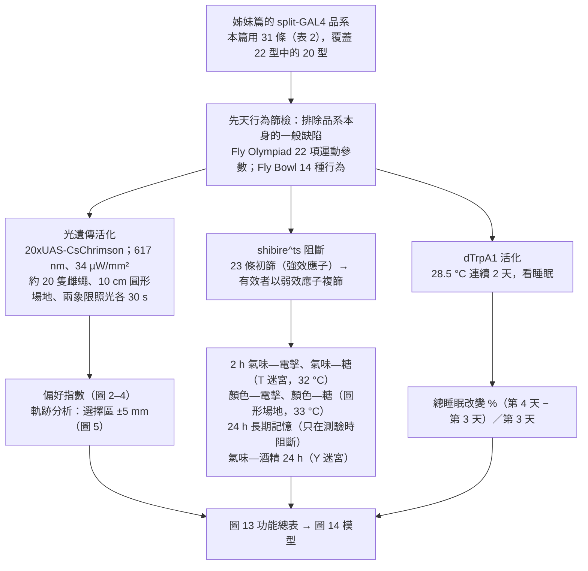

**先天行為篩檢。** Fly Olympiad 與 Fly Bowl 是兩套高通量的一般行為檢查：前者測 22 項基本運動參數（受驚反應、視動反應、趨光），後者在開放場地自動辨認走路、追逐、理毛等 14 種行為。目的是排除品系本身的走路或視覺缺陷干擾後續的記憶與睡眠實驗。結果沒有品系出現跨兩種 shibire^ts 效應子都一致的缺陷；只有 MB549C 走得較慢，後續分析歸因於該品系的遺傳背景而非 MBON 被關掉；MB052B 只有雄蠅出現表型，因此活化實驗不用該品系的雄蠅。

**品系與表現量。** 31 條 split-GAL4 列在表 2（本頁未重製該表），表 2 中以括號標出的細胞型別，表示該型表現弱、隨機或只在部分報導基因下看得到。作者強調一個少見的做法：**表現量用插在同一個基因組位置的報導基因來量**。理由是同一構築插在不同位置，表現量就不同；報導基因若與效應子插在不同位置，量到的強弱不能代表效應子的強弱。最準的做法是直接測效應子本身：CsChrimson 帶有 mVenus 螢光標籤，可以直接染 mVenus。其他實驗退而求其次，用插在與效應子同一位置的螢光報導基因，**唯一的例外是 2 小時氣味記憶用的弱效應子 UAS-Shi x1**（以 P 元素隨機插入，沒有同位置的報導基因可用）。表現量以 0–5 的灰階呈現在各圖的矩陣裡；作者自陳跨型別比較灰階不準。

**判定標準（方法自述）。** 「要把一個功能指派給一群細胞，必須用兩條不同的 GAL4 品系都看到效果」；只有一條品系時「只宜解讀為提示性的」，除非是在確認已發表的結果；一條顯著、另一條表現相似的不顯著時，只說「提出可能性」。作者並說整體設計「強調避免偽陽性」，所以「可能漏掉了一些細胞型別」。

**光遺傳。** 圓形場地直徑 10 cm、高 3 mm，四象限以 1 mm 隔板分開，617 nm LED，照光區 34 µW/mm²，交界處 10 mm 內由 34 降到 3 µW/mm²。CsChrimson 要有視黃醛當輔因子才能作用，所以餵在食物裡：羽化（從蛹變為成蟲）前 0.2 mM、之後 0.4 mM，22 °C 暗處飼養；測 4–10 日齡雌蠅，25 °C、50% 相對濕度。協定分四段，每段 30 秒：0–30 s 不照、30–60 s 照 Q2 與 Q3、60–90 s 不照、90–120 s 改照 Q1 與 Q4（原文未說明 Q2、Q3 是相鄰還是對角的兩象限）；PI 取兩段照光的最後 5 秒（55–60 s、115–120 s）平均。每秒 30 張、1024 × 1024 像素攝影。統計：圖 2C 為 Kruskal–Wallis 加 Dunn 事後檢定；圖 3G 與圖 4 為單因子 ANOVA 加 Bonferroni；圖 5D 為比例相等檢定加 Dunn–Šidák 校正。**只呈現 20xUAS 版本的資料**；作者說 5x 與 10x 的初步結果顯示「表現太弱或太強都可能看不到表型」。

**2 小時氣味記憶（T 迷宮）。** 約 50 隻一管；OCT 稀釋到 1%、MCH 稀釋到 2%（石蠟油稀釋）；嫌惡：一個氣味給 1 分鐘並配 12 下 1.5 s、90 V 電擊，另一個氣味給 1 分鐘但不配電擊；獎賞：飢餓到約 10% 死亡率，糖紙配對（依 Liu et al. 2012；圖 7 圖說寫飢餓 28–40 小時）。訓練前 30 分鐘起到測驗結束都在 32 °C。測驗時讓果蠅在兩個氣味間選擇 2 分鐘，全程錄影；每一時刻都可由果蠅分布算出一個 PI，取這 2 分鐘最後 10 秒各時刻 PI 的平均當成該組成績。初篩用強效應子、25 °C 飼養；複篩用 UAS-Shi x1、18 °C 飼養。統計：常態且變異數同質者用 t 檢定或 ANOVA 加 Bonferroni；圖 7B 改用 Kruskal–Wallis 加 Dunn。（初篩先用強效應子，是因為有些品系在允許溫度下就出現表型，推測是效應子表現量太高，所以陽性者改用弱效應子複篩確認。）

**顏色記憶。** 每次 30–40 隻雌雄混合；藍 452 或 456 nm（14.1 cd m⁻² s⁻¹，原文單位）、綠 520 nm（70.7 cd m⁻² s⁻¹）由下方照射；嫌惡：CS+ 期間 60 s 內給 12 下 1 s、AC 60 V 電擊，電擊格柵是鍍在玻璃上的 ITO（氧化銦錫，一種透明導電材料；※ 推論：用透明材料應是為了讓下方的色光穿上來，原文只寫 transparent）；獎賞：2 M 蔗糖乾燥濾紙，飢餓到約 20% 死亡率。訓練重複 4 次後立即測驗 90 秒（圖 8A、9A）。只用強效應子。

**長期記憶。** 5 次間隔訓練（每次間隔 15 分鐘，25 °C），每次 1 分鐘配 12 下 1.5 s、60 V 電擊；之後 18 °C 保存 24 小時，測驗前 30 分鐘升到 32 °C，**只在測驗時阻斷**。氣味濃度 OCT 0.36 mM、MCH 0.325 mM。初篩每條品系 n＝7–10（MB093C 為 20），與「只帶效應子」的 +/Shi 對照（多次實驗合併成一大組，n > 150）以雙尾 t 檢定比較，並以 Benjamini–Hochberg 控制偽發現率；複篩用 ANOVA 加 Newman–Keuls。

**酒精記憶。** 雄蠅、每組 30 隻；兩種氣味（乙酸乙酯與異戊醇，各以體積比 1:36 溶於礦物油稀釋）依序各 10 分鐘，第二個伴隨 60% 酒精蒸氣；訓練 3 次、間隔 50 分鐘；Y 迷宮測驗 30 分鐘或 24 小時後。阻斷在訓練與測驗時，方法寫 31 °C（圖 11 寫 33 °C，見第五節）。每條品系分兩天做、合計 n＝12；與合併對照做 Wilcoxon 檢定加 Benjamini–Hochberg。

**睡眠。** 處女雌蠅、3–7 日齡、n＝24–35；Trikinetics 活動監測器以紅外線光束計數，1 分鐘一格、共 7 天；睡眠＝連續 5 分鐘以上不動。第 1–3 天 21.5 °C 為基線，第 4–5 天 28.5 °C 活化，第 6 天回到 21.5 °C。初篩用 10X UAS-dTrpA1（attP16），複篩用插在另一位置的 pJFRC124-20XUAS-IVS-dTrpA1（attP18）。

**樣本數。** 光遺傳初篩 n＝11–29（對照 67）；長期記憶與酒精記憶的 n 在方法中；**2 小時氣味記憶與顏色記憶（圖 6–9）在正文、方法與圖說中都沒有報告 n**（本頁以「n =」「n=」「sample size」搜過全文）。

### 三、結果

#### 3.1 規模：22 型 MBON、31 條品系、8 種行為作業

全篇共用到 31 條品系（表 2）：25 條用在光遺傳篩檢，23 條用在 shibire^ts 初篩，其餘是確認用的第二條品系。行為作業共 8 種：光遺傳偏好、2 小時氣味—電擊記憶、2 小時氣味—糖記憶、顏色—電擊記憶、顏色—糖記憶、24 小時長期記憶、氣味—酒精記憶、睡眠。

表 1 列出 22 型 MBON 與每側細胞數：葉上 21 型（MBON-01 至 -21）合計 34 顆，加萼部 1 顆。最大的一型是 MBON-β′1（8 顆），其他都是 1–2 顆（「21 型中除一型外都只有一兩顆」）。光遺傳篩檢的 25 條品系覆蓋 22 型中的 20 型；缺的兩型是 MBON-γ1γ2 與 MBON-γ4γ5（※ 依圖 2C 的矩陣列名比對表 1；圖說只寫 20 of 22）。γ3 與 γ3β′1 在所有品系中總是一起出現，無法分開。

> 驗算：表 1 的細胞數，MBON-01 至 -21 依序為 1、1、1、1、1、1、2、1、1、8、1、2、1、2、2、1、2、1、2、1、1，合計 34，與摘要「34 output neurons of 21 types」一致；加 MBON-22（萼部）共 22 型 35 顆。

#### 3.2 單獨叫醒 MBON 就能讓果蠅靠近或走開（圖 2、3）

依圖 2C 逐條判讀（※ 星號從圖讀出）：

| 傳遞物質 | 品系數 | 顯著（方向） | 不顯著 |
|---|---:|---|---|
| 麩胺酸 | 8 | MB298B（γ4>γ1γ2）\*\*\*、MB434B（γ4>γ1γ2＋β1>α）\*\*、MB011B（M4/M6 群三型：γ5β′2a、β′2mp、β′2mp_bilateral）\*\*\*，**皆為走開** | MB433B（主要 β1>α）、MB210B、MB002B（M4/M6 子集）、MB399B（β2β′2a）、MB310C（α1） |
| GABA | 4 | MB083C（γ3＋γ3β′1）\*\*\*、MB110C（同）\*\*、MB112C（γ1pedc>α/β）\*\*，**皆為靠近** | MB057B（β′1） |
| 乙醯膽鹼 | 12 | MB090C（γ2α′1）\*、MB077B（γ2α′1）\*\*\*、MB052B（V2 群五型）\*\*\*，**皆為靠近** | 其餘 9 條（含 α3、α′2、α2sc、α′1、α′3 等子集） |
| 萼部 | 1 | — | MB242A |
| **合計** | **25** | **9（走開 3、靠近 6）** | **16** |

> 依圖 2C 讀出並驗算：8 ＋ 4 ＋ 12 ＋ 1 ＝ 25；顯著 3 ＋ 3 ＋ 3 ＝ 9。圖說 n＝11–29（對照 67）。

**這張表要看的是右欄。** 「所有走開的都是麩胺酸、所有靠近的都是 GABA 或乙醯膽鹼」在 9 條顯著品系上沒有反例；但 16 條不顯著，其中 5 條是只標麩胺酸 MBON 的。尤其 MB310C（MBON-α1）與 MB399B（MBON-β2β′2a）的中位數都在 0 附近。**所以「麩胺酸 MBON 推動走開」是對顯著者的描述，不是每一型都被證實。** 作者自己的說法是「behavioral valence was highly correlated with MBON transmitter type」，並在正文說 M4/M6 群與 V2 群要整群活化才有強效果，子集「效果大減」。

> MB011B 標的三型是 MBON-γ5β′2a、MBON-β′2mp、MBON-β′2mp_bilateral；M4/M6 群的第四型 MBON-β2β′2a 不在其中（上表由 MB399B 標此型）。

果蠅可能天生偏好光或躲光，所以要排除「趨光」的干擾。作者取六條選出的品系（MB434B、MB011B、MB083C、MB112C、MB077B、MB052B），用帶品系、但不帶 CsChrimson 的果蠅（split-GAL4/+）照同樣的光（圖 3G）。這些果蠅都沒有顯著的光偏好，表示前述偏好來自 MBON 被活化，不是光本身。

#### 3.3 效果是組合性的（圖 4）

依圖 4 判讀（※ 從圖讀出，誤差約 ±0.02）：

| 組合 | 單獨 A | 單獨 B | 兩者相加（※ 推算） | 實測組合 | 顯著性（圖上） |
|---|---:|---:|---:|---:|---|
| MB434B＋MB011B（走開＋走開） | −0.19 | −0.19 | −0.38 | −0.40 | 組合分別與 A、B 比：皆 \*\* |
| MB083C＋MB112C（靠近＋靠近） | 0.29 | 0.26 | 0.55 | 0.24 | ns |
| MB077B＋MB052B（靠近＋靠近） | 0.26 | 0.30 | 0.56 | 0.36 | vs MB077B \*；vs MB052B ns |
| MB083C＋MB077B（靠近＋靠近） | 0.29 | 0.26 | 0.55 | 0.42 | \*、\*\* |
| MB112C＋MB077B（靠近＋靠近） | 0.26 | 0.26 | 0.52 | 0.45 | \*\*、\*\* |
| MB434B＋MB077B（走開＋靠近） | −0.19 | 0.26 | 0.07 | 0.12 | 與 A、B 都顯著不同 |
| MB434B＋MB083C | −0.19 | 0.28 | 0.09 | 0.16 | 同上 |
| MB011B＋MB083C | −0.20 | 0.28 | 0.08 | 0.12 | 同上 |
| MB011B＋MB112C | −0.20 | 0.26 | 0.06 | 0.08 | 同上 |

> 讀表說明：
> - 「單獨 A／B」是兩條品系各自活化時的光偏好 PI（見本頁用語），正＝靠近、負＝走開。
> - 「顯著性」欄是把組合分別與兩個單獨品系比較，不是與 0 比；「與 A、B 都顯著不同」＝組合與兩個單獨品系都有顯著差異。
> - 同一品系在不同列的單獨值略有出入（0.29／0.28、−0.19／−0.20）。圖 4 圖說說部分基因型的資料在不只一個分格重複畫出，所以這是同一筆資料，差異來自讀圖誤差（約 ±0.02）。
> - 「兩者相加」是本頁把兩個單獨 PI 直接相加，論文沒有做這個計算。PI 有上下限（±1），而且行為反應未必線性，所以相加只是粗略的參照。

**兩種方向的組合要用不同判準來看：**

- **相反方向（走開＋靠近）：看實測是否接近相加值。** 四組都落在相加值附近（差 0.02–0.07），看起來很像加法。其中較小的差距在讀圖誤差範圍內。
- **同方向（靠近＋靠近、走開＋走開）：看組合是否顯著強於各單獨品系**，這是正文用的判準。例如 MB083C＋MB077B 實測 0.42，雖低於相加值 0.55，但顯著強於兩個單獨品系，所以算「更強」。

**依這個判準，同方向的 5 組中有 2 組不符合。** 一組是 GABA 組合 MB083C＋MB112C：完全沒有加成，實測 0.24 比任一單獨（0.29、0.26）都低。另一組是乙醯膽鹼組合 MB077B＋MB052B：與 MB052B 單獨沒有顯著差別。正文寫「同方向的組合一般比單獨強」、討論寫「效果看起來是相加的」，與這 2 組不合（見第五節）。

※ 推論：MB083C＋MB112C 的 0.24 離上限 1 很遠，不是天花板效應。兩者合起來沒有加成、甚至略低，有兩種可能（兩條品系標的都是 GABA MBON：MB083C 標 γ3、γ3β′1，MB112C 標 γ1pedc>α/β）。第一，MB112C 標的 MBON-γ1pedc>α/β 軸突伸進 α/β 葉，可能影響那裡其他 MBON，抵消一部分效果。第二，品系組合可能多標了非目標細胞（見圖 4 解讀）。本篇資料分不出是哪一種。

#### 3.4 MBON 偏置的是方向，不是動作（圖 5）

在交界兩側各 5 mm 的選擇區追蹤單隻果蠅（每個基因型 79–410 條「從暗側進入」的軌跡、43–280 條「從亮側進入」的軌跡）。從暗側進入、最後走到亮側的比例：對照約 0.80，MB434B＋MB011B 約 0.37，MB112C＋MB077B 約 0.93（※ 從圖 5D 判讀）。這個「選擇機率」與光偏好 PI 高度相關（r＝0.91，p < 0.001；每個基因型一點，共 10 點＝9 個基因型＋對照）。因為只有 10 點，相關係數小時 p 值很大。照光區內的走路速度改變、角速度改變都與 PI 無關（r＝0.13、p＝0.72；r＝0.12、p＝0.75）。對照組比較：活化苦味受器（Gr66a）讓果蠅進入亮區時加速，活化一大群嗅葉投射神經元（NP225）讓果蠅出現固定的後退走法（影片 4、5）——**那兩種是「動作」改變，MBON 不是**。

#### 3.5 嫌惡記憶：一對 MBON—DAN 同時負責氣味與顏色（圖 6、8）

- **2 小時氣味—電擊記憶。** 23 條品系以強效應子初篩，9 條有下降（圖 6B 的方框數與正文一致）；以弱效應子複篩後只剩 MB112C（MBON-γ1pedc>α/β）。改用弱效應子的理由：強效應子表現量太高，有些品系在允許溫度（效應子尚未作用的低溫）下就出現表型，所以初篩陽性要用弱效應子確認。弱效應子沒看到效果，可能是初篩為假陽性，也可能是阻斷不夠強，本篇沒有區分。第二條品系 MB085C 確認。允許溫度下正常，氣味與電擊的躲避正常。依圖 6C 判讀，MB112C/Shi 約 −0.25、對照約 −0.45；記憶約剩一半多，不是消失（※ 從圖判讀）。
- **同格的 DAN。** 阻斷 PPL1-γ1pedc（MB438B）同樣損害；以 dTrpA1 升溫活化它代替電擊，3 分鐘記憶約 −0.53（對照約 0）。MB438B 依表 2 也弱標 PPL1-α2α′2，所以效果也可能部分來自這型 DAN。
- **解剖。** 單細胞標記（MCFO）與雙色標記（R12G04-LexA 標 MBON、MB320C 標 DAN）顯示兩者在 γ1 與 pedc 精確重疊（圖 6K）。
- **顏色—電擊記憶。** 強效應子篩檢找到 MB112C；MB262B 與 MB085C（資料未示）確認；MB438B 也損害（圖 8）。對照組的記憶分數本身只有約 −0.12 到 −0.17（※ 從圖判讀），比氣味記憶小得多。顏色記憶本身弱，可偵測的損害範圍就小，結果較易受雜訊影響。
- **四條麩胺酸品系** 在強效應子初篩中有下降、弱效應子無法確認（討論）。依圖 14B 的模型（見 3.9），嫌惡學習讓 GABA MBON 變弱，麩胺酸 MBON 因此被放開而推動走開；麩胺酸 MBON 是輸出端，所以在嫌惡記憶中應該必需。作者承認沒看到這個必需性，並提議以品系組合擴大阻斷範圍。

#### 3.6 獎賞記憶：許多型、跨感覺部分共用（圖 7、9、11）

| 作業 | 顯著損害的品系 | 作者的歸屬 |
|---|---|---|
| 2 h 氣味—糖（圖 7） | 8 條：MB011B、MB310C、MB082C、MB093C、MB018B、MB051B、MB077B、MB050B | V3/V4 群乙醯膽鹼 5 條：MB082C、MB093C＝α3（弱標 α′2）、MB018B＝α′2、MB051B、MB077B＝γ2α′1；MB310C＝MBON-α1；MB011B＝M4/M6 群；MB050B（α2sc、α′1）「未解決」，見下 |
| 顏色—糖（圖 9） | 5 條：MB434B、MB011B、MB210B、MB542B、MB052B | M4/M6 群（β′2mp、γ5β′2a）、γ4>γ1γ2、V2 群 |
| 24 h 氣味—酒精（圖 11） | 8 條：MB298B、MB434B、MB011B、MB210B、MB082C、MB018B、MB077B、MB027B（※ 依圖 11B 星號計數） | γ4>γ1γ2（MB298B、MB434B 兩條）、α′2（MB018B，MB091C 確認）、M4/M6 群（MB011B）；γ2α′1 只有一條（MB077B）顯著；α3 的兩條（MB082C 與 MB093C）結果不一致 |

> 氣味—糖列的 MB050B：圖 7 圖說說 MB052B 標的細胞包含 MB050B 的兩型、再加其他型，而 MB052B 在 2 小時氣味—糖記憶中沒有表型，所以這兩型是否必需「未解決」。圖說寫 MB050B 標「MBON-α2 與 MBON-α′1」，表 2 為 α2sc。
>
> 酒精這一列的第八條 MB027B（α′3m、α′3ap）在正文沒有被提到，只出現在圖 11F 的括號裡。

**三種獎賞記憶都需要 M4/M6 群（MB011B 在三作業都顯著）**；乙醯膽鹼 V3/V4 群只在氣味記憶需要，顏色記憶不需要。

**酒精記憶會隨時間由嫌惡轉為獎賞。** 正常果蠅在訓練後 30 分鐘躲開配過酒精的氣味，24 小時後反而偏好它。阻斷 MBON-α′2（每側一顆）時，24 小時後果蠅仍躲開該氣味，停在 30 分鐘時的「嫌惡」狀態。作者由此主張「酒精的嫌惡與獎賞記憶同時形成，經不同的 MB 迴路在不同時間表現」，且由嫌惡轉為獎賞是「主動」過程。「主動」指這個轉換需要特定 MBON 參與，而不是嫌惡記憶自己隨時間淡掉。

#### 3.7 長期記憶的讀出需要 V2 群整群（圖 10）

只在測驗時阻斷。MB052B（V2 群五型）讓 24 小時記憶幾乎完全消失（ANOVA F₂,₃₃＝14.84，p < 0.0001；允許溫度 F₂,₂₄＝0.95，p＝0.40）；五條只標其子集的品系都不顯著，作者因此說 V2 群「整群」負責。MB082C（α3，弱標 α′2）也有損害，但另一條 α3 品系 MB093C（初篩 n＝20）與既有的 G0239（Plaçais et al. 2013 用過的另一條 MBON-α3 品系）都沒有，作者沒把它歸給 MBON-α3。

#### 3.8 睡眠：與光偏好同邊（圖 12）

初篩 5 條減少睡眠（全是麩胺酸：MB298B、MB434B、MB011B、MB210B、MB002B）、7 條增加睡眠（GABA 的 MB083C、MB110C，乙醯膽鹼的 MB051B、MB090C、MB077C，萼部的 MB242A、MB622B）。其中 MB622B 是另一條萼部 MBON 品系（表 2），光遺傳篩檢沒用它；MB077C 是另一條 γ2α′1 品系（表 2），不是 MB077B 的筆誤。

初篩共 12 條陽性，複篩改用另一個插入位置的 dTrpA1：

- 圖 12D 呈現的 8 條都重現。
- MB242A 也複篩了，但沒重現（資料未示）。
- 剩下 3 條（MB110C、MB090C、MB622B）是否複篩，論文沒交代（見第五節 6(h)）。

依圖 12D 判讀，減少的約 −20% 到 −30%，增加的約 +23% 到 +28%，對照約 +5%（※ 從圖判讀）。「促醒」的 MBON 與「光遺傳走開」的大致是同一群，「促眠」的與「靠近」的大致是同一群。

#### 3.9 總表與模型（圖 13、14、15）

圖 13 把八種作業的結果排成一張矩陣：實心＝只操作這一型就有顯著表型；斜線＝品系標記多型，只能歸給該群；淺色＝提示性。

圖 14 提出「平衡被打破」的模型。未訓練時，推動靠近與推動走開的 MBON 兩邊平衡。模型假設 MBON 之間有抑制性連結：麩胺酸 MBON 抑制 GABA 與乙醯膽鹼 MBON，GABA MBON 抑制麩胺酸 MBON。（CS+ 見本頁用語。）

- **嫌惡學習：** γ1pedc 的 GABA MBON 對 CS+ 的反應變弱 → 它對麩胺酸 MBON 的抑制變少 → 麩胺酸 MBON 變強 → 果蠅走開。
- **獎賞學習：** 麩胺酸 MBON 的格裡，對 CS+ 的反應變弱 → 它對 GABA 與乙醯膽鹼 MBON 的抑制變少 → 這些 MBON 變強 → 果蠅靠近。

圖 15 提出 MBON 末梢與嗅葉投射神經元、側角輸出神經元在 CRE、SMP、SIP、SLP 匯聚，是整合先天與習得價值的節點。

### 四、討論

**主張一：MBON 群體表徵價值，偏置而非指揮動作。** 證據中到強。光遺傳在沒有氣味的情況下引起靠近或走開（9 條品系），軌跡分析顯示改變的是交界處的轉向選擇而非速度與轉彎率，而且動作不固定。這些都是在未訓練果蠅上的人工活化，作者把它當成「學習後 MBON 反應改變」的類比；但學習後的 MBON 反應本篇沒有量（引 Séjourné 2011 說 V2 群對 CS+ 反應下降）。

**主張二：MBON 推動的方向，一般與同格 DAN 寫入的記憶方向相反，最容易用「多巴胺讓 KC→MBON 突觸變弱」解釋。** 原文：「The sign of preference we observed in response to CsChrimson activation of particular MBONs was, in general, opposite to that of the memory induced by dopaminergic input to the corresponding MB compartments.」作者舉的例子是 γ1pedc>α/β 與 γ2α′1（活化→靠近；該格 DAN→嫌惡記憶），以及麩胺酸 MBON（活化→走開；該格 DAN→獎賞記憶）。

「突觸變弱」為什麼最容易解釋這個相反關係：以懲罰格為例，這格的 MBON 推動靠近。若多巴胺讓 KC→這型 MBON 的突觸變弱，之後同一氣味推動靠近的力量就變小，天平倒向走開，正好得到嫌惡記憶。獎賞格反過來：那裡的 MBON 推動走開，突觸變弱後走開的力量變小，結果是偏好該氣味。

**這條通則的證據比它在後續文獻中的地位弱。**(1) 可直接比對「單型 MBON 方向」與「同格 DAN 記憶方向」的格只有少數：γ1pedc、γ2α′1、γ4（MB298B）。(2) γ5、β′2 的麩胺酸 MBON 只有整群（MB011B）顯著；這條品系同時標記三型，效果無法歸給單一格，所以不能逐格比對。(3) α1、β2β′2a 的 MBON 所在格有獎賞 DAN（圖 1A 的綠色箭頭），但活化它們沒有偏好。(4) γ3 與 γ3β′1 這兩型 MBON 位在 PAM 支配的範圍（圖 1A 的 PAM 虛線框），活化它們讓果蠅**靠近**。（γ3β′1 的樹突跨 γ3 與 β′1 兩格；只標記 β′1 的 MB057B〔MBON-β′1〕不顯著。）
- 「PAM 群多半傳獎賞」只是整群的傾向。圖 1A 沒有畫出 γ3、β′1 這兩格的 DAN 寫入哪種記憶，所以這兩格的記憶方向本篇沒有證據，無法拿來檢驗「與 DAN 相反」：既不支持，也不違反。
- 但本庫部分頁面（轉述 Felsenberg 2017、2018 的整理）把通則寫成以 DAN 群來分的「PAM 支配的格，MBON 推動走開」。照這個說法，這兩型**就是反例**。

**其他可能機制。** 作者也提出兩種：
- 多巴胺增強 KC 釋放 sNPF。sNPF（short neuropeptide F）是 KC 釋放的一種神經胜肽，作用在帶有其受體的下游細胞時是抑制性的。這是讓 KC 多送出一種抑制訊號，與「突觸變弱」是不同機制。
- 多巴胺的效果依 KC 當時是否活動而定。

作者並引脊椎動物的基底核（腦中與動作選擇和獎賞學習有關的結構）：那裡同一類突觸受多巴胺影響後可變強也可變弱，稱為雙向可塑性。引這個例子是要說明「多重機制可能並存」。

**主張三：嫌惡記憶集中、獎賞記憶分散。** 證據中等。嫌惡的集中有兩條品系、兩種感覺（氣味、顏色）、加上同格 DAN 的阻斷與代替實驗，是本篇最完整的一條。獎賞的「分散」部分來自篩檢的不對稱。比較的是兩個 2 小時氣味作業，兩者都先用強效應子初篩、再用弱效應子複篩：

| 作業 | 初篩品系數 | 初篩陽性 | 弱效應子複篩後仍陽性 |
|---|---|---|---|
| 2 小時氣味—電擊（嫌惡） | 23 | 9 | 1 |
| 2 小時氣味—糖（獎賞） | 23 | 12 | 8 |

同樣的流程，獎賞那邊被刪掉的少，留下的品系多，看起來就「分散」。顏色記憶只用強效應子，不在這個比較內。這是否反映生物學、還是兩種作業對阻斷的敏感度不同，本篇沒有檢驗。

**主張四：MBON 與 DAN 不在同一格時，資訊靠 MBON 網路轉運。** 證據弱，是推測。作者自己點出一個錯配：乙醯膽鹼 MBON 是獎賞記憶所需，但它們所在的格由 PPL1（懲罰型）支配，不收 PAM 的獎賞訊號。作者提出由跨格的 MBON 連結或蕈狀體外的連結轉運，並說需要電子顯微鏡層級的連結體驗證。

**主張五：MBON 群體同時表徵價值與內在狀態（睡眠、清醒）。** 證據中等到弱。睡眠與光偏好的對應是兩組獨立實驗的類比（不同效應子、不同溫度、不同性別的果蠅），作者以「愉快—不愉快、激發—不激發」兩軸做推測性的詮釋，引 Anderson & Adolphs 2014 的情緒原始型框架。這個框架把情緒拆成上述幾個基本維度；作者把 MBON 表徵的價值對應到「愉快—不愉快」軸，把睡眠與清醒對應到「激發—不激發」軸。

### 五、問題與限制

**1. 寫入還是讀出分不開。** 2 小時記憶與顏色記憶在訓練、保留、測驗全程阻斷；作者明說「預期會偵測到任何記憶處理階段的損害」。只有長期記憶只在測驗時阻斷。作者在討論承認「仍待證明這些 MBON 的輸出是在提取時短暫需要」。

**2. 陰性結果多，而且是刻意的。** 作者自陳設計「強調避免偽陽性」，弱效應子複篩把 2 小時嫌惡記憶的 9 條初篩陽性刪到 1 條。所以「某型 MBON 不需要」不能從本篇讀出；冗餘是主要的替代解釋：多型 MBON 互為備援，關掉一型可能被其他型補上。作者引「保守的果蠅基因不到一半剔除後有表型」作類比。「保守」指演化上許多物種都保有、一般認為重要的基因；類比的用意是：重要的元件拿掉，也常看不出效果，因為有備援。

**3. 樣本數。** 2 小時氣味記憶與顏色記憶（圖 6–9）在全文與圖說中沒有報告 n（本頁搜過）。光遺傳初篩 n＝11–29。

**4. 性別與條件各不相同。** 光遺傳用雌蠅、酒精用雄蠅、顏色記憶雌雄混合、睡眠用處女雌蠅、2 小時氣味記憶未寫；溫度從 28.5 °C 到 34 °C。MB052B 在雄蠅有雄性專一的表現，所以活化實驗只用雌蠅。圖 13 把這些不同條件的結果排在同一張表上。

**5. 「傳遞物質」是推定的，連結的正負號是假設的。** 麩胺酸對下游是興奮還是抑制，取決於下游的受體，作者自己說「我們不知道」；圖 14 的抑制連結是假設。

**6. ⚠️ 論文自身不一致（本頁稽核）。**
- (a) **判定標準與總表不一致**：方法說只有一條品系時「只宜解讀為提示性」，圖 13 卻以「實心」標示 MBON-α1 在氣味—糖記憶中的角色（只有 MB310C 一條）、MBON-γ1pedc>α/β 在「靠近」中的角色（光遺傳只用了 MB112C 一條）。圖 13 圖說的實心標準是「只操作這一型」，與方法的「兩條品系」是不同的標準，兩者並列而沒有說明。
- (b) **圖 9B 圖說寫「Screening for MBONs required for aversive visual conditioning」**，該圖是獎賞（糖）顏色記憶。
- (c) **正文寫「MB091C in Figure 12E」**，MB091C 的資料在圖 11E；圖 12 是睡眠。
- (d) **正文寫「MBON-β′2a_bilateral」**（睡眠一節），表 1 沒有這一型，應為 MBON-β′2mp_bilateral。
- (e) **酒精記憶的阻斷溫度**：方法 31 °C，圖 11C–E 標 33 °C。
- (f) **圖 5F–H 的統計寫法**：「Spearman's rank-order correlation: Pearson r = 0.91」，同一句裡出現兩種相關係數。
- (g) **同方向組合「一般更強」**（正文）與「效果看起來是相加的」（討論）：圖 4 的 5 組同方向組合中，GABA＋GABA（MB083C＋MB112C）為 ns 且數值低於任一單獨，MB077B＋MB052B 與 MB052B 單獨為 ns（見 3.3）。
- (h) **睡眠複篩的品系數**：初篩 12 條顯著，正文說複篩「確認了除一條之外的全部」，圖 12D 只呈現 8 條、另述 MB242A 未重現；MB110C、MB090C、MB622B 是否複篩，PDF 沒有交代。
- (i) **酒精記憶顯著的 8 條中，MB027B 正文未提**（只在圖 11F 括號中）。
- (j) 圖 10 圖說「The bottom and top of each box represents…」整句重複兩次（編輯瑕疵，不影響內容）。

**7. 本庫稽核出的、論文自己沒處理的問題：「與 DAN 相反」的通則只有三格能直接檢驗。** 論文用「in general」措辭，例子是 γ1pedc>α/β、γ2α′1 與「麩胺酸 MBON」。把圖 1A（哪幾格的 DAN 寫入哪種記憶）與圖 2C（哪幾型 MBON 單獨顯著）逐格對齊：同時有「單型 MBON 顯著」與「同格 DAN 記憶方向」的只有 γ1pedc、γ2α′1、γ4 三格，三格都符合相反。γ5、β′2 只在三型合併時顯著；α1、β1、β2 的 MBON 單獨活化不顯著；α2、α3 等 PPL1 支配的 α 葉格，圖 1A 沒有記憶箭頭，所以無法比對；γ3、β′1 的 DAN 方向未標，同樣無法比對。※ 推論：這條通則在 2014 年時是「三格符合、其餘無資料或無效果」，而不是「多數格都檢驗過」。本庫部分頁面（轉述 Felsenberg 2017、2018 的整理）把它寫成「PAM 支配格的 MBON 推動走開」時，忽略了本篇自己的 γ3／γ3β′1（GABA、靠近）。

### 六、未來

**論文自陳的方向。** (1) 用品系組合擴大阻斷範圍，檢驗模型預測的麩胺酸 MBON 在嫌惡記憶中的角色；(2) 用成像與電生理直接看單一神經元的可塑性，避開冗餘造成的遮蔽；(3) 電子顯微鏡層級的連結體確認光學顯微鏡推測的連結，並以生理實驗定出連結的正負號；(4) 用消退與逆轉學習的作業，檢驗多層 MBON 網路處理新舊記憶衝突的角色。消退＝學會後讓刺激單獨出現、不再配獎懲，原記憶隨之減弱；逆轉學習＝把原本配獎懲與不配獎懲的兩個刺激對調，重新訓練。(5) 找出讀取 MBON 群體活動的下游，作者首推投射到中央複合體扇形體的神經元。中央複合體是果蠅腦中央協調動作的區域，扇形體是其中一部分；這些神經元的樹突廣泛分布在 MBON 末梢所在的區域，所以作者首推它們。(6) MBON 的 RNA 表現譜。

**本庫關注的後續。** 作者推論的「多巴胺讓 KC→MBON 突觸變弱」由 [[s-hige-2015-heterosynaptic-plasticity]] 在 γ1pedc 以電極直接量到；[[s-handler-2019-dopamine-receptor-timing]] 再發現 KC→MBON 突觸也可以變強（量的是 γ4 格，不是 γ1pedc），取決於氣味（KC 活動）與多巴胺誰先誰後：多巴胺先到、氣味後到時變強。第 (4) 點由 [[s-aso-2016-dan-cell-type-rules]]（各格寫入與更新的規則）、[[s-felsenberg-2017-re-evaluation]] 與 [[s-felsenberg-2018-memory-extinction]]（消退時 MBON 回頭叫醒相反價值的 DAN）接手；本篇看到的「MBON 末梢落在別格 DAN 的樹突上、形成回饋迴路」由 [[s-ichinose-2015-reward-recurrent-circuit]]（MBON-α1→PAM-α1）與 [[s-huang-2024-dopamine-memory-dynamics]]（MBON-γ1pedc>α/β→PPL1-α3）在功能上檢驗，見 [[t-mbon-dan-feedback]]。第 (3) 點的連結體在 [[s-minnick-2026-untrained-connectome]] 與 Huang 2024 被拿來建模。

**尚未被回答的。** 除了 γ1pedc、γ2α′1、γ4 三格，其餘各格的「MBON 方向 vs DAN 記憶方向」仍沒有單型層級的對照；γ3、γ3β′1 這兩型位在 PAM 範圍卻推動靠近，同格 DAN 寫入的是什麼記憶，本庫沒有來源。MBON-α1 被活化沒有偏好、卻是獎賞記憶所需（本篇與 Ichinose 2015），它的角色是「價值」還是「回饋給 DAN」，仍待直接檢驗。

---

## 圖

> 本篇主圖 15 張全部收錄。表 1 的細胞數在專業文 3.1 驗算、型別分群寫在「本頁用語」；表 2（31 條品系的表現型別與 AD／DBD 序列）只在專業文與各圖解讀中引用，未重製。圖補充圖 11 張不在 PDF 內，未收。所有圖都從 300 dpi 整頁渲染裁切。

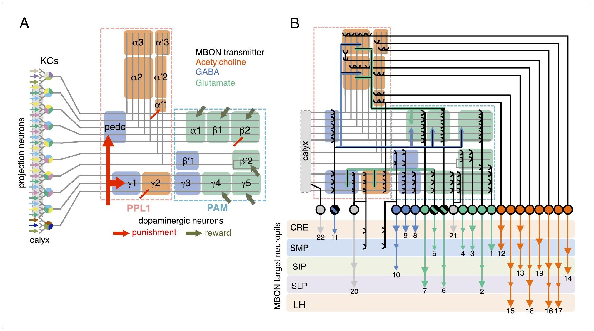

<small>圖片出處：Aso Y, Sitaraman D, Ichinose T et al. *eLife* 3:e04580 (2014)，Figure 1。CC BY（© 2014 Aso et al.）；全文見 [PMC](https://pmc.ncbi.nlm.nih.gov/articles/PMC4273436/)。</small>

> **原圖說（Figure 1）：** Circuit diagrams of the mushroom body. (A) The innervation patterns of extrinsic neurons define 15 compartments in the MB lobes and one compartment in the core of distal pedunculus (pedc); the compartments are represented by rectangles that are color-coded based on the neurotransmitter used by the mushroom body output neurons (MBONs) having dendrites in that compartment (green, glutamate; blue, GABA; orange, acetylcholine). Projection neurons (far left, colored arrows) from the antennal lobe convey olfactory sensory information to the MB calyx where they synapse on the dendrites of Kenyon cells (KCs). The parallel axon fibers of the KCs (gray lines) form the lobes (α/β, α′/β′ and γ) where KCs terminate onto the dendrites of the MBONs. Each of the seven types of KCs innervates a specific layer within a given lobe. The dendrites of individual MBON types and the terminals of dopaminergic neurons (DANs) intersect the longitudinal axis of KC axon-bundles in specific compartments along the lobes. MBONs using the same transmitter are spatially co-localized in the lobes (See Figure 1B). Innervation areas of PPL1 and PAM cluster DANs axons in the MB lobes are indicated by the rectangles outlined in dashed lines. Activation of subsets of DANs can convey punishment or reward, respectively inducing aversive or appetitive memory when activation is paired with odor presentation. The size of arrows indicates magnitude of memory induced by DAN activation. See text for references. (B) Schematic representation of the 21 cell types of MBONs in the lobes and one cell type of MBON in the calyx based on the data presented in the accompanying manuscript (Aso et al., 2014): circles, cell bodies; semicircles, dendrites; arrowheads, axon terminals; color-coding is by neurotransmitter as in panel (A) Three MBON cell-types (GABAergic MBON-γ1pedc>α/β, glutamatergic MBON-γ4>γ1γ2 and MBON-β1>α; marked as 11, 5 and 6 respectively) send axons into the MB lobes. Axons of MBON-γ4>γ1γ2 project from γ4 to γ1 and γ2, and thus have the potential to affect activity of MBON-γ1pedc>α/β. From γ1, the axon of MBON-γ1pedc>α/β projects to compartments in the α/β lobes including β1, where dendrites of MBON-β1>α arborize. Axons of both MBON-γ1pedc>α/β and MBON-β1>α project to the compartments in the α lobe. Therefore activity of MBONs in the α lobe can be regulated by these layered inter-compartmental connections. These three types of MBONs (11, 5 and 6) do not project back to their own dendrites. Therefore, the organization of the MBONs can be viewed as forming a multilayered feed-forward network (Aso et al., 2014). MBONs project to a small number of brain areas: the crepine (CRE; a region surrounding the horizontal/medial lobes), the superior medial protocerebrum (SMP), superior intermediate protocerebrum (SIP) and superior lateral protocerebrum (SLP) and the lateral horn (LH). The size of the arrowhead reflects the relative number of termini in each area. The MBONs are numbered and listed in Table 1. See the accompanying manuscript (Aso et al., 2014) and Table 1 for details.

**圖說中譯：** 蕈狀體的迴路圖。(A) 外來神經元（樹突或末梢進入蕈狀體、但細胞本體不屬於蕈狀體的神經元，本篇指 MBON 與 DAN）的支配範圍在 MB 葉上界定出 15 個區室，另在遠端柄的核心界定出一個區室（pedc）。區室以長方形表示，依樹突位在該區室的 MBON 所用的傳遞物質上色（綠：麩胺酸；藍：GABA；橘：乙醯膽鹼）。來自嗅葉的投射神經元（最左、彩色箭頭）把嗅覺資訊送到 MB 萼部，在那裡與 Kenyon 細胞（KC）的樹突形成突觸。KC 的平行軸突（灰線）形成葉（α/β、α′/β′、γ），KC 在葉上連到 MBON 的樹突。七類 KC 各支配一條葉中的特定一層。各型 MBON 的樹突與多巴胺神經元（DAN）的末梢，在沿著葉的特定區室與 KC 軸突束的長軸交會。使用相同傳遞物質的 MBON 在葉上空間聚集（見圖 1B）。PPL1 與 PAM 兩群 DAN 軸突在 MB 葉上的支配範圍以虛線框標出。活化部分 DAN 可傳遞懲罰或獎賞，與氣味配對時分別誘發嫌惡或獎賞記憶；箭頭大小表示 DAN 活化誘發的記憶強度。文獻見正文。(B) 依姊妹篇（Aso et al., 2014）資料，示意葉上 21 型 MBON 與萼部 1 型 MBON：圓為細胞體、半圓為樹突、箭頭為軸突末梢；依傳遞物質上色，同 (A)。三型 MBON（GABA 的 MBON-γ1pedc>α/β、麩胺酸的 MBON-γ4>γ1γ2 與 MBON-β1>α；編號分別為 11、5、6）把軸突送進 MB 葉。MBON-γ4>γ1γ2 的軸突從 γ4 投射到 γ1 與 γ2，因此可能影響 MBON-γ1pedc>α/β 的活動。MBON-γ1pedc>α/β 的軸突從 γ1 投射到 α/β 葉的各區室，包括 MBON-β1>α 樹突所在的 β1。MBON-γ1pedc>α/β 與 MBON-β1>α 的軸突都投射到 α 葉的區室。因此 α 葉 MBON 的活動可受這些分層的跨區室連結調控。這三型 MBON（11、5、6）不投射回自己的樹突，所以 MBON 的組織可視為多層前饋網路（Aso et al., 2014）。MBON 投射到少數腦區：crepine（CRE，圍繞水平／內側葉的區域）、上內側原腦（SMP）、上中間原腦（SIP）、上外側原腦（SLP）與側角（LH）。箭頭大小反映各區末梢的相對數量。MBON 的編號列於表 1。細節見姊妹篇與表 1。

**解讀：**
- **A 圖是全篇「與 DAN 相反」通則的對照底稿，該看的是箭頭畫在哪幾格、沒畫在哪幾格。** 紅色（懲罰）箭頭指向 pedc 與 γ1（最粗）、γ2、α′1，另有一支小紅箭頭指向 β2；綠色（獎賞）箭頭指向 α1、β1、β2、β′2、γ4、γ5（※ 從圖判讀）。β2 同時有紅、綠箭頭，表示這一格同時收到懲罰型與獎賞型輸入，不能單純歸到任一邊，在「與 DAN 相反」的比對中也用不上。**α2、α3、α′2、α′3、γ3、β′1 沒有箭頭**，也就是 2014 年時這幾格的 DAN 寫入什麼記憶，圖上沒有資料。後文所有「MBON 方向與 DAN 相反」的比對，只能在有箭頭的格做。
- **γ3 與 β′1 是藍色（GABA）卻畫在 PAM 的虛線框裡。** 有兩種分組方式：依 MBON 的傳遞物質（綠、藍、橘），或依支配該格的 DAN 群（PAM、PPL1）。這兩種分組在 γ3、β′1 兩格對不起來。
  - 本庫部分頁面轉述 Felsenberg 2017、2018 的整理時，把本篇結論改寫成以 DAN 群分邊（「PAM 支配的格放麩胺酸 MBON、推動走開」）。本圖並不支持這種寫法。
  - 圖 2C 顯示，γ3 與 γ3β′1 這兩型 GABA MBON（MB083C、MB110C）活化後推動**靠近**；只標 MBON-β′1 的 MB057B 則不顯著。
  - 結論：γ3、β′1 兩格的 DAN 寫入哪種記憶，圖 1A 沒有畫，所以不能拿來檢驗「與 DAN 相反」；但它們確實是「PAM 格的 MBON 推動走開」這種以 DAN 群分邊說法的反例（與第四節主張二 (4) 同一說法）。
- **B 圖的三條「回到葉內」的軸突（11、5、6）是第 3.9 節模型的骨架**，但它們是光學顯微鏡下的投射，不是突觸。圖說用「have the potential to」，作者在討論中也說要靠電子顯微鏡層級的連結體確認。

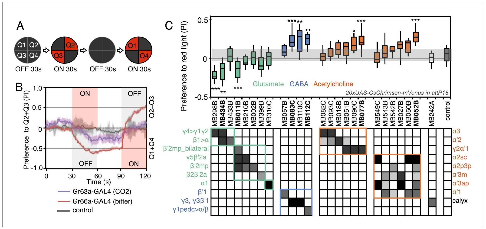

<small>圖片出處：Aso Y, Sitaraman D, Ichinose T et al. *eLife* 3:e04580 (2014)，Figure 2。CC BY（© 2014 Aso et al.）；全文見 [PMC](https://pmc.ncbi.nlm.nih.gov/articles/PMC4273436/)。</small>

> **原圖說（Figure 2）：** Screening MBONs for behavioral valence. (A) Behavioral valence assay. Approximately twenty female flies were placed in a 10 cm circular arena in a dark chamber and allowed to distribute themselves freely among the four quadrants. From 30–60 s, two of the quadrants (Q2&3) were illuminated with 617 nm peaked red LED lights to activate CsChrimson-containing neurons; from 90–120 s, the other two quadrants (Q1 & 4) were illuminated instead. No quadrants were illuminated from 0–30 s or from 60–90 s. The flies were video recorded and their locations in the arena were used to calculate behavioral preferences. (B) For these time-domain plots, the quadrant preference at each point in time was calculated as [(number of flies in Q2&3) - (number of flies in Q1&4)]/(total number of flies). Flies expressing CsChrimson in receptor neurons for CO2 or for bitter taste (using the indicated drivers and 20xUAS-CsChrimson-mVenus in attP18) avoided the illuminated quadrants, whereas the control genotype (empty driver, pBDPGAL4U in attP2/20xUAS-CsChrimson-mVenus in attP18) showed a very slight preference for illuminated quadrants. Lighter colored areas around lines indicate the standard error of the mean. (C) Screening of MBON drivers for behavioral valence. The red-light preference index (PI) was defined as: [(number of flies in illuminated quadrants) - (number of flies in non-illuminated quadrants)]/(total number of flies). For each 2-min experiment, the overall PI was calculated by averaging the PIs from the final 5 s of each of the two red-lights-on conditions (namely, 55–60 s and 115–120 s). MBON cell types expressed in each driver are shown in the matrix below the graph; collectively all the drivers covered 20 of the 22 MBON types. MBON-γ3 and MBON-γ3β′1 are listed together, because these MBON cell types are always labeled together in our split-GAL4 lines. Driver lines shown in bold were selected for more detailed experiments. MBONs have been grouped by cell body cluster, neurotransmitter and color-coded as indicated (see Table 1). The bottom and top of each box represents the first and third quartile, and the horizontal line dividing the box is the median. The whiskers represent the 10th and 90th percentiles. The gray rectangle spanning the horizontal axis indicates the interquartile range of the control. Relative expression levels in individual cell types were estimated by confocal microscopy of brains stained for CsChrimson-mVenus and are shown in gray scale (See ‘Materials and methods’; Figure 3 and Figure 3—figure supplements 1,2 show confocal images). Statistical tests are described in methods: \*, p < 0.05; \*\*, p < 0.01; \*\*\*, p < 0.001; n = 11–29 for GAL4/CsChrimson; n = 67 for control.

**圖說中譯：** MBON 的行為價值篩檢。(A) 行為價值測驗。約 20 隻雌蠅放在暗室裡一個 10 cm 的圓形場地，在四個象限間自由分布。30–60 s 以峰值 617 nm 的紅光 LED 照亮兩個象限（Q2 與 Q3），活化帶 CsChrimson 的神經元；90–120 s 改照另外兩個象限（Q1 與 Q4）；0–30 s 與 60–90 s 不照。錄影，以果蠅在場地中的位置計算行為偏好。(B) 這些時間圖中，每個時刻的象限偏好＝[(Q2 與 Q3 的隻數) − (Q1 與 Q4 的隻數)]／總隻數。在 CO₂ 或苦味受器神經元表現 CsChrimson 的果蠅（用圖中驅動品系與 20xUAS-CsChrimson-mVenus（attP18））躲開照光象限；對照基因型（空驅動品系 pBDPGAL4U（attP2）／20xUAS-CsChrimson-mVenus（attP18）；空驅動品系見本頁用語，attP2、attP18 是基因插入基因組位置的代號）對照光象限有非常輕微的偏好。線旁淺色區為平均值的標準誤。(C) MBON 驅動品系的行為價值篩檢。紅光偏好指數（PI）定義為 [(照光象限隻數) − (未照光象限隻數)]／總隻數。每次 2 分鐘實驗的整體 PI，取兩段照光的最後 5 秒（55–60 s 與 115–120 s）的 PI 平均。各品系表現的 MBON 型別列在圖下矩陣；所有品系合計涵蓋 22 型 MBON 中的 20 型。MBON-γ3 與 MBON-γ3β′1 並列，因為在我們的 split-GAL4 品系中兩者總是一起被標記。粗體品系被選來做更詳細的實驗。MBON 依細胞體群與傳遞物質分組上色（見表 1）。盒的上下緣為第一與第三四分位數，盒中橫線為中位數；鬚為第 10 與第 90 百分位數。橫跨橫軸的灰色長方形為對照組的四分位距。各型細胞的相對表現量以共軛焦顯微鏡觀察 CsChrimson-mVenus 染色的腦估計，以灰階表示（見方法；圖 3 與圖 3 補充圖 1、2 為共軛焦影像）。統計見方法：\* p < 0.05；\*\* p < 0.01；\*\*\* p < 0.001；GAL4/CsChrimson n＝11–29；對照 n＝67。（論文未說明 n 的單位；一次實驗約 20 隻果蠅，n 較可能是實驗次數，※ 推論。）

**解讀：**
- **圖上 25 條品系只有 9 條顯著**（逐條清單見專業文 3.2）。「所有走開的都是麩胺酸」成立，但反過來「麩胺酸 MBON 都推動走開」不成立：MB433B（主要 β1>α）、MB210B、MB002B（M4/M6 子集）、MB399B（β2β′2a）、MB310C（α1）五條只標麩胺酸 MBON 的品系都不顯著，中位數在 0 附近。
- **乙醯膽鹼那一側 12 條只有 3 條顯著，但幾乎全部的中位數都在 0 以上**（※ 從圖判讀）。這種「方向一致、個別不顯著」的型態，與作者「群體編碼、需要整群」的主張相容，也與「檢定力不足」相容；n＝11–29 的盒圖分不出兩者。
- **要分清「單一型別顯著」與「整群顯著」。** 單一型別就顯著的只有：MBON-γ4>γ1γ2（MB298B）、MBON-γ1pedc>α/β（MB112C）、MBON-γ2α′1（MB077B、MB090C）。γ3 與 γ3β′1 也顯著，但沒有品系能把兩型分開，只能當成一組看，嚴格說不算單一型別。M4/M6 群（γ5β′2a、β′2mp、β′2mp_bilateral）與 V2 群（五型）都只有整群顯著。**本庫引用「γ5 MBON 推動走開」（Handler 2019 引本篇）時，本篇能支持的只是「含 γ5β′2a 的三型合起來推動走開」。**
- **對照組本身略偏向照光區**（中位數約 +0.06，※ 從圖判讀；B 圖說也寫「very slight preference」）。所以「靠近」的效果量要扣掉這個基線來看，例如 MB052B 的中位數約 0.27，比對照多約 0.2。

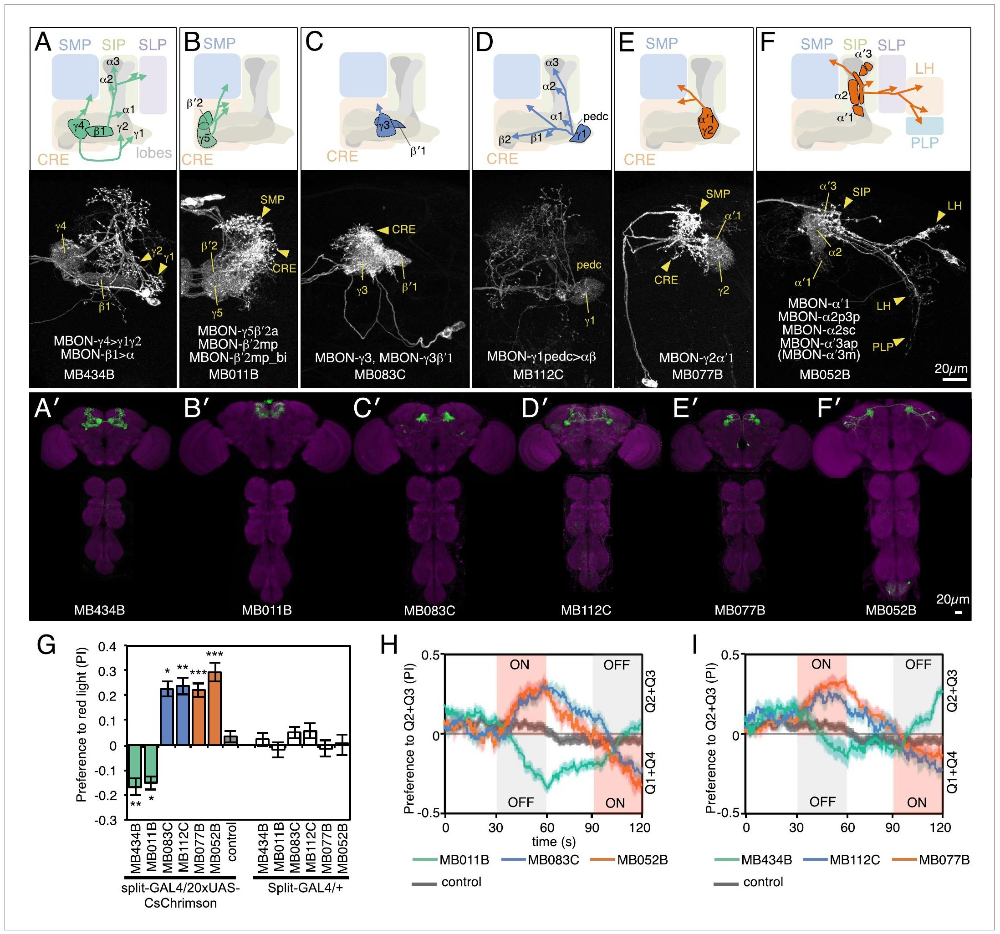

<small>圖片出處：Aso Y, Sitaraman D, Ichinose T et al. *eLife* 3:e04580 (2014)，Figure 3。CC BY（© 2014 Aso et al.）；全文見 [PMC](https://pmc.ncbi.nlm.nih.gov/articles/PMC4273436/)。</small>

> **原圖說（Figure 3）：** MBONs for attraction and repulsion. (A–F) Anatomy of MBONs in six selected drivers. Top: Diagrams of the cell types that show expression with each driver, color-coded by neurotransmitter. The name of the split-GAL4 driver line and the cell type(s) in which it expresses are given at the bottom of each panel. The positions of their dendrites in the MB lobes are indicated; the arrows show the projections of their axons. Bottom: Confocal images of a single brain hemisphere for each line; MB compartments occupied by the dendrites of the MBONs in each line are labeled and the arrowheads indicate the sites of their synaptic terminals. See Figure 1 legend for abbreviations. Full confocal stacks of these images are available at www.janelia.org/split-gal4. (A′–F′) Expression patterns of the same drivers shown in a complete brain and ventral nerve cord: green, expression of CsChrimson-mVenus; magenta, neuropil reference stain (nc82 antibody). Frontal views of maximum intensity projections are shown. See the accompanying manuscript (Aso et al., 2014) for a detailed description of the morphology of each cell type. (G) The preference index (PI) for each experimental group (split-GAL4/CsChrimson) was compared with split-GAL4/+ and pBDPGAL4U/CsChrimson controls. Bars and error bars indicate mean and standard error of the mean respectively. Asterisk indicates significance: \*, p < 0.05; \*\*, p < 0.01; \*\*\*, p < 0.001. (H–I) Time course of the preference index. See legend to Figure 2 for more explanation. Data for six drivers and control are displayed in two panels for clarity, color-coded as indicated. DOI: 10.7554/eLife.04580.006

**圖說中譯：** 引起吸引與排斥的 MBON。(A–F) 六條選出的驅動品系中 MBON 的解剖。上：各品系表現的細胞型別示意，依傳遞物質上色；品系名與其表現的型別寫在各格下方；標出樹突在 MB 葉上的位置，箭頭表示軸突的投射。下：各品系單側腦半球的共軛焦影像；標出這些 MBON 樹突占據的 MB 區室，箭頭標出其突觸末梢的位置。縮寫見圖 1 圖說。影像的完整共軛焦疊層見 www.janelia.org/split-gal4。(A′–F′) 同一品系在全腦與腹神經索（見本頁用語）的表現：綠為 CsChrimson-mVenus，洋紅為神經纖維參考染色（nc82 抗體）。正面的最大強度投影。各型細胞的形態詳見姊妹篇（Aso et al., 2014）。(G) 各實驗組（split-GAL4/CsChrimson）的偏好指數（PI）與 split-GAL4/+（見本頁用語）及 pBDPGAL4U/CsChrimson 兩組對照比較。柱與誤差槓為平均值與平均值的標準誤。星號表示顯著：\* p < 0.05；\*\* p < 0.01；\*\*\* p < 0.001。(H–I) 偏好指數的時間變化，說明見圖 2 圖說。六條品系與對照分成兩格呈現以求清楚，依圖例上色。

**解讀：**
- **A′–F′ 是本圖最該看、也最容易略過的部分**：它回答「這條品系除了 MBON 還標了誰」。腦內的綠色訊號大致集中在蕈狀體一帶；F′（MB052B）在腹神經索末端可見綠點（※ 從圖判讀），E′（MB077B）腦中線附近也有訊號。作者以「直接看 CsChrimson 表現」選品系，但沒有量化腦外的表現。
- **G 圖的實驗組 PI 約 −0.17 到 +0.29（※ 從圖判讀），pBDPGAL4U/CsChrimson 對照約 0.03**；split-GAL4/+ 都在 0 附近。
  - 這裡的 0.03 與圖 2 解讀的 +0.06 不是同一組數字的兩種值：圖 2C 是 25 條品系篩檢時的對照、取中位數；圖 3G 是六條品系實驗時的對照、取平均。
  - 這個結果排除了「品系本身趨光」，但沒有排除「品系的非 MBON 表現造成偏好」，後者要靠 A′–F′。
- **H、I 圖的形狀值得看**：偏好在 30 秒照光期間逐漸累積，到照光結束（60 s）前後才最大；熄燈後並沒有立刻歸零，例如 MB083C 在 60–90 秒的不照光期間仍緩慢回落（※ 從圖判讀）。PI 只取每段照光最後 5 秒，量的是累積後的分布，不是反應速度；第二段照光開始時的分布也還帶著第一段的殘留。

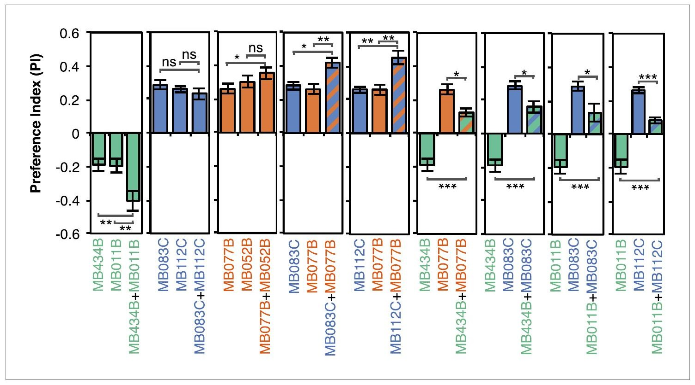

<small>圖片出處：Aso Y, Sitaraman D, Ichinose T et al. *eLife* 3:e04580 (2014)，Figure 4。CC BY（© 2014 Aso et al.）；全文見 [PMC](https://pmc.ncbi.nlm.nih.gov/articles/PMC4273436/)。</small>

> **原圖說（Figure 4）：** Additive effects of MBONs for attraction and repulsion. PIs of individual drivers and combinations of drivers are shown when tested by the protocol shown in Figure 2A. The expression patterns of the combination drivers are shown in Figure 4—figure supplement 1. Bar graphs are color coded by the transmitter of the MBONs. To facilitate comparisons, data for some genotypes are shown in more than one panel. Asterisk indicates significance: \*, p < 0.05; \*\*, p < 0.01; \*\*\*, p < 0.001.

**圖說中譯：** 吸引與排斥 MBON 的相加效應。以圖 2A 的協定測試單一品系與品系組合的 PI。組合品系的表現型態見圖 4 補充圖 1。（品系組合見本頁用語 AD／DBD 列：把兩條品系的兩半放進同一隻果蠅，所以會多標一些非目標細胞。）柱狀圖依 MBON 的傳遞物質上色。為方便比較，部分基因型的資料出現在不只一格。星號表示顯著：\* p < 0.05；\*\* p < 0.01；\*\*\* p < 0.001。

**解讀：**
- **把兩個單獨 PI 相加，與實測組合比較（專業文 3.3 的表）。** 兩種組合用的判準不同：
  - 相反方向（一型走開＋一型靠近）：看組合是否接近兩者相加。四組都在相加值附近，這部分支持「相加」。
  - 同方向：看組合是否顯著強於各自單獨。五組中有兩組不符。
  - 不符的第一組是 MB083C＋MB112C（兩組 GABA）：單獨約 0.29 與 0.26，組合約 0.24，與兩個單獨品系相比都不顯著（ns），而且低於任一單獨。
  - 不符的第二組是 MB077B＋MB052B（兩組乙醯膽鹼）：組合與 MB052B 單獨沒有顯著差別。
  - 正文「一般更強」、討論「看起來是相加的」都沒有提到這兩組。
- **相反方向的組合全部落在 0 以上**（約 0.08–0.16，※ 從圖判讀）。四組都是「一型走開＋一型靠近」，結果都略偏靠近；但單獨的靠近 PI（約 0.26–0.28）本來就比走開 PI（約 −0.19 到 −0.20）大，相加後偏正是預期的，不代表「靠近」的權重較大。
- **組合品系的表現型態在補充圖（未取得）**；方法說組合品系「一般比親代品系多標了一些非目標細胞」。本篇沒有量這些多標細胞對行為的貢獻，無法判斷組合效果中有多少來自它們（？待查）。

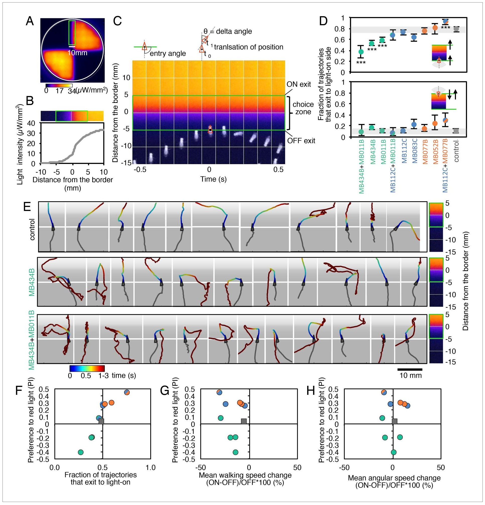

<small>圖片出處：Aso Y, Sitaraman D, Ichinose T et al. *eLife* 3:e04580 (2014)，Figure 5。CC BY（© 2014 Aso et al.）；全文見 [PMC](https://pmc.ncbi.nlm.nih.gov/articles/PMC4273436/)。</small>

> **原圖說（Figure 5）：** MBONs bias choice at the border. (A) Pseudo-colored light intensity in the behavioral arena. The choice zone was defined as ± 5 mm from the light ON/OFF border (green box). (B) Gradient of light intensity across the light ON/OFF border axis shown. (C) An example of MB434B + MB011B/UAS-CsChrimson fly that entered the choice zone from the light-off side at time = 0 and then stopped and quickly turned around to exit the choice zone, going back into the light-off side. Eleven images taken at 0.1 s intervals have been superimposed. Entry angle to the choice zone was defined as diagramed (top left). Speed and angular speed was calculated based on the difference in the position of a fly in successive frames of 30 frames per second video recordings. (D) The fraction of trajectories entering the choice zone from the dark side and then exiting to the illuminated side is plotted for the indicated drivers in combination with CsChrimson (top). The control genotype was the empty driver, pBDPGAL4U, in attP2 in combination with 20xUAS-CsChrimson-mVenus in attP18. Only flies that entered the choice zone at an entry angle of between 45 and 135° (facing to the light ON/OFF border) and had moved more than 5 mm in the 1 s prior to entering the choice zone were analyzed. The error bars show the 95% confidence interval. Between 79 and 410 trajectories were analyzed per genotype. Compared to the control, MB434B + MB011B, MB434B and MB011B showed a significantly lower fraction of trajectories that exit to the light-on side (more avoidance of light), whereas significantly higher fraction of trajectories of MB112C + MB077B flies exit to the light-on side (more attraction to the light); multiple comparisons with the Dunn-Sidak correction: \*\*\*, p < 0.001. Similarly, the fraction of trajectories entering the choice zone from the illuminated side and then changing direction so as to also exit to the illuminated side is plotted for the indicated drivers in combination with CsChrimson (bottom). Between 43 and 280 trajectories were analyzed per genotype. (E) Representative trajectories are shown for the indicated genotypes. The trajectories are color-coded to indicate the position of the fly in the trajectory as a function of time after entering the choice zone. The triangle shows the position of the fly at time = 0, when flies entered into the choice zone (indicated by the white line at −5 mm from the light ON/OFF border). The gray scale background in the panels and pseudo-color scale on the right indicate the intensity of CsChrimson activating light. (F) Preference index to the CsChrimson-activating light (Figure 4) was plotted against the fraction of trajectories that exit from the choice zone to the illuminated side irrespective of side of entry: [(number of trajectories enter to the choice zone from dark side and then exit to illuminated side) + (number of trajectories enter to the choice zone from illuminated side and then exit to illuminated side)] divided by total number of trajectories that entered into the choice zone. They were highly correlated (Spearman's rank-order correlation: Pearson r = 0.91; R square = 0.83; p < 0.001). Genotypes are the same as in panel D and are shown with same color code. (G) Preference index to the CsChrimson light (Figure 4) was plotted against the mean walking speed change in the illuminated quadrants compared to dark quadrants (see Figure 5—figure supplement 1). There was no significant correlation (Spearman's rank-order correlation: Pearson r = 0.13; R square = 0.01; p = 0.72). Genotypes are the same as in panel D and are shown with same color code. (H) Preference index to the CsChrimson light (Figure 4) was plotted against mean angular speed in the illuminated quadrants compared to dark quadrants (see Figure 5—figure supplement 1). There was no significant correlation (Spearman's rank-order correlation: Pearson r = 0.12; R square = 0.001; p = 0.75). Genotypes are the same as in panel D and are shown with same color code.

**圖說中譯：** MBON 偏置交界處的選擇。(A) 行為場地中光強的偽色圖。選擇區定義為距明暗交界 ±5 mm（綠框）。(B) 沿明暗交界軸的光強梯度。(C) 一隻 MB434B＋MB011B/UAS-CsChrimson 果蠅的例子：時間 0 時從暗側進入選擇區，接著停下、迅速掉頭離開選擇區、回到暗側。疊合了間隔 0.1 s 的 11 張影像。進入選擇區的角度定義見左上示意。速度與角速度以每秒 30 張的錄影中相鄰兩張的位置差計算。(D) 上：從暗側進入選擇區、再從亮側離開的軌跡比例，各品系配 CsChrimson。對照基因型為空驅動品系 pBDPGAL4U（attP2）配 20xUAS-CsChrimson-mVenus（attP18）。只分析進入角度在 45–135°（面向明暗交界）、且進入前 1 秒移動超過 5 mm 的果蠅。角度以垂直於明暗交界的方向為 90°，愈接近 90° 愈是正對交界走（※ 推論，論文只給角度範圍）。誤差槓為 95% 信賴區間。每個基因型分析 79–410 條軌跡。與對照相比，MB434B＋MB011B、MB434B、MB011B 從亮側離開的軌跡比例顯著較低（更躲光），MB112C＋MB077B 顯著較高（更趨光）；多重比較以 Dunn–Šidák 校正：\*\*\* p < 0.001。下：同樣地，從亮側進入、轉向後也從亮側離開的軌跡比例；每個基因型分析 43–280 條軌跡。(E) 各基因型的代表性軌跡。軌跡依進入選擇區後的時間上色。三角形為時間 0（進入選擇區，白線位於距交界 −5 mm）時的位置。距離的負值側是暗側、正值側是亮側（※ 推論，依 C 圖「從暗側進入」的描述）。背景灰階與右側偽色尺表示 CsChrimson 活化光的強度。(F) 橫軸取圖 4 那幾個基因型（單獨品系與組合）對 CsChrimson 活化光的偏好指數（PI），對「從選擇區往亮側離開的軌跡比例（不論從哪一側進入）」作圖：[(從暗側進入、往亮側離開的軌跡數) ＋ (從亮側進入、往亮側離開的軌跡數)] ÷ 進入選擇區的軌跡總數。兩者高度相關（Spearman 等級相關：Pearson r＝0.91；R²＝0.83；p < 0.001）。基因型同 D，配色相同。(G) 同一組偏好指數（取自圖 4）對照光象限相對於暗象限的平均走路速度改變作圖（見圖 5 補充圖 1）。無顯著相關（Spearman 等級相關：Pearson r＝0.13；R²＝0.01；p＝0.72）。(H) 偏好指數對照光象限相對於暗象限的平均角速度作圖（見圖 5 補充圖 1）。無顯著相關（Spearman 等級相關：Pearson r＝0.12；R²＝0.001；p＝0.75）。

**解讀：**
- **D 上圖藏著一個正文沒提的結果：單獨的「靠近」品系，從暗側往亮側走的比例並沒有比對照高。** MB112C 約 0.74、MB083C 約 0.64、MB077B 約 0.76、MB052B 約 0.81，對照約 0.80（※ 從圖判讀）；只有組合 MB112C＋MB077B（約 0.93）顯著較高。MB083C 的 0.64 雖低於對照，但圖 5D 沒有標這些單獨品系與對照的差異是否顯著，所以不能說它在交界反而躲光（※ 本頁判讀）。正文說這些果蠅從暗側進入時「行為與對照相似」，靠近的偏好主要來自從亮側進入時較常掉頭回亮側（D 下圖）。也就是說，**「靠近」的 MBON 主要讓果蠅留在亮區，而不是把果蠅拉進亮區**（※ 推論）。
- **F、G、H 每張只有 10 個點**（※ 從圖判讀）。正文點名的基因型有 MB434B、MB011B、MB434B＋MB011B、MB112C、MB083C、MB077B、MB052B、MB112C＋MB077B，另加對照；其餘一點無法從正文確定是哪個基因型。
- r＝0.91 的意義是「走開越強的品系越常在交界掉頭」。G、H 的不相關則是「速度與轉彎率不隨 PI 變」。後者是本篇「MBON 不指揮動作」論點的關鍵，但它是 10 點的不顯著，不是「證明沒有關係」；圖 5 補充圖 1（未取得）說 MBON 活化對速度「只有小效果」。
- ⚠️ 圖說三處都寫「Spearman's rank-order correlation: Pearson r」，同一句混用兩種相關係數，讀者無法確定用的是哪一種。
- ⚠️ H 的數字本身不一致：r＝0.12 的平方約 0.014，與圖說標的 R²＝0.001 對不上；F 的 0.91² ≈ 0.83 則相符。
- **C 與 E 的軌跡是「代表性」的**，選法未說明（影片 2、3 圖說寫「randomly selected」）。

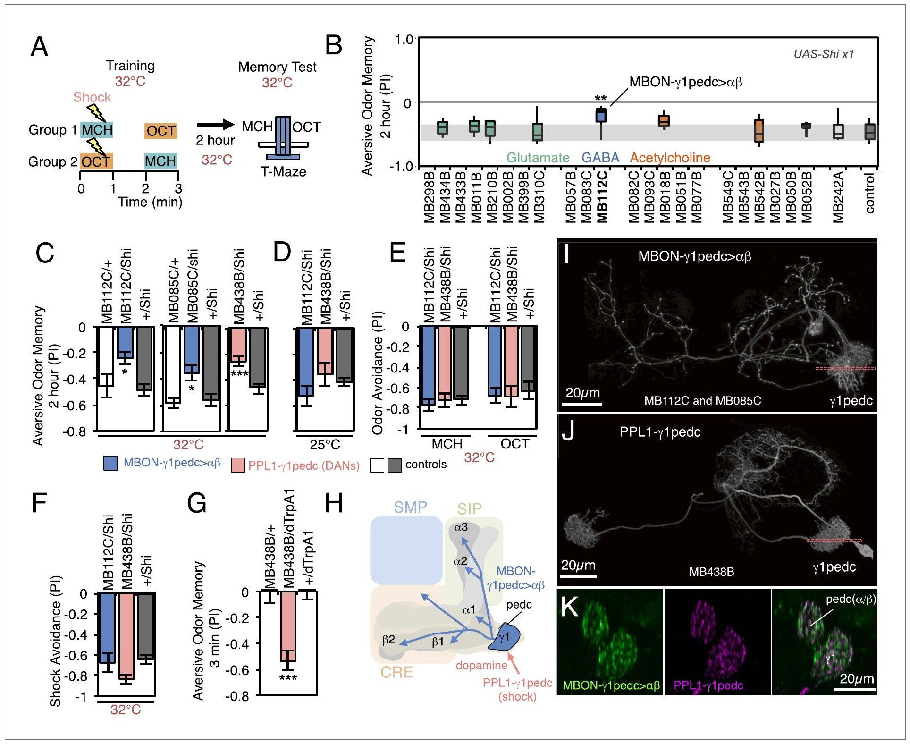

<small>圖片出處：Aso Y, Sitaraman D, Ichinose T et al. *eLife* 3:e04580 (2014)，Figure 6。CC BY（© 2014 Aso et al.）；全文見 [PMC](https://pmc.ncbi.nlm.nih.gov/articles/PMC4273436/)。</small>

> **原圖說（Figure 6）：** Requirement of MBONs for 2-hr aversive odor memory. (A) Schematic of the T-maze apparatus. In one group of flies, 4-methylcyclohexanol (MCH) was paired with electric shocks for 60 s. After a 60 s pause, 3-octanol (OCT) was delivered without electric shock. For the reciprocal group, OCT was paired with electric shock, and MCH was delivered without shock. 2 hr after training, flies were given a choice between the two odors in a T-maze and their distribution was used to calculate a performance index (PI). The PI corresponds to the mean of the [(number of flies in the OCT tube minus number of flies in the MCH tube)/total number of flies when OCT was paired with electric shock] and [(number of flies in the MCH tube minus number of flies in the OCT tube)/total number of flies when MCH was paired with electric shock]. The set of 23 driver lines was first screened using pJFRC100-20XUAS-TTS-Shibire-ts1-p10 (VK00005) as the Shits effector; lines that showed a strongly decreased PI in this initial screen were retested with the UAS-Shi x1 effector. (B) Results of secondary screening of MBONs for 2-hr aversive memory using UAS-Shi x1. MBONs have been grouped by neurotransmitter and color-coded. The bottom and top of each box represents the first and third quartile, and the horizontal line dividing the box is the median. The whiskers represent the 10th and 90th percentiles. The gray rectangle spanning the horizontal axis indicates the interquartile range of the control. Statistical tests are described in methods: \*\*, p < 0.01. (C) 2-hr aversive odor memory at the restrictive temperature. In addition to confirming the result obtained with MB112C in the screening assays, a second driver line for MBON-γ1pedc>α/β, (MB085C) was tested and found to have a similar impairment. Blocking dopaminergic input to the MB compartments where the dendrites of MBON-γ1pedc>α/β reside, using MB438B, also impairs 2-hr aversive odor memory. UAS-Shi x1 was used as the effector. See Figure 6—figure supplement 1 for the expression patterns of the MB112C, MB085C and MB438B drivers. Bars and error bars show mean and standard error of the mean (SEM). Statistical tests are described in methods: \*, p < 0.05; \*\*\*, p < 0.001. (D) 2-hr aversive odor memory in MB112C/Shi and MB438B/Shi flies is not impaired at the permissive temperature. UAS-Shi x1 was used as the effector. (E) Avoidance of MCH and OCT in untrained MB112C/Shi and MB438B/Shi flies is not impaired at the restrictive temperature, indicating that these genotypes can detect and respond to the odors. UAS-Shi x1 was used as the effector. (F) Shock avoidance in untrained MB112C/Shi and MB438B/Shi flies is not impaired at the restrictive temperature. UAS-Shi x1 was used as the effector. (G) Activation of the PPL1-γ1pedc dopaminergic neurons can substitute for electric shock as the unconditioned stimulus (US). Flies trained using thermoactivation of MB438B/dTrpA1 as the US showed robust 3 min aversive memory. (H) Diagram of a circuit module for aversive odor memory. MBON-γ1pedc>α/β is shown in blue. PPL1-γ1pedc conveys the US of electric shock (pink arrow). (I) Morphology of MBON-γ1pedc>α/β. A frontal view of maximum intensity projection of an image of a single cell generated by stochastic labeling using the multicolor flip-out technique (MCFO; Nern et al., in prep.) is shown. MBON-γ1pedc>α/β has dendrites in γ1 and the core of pedunclulus (pedc), where α/β KCs project. Its axon bilaterally innervates the α/β lobes and the pedc, and neighboring neuropils (SMP, SIP and CRE); see Figure 6—figure supplement 1 for more anatomical details. The orange dashed line indicates the plane of the cross section shown in (K) of the γ1 and the pedc. (J) Morphology of PPL1-γ1pedc. A frontal view of maximum intensity projection of an image of a single cell generated by MCFO is shown. PPL1-γ1pedc extends dendrites unilaterally in the SMP, SIP and CRE, and bilaterally innervates the γ1 and the pedc. The orange dashed line indicates the plane of the cross section of γ1 and the pedc shown in (K). (K) Double labeling of MBON-γ1pedc>α/β (green; R12G04-LexA, pJFRC216-13XLexAop2-IVS-myr::smGFP-V5 [su(Hw)attP8] and PPL1-γ1pedc (magenta; MB320C, pJFRC200-10XUAS-IVS-myr::smGFP-HA (attP18)). A coronal section is shown. The dendrites of MBON-γ1pedc>α/β and the terminals of PPL1-γ1pedc precisely overlap in γ1 and the pedc.

**圖說中譯：** 2 小時嫌惡氣味記憶需要的 MBON。(A) T 迷宮示意。一組果蠅以 4-甲基環己醇（MCH）配電擊 60 s，暫停 60 s 後給 3-辛醇（OCT）而不電；互換組則以 OCT 配電擊、MCH 不電。訓練 2 小時後，讓果蠅在 T 迷宮中兩個氣味間選擇，以分布計算表現指數（PI）：PI＝[OCT 配電擊時 (OCT 管隻數 − MCH 管隻數)／總隻數] 與 [MCH 配電擊時 (MCH 管隻數 − OCT 管隻數)／總隻數] 的平均。23 條驅動品系先以 pJFRC100-20XUAS-TTS-Shibire-ts1-p10（VK00005）為 Shi^ts 效應子（見本頁用語）初篩；初篩中 PI 大幅下降的品系，再以 UAS-Shi x1 效應子複篩。(B) 以 UAS-Shi x1 做 2 小時嫌惡記憶 MBON 複篩的結果。MBON 依傳遞物質分組上色。盒的上下緣為第一與第三四分位數，橫線為中位數；鬚為第 10 與第 90 百分位數；灰色長方形為對照的四分位距。統計見方法：\*\* p < 0.01。(C) 限制溫度下的 2 小時嫌惡氣味記憶。除了確認 MB112C 在篩檢中的結果，也測了 MBON-γ1pedc>α/β 的第二條品系（MB085C），有相似的損害。以 MB438B 阻斷 MBON-γ1pedc>α/β 樹突所在區室的多巴胺輸入，同樣損害 2 小時嫌惡氣味記憶。效應子為 UAS-Shi x1。MB112C、MB085C、MB438B 的表現型態見圖 6 補充圖 1。柱與誤差槓為平均值與標準誤（SEM）。統計見方法：\* p < 0.05；\*\*\* p < 0.001。(D) 允許溫度下，MB112C/Shi 與 MB438B/Shi 的 2 小時嫌惡氣味記憶不受損。效應子 UAS-Shi x1。(E) 限制溫度下，未訓練的 MB112C/Shi 與 MB438B/Shi 對 MCH 與 OCT 的躲避不受損，表示這些基因型能偵測並回應氣味。(F) 限制溫度下，未訓練的 MB112C/Shi 與 MB438B/Shi 對電擊的躲避不受損。(G) 活化 PPL1-γ1pedc 多巴胺神經元可代替電擊作為非條件刺激（US）。以 MB438B/dTrpA1 的熱活化為 US 訓練的果蠅，有穩健的 3 分鐘嫌惡記憶。(H) 嫌惡氣味記憶的迴路模組示意。MBON-γ1pedc>α/β 以藍色表示；PPL1-γ1pedc 傳遞電擊的 US（粉紅箭頭）。(I) MBON-γ1pedc>α/β 的形態：以多色隨機標記（MCFO；Nern et al., in prep.）得到的單細胞影像，正面最大強度投影（把整疊共軛焦影像沿前後方向壓成一張平面圖）。MBON-γ1pedc>α/β 的樹突在 γ1 與柄的核心（pedc，α/β KC 投射處）；軸突雙側支配 α/β 葉、pedc 與鄰近神經纖維區（SMP、SIP 與 CRE）；解剖細節見圖 6 補充圖 1。橘色虛線為 (K) 中 γ1 與 pedc 橫切面的位置。(J) PPL1-γ1pedc 的形態：MCFO 單細胞影像，正面最大強度投影。PPL1-γ1pedc 的樹突單側在 SMP、SIP 與 CRE，雙側支配 γ1 與 pedc。橘色虛線為 (K) 的切面位置。(K) MBON-γ1pedc>α/β（綠；R12G04-LexA、pJFRC216-13XLexAop2-IVS-myr::smGFP-V5 [su(Hw)attP8]）與 PPL1-γ1pedc（洋紅；MB320C、pJFRC200-10XUAS-IVS-myr::smGFP-HA（attP18））的雙標記，冠狀切面（只取某一層的橫切面）。MBON-γ1pedc>α/β 的樹突與 PPL1-γ1pedc 的末梢在 γ1 與 pedc 精確重疊。

**解讀：**
- **B 圖要看「哪些品系有方框」**：23 條中只有 9 條有方框（初篩陽性、進入複篩），與正文「九條」一致；其中 4 條是麩胺酸品系（MB434B、MB011B、MB210B、MB310C），與討論「四條麩胺酸品系初篩有損害」一致。其餘 14 條在這張圖上是空白，代表初篩就沒有下降，不是沒測。
- **C 圖的損害是部分的**：MB112C/Shi 約 −0.25、MB085C/Shi 約 −0.32，對照約 −0.45 到 −0.57（※ 從圖判讀）。記憶剩一半左右。阻斷一型 MBON 不能消除嫌惡記憶，與作者「冗餘」（見本頁用語）的說法一致；作者在討論中以基因剔除作類比（見第五節第 2 點）。這也表示 γ1pedc 以外仍有讀出路徑。
- **D 圖只有三柱、沒有 GAL4/+ 對照**。少了這一組，就不能排除品系本身（而非阻斷）造成的差異。
- 允許溫度下 MB112C/Shi 約 −0.53、MB438B/Shi 約 −0.36、+/Shi 約 −0.42（※ 從圖判讀）。MB438B/Shi 的記憶分數最接近 0，也就是記憶比另外兩組弱。圖說只說「不受損」；本頁只指出這個差異，沒有重新檢定。
- **K 圖是這一對 MBON—DAN 共用一格的直接證據**。MBON 用 LexA 品系（見本頁用語）R12G04 標、DAN 用 split-GAL4 品系 MB320C 標，兩套系統可同時用兩種顏色分別標兩型細胞，才看得出兩者是否落在同一格。
- R12G04 正是 Hige 2015 用來標 MBON-γ1pedc 的那一條，MB320C 也是 Hige 2015 用來活化 PPL1-γ1pedc 的品系；用同一條品系，表示兩篇指的是同一群細胞。
- **G 圖的 3 分鐘記憶約 −0.53**，代替電擊的效果量比 C 圖的 2 小時電擊記憶還大，但時間點不同（3 分鐘 vs 2 小時），不能比較強弱。

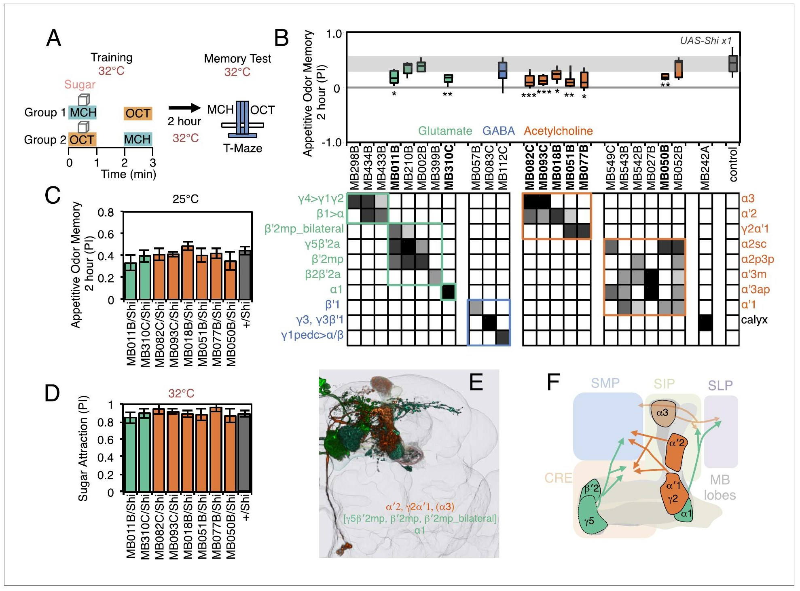

<small>圖片出處：Aso Y, Sitaraman D, Ichinose T et al. *eLife* 3:e04580 (2014)，Figure 7。CC BY（© 2014 Aso et al.）；全文見 [PMC](https://pmc.ncbi.nlm.nih.gov/articles/PMC4273436/)。</small>

> **原圖說（Figure 7）：** Requirement of MBONs for 2-hr appetitive odor memory. (A) Flies were trained and tested in a similar way as in Figure 6A, except that flies were starved for 28–40 hr prior to experiments and trained with a reward consisting of a tube covered with sugar absorbed filter paper. (B) Results of secondary screening of MBONs for 2-hr appetitive memory using UAS-Shi x1. MBONs have been grouped by neurotransmitter and color-coded. The bottom and top of each box represents the first and third quartile, and the horizontal line dividing the box is the median. The whiskers represent the 10th and 90th percentiles. The gray rectangle spanning the horizontal axis indicates the interquartile range of the control. Statistical tests are described in methods: \*, p < 0.05; \*\*, p < 0.01; \*\*\*, p < 0.001. The relative expression levels produced by the split-GAL4 driver lines in each cell type (indicated by the gray scale) are based on imaging with pJFRC2-10XUAS-IVS-mCD8::GFP (VK00005). Images of the expression patterns of selected drivers are shown in Figure 7—figure supplement 1. MB082C and MB093C label the cholinergic MBON-α3; however, these lines also show weak labeling in MBON-α′2. As blocking MBON-α′2 alone also gave a significant phenotype (MB018B/Shi), we cannot rule out the formal possibility that the phenotype observed with MB082C and MB093C results from blocking MBON-α′2. MB050B labels MBON-α2 and MBON-α′1; however, because MB052B, which labels the same cell types in addition to others, did not give a phenotype, the requirement for these cell types is not resolved. (C) 2 hr appetitive odor memory at permissive temperature. (D) Sugar attraction in untrained flies at restrictive temperature. (E) Rendering of MBONs with outline of MB lobes and brain. MBONs grouped by square brackets represent cases where the available set of driver lines do not allow assigning an effect to a single cell type, but only to that set of MBONs. MBONs in parentheses represent cases where the data implicating them are only suggestive. (F) Diagram of MBONs for appetitive odor memory. MBONs are shown in lighter colors when data implicating them are only suggestive.

**圖說中譯：** 2 小時獎賞氣味記憶需要的 MBON。(A) 訓練與測驗方式同圖 6A，但果蠅在實驗前飢餓 28–40 小時，以鋪了吸糖濾紙的管子為獎賞訓練。(B) 以 UAS-Shi x1 做 2 小時獎賞記憶 MBON 複篩的結果。MBON 依傳遞物質分組上色。盒圖說明同前。統計見方法：\* p < 0.05；\*\* p < 0.01；\*\*\* p < 0.001。各型細胞的相對表現量（灰階）依 pJFRC2-10XUAS-IVS-mCD8::GFP（VK00005）的影像。部分品系的表現型態見圖 7 補充圖 1。MB082C 與 MB093C 標記乙醯膽鹼的 MBON-α3，但也弱標 MBON-α′2；由於單獨阻斷 MBON-α′2 也有顯著表型（MB018B/Shi），MB082C 與 MB093C 的表型理論上無法排除是阻斷 MBON-α′2 造成的。MB050B 標記 MBON-α2〔原文寫 α2，依表 1 為 MBON-α2sc〕與 MBON-α′1；但標記同樣型別再加其他型別的 MB052B 沒有表型，所以這些型別是否需要尚未解決。(C) 允許溫度下的 2 小時獎賞氣味記憶。(D) 限制溫度下未訓練果蠅的糖吸引。(E) MBON 的立體重建，含 MB 葉與腦的輪廓。方括號內的 MBON 表示現有品系無法把效果歸給單一型別、只能歸給該組；括號內的 MBON 表示資料只具提示性。(F) 獎賞氣味記憶的 MBON 示意。資料只具提示性的 MBON 以較淺顏色表示。

**解讀：**
- **對照的 PI 約 0.4，受損品系約 0.1–0.2**（※ 從圖判讀），沒有一條降到 0。和嫌惡記憶一樣是部分損害。
- **MB310C（MBON-α1）是單一品系、單一型別**，在 B 圖 \*\*。依方法自己的標準只算「提示性」，F 圖卻以實色畫 α1、圖 13 以實心標示。這條品系後來是 [[s-ichinose-2015-reward-recurrent-circuit]] 的主角之一（第二條品系 MB323B 由該篇補上）。
- **圖說把 MB050B 的表型寫成「未解決」**，理由是包含同樣型別的 MB052B 沒有表型。這是一個常被忽略的推理：**標得更多的品系反而沒有表型**，可能是表現量差異，也可能是 MB052B 多標的型別在作用上互相抵消；本篇沒有分辨。
- **C 圖允許溫度下各品系約 0.3–0.5，+/Shi 約 0.45**（※ 從圖判讀），MB011B/Shi 與 MB050B/Shi 偏低（約 0.33–0.35），但沒有標顯著。允許溫度下（阻斷尚未生效）就偏低，表示限制溫度下的損害可能有一部分不是阻斷造成的（※ 本頁判讀）。

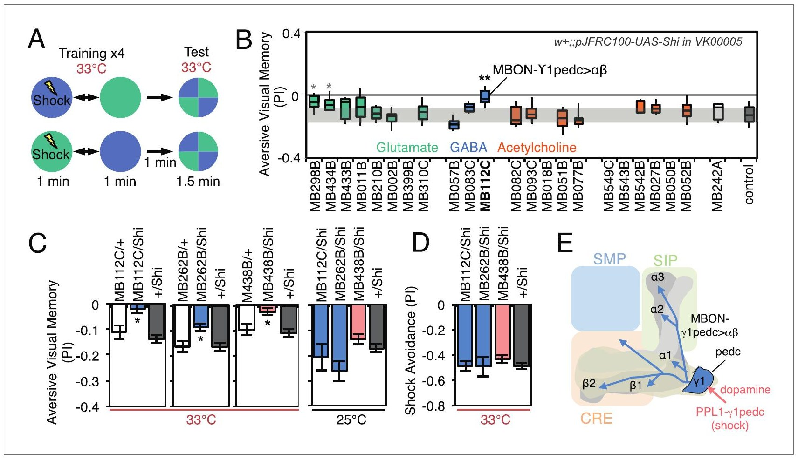

<small>圖片出處：Aso Y, Sitaraman D, Ichinose T et al. *eLife* 3:e04580 (2014)，Figure 8。CC BY（© 2014 Aso et al.）；全文見 [PMC](https://pmc.ncbi.nlm.nih.gov/articles/PMC4273436/)。</small>

> **原圖說（Figure 8）：** Requirement of MBONs for aversive visual memory. (A) Diagram of the training protocol used for aversive visual conditioning. Groups of 30–40 flies were trained in a circular arena with green or blue LED light and electric shock in a reciprocal manner, as in olfactory conditioning. Training was repeated four times and memory was tested immediately after the last training session. The PI corresponds to the mean of the [(number of flies in the blue quadrant minus number of flies in green quadrant)/total number of flies when blue was paired with electric shock] and [(number of flies in the green quadrant minus number of flies in the blue tube)/total number of flies when green was paired with electric shock]; See ‘Materials and methods’ for more detail. (B) Results for the requirement of MBONs in aversive visual conditioning. pJFRC100-20XUAS-TTS-Shibire-ts1-p10 (VK00005) was used to block synaptic transmission. Flies were trained and tested at the restrictive temperature. MBONs have been grouped by neurotransmitter and color-coded. The bottom and top of each box represents the first and third quartile, and the horizontal line dividing the box is the median. The whiskers represent the 10th and 90th percentiles. The gray rectangle spanning the horizontal axis indicates the interquartile range of the control. Statistical tests are described in methods: \*, p < 0.05; \*\*, p < 0.01. The two lines marked with gray asterisks failed one of the control assays: MB434B/Shi did not differ significantly from MB434B/+ and MB298B had altered color preference. One line, MB112C, with significantly impaired memory passed all control assays (see panel C). (C) Blocking MBON-γ1pedc>α/β with either of two split-GAL4 lines (MB262B and MB112C) caused significant visual memory impairment compared to GAL4/+ and +/Shi controls. Blocking the output of PPL1-γ1pedc dopaminergic neurons (MB438B) also resulted in a strong defect. Split-GAL4/Shi flies were not impaired at the permissive temperature compared to +/Shi. Bars and error bars show mean and standard error of the mean. (D) Electric shock avoidance in untrained flies was not impaired at restrictive temperature compared to +/Shi. Bars and error bars show mean and standard error of the mean. (E) Diagram of the MB circuit for aversive visual memory. The GABAergic MBON-γ1pedc>α/β is required for conditioned color preference. The dopaminergic PPL1- γ1pedc neurons terminate in the same compartments where the dendrites of MBON-γ1pedc>α/β are found; they likely convey the electric shock punishment signal.

**圖說中譯：** 嫌惡顏色記憶需要的 MBON。(A) 嫌惡顏色制約的訓練協定示意。每組 30–40 隻果蠅在圓形場地中，以綠或藍 LED 光與電擊互換配對訓練，方式同嗅覺制約。訓練重複四次，最後一次訓練後立即測驗。PI＝[藍配電擊時 (藍象限隻數 − 綠象限隻數)／總隻數] 與 [綠配電擊時 (綠象限隻數 − 藍管〔原文如此；顏色實驗用象限，非管〕隻數)／總隻數] 的平均；細節見方法。(B) 嫌惡顏色制約中 MBON 需求的結果。以 pJFRC100-20XUAS-TTS-Shibire-ts1-p10（VK00005）阻斷突觸傳遞。果蠅在限制溫度下訓練與測驗。MBON 依傳遞物質分組上色。盒圖說明同前。統計見方法：\* p < 0.05；\*\* p < 0.01。兩條以灰色星號標示的品系未通過某項對照：MB434B/Shi 與 MB434B/+ 無顯著差異，MB298B 的顏色偏好改變。〔「/Shi」「/+」「+/Shi」「GAL4/+」寫法見本頁用語。實驗組必須同時顯著低於「只帶品系」與「只帶效應子」兩種對照，才算是阻斷造成的。MB298B 的「顏色偏好改變」指未受訓練時對藍／綠的偏好就與對照不同；記憶分數是以顏色選擇算出來的，所以這條品系的分數無法解讀。〕一條品系 MB112C 記憶顯著受損且通過所有對照（見 C）。(C) 以兩條 split-GAL4 品系（MB262B 與 MB112C）阻斷 MBON-γ1pedc>α/β，與 GAL4/+、+/Shi 對照相比，顏色記憶顯著受損。阻斷 PPL1-γ1pedc 多巴胺神經元的輸出（MB438B）也造成強烈缺陷。split-GAL4/Shi 果蠅在允許溫度下與 +/Shi 相比不受損。柱與誤差槓為平均值與標準誤。(D) 限制溫度下，未訓練果蠅的電擊躲避與 +/Shi 相比不受損。(E) 嫌惡顏色記憶的 MB 迴路示意。GABA 的 MBON-γ1pedc>α/β 是條件化顏色偏好所需；PPL1-γ1pedc 多巴胺神經元的末梢位在 MBON-γ1pedc>α/β 樹突所在的區室，可能傳遞電擊懲罰訊號。

**解讀：**
- **這張圖的效果量很小，要看縱軸**：+/Shi 的嫌惡顏色記憶只有約 −0.12 到 −0.17（※ 從圖判讀），縱軸範圍只有 −0.4 到 0.4。MB112C/Shi 約 −0.03、MB438B/Shi 約 −0.03、MB262B/Shi 約 −0.09。完全學會（對照約 −0.12 到 −0.17）與完全沒學到（0）之間只差約 0.1 到 0.17，受損品系約 −0.03。在這麼窄的範圍內，結論對讀圖誤差與雜訊較敏感。
- **B 圖的 MB298B 與 MB434B 在 0 附近、甚至略為正值，卻以灰色星號排除**（未通過對照）。這兩條都標 MBON-γ4>γ1γ2，作者在圖 9G 說它「前饋到 MBON-γ1pedc>α/β 的樹突」。阻斷它也讓嫌惡顏色記憶接近 0。這與「γ4>γ1γ2 → γ1pedc」的網路假說可以相容：γ1pedc 的 GABA MBON 是嫌惡記憶必需的；若 γ4>γ1γ2 的軸突影響 γ1pedc 的 MBON，阻斷上游也可能損害嫌惡記憶。這條連結的正負號本篇沒有量（※ 推論）。但這兩條品系因對照不過關，資料不能採用。
- **兩種感覺共用同一對細胞（主張三）**：顏色與氣味記憶的訓練（4 次、立即測 vs 1 次、2 小時後測）、溫度（33 °C vs 32 °C）、效應子（強 vs 弱）都不同。條件差這麼多，兩種作業仍指向同一對 MBON—DAN（MBON-γ1pedc>α/β 與 PPL1-γ1pedc），所以這不像單一條件造成的巧合。但也因條件不同，兩種記憶的損害幅度不能並排比較。

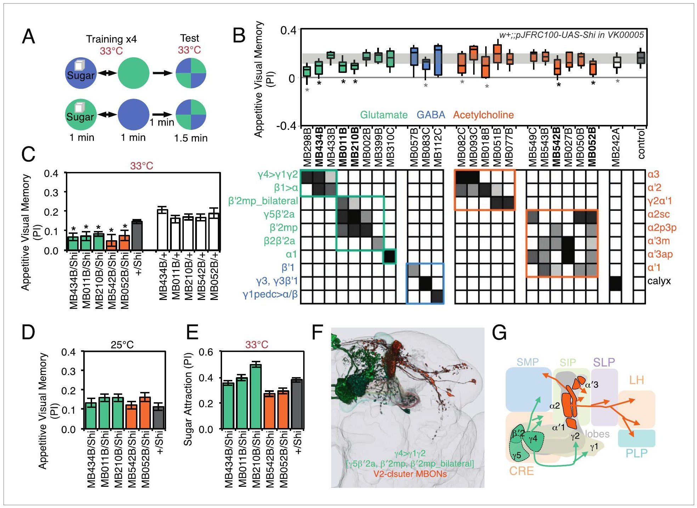

<small>圖片出處：Aso Y, Sitaraman D, Ichinose T et al. *eLife* 3:e04580 (2014)，Figure 9。CC BY（© 2014 Aso et al.）；全文見 [PMC](https://pmc.ncbi.nlm.nih.gov/articles/PMC4273436/)。</small>

> **原圖說（Figure 9）：** Requirement of MBONs for appetitive visual memory. (A) Diagram of the training protocol used for appetitive visual conditioning. Starved flies were trained with sugar and the PI calculated in the same manner as in aversive visual conditioning (see Figure 8A). Flies were trained and tested at the restrictive temperature. (B) Screening for MBONs required for aversive visual conditioning. pJFRC100-20XUAS-TTS-Shibire-ts1-p10 (VK00005) was used to block synaptic transmission. MBONs have been grouped by neurotransmitter and color-coded. The bottom and top of each box represents the first and third quartile, and the line inside the box is the median. The whiskers represent the 10th and 90th percentiles. The gray rectangle spanning the horizontal axis indicates the interquartile range of the control. Statistical tests are described in methods: \*, p < 0.05. Gray asterisks indicate lines that were not significantly different from GAL4/+ controls (MB083C, MB082C, MB018B and MB242A) or had altered color preference (MB298B). The relative expression levels produced by the split-GAL4 driver lines in each cell type (indicated in a gray scale) are based on imaging with pJFRC2-10XUAS-IVS-mCD8::GFP (VK00005). Images of the expression patterns of selected drivers are shown in Figure 9—figure supplement 1. (C) Visual appetitive memory was impaired at restrictive temperature by blocking the subsets of glutamate or acetylcholine MBONs labeled by MB434B, MB011B, MB210B, MB542B and MB052B compared to +/Shi and GAL4/+ controls. (D) No appetitive visual memory impairment was found at the permissive temperature compared to +/Shi. (E) Sugar attraction in untrained flies was not impaired at the restrictive temperature compared to +/Shi. (F) Rendering of MBONs implicated in appetitive visual memory. MBONs grouped by square brackets represent cases where the available set of driver lines do not allow assigning an effect to a single cell type, but only to the bracketed set. (G) Circuit diagram for appetitive visual memory. Glutamatergic MBONs (MBON-β′2mp and MBON-γ5β′2a) mediate visual appetitive memory. PAM neurons innervating these compartments of the MB lobes (see Figure 1A) are thought to convey the sucrose reward signal (Vogt et al., 2014). MBON-γ4>γ1γ2 feeds forward onto the dendrites of MBON-γ1pedc>α/β, a neuron required for aversive odor and aversive visual memory. Cholinergic V2 cluster neurons also appear to play a role.

**圖說中譯：** 獎賞顏色記憶需要的 MBON。(A) 獎賞顏色制約的訓練協定示意。飢餓的果蠅以糖訓練，PI 計算方式同嫌惡顏色制約（見圖 8A）。果蠅在限制溫度下訓練與測驗。(B) 嫌惡〔原文如此，⚠️ 應為獎賞〕顏色制約所需 MBON 的篩檢。以 pJFRC100-20XUAS-TTS-Shibire-ts1-p10（VK00005）阻斷突觸傳遞。MBON 依傳遞物質分組上色。盒圖說明同前。統計見方法：\* p < 0.05。灰色星號表示與 GAL4/+ 對照無顯著差異（MB083C、MB082C、MB018B、MB242A）或顏色偏好改變（MB298B）的品系。各型細胞的相對表現量（灰階）依 pJFRC2-10XUAS-IVS-mCD8::GFP（VK00005）的影像。部分品系的表現型態見圖 9 補充圖 1。(C) 與 +/Shi 及 GAL4/+ 對照相比，在限制溫度下阻斷 MB434B、MB011B、MB210B、MB542B、MB052B 標記的部分麩胺酸或乙醯膽鹼 MBON，獎賞顏色記憶受損。(D) 允許溫度下與 +/Shi 相比，獎賞顏色記憶未見損害。(E) 限制溫度下與 +/Shi 相比，未訓練果蠅的糖吸引不受損。(F) 獎賞顏色記憶相關 MBON 的立體重建。方括號內的 MBON 表示現有品系無法把效果歸給單一型別、只能歸給括號內的組。(G) 獎賞顏色記憶的迴路示意。麩胺酸 MBON（MBON-β′2mp 與 MBON-γ5β′2a）媒介獎賞顏色記憶。支配 MB 葉這些區室的 PAM 神經元（見圖 1A）被認為傳遞蔗糖獎賞訊號（Vogt et al., 2014）。MBON-γ4>γ1γ2 前饋到 MBON-γ1pedc>α/β 的樹突，後者是嫌惡氣味與嫌惡顏色記憶所需的神經元。乙醯膽鹼的 V2 群神經元似乎也有角色。

**解讀：**
- ⚠️ **B 圖圖說寫「aversive visual conditioning」**，本圖是糖獎賞的顏色記憶（A 圖與縱軸「Appetitive Visual Memory」）。單篇自身不一致，不影響資料。
- **效果量同樣很小**：+/Shi 約 0.14，受損品系約 0.05–0.08，GAL4/+ 約 0.16–0.21（※ 從圖判讀）。
- **E 圖的糖吸引其實有差異**：「糖吸引」是未受訓練果蠅對糖的偏好指數，算法與記憶 PI 類似（正值＝偏好糖那一側），只能比相對高低。MB210B/Shi 約 0.50、MB542B/Shi 與 MB052B/Shi 約 0.27–0.29，+/Shi 約 0.38（※ 從圖判讀）。圖說寫「不受損」，指的是沒有顯著低於 +/Shi；MB542B 與 MB052B 的糖吸引偏低卻同時是「受損」品系，糖吸引較弱是否部分解釋了記憶較差，本篇沒有討論。
- **G 圖圖說的 γ4>γ1γ2 → γ1pedc 是本篇少數把獎賞與嫌惡兩條路接起來的假設**：阻斷 MB434B（含 γ4>γ1γ2）同時損害嫌惡與獎賞的顏色記憶（圖 8、圖 9）。γ4>γ1γ2 的軸突伸進 γ1 與 γ2。※ 推論：若它對 γ1pedc 的 GABA MBON 是抑制性的，阻斷它會讓 γ1pedc 的 MBON 活動增加，兩種記憶的讀出都可能受影響。但連結的正負號與兩種記憶各自的機制，本篇都沒有量。所以這只是與圖 14 骨牌模型相容的一種可能，不是已確立的雙重角色。

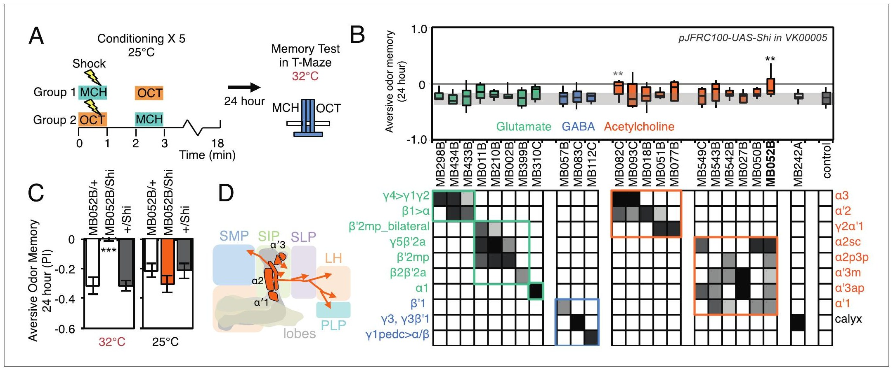

<small>圖片出處：Aso Y, Sitaraman D, Ichinose T et al. *eLife* 3:e04580 (2014)，Figure 10。CC BY（© 2014 Aso et al.）；全文見 [PMC](https://pmc.ncbi.nlm.nih.gov/articles/PMC4273436/)。</small>

> **原圖說（Figure 10）：** Requirement of long-term aversive odor memory. (A) Diagram of the conditioning protocol. Training sessions with electric shocks were repeated five times with 15 min intervals between training, all at the permissive temperature (25°C). Following training, flies were kept for 24 hr at 18°C, then shifted to the restrictive temperature (32°C) 30 min prior to test. The PI corresponds to the mean of the [(number of flies in the OCT tube minus number of flies in the MCH tube)/total number of flies when OCT was paired with electric shock] and [(number of flies in the MCH tube minus number of flies in the OCT tube)/total number of flies when MCH was paired with electric shock]. (B) Results of the primary screening for MBONs required for long-term aversive memory retrieval. pJFRC100-20XUAS-TTS-Shibire-ts1-p10 (VK00005) was used to block synaptic transmission. The bottom and top of each box represents the first and third quartile, and the line inside the box is the median. The bottom and top of each box represents the first and third quartile, and the horizontal line dividing the box is the median. The whiskers represent the 10th and 90th percentiles. The gray rectangle spanning the horizontal axis indicates the interquartile range of the control. Statistical tests are described in methods: \*\*: p < 0.01. The relative expression levels produced by the split-GAL4 driver lines in each cell type (indicated by the gray scale) are based on imaging with pJFRC2-10XUAS-IVS-mCD8::GFP (VK00005). Two lines, MB052B and MB082C showed significant memory impairment. MB082C drives expression in MBON-α3 and to a lesser extent in MBON-α′2. In subsequent control experiments, MB082C/Shits showed significant impairment compared to MB082C/+ and +/Shits (data not shown). However, we were unable to attribute this aversive LTM phenotype to MBON-α3, because blocking this cell type by other drivers did not result in a consistent phenotype (MB093C, Figure 10B; G0239, (Placais et al., 2013)). The requirement for MBON-α3 for aversive odor LTM has been reported, but it is unclear whether these neurons are required for canonical LTM after spaced training (Pai et al., 2013) or instead for so-called ‘fasting LTM’, a memory that mildly fasted flies can form after a single cycle of conditioning (Hirano and Saitoe, 2013; Placais and Preat, 2013; Placais et al., 2013). We note that these same two split-GAL4 driver lines for MBON-α3 (MB082C and MB093C) also showed discordant results in the ethanol memory assay (see below), suggesting some underlying difference between the two lines, perhaps in off-targeted expressions or genetic background. (C) MB052B/Shi showed memory impairment compared to MB052B/+ and +/Shi at the restrictive temperature but not at the permissive temperature. Statistical tests are described in methods: \*\*\*, p < 0.001. (D) Diagram of the output neurons that are required for long-term aversive odor memory. MB052B labels five cell types of cholinergic MBONs from the vertical lobes, four of them project to the lateral horn. Lines labeling only a subset of these MBONs gave only small effects when blocked.

**圖說中譯：** 長期嫌惡氣味記憶的需求。(A) 制約協定示意。電擊訓練重複五次、每次間隔 15 分鐘，全部在允許溫度（25 °C）。訓練後果蠅在 18 °C 保存 24 小時，測驗前 30 分鐘升到限制溫度（32 °C）。PI 計算同圖 6。(B) 長期嫌惡記憶提取所需 MBON 的初篩結果。以 pJFRC100-20XUAS-TTS-Shibire-ts1-p10（VK00005）阻斷突觸傳遞。盒圖說明同前（原文此句重複兩次）。統計見方法：\*\* p < 0.01。各型細胞的相對表現量（灰階）依 pJFRC2-10XUAS-IVS-mCD8::GFP（VK00005）的影像。兩條品系 MB052B 與 MB082C 有顯著記憶損害。MB082C 表現在 MBON-α3，較弱地表現在 MBON-α′2。後續對照實驗中，MB082C/Shi^ts 與 MB082C/+、+/Shi^ts 相比顯著受損（資料未示）。但我們無法把這個長期記憶表型歸給 MBON-α3，因為以其他品系阻斷這型細胞沒有一致的表型（MB093C，圖 10B；G0239（Plaçais et al., 2013））。MBON-α3 對嫌惡氣味長期記憶的需求已有報告，但不清楚這些神經元是間隔訓練後的典型長期記憶所需（Pai et al., 2013），還是所謂「飢餓長期記憶」所需——輕度飢餓的果蠅在一次制約後就能形成的記憶（Hirano and Saitoe, 2013；Plaçais and Preat, 2013；Plaçais et al., 2013）。我們注意到，同樣這兩條 MBON-α3 品系（MB082C 與 MB093C）在酒精記憶測驗中也有不一致的結果（見下），顯示兩條品系之間有某種潛在差異，也許在非目標表現或遺傳背景（兩詞見本頁用語）。(C) 限制溫度下，MB052B/Shi 與 MB052B/+、+/Shi 相比記憶受損，允許溫度下則否。統計見方法：\*\*\* p < 0.001。(D) 長期嫌惡氣味記憶所需輸出神經元的示意。MB052B 標記垂直葉上五型乙醯膽鹼 MBON，其中四型投射到側角。只標記這些 MBON 子集的品系，阻斷時只有小效果。

**解讀：**
- **這是全篇唯一只在測驗時阻斷的記憶實驗**，學習與保留階段不受影響，所以損害只能來自提取（讀出）。2 小時記憶則是全程阻斷，分不出是哪一階段受損（見第五節第 1 點）。因此 V2 群的結論是「讀出」層級的，比 2 小時記憶的結論更乾淨。MB052B/Shi 約 0（對照約 −0.3，※ 從圖判讀），是全篇最完整的一次消除。
- **MB093C 的陰性與 MB082C 的陽性並列**，作者歸因於品系差異。這直接影響本知識庫其他頁：[[s-huang-2024-dopamine-memory-dynamics]] 阻斷 MBON-α3 時用的正是 MB093C。依本篇表 2，MB093C 標 MBON-α3 並弱標 MBON-α′2；本篇也顯示它在長期記憶與酒精記憶中與另一條 α3 品系結果不一致。所以 Huang 2024 以 MB093C 阻斷 MBON-α3 若得到陰性結果，可能與品系差異有關，不宜直接當成該型沒有角色（※ 本頁判讀）。
- **D 圖說「四型投射到側角」**：側角是處理先天氣味反應的區域。長期記憶的讀出走向先天反應的區域，是圖 15「先天與習得在匯聚區整合」的一個具體例子。

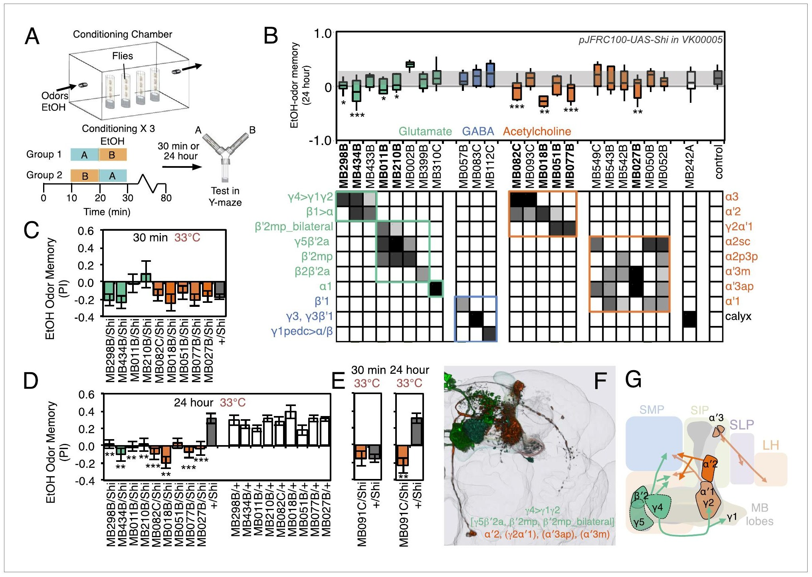

<small>圖片出處：Aso Y, Sitaraman D, Ichinose T et al. *eLife* 3:e04580 (2014)，Figure 11。CC BY（© 2014 Aso et al.）；全文見 [PMC](https://pmc.ncbi.nlm.nih.gov/articles/PMC4273436/)。</small>

> **原圖說（Figure 11）：** Requirement of MBONs for appetitive odor-ethanol intoxication memory. (A) Diagram of odor conditioning using ethanol vapor. Conditioned ethanol preference is measured by presenting two odors in sequence, one in the presence of an intoxicating dose of ethanol, three times for 10 min with 50-min breaks between exposures, followed by testing for preference between the two odors in a Y-maze in the absence of ethanol either 30 min or 24 hr after training. Wild-type flies find the ethanol-paired odor to be aversive when tested 30 min after training, but appetitive 24 hr after training. (B) Results of assays for the requirement of MBONs in ethanol-induced appetitive odor memory. pJFRC100-20XUAS-TTS-Shibire-ts1-p10 (VK00005) was used to block synaptic transmission during training and test; flies were kept at the permissive temperature for the 24 hr between training and test. MBONs have been grouped by neurotransmitter and color-coded. The bottom and top of each box represents the first and third quartile, and the horizontal line dividing the box is the median. The whiskers represent the 10th and 90th percentiles. The gray rectangle spanning the horizontal axis indicates the interquartile range of the control. Statistical tests are described in methods: \*, p < 0.05; \*\*, p < 0.01; \*\*\*, p < 0.001. The relative expression levels produced by the split-GAL4 driver lines in each cell type (indicated by the gray scale) are based on imaging with pJFRC2-10XUAS-IVS-mCD8::GFP (VK00005). Images of the expression patterns of selected drivers are shown in Figure 11—figure supplement 1. (C) 30-min ethanol-induced odor memory. (D) 24-hr ethanol-induced appetitive odor memory compared to +/Shi and GAL4/+ genetic controls. (E) Blocking transmission in MBON-α′2 with MB091C resulted in a failure to switch from aversive to appetitive memory for ethanol intoxication, confirming the result seen with MB018B. (F) Renderings of the MBONs implicated in 24 hr ethanol odor memory. MBONs grouped by square brackets represent cases where the available set of driver lines do not allow assigning an effect to a single cell type, but only to that set of MBONs. MBONs cell types in parentheses indicate cases where the data implicating them are only suggestive. (G) Schematic of potential circuits for appetitive ethanol memory. Cholinergic outputs from the MBON-α′2 and MBON-γ2α′1, and glutamatergic MBON-γ4>γ1γ2, MBON-γ5β′2a and MBON-β′2mp are implicated in appetitive ethanol memory. MBONs for which the data shows inconsistency across driver lines (MBON-α3 and MBON-γ2α′1) are shown in a lighter color; additional experiments will be required to resolve the role of these MBONs.

**圖說中譯：** 獎賞的氣味—酒精醉態記憶需要的 MBON。(A) 以酒精蒸氣做氣味制約的示意。依序呈現兩種氣味，其中一種伴隨致醉劑量的酒精，各 10 分鐘、重複三次、間隔 50 分鐘；訓練後 30 分鐘或 24 小時，在無酒精的 Y 迷宮中測兩種氣味的偏好，量得條件化的酒精偏好。野生型果蠅在訓練後 30 分鐘覺得配酒精的氣味是嫌惡的，24 小時後則是獎賞的。(B) 酒精誘發的獎賞氣味記憶中 MBON 需求的結果。以 pJFRC100-20XUAS-TTS-Shibire-ts1-p10（VK00005）在訓練與測驗時阻斷突觸傳遞；訓練與測驗之間的 24 小時果蠅保持在允許溫度。MBON 依傳遞物質分組上色。盒圖說明同前。統計見方法：\* p < 0.05；\*\* p < 0.01；\*\*\* p < 0.001。各型細胞的相對表現量（灰階）依 pJFRC2-10XUAS-IVS-mCD8::GFP（VK00005）的影像。部分品系的表現型態見圖 11 補充圖 1。(C) 30 分鐘的酒精誘發氣味記憶。(D) 與 +/Shi 及 GAL4/+ 遺傳對照相比的 24 小時酒精誘發獎賞氣味記憶。(E) 以 MB091C 阻斷 MBON-α′2 的傳遞，使酒精醉態記憶無法由嫌惡轉為獎賞，確認 MB018B 的結果。(F) 24 小時酒精氣味記憶相關 MBON 的立體重建。方括號內的 MBON 表示現有品系無法把效果歸給單一型別、只能歸給該組；括號內的 MBON 型別表示資料只具提示性。(G) 獎賞酒精記憶的潛在迴路示意。乙醯膽鹼的 MBON-α′2 與 MBON-γ2α′1，以及麩胺酸的 MBON-γ4>γ1γ2、MBON-γ5β′2a 與 MBON-β′2mp 涉及獎賞酒精記憶。資料在品系間不一致的 MBON（MBON-α3 與 MBON-γ2α′1）以較淺顏色表示；需要更多實驗才能解決這些 MBON 的角色。（對照正文：γ2α′1 只有一條品系顯著，α3 兩條品系結果相反，所以證據不足，見 3.6。）

**解讀：**
- **B 圖數得 8 條有星號**：MB298B、MB434B、MB011B、MB210B、MB082C、MB018B、MB077B、MB027B（※ 從圖判讀），與正文「八條」一致；但 MB027B（α′3m、α′3ap）在正文完全沒提，只在 F 圖以括號出現。圖上 MB051B 的品系名以粗體標出（粗體含意本圖圖說未交代），但沒有星號（※ 從圖判讀）；這與正文「效果較弱、未達統計顯著」一致。
- **C、D、E 都標 33 °C，方法寫 31 °C**（⚠️ 單篇自身不一致）。
- **本圖的分數正負號**：負值＝躲開配酒精的氣味（嫌惡），正值＝靠近（獎賞），0＝沒有記憶。
- **E 圖是全篇最有趣的結果之一，但它是「保留」不是「消除」**：阻斷 MBON-α′2 的果蠅，24 小時分數約 −0.2，和 30 分鐘時的嫌惡分數相近（※ 從圖判讀）。也就是說，牠們在 24 小時仍保留嫌惡，而不是記憶整個消失（分數回到 0）。
- **作者據此主張由嫌惡轉獎賞是主動過程**：轉換需要特定 MBON 參與，而不是嫌惡記憶自己隨時間淡掉、獎賞記憶自然浮現。
- **E 圖可有兩種讀法，本篇分不開**（※ 推論）：
  - (1) 作者的讀法：嫌惡與獎賞記憶都已形成，MBON-α′2 的輸出負責在 24 小時把表現切換成獎賞。
  - (2) 另一種讀法：阻斷 α′2 擋住的是獎賞記憶的形成或表現，剩下的嫌惡記憶自然顯現。
  - 本篇在訓練與測驗時都阻斷，兩種讀法都預期 24 小時看到嫌惡。若只在 30 分鐘到 24 小時之間阻斷，讀法 (1) 仍預期停在嫌惡，讀法 (2) 則不一定（※ 本頁推論）。
- **C 圖的 30 分鐘記憶，對照約 −0.15，各品系約 −0.25 到 +0.05**；MB011B 與 MB210B 偏向 0 以上，即嫌惡表現變弱（正文「兩條有下降趨勢」）。30 分鐘記憶的用途是確認果蠅聞得到氣味、也學得起來，以排除「24 小時記憶變差只是一開始沒學會」。但這個記憶本身很小，「這些品系能形成記憶」的推論建立在小效果上。

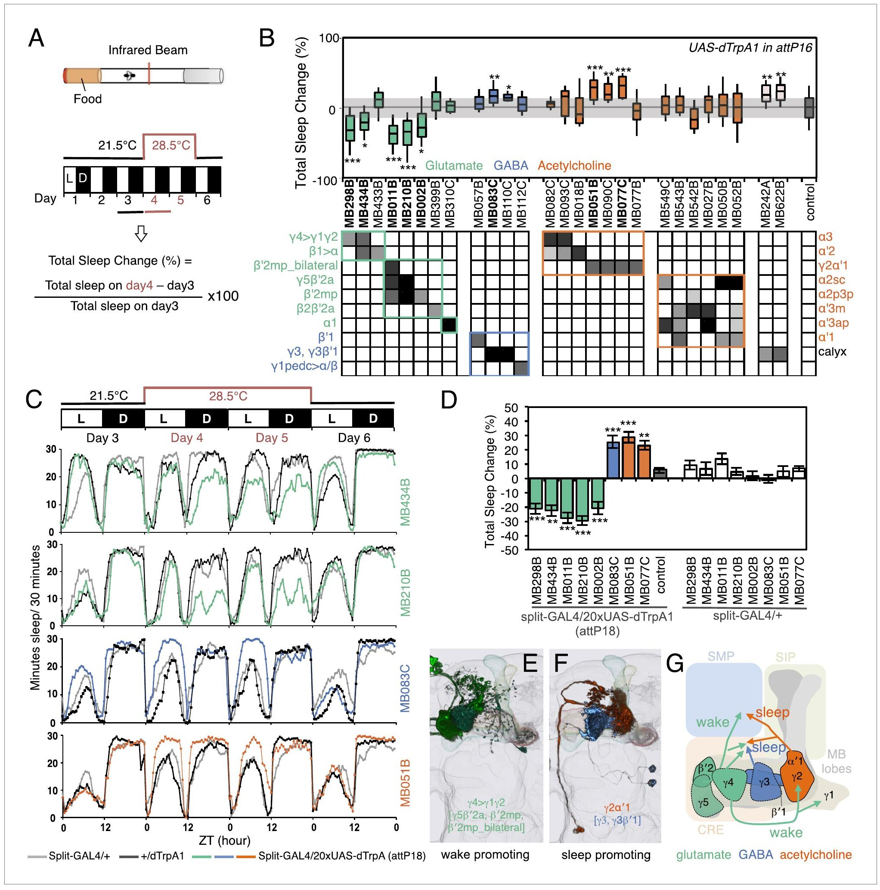

<small>圖片出處：Aso Y, Sitaraman D, Ichinose T et al. *eLife* 3:e04580 (2014)，Figure 12。CC BY（© 2014 Aso et al.）；全文見 [PMC](https://pmc.ncbi.nlm.nih.gov/articles/PMC4273436/)。</small>

> **原圖說（Figure 12）：** MBONs bi-directionally regulate sleep. (A) Top: Schematic of the experimental apparatus used for assaying sleep. Single flies are placed in a tube and activity is measured by counting the number of times the fly crosses an infrared beam. Bottom: Diagram of the experimental assay. Sleep was measured at 21.5°C for 3 days to establish the baseline sleep profile. Flies were then shifted to 28.5°C for 2 days to increase activity of the targeted cells by activating the dTrpA1 channel, and then returned to 21.5°C after activation to assay recovery. The effect of MBON activation on sleep amount is quantified as percentage change in sleep. Negative and positive values indicate decreased and increased sleep, respectively. (B) Box plots of change in sleep induced by dTrpA1 [UAS-dTrpA1 (attP16); (Hamada et al., 2008)] mediated activation of the neurons targeted by each of the indicated split-GAL4 driver lines. MBONs are grouped by neurotransmitter and color-coded as indicated. The bottom and top of each box represents the first and third quartile, and the horizontal line dividing the box is the median. The whiskers represent the 10th and 90th percentiles. The gray rectangle spanning the horizontal axis indicates the interquartile range of the control. Statistical tests are described in methods: \*, p < 0.05; \*\*, p < 0.01; \*\*\*, p < 0.001. The matrix below the box plots shows the relative levels of expression (indicated by the gray scale) in the cell types observed with each driver line using pJFRC200-10XUAS-IVS-myr::smGFP-HA (attP18). Images of the expression patterns of selected drivers are shown in Figure 12—figure supplement 1. (C) Sleep profiles of four split-GAL4 lines are shown. Each plot shows a 4-day period starting with subjective dawn. Sleep duration (min/30 min) on day 3 (21.5°C; permissive temperature), days 4, 5 (28.5°C; non-permissive temperature) and day 6 (21.5°C; permissive temperature) are plotted (colored line, split-GAL4 line in combination with pJFRC124-20XUAS-IVS-dTrpA1 (attP18); black line, represents +/dTrpA1; gray line, split-GAL4/+). (D) Sleep phenotypes were replicated with pJFRC124-20XUAS-IVS-dTrpA1 (attP18) for the eight drivers shown, but not for MB242A (not shown). Corresponding split-GAL4/+ flies showed normal sleep. (E, F) Renderings of MBONs responsible for the decreasing (E) or increasing (F) sleep. MBONs are color-coded based on their putative transmitter. (G) Diagram of MBONs responsible for the sleep regulation. MBONs are color-coded based on their putative transmitter as indicated. The wake promoting glutamatergic MBON-γ5β′2a, MBON-β′2mp and MBON-β′2mp_bilateral converge with the sleep promoting cholinergic MBON-γ2α′1 and GABAergic MBON-γ3 and MBON-γ3β′1 in the SMP and CRE. The wake-promoting glutamatergic MBON-γ4>γ1γ2 terminates in the dendritic region of MBON-γ2α′1.

**圖說中譯：** MBON 雙向調控睡眠。(A) 上：睡眠測驗裝置示意。單隻果蠅放在一根管子裡，以穿過紅外線光束的次數量活動。下：實驗流程。21.5 °C 下量 3 天睡眠，建立基線；接著升到 28.5 °C 兩天，以 dTrpA1 通道提高目標細胞的活性；之後回到 21.5 °C 看恢復。MBON 活化對睡眠量的效果以睡眠的百分比改變表示，負值為睡眠減少、正值為增加。(B) 以各 split-GAL4 品系驅動 dTrpA1［UAS-dTrpA1（attP16）；（Hamada et al., 2008）］活化目標神經元時睡眠改變的盒圖。MBON 依傳遞物質分組上色。盒圖說明同前。統計見方法：\* p < 0.05；\*\* p < 0.01；\*\*\* p < 0.001。盒圖下的矩陣以灰階表示各品系在各型細胞的相對表現量，依 pJFRC200-10XUAS-IVS-myr::smGFP-HA（attP18）。部分品系的表現型態見圖 12 補充圖 1。(C) 四條 split-GAL4 品系的睡眠曲線。每張圖為從主觀黎明（依果蠅生理時鐘推算的早晨起點；實驗在固定明暗週期下進行）開始的 4 天：第 3 天（21.5 °C，允許溫度）、第 4、5 天（28.5 °C，非允許溫度）與第 6 天（21.5 °C）的睡眠時間（分鐘／30 分鐘）（彩色線為 split-GAL4 配 pJFRC124-20XUAS-IVS-dTrpA1（attP18）；黑線為 +/dTrpA1；灰線為 split-GAL4/+）。(D) 以 pJFRC124-20XUAS-IVS-dTrpA1（attP18）重現了圖中八條品系的睡眠表型，MB242A 未能重現（未示）。對應的 split-GAL4/+ 果蠅睡眠正常。(E、F) 減少（E）或增加（F）睡眠的 MBON 立體重建，依推定傳遞物質上色。(G) 調控睡眠的 MBON 示意，依推定傳遞物質上色。促醒的麩胺酸 MBON-γ5β′2a、MBON-β′2mp、MBON-β′2mp_bilateral，與促眠的乙醯膽鹼 MBON-γ2α′1 及 GABA 的 MBON-γ3、MBON-γ3β′1 在 SMP 與 CRE 匯聚。促醒的麩胺酸 MBON-γ4>γ1γ2 終止在 MBON-γ2α′1 的樹突區。

**解讀：**
- **初篩 12 條顯著；D 圖呈現 8 條，都重現；MB242A 複篩沒有重現，資料未示**；MB110C、MB090C、MB622B 三條是否複篩，PDF 沒有交代（⚠️）。
- **C 圖要分開看白天與夜間**：MB434B 與 MB210B 在升溫的兩天裡，減少的主要是**夜間**睡眠（MB210B 夜間約 10 分鐘／30 分鐘，對照約 25），白天差距較小；MB083C 與 MB051B 增加的主要是**白天**睡眠（白天約 30，對照約 20–23）（※ 從圖判讀）。百分比改變把日夜加總，看不出「促醒的砍夜間、促眠的加白天」這個不對稱。
- **「促醒＝走開、促眠＝靠近」的對應是兩組獨立實驗的類比**：光遺傳用 CsChrimson、雌蠅、25 °C、數十秒；睡眠用 dTrpA1、處女雌蠅、28.5 °C、兩天。兩組品系也不完全重疊（例如睡眠用 MB077C，光遺傳用 MB077B）。這兩條品系的 AD 與 DBD 兩半（見本頁用語）用同樣的基因片段，只是插在不同的基因組位置；所以標記的細胞型別相同（都是 MBON-γ2α′1），差別可能只在表現量（※ 推論）。
- **萼部的兩條品系（MB242A、MB622B）在初篩都增加睡眠**，但 MB242A 未能重現。MBON-calyx 的傳遞物質未定，這一型的角色沒有結論。

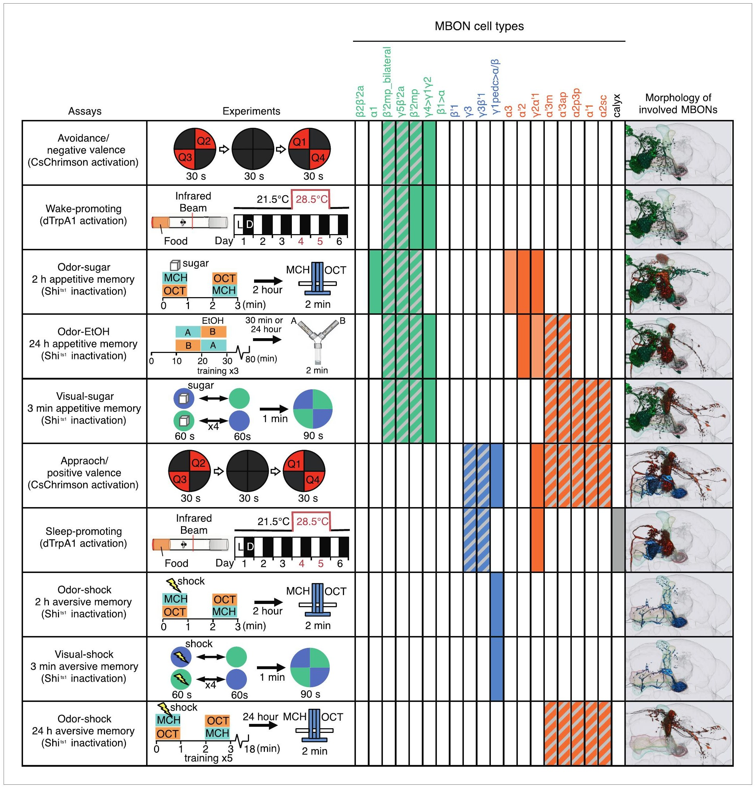

<small>圖片出處：Aso Y, Sitaraman D, Ichinose T et al. *eLife* 3:e04580 (2014)，Figure 13。CC BY（© 2014 Aso et al.）；全文見 [PMC](https://pmc.ncbi.nlm.nih.gov/articles/PMC4273436/)。</small>

> **原圖說（Figure 13）：** A map of MBON functions. A matrix summarizing the MBON cell types identified in each of the behavior assays is shown. In the cells of the matrix representing MBON cell types, solid colors were assigned when manipulation of that cell type alone caused a significant behavioral phenotype. Hatched cells indicate cases where we observed a significant behavioral phenotype, but the driver line used labeled a combination of cell types. In these cases, our data only allow us to assign the phenotypic effect to that group of MBONs. The light colored cells indicate two cases where our data suggested the involvement of a cell type, but was not conclusive. See Results for details. Avoidance, attraction, wake-promoting and sleep-promoting phenotypes reflect the results of activating MBONs; the other assays measured the effects of blocking synaptic transmission. Activation of glutamatergic MBONs repelled flies and promoted wakefulness, whereas activation of GABAergic or cholinergic MBONs attracted flies and promoted sleep. In general, more cell types were involved in appetitive memory than in aversive memory. Partially overlapping set of cholinergic and glutamatergic MBONs were required for all three appetitive memory assays. The same GABAergic MBON-γ1pedc>α/β was required for short-term olfactory and visual memory in an assay protocol that did not distinguish between formation or retrieval, whereas long-term aversive odor memory retrieval required the V2 cluster MBONs.

**圖說中譯：** MBON 功能地圖。矩陣總結各行為測驗中找到的 MBON 型別。代表 MBON 型別的格子中，只操作該型就造成顯著行為表型時塗實色；斜線格表示觀察到顯著表型、但所用品系標記多型，這時資料只容許把效果歸給該組 MBON；表上有兩格屬於「資料提示該型參與、但不確定」的情況，以淺色標示。細節見結果。走開、吸引、促醒、促眠是活化 MBON 的結果；其他測驗量的是阻斷突觸傳遞的效果。活化麩胺酸 MBON 使果蠅排斥並促醒，活化 GABA 或乙醯膽鹼 MBON 使果蠅吸引並促眠。整體而言，獎賞記憶涉及的型別多於嫌惡記憶。部分重疊的乙醯膽鹼與麩胺酸 MBON 是三種獎賞記憶測驗都需要的。同一型 GABA 的 MBON-γ1pedc>α/β 是短期嗅覺與視覺記憶所需（協定不區分形成與提取），而長期嫌惡氣味記憶的提取需要 V2 群 MBON。

**解讀：**
- **實心的標準與方法的標準不同**（⚠️）。圖說的實心＝「只操作這一型就顯著」；方法的標準＝「兩條品系都看到」才算指派功能，否則只是提示。依方法，至少三格的實心應降為「提示」：
  - 氣味—糖記憶的 MBON-α1：只有 MB310C 一條。
  - 光遺傳靠近（吸引）的 MBON-γ1pedc>α/β：只有 MB112C 一條。
  - 氣味—糖記憶的 MBON-α′2：只有 MB018B 一條；MB082C、MB093C 只弱標 α′2。
- **這張表是後續文獻引用「某型 MBON 推動靠近／走開」的源頭**。看「走開」與「吸引」兩列：單型實心的只有 γ4>γ1γ2（走開）、γ1pedc>α/β 與 γ2α′1（吸引）；M4/M6 三型、γ3／γ3β′1、V2 五型都是斜線。**引用 γ5β′2a、β′2mp 或 V2 任一型的「方向」時，本表只支持「該群」層級。**
- **「吸引」與「促眠」兩列的 γ1pedc>α/β 不同**：吸引列實心，促眠列空白。空白代表沒有顯著效果或沒有資料，本篇沒有分別標示（？待查）；3.8 只列出有效的品系，沒說哪些品系在睡眠篩檢中測過而無效。因此不能斷定這一型「活化會吸引、卻不改變睡眠」，「促眠＝靠近」是否逐型成立仍未確定。

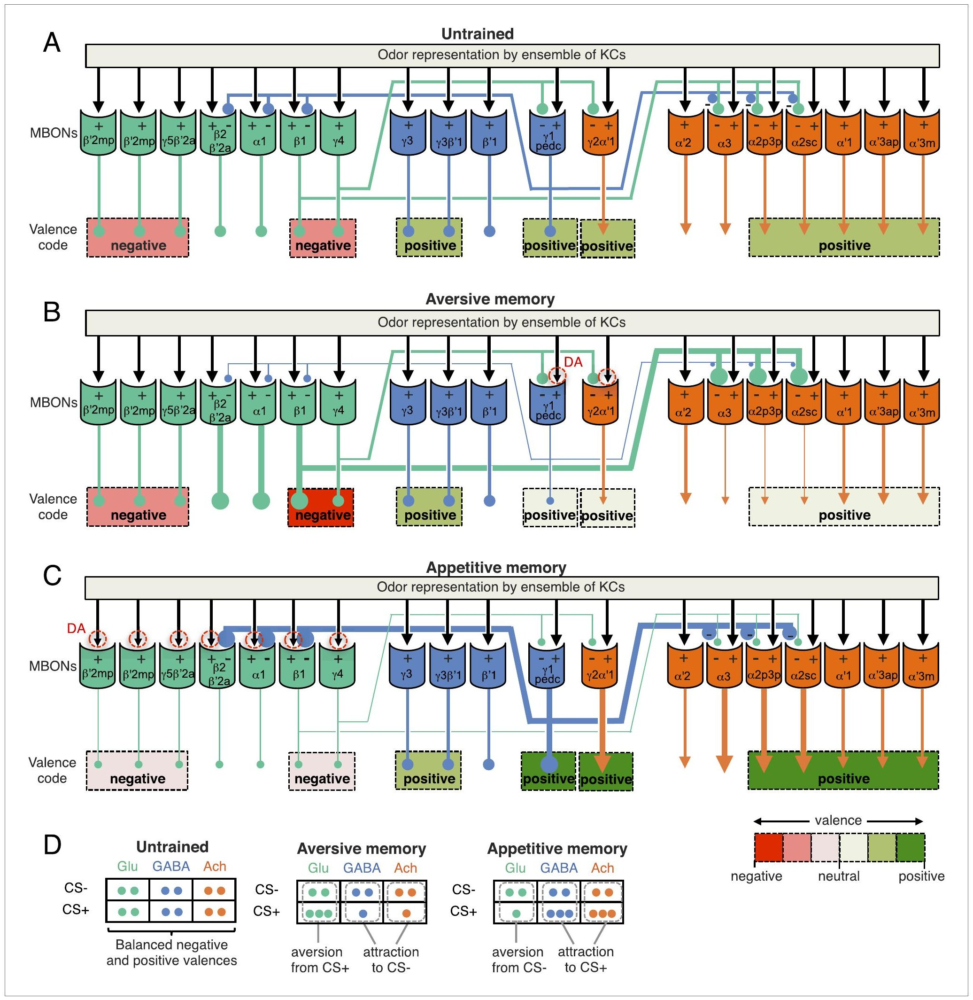

<small>圖片出處：Aso Y, Sitaraman D, Ichinose T et al. *eLife* 3:e04580 (2014)，Figure 14。CC BY（© 2014 Aso et al.）；全文見 [PMC](https://pmc.ncbi.nlm.nih.gov/articles/PMC4273436/)。</small>

> **原圖說（Figure 14）：** A simplified circuit model for the encoding of learned valence by MBONs ensemble and feedforward network. (A) In response to an odor, a sparse ensemble of Kenyon cells provides excitatory synaptic input to MBONs (black arrows; Hige et al., unpublished) (Cassenaer and Laurent, 2007). Glutamatergic (Glu; green), GABAergic (GABA; blue) and cholinergic (Ach; orange) MBONs all receive KC input; the names of MBONs are based on the lobe compartment where their dendrites arborize. CsChrimson activation of some glutamatergic MBONs can be repulsive, whereas activation of GABA or cholinergic MBONs can be attractive (color coded as indicated by the scale at bottom right) (Figure 2C). We often only observed significant behavioral effect with combinations of cell types (indicated by dashed lines grouping multiple cell types). MBON-γ1pedc>α/β, and glutamatergic MBONs, MBON-β1>α and MBON-γ4>γ1γ2, have synaptic terminals inside the compartments of MB lobes (Aso et al., 2014). While the microcircuits within each MB compartment remain to be elucidated, our light level anatomical studies have enumerated the cell types present in each compartment. The α2 and α3 compartments contain the dendrites of cholinergic MBONs and are targeted by both the GABAergic MBON-γ1pedc>α/β and the glutamatergic MBON-β1>α. These MBONs cover only a small fraction of volume in their target compartments (see Figure 6—figure supplement 1); since they could contact only a fraction of Kenyon cells, we propose that they target MBONs directly. Here we hypothesize that glutamate is inhibitory to cholinergic and GABAergic MBONs, and GABA is inhibitory to glutamatergic MBONs (inhibitory connections are indicated by circles). The thickness of lines and size of their endings are meant to indicate activity levels. (B) PPL1- γ1pedc DANs play a major role to mediate punishment signals to the MB for formation of aversive memory together with minor contribution from other DANs including PPL1-γ2α′1 (Aso et al., 2012). If an aversive memory is formed by the simultaneous presentation of an odor and punishment and results in a synaptic depression of KC terminals by dopamine (represented by red dashed circles), the response of the GABAergic MBONs to the CS+ would be depressed (see text). Reduced GABAergic inhibitory input would then increase the CS+ response of glutamatergic MBONs, whereas the CS+ response of cholinergic MBONs would be reduced because of dis-inhibition of the inhibitory glutamatergic MBONs. The end result is enhanced activity of aversion-mediating glutamatergic MBONs together with the reduced activity of attraction-mediating GABAergic and cholinergic MBONs in response to CS+. The CS- is represented by a different set of KCs whose synaptic connections to the MBONs would not be expected to be modified by training and so the responses of the ensemble of MBONs to the CS- would remain balanced. The change in response of the MBONs to the CS+, relative to their unchanged response to the CS-, biases choice toward the CS+ (see diagram in panel D). This model is consistent with the essential role of MBON-γ1pedc>α/β in aversive memory. Also, cholinergic MBONs in V2 cluster have been shown to reduce their response to an odor after olfactory conditioning with electric shock (Séjourné et al., Nat. Neurosci., 2011), although we detected their requirement only for long-term memory, but not for 2 hr memory. This model predicts a role for glutamatergic MBONs, but we did not observe significant effect by blocking subsets of glutamtergic MBONs (Figures 6 and 8). Thus, to test this model, it will be necessary to block broader sets of glutamatergic MBON cell types by using combinations of split-GAL4 drivers. (C) In contrast to aversive memory in which one type of DAN (PPL1-γ1pedc) plays a major role in memory formation, reward signals are mediated by a distributed set of PAM cluster DANs that innervate the compartments of glutamatergic MBONs (Yamagata et al., in press) (Burke et al., 2012; Liu et al., 2012; Perisse et al., 2013). If an appetitive memory is formed by synaptic depression of KC terminals in response to dopamine release, the response of the glutamatergic MBONs to the CS + would be depressed. The resultant reduced glutamatergic inhibitory input to the GABAergic and cholinergic MBONs would increase their response to the CS+. In turn, increased GABAergic input to glutamatergic MBONs may further amplify and stabilize the initial effects of plasticity. The end result would be reduced activity of aversion-mediating glutamatergic MBONs together with the increased activity of attraction-mediating GABAergic and cholinergic MBONs in response to CS+. This model is consistent with requirement of glutamatergic MBONs: blocking the M4/M6 cluster MBONs (MBON-γ5β′2a, MBON-β′2mp and MBON-β′2mp_bilateral; Table 1) by MB011B resulted in memory impairment for all three appetitive memory assays (Figures 7, 9 and 11). Blocking the MBON-γ4>γ1γ2 and MBON-β1>α by MB434B resulted in memory impairment in two of three assays (Figures 9 and 11). While we did not detect a requirement for the GABAergic MBON-γ1ped>α/β in appetitive memory, previous study have shown that dopamine input to the γ1 and pedc suppresses expression of appetitive memory in fed flies (Krashes et al., 2009), indicating some role of MBON-γ1ped>α/β in appetitive memory. Blocking cholinergic MBONs in the V3/V4 cluster (MBON-γ2α′1, MBON-α′2 and MBON-α3) resulted in memory impairment in appetitive odor memories (Figures 7 and 11) (Placais et al., 2013) but not in appetitive visual memory (Figure 9). Some of driver lines for the cholinergic MBONs in the V2 cluster showed impairment of appetitive memory in all three assays (Figures 7, 9 and 11), although our data did not allow mapping to the resolution of specific cell types due to inconsistent results obtained using other lines. (D) In the matrix shown, the number of circles represents the activity levels of MBONs in response to the CS+ odor (the odor that is paired with the unconditioned stimulus during conditioning) and the CS− odor (a control odor). In untrained flies, the activities of MBONs for opposing effects are balanced. Dopamine modulation breaks this balance to bias the choice between CS+ and CS−.

**圖說中譯：** MBON 群體與前饋網路編碼習得價值的簡化迴路模型。(A) 對一個氣味，稀疏的一群 Kenyon 細胞提供 MBON 興奮性的突觸輸入（黑箭頭；Hige et al., unpublished；Cassenaer and Laurent, 2007）。麩胺酸（Glu；綠）、GABA（藍）與乙醯膽鹼（Ach；橘）MBON 都接收 KC 輸入；MBON 以其樹突所在的葉區室命名。以 CsChrimson 活化部分麩胺酸 MBON 可引起排斥，活化 GABA 或乙醯膽鹼 MBON 可引起吸引（依右下色尺上色）（圖 2C）。我們常常只在細胞型別組合時才觀察到顯著的行為效果（以虛線框住多型表示）。MBON-γ1pedc>α/β 以及麩胺酸的 MBON-β1>α 與 MBON-γ4>γ1γ2 在 MB 葉的區室內有突觸末梢（Aso et al., 2014）。各區室內的微迴路仍待闡明，但我們的光學層級解剖已列出各區室中有哪些細胞型別。α2 與 α3 區室含乙醯膽鹼 MBON 的樹突，並是 GABA 的 MBON-γ1pedc>α/β 與麩胺酸的 MBON-β1>α 的目標。這些 MBON 的軸突末梢在目標區室只占很小的體積（見圖 6 補充圖 1），碰得到的 Kenyon 細胞有限；因此我們提出，它們主要直接接到該格 MBON（的樹突），而不是去改變 KC（※ 依圖說原文的推論）。在此我們假設麩胺酸對乙醯膽鹼與 GABA MBON 為抑制性，GABA 對麩胺酸 MBON 為抑制性（抑制性連結以圓點表示）。線的粗細與末端大小代表活動量。(B) PPL1-γ1pedc DAN 在傳遞懲罰訊號、形成嫌惡記憶上扮演主要角色，其他 DAN（包括 PPL1-γ2α′1）有次要貢獻（Aso et al., 2012）。假設同時給氣味與懲罰形成了嫌惡記憶，而這個記憶的形式是：多巴胺壓低該格 KC 末梢到 MBON 的突觸傳遞（紅虛線圓），也就是本頁說的「突觸變弱」。那麼 GABA MBON 對 CS+ 的反應就會被壓低（見正文）。接下來分三步：GABA MBON 變弱，它對麩胺酸 MBON 的抑制就減少；這種「原本壓住它的抑制被移除」稱為去抑制，於是麩胺酸 MBON 對 CS+ 的反應提高；麩胺酸 MBON 本身會抑制乙醯膽鹼 MBON，它變強後，乙醯膽鹼 MBON 對 CS+ 的反應就被壓得更低。最終結果是：對 CS+，媒介嫌惡的麩胺酸 MBON 活性增強，媒介吸引的 GABA 與乙醯膽鹼 MBON 活性降低。CS− 由另一組 KC 代表，其與 MBON 的突觸連結預期不會被訓練改變，所以 MBON 群體對 CS− 的反應仍然平衡。MBON 對 CS+ 的反應相對於對 CS− 不變的反應的改變，使選擇偏向 CS+〔原文如此；依上下文，嫌惡記憶應是偏離 CS+〕（見 D 圖示）。這個模型與 MBON-γ1pedc>α/β 在嫌惡記憶中的必要角色一致。另外，V2 群乙醯膽鹼 MBON 已被證明在電擊嗅覺制約後降低對氣味的反應（Séjourné et al., Nat. Neurosci., 2011），雖然我們只在長期記憶、而非 2 小時記憶中偵測到它們的需求。這個模型預測麩胺酸 MBON 有角色，但阻斷麩胺酸 MBON 的子集沒有觀察到顯著效果（圖 6、8）。因此要檢驗這個模型，需要以 split-GAL4 品系的組合阻斷更廣的麩胺酸 MBON 型別。(C) 與嫌惡記憶中由一型 DAN（PPL1-γ1pedc）扮演主要角色不同，獎賞訊號由支配麩胺酸 MBON 區室的一組分散的 PAM DAN 傳遞（Yamagata et al., in press；Burke et al., 2012；Liu et al., 2012；Perisse et al., 2013）。若獎賞記憶同樣是多巴胺壓低 KC 末梢到 MBON 的突觸傳遞（突觸變弱）所形成，麩胺酸 MBON 對 CS+ 的反應就會被壓低。麩胺酸對 GABA 與乙醯膽鹼 MBON 的抑制性輸入因此減少，會提高它們對 CS+ 的反應。接著，增加的 GABA 輸入到麩胺酸 MBON，可能進一步放大並穩定可塑性的初始效果。最終結果是：對 CS+，媒介嫌惡的麩胺酸 MBON 活性降低，媒介吸引的 GABA 與乙醯膽鹼 MBON 活性增加。這個模型與麩胺酸 MBON 的需求一致：以 MB011B 阻斷 M4/M6 群 MBON（MBON-γ5β′2a、MBON-β′2mp 與 MBON-β′2mp_bilateral；表 1），三種獎賞記憶測驗都受損（圖 7、9、11）。以 MB434B 阻斷 MBON-γ4>γ1γ2 與 MBON-β1>α，三種中兩種受損（圖 9、11）。雖然我們沒有偵測到 GABA 的 MBON-γ1ped>α/β〔原文如此〕在獎賞記憶中的需求，先前研究顯示，在吃飽（相對於飢餓）的果蠅中，送進 γ1 與 pedc 的多巴胺會壓抑獎賞記憶的表現（Krashes et al., 2009）；中間一步應是這些多巴胺改變了 γ1pedc 這格 MBON 的輸出（※ 推論）。獎賞記憶表現得出來與否跟飢餓狀態有關，本篇未再細述其機制。這表示 MBON-γ1ped>α/β 在獎賞記憶中有某種角色。阻斷 V3/V4 群乙醯膽鹼 MBON（MBON-γ2α′1、MBON-α′2 與 MBON-α3）損害獎賞氣味記憶（圖 7、11）（Plaçais et al., 2013），但不損害獎賞顏色記憶（圖 9）。V2 群乙醯膽鹼 MBON 的部分品系在三種測驗中都損害獎賞記憶（圖 7、9、11），但由於其他品系結果不一致，我們的資料無法定位到特定型別。(D) 矩陣中圓點數代表 MBON 對 CS+ 氣味（訓練時與非條件刺激配對的氣味；非條件刺激即 US，unconditioned stimulus，指懲罰或獎賞本身，見本頁用語）與 CS− 氣味（對照氣味）的活動量。未訓練的果蠅中，相反效果的 MBON 活動平衡。多巴胺調節打破這個平衡，使 CS+ 與 CS− 之間的選擇產生偏向。

**解讀：**
- **這張圖畫得像資料，其實全部是假設。** A 圖的抑制性圓點（麩胺酸抑制 GABA 與乙醯膽鹼、GABA 抑制麩胺酸）是作者明說的假設；B、C 圖的「突觸抑制」是作者由「活化方向與 DAN 記憶方向相反」推出的機制。本篇沒有任何 MBON 的生理記錄。
- **圖上兩種「圓」意思不同。** 紅虛線圓指的是 KC→MBON 突觸變弱（學習造成的改變）；A 圖的圓點則是 MBON 之間假設的「抑制性連結」（一型 MBON 壓低另一型）。兩者是兩回事。
- **B 圖說「biases choice toward the CS+」**：依整段文意，嫌惡記憶的結果應是偏離 CS+（D 圖「aversion from CS+」）。這是圖說措辭的問題，不影響 D 圖。
- **模型預測與資料有一處明說的落差**：嫌惡記憶應該需要麩胺酸 MBON，但阻斷其子集沒有效果（作者自陳）。後來 [[s-felsenberg-2018-memory-extinction]] 做了兩件事。第一，量到嫌惡訓練後麩胺酸 MBON 的軸突反應改變（方向見該來源頁；？待查）；這群 MBON 在早期文獻稱 M4β′、M6，對應本頁的 M4/M6 群。第二，以電子顯微鏡數出 MBON-γ1pedc>α/β 接到 M6 的 16–17 個突觸；這個數字算多或少，本篇與本頁都沒有可比的基準（？待查）。這給了 A 圖「GABA 抑制麩胺酸 MBON」的一部分解剖支持。
- **A 圖 valence code 列的方塊值得對照圖 2C**：A 圖以框線標出被歸為「negative」（負價值，即活化後果蠅走開）的一組 MBON。β2β′2a 與 α1 的麩胺酸 MBON 不在框內（※ 從圖判讀），與圖 2C 這兩型單獨活化無效一致。γ4 在圖上與 β1 合框，對應的是同時標這兩型的品系 MB434B；γ4 單獨就顯著的是另一條品系 MB298B（見 3.2）。作者自己的模型圖並沒有宣稱「所有麩胺酸 MBON 都推動走開」。

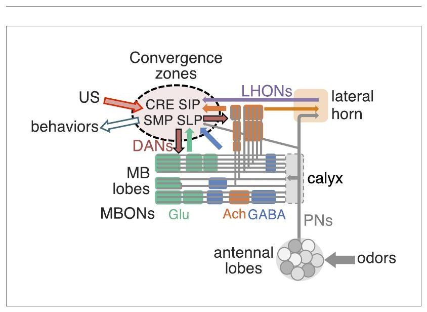

<small>圖片出處：Aso Y, Sitaraman D, Ichinose T et al. *eLife* 3:e04580 (2014)，Figure 15。CC BY（© 2014 Aso et al.）；全文見 [PMC](https://pmc.ncbi.nlm.nih.gov/articles/PMC4273436/)。</small>

> **原圖說（Figure 15）：** Convergence zone of MBON terminals as network nodes to integrate innate and learned valences. MB lobes are consisted of three groups of compartments based on the putative transmitter of MBONs (glutamate, GABA and acetylcholine; color-coded as indicated), which are interconnected inside the lobes and send converging outputs to the lateral horn, CRE, SMP, SIP and SLP. These regions also receive input from the antennal lobes and the lateral horn, some of which appear to be in close apposition to the terminals of MBONs and likely target common downstream neurons (see Figure 15— figure supplement 1). Therefore, these convergence zones are well positioned to function as integration sites for selecting adaptive behaviors based on both innate and learned valences.

**圖說中譯：** MBON 末梢的匯聚區作為整合先天與習得價值的網路節點。MB 葉依 MBON 的推定傳遞物質（麩胺酸、GABA、乙醯膽鹼；依圖例上色）分成三組區室，它們在葉內互相連接，並把匯聚的輸出送到側角、CRE、SMP、SIP 與 SLP。MBON 末梢集中的 CRE、SMP、SIP、SLP 等區域，也接收嗅葉投射神經元與側角輸出神經元的輸入；後兩者帶的是先天的氣味資訊。（側角本身既是 MBON 輸出的去處，也藉其輸出神經元送訊號到其他匯聚區。）這些輸入中有部分似乎緊貼 MBON 的末梢，可能有共同的下游神經元（見圖 15 補充圖 1）。因此這些匯聚區很適合作為依據先天與習得價值選擇適應行為的整合位置。

**解讀：**
- **這是一張概念圖，支撐它的解剖資料在補充圖 15-1（未取得）**，而「緊貼」是光學顯微鏡的判斷。圖上也畫了 MBON 到 DAN 的箭頭（DANs 方框），即正文「部分 MBON 似乎終止在支配其他區室的 DAN 的樹突上，形成回饋迴路」。意思是 MBON 的末梢也落在別格 DAN 的樹突所在區域，形成 MBON→DAN 的回饋；若這些 DAN 再回去改寫自己那一格的 KC→MBON 突觸，價值的讀出就能反過來影響後續的寫入（※ 推論，本篇未量）。這條回饋在本篇只是解剖觀察，後來由 Ichinose 2015、Felsenberg 2017／2018、Huang 2024 在功能上檢驗（見 [[t-mbon-dan-feedback]]）。
- **作者把下游指向中央複合體的扇形體。** 中央複合體是果蠅腦中央、與協調動作模式有關的區域，扇形體是其中一層。投射到扇形體的神經元，樹突廣泛分布在 MBON 末梢所在的同一批區域，所以作者首推它當下游。這在本篇是推測，沒有資料。

---

## 相關

- [[numbers]] — 本篇貢獻了 MBON 型別與細胞數（21 型 34 顆、加萼部共 22 型）、光遺傳協定參數（617 nm、34 µW/mm²、n＝11–29）、篩檢的顯著品系數、軌跡分析的相關係數、各記憶作業的協定與效果量、睡眠協定
- 主題：[[t-mbon-dan-feedback]]（MBON 末梢落在別格 DAN 樹突的解剖觀察；「與 DAN 相反」通則是各篇回饋模型的前提）、[[t-timing-rules]]（「突觸變弱或變強對行為的意義」表的方向全部引自本篇）、[[t-dopamine-to-plasticity]]（本篇推論多巴胺讓 KC→MBON 變弱）、[[t-memory-updating]]（多層前饋網路處理新舊記憶衝突的提議；酒精記憶由嫌惡轉獎賞）
- 概念：[[c-mb-compartment]]、[[c-kc-mbon-plasticity]]、[[c-us-substitution]]、[[c-performance-index]]、[[c-spaced-training]]
- 實體：[[e-mbon]]、[[e-mbon-gamma1pedc]]、[[e-mbon-gamma2alpha1]]、[[e-mbon-gamma4]]、[[e-mbon-gamma5beta2a]]、[[e-mbon-alpha2sc]]、[[e-ppl1-gamma1pedc]]、[[e-dopaminergic-neuron]]、[[e-split-gal4]]、[[e-cschrimson]]、[[e-shibire-ts]]、[[e-t-maze]]、[[e-mushroom-body]]、[[e-kenyon-cell]]
- 來源：[[s-hige-2015-heterosynaptic-plasticity]]、[[s-handler-2019-dopamine-receptor-timing]]、[[s-felsenberg-2017-re-evaluation]]、[[s-felsenberg-2018-memory-extinction]]、[[s-ichinose-2015-reward-recurrent-circuit]]、[[s-aso-2016-dan-cell-type-rules]]、[[s-huang-2024-dopamine-memory-dynamics]]
- 待開頁面：[[c-valence-coding]]（價值編碼）、`e-mbon-v2-cluster`、[[e-mbon-alpha3]]、[[e-mbon-alpha1]]、`e-mbon-beta2mp`、`e-dtrpa1`、[[e-mcfo]]、`e-mb310c`、[[c-feedforward-inhibition]]、[[c-appetitive-memory]]、`c-ethanol-reward-memory`（酒精醉態記憶）、`c-sleep-regulation`（睡眠調節）、`c-visual-conditioning`（顏色制約）、`e-mbon-gamma3`（γ3 與 γ3β′1）、`e-mb112c`、`e-mb052b`

## 出處

Aso, Y., Sitaraman, D., Ichinose, T., Kaun, K. R., Vogt, K., Belliart-Guérin, G., Plaçais, P.-Y., Robie, A. A., Yamagata, N., Schnaitmann, C., Rowell, W. J., Johnston, R. M., Ngo, T.-T. B., Chen, N., Korff, W., Nitabach, M. N., Heberlein, U., Preat, T., Branson, K. M., Tanimoto, H., and Rubin, G. M. (2014). Mushroom body output neurons encode valence and guide memory-based action selection in *Drosophila*. *eLife* 3, e04580. https://doi.org/10.7554/eLife.04580

本篇為 CC BY 開放取用，版權屬作者（Copyright Aso et al.）。圖片擷取自原文，依該授權在標明出處的條件下重製，本庫以教學與評論目的引用。全文請至 https://pmc.ncbi.nlm.nih.gov/articles/PMC4273436/ 免費閱讀。
