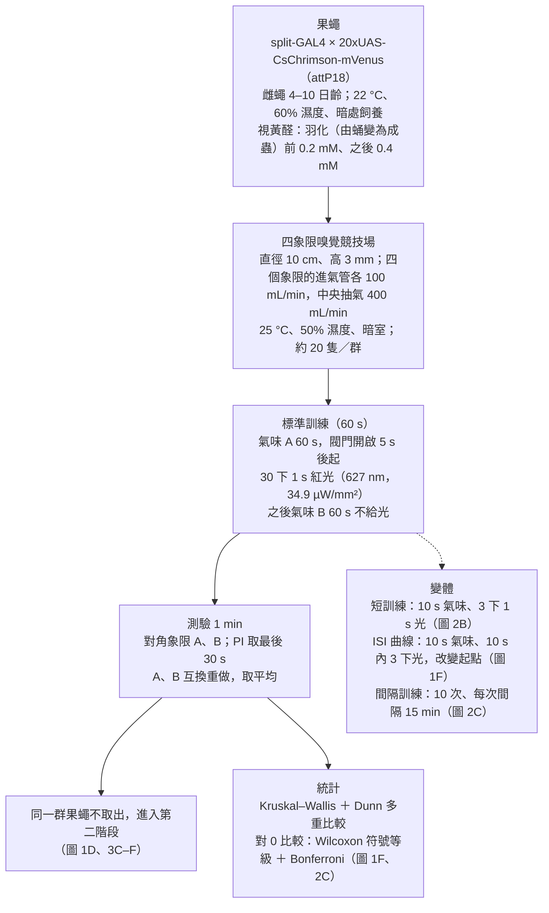
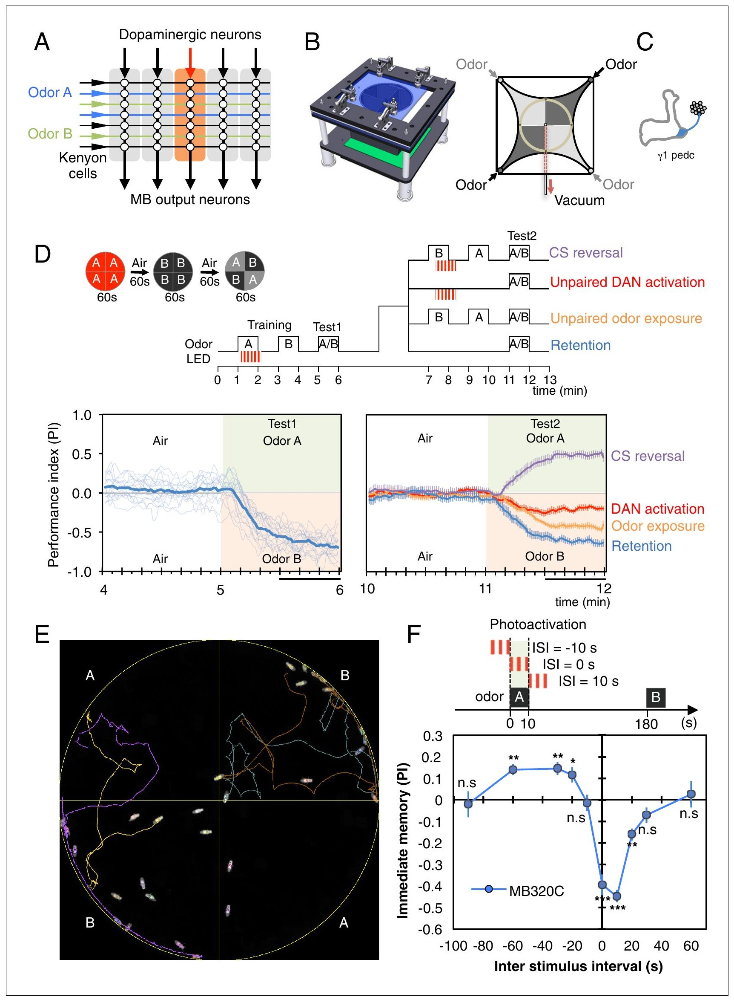
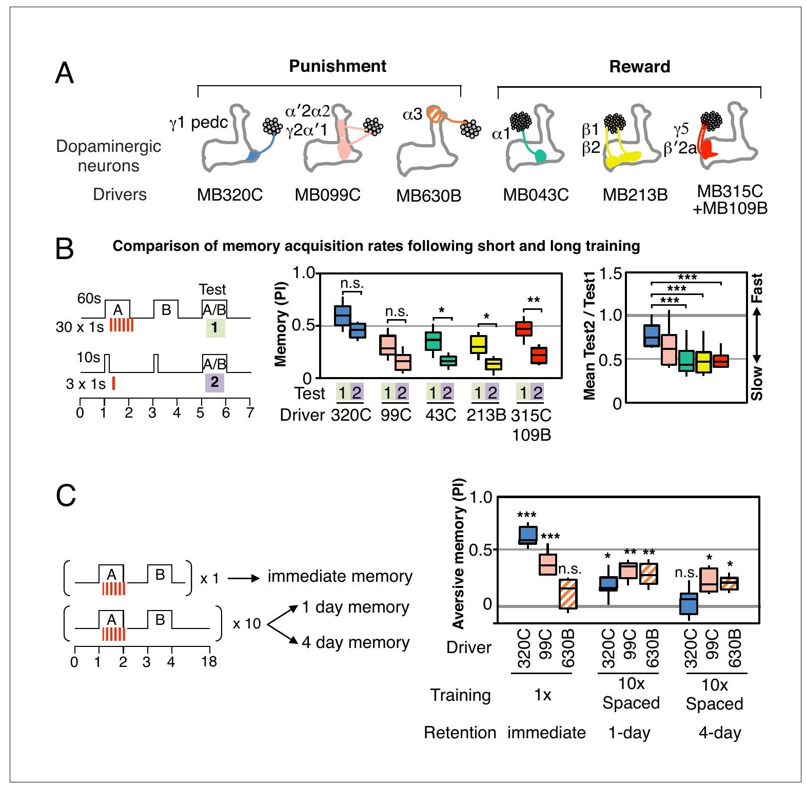
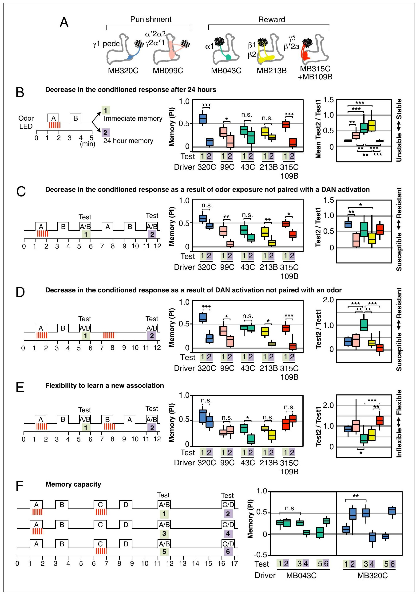
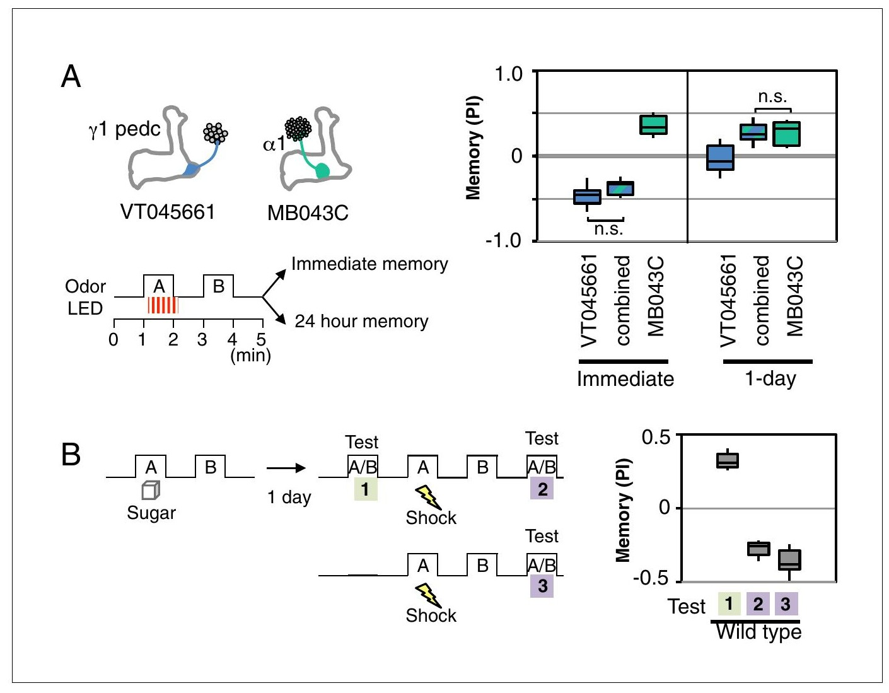
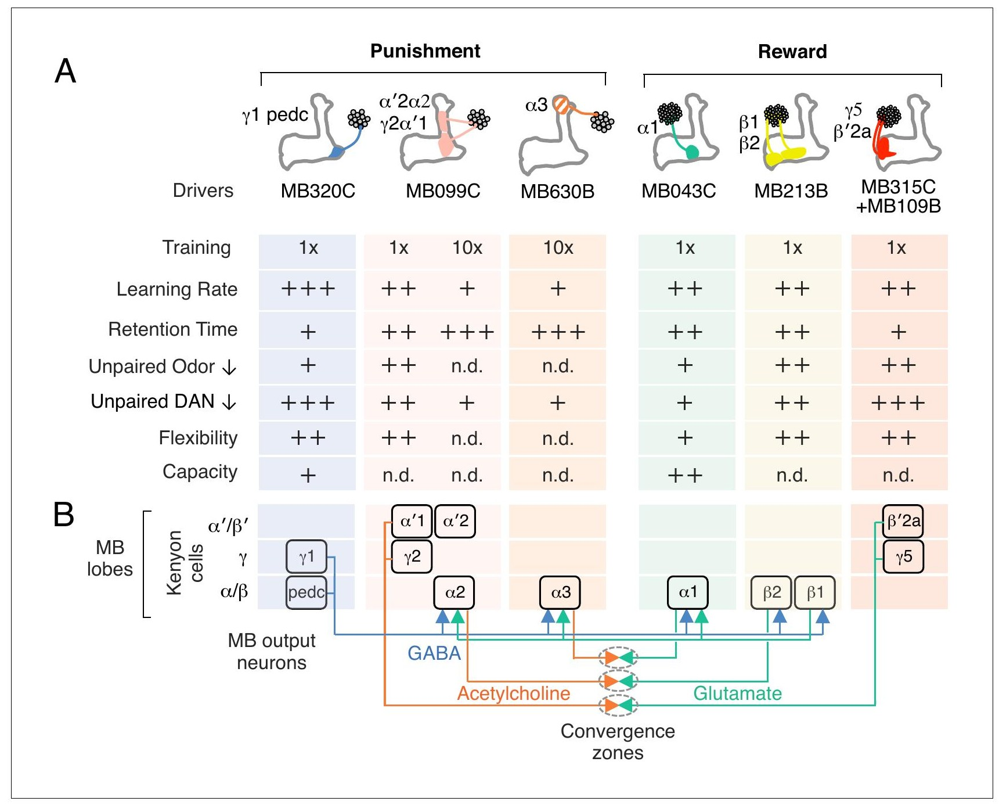

<!-- 本機 PDF：papers/2016-Dopaminergic%20neurons%20write%20and%20update%20memories%20with%20cell-type-specific%20rules.pdf -->

# Dopaminergic neurons write and update memories with cell-type-specific rules

**多巴胺神經元依各自細胞類型的規則寫入與更新記憶**

| 項目 | 內容 |
|---|---|
| **出處** | eLife 5, e16135 (2016). doi: 10.7554/eLife.16135 [全文（PMC 免費閱讀）](https://pmc.ncbi.nlm.nih.gov/articles/PMC4987137/) |
| 日期 | 刊出 2016-07-21（PDF 印「Published: 21 July 2016」）；投稿 2016-03-21・接受 2016-07-18；修訂日期 PDF 未印。eLife 文章是單篇編號（e16135），沒有起迄頁；PDF 共 15 頁 |
| 通訊作者 | Yoshinori Aso，asoy@janelia.hhmi.org；Gerald M. Rubin，rubing@janelia.hhmi.org（PDF 只有英文名） |
| 作者 | 共 2 人：Yoshinori Aso、Gerald M. Rubin。分工（PDF 的 Author contributions）：兩人共同構思與設計；Aso 取得並分析資料；兩人共同撰寫 |
| 機構 | Janelia Research Campus, Howard Hughes Medical Institute（美國維吉尼亞州 Ashburn） |
| 資料庫 | 無公開資料或程式碼。驅動品系的表現影像在 www.janelia.org/split-gal4；行為裝置的完整構造文件與 CAD 檔「向 Janelia 技術移轉辦公室索取」 |
| 補充資料 | 圖 1 補充圖 1、圖 2 補充圖 1–5、圖 3 補充圖 1、影片 1–2、補充檔 1（裝置設計與零件表）。**本 PDF 只列出標題，不含內容**（本頁以「補充圖 2-3」表示圖 2 的第 3 張補充圖，依此類推）；本頁凡依賴它們的內容一律標 `？待查（補充資料未取得）` |
| 編輯／審查 | 審查編輯（Reviewing editor）Liqun Luo（HHMI／Stanford University）。文章類型為 eLife 的「Research advance」（研究進展），即延續先前一篇 eLife 論文的短篇；延續的是哪一篇，PDF 未寫明：？待查 |
| 經費 | HHMI（兩位作者） |

> 與本庫有關的作者：無（本庫目前沒有「與本庫有關的作者」名單）。Aso 與 Rubin 同時是 [[s-hige-2015-heterosynaptic-plasticity]] 的共同作者。
>
> **本篇為 CC BY 開放取用**（PDF 第 1 頁：「This article is distributed under the terms of the Creative Commons Attribution License, which permits unrestricted use and redistribution provided that the original author and source are credited」；未註明版本號），版權屬作者（Copyright Aso and Rubin），圖片與 PDF 可在標明出處下自由使用與散布。本庫仍依規定只給全文連結、不放 PDF；每張圖下方標明出處與授權。

---

## 為什麼重要

果蠅的蘑菇體（mushroom body, MB）是學習「哪個氣味代表好事、哪個代表壞事」的腦區。氣味由約 2000 顆 Kenyon 細胞（Kenyon cell, KC）的稀疏活動代表（每種氣味只活化其中一小群）；KC 的長軸突成束排成幾條「葉」（lobe），而輸出神經元（MB output neuron, MBON）的樹突與多巴胺神經元（dopaminergic neuron, DAN）的末梢沿著這些軸突一段一段地鋪開，把葉切成 15 個區室（compartment）（以上依本篇引言，引 Tanaka et al. 2008、Aso et al. 2014a）。每個區室的 DAN 被認為只調整自己那一段的「KC → MBON」突觸（本篇引 Hige et al. 2015、Cohn et al. 2015；本庫收錄的 [[s-cohn-2015-coordinated-neuromodulation]] 另在圖 6E 量到小幅的跨格例外，見 [[c-mb-compartment]]）。所以同一個氣味可以在不同區室各留下一份獨立的記錄。**問題是：各區室寫入與修改記錄的規則是否相同？** 本篇的回答是：差很多。

驅動品系（driver line）是決定某個外加基因只在哪些神經元表現的果蠅品系（見 [[e-split-gal4]]）。作者用分裂式 GAL4（split-GAL4）這一類能把表現範圍縮到一兩型細胞的驅動品系，只在一型或兩型 DAN 裡放入紅光敏感的離子通道 CsChrimson，在一個可以反覆訓練與測驗、不必搬動果蠅的四象限嗅覺競技場裡，用紅光代替電擊或糖當作懲罰或獎賞。這種用光控制特定神經元的方法稱為光遺傳（optogenetics）。他們比較了 6 組驅動品系在六件事上的差異。6 組中有三組各活化兩型 DAN，有些型 DAN 的名稱也橫跨兩個區室（例如 γ2α′1），所以 6 組合計涵蓋（作者的說法）15 個區室中的 11 個。六件事是：要訓練多久才學會、記憶維持多久、只聞氣味不給懲罰時記憶掉多少、只給懲罰不給氣味時記憶掉多少、能不能學會新的配對、能同時記住幾組氣味配對（一組＝一個配光的氣味加一個不配光的對照氣味）。區室以所在的葉與位置編號命名（γ1、α1、β′2 等；γ1pedc 是一型 DAN 支配的範圍，本篇圖 3F 圖說把它當作 γ1 與 pedc 兩個區室，計數問題見專業文 3.6）；PPL1 與 PAM 是兩群 DAN 的名稱（本篇沒有解釋命名）；本篇把屬於 PPL1 群、支配 γ1pedc、γ2α′1、α′2α2、α3 的 DAN 當懲罰訊號，把屬於 PAM 群、支配 α1、β1/β2、γ5/β′2a 的 DAN 當獎賞訊號（圖 2A）。結果是每一項都有區室之間的差異，例如管 γ1pedc 區室的 DAN 一次訓練就留下強記憶，但這份記憶一天就退掉、連續學兩組只記得最後一組；管 α1 區室的 DAN 學得較慢，記憶較穩，兩組都記得。

對本庫而言，這篇與已收的三篇（Tomchik & Davis 2009、Hige et al. 2015、Handler et al. 2019）互補，與後兩篇關係最直接。[[s-hige-2015-heterosynaptic-plasticity]] 用同一顆 DAN（PPL1-γ1pedc，品系 MB320C；依 Hige 2015，MB320C 只標記一顆 PPL1-γ1pedc，所以本頁對這一型也說「一顆」）在活體上直接量到突觸變弱，但時間規則只測了兩點：順向（氣味先、DAN 後）與逆向（DAN 先、氣味後）各一；本篇用行為測了十個時間差，發現**同一顆 DAN 在氣味之後放電，果蠅學會躲氣味；在氣味之前 20–60 秒放電，果蠅反而學會喜歡氣味**。這和 [[s-handler-2019-dopamine-receptor-timing]]「逆向配對學到相反方向」的結論同向，但 Handler 的逆向間隔只有約 1–2 秒，本篇的喜好窗是 20–60 秒，差了十倍以上。它也不和 Hige 2015 的「逆向無效」衝突：Hige 的逆向光只比氣味早 2.0 到 0.5 秒；本篇每次給光 10 秒；在光比氣味早 10 秒、光結束時氣味剛到的那一點，同樣測不到效果，喜好只在更早的時候出現（見專業文 3.2）。本篇沒有任何生理記錄，**全部是行為**；作者自己也說「單一 DAN 能依時序雙向改變突觸」這個模型「有待生理量測完整檢驗」。

---

## 論文摘要（原文與中譯）

> 本篇的摘要（Abstract）是不分段的單段（不是 Background／Results／Conclusion 結構），以下照原文排列。摘要中的「寫入」指形成新的記憶；「減弱」指已形成的記憶被削弱；「平行的記憶系統」指不同區室。
>
> Associative learning is thought to involve parallel and distributed mechanisms of memory formation and storage. In *Drosophila*, the mushroom body (MB) is the major site of associative odor memory formation. Previously we described the anatomy of the adult MB and defined 20 types of dopaminergic neurons (DANs) that each innervate distinct MB compartments (Aso et al., 2014a, 2014b). Here we compare the properties of memories formed by optogenetic activation of individual DAN cell types. We found extensive differences in training requirements for memory formation, decay dynamics, storage capacity and flexibility to learn new associations. Even a single DAN cell type can either write or reduce an aversive memory, or write an appetitive memory, depending on when it is activated relative to odor delivery. Our results show that different learning rules are executed in seemingly parallel memory systems, providing multiple distinct circuit-based strategies to predict future events from past experiences.

**中譯**（本節為忠實翻譯，非自撰內容）：

> 聯想學習被認為涉及平行且分散的記憶形成與儲存機制。在果蠅中，蘑菇體（MB）是聯想式氣味記憶形成的主要部位。我們先前描述了成蟲 MB 的解剖，並定義了 20 型多巴胺神經元（DAN），每一型支配不同的 MB 區室（Aso et al., 2014a, 2014b）。本研究比較以光遺傳活化個別 DAN 細胞類型所形成之記憶的性質。我們發現，記憶形成所需的訓練量、衰退的動態、儲存容量，以及學習新聯結的彈性，都有廣泛的差異。即使是單一型 DAN，也能依其相對於氣味呈現的活化時間點，寫入或減弱一個嫌惡記憶，或寫入一個喜好記憶。我們的結果顯示，不同的學習規則在看似平行的記憶系統中執行，提供了多種以迴路為基礎、由過去經驗預測未來事件的策略。

---

## 科普文

想像一家公司有好幾本帳簿（本篇比較了其中六本），記的都是同一批交易（氣味），但各由一位會計負責，而每位會計的作帳規則不同。有的會計聽到一次就記下、但隔天就忘；有的要聽十次才肯入帳，但一記就是好幾天；有的新消息一來就把舊的劃掉，有的新舊並存。公司做決定時，看的是六本帳簿合起來的結果。

果蠅的蘑菇體很像這樣。氣味由一大群 Kenyon 細胞代表，它們的軸突像一束平行的電線；沿著電線，蘑菇體被切成一段一段的「區室」。每一段有一型多巴胺神經元當「會計」（它放電就代表「剛才有好事或壞事」），也有一型輸出神經元讀這一段的帳，告訴果蠅要靠近還是走開。以前的研究多半用真的電擊或糖去訓練果蠅，而電擊或糖會同時驚動很多型多巴胺神經元，等於六位會計同時寫帳，分不出誰用了什麼規則。

**這篇的解法是一次只叫醒一位（或兩位）會計。** 作者用遺傳工具，讓某一型多巴胺神經元帶上一種照到紅光就會放電的蛋白質，叫 CsChrimson。紅光一亮，只有這一型放電，等於只對這一本帳簿說「剛才那個氣味伴隨著壞事（或好事）」。他們還造了一個圓形的小競技場：直徑 10 公分、高 3 毫米，分成四個象限，每個象限可以各自吹入不同的氣味，並可用紅光照射整個競技場。約 20 隻果蠅在裡面自由走動，不必搬動就能先訓練、再測驗、再訓練。測驗時，兩個對角象限吹氣味 A、另兩個吹氣味 B，看果蠅聚在哪邊。分數叫表現指數（performance index, PI）：「待在 A 象限的隻數減去待在 B 象限的隻數，再除以總隻數」，其中 A 是訓練時配光的氣味。PI 介於 −1 和 +1 之間，0 表示沒有偏好。

**第一個發現：同一位會計，時間不同，記的帳方向相反。** 量這條規則時，每次訓練是 10 秒氣味，加上 10 秒內三下、每下 1 秒的紅光，研究者只改變光的起點。管 γ1pedc 區室的多巴胺神經元（PPL1-γ1pedc）在氣味開始後 0–20 秒內被紅光叫醒，果蠅學會躲開那個氣味；PI 最低約 −0.45（負值＝躲開配光的氣味）。但如果紅光比氣味**早** 20 到 60 秒，果蠅反而學會**喜歡**那個氣味，PI 約 +0.15（約為躲避幅度的三分之一）。紅光早 10 秒或早 90 秒、晚 30 秒或晚 60 秒，都學不到。作者的解釋是：氣味如果出現在壞事之後，它預告的是「壞事結束了」，所以變成好消息。作者引 Tanimoto et al. 2004 說明動物也能學到「氣味預告懲罰的結束」而被它吸引；本篇是在單一型多巴胺神經元上看到這個現象。

**第二個發現：同一位會計也能把帳劃掉。** 先訓練果蠅躲氣味 A，幾分鐘後在沒有氣味的情況下再叫醒同一型多巴胺神經元一次，果蠅對 A 的躲避就大幅減弱：只等待、不做處理的那一組約 −0.65，這一組只剩約 −0.2（※ 從圖判讀）。這裡用的是 60 秒的標準訓練，比上一段量時間規則用的 10 秒訓練強，所以分數較高。只聞氣味不給光，躲避也會減弱，但減得少。若在已學會躲 A 之後，改把另一個氣味 B 與光配對，果蠅改成躲 B，而且對 A 的躲避也被削弱（見專業文 3.1）。作者據此說，同一型多巴胺神經元既能「寫入」也能「削弱」記憶。

**第三個發現：每位會計的規則不同。** 作者再比較了另外五組品系，結果整理成論文最後的一張評分表（圖 5A）。幾個例子：

- **學得快不快。** 把訓練從 60 秒縮成 10 秒，γ1pedc 那一型受影響較小，管獎賞的三組則學得差很多。
- **記多久。** γ1pedc 的記憶一天後幾乎消失；管 α1、β1/β2 的獎賞型則還留下一部分。管 α3 的 PPL1-α3 一次訓練幾乎學不到，但每 15 分鐘訓練一次、共十次之後，四天後還記得；γ1pedc 那一型訓練十次也撐不到第四天。**作者的結論是：記憶能撐多久，是區室本身的性質，不只是訓練方式的結果。**
- **新舊衝突怎麼處理。** 連續學兩組氣味，用 γ1pedc 那一型訓練只記得最後一組；用管 α1 的那一型（PAM-α1）訓練，兩組都記得。

**第四個發現：同一個氣味可以同時被記成「好」與「壞」。** 作者同時叫醒管懲罰的 γ1pedc 型與管獎賞的 α1 型，配同一個氣味。剛訓練完，果蠅強烈躲這個氣味；一天後，果蠅反而喜歡它。最直接的解釋是：兩個區室各記了一份，γ1pedc 那份很快消失、α1 那份留得久，所以整體結果隨時間翻轉。

**代價與限制。** 第一，用紅光代替真的懲罰，是一種自然界不會出現的刺激，作者自己也承認。第二，有三組品系一次叫醒兩型多巴胺神經元，因為只叫醒一型時記憶太弱；所以「一個區室一套規則」在這三組裡其實是「兩個區室合起來的規則」。第三，這篇只量行為，沒有量任何神經元；「規則不同」是從行為推回區室，中間的突觸變化是推論。第四，評分表的「+」「++」「+++」是作者主觀給的分。

**最容易被誤讀的一點：這篇說的是「不同區室的多巴胺神經元被單獨叫醒時，留下的記憶有不同的性質」，不是「真實的學習就是這樣分工」。** 真的電擊或糖會同時叫醒很多型，作者的模型是「行為上看到的記憶，是好幾個區室各自記憶的總和」，但這個總和本篇只在一個例子（γ1pedc ＋ α1）上直接測過。在那個例子裡，一天後的結果符合「各記各的、再相加」；剛訓練完時，果蠅的躲避卻幾乎和只叫醒 γ1pedc 時一樣強，α1 那份喜好好像沒有被算進去，所以並不是簡單相加（見專業文 3.5）。

---

## 專業文

### 一、概述

**主要問題。** 蘑菇體的各區室在「寫入」（形成）與「更新」（削弱、覆寫、並存）氣味記憶時，是否遵守相同的規則？若不同，差在哪些參數上？

**重要性。** 作者在引言把這個問題放在一個更大的架構裡：學習迴路常見的結構是「大量代表感覺的神經元，收斂到少數輸出神經元」，懲罰或獎賞活化調節神經元（在蘑菇體即 DAN），改變感覺神經元（KC）與輸出神經元（MBON）之間的突觸權重（引 Luo 2015、Dean et al. 2010）。若一個記憶的各成分分別存在不同的子迴路、各有不同的寫入與保留規則，動物就能同時採用「只看最近一次」與「累積多次再下判斷」兩種策略（引 Hikosaka et al. 2014）。果蠅蘑菇體的各區室可以用個別驅動品系操作，是檢驗這個想法的模型。

**發表當時的領域現狀（2016）。** 依本篇引言：

- **解剖。** 15 個區室由 MBON 樹突與 DAN 末梢的重疊範圍界定（Tanaka et al. 2008、Aso et al. 2014a）；每個區室只含 γ、α′/β′、α/β 三大類 KC 之一（圖 5B 以這三類 KC 各成一列表示葉，區室名稱開頭的 γ、α、β′ 等即葉名）；一型 MBON 在一到兩個區室中接收約 90 到約 2000 顆 KC 的輸入，一顆 KC 沿軸突與 5–6 型 MBON 形成「途經式」（en passant，軸突經過時順路形成的）突觸（Aso et al. 2009、2014a）。
- **功能。** 各區室的 KC、MBON、DAN 分別參與不同價性（valence，好或壞）與不同穩定度的記憶，已有大量文獻（引言列了 Schwaerzel et al. 2003 到 Huetteroth et al. 2015 共二十篇）。DAN 只調整自己區室的 KC→MBON 突觸，引 Hige et al. 2015 與 Cohn et al. 2015。
- **缺口。** 「關於每個區室寫入與更新記憶的規則，所知甚少」（引言原句的意譯）。多巴胺同時與學習和遺忘有關（引 Berry et al. 2012、Shuai et al. 2015 等），但「同一型 DAN 能否在同一區室同時驅動兩者」尚未確定。

**體裁：** 原著論文（eLife 的「研究進展」短篇）；**純行為**，以光遺傳活化 DAN 取代真實增強訊號。本頁在全文搜尋「記錄」「膜片鉗」「電生理」「影像」的英文關鍵字（`record|patch|electrophys|imaging`），只在引用他人的影像資料與表現圖庫時出現；本篇沒有自己的生理或影像量測。

**讀專業文前的術語與標記**（後文首次出現時不再重複解釋）：

| 詞 | 意思 |
|---|---|
| KC、MBON、DAN | Kenyon 細胞（代表氣味）、蘑菇體輸出神經元（讀出、推動靠近或走開）、多巴胺神經元（送來懲罰或獎賞訊號）。學習改變的是 KC→MBON 突觸 |
| 區室與命名 | 葉沿長度切成的段，名稱如 γ1、α1、β′2；DAN 與 MBON 以所在區室命名。PPL1、PAM 是兩群 DAN 的名稱；本篇圖 2A 把 PPL1 各型歸在「懲罰」、PAM 各型歸在「獎賞」。例：PPL1-γ1pedc＝支配 γ1pedc 的 PPL1 型 DAN；PAM-α1＝支配 α1 的 PAM 型 DAN。pedc 的意思本篇未解釋 |
| 驅動品系（driver） | 決定 CsChrimson 只在哪些神經元表現的果蠅品系，例如 MB320C。split-GAL4 是其中一類，能把表現範圍縮到一兩型細胞（見 [[e-split-gal4]]）。本篇的六組驅動品系見下表 |
| CsChrimson | 紅光一照就讓神經元放電的通道蛋白（見 [[e-cschrimson]]）；飼料要加視黃醛（retinal）才能作用 |
| CS、US、增強訊號 | 條件刺激（conditioned stimulus，本篇是氣味）、非條件刺激（unconditioned stimulus，原本是電擊或糖，本篇以紅光活化 DAN 取代，見 [[c-us-substitution]]）。懲罰與獎賞統稱「增強訊號」（reinforcement），即 US |
| PI | 表現指數＝（A 象限隻數 − B 象限隻數）／總隻數，取測驗最後 30 秒的平均。A 永遠是第一次訓練時配光的氣味；一群果蠅以 3-辛醇當 A、另一群以 4-甲基環己醇當 A，報告兩群的平均。因為 A 一律是配光的氣味，兩群的正負號方向一致，平均不會互相抵消；互換氣味是為了抵銷果蠅對某一種氣味的天生偏好。圖 2、3 把嫌惡型品系的 PI **改號**（乘以 −1），所以那兩張圖的正值一律代表「學到了」；圖 1、圖 4 未改號，負值＝躲 A（見 [[c-performance-index]]） |
| ISI | 刺激間隔（inter-stimulus interval）＝光開始的時刻減去氣味開始的時刻。負值＝光（DAN）在前，正值＝光在後（見 [[c-cs-us-timing]]） |
| 即時記憶、1 日、4 日記憶 | 訓練後約 1 分鐘、1 天、4 天測到的 PI |
| 間隔訓練（spaced training） | 訓練之間插入休息；本篇為 10 次訓練、每次間隔 15 分鐘 |
| 盒鬚圖 | 圖 2、3、4 的格式：盒的上下緣＝第三、第一四分位數，盒中線＝中位數，鬚＝第 10 與第 90 百分位數 |
| N | 圖說中的樣本數。每個 PI 由一群約 20 隻果蠅算出；N 是「群」數還是「互換氣味的一對群」數，PDF 未明說：？待查 |
| \*、\*\*、\*\*\*、n.s. | 顯著性 p<0.05、p<0.01、p<0.001、不顯著 |
| ※ 推論 | 論文沒有明說、本頁自行推得的內容 |
| ※ 從圖判讀 | 本頁從圖上的點、盒或曲線估讀的數值，論文沒有明列；盒鬚圖讀的是中位數，誤差約 ±0.05 PI |
| ？待查 | 需要補充資料或其他來源才能確認、本頁刻意不填的內容 |

**六組驅動品系**（依圖 2A、圖 3A 與正文第 5 頁；MB315C＋MB109B 兩個品系合用，算一組；VT045661-LexA 只用在圖 4A，不計入六組）：

| 品系 | 活化的 DAN | 區室（圖上標示） | 增強訊號 | 用在哪些圖 |
|---|---|---|---|---|
| MB320C | PPL1-γ1pedc（一型） | γ1、pedc | 懲罰 | 1、2、3、5 |
| MB099C | PPL1-γ2α′1 ＋ PPL1-α′2α2（兩型） | γ2、α′1、α′2、α2 | 懲罰 | 2、3、5 |
| MB630B | PPL1-α3（一型，本篇新做） | α3 | 懲罰 | 2C、5 |
| MB043C | PAM-α1（一型） | α1 | 獎賞 | 2、3、4、5 |
| MB213B | 支配 β1、β2 的 PAM（兩型；圖上只標區室） | β1、β2 | 獎賞 | 2、3、5 |
| MB315C ＋ MB109B | 支配 γ5、β′2a 的 PAM（兩型；兩個品系合用） | γ5、β′2a | 獎賞 | 2、3、5 |
| VT045661-LexA | PPL1-γ1pedc（另一套表現系統） | γ1pedc | 懲罰 | 4A |

> ⚠️ 矛盾｜MB099C 標記幾型 DAN｜未裁決。本篇說 MB099C 是「PPL1-γ2α′1 與 PPL1-α′2α2 的組合」（正文第 5 頁），並說 MB320C 與 MB099C 兩個品系合計標記「三型 DAN」（1 ＋ 2），圖 2A 也只畫這兩型。[[s-hige-2015-heterosynaptic-plasticity]] 的原文（同一個品系、兩位作者重疊）寫「MB099C labels four types of PPL1 DANs: PPL1-γ2α′1, α′2α2, α′3, and α3」。差的兩型裡有 α3，正好是本篇 MB630B 單獨活化、且能形成 4 日記憶的那一型。若 Hige 2015 的說法對，本篇圖 2C 中 MB099C 的長期記憶就可能部分來自 α3。兩篇都把表現影像放在補充資料或網站，本庫沒有取得，無法判斷。

### 二、方法

**遺傳工具。** 驅動品系在選定的細胞裡製造一種開啟基因的蛋白（GAL4 或 LexA）；「效應品系」帶著被這個開關打開的基因。兩者雜交後，效應基因只在驅動品系選定的細胞裡表現（原理見 [[e-split-gal4]]）。本篇的效應基因是 CsChrimson 接上螢光蛋白 mVenus（20xUAS-CsChrimson-mVenus，插在基因組的 attP18 位置）。全部驅動品系都與這同一個效應品系雜交，所以各組的差別理論上只在驅動品系本身。作者說他們挑的是「在不同 DAN 型中表現量相近且高」的品系，表現影像在 Janelia 網站；正文引 Hige et al. 2015 說 MB320C 與 MB099C 所標的三型 DAN 對 CsChrimson 活化有相近的放電反應。其他四組（MB630B、MB043C、MB213B、MB315C＋MB109B）**沒有放電的直接證據**，本篇也沒有比較各組實際放出的多巴胺量。作者另以補充圖 2-3 確認這些品系用真的電擊或糖訓練時記憶正常（？待查）。新品系 MB630B 依 split-GAL4 的作法由兩半組成：VT026773-p65ADZp（attP40）與 R72B05-ZpGAL4DBD（attP2）。MB315C 與 MB109B 合用的作法是先把 CsChrimson 與 MB315C 組合，再與 MB109B 雜交（論文未說明目的）。圖 4A 要在同一隻果蠅同時活化兩型 DAN，γ1pedc 改用另一套表現系統：驅動品系 VT045661-LexA（插在基因組的 JK22C 位置）打開效應品系 13xLexAop2-CsChrimson-tdTomato（LexA 版的 CsChrimson，接上另一種螢光蛋白 tdTomato）；α1 仍用 MB043C 配 20xUAS-CsChrimson-mVenus。「合併組」帶這兩套共四個轉基因。論文沒有說明為何不直接合用兩個 split-GAL4 品系。

**對照組。** 圖 1 圖說報告兩組對照，以同樣訓練協定都沒有顯著記憶：不帶驅動品系的對照（pBDPGAL4 ／ 20xUAS-CsChrimson）PI ＝ 0.07（SEM 0.037，N ＝ 14）；不帶 CsChrimson 的對照（MB320C／w1118）PI ＝ −0.01（SEM 0.031，N ＝ 10）。注意 PDF 的文字層把負號吃掉了，整頁渲染上是 −0.01。其他品系的遺傳背景對照在補充圖 2-3（？待查）。

**競技場。** 依四象限嗅覺計（Pettersson 1970、Vet et al. 1983）設計，先前在 Aso et al. 2014b 與 Hige et al. 2015 簡述過。影片 1 的圖說給出氣流的時間尺度：閥門開啟後約 2 秒氣味到達競技場周邊，再約 3 秒充滿；以 400 mL/min 換掉競技場內 23.5 mL 的空氣約需 3.5 秒。※ 推論：所以「閥門開啟」與「果蠅實際聞到氣味」之間有數秒延遲；標準訓練讓光在閥門開啟 5 秒後才開始，應是為了這個延遲。圖 1F 的 ISI 以「氣味遞送開始」為零點，論文沒說這個零點是閥門開啟還是氣味到達。若是閥門開啟，果蠅實際聞到氣味的時刻要晚幾秒，光與氣味在時間上的重疊就比 ISI 數字所示少幾秒；這對 ISI 接近 0 的點影響最大。

**氣味與增強訊號。** 3-辛醇（OCT）1:1000、4-甲基環己醇（MCH）1:750、乙酸戊酯（PA）1:5000、乳酸乙酯（EL）1:5000，以石蠟油稀釋。紅光為 627 nm 峰值，果蠅位置的強度 34.9 µW/mm²（PDF 文字層顯示為「mW」，但整頁渲染是 µ）。標準訓練是 60 秒內 30 下、每下 1 秒；※ 推論：即每 2 秒一下、亮暗各半，但論文沒寫頻率（grep `Hz|frequency` 無結果）。圖 4B 的真實電擊為 1 分鐘內 12 下、每下 1.25 秒、60 V，以競技場底部的銅網給；糖訓練用吸了蔗糖的濾紙。

**飢餓。** 方法說「喜好記憶測驗的果蠅在 1% 洋菜上餓 24–48 小時」；圖 4 圖說明寫餓 48 小時。**以光活化獎賞型 DAN（MB043C、MB213B、MB315C＋MB109B）的圖 2、3 實驗是否也先餓過，PDF 沒有明說**（grep `starv` 共四處：圖 4 圖說三處、方法一處），也沒有說明飢餓的目的。※ 推論：若兩處的飢餓狀態不同，圖 2、3 與圖 4A 中 MB043C 的喜好記憶不宜直接比較。

**統計。** 以 Prism 做 Kruskal–Wallis 檢定後接 Dunn 多重比較；圖 1F、2C 與補充圖 2-4 是對 0 比較，用 Wilcoxon 符號等級檢定加 Bonferroni 校正。攝影 30 幀／秒，以 Fiji 分析。

### 三、結果

#### 3.1 單一區室的四種操作（圖 1A–E）

<small>圖片出處：Aso Y, Rubin GM. *eLife* 5:e16135 (2016)，Figure 1。© 2016 Aso and Rubin，依 Creative Commons Attribution License（CC BY）授權使用；全文見 [PMC](https://pmc.ncbi.nlm.nih.gov/articles/PMC4987137/)。</small>

> **原圖說（Figure 1）：** Learning rules in one MB compartment. (A) Conceptual diagram of memory circuit organization. The parallel axonal fibers of the Kenyon cells represent odor stimuli, modulatory dopaminergic inputs induce plasticity at KC to MBON synapses in distinct compartments (represented by the shaded rectangles) along the length of these axons and MB output neurons from the compartments read out memory. See Aso et al. (2014a) for more details. (B) Left: Design of the optogenetic olfactory arena. See Figure 1—figure supplement 1 and Supplementary file 1 for details. Right: Diagram illustrating odor paths in the arena. Flies are confined in the circular arena at the center (3-mm high and 10-cm diameter). Video 1 illustrates the pattern of airflow. (C) Diagram of the expression pattern of the split-GAL4 line MB320C driving CsChrimson-mVenus (blue) in PPL1-γ1pedc; see Aso et al. (2014a) and www.janelia.org/split-gal4 for primary image data for this and other split-GAL4 lines. (D) Top: Training protocols. For odor delivery, valves were open for 60 s. For training, thirty 1 s pulses of red light (627 nm peak and 34.9 µW/mm² at the position of the flies) were applied over 60 s starting 5 s after valve opening. Experiments were done reciprocally: In one group of flies, odor A and B were 3-octanol and 4-methylcyclohexanol, respectively, while in a second group of flies, the odors were reversed. All flies went through the same initial training and test protocol, and then the flies, without removal from the arena, went through one of the four diagramed training and test protocols. Bottom: Time course of the performance index (PI) during first test period (from 4–6 min of the experiment; left) and second test period (from 10–12 min of the experiment; right). The PI is defined as [(number of flies in the odor A quadrants) - (number of flies in odor B quadrants)]/(total number of flies). The average PI of reciprocal experiments is shown. The overall PI, which is reported in Figure 1F and Figures 2 and 3 was calculated by averaging the PIs from the final 30 s of each test period (indicated by the black horizontal line on the time axis). In the left panel, thin lines show individual reciprocal experiments and the thick line the mean of all experiments. In the right panel the mean with error bars representing the SEM are shown. Control genotypes did not show any significant memory in the same training protocols: (1) no driver control, pBDPGAL4 in attP2/20xUAS-CsChrimson in attP18 (PI = 0.07, SEM = 0.037, N = 14); and (2) no effector control, MB320C/w1118 (PI = −0.01, SEM = 0.031, N = 10). (E) A single frame of Video 2 showing the position of odor-conditioned flies at the end of the 1-min test period. Lines show trajectory of four flies. Video 2 shows the behavior of flies in the area for the full 1 min test period. (F) Inter-stimulus-interval (ISI) curve. A single training was done for each experiment. The relative timing of a 10 s delivery of odor A and a 10 s period in which three 1 s light pulse were delivered was varied. The diagram on top illustrates the cases of ISI = −10 s, 0 s and +10 s corresponding to the light pulses starting −10 s, 0 s, or +10 s after the initiation of odor delivery, respectively. The data points and error bars show the mean and SEM for MB320C/CsChrimson-mVenus. N = 10–14. Asterisk indicates significance from 0: \*p<0.05; \*\*p<0.01; \*\*\*p<0.001; n.s., not significant.

**圖說中譯：** 單一 MB 區室中的學習規則。(A) 記憶迴路組織的概念圖：KC 的平行軸突代表氣味刺激；調節性的多巴胺輸入在沿著這些軸突分布的各區室（灰色方塊）誘發 KC→MBON 突觸的可塑性；各區室的 MB 輸出神經元讀出記憶。詳見 Aso et al. (2014a)。(B) 左：光遺傳嗅覺競技場的設計，詳見圖 1 補充圖 1 與補充檔 1。右：競技場內的氣味路徑；果蠅被限制在中央的圓形競技場（高 3 mm、直徑 10 cm）；影片 1 顯示氣流樣式。(C) split-GAL4 品系 MB320C 在 PPL1-γ1pedc 驅動 CsChrimson-mVenus（藍）的表現示意圖；此品系與其他 split-GAL4 品系的原始影像見 Aso et al. (2014a) 與 www.janelia.org/split-gal4。(D) 上：訓練協定。給氣味時閥門開 60 s；訓練時於閥門開啟後 5 s 起，在 60 s 內給 30 個 1 s 紅光脈衝（峰值 627 nm，果蠅位置 34.9 µW/mm²）。實驗互換進行：一群果蠅的氣味 A、B 分別為 3-辛醇與 4-甲基環己醇，另一群相反。所有果蠅先經過相同的初次訓練與測驗，之後不取出競技場，再經過圖示四種訓練與測驗協定之一。下：第一次測驗期（實驗第 4–6 分鐘，左）與第二次測驗期（第 10–12 分鐘，右）的 PI 時間曲線。PI 定義為〔（氣味 A 象限的果蠅數）−（氣味 B 象限的果蠅數）〕／（果蠅總數）。圖中為互換實驗的平均 PI。圖 1F 與圖 2、3 報告的整體 PI，是每個測驗期最後 30 s 的 PI 平均（時間軸上的黑色橫線）。左圖細線為個別互換實驗、粗線為全部實驗的平均；右圖為平均值，誤差棒為 SEM。對照基因型在相同訓練協定下都沒有顯著記憶：(1) 無驅動品系對照，pBDPGAL4（attP2）／20xUAS-CsChrimson（attP18）（PI ＝ 0.07，SEM ＝ 0.037，N ＝ 14）；(2) 無效應品系對照，MB320C／w1118（PI ＝ −0.01，SEM ＝ 0.031，N ＝ 10）。(E) 影片 2 的一格畫面，顯示 1 分鐘測驗結束時受過制約的果蠅位置；線條為四隻果蠅的軌跡。(F) 刺激間隔（ISI）曲線。每個實驗只訓練一次。改變 10 s 氣味 A 與「10 s 內給三個 1 s 光脈衝」兩者的相對時間。上方示意 ISI ＝ −10 s、0 s、+10 s，即光脈衝在氣味遞送開始後 −10 s、0 s、+10 s 起始。資料點與誤差棒為 MB320C／CsChrimson-mVenus 的平均與 SEM；N ＝ 10–14。星號表示與 0 的差異顯著：\*p<0.05；\*\*p<0.01；\*\*\*p<0.001；n.s. 不顯著。

**解讀：**

D 圖的第二階段有四組。每群果蠅先接受相同的初次訓練與測驗，再分到其中一組：**CS 反轉**（紫線）＝改以 B 配光、A 不配光；**未配對 DAN 活化**（紅線）＝不給氣味、只給光；**未配對氣味暴露**（橘線）＝兩種氣味都聞、但不給光；**保留**（藍線）＝不做任何處理、只等待。「未配對」指兩種刺激沒有同時出現。

- **D 圖右格真正該看的是紅線停在哪裡。** 正文說未配對的 DAN 活化「幾乎完全消除」（almost completely abolish）制約反應，但紅線最後 30 秒約 −0.2，保留組（藍線）約 −0.65（※ 從圖判讀）；也就是還剩約三成。圖 3D（見 3.4）的 MB320C 也一樣：圖 3 把嫌惡記憶改號成正值，所以那裡的 0.63 對應這裡的 −0.65；中位數約 0.63 → 0.2，同一群果蠅前後兩次 PI 相除的比值中位數約 0.33。⚠️ 正文用語比圖強。「大幅減弱」成立，「幾乎完全消除」不成立。
- **「消除」與「抵銷」分不出來。** 作者引 Cohn et al. 2015 在 **γ4** 區室 MBON 的影像資料，說這個減弱「最可能」是 MBON 對氣味的反應恢復，也就是記憶被抹除（學習讓 KC→MBON 突觸變弱，MBON 對受訓氣味的反應因而下降；反應恢復，就表示這個改變被撤銷）。但那是另一個區室、另一篇論文；本篇對 γ1pedc 沒有任何生理量測。另一種讀法是 DAN 單獨放電在 γ1pedc 留下另一份記憶、與原記憶相抵。這張圖分不出兩者。
- **CS 反轉組（紫線）的 +0.5 有資訊量。** 這是二選一測驗：若第一份記憶（躲 A）完整保留、又學會躲 B，兩者相抵，PI 應接近 0。實測約 +0.5，接近第一次測驗的 −0.7 反過來。※ 推論：所以第一份記憶確實被大幅削弱，不只是被新記憶蓋過；這個推論依賴「兩份記憶在二選一中線性相抵」的假設。對照圖 3E（見 3.4，也是反轉配對）的 MB043C（獎賞型，α1 區室），那裡第二次測驗只剩約 0.1（圖 3E 的測驗 2 以新配對為準計分，正值＝學會新配對，見 3.4），接近 0。作者用「舊記憶還在、與新記憶互相抵銷」來解釋它；γ1pedc 的 +0.5 則表示舊記憶大多已被削弱。
- **時間軸的陷阱。** D 圖上方的流程從第 0 分鐘到第 13 分鐘，初次訓練（氣味 A 配光）在第 1–2 分鐘；第二階段在第 7–8 分鐘處理；第二次測驗期的曲線畫第 10–12 分鐘：第 10–11 分鐘只有空氣（基線），氣味在第 11–12 分鐘給，PI 取最後 30 秒（11:30–12:00）。保留組沒有第二階段處理，所以它量的是**初次訓練後約 10 分鐘**的記憶。正文的「完整保留 10 分鐘」就是指這一點，不要讀成長期記憶。
- **對照組的值比看起來重要。** 無驅動品系對照 PI ＝ 0.07，SEM 0.037。這組受訓的是 A，+0.07 表示略偏向 A，方向與喜好記憶相同。數值小、不顯著，但和本篇幾個顯著的喜好記憶（圖 1F 的 +0.12 到 +0.15）在同一個量級。※ 推論：喜好記憶的效應量只有對照組背景偏差的兩倍左右，見 3.2。

#### 3.2 時間規則：同一顆 DAN 寫入兩種方向（圖 1F）

圖 1F 是本篇對本庫最重要的一張圖，數值如下（※ 從圖判讀，誤差約 ±0.02）：

| ISI（s） | −90 | −60 | −30 | −20 | −10 | 0 | +10 | +20 | +30 | +60 |
|---|---|---|---|---|---|---|---|---|---|---|
| PI | −0.01 | +0.14 | +0.15 | +0.12 | −0.01 | −0.39 | −0.45 | −0.16 | −0.07 | +0.03 |
| 對 0 | n.s. | \*\* | \*\* | \* | n.s. | \*\*\* | \*\*\* | \*\* | n.s. | n.s. |

> 圖 1 未改號：負值＝躲受訓氣味（嫌惡），正值＝喜歡（喜好）。N ＝ 10–14（每點的 N 未分列）。

**解讀：**

- **正文說嫌惡記憶出現在「氣味開始後 30 秒的時間窗內」，但 +30 秒那一點不顯著。** 顯著的是 0、+10、+20 三點。以「光的起點」計，嫌惡窗是 0 到 +20 秒（含）、+30 秒不含；正文的「30 秒窗」若理解為「0 到 30 秒之間」可以成立，只是邊界點本身無效。
- **ISI −10 秒那一點是關鍵。** 這時三下光分布在氣味前 10 秒到氣味開始之間，光結束時氣味剛到（若考慮競技場數秒的充氣延遲，甚至還沒到，見方法）。結果是 n.s.，既不嫌惡也不喜好。**這和 [[s-hige-2015-heterosynaptic-plasticity]] 用同一顆 DAN、在活體上測到的「逆向配對（光在氣味前 2.0 到 0.5 秒）突觸不變」方向一致**：在光緊貼著氣味之前時，兩篇都看不到效果。
- **喜好記憶出現在光比氣味早 20 到 60 秒時。** 這時光在氣味開始前已經結束了 10 到 50 秒。※ 推論：這是一個很長的「懲罰結束」型時間窗（氣味出現在懲罰訊號之後，預告的是懲罰已結束，見科普文），比 [[s-handler-2019-dopamine-receptor-timing]] 的逆向效應（突觸在 −1.2 秒變強、行為在 −2 秒反轉）長了一個數量級以上。兩篇的 DAN 不同（本篇只有 PPL1-γ1pedc；Handler 的 PPL 品系 MB504B 支配六個區室、未列出是哪六個；Handler 寫的 PPL 與本篇的 PPL1 是否同一群，兩篇都沒說明，見 [[e-dopaminergic-neuron]]）、裝置不同、氣味長度不同（10 s vs 2 s），所以這不是矛盾，但表示「逆向配對學到相反方向」的時間窗依條件可以差很多。
- **兩個方向的幅度差了約三倍。** 嫌惡最強約 −0.45，喜好最強約 +0.15。對照組的 PI 量級是 0.07（見 3.1），所以喜好那一側的效應量並不大；三點都顯著，而且連成一個平台，這比單一顯著點可信。
- **作者對機制的說法保守。** 正文寫「若這顆 DAN 能依 KC 活動的有無與相對時序雙向改變 KC→MBON 突觸強度，我們的資料最容易解釋；這個模型的完整檢驗有待更多生理量測」。也就是說，「逆向配對讓 γ1pedc 突觸變強」是一個**假說**，本篇沒有量。另一種可能是喜好記憶其實寫在別的區室：圖 5B 圖說提到 MBON 可以投射到 DAN 的樹突，所以 γ1pedc 的活動可能間接影響別區的 DAN。本篇沒有排除這種可能。
- **B 氣味的時間沒有隨 ISI 移動。** 圖 1F 上方示意：氣味 A 在 0 秒，氣味 B 固定在 180 秒。所以 ISI ＝ +60 秒時，光在第 60–70 秒，結束後 110 秒才給 B。因為測驗是 A 對 B 二選一，若 B 也被寫入記憶，PI 就會跟著變。※ 推論：對 B 而言，光比 B 早約 120 秒開始、早 110 秒結束，相當於 ISI 約 −120 秒；依同一條曲線，ISI ＝ −90 秒（光在氣味前 80 秒就結束）已經無效，B 更不太可能受影響；但論文沒有討論。
- **其他品系的 ISI 曲線在補充圖 2-4**（？待查）。正文只說各區室的最佳時間關係「相似但不完全相同」。本頁無法確認其他區室是否也有逆向喜好窗。

#### 3.3 寫入規則：訓練長度與重複次數（圖 2）

<small>圖片出處：Aso Y, Rubin GM. *eLife* 5:e16135 (2016)，Figure 2。© 2016 Aso and Rubin，依 Creative Commons Attribution License（CC BY）授權使用；全文見 [PMC](https://pmc.ncbi.nlm.nih.gov/articles/PMC4987137/)。</small>

> **原圖說（Figure 2）：** Rules for writing memory. (A) Diagram of the DANs contained in split-GAL4 driver lines, which have been color-coded to facilitate comparison with the plots shown in the subsequent panels. Expression patterns of these drivers, including full confocal stacks, can be found at www.janelia.org/split-gal4. In all experiments, the drivers were crossed with 20xUAS-CsChrimson-mVenus in attP18. (B) Differential effect of training length among DANs. Left: Diagram of the experimental design. Immediate memories formed after paring a 60-s odor presentation with thirty 1-s CsChrimson-activating light pulses (Test 1) were compared with those obtained with a 10-s odor presentation paired with three 1-s light pulses (Test 2). Center: A 60-s training period resulted in significantly better memory performance compared with a 10-s training for MB043C, MB213B and MB315C+MB109B (data from ISI = 0 s for MB099C and ISI = +10 s for others drivers were used to provide maximum memory formation; see ISI curves in Figure 2—figure supplement 4). We also observed increased learning with 60-s versus 10-s training (PI of 0.72 versus 0.15) when using R58E02-GAL4 (Liu et al., 2012), a strong GAL4 driver expressed in ~90 PAM cluster DANs that includes all of the ~50 DANs that have expression in MB043C, MB213B and MB315C+MB109B. To facilitate comparison of PI magnitudes, the sign of the PI in this and subsequent panels was reversed for DANs that induced aversive memory (MB320C, MB099C and MB630B). The bottom and top of each box represents the first and third quartile, and the horizontal line dividing the box is the median. The whiskers represent the 10th and 90th percentiles. N = 8–16. Right: Comparison of the effect of training time on memory formation induced by activation of different DANs. Ratios of the mean PI obtained with short training and individual PIs obtained with long training are shown for each driver. Asterisk indicates significance of depicted pairs after comparing all pairs. (C) Comparison of learning after single and repetitive training using the three drivers MB320C, MB099C and MB630B. Either a single training with memory test after 1 min (immediate memory; left) or 10 trainings separated by 15 min resting intervals and then memory tests after 1 (middle) or 4 (right) days were used. Significant aversive 1-day memory was seen with all drivers, while 4-day memory was observed only with MB099C and MB630B. MB320C failed to show 4-day memory despite displaying the most robust immediate memory, while MB630B did not induce significant immediate memory. N = 8–12. Asterisk indicates significance of comparison of indicated pairs in B and from 0 in C: \*p<0.05; \*\*p<0.01; \*\*\*p<0.001.

**圖說中譯：** 寫入記憶的規則。(A) split-GAL4 驅動品系所含 DAN 的示意圖，以顏色標示，方便與後續各格對照。各品系的表現樣式（含完整共軛焦影像堆疊）見 www.janelia.org/split-gal4。所有實驗中，驅動品系都與 20xUAS-CsChrimson-mVenus（attP18）雜交。(B) 訓練長度對不同 DAN 的影響不同。左：實驗設計。比較「60 s 氣味配 30 個 1 s 光脈衝」後的即時記憶（測驗 1）與「10 s 氣味配 3 個 1 s 光脈衝」後的即時記憶（測驗 2）。中：60 s 訓練的記憶表現顯著優於 10 s 訓練者為 MB043C、MB213B 與 MB315C+MB109B（為取得最大記憶，MB099C 用 ISI ＝ 0 s 的資料，其他品系用 ISI ＝ +10 s 的資料；ISI 曲線見圖 2 補充圖 4）。使用 R58E02-GAL4（Liu et al., 2012）時，60 s 訓練的學習也優於 10 s（PI 0.72 對 0.15）；R58E02-GAL4 是一個強 GAL4 品系，表現於約 90 顆 PAM 群 DAN，涵蓋 MB043C、MB213B 與 MB315C+MB109B 所表現的全部約 50 顆 DAN。為方便比較 PI 大小，本格與後續各格中誘發嫌惡記憶的 DAN（MB320C、MB099C、MB630B）其 PI 改號。盒的下緣與上緣為第一與第三四分位數，盒中橫線為中位數，鬚為第 10 與第 90 百分位數。N ＝ 8–16。右：比較訓練時間對各 DAN 誘發之記憶形成的影響。圖中為各品系「短訓練 PI 的平均」除以「長訓練的個別 PI」之比值。星號表示全部配對比較後所示配對的顯著性。(C) 以 MB320C、MB099C、MB630B 三個品系比較單次與重複訓練後的學習。單次訓練後 1 min 測驗（即時記憶，左），或 10 次訓練、每次間隔 15 min 休息，之後 1 天（中）或 4 天（右）測驗。三個品系都有顯著的 1 日嫌惡記憶，4 日記憶只見於 MB099C 與 MB630B。MB320C 即時記憶最強，卻沒有 4 日記憶；MB630B 則沒有誘發顯著的即時記憶。N ＝ 8–12。星號表示 B 中所示配對的比較、C 中與 0 的比較：\*p<0.05；\*\*p<0.01；\*\*\*p<0.001。

**解讀：**

- **B 的「訓練長度」同時改變了兩件事。** 60 秒訓練配 30 下光，10 秒訓練配 3 下光；氣味時長與 DAN 活化次數同時變為十分之一。所以「學得慢」（短訓練的記憶遠不如長訓練）也可以讀成「需要更多次 DAN 放電」，本篇分不出是「時間」還是「劑量」。正文在介紹 B 時先說「較長與重複的訓練在各動物門都會產生較強、較持久的記憶」，但 B 只改了長度，沒有重複。
- **測驗 2 的資料是從 ISI 曲線借來的。** 圖說說短訓練組用 ISI ＝ 0（MB099C）或 +10 秒（其他品系）那一點的資料。MB320C 的短訓練中位數約 0.45（改號後），與圖 1F 在 +10 秒的 −0.45 相符；一個是中位數、一個是平均值，只能算粗略的交叉檢查。也因此，短訓練的時間點是**為每個品系挑過的最佳 ISI**，比較對短訓練組有利；即使如此，三組獎賞型 DAN 的短訓練記憶仍只有長訓練的約一半。
- **右格比值的分布只反映長訓練組的變異。** 比值＝「短訓練的平均」除以「長訓練的個別值」，因為兩組是不同的果蠅。盒的寬窄來自分母，短訓練組自己的變異沒有進來。比值越接近 1，表示短訓練已接近長訓練的效果，也就是學得越快。※ 從圖判讀的中位數：MB320C 約 0.75、MB099C 約 0.62、MB043C 約 0.45、MB213B 約 0.47、MB315C＋MB109B 約 0.48。中間格（短 vs 長訓練）MB320C 與 MB099C 都是 n.s.，三組獎賞型都顯著；右格顯著的只有 MB320C 與三組獎賞型之間（\*\*\*）。**所以 B 支持的說法是「γ1pedc 比三組獎賞型 DAN 學得快」，不是 B 所測的五組（MB630B 不在 B）各有不同的學習速率。**
- **R58E02 的 0.72 對 0.15 是全篇差距最大的一組，卻只在圖說裡。** 比值約 0.21，遠低於三組獎賞型分別活化時的約 0.45–0.48。※ 推論：若同時活化許多 PAM 時的記憶只是各區室記憶的加總，訓練長度的影響應落在三組各自的範圍附近（每組的比值約 0.45–0.48，加總後的比值也應約略如此）；實測約 0.21，影響反而更大，與這個簡單加總模型不一定相符。論文沒有討論。
- **C 圖是全篇最有力的一個對比，該看的是兩個品系的趨勢交叉（把即時、1 日、4 日的中位數連起來看）。** ※ 從圖判讀的中位數：MB320C 即時約 0.6、1 日約 0.18、4 日約 0.05（n.s.）；MB630B 即時約 0.12（n.s.）、1 日約 0.28、4 日約 0.2。**即時記憶最強的一型，4 日記憶最弱；即時記憶最弱的一型，4 日記憶最穩。** 這支持作者「穩定度是區室的內在性質」的結論。但要記住比較的是兩個不同的驅動品系，表現量與每次光照放出的多巴胺量都可能不同（本篇只說三型 DAN 的放電相近，不含 α3）。
- **MB099C 的 4 日記憶可能不只來自它圖上那兩型**，見第一節末的 ⚠️ 矛盾。

#### 3.4 更新規則：遺忘、未配對的氣味、未配對的 DAN、彈性、容量（圖 3）

<small>圖片出處：Aso Y, Rubin GM. *eLife* 5:e16135 (2016)，Figure 3。© 2016 Aso and Rubin，依 Creative Commons Attribution License（CC BY）授權使用；全文見 [PMC](https://pmc.ncbi.nlm.nih.gov/articles/PMC4987137/)。</small>

> **原圖說（Figure 3）：** Rules for updating memory. (A) Diagram of the DANs contained in split-GAL4 driver lines, which have been color-coded to facilitate comparison with the plots shown in the subsequent panels. In all experiments, the drivers were crossed with 20xUAS-CsChrimson-mVenus in attP18. (B) Memory decay after 1 d. Left: Flies were trained with a 60-s odor delivery during which thirty 1-s pulses of red light were given, and then tested either immediately (Test 1) or after 1 d (Test 2). Center: To facilitate comparison of PI magnitudes, the sign of the PI in this and subsequent panels was reversed for DANs that induced aversive memory (MB320C, MB099C and MB630B). The bottom and top of each box represents the first and third quartile, and the horizontal line dividing the box is the median. The whiskers represent the 10th and 90th percentiles. N = 8–18. Right: Comparison of memory retention times induced by activation of different DANs. Ratios of the mean PI measured at 1d and individual PIs immediately after training are shown for each driver. Asterisk indicates significance of depicted pairs after comparing all pairs. (C) Decrease in the conditioned response by unpaired odor exposure. After the first training and test (Test 1), flies were exposed to both odors without optogenetic DAN activation and then retested (Test 2). In panels C–E, Test 1 and Test 2 were performed on the same group of flies and thus the ratios of individual data points are plotted in the rightmost graphs. N = 10–18. (D) Decrease in the conditioned response by unpaired DAN activation. After first training and test (Test 1), flies were exposed to light to activate DANs (thirty 1-s pulses) without odor delivery, and then retested (Test 2). N = 10–17. (E) Flexibility to learn a new association. After first training and test (Test 1), flies were trained with the opposite pairing of odor and DAN activation and tested for their ability to learn the new pairing (Test 2). N = 10–16. For most DANs, the ability to learn the second association was not significantly impaired by the first training. The exception was MB043C, which expresses in the DAN innervating the α1 compartment. (F) Memory capacity. Flies were trained and tested with two pairs of odors. Odor A and B were pentyl acetate and 3-octanol, respectively. Odor C and D were ethyl lactate and 4-methylcyclohexanol, respectively. N = 8–12. For MB320C (compartments γ1 and pedc) only the most recently trained odor was retained, an effective memory capacity of one. For MB043C (α1 compartment), flies were able to remember both comparisons, demonstrating a memory capacity of at least two. Asterisk indicates significance: n.s. not significant, \*p<0.05; \*\*p<0.01; \*\*\*p<0.001.

**圖說中譯：** 更新記憶的規則。(A) split-GAL4 驅動品系所含 DAN 的示意圖，以顏色標示。所有實驗中，驅動品系都與 20xUAS-CsChrimson-mVenus（attP18）雜交。(B) 1 天後的記憶衰退。左：以 60 s 氣味遞送、其間給 30 個 1 s 紅光脈衝訓練，之後立即（測驗 1）或 1 天後（測驗 2）測驗。中：為方便比較 PI 大小，本格與後續各格中誘發嫌惡記憶的 DAN（MB320C、MB099C、MB630B）其 PI 改號。盒鬚定義同圖 2。N ＝ 8–18。右：比較各 DAN 誘發之記憶的保留時間。圖中為「1 天時 PI 的平均」除以「訓練後立即的個別 PI」之比值。星號表示全部配對比較後所示配對的顯著性。(C) 未配對的氣味暴露使制約反應減弱。第一次訓練與測驗（測驗 1）後，讓果蠅暴露於兩種氣味而不給光遺傳 DAN 活化，再測一次（測驗 2）。C–E 各格中測驗 1 與測驗 2 是同一群果蠅，所以最右側圖畫的是個別資料點的比值。N ＝ 10–18。(D) 未配對的 DAN 活化使制約反應減弱。第一次訓練與測驗後，不給氣味、只以光活化 DAN（30 個 1 s 脈衝），再測一次。N ＝ 10–17。(E) 學習新聯結的彈性。第一次訓練與測驗後，以相反的氣味—DAN 配對訓練，測驗是否學會新的配對（測驗 2）。N ＝ 10–16。多數 DAN 學習第二個聯結的能力沒有因第一次訓練而顯著受損，例外是表現於支配 α1 區室之 DAN 的 MB043C。(F) 記憶容量。以兩對氣味訓練與測驗。氣味 A、B 為乙酸戊酯與 3-辛醇；氣味 C、D 為乳酸乙酯與 4-甲基環己醇。N ＝ 8–12。MB320C（γ1 與 pedc 區室）只保留最近一次訓練的氣味，有效記憶容量為一；MB043C（α1 區室）的果蠅能記住兩組比較，記憶容量至少為二。星號：n.s. 不顯著；\*p<0.05；\*\*p<0.01；\*\*\*p<0.001。

**解讀：**

- **先把中間格與右格的數值並列（※ 從圖判讀的中位數，測驗 1 → 測驗 2；右格為比值）：**

| 品系 | B 1 日後 | C 未配對氣味 | D 未配對 DAN | E 反轉配對 |
|---|---|---|---|---|
| MB320C（γ1pedc） | 0.62 → 0.10 \*\*\*；0.18 | 0.60 → 0.44 n.s.；0.75 | 0.63 → 0.20 \*\*\*；0.33 | 0.65 → 0.50 n.s.；0.85 |
| MB099C（γ2α′1、α′2α2） | 0.30 → 0.08 \*；0.37 | 0.33 → 0.05 \*\*；0.20 | 0.37 → 0.15 \*；0.43 | 0.27 → 0.30 n.s.；1.05 |
| MB043C（α1） | 0.35 → 0.22 n.s.；0.57 | 0.35 → 0.15 n.s.；0.55 | 0.43 → 0.40 n.s.；0.90 | 0.35 → 0.10 \*；0.38 |
| MB213B（β1、β2） | 0.33 → 0.20 n.s.；0.67 | 0.30 → 0.08 \*\*；0.28 | 0.35 → 0.08 \*；0.28 | 0.33 → 0.22 n.s.；0.55 |
| MB315C＋MB109B（γ5、β′2a） | 0.47 → 0.05 \*\*\*；0.18 | 0.48 → 0.25 \*；0.55 | 0.42 → 0.03 \*\*\*；0.10 | 0.45 → 0.52 n.s.；1.30 |

> 依圖 3B–E 逐格讀出。星號為圖上中間格「測驗 1 對測驗 2」的標示。B 的比值以「1 日平均」除以「即時個別值」，C–E 為同一群果蠅的個別比值。

- **圖 5A 的「+」評分，對應的是中間格的顯著性，不是右格比值的大小（※ 推論）。** 圖 5A（見 3.6）中，「未配對氣味使記憶減弱」等列的 + 越多，表示減弱越多。以 C（未配對氣味）為例：MB043C 與 MB315C＋MB109B 的比值中位數都約 0.55，圖 5A 卻分別給「+」與「++」；兩者的差別是中間格前者 n.s.、後者 \*。D 也一樣：中間格 n.s. 的 MB043C 拿最少的「+」，\* 的拿「++」，\*\*\* 的拿「+++」。E（「彈性」一列）的方向相反，+ 越多表示越有彈性；中間格顯著下降的 MB043C 拿「+」，n.s. 的四組都拿「++」。兩種方向下，評分都與「測驗 1 對 2 是否顯著」一一對應。作者說評分是「定性判斷」，沒有給規則。**後果是：評分會受各組 N 與變異影響，不能當作區室性質的定量排序。**
- **D 格的 α1 是真正的例外。** 只有 MB043C 的測驗 2 幾乎沒掉（比值約 0.9），並與其他四組在右格顯著不同。這與正文「五組中四組顯著減弱」相符。作者把它和 α1 的迴路特殊性連起來：MBON-α1 似乎與支配 α1 的 DAN（PAM-α1）的樹突形成突觸，構成長期記憶所需的回饋迴路（引 Ichinose et al. 2015，即本庫的 [[s-ichinose-2015-reward-recurrent-circuit]]）。作者沒有說明這個回饋迴路如何讓記憶抵抗削弱，只把兩件事並列；這是解剖與文獻上的對應，本篇沒有檢驗因果。
- **E 格的「彈性」量的是淨偏好，不是新記憶本身。** 第二次訓練把配對反過來（B 配光）。圖 3E 的測驗 2 以新配對為準計分：正值＝學會新配對（※ 推論：圖說沒有明寫計分方式，但測驗 2 的值全為正，與圖 1D 紫線的 +0.5 一致——那張圖以 A 為準，躲 B 即為正）。推理分兩步：其一，若圖 3E 仍以 A 為準，學會躲 B 的嫌惡型品系會得到正的原始 PI，改號後變負；其二，圖上嫌惡型品系的測驗 2 卻是正值，所以計分基準應已換成新配對的 B。依此，測驗 2 的 PI 等於「學會 B」減去「仍記得 A」。MB043C 的測驗 2 低（約 0.1），可以是新記憶學不起來，也可以是舊記憶還在、與新記憶相抵。作者採後者，並以 F 格支持。
- **F 格的設計有效排除了類化**（generalization：學會對一個氣味的反應後，對沒受訓的氣味也出現同樣反應）。圖上有三種協定，每種先後訓練 A/B 與 C/D 兩對氣味（A 在前、C 在後），再在第 11–12 分鐘測 A/B、第 16–17 分鐘測 C/D。協定一：A、C 都配光，測驗編為第 1（A/B）、2（C/D）號；協定二：只有 A 配光，第 3、4 號；協定三：只有 C 配光，第 5、6 號。所以第 4 號（C 沒配光）與第 5 號（A 沒配光）測的是未受訓的那一對。MB320C：A/B 在只受訓 A 時約 0.5（第 3 號），再學 C 之後掉到約 0.12（第 1 號，\*\*）；C/D 在第 2、6 號都約 0.45–0.55。MB043C：A/B 在第 1、3 號都約 0.27，兩者差異 n.s.（這個 n.s. 是兩號之間的比較，不是與 0 的比較）；C/D 在第 2、6 號都約 0.3。第 4、5 號（未受訓的那一對）兩個品系都接近 0，所以 MB043C 的「兩組都記得」不是因為學了一對之後連另一對也一起偏好。**這是全圖最乾淨的一格。** 但「容量」只比了兩個品系、只測了兩組；摘要把「儲存容量」列為「廣泛差異」之一，證據只有這兩個點。
- **MB320C 在 F 的第 1 號測驗仍約 0.12，不是 0。** 圖說說「只保留最近一次訓練的氣味」，嚴格說是第一份記憶大幅減弱、但可能有殘餘；圖上沒有對 0 的檢定。
- **統計方法與設計不完全相配（※ 推論）。** C–E 的測驗 1 與 2 是同一群果蠅，方法卻只列 Kruskal–Wallis 加 Dunn 這類不配對的檢定；同一群的前後比較本可用配對檢定，論文沒說中間格的星號用的是哪一種。

#### 3.5 衝突的記憶（圖 4）

<small>圖片出處：Aso Y, Rubin GM. *eLife* 5:e16135 (2016)，Figure 4。© 2016 Aso and Rubin，依 Creative Commons Attribution License（CC BY）授權使用；全文見 [PMC](https://pmc.ncbi.nlm.nih.gov/articles/PMC4987137/)。</small>

> **原圖說（Figure 4）：** Processing of conflicting memories. (A) Flies expressing CsChrimson in PPL1-γ1pedc (VT045661-LexA in JK22C x 13xLexAop2-CsChrimson-tdTomato in attP18), or in PAM-α1 (MB043C x 20xUAS-CsChrimson-mVenus in attP18), or in both PPL1-γ1pedc and PAM-α1 (by combining all four transgenes) were starved for 48 hr and then trained with a 60-s odor delivery during which thirty 1-s pulses of red light were given, and then tested either immediately or after 1 d. N = 8–12. (B) Wild type flies were starved for 48 hr and then trained using 2-min exposures to odor A with sucrose and then to odor B without sucrose and tested for odor preference after 1d (Test 1). Following the first memory test, flies were trained with a 1-min exposure of odor A (the odor previously paired with sugar) and electric shock (twelve 1.25 s pulses of 60V) in the olfactory arena and then with odor B without shock. Odor preference was measured immediately after the second training (Test 2). For comparison, wild type flies starved for same period were conditioned with electric shock and tested immediately (Test 3). N = 8.

**圖說中譯：** 衝突記憶的處理。(A) 在 PPL1-γ1pedc（VT045661-LexA〔JK22C〕× 13xLexAop2-CsChrimson-tdTomato〔attP18〕）、在 PAM-α1（MB043C × 20xUAS-CsChrimson-mVenus〔attP18〕），或同時在兩者（合併全部四個轉基因）表現 CsChrimson 的果蠅，先餓 48 小時，再以 60 s 氣味遞送、其間給 30 個 1 s 紅光脈衝訓練，之後立即或 1 天後測驗。N ＝ 8–12。(B) 野生型果蠅餓 48 小時，以 2 分鐘的氣味 A 配蔗糖、再 2 分鐘的氣味 B 不配蔗糖訓練，1 天後測氣味偏好（測驗 1）。第一次測驗後，在嗅覺競技場中以 1 分鐘的氣味 A（先前與糖配對的氣味）配電擊（12 個 1.25 s、60 V 的脈衝）、再以氣味 B 不配電擊訓練。第二次訓練後立即測氣味偏好（測驗 2）。作為比較，餓同樣時間的野生型果蠅只接受電擊制約並立即測驗（測驗 3）。N ＝ 8。

**解讀：**

- **A 圖未改號**：負值＝嫌惡。※ 從圖判讀的中位數：即時記憶 VT045661（γ1pedc）約 −0.47、合併組約 −0.38（與 γ1pedc 單獨 n.s.）、MB043C（α1）約 +0.33；1 日記憶分別約 −0.07、+0.27、+0.30（合併組與 α1 單獨 n.s.）。
- **作者的「非線性整合」是一個沒有被檢定的比較。** 正文說即時記憶是「強烈嫌惡，而不是介於中間」，據此推論網路非線性地整合兩份記憶。**拿論文自己的數字算：若兩份記憶簡單相加，即時記憶應約 −0.47 ＋ 0.33 ＝ −0.14；實測 −0.38。** 這個差距支持作者的說法，但圖上唯一的檢定是「合併組 vs γ1pedc 單獨：n.s.」，那只表示合併組與單獨嫌惡組分不出來，不等於與相加值顯著不同。另外 PI 有上下限（−1 到 +1），本來就不是可以簡單相加的量（※ 推論）。作者提出的可能機制是 γ1pedc 的 MBON「前饋」連到 α1 區室，也就是一個區室的 MBON 把輸出送到另一個區室（圖 5B，見 3.6）。
- **1 日記憶的部分符合簡單相加。** −0.07 ＋ 0.30 ≈ 0.23，實測合併組約 0.27。 γ1pedc 單獨在 1 日時已回到約 0，合併組等於 α1 單獨。這與 3.3、3.4 的「γ1pedc 記憶快衰、α1 記憶較穩」一致。
- **合併組用的是另一套表現系統。** γ1pedc 在這裡由 VT045661-LexA 驅動，不是全篇主角 MB320C；兩者的表現量是否相近，本篇沒有比較。所有組都餓了 48 小時，這與其他圖（未說明是否飢餓）不同；※ 推論：飢餓狀態不同的實驗，喜好記憶的 PI 不宜直接比較。
- **B 圖的目的**：作者用它表示真實的糖與電擊也能讓同一氣味先後帶有相反的經驗，而野生型果蠅能有效地轉換偏好（正文第 9 頁）。**B 圖沒有任何統計檢定**（圖上無星號，圖說只給 N ＝ 8）。中位數約：測驗 1 ＋0.32、測驗 2 −0.27、測驗 3 −0.36。若轉換真的有效率，先學過糖再受電擊的測驗 2，應與只受電擊的測驗 3 差不多；實測測驗 2 比測驗 3 弱約 0.09，可能是殘留的糖記憶，也可能只是雜訊；本篇沒有檢定。

#### 3.6 規則總表與網路（圖 5）

<small>圖片出處：Aso Y, Rubin GM. *eLife* 5:e16135 (2016)，Figure 5。© 2016 Aso and Rubin，依 Creative Commons Attribution License（CC BY）授權使用；全文見 [PMC](https://pmc.ncbi.nlm.nih.gov/articles/PMC4987137/)。</small>

> **原圖說（Figure 5）：** Summary of distinct rules for learning and updating memory. (A) Summary table of distinct learning rules induced by different DAN cell types. Criteria were qualitatively judged to be +, ++, +++ or n.d. (not determined) based on the data presented in Figures 2,3. (B) Diagram summarizing the feed forward network within the MB lobes (compartments shown as boxes) and the convergence of MBONs in common target zones in other brain areas (shown as ovals). These circuit motifs might provide a path through which memories distributed in different MB compartments might be integrated (Aso et al., 2014a). Not shown in this diagram are cases where MBONs target the dendrites of DANs, a circuit motif that is known to occur (Aso et al., 2014a; Ichinose et al., 2015) and could also promote communication between compartments.

**圖說中譯：** 學習與更新記憶之不同規則的總結。(A) 不同 DAN 細胞類型所誘發之學習規則的總表。依圖 2、3 的資料，以 +、++、+++ 或 n.d.（未測）定性評分。(B) 示意 MB 葉內的前饋網路（區室以方框表示），以及 MBON 在其他腦區共同目標區的匯聚（以橢圓表示）。這些迴路結構可能提供分散在不同 MB 區室的記憶被整合的途徑（Aso et al., 2014a）。圖中未畫出 MBON 投射到 DAN 樹突的情形；這種迴路結構已知存在（Aso et al., 2014a；Ichinose et al., 2015），也可能促進區室間的溝通。

**A 表重製（依原圖逐格抄錄）：**

| 項目 | MB320C 1× | MB099C 1× | MB099C 10× | MB630B 10× | MB043C 1× | MB213B 1× | MB315C＋MB109B 1× |
|---|---|---|---|---|---|---|---|
| 學習速率 | +++ | ++ | + | + | ++ | ++ | ++ |
| 保留時間 | + | ++ | +++ | +++ | ++ | ++ | + |
| 未配對氣味使記憶減弱 | + | ++ | n.d. | n.d. | + | ++ | ++ |
| 未配對 DAN 使記憶減弱 | +++ | ++ | + | + | + | ++ | +++ |
| 彈性 | ++ | ++ | n.d. | n.d. | + | ++ | ++ |
| 容量 | + | n.d. | n.d. | n.d. | ++ | n.d. | n.d. |
| **本表的實測依據** | 圖 2B、3B–F | 圖 2B、3B–E | 圖 2C、補充圖 3-1（？待查） | 圖 2C、補充圖 3-1（？待查） | 圖 2B、3B–F | 圖 2B、3B–E | 圖 2B、3B–E |

> 1×＝一次標準訓練；10×＝10 次間隔訓練（每次間隔 15 分鐘）。最後一列是本頁補上的：每一格評分來自哪張圖。42 格中 9 格是 n.d.；「容量」一列只有兩格有資料。10× 那兩欄的「未配對 DAN」來自補充圖 3-1（1 日記憶對未配對 DAN 活化有抵抗力），本庫未取得。

**解讀：**

- **這張表看起來像六種規則，實際能分出來的組合較少。** MB099C（1×）與 MB213B 兩欄幾乎全是 ++；MB315C＋MB109B 一欄除了保留時間（+）與未配對 DAN（+++）外也是 ++。※ 推論：若照 3.4 的觀察（評分跟著顯著性走），差異最確定的是三件事：γ1pedc（MB320C）學得快、忘得快、被未配對 DAN 削弱得多；α1（MB043C）不被未配對 DAN 削弱、新舊並存；α3（MB630B）與 MB099C 在間隔訓練後記得久。
- **「學習速率」一列的評分與圖 2B 的資料對不太上（※ 推論）。** 依 2B 右格，只有 MB320C 與三組獎賞型顯著不同。MB099C 的比值（約 0.62）與任何一組都沒有顯著差異，中間格也與 MB320C 同為 n.s.（短、長訓練分不出），卻與三組獎賞型同得 ++，而不是介於兩者之間或與 MB320C 相同。MB099C 這一格的給分依據，PDF 沒說明。MB099C 10× 與 MB630B 的「+」不在 2B 裡；※ 推論：應是依圖 2C 單次訓練的即時記憶較弱（MB630B 即時記憶不顯著）而給，論文也未說明。
- **B 圖該看的是藍線（GABA）。** 圖上 MBON-γ1pedc 的連線標為 GABA（圖中標示的神經傳遞物），藍色箭頭伸到 α/β 葉的 α2、α3、α1、β2、β1 各區室。這就是正文說的「γ1pedc 到 α1 的前饋連結」，作者用它解釋圖 4A 的非線性整合。但本篇沒有說明 GABA 在這裡的作用，也沒有說明這條連結在學習後變強或變弱，所以它如何造成那個結果，無法從本篇推出；這是解剖圖上的一條可能路徑，本篇沒有檢驗。
- **B 圖也透露了區室的計數。** 方框共有 γ1、pedc、α′1、α′2、γ2、α2、α3、α1、β2、β1、β′2a、γ5 十二個，正好是六組品系所支配的區室。正文說六組品系「支配 15 個區室中的 11 個」，而圖 3F 圖說稱 MB320C 支配「γ1 與 pedc」兩個區室。⚠️ 照圖數是 12 個，論文沒有說明怎麼數出 11。這不影響本篇的結論，但引用「11 個區室」時要知道它與圖對不上。

### 四、討論

**主張一：同一型 DAN 能依時序寫入嫌惡記憶、削弱嫌惡記憶，或寫入喜好記憶。** 證據在行為上強：圖 1F 十個時間點連成兩個方向相反、各自顯著的平台，圖 1D 的四組協定都先經過相同的初次訓練與測驗，再分組處理，彼此可以直接比較。但只有 PPL1-γ1pedc 這一型被完整測試，摘要的「Even a single DAN cell type」是對這一型的陳述，不宜推廣到其他型。機制上的主張（雙向改變突觸）作者自己標為待驗證。

**主張二：記憶的穩定度是區室的內在性質，而非訓練協定的結果。** 證據中等。圖 2C 的 MB320C 與 MB630B 交叉對比清楚，但只比較了三個品系，而且驅動品系不同可能帶來活化強度的差異。「內在性質」這個說法若要成立，需要排除「α3 的 DAN 被光活化得比較弱，所以要訓練十次才夠」這類解釋；本篇只為 MB320C 與 MB099C 引了放電資料（Hige 2015），沒有 MB630B 的。

**主張三：各區室的記憶形成與鞏固是平行、獨立的。** 作者用的動詞是「consistent with」（一致於），並明說「不排除網路活動促進鞏固」；鞏固（consolidation）指記憶由短期轉為長期的過程，網路活動指區室之間經由 DAN、MBON 的連結互相影響。圖 4A 反而顯示兩份記憶在即時測驗中**不是**簡單相加，作者用前饋連結解釋。所以「平行獨立」是寫入層面的說法，「讀出」層面本篇自己的資料就顯示有交互作用。

**主張四：不同區室對「CS 與 US 相關性的可靠程度」權重不同。** 這是對圖 3C、3D 的詮釋：未配對的氣味或未配對的 DAN 都代表「先前學到的關係不可靠」，記憶因此減弱，而減弱的程度因區室而異。作者引文獻說只聞氣味也會活化部分 DAN（Riemensperger et al. 2005、Mao & Davis 2009），所以兩種減弱可能共用機制。※ 推論：意思應是「未配對氣味」造成的減弱，可能其實是經由這些被氣味活化的 DAN 發生，等於較弱的「未配對 DAN 活化」。這是合理的功能性詮釋，但只有 α1 一組在未配對 DAN 下明顯不同，其餘差異落在評分的模糊地帶（見 3.4）。

**主張五：真實學習中的記憶曲線，是多個區室各自記憶的加總。** 作者以補充圖 2-5 的概念模型說明（？待查）。這個模型讓「重複訓練才有長期記憶」可以解釋為「重複的自然刺激招募了學得較慢的區室」，而不必假設短期記憶在同一個突觸轉成長期記憶。作者自己把「短期記憶是否在同一突觸轉成長期記憶，還是分開平行形成」列為開放問題。

**作者提出的機制來源。** 作者說「我們不知道產生這些不同學習規則的機制」，列了三種可能：不同型 DAN 的多巴胺釋放特性不同；各區室對多巴胺的生化反應不同（例如 KC 表現四種多巴胺受體，引 Crocker et al. 2016，可能在各區室用法不同）；或來自迴路性質（區室之間透過 DAN、MBON 的連結，以及圖 5B 所示 MB 葉內區室之間的前饋連結溝通）。三者本篇都沒有檢驗。

### 五、問題與限制

**1. 光遺傳活化不是自然刺激。** 作者自承「不太可能自然發生」。光照每下 1 秒、30 下，與真實電擊或糖誘發的 DAN 放電樣式未必相同；補充圖 2-3 雖確認各品系用真的電擊或糖訓練時正常（？待查），但那檢查的是這些品系本身的學習能力沒有受損，不是光活化與自然刺激的等價性。

**2. 一組品系不等於一個區室。** 六組中三組活化兩型 DAN，因為作者「發現只活化一型 DAN 時記憶不夠強」（補充圖 2-1、2-2，？待查）。標題與摘要說「cell-type-specific rules」，但 MB099C、MB213B、MB315C＋MB109B 的規則是兩型合起來的。MB099C 的組成還與 Hige 2015 的描述不一致（見第一節 ⚠️）。

**3. 各品系的活化強度沒有被校準。** 只有 MB320C 與 MB099C 有放電資料（引 Hige 2015）；其他四組沒有，也沒有量多巴胺釋放。「學得慢」「記得久」的差異，有一部分可能來自活化強度，而不是區室規則。

**4. 只有行為，沒有生理。** 全篇沒有記錄任何神經元（grep 結果見體裁一節）。「區室規則」是從驅動品系的解剖推回去的；記憶寫在哪個區室、哪個突觸，本篇沒有直接證據。作者用 Cohn 2015 的 γ4 影像資料支持 γ1pedc 的「抹除」，是跨區室借用。

**5. 訓練長度與 DAN 活化次數同時改變**（圖 2B，60 s／30 下 vs 10 s／3 下），分不出是時間還是劑量。

**6. 評分表是定性判斷**，依據 PDF 沒說明；本頁比對後認為評分大致跟著「測驗 1 對 2」的顯著性，而不是效應量（見 3.4、3.6，※ 推論）。

**7. 飢餓狀態沒有交代清楚。** 獎賞型 DAN 的光遺傳實驗（圖 2、3）是否先餓過，PDF 沒說；圖 4A 明寫餓 48 小時。若圖 2、3 與圖 4A 的飢餓狀態不同，兩處 MB043C 的 PI 不宜直接比較。

**8. 本頁稽核出來、論文自己沒處理的問題：摘要的「廣泛差異」有一半證據很薄，而且正文有一處用語比圖強。**
- 摘要把「儲存容量」與「學習新聯結的彈性」列為「廣泛差異」。容量只測了兩個品系（圖 3F）；彈性五組中只有 MB043C 一組顯著不同（圖 3E 圖說自己說「多數 DAN 沒有顯著受損」）。
- 正文說未配對 DAN 活化「幾乎完全消除」γ1pedc 的制約反應，圖 1D 與圖 3D 顯示還剩約三成（※ 從圖判讀）。
- 「11 of the 15 compartments」與圖 3F、圖 5B 自己的區室標示（含 pedc 共 12 格）對不上，計數方式未說明。
- 圖 4A 的「非線性整合」沒有對「相加值」做檢定（見 3.5）。
- 小問題：參考文獻列了 Ebbinghaus 1885（書名《記憶：對實驗心理學的貢獻》），但正文沒有引用它（grep `Ebbinghaus` 只出現在參考文獻）。這只是引用格式的疏漏，不影響結論。

### 六、未來

**論文自陳的方向。** (1) 以生理量測檢驗「單一 DAN 依時序雙向改變 KC→MBON 突觸」的模型；(2) 找出產生不同學習規則的分子與迴路機制（DAN 的釋放特性、各區室受體的配置、區室間的連結）；(3) 了解分散的記憶成分如何以不同規則寫入、之後如何整合以引導行為。作者也預期這些策略在果蠅與其他物種間有共通之處，並舉哺乳類的多巴胺神經元以不同學習規則表徵物體價值為例（引 Kim et al. 2015）。

**本庫關注的後續。**
- **逆向配對的方向。** 本篇在行為上顯示 PPL1-γ1pedc 逆向 20–60 秒產生喜好、−10 秒無效。[[s-hige-2015-heterosynaptic-plasticity]] 在同一顆 DAN 的突觸上，逆向約 −2 到 −0.5 秒無效；[[s-handler-2019-dopamine-receptor-timing]] 在 γ4 的突觸上，逆向 −1.2 秒變強。本庫把「多巴胺比氣味先到時，突觸與行為是不變，還是往反方向改」列為待裁決的矛盾（[[syn-contradictions]] 1.1：Hige 2015 的 γ1pedc 突觸不變，Handler 2019 的 γ4 突觸在多巴胺早 1.2 秒時變強）。本篇提供了一個新的資料點：γ1pedc 在行為上也有「逆向學到相反方向」，但出現在比 Handler 長十倍以上的間隔。1.1 列出的解決條件之一，是在 γ1pedc 用與 Handler 相同的逆向間隔（約 −1.2 秒）量突觸；本篇沒有生理量測，沒有滿足這個條件。主題頁 [[t-timing-rules]] 寫「完整的時間差掃描只有 Handler 2019 在 γ4 格做過」（「格」即區室），就突觸而言仍成立；就行為而言，本篇在 γ1pedc 做了十點的掃描。
- **區室門檻。** [[s-hige-2015-heterosynaptic-plasticity]] 在突觸層級看到 γ1 要的配對比 α2 少；本篇在行為上看到 γ1pedc 學得最快（圖 2B）。兩篇方向一致，見主題頁 [[t-dopamine-to-plasticity]]（該頁把「多巴胺到突觸改變」分成四個環節，相關的是第三環「訊號被限制在一格之內」，該環也比較了 Hige 2015 在 γ1 與 α2 的誘發門檻）。本篇作者提到 KC 表現四種多巴胺受體、可能在各區室配置不同，這正是 [[syn-contradictions]] 3.4 所問的問題，但本篇沒有資料。
- **記憶被削弱的機制。** 圖 1D、3C、3D 的「未配對氣味或未配對 DAN 使記憶減弱」，是行為上的現象；它在突觸或迴路上是什麼，本庫目前沒有收錄能回答的論文：`？待查`。

**尚未被回答的。** (1) 逆向配對時 γ1pedc 的突觸是否變強；(2) 其他區室的 ISI 曲線（補充圖 2-4 未取得）；(3) 各品系活化強度的校準；(4) 未配對 DAN 活化造成的減弱，是抹除還是另寫一份相反的記憶；(5) 記憶容量在其他區室是否也有差異；(6) 真實的電擊或糖同時活化多型 DAN 時，各區室記憶如何組合成行為。

---

## 相關

- [[numbers]] — 本篇的圖 1F ISI 曲線、圖 2、3 各品系的 PI 與比值、圖 4 的衝突記憶、競技場與飼養參數（本頁數字尚待登記到數字登記簿）
- 主題：[[t-timing-rules]]（行為上的 ISI 掃描，逆向 20–60 秒產生喜好）、[[t-dopamine-to-plasticity]]（區室間規則不同；受體配置的推測）
- 主題：[[t-memory-updating]]（各型 DAN 的更新規則；未配對 DAN 活化削弱記憶）、[[t-mbon-dan-feedback]]（α1 的例外與 Ichinose 2015 的迴圈）
- 概念：[[c-cs-us-timing]]、[[c-mb-compartment]]、[[c-performance-index]]、[[c-us-substitution]]、[[c-kc-mbon-plasticity]]
- 實體：[[e-mushroom-body]]、[[e-kenyon-cell]]、[[e-dopaminergic-neuron]]、[[e-mbon]]、[[e-cschrimson]]、[[e-split-gal4]]
- 來源：[[s-hige-2015-heterosynaptic-plasticity]]（同一顆 DAN 的突觸量測）、[[s-handler-2019-dopamine-receptor-timing]]（引用本篇作為行為上逆向配對的證據）、[[s-tomchik-2009-camp-dynamics]]（另一種行為時間窗）
- 矛盾：[[syn-contradictions]] 1.1（逆向配對）；本頁新增的 MB099C 組成矛盾，尚待登記到矛盾清單
- 頁名前綴：s- 來源、t- 主題、c- 概念、e- 實體、syn- 本庫狀態；下列反引號中的頁面尚未建立
- 本批（2026-10-25 第二批）已開頁、與本篇相關：[[t-memory-updating]]、[[c-spaced-training]]、[[c-memory-consolidation]]、[[c-cs-us-timing]]、[[e-olfactory-arena]]、[[e-ppl1-gamma1pedc]]、[[e-pam-alpha1]]

## 出處

Aso, Y., & Rubin, G. M. (2016). Dopaminergic neurons write and update memories with cell-type-specific rules. *eLife*, 5, e16135. https://doi.org/10.7554/eLife.16135

本篇以 Creative Commons Attribution License（CC BY）發表，版權屬作者（Copyright Aso and Rubin），在標明原作者與出處的條件下可自由使用與再散布（PDF 未註明授權版本號）。本頁的圖擷取自原文，依此授權使用並逐圖標明出處。全文請至 https://pmc.ncbi.nlm.nih.gov/articles/PMC4987137/ 免費閱讀。
