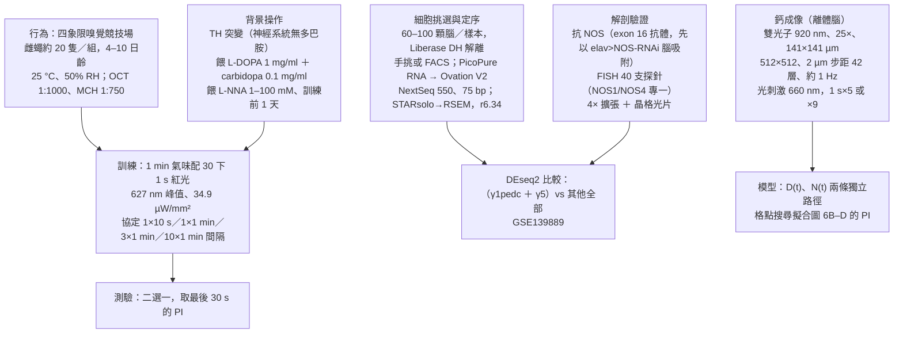
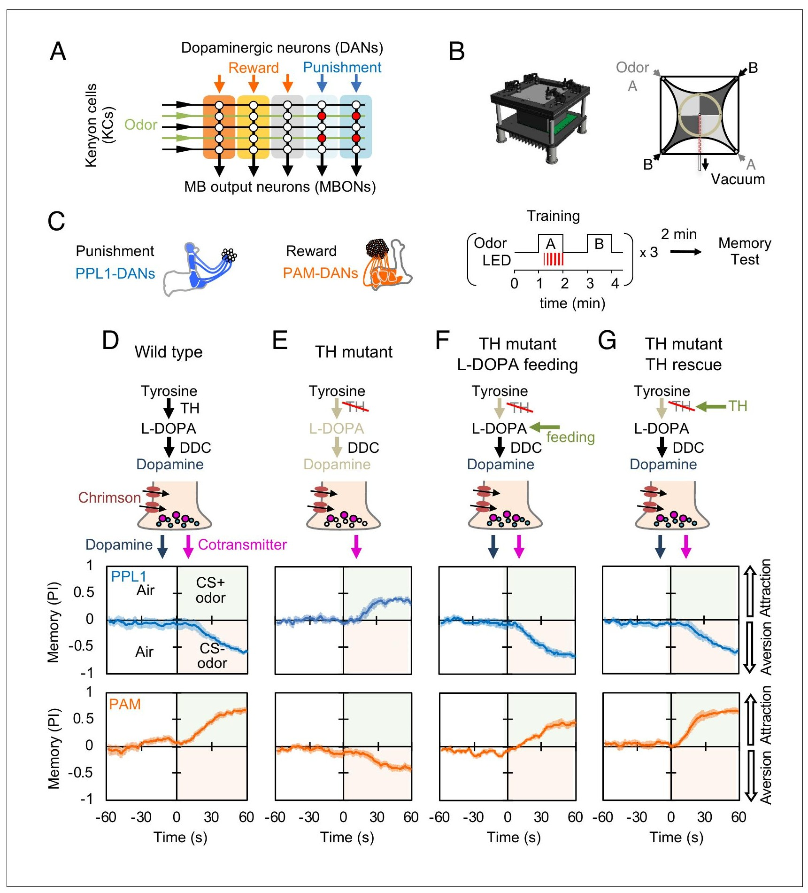
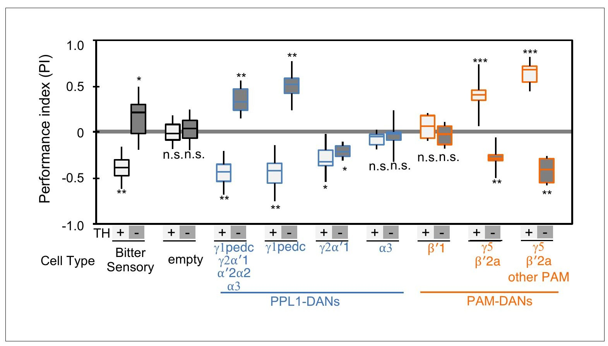
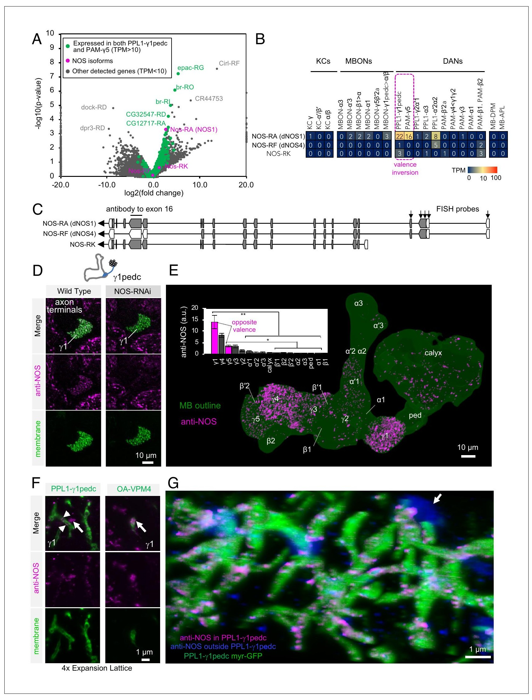
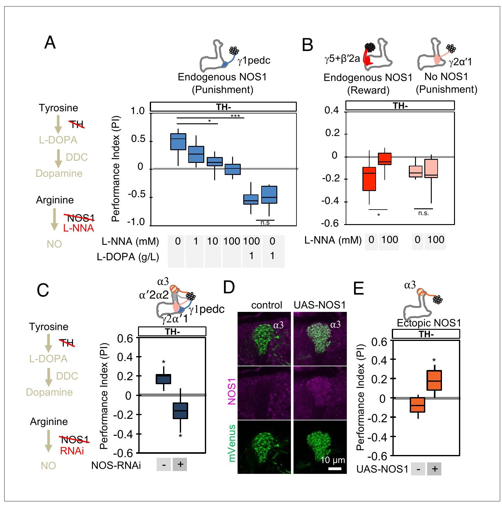
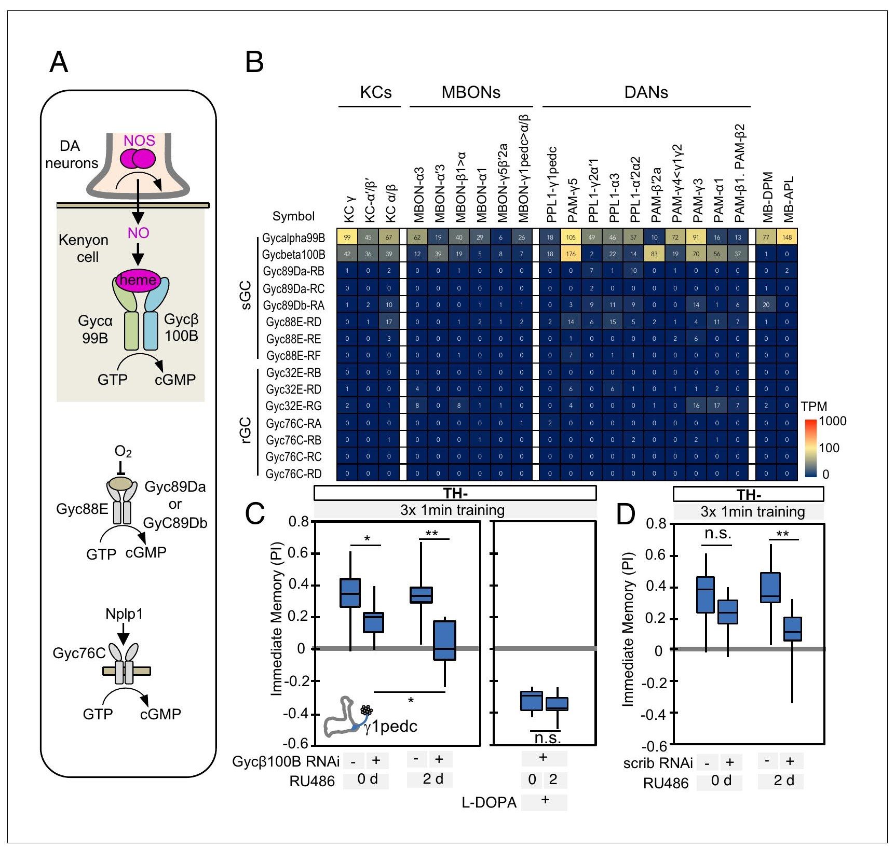
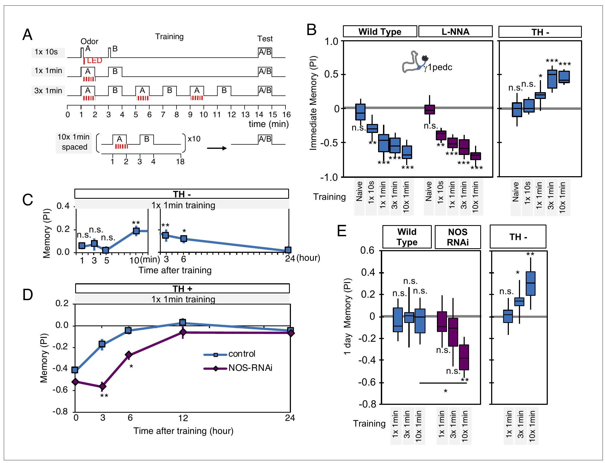
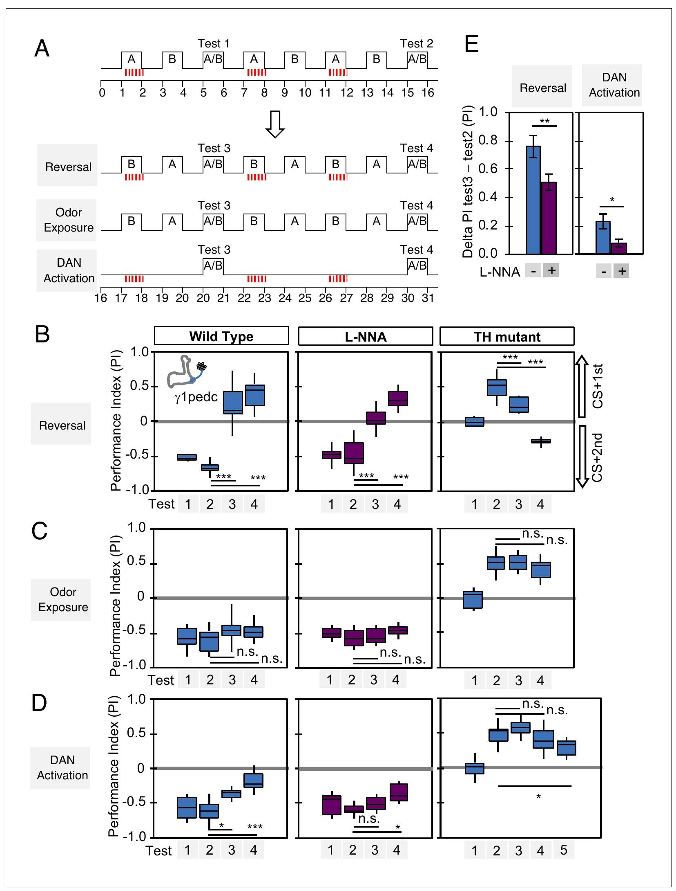
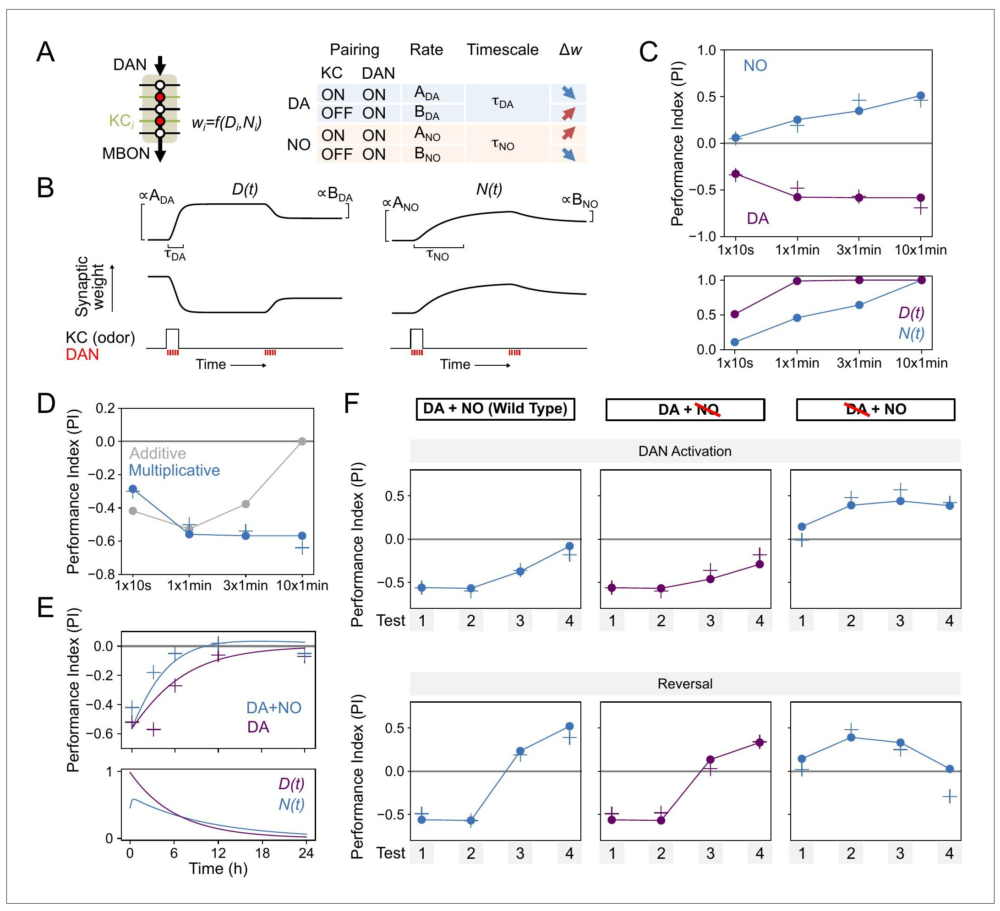
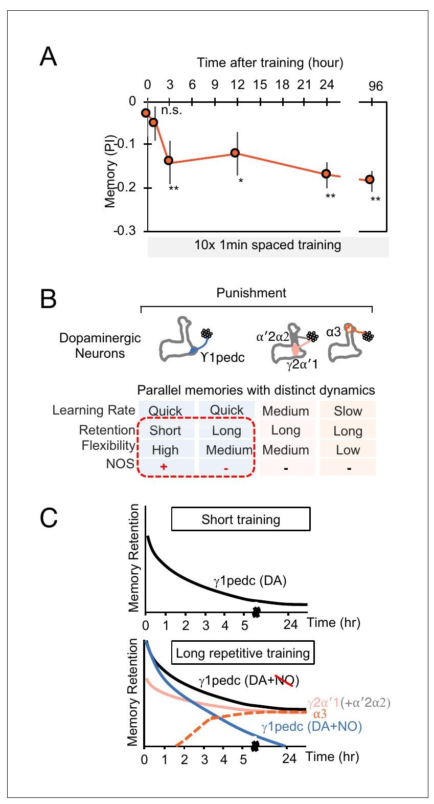

<!-- 本機 PDF：papers/2019-Nitric%20oxide%20acts%20as%20a%20cotransmitter%20in%20a%20subset%20of%20dopaminergic%20neurons%20to%20diversify%20memory%20dynamics.pdf -->

# Nitric oxide acts as a cotransmitter in a subset of dopaminergic neurons to diversify memory dynamics

**一氧化氮在一部分多巴胺神經元裡充當共同傳遞物，使記憶動態多樣化**

| 項目 | 內容 |
|---|---|
| **出處** | eLife 8, e49257 (2019). doi: 10.7554/eLife.49257 [全文（PMC 免費閱讀）](https://pmc.ncbi.nlm.nih.gov/articles/PMC6948953/) |
| 日期 | 收稿 2019-06-12・接受 2019-11-13・刊出 2019-11-14（PDF 第 1 頁）。eLife 是單篇編號（e49257），沒有起迄頁；PDF 共 33 頁 |
| 通訊作者 | Yoshinori Aso（asoy@janelia.hhmi.org）、Gerald M. Rubin（rubing@janelia.hhmi.org）。PDF 只有英文名 |
| 作者 | 共 14 人：Yoshinori Aso、Robert P Ray、Xi Long、Daniel Bushey、Karol Cichewicz、Teri-TB Ngo、Brandi Sharp、Christina Christoforou、Amy Hu、Andrew L Lemire、Paul Tillberg、Jay Hirsh、Ashok Litwin-Kumar、Gerald M Rubin。**PDF 未標示共同第一作者**（已查作者列的上標與註腳）。分工：Aso 構思、取得並分析資料、督導；Litwin-Kumar 負責模型的形式分析；Lemire 與 Ray 負責程式與分析；Cichewicz、Sharp、Hirsh 提供材料（TH 突變株相關） |
| 機構 | Janelia Research Campus, Howard Hughes Medical Institute（美國維吉尼亞州 Ashburn）；Department of Biology, University of Virginia（Charlottesville）；Department of Neuroscience, Columbia University（紐約） |
| 資料庫 | 全部轉錄體資料存於 NCBI Gene Expression Omnibus，編號 GSE139889。驅動品系的表現樣式見 www.janelia.org/split-gal4。**模型程式碼未釋出**（PDF 的 Additional files 只列三個補充檔與透明報告表，沒有程式碼條目） |
| 補充資料 | 圖補充共 20 張（圖 1 有 2、圖 2 有 1、圖 3 有 10、圖 4 有 1、圖 5 有 3、圖 6 有 1、圖 8 有 2；圖 7 與圖 9 沒有），補充檔 1（RNA-seq 的 TPM 全表）、2（關鍵材料表）、3（基因型與餵藥對照表），以及影片 1。**以上全部不在本機 PDF 內，本庫未取得**；凡依賴它們的內容一律標 ？待查 |
| 編輯／審查 | 審查編輯（Reviewing editor）Mani Ramaswami（Trinity College Dublin，愛爾蘭）。PDF 未列其他審查人姓名；決定信與作者回覆另有 DOI（.sa1／.sa2），本庫未取得 |
| 經費 | HHMI（11 位作者）；NIH R01 GM84128（Cichewicz、Hirsh）；Simons Foundation Global Brain（Aso、Litwin-Kumar、Rubin）；Burroughs Wellcome Fund、Gatsby Charitable Foundation、NSF DBI-1707398（皆為 Litwin-Kumar） |

> 與本庫有關的作者：無。本篇的第一與通訊作者 Aso、Rubin 同時是本庫 [[s-aso-2014-mbon-valence]]、[[s-aso-2016-dan-cell-type-rules]] 的作者，本篇多處把 Aso & Rubin 2016 當成前提直接引用。本篇也引用了本庫的 Hige 2015、Cohn 2015、Handler 2019、Gervasi 2010、Tomchik 2009、Burke 2012、Ichinose 2015、Mao 2009、Tully 1985。
>
> **本篇為 Creative Commons Attribution（CC BY）開放取用**（PDF 第 1 頁：「This article is distributed under the terms of the Creative Commons Attribution License, which permits unrestricted use and redistribution provided that the original author and source are credited」；未註明版本號），版權屬作者（Copyright Aso et al.）。圖片可在標明出處的條件下自由使用與散布。本庫仍依規定只給全文連結、不放 PDF；每張圖下方標明出處與授權。

---

## 為什麼重要

> 本節假設讀者已略知果蠅嗅覺學習的輪廓。**完全不熟的讀者可以先看「科普文」一節**；術語另見「專業文」開頭的「本頁用語」表。

本庫原有的學習模型只有一種增強訊號：多巴胺。[[t-dopamine-to-plasticity]] 整條線問的是「KC 軸突怎麼讀出多巴胺」，答案是 cAMP（Tomchik 2009〔[[s-tomchik-2009-camp-dynamics]]〕、Gervasi 2010）與兩種多巴胺受體（Handler 2019，[[s-handler-2019-dopamine-receptor-timing]]）。本篇指出同一批多巴胺神經元（DAN）還送出第二種訊號——一氧化氮（nitric oxide, NO），它不經多巴胺受體，而是作用在 KC 裡的可溶性鳥苷酸環化酶（sGC）、改變 cGMP。**這是本庫第一條與 cAMP 平行、方向相反的第二傳訊者路徑。**

第二，它給 [[t-timing-rules]] 與 [[t-memory-updating]] 一個分子層級的解釋。[[s-aso-2016-dan-cell-type-rules]]（同一組作者）在行為上發現各區室的學習速率、記憶保留與彈性差很多：γ1pedc 學得最快、忘得最快、重複訓練十次也撐不到一天；α3 學得慢但記得久。那篇把機制列為未知，並猜了三種可能（多巴胺釋放特性、各區室的生化反應、迴路性質）。本篇回答了其中一種：**γ1pedc 與 γ5 這兩格的 DAN 另外會做 NO，NO 的作用方向與多巴胺相反、發展得慢，於是把這一格的記憶「剪短」，同時讓它更容易被新經驗改寫。**把 NOS 關掉，γ1pedc 就能在十次間隔訓練之後留下一天的記憶——原本做不到的事。

第三，它提供了一個本庫其他篇都沒有的操作：**拿掉多巴胺之後，再看同一顆 DAN 能做什麼。** 在做不出多巴胺的 TH 突變果蠅裡活化懲罰型的 PPL1-γ1pedc，果蠅學到的不是躲開，而是喜歡這個氣味；活化獎賞型的 PAM-γ5 則反過來。這個「價性反轉」是整篇的起點，也是找出 NO 的篩選依據。但要注意它的邏輯代價：**整篇的分子證據幾乎都在「沒有多巴胺」這個人工背景裡取得**，NO 在正常果蠅裡做什麼，只能從「把 NOS 關掉之後記憶變久」這一類間接實驗推回去。詳見專業文第四、五節。

---

## 論文摘要（原文與中譯）

> Animals employ diverse learning rules and synaptic plasticity dynamics to record temporal and statistical information about the world. However, the molecular mechanisms underlying this diversity are poorly understood. The anatomically defined compartments of the insect mushroom body function as parallel units of associative learning, with different learning rates, memory decay dynamics and flexibility (Aso and Rubin, 2016). Here, we show that nitric oxide (NO) acts as a neurotransmitter in a subset of dopaminergic neurons in *Drosophila*. NO's effects develop more slowly than those of dopamine and depend on soluble guanylate cyclase in postsynaptic Kenyon cells. NO acts antagonistically to dopamine; it shortens memory retention and facilitates the rapid updating of memories. The interplay of NO and dopamine enables memories stored in local domains along Kenyon cell axons to be specialized for predicting the value of odors based only on recent events. Our results provide key mechanistic insights into how diverse memory dynamics are established in parallel memory systems.

（eLife 的摘要不分 Background／Results／Conclusion 段，照原樣一段。）

**中譯**（本節為忠實翻譯，非自撰內容）：

> 動物採用多樣的學習規則與突觸可塑性動態，來記錄世界的時間與統計資訊。然而，這種多樣性背後的分子機制仍所知甚少。昆蟲蕈狀體中以解剖界定的區室，作為聯結學習的平行單元運作，各自有不同的學習速率、記憶衰退動態與彈性（Aso and Rubin, 2016）。本文顯示，在果蠅中，一氧化氮（NO）在一部分多巴胺神經元裡作為神經傳遞物。NO 的作用發展得比多巴胺慢，並依賴突觸後 Kenyon 細胞中的可溶性鳥苷酸環化酶。NO 的作用與多巴胺相拮抗；它縮短記憶的保留時間，並促進記憶的快速更新。NO 與多巴胺的交互作用，使儲存在 Kenyon 細胞軸突沿線各局部區域的記憶，得以專門用來只根據近期事件預測氣味的價值。我們的結果，為「平行記憶系統中多樣的記憶動態如何建立」提供了關鍵的機制性見解。

---

## 科普文

想像一間教室裡有兩位老師在同一塊白板上寫字。一位用的是奇異筆，一寫就清楚，但寫得快、也容易被下一行蓋掉；另一位拿的是慢慢滲出來的消字靈，動作慢，要寫很多次才看得見，可是一旦滲開，前面那行字就會慢慢淡掉。這篇論文說，果蠅腦裡真的有這樣一對老師：**同一顆神經元同時送出多巴胺與一氧化氮，兩者作用相反、快慢不同；結果不是互相抵銷，而是替這一格的記憶訂出「能記多久」。**

**先交代果蠅怎麼學。** 果蠅聞到氣味時，蕈狀體（mushroom body）裡一小群 Kenyon 細胞（KC）會活動，哪一群活動就代表哪個氣味。KC 把訊號送給蕈狀體輸出神經元（MBON），MBON 的活動推動果蠅靠近或走開。第三種角色是多巴胺神經元（DAN），它帶來「這是好事還是壞事」的訊號：氣味與懲罰同時出現時，被這個氣味活化的 KC 與 MBON 之間的接點（突觸）就變弱。蕈狀體沿著 KC 的長軸分成一格一格的區室，每格由一型 DAN 管、一型 MBON 讀。本篇的主角是 γ1pedc 這一格（由 PPL1-γ1pedc 管，學得最快、忘得最快）與 γ5 這一格（由 PAM-γ5 管，屬於報告獎賞的那一群）。

**難題：為什麼各格的記憶能撐的時間差那麼多？** 同一批 KC 的軸突從頭到尾穿過所有格子，所以差別不在「哪些 KC」，而在格子本身。前人（本庫 [[s-aso-2016-dan-cell-type-rules]]）只用光叫醒單一型 DAN，就量出 γ1pedc 一次十秒訓練就學得起來、卻連續訓練十次也留不住一天；α3 正好相反。原因不明。

**解法第一步：把多巴胺拿掉，看 DAN 還會做什麼。** 作者用一種做不出多巴胺的突變果蠅（TH 突變：TH 是製造多巴胺的關鍵酵素），再用紅光叫醒特定的 DAN，同時給氣味。正常果蠅學到的是躲開這個氣味；沒有多巴胺的果蠅學到的卻是**喜歡**它。獎賞型的 PAM-γ5 則倒過來，從喜歡變成躲開。餵食 L-DOPA（多巴胺的前驅物）把多巴胺補回來，或只在這幾型 DAN 裡補回 TH 酵素，結果都回到正常。所以這不是發育壞掉，而是「少了多巴胺之後，另一種傳遞物的作用露了出來」。

更重要的是，這個反轉只發生在少數幾型：γ1pedc 與 γ5／β′2a 會反轉；γ2α′1 不論有沒有多巴胺都讓果蠅躲開（表示它的第二種傳遞物與多巴胺同向）；α3 與 β′1 在沒有多巴胺時什麼都學不到（表示它們沒有能單獨寫入記憶的第二種傳遞物）。**所以「第二種傳遞物」是逐型不同的，這正好對應各格規則不同。**

**解法第二步：把這幾型細胞的基因表現量出來。** PPL1-γ1pedc 每邊腦只有一顆，要從整顆腦裡把它挑出來，等於濃縮約五萬倍。作者用只標記特定細胞的果蠅品系，把細胞一顆一顆挑出來定序，比較「會反轉的兩型」與「其他所有型」。跳出來的是 NOS——製造一氧化氮的酵素。抗體染色也看到 γ1 與 γ5 這兩格的訊號最強。

**解法第三步：三種操作確認 NO 真的在做事。** 其一，餵食 NOS 的抑制劑，沒有多巴胺時那份「喜歡」的記憶隨劑量遞減而消失；補回多巴胺後，正常的躲避記憶不受影響。其二，只在這幾型 DAN 裡用 RNA 干擾壓低 NOS，效果相同。其三，反過來做：在本來不做 NO 的 α3 那一格硬是讓 DAN 做出 NOS，沒有多巴胺時它也能寫入「喜歡」的記憶了。**NO 是可以搬家的。**

**NO 作用在誰身上？** 答案是 KC。KC 裡有一種叫可溶性鳥苷酸環化酶（sGC）的酵素，碰到 NO 就製造 cGMP——這是和 cAMP 平行的另一種細胞內訊號分子。把 sGC 的一個次單元在 KC 裡壓低，NO 造出來的記憶就消失了。所以這條路線是：DAN 放出 NO → KC 的 sGC → cGMP，和「DAN 放出多巴胺 → KC 的受體 → cAMP」平行。

**關鍵的差別在快慢。** 多巴胺造的記憶一分鐘內就測得到，兩三小時後掉一半；NO 造的記憶訓練後 1、3、5 分鐘都還量不到，10 分鐘才出現，但一旦出現，六小時後還剩一半以上。也就是**一個快而短，一個慢而長**。兩者方向相反，於是在正常果蠅身上，慢慢累積的 NO 會把先寫下的多巴胺記憶逐漸抵掉。證據是：把 NOS 關掉之後，同一種訓練造出的記憶在 3 小時與 6 小時都比對照組強，但剛訓練完一樣強——**NO 不影響學得多好，只影響記得多久。**

還有一個更戲劇性的結果。γ1pedc 這一格本來就算訓練十次也留不住一天的記憶（前人的發現）；把 NOS 關掉之後，十次間隔訓練就留下了一天的記憶。**「這一格記不久」不是它的硬體限制，而是 NO 主動把它剪短的。**

**代價是什麼？** 記得久不一定好。作者接著測「改寫」：先訓練果蠅躲氣味 A，再反過來把氣味 B 配上光。正常果蠅一次就改得過來；NOS 被抑制的果蠅要訓練好幾次才改得過來。只叫醒 DAN、不給氣味（相當於「警報響了卻什麼事都沒發生」）也一樣：正常果蠅一次就把原本的躲避削掉一截，NOS 被抑制的要三次。**所以 NO 買到的是彈性：記得短，但改得快。**最後作者把這一切寫成一個小模型：多巴胺與一氧化氮各管一個參數，兩者相乘而不是相加，才能同時解釋學習、衰退與改寫三種實驗。

**最容易被誤讀的一點：這篇沒有證明「一氧化氮在正常果蠅裡讓突觸變強」。** 「NO 讓突觸變強」是模型為了解釋行為而採用的假設，整篇沒有任何突觸或細胞層級的量測可以直接支持它（唯一的生理量測是 NO 讓 MBON-γ1pedc 的鈣上升，那是下游，不是突觸強度）。作者自己在討論裡寫得很清楚：要檢驗這個想法「需要生理實驗」。同樣地，NO 的全部「寫入記憶」證據都來自沒有多巴胺的果蠅；在正常果蠅裡，NO 被證明的是**縮短保留、加速改寫**，不是寫入。

---

## 專業文

### 本頁用語

本頁各節可單獨查閱，故把反覆出現的詞集中在這裡。

| 詞 | 意思 |
|---|---|
| 蕈狀體（mushroom body, MB） | 果蠅腦中負責嗅覺學習與記憶的結構，左右各一 |
| KC（Kenyon cell） | 蕈狀體的主要神經元，本篇引言寫「約 2000 顆」。每個氣味活化一小群 KC |
| MBON | 蕈狀體輸出神經元，讀出 KC 的訊號、推動果蠅靠近或走開。學習改變的是 KC→MBON 的突觸 |
| DAN（dopaminergic neuron） | 多巴胺神經元。本篇引言依 Aso 2014a（[[s-aso-2014-mb-architecture]]）寫「20 型 DAN、22 型 MBON、葉部 15 個區室（引 Tanaka 2008）」。**PPL1 群多半報告懲罰，PAM 群多半報告獎賞** |
| 區室（compartment） | 葉沿長度分成的一格一格，每格由一型 DAN 支配、一型 MBON 讀取。本篇主角是 γ1pedc 與 γ5。見 [[c-mb-compartment]] |
| 價性（valence） | 一個刺激對動物是好是壞。**價性反轉（valence inversion）**＝同一次訓練在沒有多巴胺時造出方向相反的記憶 |
| PI（performance index，表現指數） | ＝（在氣味 A 四象限的果蠅數 − 在氣味 B 四象限的果蠅數）÷ 總數，取互換氣味的兩組平均。本篇取測驗期最後 30 秒的平均。範圍 −1 到 +1。見 [[c-performance-index]] |
| TH（tyrosine hydroxylase，酪胺酸羥化酶） | 多巴胺合成路徑的第一個酵素：酪胺酸 → L-DOPA（經 TH）→ 多巴胺（經 DDC）。**TH 突變**果蠅的神經系統做不出多巴胺（本篇引 Cichewicz 2017、Riemensperger 2011） |
| L-DOPA、carbidopa | L-DOPA 是多巴胺的前驅物，餵食可繞過 TH 補回多巴胺；carbidopa 抑制周邊的 DDC，讓 L-DOPA 更多進到腦裡 |
| NO（nitric oxide，一氧化氮） | 一種氣體訊號分子，由 NOS 以 L-精胺酸（L-arginine）為原料製造。體積小、可擴散，不經典型的突觸小泡釋放 |
| NOS（nitric oxide synthase） | 製造 NO 的酵素。果蠅只有一個 *Nos* 基因，但有多種剪接版本（isoform）：只有全長的 **NOS1（轉錄本 NOS-RA）**有功能，截短的版本可作為顯性負向（dominant-negative，即會干擾正常版本運作的壞掉版本） |
| L-NNA | NOS 的競爭性抑制劑（L-NG-Nitroarginine），本篇以餵食給藥，是全身性的 |
| sGC（soluble guanylate cyclase，可溶性鳥苷酸環化酶） | NO 的受體型酵素，由 **Gycα99B** 與 **Gycβ100B** 兩個次單元組成；與 NO 結合後把 GTP 轉成 **cGMP**。rGC（receptor guanylyl cyclase）則是膜上的另一類，由胜肽配體活化（如 Nplp1→Gyc76C） |
| cGMP | 與 cAMP 平行的另一種第二傳訊者 |
| RNA 干擾（RNAi）、shRNA | 讓細胞少做某個蛋白質的方法。本篇用 TRiP 的 NOS-RNAi、Gycβ100B-shRNA、scrib-shRNA |
| 異位表現（ectopic expression） | 在本來不表現某基因的細胞裡硬是讓它表現。本篇在 PPL1-α3 與 PPL1-γ2α′1 異位表現 NOS |
| MB247-switch、RU-486 | 一種可以「用藥開關」的驅動品系：餵 RU-486 才打開外加基因，所以操作限於成蟲期、不影響發育。本篇用它在 KC 裡開啟 shRNA |
| *scribble*（*scrib*） | 一個支架蛋白基因，前人（Cervantes-Sandoval 2016）報告它是主動遺忘的元件：KC 裡少了它，電擊記憶留得更久 |
| split-GAL4、LexA | 只在一兩型神經元裡打開外加基因的驅動品系系統；LexA 是與 GAL4 並行的另一套，兩套可在同一隻果蠅分別控制不同細胞。見 [[e-split-gal4]] |
| CsChrimson | 照紅光就讓神經元放電的通道蛋白。見 [[e-cschrimson]] |
| 嗅覺競技場（olfactory arena） | 四象限的自動化裝置，可以反覆訓練與測驗而不必搬動果蠅，用光代替電擊或糖。見 [[e-olfactory-arena]] |
| 間隔訓練（spaced training） | 訓練之間插入休息。本篇的 10× 間隔訓練每個循環 18 分鐘（氣味 A 在第 1–2 分鐘、氣味 B 在第 3–4 分鐘，其餘為休息；※ 從圖 6A 判讀） |
| 逆轉學習（reversal learning） | 先把氣味 A 配上 DAN 活化，之後改把氣味 B 配上，看偏好改得多快 |
| ExM、LLSM | 擴張顯微術（把組織等比例脹大再拍）與晶格光片顯微鏡。本篇用 4 倍擴張看 NOS 與 γ1pedc 末梢是否重疊 |
| FISH | 螢光原位雜交：用探針直接在組織上標出某個 RNA 的位置 |
| TPM | transcripts per million，RNA 定序的表現量單位 |
| D(t)、N(t)、A、B、τ | 模型的五組量：D 與 N 分別是多巴胺與 NO 造成的突觸改變（0 到 1），A 是「KC 與 DAN 同時活動」時的上升速率，B 是「DAN 活動但 KC 不活動」時的衰退速率，τ 是改變展現出來的時間常數 |
| 相乘模型 | 突觸權重 w ∝ (1 − D)(1 + N)，與相加模型 w ∝ N − D 相對 |
| ※ 推論 | 論文沒有明說、本頁自行推得的內容，並寫出依據 |
| ？待查 | 值得查證但本頁刻意不填的內容 |

### 一、概述

**主要問題。** 蕈狀體各區室的學習規則（學習速率、記憶衰退、彈性）為什麼不同？作者的假說是：支配各區室的 DAN 除了多巴胺之外，還使用**不同的共同傳遞物（cotransmitter）**，而這些共同傳遞物造成了規則的差異。

**重要性。** 若成立，它把「區室規則不同」這個現象從行為層級推進到分子層級，並且給出一個可操作的槓桿：關掉某一格的共同傳遞物，就能改變那一格能記多久。它也在 cAMP 之外，為本庫加上第二條第二傳訊者路徑（cGMP）。

**發表當時的領域現狀（2019）。**

- 區室規則：Aso & Rubin 2016（[[s-aso-2016-dan-cell-type-rules]]）以光遺傳逐型比較了學習速率、衰退與彈性，發現 PAM-α1 一次一分鐘訓練就能造出 24 小時記憶，PPL1-α3 要重複十次，PPL1-γ1pedc 十秒就能造出強的短期記憶、卻連十次一分鐘訓練也造不出長期記憶。機制未知。
- 突觸規則：Hige 2015（[[s-hige-2015-heterosynaptic-plasticity]]）直接量到 DAN 活化讓同格、同時活動的 KC→MBON 突觸長期變弱；Cohn 2015、Berry 2018、Hattori 2017 則報告單獨活化 DAN 可以把變弱推回去。
- 共同傳遞物：哺乳類的 DAN 已知會共同釋放麩胺酸或 GABA（Tritsch 2012 等）；果蠅與哺乳類的單細胞表現分析都看到 DAN 表現多種神經胜肽（Croset 2018、Poulin 2014）；蕈狀體的電顯連結體（Takemura 2017、Eichler 2017）在 DAN 末梢同時看到清亮小泡與緻密核心小泡，而且緻密核心小泡的大小逐型不同。這是本篇的直接動機。
- NO 在果蠅腦的既有角色：Kuntz 2017 報告橢球體（ellipsoid body）的環狀神經元需要 NO/cGMP 做視覺工作記憶，但那裡的 NOS 被認為是**細胞自身作用**（作用在自己身上），不是送給鄰居的訊號。本篇的主張與它對比。
- 小腦的類比：哺乳類小腦的平行纖維—普金斯細胞突觸，攀緣纖維誘發的長期抑制可與 NO 誘發的長期增強並存（Lev-Ram 2002 等）。作者在討論中把蕈狀體與小腦並列。

**作者自陳的新意**是三點合一：在果蠅 DAN 中找到 NO 作為真正的傳遞物（有突觸後的受體）；證明它的作用與多巴胺相反且較慢；並證明這個差異造成了區室之間記憶動態的差異。

### 二、方法

**行為。** 全部在四象限嗅覺競技場（[[e-olfactory-arena]]）裡做，用 CsChrimson 以紅光代替電擊或糖。一次訓練是「氣味 A 1 分鐘，期間給 30 下 1 秒紅光 → 1 分鐘無氣味無光 → 氣味 B 1 分鐘無光」，互換氣味的兩組取平均。四種協定：1×10 秒、1×1 分鐘、3×1 分鐘、10×1 分鐘間隔（每循環 18 分鐘，※ 從圖 6A 判讀）。果蠅為雌性、羽化後 4–10 天、以含視黃醛（羽化前 0.2 mM、之後 0.4 mM）的食物在 21 °C、60% 濕度、黑暗中飼養。統計用 Kruskal–Wallis 加 Dunn 事後檢定；圖 4C、4E、6B、6C、6E、9A 與兩張圖補充則用 Wilcoxon 符號等級檢定對 0 做比較、Bonferroni 校正。樣本數以 Aso & Rubin 2016 的標準差估計，效應量 0.15、檢定力 0.8、顯著水準 0.05。

**藥物。** L-DOPA 1 mg/ml 與 carbidopa 0.1 mg/ml 直接混進融化的果蠅食物；L-NNA 1–100 mM 同法，訓練前 24 小時開始餵。餵食時長見圖 1 補充圖 1（未取得，？待查）。

**細胞分選與 RNA 定序。** 這是本篇最費工的一段。PPL1-γ1pedc 每個腦半球只有一顆，作者估計要約 **50,000 倍**的濃縮。每個樣本解剖 60–100 顆腦，以 Liberase DH 在室溫消化 1 小時後打散，再用嘴吸式微管手挑或用 FACS 分選帶螢光的細胞。先以 MBON-γ1pedc>α/β（每半球一顆）試水溫：三個重複、每個約 350 顆細胞，平均得 5.3 µg cDNA，重複之間 Pearson R ＝ 0.90。正式實驗依細胞體大小調整挑選數：KC 每重複 1,000–2,500 顆，DPM 與 APL 56 ± 18 顆，PAM 群 546 ± 60 顆，PPL1 與 MBON 296 ± 15 顆；平均得 cDNA 3.39 ± 0.21 µg、對應讀數 17.7 ± 1.2 百萬條、重複之間 Pearson R ＝ 0.80 ± 0.02。共取 10 個 DAN 驅動品系（每個 2–4 個生物重複）、三類 KC、DPM、APL 與另外五型 MBON。定序後以 STARsolo 比對到 FlyBase r6.34、RSEM 計數、DEseq2 比較。

**抗體與探針。** 抗 NOS 血清針對 exon 16（取自 Yakubovich 2010），先用「全神經系統 NOS 被 RNAi 壓低」的 30 顆腦吸附一天以降低非專一訊號，再經親和層析純化。FISH 用 40 支探針，針對 NOS1 與 NOS4 共有、NOS-RK 沒有的前四個外顯子。擴張顯微術依 Tillberg 2016 做 4 倍擴張，以自製晶格光片顯微鏡成像。

**鈣成像。** 離體腦，雙光子 920 nm、25× 水鏡、141 × 141 µm 視野、512 × 512 像素、2 µm 步距共 42 層、約 1 Hz，激發功率 12 mW。光刺激用 660 nm LED 配數位微鏡，PPL1-γ1pedc → MBON-γ1pedc 用 5 次、間隔 30 秒、最高 1.2 mW/mm²；測 PPL1-γ1pedc → PAM-DAN 則用 9 次、間隔 30 秒、0.89 mW/mm²；每次 1 秒。ΔF/F 的基線取刺激前 5 秒的中位數。L-NNA 組為 100 mM、24 小時。

**模型。** 兩個變數 d(t)、n(t) 代表多巴胺與 NO 造成的即時改變。KC 與 DAN 同時活動時 d、n 以速率 A 趨近 1；DAN 活動但 KC 不活動時以速率 B 衰減回 0。另定義 D(t)、N(t) 跟隨 d、n 但較慢，時間常數依資料設為 **τ_D ＝ 30 秒、τ_N ＝ 10 分鐘**。突觸權重在只有多巴胺時 w ∝ 1 − D，只有 NO 時 w ∝ 1 + N。氣味 A 與 B 各隨機活化 10% 的 KC，MBON 的活化為權重的平均，再經一個 softmax（參數 γ 決定 MBON 活化對選擇的影響力）換成選氣味 A 的機率。以格點搜尋最小化模型與圖 6B 四種協定 PI 的均方差，得 **A_DA ＝ 4.3 min⁻¹、A_NO ＝ 0.96 min⁻¹**（γ 分別為 14.8 與 12.6）。合併兩條路徑時比較相加 w ∝ N − D 與相乘 w ∝ (1 − D)(1 + N)，相乘的 γ ＝ 14.3、相加的 γ ＝ 24.6。再以圖 6D 擬合背景 DAN 活動造成的衰退速率（2.7 × 10⁻³ 與 1.6 × 10⁻³ min⁻¹，⚠️ 兩者在 PDF 上都印成 B^bg_D，見第五節），以圖 8F 的 DAN 單獨活化資料擬合 **B_DA ＝ 0.26 min⁻¹、B_NO ＝ 0.16 min⁻¹**，再用這組參數**不加任何自由參數**預測逆轉學習。

### 三、結果

#### 3.1 沒有多巴胺時，DAN 仍能寫入記憶，但價性相反（圖 1）

在 TH 突變背景下活化 PPL1 的四型 DAN（γ1pedc、γ2α′1、α′2α2、α3 合一個品系），果蠅學到的是**喜歡**配對氣味（PI 約 +0.45，※ 從圖 1E 判讀），正常背景下則是躲開（約 −0.4）。活化 PAM 群（R58E02∩DDC）在正常果蠅造出喜好（約 +0.65），在 TH 突變則造出躲避（約 −0.45）。兩種排除：餵 L-DOPA 加 carbidopa 給成蟲，價性完全回到正常（圖 1F），所以不是「一輩子沒有多巴胺」造成的發育缺陷（作者引 Niens 2017 提出這個疑慮）；只在 PPL1 DAN 裡補回 TH cDNA 也足以回復（圖 1G），所以也不是蕈狀體以外的多巴胺缺失造成的。作者並指出，Riemensperger 2011 早已報告多巴胺缺失的果蠅在氣味—電擊制約後有**弱的**正價性記憶，本篇看到的強度大得多。

#### 3.2 價性反轉只發生在部分細胞型（圖 2）

七個驅動品系逐一測：**反轉**的是 PPL1-γ1pedc（負轉正）與 PAM-γ5／β′2a（正轉負）；**不反轉**的是 PPL1-γ2α′1（有無多巴胺都是負價性，表示它的共同傳遞物與多巴胺同號）；**沒有記憶**的是 PPL1-α3 與 PAM-β′1（表示它們沒有能在無多巴胺時單獨寫入記憶的共同傳遞物）。活化苦味感覺神經元（Gr66a-GAL4，前人證明它會活化 PPL1 DAN）同樣反轉，所以反轉不是「直接用光叫 DAN」這個人工操作的產物。

#### 3.3 轉錄體比對找到 NOS（圖 3）

把兩型「會反轉」的細胞（PPL1-γ1pedc、PAM-γ5）的資料合併，對上其他所有細胞型，畫成火山圖。在兩型中都超過 10 TPM 的轉錄本有 **2,981** 條（綠點），一型或兩型低於 10 TPM 的有 **31,539** 條（灰點，合計 34,520）。符合「在這兩型高、其他型低」的轉錄本中，**NOS 是唯一可能編碼神經傳遞物合成酵素的一個**；其餘五條分別是 epac-RG（cAMP 活化的交換因子）、br-RO 與 br-RI（轉錄因子 *broad* 的兩個轉錄本）、CG32547-RD（一個 G 蛋白偶聯受體）、CG12717-RA（SUMO 專一的異肽酶）。另有兩個不完全吻合的候選：神經胜肽 DH44 只在 γ1pedc 高、γ5 沒有；Nplp1 在兩型都有，但其他 DAN 與 MBON 也有，且其受體 Gyc76C 在 KC 幾乎測不到。

剪接版本很關鍵：只有全長的 NOS1（NOS-RA）有功能，截短的可作顯性負向。RNA 定序顯示 NOS1 是表現量最高的版本（γ1pedc 22 TPM、γ5 16 TPM）。FISH（探針專一於 NOS1 與 NOS4）在 PPL1-γ1pedc 有訊號；抗體（專一於 NOS1 與 NOS-RK）染出 γ1 與 γ5 兩格最強，並在 PPL1-γ1pedc 表現 NOS-RNAi 後大幅消失。4 倍擴張加晶格光片確認 NOS 與 γ1pedc 末梢重疊；同時發現 γ1 區另有**稀疏但大顆**的 NOS 點狀訊號在 γ1pedc 之外，形態符合章魚胺神經元 OA-VPM3／VPM4，表示那些細胞也做 NOS。γ3 與 γ4 的抗體訊號也顯著，但 PAM-γ3、PAM-γ4 的 NOS 轉錄本很低，作者推測那裡的訊號來自非 DAN 細胞或發育期的表現。

#### 3.4 NOS 是「無多巴胺記憶」的必要條件，而且可以搬到別格（圖 4）

- **抑制劑**：L-NNA 0 / 1 / 10 / 100 mM，TH 突變背景下 PPL1-γ1pedc 造出的正價性記憶由約 +0.47 降到約 0（※ 從圖判讀），呈劑量依賴。兩個對照說明這不是「吃了 L-NNA 就不會學」：補回 L-DOPA 後，同樣餵 L-NNA 的果蠅仍形成正常的負價性記憶；而且 L-NNA 的效果有細胞型專一性——γ1pedc 與 γ5／β′2a 受影響，γ2α′1 不受影響。
- **RNAi**：只在 PPL1 的那組 DAN 裡壓低 NOS，TH 突變背景的記憶由正價性（約 +0.17）翻成負價性（約 −0.18）。作者把殘留的負價性歸給 γ2α′1 的另一種未知共同傳遞物。
- **異位表現**：在本來沒有內生 NOS 的 PPL1-α3 裡表現 NOS，TH 突變果蠅經 3×1 分鐘訓練就形成正價性記憶（約 +0.18）；在 PPL1-γ2α′1 異位表現也造成價性反轉（圖 4 補充圖 1，未取得）。注意作為對比的事實：在正常果蠅裡，PPL1-α3 要 10 次間隔訓練才造得出負價性記憶（引 Aso & Rubin 2016）。

#### 3.5 NO 的受體在 KC：sGC 與 cGMP（圖 5）

RNA 定序顯示 sGC 的兩個次單元 Gycα99B 與 Gycβ100B 在 KC、MBON、DAN 都有表現（KC γ 為 99／42 TPM），其他鳥苷酸環化酶基因低得多。蛋白質捕捉品系 Gycβ100B-EGFP 在整個蕈狀體葉部都有（圖 5 補充圖 1，未取得）。用 MB247-switch 在**成蟲期**於 KC 誘發 Gycβ100B-shRNA（餵 RU-486 兩天），TH 突變背景下 PPL1-γ1pedc 造出的正價性記憶消失；同一批果蠅補回 L-DOPA 後，負價性記憶不受影響，所以不是一般性的學習缺陷。作者自承 MB247-switch 在沒有 RU-486 時也有明顯的滲漏表現，圖上未餵藥組也有部分效果。另外，在 KC 誘發 *scrib*-shRNA 同樣削弱 NO 依賴的記憶，暗示 NO 與前人報告的主動遺忘路徑有關。

兩個限制寫在同一節：NO 可能還有別的標的——MBON 與 DAN 也表現 sGC，而且作者量到在 TH 突變背景下活化 PPL1-γ1pedc 會讓 MBON-γ1pedc>α/β 的鈣**長時間上升**，且被 L-NNA 壓制（圖 5 補充圖 2，未取得）；但 γ3、γ4、γ5 的 DAN 沒有反應，作者推測 NO 擴散不到那 **30 µm** 的距離。

#### 3.6 兩條路徑的時間尺度不同（圖 6）

- **學習速率。** 正常果蠅只要 10 秒訓練就有顯著的負價性記憶，且餵 L-NNA 完全不影響任何協定下的即時記憶。TH 突變背景則相反：1×10 秒完全沒有可測的記憶，要 1×1 分鐘才顯著（約 +0.2），3× 與 10× 才達約 +0.45。**NO 需要更長、更多次的訓練。**
- **發展速度。** TH 突變背景、1×1 分鐘訓練後，記憶在 1、3、5 分鐘都與 0 無顯著差異，**10 分鐘**才顯著（約 +0.19）；之後 3 小時（約 +0.15）、6 小時（約 +0.12）仍顯著，24 小時回到 0。作者拿它對比正常果蠅：多巴胺造的記憶訓練後 1 分鐘內就測得到，半衰期只有 2–3 小時（引 Aso 2012）。
- **NO 縮短保留。** 正常背景、1×1 分鐘訓練，只在 PPL1-γ1pedc 裡壓低 NOS，**即時記憶不變**，但 3 小時與 6 小時的負價性記憶顯著強於對照（3 小時約 −0.57 對 −0.17）。L-NNA 餵食得到同樣結果（圖 6 補充圖 1，未取得）。
- **NO 擋住了長期記憶。** 正常果蠅用 PPL1-γ1pedc 訓練，不論 1×、3× 還是 10× 間隔，都沒有顯著的一日記憶（這與 Aso & Rubin 2016 一致）。表現 NOS-shRNA 的果蠅在 10× 間隔訓練後出現顯著的一日**負價性**記憶（約 −0.45）；TH 突變背景則在 3× 與 10× 後出現顯著的一日**正價性**記憶（約 +0.13、+0.30）。

#### 3.7 NO 加快記憶的更新（圖 7）

先以 3×1 分鐘訓練建立記憶，再給三種新經驗：

1. **逆轉配對**：三組（正常、L-NNA、TH 突變）都在第一次逆轉後偏好就改變了，但只有正常果蠅改到「偏好新氣味」的程度；L-NNA 與 TH 突變要多訓練幾輪。
2. **只聞兩個氣味、不給光**：三組的偏好都沒有顯著改變。這是重要的對照——更新需要 DAN 活化，不是單純再暴露。
3. **只活化 DAN、不給氣味**：正常果蠅一次就顯著削弱制約反應，L-NNA 要三次，TH 突變要五次。

量化的比較在圖 7E：逆轉造成的 PI 改變，正常約 0.75、L-NNA 約 0.50（p < 0.01）；DAN 單獨活化造成的改變，正常約 0.24、L-NNA 約 0.09（p < 0.05）。

#### 3.8 模型：相乘而非相加（圖 8、圖 9A）

模型的三個假設：兩條路徑都依 KC 是否活動而雙向改變突觸；記憶衰退來自訓練後 DAN 的背景活動；兩條路徑互相獨立、可以並存。擬合得到 A_DA ＝ 4.3 min⁻¹、A_NO ＝ 0.96 min⁻¹，也就是**多巴胺的效應在 1×1 分鐘配對後就接近飽和，NO 遠慢**。合併時，相加模型 w ∝ N − D 預測「重複配對後記憶反而變弱」，與資料不符；相乘模型 w ∝ (1 − D)(1 + N) 則吻合。再用圖 6D 擬合背景衰退速率，可解釋 NO 依賴的記憶壽命縮短；用 DAN 單獨活化的資料擬合 B_DA、B_NO 之後，**不加自由參數**就預測出逆轉學習的動態，相加模型則做不到。

作者明確指出模型的一個例外：它**無法**解釋 10× 訓練後在「無多巴胺」或「無 NO」條件下記憶變得更持久（圖 6E），因此間隔訓練應另外招募了鞏固機制。相關地，圖 9A 顯示 PPL1-α3 的 10× 間隔訓練造出的長期記憶，在訓練後立即與 1 小時都量不到，3 小時後才顯著，並一直維持到 96 小時；作者把它連到「訓練後頭 3 小時 MBON-α3 需要蛋白質合成」的前人結果（Pai 2013、Wu 2017），並說目前的模型不含突觸後的參數。

### 四、討論

**主張一：NO 是 DAN 的共同傳遞物，不是細胞自身的訊號。** 證據中等偏強。支持點有三：NOS1 定位在 DAN 的軸突末梢；突觸後的 KC 需要推定受體 sGC；異位表現 NOS 可以把表現型搬到別格。作者自己拿橢球體的 NO（Kuntz 2017，被認為作用在表現 NOS 的細胞自身）當對照。弱點是**沒有直接量到 NO 的釋放**，而且 NOS 的活性是否隨 DAN 的活動而調節，只有「果蠅 NOS 受鈣／攜鈣素調節」這個引用的生化性質可依賴。

**主張二：NO 誘發 KC→MBON 突觸增強。** 證據弱，這是模型假設。作者自己寫「testing this idea and other possible mechanisms for NO action will require physiological experiments」。唯一的生理量測（NO 讓 MBON-γ1pedc 的鈣長時間上升）是下游的效應，不能區分「KC→MBON 突觸變強」與「NO 直接作用在 MBON 上」——而 MBON 本身也表現 sGC，作者在 3.5 節自己提出了這個可能。

**主張三：NO 縮短保留、加速更新。** 這是全篇最硬的一段，因為它在**正常**果蠅（有多巴胺）裡做，有兩種獨立的操作（全身藥物 L-NNA 與細胞型專一的 RNAi）得到一致結果，而且即時記憶不變、只有 3 小時與 6 小時變強，排除了「學得比較好」這個替代解釋。限制是行為終點單一（PI），且沒有任何神經層級的量測顯示痕跡本身維持得比較久。

**主張四：這解釋了區室規則的多樣性。** 證據中等。相關性很好（會反轉的兩型就是 NOS 高的兩型），因果也有（關掉 NOS，γ1pedc 就能留下一日記憶）。但「多樣性」至少有四型（γ1pedc、γ2α′1、α′2α2、α3）而本篇只解釋了 NOS 陽性的那一型；γ2α′1 的共同傳遞物仍未知，作者自己標為未解。

**主張五：可類比小腦。** 作者把「LTD 與 NO 誘發的 LTP 並存，使淨權重不變」的小腦模型搬過來，並提出一個重新解釋：PPL1-γ1pedc 間隔訓練後測不到一日記憶，**不一定是資訊消失（遺忘），也可以是兩個方向相反的訊號相抵**。這個重新解釋與本篇的模型一致，但作者自承要確認它需要先了解下游的訊號路徑。

**主張六：NO 與主動遺忘的關係。** 作者刻意沒有把話說死。他們指出 NO 的效果需要 KC 裡的 *scribble*，而 *scribble* 被前人報告為主動遺忘的元件；但接著寫「it is an open question whether the signaling pathways for forgetting ... are related to signaling cascades downstream of NO and guanylate cyclase」。這個保留是對的：*scrib*-shRNA 削弱的是「NO 造出的記憶」，若 NO 的作用等同於遺忘，壓低遺忘機制應該讓那份記憶更強而不是更弱（※ 推論：所以這個結果更像是 *scrib* 參與 NO 的訊號傳遞，而不是 NO 走遺忘路徑；論文沒有做這個推論）。

### 五、問題與限制

**1. 分子證據幾乎都取自「沒有多巴胺」的人工背景。** NOS 的必要性（圖 4A–C）、sGC 的必要性（圖 5C）、*scrib* 的必要性（圖 5D）、NO 記憶的動力學（圖 6C）全部在 TH 突變果蠅裡做。正常果蠅裡 NO 的作用，只有圖 6D、6E 與圖 7 的「關掉 NOS 之後記憶變久、改寫變慢」這一類反向證據。TH 突變果蠅的 DAN 本身是否正常（放電、小泡、NOS 表現量），本篇沒有量。

**2. 沒有量 NO。** 整篇沒有任何 NO 或 cGMP 的直接量測（已 grep 全文的 `sensor`、`imaging`、`cGMP`：cGMP 只出現在 RNA 表現與路徑討論，唯一的成像是 MBON 的鈣）。作者在討論中自己把「用新感測器直接量多巴胺與 NO 的釋放」列為未解。

**3. L-NNA 是全身性的。** NOS 在腦中廣泛表現（引 Kuntz 2017）。作者用兩個對照處理這個問題（補回 L-DOPA 後學習正常；γ2α′1 不受影響），這兩個對照確實排除了「L-NNA 讓果蠅不能學習」，但**不排除 L-NNA 經由蕈狀體以外的 NOS 影響記憶的保留與更新**。圖 6D、6E 的細胞型專一 RNAi 補上了這一塊，圖 7 的更新實驗則只有 L-NNA，沒有 RNAi 版本。

**4. 一個關鍵實驗缺少對照組的說明。** 圖 6E 的野生型與 NOS-RNAi 兩組用哪個驅動品系，圖說只交代了圖 6D（MB320C），圖 6E 未寫（？待查）。這影響「10× 訓練後出現一日記憶」這個全篇最強的結果能不能與同圖 TH 突變組（用 VT045661-LexA）並排。

**5. 模型的參數少、資料點也少。** 整個模型以圖 6B 的四個協定（四個點）擬合 A_DA、A_NO 與 γ，以圖 6D 的五個時間點擬合背景衰退。相乘與相加之爭建立在「相加模型預測重複配對後記憶變弱」這一點上，而資料側只有四個協定。模型程式碼未釋出，圖 8 補充圖 1（參數表）未取得，無法重做。

**6. 「NOS 陽性＝會反轉」的對應沒有看起來那麼乾淨。** 圖 3B 的 NOS-RA（NOS1）TPM：γ1pedc 22、γ5 16、**α′2α2 8**、α3 2、γ2α′1 1。第三高的 PPL1-α′2α2 從未被單獨測過價性反轉——圖 2 測的七組裡，α′2α2 只出現在「γ1pedc＋γ2α′1＋α′2α2＋α3」這個四型合一的品系裡。所以「只有 γ1pedc 與 γ5 會反轉」是從**已測的組合**得到的結論，不是對全部 NOS 陽性細胞型的檢驗。這一條是本頁稽核出來的。

**7. 本頁稽核出來、論文自己沒處理的問題：圖號與符號的引用錯誤至少五處，其中兩處指向不存在的分格。** 以下全部是單篇自身不一致（⚠️，不需裁決）：

- ⚠️ 方法「Predicting memory dynamics in reversal learning」兩次寫「Figure 7F」（擬合 BD、BN 用的資料、以及用來預測逆轉學習的結果），但**圖 7 只有 A–E 五格**，所指的應是圖 8F。
- ⚠️ 方法「Modeling memory decay」：`This leads to B^bg_D = 2.7 ×10⁻³ min⁻¹) and B^bg_D = 1.6 ×10⁻³ min⁻¹`——同一個符號印了兩次，第二個應為 B^bg_N；另有一個多出來的右括號。已用 300 dpi 重繪該頁確認不是文字抽取的問題。
- ⚠️ 結果節：相加模型失敗的理由寫成「because of the slower accumulation of NO-dependent facilitation after **DA-dependent potentiation** has saturated」，但全篇多巴胺的作用都是 depression（抑制）。
- ⚠️ 結果節「the effects of DA and NO occur via independent pathways and can coexist (Figure 6)」——這是模型的假設，應指圖 8；同段下文也把相乘模型的曲線寫成「Figure 8C, blue curve」，而相乘與相加的對比在圖 8D（圖 8C 另有一條藍線是 NO，所以這個引用會把讀者帶到錯的格）。
- ⚠️ 圖 8 圖說：「In (C)-(F), crosses represent the means of data from Figure 7」。但 C 格的四種配對協定（1×10 s 到 10×1 min）來自圖 6B，E 格比對的是圖 6D 的 NOS-RNAi 資料（方法節自己寫「to fit the data ... from Figure 6D」）。
- ⚠️ 圖 4 圖說：「Asterisk indicates significance of designated pair in A and B, or from 0 in **C and D**」——D 格是免疫染色影像，沒有統計；應為 C 與 E。同一段圖說先逐格給了 N ＝ 8–12、12–16、8、12，最後又統一寫「N = 8–16」。
- ⚠️ 圖 3E 圖說寫「Kruskal-Wallis with **Dann's** test」，方法節寫 Dunn's；方法節的統計句則寫成「Figures 4C, E, 6B, C and E **and E**, 9A」，重複了一個 E。
- ⚠️ 正文說在「all PPL1 DANs」表現 NOS-RNAi（圖 4C），圖說列的是 γ1pedc、γ2α′1、α′2α2、α3 四型；PPL1 群不只這四型（本庫 [[s-huang-2024-dopamine-memory-dynamics]] 量了五型，含 α′3）。

這些都不影響結論的方向，但圖 7F 與 B^bg 那兩處會讓想重做模型的人直接卡住。

### 六、未來

**論文自陳的方向。** 直接量 DAN 釋放的多巴胺與 NO（並列了幾種新感測器）；釐清 cGMP 的下游（作者發現 KC 裡測不到兩個果蠅 PKG 基因，但有環核苷酸閘控通道與 cGMP 專一的磷酸二酯酶 Pde9，並引用 sGC 可被 PKA 磷酸化、*rutabaga* 突變腦的 sGC 活性較低，暗示 cAMP 與 cGMP 互相串話）；找出 γ2α′1 的共同傳遞物；以及用「在特定 DAN 誘發記憶、同時在特定 KC 操作基因」的作法，把上百個記憶基因定位到次細胞層級。

**本庫關注的後續。** 這篇在本庫留下三個開口。其一，**第二傳訊者從一條變兩條**：[[t-dopamine-to-plasticity]] 整條線寫的是 cAMP，本篇加上 cGMP，而兩者可能透過 PKA 對 sGC 的磷酸化相連——庫內 [[s-gervasi-2010-pka-dynamics]] 正好量的是 PKA、[[e-rutabaga]] 正好是那個被引用的突變株。其二，**「DAN 送來的訊號不只多巴胺」**：[[t-timing-rules]] 的所有時序規則都假設增強訊號就是多巴胺，本篇指出至少在 γ1pedc 與 γ5 兩格不是；而本篇也明說 NOS 對「時序依賴的價性反轉」是不需要的（圖 5 補充圖 3），這把那個反轉留給 Handler 2019 的兩種受體。其三，**保留時間是被主動縮短的**：[[t-memory-updating]] 討論「記憶被抹掉還是被蓋過」，本篇提出第三種讀法——兩個方向相反、速度不同的訊號相抵，淨值看起來像忘了。

**尚未被回答的。** NO 在正常果蠅裡到底讓突觸變強，還是讓已經變弱的突觸回彈？兩者在行為上一樣，但在 KC→MBON 的記錄上可以分開——這正是庫內 [[s-hige-2015-heterosynaptic-plasticity]] 的作法可以直接接上的地方（在 γ1pedc 量突觸，同時餵 L-NNA 或壓低 NOS）。此外，NOS 陽性但未被單獨測過的 PPL1-α′2α2 會不會也反轉；以及 NO 的 30 µm 擴散上限（本篇由「γ3–γ5 的 DAN 沒反應」反推）是否真的是距離問題，都沒有答案。

---

## 圖

> 本篇主圖 9 張全部收錄。所有圖都從 300 dpi 整頁渲染裁切。圖補充 20 張與三個補充檔不在 PDF 內，本庫未取得。

<small>圖片出處：Aso Y, Ray RP, Long X et al. *eLife* 8:e49257 (2019)，Figure 1。© 2019 Aso et al.，依 Creative Commons Attribution License（CC BY）授權使用；全文見 [PMC](https://pmc.ncbi.nlm.nih.gov/articles/PMC6948953/)。</small>

> **原圖說（Figure 1）：** Dopaminergic neurons can induce memories without dopamine, but with opposite valence. (A) Conceptual diagram of the circuit organization in the MB lobes. Sparse activity in the parallel axonal fibers of the KCs represent odor stimuli. DANs induce plasticity at KC to MBON synapses (represented by circles), when DAN and KC activity are coincident (red circles). The MB compartments (indicated by the colored rectangles) differ in their learning and memory decay rates. The actual MB lobes contains 15 compartments (Tanaka et al., 2008). (B) Design of the optogenetic olfactory arena and a diagram illustrating odor paths in the arena. (C) Schematic representation of the innervation patterns of the PPL1 (blue; R52H03-p65ADZp; TH-ZpGAL4DBD) and PAM cluster (orange; R58E02-p65ADZp; DDC-ZpGAL4DBD) DANs used to train flies. A diagram of the training protocol is also shown. Flies were trained and tested in the olfactory area. A 1 min odor exposure was paired with thirty 1 s pulses of red light (627 nm peak and 34.9 μW/mm²), followed by 1 min without odor or red light, and then presentation of a second odor for 1 min without red light. In one group of flies, odors A and B were 3-octanol and 4-methylcyclohexanol, respectively, while in a second group of flies, the odors were reversed. Memory was tested immediately after three repetitions of training bouts by giving flies a binary choice between the two odors in the olfactory area. (D–G) Odor memories induced by the collective optogenetic activation of PPL1-γ1pedc, PPL1-γ2α'1, PPL1-α'2α2 and PPL1-α3 DANs (upper panels; blue lines) or activation of PAM cluster DANs (lower panels; orange lines) in wild type (D), TH mutant (E), TH mutant feed 1 mg/ml L-DOPA and 0.1 mg/ml carbidopa (F), or TH mutant with cell-type specific expression of a wild-type TH cDNA (G; see the Materials and methods for drug treatment and supplemental information for genotypes). Time courses of the performance index (PI) during the test period are shown as the average of reciprocal experiments. The PI is defined as [(number of flies in the odor A quadrants) - (number of flies in odor B quadrants)]/ (total number of flies). Thick line and shading represent mean ± SEM. N = 12–16. Two split-GAL4 drivers R52H03-p65ADZp in attP40; TH-ZpGAL4DBD in VK00027 and R58E02-p65ADZp in attP40; DDC-ZpGAL4DBD in VK00027 were used for driving 20xUAS-CsChrimon-mVenus in PPL1 or PAM DANs, respectively.

**圖說中譯：** 多巴胺神經元可以在沒有多巴胺的情況下誘發記憶，但價性相反。(A) 蕈狀體葉部迴路組織的概念圖。KC 平行軸突纖維上的稀疏活動代表氣味刺激。DAN 在 DAN 與 KC 活動同時發生時（紅圈），於 KC 到 MBON 的突觸（以圓圈表示）誘發可塑性。各 MB 區室（彩色方框）的學習與記憶衰退速率不同。實際的 MB 葉部含 15 個區室（Tanaka et al., 2008）。(B) 光遺傳嗅覺競技場的設計，以及競技場內氣流路徑示意。(C) 用來訓練果蠅的 PPL1（藍）與 PAM 群（橘）DAN 支配樣式示意，以及訓練協定圖。1 分鐘氣味配 30 下 1 秒紅光（峰值 627 nm、34.9 μW/mm²），接著 1 分鐘無氣味無紅光，再給第二個氣味 1 分鐘、不給紅光。一組果蠅的氣味 A、B 分別是 3-辛醇與 4-甲基環己醇，另一組對調。三次訓練回合後立即測驗，讓果蠅在兩個氣味間二選一。(D–G) 集體光遺傳活化 PPL1-γ1pedc、γ2α′1、α′2α2 與 α3（上排，藍線）或活化 PAM 群（下排，橘線）所誘發的氣味記憶，分別在野生型（D）、TH 突變（E）、TH 突變餵 1 mg/ml L-DOPA 與 0.1 mg/ml carbidopa（F），或 TH 突變但以細胞型專一方式表現野生型 TH cDNA（G）。圖為測驗期 PI 的時間歷程，取互換氣味兩組的平均。PI ＝（氣味 A 四象限的果蠅數 − 氣味 B 四象限的果蠅數）÷ 總數。粗線與陰影為平均 ± 標準誤。N ＝ 12–16。

**解讀：**

- **D 與 E 之間的落差，不是「學不到」而是「學到相反」，這決定了全篇的推論方式。** 若 TH 突變只是削弱記憶，曲線會壓平；實際上它整條翻到另一側（PPL1 由約 −0.4 翻到約 +0.45，PAM 由約 +0.65 翻到約 −0.45；※ 從圖判讀，誤差約 ±0.05）。**正是這個「翻面」讓作者可以把反轉當成篩選共同傳遞物的表現型**——若只是變弱，就無法區分「另一種傳遞物」與「多巴胺不足」。
- **F 與 G 是兩個不同層級的排除，常被當成同一件事。** F（餵 L-DOPA）排除的是**發育**解釋：成蟲期補回多巴胺就夠。G（只在 PPL1 補回 TH）排除的是**部位**解釋：不必全腦有多巴胺。兩者都做了，結論才站得住；只做其中一個都留有漏洞。
- **A 圖畫的是 15 個區室，但本篇從頭到尾只操作其中六格。** 圖上的彩色方框是概念示意（引 Tanaka 2008），不是本篇的實驗範圍。讀圖時容易把「區室規則多樣」讀成對 15 格的陳述，實際的資料只涵蓋 γ1pedc、γ2α′1、α′2α2、α3、γ5／β′2a、β′1。
- **訓練協定的「30 下 1 秒光」是一個重要的劑量。** 本庫 [[s-aso-2016-dan-cell-type-rules]] 的 60 秒／30 下與 10 秒／3 下對比顯示，光的下數與氣味時長同時改變時分不出是時間還是劑量；本篇沿用同一裝置與同一「1 分鐘配 30 下」劑量，所以兩篇的 PI 可以互相參照（但本篇的 1×10 秒組只有 3 下光，這一點與 Aso 2016 的短訓練相同）。

<small>圖片出處：Aso Y, Ray RP, Long X et al. *eLife* 8:e49257 (2019)，Figure 2。© 2019 Aso et al.，依 CC BY 授權使用；全文見 [PMC](https://pmc.ncbi.nlm.nih.gov/articles/PMC6948953/)。</small>

> **原圖說（Figure 2）：** Cotransmitter effects differ among DAN cell types. The PI of olfactory memories measured immediately after 3 × 1 min training in TH mutant/TH+ heterozygotes (+) or TH mutant/TH mutant (-) background. Odor presentation was paired with either activation of bitter taste neurons (Gr66a-GAL4) or the indicated subset of DANs using the optogenetic activation protocol diagramed in Figure 1C. A split-GAL4 driver without enhancer (empty) was used as a control. The bottom and top of each box represents the first and third quartile, and the horizontal line dividing the box is the median; the PI was calculated by averaging the PIs from the final 30 s of each test period (see legend to Figure 1). The whiskers represent the minimum and maximum. N = 8–16. Asterisk indicates significance from the empty-GAL4 control. Comparison with chance level (i.e. PI = 0) resulted in identical statistical significance: *, p<0.05; **, p<0.01; ***, p<0.001; n.s., not significant.

**圖說中譯：** 共同傳遞物的效果因 DAN 細胞型而異。圖為在 TH 突變／TH⁺ 異型合子（+）或 TH 突變／TH 突變（−）背景下，3 × 1 分鐘訓練後立即量得的嗅覺記憶 PI。氣味呈現配合活化苦味感覺神經元（Gr66a-GAL4）或圖中標示的 DAN 子集，使用圖 1C 的光遺傳活化協定。以不含增強子的 split-GAL4 驅動品系（empty）為對照。盒的下緣與上緣為第一與第三四分位數，盒中橫線為中位數；PI 取每次測驗期最後 30 秒的平均（見圖 1 圖說）。鬚為最小值與最大值。N ＝ 8–16。星號表示與 empty-GAL4 對照的顯著差異；與機率水準（即 PI ＝ 0）比較得到完全相同的顯著性：\*p<0.05；\*\*p<0.01；\*\*\*p<0.001；n.s. 不顯著。

**圖說中譯（續）：** 驅動品系的表現樣式見圖 2 補充圖 1 與 www.janelia.org/split-gal4。

**解讀：**

- **這張圖該看的是三種結果，不是兩種。** 多數人會只記得「γ1pedc 與 γ5 反轉」。圖上其實有三類：反轉（γ1pedc：約 −0.45 → +0.5；γ5β′2a：約 +0.4 → −0.28）、**不反轉但保留**（γ2α′1：約 −0.3 → −0.22，兩邊都顯著）、**消失**（α3 與 β′1：TH 突變下不顯著）。第二類是作者後來解釋圖 4C 殘留負價性記憶的依據，也是「共同傳遞物不只一種」的主要證據。※ 從圖判讀，誤差約 ±0.05。
- **α′2α2 從未被單獨測過。** 七組裡只有四型合一的那一組含 α′2α2。對照圖 3B，α′2α2 的 NOS1 表現量是 8 TPM（僅次於 γ1pedc 的 22 與 γ5 的 16），所以「NOS 陽性的就是會反轉的」這個對應關係，在第三高的那一型上沒有被檢驗（見第五節第 6 條）。
- **Gr66a 那一欄比看起來重要。** 它是全圖唯一不直接叫醒 DAN 的操作：活化苦味神經元（前人證明會經突觸活化 PPL1），同樣看到反轉（約 −0.38 → +0.25）。**這一欄排除了「反轉是 CsChrimson 強迫 DAN 齊發造成的假象」**，而這是所有光遺傳取代自然增強訊號的研究共有的疑慮（見本庫 [[s-tumkaya-2025-synthetic-memory-inception]] 的討論）。
- **兩種統計給出相同結果，這句話本身是資訊。** 圖說說「與 empty 對照比」和「與 0 比」顯著性完全相同，表示 empty 對照的 PI 確實貼近 0（圖上約 0），所以本圖的星號可以當成「有沒有學到」來讀。

<small>圖片出處：Aso Y, Ray RP, Long X et al. *eLife* 8:e49257 (2019)，Figure 3。© 2019 Aso et al.，依 CC BY 授權使用；全文見 [PMC](https://pmc.ncbi.nlm.nih.gov/articles/PMC6948953/)。</small>

> **原圖說（Figure 3）：** Identification of NOS1 in PPL1-γ1pedc and PAM-γ5 by RNA-Seq. (A) The RNA-Seq data of two cell types that showed the valence-inversion phenotype (i.e. PPL1-γ1pedc and PAM-γ5) were pooled and compared against the pooled data of all other cell types examined (DANs, MBONs, KCs). The -log10 of p-values for comparing number of counted transcripts between the pooled data of PPL1-γ1pedc and PAM-γ5 relative to that of all other cell types were plotted against the log2 of fold changes observed in the expression levels of transcripts. Different splice isoforms of genes are plotted separately (dots). Green dots represent the 2981 transcripts expressed at levels above 10 transcripts per million (TPM) in both PPL1-γ1pedc and PAM-γ5. Gray dots represent the 31,539 transcripts with expression levels below 10 TPM in one or both of these two DANs. Dots on +20 or −20 x-axis represent splice isoforms that were detected only in the pooled PPL1-γ1pedc and PAM-γ5 or in other cell types. Magenta dots show the three splice isoforms of NOS. (B) Mean TPM of NOS splicing isoforms. The magenta dashed line highlights PPL1-γ1pedc and PAM-γ5, the two cell types that showed the valence-inversion phenotype. (C) Map of the NOS locus. Exons and protein coding sequences are depicted as boxes and gray boxes, respectively. Only the full-length isoform NOS-RA (dNOS1) produces a functional NOS protein (Stasiv et al., 2001). The antibody we used was raised against exon16 (Kuntz et al., 2017; Yakubovich et al., 2010). Arrows indicate the first four exons of NOS1 and NOS4 where 40 FISH probes were designed to recognize these, but not NOS-RK transcripts. See Materials and methods for details of the position and sequence of the probes. (D) NOS immunoreactivity was observed in the γ1pedc compartment of the MB. Immunoreactivity was markedly reduced by expressing NOS-RNAi in PPL1-γ1pedc. (E) Distribution of NOS-immunoreactivity inside the MB is displayed. Voxels above mean +2SD of the entire brain are shown in 12-bit scale in magenta. The insert shows a quantification of NOS-immunoreactivity in each MB compartment. Signal in γ1 was significantly higher than 12 compartments indicated by the bracket (Kruskal-Wallis with Dann's test for selected pairs). Signal in γ5 was significantly higher than eight compartments indicated by the bracket; *, p<0.05; **, p<0.01; n = 12. (F) Lattice light sheet image of a 4x expanded brain shows colocalization of NOS immunoreactivity and the terminals of PPL1-γ1pedc (left; arrowheads). In addition, large but sparse NOS puncta were observed outside PPL1-γ1pedc (left; arrow); these puncta match the pattern of terminals of OA-VPM3 and/or OA-VPM4 (right; arrow), indicating that these octopaminergic neurons also expresses NOS. (G) 3D reconstruction of lattice light sheet image of the γ1 with pseudo colors for NOS inside (magenta) or outside (blue) the PPL1-γ1pedc DANs (green). The arrow indicates a large NOS puncta outside PPL1-γ1pedc.

**圖說中譯：** 以 RNA 定序在 PPL1-γ1pedc 與 PAM-γ5 中鑑定出 NOS1。(A) 把兩型出現價性反轉表現型的細胞（即 PPL1-γ1pedc 與 PAM-γ5）的 RNA-Seq 資料合併，與所有其他受檢細胞型（DAN、MBON、KC）的合併資料比較。縱軸為比較轉錄本計數所得 p 值的負對數（以 10 為底），橫軸為表現量倍數變化的對數（以 2 為底）。同一基因的不同剪接版本分別作點。綠點為在 PPL1-γ1pedc 與 PAM-γ5 兩者都高於每百萬轉錄本 10 條（TPM）的 2,981 條轉錄本。灰點為在這兩型 DAN 之一或兩者都低於 10 TPM 的 31,539 條。落在橫軸 +20 或 −20 的點，表示只在合併的 PPL1-γ1pedc 與 PAM-γ5 中、或只在其他細胞型中被偵測到的剪接版本。洋紅點為 NOS 的三個剪接版本。(B) NOS 各剪接版本的平均 TPM。洋紅虛線框出 PPL1-γ1pedc 與 PAM-γ5 這兩型出現價性反轉的細胞。(C) NOS 基因座圖。外顯子與蛋白質編碼序列分別以方框與灰框表示。只有全長版本 NOS-RA（dNOS1）產生有功能的 NOS 蛋白（Stasiv et al., 2001）。所用抗體針對第 16 外顯子。箭頭標出 NOS1 與 NOS4 的前四個外顯子，40 支 FISH 探針設計成辨認這些、但不辨認 NOS-RK 轉錄本。(D) 在 MB 的 γ1pedc 區室觀察到 NOS 免疫反應性；在 PPL1-γ1pedc 表現 NOS-RNAi 後顯著減少。(E) MB 內 NOS 免疫反應性的分布。超過全腦平均 +2 標準差的體素以洋紅、12 位元灰階顯示。插圖為各 MB 區室 NOS 免疫反應性的量化。γ1 的訊號顯著高於括號標出的 12 個區室（Kruskal–Wallis 加選定配對的 Dunn 檢定）；γ5 的訊號顯著高於括號標出的 8 個區室；\*p<0.05；\*\*p<0.01；n ＝ 12。(F) 4 倍擴張腦的晶格光片影像顯示 NOS 免疫反應性與 PPL1-γ1pedc 末梢重疊（左；箭頭頭）。此外在 PPL1-γ1pedc 之外觀察到大但稀疏的 NOS 點狀訊號（左；箭頭），其樣式符合 OA-VPM3 與／或 OA-VPM4 的末梢（右；箭頭），表示這些章魚胺神經元也表現 NOS。(G) γ1 的晶格光片影像三維重建，以偽色標示 PPL1-γ1pedc（綠）內（洋紅）或外（藍）的 NOS。箭頭指出 PPL1-γ1pedc 之外的一個大 NOS 點。

**解讀：**

- **B 圖是全篇的關鍵證據，也是全篇最薄的一張表。** 整個 NOS 假說建立在一列 TPM 數字上：NOS-RA 在 γ1pedc 為 22、γ5 為 16，其餘細胞型 0–8。**22 與 16 TPM 以轉錄體標準而言是中低表現量**（對照同篇圖 5B，sGC 次單元 Gycβ100B 在 PAM-γ5 是 176 TPM、KC γ 是 42），而每型只有 2–4 個生物重複。作者用功能實驗補上了因果（圖 4），但「NOS 的表現量高低逐型對應價性反轉」這個相關性本身，樣本很小。
- **E 圖的括號不是在比 γ1 與 γ5。** 圖說說 γ1 顯著高於 12 個區室、γ5 顯著高於 8 個區室；但 **γ1（約 14 a.u.）與 γ4（約 8.2）之間、以及 γ4 與 γ5（約 3.4）之間有沒有差，圖上沒有標**（※ 從 300 dpi 重繪判讀，誤差約 ±0.5 a.u.）。γ4 的抗體訊號其實是第二高，比 γ5 高，而 PAM-γ4 的 NOS 轉錄本很低——作者自己把 γ3、γ4 的訊號歸給非 DAN 細胞或發育期表現。**所以抗體與 RNA 兩套證據在 γ4 上不一致，這是靠推論彌合的，不是靠實驗。**
- **F 圖右半是一個意外發現，容易被略過：章魚胺神經元也做 NOS。** 這對本庫有直接影響——[[c-octopamine-reward-signal]] 記錄的是章魚胺作為獎賞訊號，而 OA-VPM3／VPM4 的末梢也在 γ1 區。若章魚胺神經元也釋放 NO，則「γ1 的 NO」在自然情況下不只來自 PPL1-γ1pedc。本篇的功能實驗全都操作 DAN，沒有碰章魚胺神經元。
- **A 圖的綠點／灰點切法決定了「只有六條轉錄本符合」這個結論。** 門檻是「兩型都 > 10 TPM」。若某個共同傳遞物的合成酵素在其中一型只有 8 TPM（例如剛好落在門檻下），它就會變成灰點而被排除。**這是一個會漏東西的篩選**，作者自己也寫「we cannot formally rule out a contribution of other genes and pathways」。

<small>圖片出處：Aso Y, Ray RP, Long X et al. *eLife* 8:e49257 (2019)，Figure 4。© 2019 Aso et al.，依 CC BY 授權使用；全文見 [PMC](https://pmc.ncbi.nlm.nih.gov/articles/PMC6948953/)。</small>

> **原圖說（Figure 4）：** NOS in DANs contributes to memory formation. (A) Increasing the dose of L-NNA reduced the positive-valence memory induced by activation of PPL1-γ1pedc in a TH mutant background. The ability to form an negative-valence memory was restored by feeding of L-DOPA plus carbidopa and this memory formation was not affected by L-NNA. N = 8–12. (B) Feeding of L-NNA in a TH mutant background reduced the negative-valence memory induced by activation of the combination of PAM-γ5 and PAM-β'2a, but not of PPL1-γ2α'1. N = 12–16 (C) Activation of PPL1 DANs (PPL1-γ1pedc, PPL1-γ2α'1, PPL1-α'2α2 and PPL1-α3) induced significant positive-valence memory in a TH mutant background. The valence of the induced memory was negative when NOS-RNAi was expressed in the same DANs. We postulate that the negative-valence memory observed when NOS-RNAi is expressed results from an as yet unidentified cotransmitter released by PPL1-γ2α'1 (see also panel B and Figure 2). N = 8 (D) NOS immunoreactivity in the α3 compartment in wild type (left) and after ectopic expression of NOS (right). (E) Activation of PPL1-α3 in which NOS was ectopically expressed induced significant positive-valence memory after 3 × 1 min training protocol in a TH mutant background (Figure 1C). Note that activation of PPL1-α3 can induce negative-valence memory in a wild-type background, but only after 10x spaced training (Aso and Rubin, 2016). N = 12 In A-C and E, memories assessed immediately after 3 × 1 min training are shown. The bottom and top of each box represents the first and third quartile, and the horizontal line dividing the box is the median. The whiskers represent the minimum and maximum. N = 8–16. Asterisk indicates significance of designated pair in A and B, or from 0 in C and D: *, p<0.05; ***, p<0.001; n.s., not significant.

**圖說中譯：** DAN 中的 NOS 參與記憶形成。(A) 提高 L-NNA 劑量，會減少 TH 突變背景下活化 PPL1-γ1pedc 所誘發的正價性記憶。餵食 L-DOPA 加 carbidopa 可回復形成負價性記憶的能力，且此記憶形成不受 L-NNA 影響。N ＝ 8–12。(B) 在 TH 突變背景餵食 L-NNA，減少了活化 PAM-γ5 與 PAM-β′2a 組合所誘發的負價性記憶，但不減少 PPL1-γ2α′1 所誘發者。N ＝ 12–16。(C) 在 TH 突變背景活化 PPL1 的 DAN（γ1pedc、γ2α′1、α′2α2、α3）誘發顯著的正價性記憶；在同一批 DAN 中表現 NOS-RNAi 時，所誘發記憶的價性為負。我們推測表現 NOS-RNAi 時觀察到的負價性記憶，來自 PPL1-γ2α′1 釋放的某種尚未鑑定的共同傳遞物（另見 B 格與圖 2）。N ＝ 8。(D) α3 區室在野生型（左）與異位表現 NOS 後（右）的 NOS 免疫反應性。(E) 在異位表現 NOS 的 PPL1-α3 上施以活化，於 TH 突變背景、3 × 1 分鐘訓練協定後誘發顯著的正價性記憶。注意在野生型背景下，活化 PPL1-α3 也能誘發負價性記憶，但需要 10 次間隔訓練（Aso and Rubin, 2016）。N ＝ 12。A–C 與 E 為 3 × 1 分鐘訓練後立即量得的記憶。盒的下緣與上緣為第一與第三四分位數，橫線為中位數，鬚為最小與最大值。N ＝ 8–16。星號表示 A、B 中所示配對的顯著性，或 C 與 D 中與 0 的比較：\*p<0.05；\*\*\*p<0.001；n.s. 不顯著。

**解讀：**

- **A 圖的右兩欄才是這張圖的論證核心，但它們畫得最不起眼。** 左四欄是劑量曲線（0 / 1 / 10 / 100 mM，PI 約 +0.47 / +0.23 / +0.10 / −0.02；※ 從圖判讀）。真正排除「L-NNA 讓果蠅變笨」的是右兩欄：補回 L-DOPA 後，餵與不餵 100 mM L-NNA 的 PI 都約 −0.6 且不顯著差異。**沒有這兩欄，整個劑量曲線可以被讀成全身性的毒性。**
- **C 圖的設計把一個混淆變成了證據。** 用的是四型合一的 PPL1 品系，所以 NOS-RNAi 同時打到 γ1pedc（NOS 陽性）與 γ2α′1（NOS 陰性、但有另一種與多巴胺同向的共同傳遞物）。結果不是「記憶消失」而是「翻成負價性」——作者把它解釋成 γ2α′1 的未知傳遞物露了出來。這個解釋與圖 2 的 γ2α′1 單獨結果一致，算是自洽的；但要注意它是**推測**（圖說用 postulate），不是直接量到。
- **E 圖是全篇唯一的充分性實驗，而它也揭露了一個不對稱。** 異位表現 NOS 讓 α3 在 TH 突變下能寫入記憶（約 +0.18，\*）。但對照圖 2，α3 在 TH 突變下本來「什麼都學不到」——所以這裡增加的不只是價性，而是**從無到有**。※ 推論：這表示 α3 的 KC→MBON 突觸本身有能力被改寫（sGC 在所有區室都有，作者在討論中正是這樣論證的），缺的只是上游的訊號；論文沒有把這一步寫成明確的結論。
- **D 圖沒有量化。** 它只有兩張代表性影像（野生型與異位表現），沒有像圖 3E 那樣的強度量化，也沒有 n；而圖說的統計句卻把 D 列進「與 0 比較」的格（見第五節的 ⚠️ 清單）。要判斷異位表現的量是否接近 γ1pedc 的內生量，本圖不夠。

<small>圖片出處：Aso Y, Ray RP, Long X et al. *eLife* 8:e49257 (2019)，Figure 5。© 2019 Aso et al.，依 CC BY 授權使用；全文見 [PMC](https://pmc.ncbi.nlm.nih.gov/articles/PMC6948953/)。</small>

> **原圖說（Figure 5）：** Soluble guanylate cyclase in the KCs is required to form NO-dependent memory. (A) Diagram of soluble or receptor guanylyl cyclases in *Drosophila*. (B) RNA-seq data indicate coexpression of Gycα99B and Gycβ100B in KCs, MBONs and DANs. For comparison, the expression levels of other guanylate cyclase genes are also shown. Note that RNA-Seq detected transcripts of neuropeptide gene Nplp1 in both PPL1-γ1pedc and PAM-γ5 (Figure 3—figure supplement 8), but expression of its receptor Gyc76C was barely detectable compared to Gycα99B and Gycβ100B. (C) Induction of Gycβ100B-shRNA in Kenyon cells by activating MB247-switch driver (Mao et al., 2004) with RU-486 feeding reduced the positive-valence memory induced by PPL1-γ1pedc. We also observed a partial effect in the flies without RU-486, presumably due to leaky expression (Figure 5—figure supplement 1E and F). Negative-valence memory with additional feeding of L-DOPA and carbidopa was not affected by Gycβ100B-shRNA induction in KCs. Memories immediately after 3 × 1 min training are shown. The bottom and top of each box represents the first and third quartile, and the horizontal line dividing the box is the median. (D) Induction of scrib-shRNA in KCs also reduced the positive-valence memory induced by activation of PPL1-γ1pedc in a TH mutant background. The whiskers represent the minimum and maximum. N = 12–16. Asterisk indicates significance of designated pair: *, p<0.05; **, p<0.01; n.s., not significant.

**圖說中譯：** KC 中的可溶性鳥苷酸環化酶是形成 NO 依賴記憶的必要條件。(A) 果蠅可溶性或受體型鳥苷酸環化酶的示意圖。(B) RNA-seq 資料顯示 Gycα99B 與 Gycβ100B 在 KC、MBON 與 DAN 中共同表現。為供比較，也列出其他鳥苷酸環化酶基因的表現量。注意 RNA-Seq 在 PPL1-γ1pedc 與 PAM-γ5 中都偵測到神經胜肽基因 Nplp1 的轉錄本，但其受體 Gyc76C 的表現量與 Gycα99B、Gycβ100B 相比幾乎測不到。(C) 以餵食 RU-486 活化 MB247-switch 驅動品系，在 Kenyon 細胞誘發 Gycβ100B-shRNA，減少了 PPL1-γ1pedc 誘發的正價性記憶。在沒有餵 RU-486 的果蠅也觀察到部分效果，推測是滲漏表現所致。額外餵食 L-DOPA 與 carbidopa 所形成的負價性記憶，不受 KC 中誘發 Gycβ100B-shRNA 的影響。圖為 3 × 1 分鐘訓練後立即量得的記憶。(D) 在 KC 誘發 scrib-shRNA 同樣減少了 TH 突變背景下活化 PPL1-γ1pedc 所誘發的正價性記憶。鬚為最小與最大值。N ＝ 12–16。星號表示所示配對的顯著性：\*p<0.05；\*\*p<0.01；n.s. 不顯著。

**解讀：**

- **C 圖的「0 d」組不是乾淨的對照，作者自己承認了。** 未餵 RU-486 的果蠅已經有部分效果（約 0.33 → 0.15，\*），這表示 MB247-switch 有滲漏。**所以「2 d」組的 0.33 → 0.05（\*\*）不能全部算成成蟲期誘發的效果**；真正成立的說法是「KC 裡減少 Gycβ100B 會削弱 NO 依賴的記憶」，而「這個操作限於成蟲、不影響發育」這一半被滲漏削弱了。L-DOPA 那一組（兩邊都約 −0.33，n.s.）仍是有效的特異性對照。
- **B 圖的數字可以反過來讀：sGC 不是 KC 專有的。** Gycα99B 在 PAM-γ5 是 105 TPM、Gycβ100B 是 176 TPM，都高於 KC γ 的 99／42。**也就是說，DAN 自己的 sGC 表現量比 KC 還高。** 本篇的功能實驗只在 KC 裡壓低 sGC，所以「NO 作用在 KC」只被證明為**必要**，不是**唯一**；作者在正文裡也寫了這個保留，並在圖 5 補充圖 2 看到 NO 影響 MBON。
- **D 圖的方向容易被讀反。** 壓低 *scrib*（被報告為主動遺忘的元件）**削弱**了 NO 造出的記憶。若 NO 的作用就是啟動遺忘，壓低遺忘元件應該讓記憶更強。所以這張圖支持的是「*scrib* 在 NO 的訊號路徑上」，而不是「NO ＝ 遺忘」。作者在討論裡的措辭（「it is an open question」）比圖說謹慎，值得照著引用。
- **A 圖畫出了一條本篇沒走的路。** 圖上同時畫了胜肽受體型的 Gyc76C（配體 Nplp1）。而 Nplp1 正是圖 3 被排除的候選之一——它在兩型 DAN 都有，但受體在 KC 幾乎測不到。**把它畫進同一張圖，等於把「為什麼選 NO 不選 Nplp1」的理由做成圖**，這是全篇少見的、把排除過程視覺化的設計。

<small>圖片出處：Aso Y, Ray RP, Long X et al. *eLife* 8:e49257 (2019)，Figure 6。© 2019 Aso et al.，依 CC BY 授權使用；全文見 [PMC](https://pmc.ncbi.nlm.nih.gov/articles/PMC6948953/)。</small>

> **原圖說（Figure 6）：** NO-dependent effect develops slowly, requires longer training than dopamine-dependent memory, and shortens memory retention. (A) Schematic diagram of training protocols. (B) Learning rate by activation of PPL1-γ1pedc in wild type (left; blue), wild type with L-NNA feeding (center; purple) or TH mutant backgrounds (right; blue). Memory scores were not significantly affected by L-NNA feeding in any of the training protocols in wild-type flies. A single 10 s training was insufficient to induce any detectable memory in a TH mutant background, but induced significant negative-valence memory in wild-type background. (C) Time course of NO-dependent, positive-valence memory induced by PPL1-γ1pedc in a TH mutant background after 1 × 1 min training. Data point and error bars indicate mean and SEM. N = 8–10. Note that the plot is split in the time axis to better display the kinetics. (D) After 1 × 1 min training, a cell-type-specific knock down of NOS in PPL1-γ1pedc prolonged the retention of negative-valence memory induced by PPL1-γ1pedc in wild-type background measured at 3 and 6 hr. Note that expression of NOS-RNAi did not affect the score of immediate memory. N = 12. (E) Effect of repetitive trainings on 1-day memory. Repetitive training with activation of PPL1-γ1pedc did not induced significant 1-day memory in wild-type background irrespective of training protocols (blue; left). Flies expressing NOS-shRNA showed significant 1 day memory after 10x spaced training (purple; center). In a TH mutant background (right), appetitive memory was induced by 3X and 10X repetitive training. For activation of PPL1-γ1pedc, VT045661-LexA was used as the driver for experiments in B, C and in the TH mutant background data in E, and MB320C split-GAL4 was used for wild-type and NOS-RNAi data in D. We made consistent observations with both global L-NNA inhibition of NOS and cell-type-specific NOS-RNAi (see Figure 6—figure supplement 1). The bottom and top of each box represents the first and third quartile, and the horizontal line dividing the box is the median. The whiskers represent the minimum and maximum. N = 12–16. Asterisk indicates significance between control and NOS-RNAi in D, between designated pair in E, or from 0 in all others: *, p<0.05; **, p<0.01; ***, p<0.001; n.s., not significant.

**圖說中譯：** NO 依賴的作用發展得慢、比多巴胺依賴的記憶需要更長的訓練，並縮短記憶保留。(A) 訓練協定示意圖。(B) 以活化 PPL1-γ1pedc 測得的學習速率，分別在野生型（左，藍）、餵食 L-NNA 的野生型（中，紫）與 TH 突變背景（右，藍）。野生型果蠅在任何訓練協定下，記憶分數都不受 L-NNA 餵食顯著影響。單次 10 秒訓練在 TH 突變背景不足以誘發任何可偵測的記憶，但在野生型背景誘發顯著的負價性記憶。(C) TH 突變背景、1 × 1 分鐘訓練後，PPL1-γ1pedc 誘發之 NO 依賴正價性記憶的時間歷程。資料點與誤差棒為平均與標準誤。N ＝ 8–10。注意本圖的時間軸是斷開的，以便顯示動力學。(D) 1 × 1 分鐘訓練後，在 PPL1-γ1pedc 中以細胞型專一方式壓低 NOS，延長了野生型背景下 PPL1-γ1pedc 誘發之負價性記憶在 3 與 6 小時的保留。注意表現 NOS-RNAi 並不影響即時記憶的分數。N ＝ 12。(E) 重複訓練對一日記憶的影響。在野生型背景下，以活化 PPL1-γ1pedc 做重複訓練，不論協定為何都沒有誘發顯著的一日記憶（藍，左）。表現 NOS-shRNA 的果蠅在 10 次間隔訓練後出現顯著的一日記憶（紫，中）。在 TH 突變背景（右），3 次與 10 次重複訓練誘發了喜好性記憶。活化 PPL1-γ1pedc 時，B、C 與 E 的 TH 突變背景資料使用 VT045661-LexA 作為驅動品系，D 的野生型與 NOS-RNAi 資料使用 MB320C split-GAL4。以全身性 L-NNA 抑制 NOS 與細胞型專一 NOS-RNAi 兩種方式，我們得到一致的觀察（見圖 6 補充圖 1）。盒與鬚同前。N ＝ 12–16。星號表示 D 中對照與 NOS-RNAi 之間、E 中所示配對之間，或其他所有格與 0 的比較：\*p<0.05；\*\*p<0.01；\*\*\*p<0.001；n.s. 不顯著。

**解讀：**

- **D 圖是全篇最硬的一張，因為它的對照寫在圖說裡而不是圖上：即時記憶不變。** 0 小時兩條線幾乎重合（約 −0.43 對 −0.52），3 小時分開（約 −0.17 對 −0.57，\*\*），6 小時仍分開（約 −0.05 對 −0.27，\*），12 與 24 小時再度重合（※ 從圖判讀，誤差約 ±0.05）。**「學習不變、保留變長」這個組合，排除了「NOS-RNAi 讓果蠅學得更好」這個替代解釋**，而這是本篇所有正常背景實驗裡論證最完整的一處。
- **C 圖的斷軸要小心讀。** 左半是分鐘（1、3、5、10），右半是小時（3、6、24），兩段的橫軸比例完全不同。視覺上 10 分鐘的那一點與 3 小時的那一點幾乎等高（約 0.19 對 0.15），容易讀成「上升後維持」；實際上中間 10 分鐘到 3 小時之間沒有任何資料點（約 170 分鐘的空白）。**所謂「一旦形成就持久」，是由兩個時間點的連線撐起來的。**
- **E 圖的三組不能直接並排比大小。** 左與中（野生型、NOS-shRNA）用 MB320C；右（TH 突變）用 VT045661-LexA——至少 B、C 與右欄是這個品系。更麻煩的是，圖說只說明了 D 格的品系指派，**E 格的野生型與 NOS-RNAi 用哪個品系沒有寫**（？待查）。※ 推論：依圖說「MB320C ... for wild-type and NOS-RNAi data」的措辭，E 的這兩組大概也是 MB320C，但論文沒有明說。
- **B 圖的「L-NNA 不影響即時記憶」是一個陰性結果，而它承擔了很重的論證。** 它被用來說「NO 不參與學習、只參與保留」。但陰性結果的強度取決於檢定力：每組 N ＝ 12–16、PI 的盒鬚重疊很大，若 NO 對即時記憶有小幅影響，這個設計未必測得出來。論文沒有報告效應量或信賴區間（本庫 [[s-tumkaya-2025-synthetic-memory-inception]] 用的估計統計正好處理這一類問題）。

<small>圖片出處：Aso Y, Ray RP, Long X et al. *eLife* 8:e49257 (2019)，Figure 7。© 2019 Aso et al.，依 CC BY 授權使用；全文見 [PMC](https://pmc.ncbi.nlm.nih.gov/articles/PMC6948953/)。</small>

> **原圖說（Figure 7）：** Nitric oxide enhances fast update of memory. (A) Experimental design to measure dynamics of memory when flies encounter new experiences after establishing an initial odor memory by the 3 × 1 min spaced training pairing odor presentation and optogenetic PPL1-γ1pedc activation. (B) In reversal learning, the control odor in the first three trainings was now paired with activation of PPL1-γ1pedc. In all three cases, the first reversal learning was sufficient to modify the odor preference. However, only in wild-type flies was this change large enough that the flies preferred the new odor. In L-NNA fed or TH mutant (dopamine deficient) flies changing the odor preference required multiple training sessions with the new odor. (C) Three exposures to each of the two odors did not significantly change the odor preference in any of the three sets of flies. (D) One activation of PPL1-γ1ped without odor quickly reduced the conditioned response in wild type. L-NNA fed flies or dopamine deficient flies required three or five times, respectively, repetitions of PPL1-γ1ped activation to significantly reduce the conditioned response. The bottom and top of each box in (B–D) represents the first and third quartile, and the horizontal line dividing the box is the median. The whiskers represent the minimum and maximum. (E) Changes in PI induced by 3x training (as measured in Test 2) resulting from the first reversal training (left) or from DAN activation without odor presentation (right) (as measured in Test 3). The observed changes were significantly larger in wild-type flies compared to L-NNA fed flies. *, p<0.05; **, p<0.01.

**圖說中譯：** 一氧化氮加快記憶的更新。(A) 實驗設計：先以 3 × 1 分鐘間隔訓練（氣味呈現配光遺傳活化 PPL1-γ1pedc）建立初始氣味記憶，再讓果蠅遭遇新經驗，量測記憶的動態。(B) 逆轉學習中，前三次訓練裡的對照氣味改為配合 PPL1-γ1pedc 活化。三種情況下，第一次逆轉學習都足以改變氣味偏好；但只有野生型果蠅的改變大到讓牠們偏好新氣味。餵 L-NNA 或 TH 突變（缺多巴胺）的果蠅，要改變偏好需要多次以新氣味訓練。(C) 對兩個氣味各暴露三次，三組果蠅的氣味偏好都沒有顯著改變。(D) 在沒有氣味的情況下活化 PPL1-γ1pedc 一次，就迅速減少野生型的制約反應。餵 L-NNA 或缺多巴胺的果蠅，則分別需要三次或五次重複活化，才顯著減少制約反應。B–D 的盒與鬚同前。(E) 以 3 次訓練建立的 PI（測驗 2），經第一次逆轉訓練（左）或無氣味的 DAN 活化（右）後的改變量（測驗 3）。野生型的改變顯著大於餵 L-NNA 者。\*p<0.05；\*\*p<0.01。

**解讀：**

- **C 格是三格裡最重要的，而它是陰性結果。** 只重複聞兩個氣味、不給光，三組的偏好都沒有顯著改變。**這一格排除了「更新只是感覺適應或單純消退」**，把 B 與 D 的效果鎖定在「需要 DAN 活化」上。本庫 [[t-memory-updating]] 討論的消退（只聞 CS+、不給懲罰）在本篇這個裝置、這個時間尺度下沒有發生——這是條件的差別（本篇兩個氣味都重複聞、間隔短），不是與 Felsenberg 2018（[[s-felsenberg-2018-memory-extinction]]）矛盾（※ 推論）。
- **E 格把 B 與 D 從「幾次才顯著」變成「改變量多大」，這個轉換值得注意。** 「要幾次才顯著」依賴檢定力，組數改變結論就可能改變；E 直接比改變量（逆轉：約 0.75 對 0.50，\*\*；DAN 單獨活化：約 0.24 對 0.09，\*），結論穩健得多。**但 E 只比了野生型與 L-NNA，沒有 TH 突變組**，所以「NO 依賴的記憶更新得更慢」只能從 B、D 的次數讀出。
- **B 的三欄共用同一條縱軸，但同一個符號代表相反的行為。** 圖最右側的雙箭頭（CS+1st／CS+2nd）是整列共用的刻度說明：正值表示果蠅待在「第一次被配對的氣味」那一側。野生型學到的是躲避，所以測驗 1、2 落在負側（約 −0.52、−0.60）；TH 突變學到的是喜好，同樣的記憶卻落在正側（測驗 2 約 +0.48）。**所以不能把 TH 突變欄的正值讀成「學到的東西和野生型相反方向地強」，要先換算成行為。** 另外值得看的是 TH 突變欄的測驗 1（約 −0.02，等於還沒學到）與測驗 2（約 +0.48）之間的落差——兩次測驗之間只多了幾回合訓練，這與圖 6B「NO 記憶需要更多次配對」是同一個現象（※ 從圖判讀）。
- **這裡的「更新」至少混了兩種機制。** D 格的操作（只活化 DAN、不給氣味）在本庫其他篇裡被證明會讓突觸變強（[[s-cohn-2015-coordinated-neuromodulation]]）或讓記憶被削弱（[[s-aso-2016-dan-cell-type-rules]]）；B 格的逆轉則同時包含「舊記憶被削弱」與「新記憶被寫入」。本篇用同一個詞（fast updating）涵蓋兩者，模型也用同一組 B 參數處理，但行為資料分不出兩者的比重。

<small>圖片出處：Aso Y, Ray RP, Long X et al. *eLife* 8:e49257 (2019)，Figure 8。© 2019 Aso et al.，依 CC BY 授權使用；全文見 [PMC](https://pmc.ncbi.nlm.nih.gov/articles/PMC6948953/)。</small>

> **原圖說（Figure 8）：** Modeling dopamine and NO mediated plasticity (A) Summary of plasticity model for independent dopaminergic (DA) and NO pathways. Synaptic weight wi from KCi to an MBON is increased or decreased depending on the pairing protocol. A and B determine the magnitude of the depression or potentiation induced by pairing, and τ determines the timescale over which weight changes occur. (B) Illustration of the effects of the model in (A), for only DA (left) or only NO (right) dependent plasticity. In each plot, KC and DANs are first co-activated, followed by a later DA activation without KC activation. (C) Top: Model performance index (PI) for different pairing protocols. In (C)-(F), crosses represent the means of data from Figure 7. Bottom: Dynamics of D(t) and N(t) in the model. (D) Modeling effects of combined DA and NO dependent plasticity. Gray curve: synaptic weights w(t) are modeled as an additive function of DA and NO dependent effects D(t) and N(t), w(t) ∝ N(t) – D(t). Blue curve: a multiplicative interaction with w(t) ∝ (1 + N(t)) (1 – D(t)). (E) Modeling 24 hr memory decay following 1 × 1 min odor pairing. We assume a low level of spontaneous DAN activity and choose BDA and BNO to fit the data. Top: Performance index in model and data. Blue curve: control. Purple curve: only DA-dependent plasticity (compared to data from NOS-RNAi experiment). Bottom: Dynamics of D(t) and N(t) in the model. (F) Modeling effects of DAN activation and reversal learning. BDA and BNO are chosen to fit the effects of DAN activation (top). The model qualitatively reproduces the effects of reversal learning (bottom) with no free parameters.

**圖說中譯：** 多巴胺與 NO 介導之可塑性的建模。(A) 多巴胺（DA）與 NO 兩條獨立路徑的可塑性模型摘要。KCi 到 MBON 的突觸權重 wi 依配對協定而增加或減少。A 與 B 決定配對所誘發之抑制或增強的幅度，τ 決定權重改變發生的時間尺度。(B) (A) 的模型效果示意，分別為只有 DA（左）或只有 NO（右）依賴的可塑性。每張圖中，KC 與 DAN 先同時活化，之後再有一次沒有 KC 活化的 DA 活化。(C) 上：不同配對協定下模型的 PI。在 (C)–(F) 中，十字表示資料的平均值（圖說寫為「來自圖 7」）。下：模型中 D(t) 與 N(t) 的動態。(D) 合併 DA 與 NO 依賴可塑性的建模。灰線：突觸權重 w(t) 建模為 D(t) 與 N(t) 的相加函數，w(t) ∝ N(t) − D(t)。藍線：相乘的交互作用，w(t) ∝ (1 + N(t))(1 − D(t))。(E) 1 × 1 分鐘氣味配對後 24 小時記憶衰退的建模。假設 DAN 有低度的自發活動，並選擇 BDA 與 BNO 以擬合資料。上：模型與資料的 PI。藍線：對照。紫線：只有 DA 依賴的可塑性（對照 NOS-RNAi 實驗的資料）。下：模型中 D(t) 與 N(t) 的動態。(F) DAN 活化與逆轉學習效果的建模。BDA 與 BNO 選為擬合 DAN 活化的效果（上）。模型以無自由參數的方式，定性重現了逆轉學習的效果（下）。

**解讀：**

- **D 圖的論證只靠一個轉折點。** 相加模型（灰）與相乘模型（藍）在 1×10 s、1×1 min 幾乎重合，差別全在 3×1 min 與 10×1 min 兩點：相加模型預測 PI 往 0 回升（因為 NO 的累積追上來並抵銷），相乘模型預測維持在約 −0.57。**所以「相乘勝於相加」這個結論，由兩個資料點決定。** 作者另有圖 8F 與圖 8 補充圖 2 的逆轉學習作為第二項證據，後者未取得。
- **F 圖的「無自由參數」是這個模型最強的一句話，但要看清楚它免的是哪些參數。** B_DA 與 B_NO 是用上排（DAN 單獨活化）擬合的，下排（逆轉學習）沒有再調參數。免掉的是逆轉這一組的參數，不是全部——A_DA、A_NO、γ、τ 都是先前從圖 6B、6D 擬合來的。
- **C 與 E 的十字其實不是來自圖 7。** 圖說寫「crosses represent the means of data from Figure 7」，但 C 的四種配對協定（1×10 s 到 10×1 min）是圖 6B 的資料，E 比對的 NOS-RNAi 衰退曲線是圖 6D 的資料（方法節自己寫得很明確）。只有 F 的兩排確實對應圖 7D 與 7B。⚠️ 單篇自身不一致。
- **A 格的表只列了兩種配對情形，這決定了模型能說什麼、不能說什麼。** 表上只有「KC ON ＋ DAN ON」與「KC OFF ＋ DAN ON」兩列，沒有「DAN 低於基線」這一列。**所以本模型在形式上沒有處理「DAN 被壓低」的情況**，而本庫 [[s-huang-2024-dopamine-memory-dynamics]] 的模型正是把那種情況當成讓突觸變強的主要條件之一（見「相關」的矛盾候選）。

<small>圖片出處：Aso Y, Ray RP, Long X et al. *eLife* 8:e49257 (2019)，Figure 9。© 2019 Aso et al.，依 CC BY 授權使用；全文見 [PMC](https://pmc.ncbi.nlm.nih.gov/articles/PMC6948953/)。</small>

> **原圖說（Figure 9）：** The MB stores parallel memories with distinct dynamics. (A) Flies were trained with 10 × 1 min spaced protocol with activation of PPL1-α3 (Figure 6A) and tested at different retention times. Memory was not detectable immediately after training and at 1 hr, but became significant after 3 hr. Data point and error bars indicate mean and SEM. N = 12–16. *, p<0.05; **, p<0.01 (B) Summary of this study. NOS diversify memory dynamics of MB compartments by reducing memory retention but enhancing flexibility. (C) A conceptual model of how naturalistic punishment (e.g. heat) induce memories that have distinct dynamics as flies experience training events. Punishment activate all PPL1-α3, γ2α'1 (MB-MV1) and γ1pedc (MB-MP1) to similar level (Kirkhart and Scott, 2015; Mao and Davis, 2009). PPL1-α'2/α'2 (MB-V1) does not respond to heat and shock (Kirkhart and Scott, 2015; Mao and Davis, 2009) and cannot induce aversive memory by itself, but can have a synergistic effect on memory retention when coactivated with PPL1-γ2α'1 (Aso and Rubin, 2016). Top: A one-time short training event first induces memory only in the γ1pedc compartment because of the fast learning rate by PPL1-γ1pedc (Aso and Rubin, 2016; Hige et al., 2015). This short-training is insufficient to induce NO-dependent memory (Figure 6B). Bottom: When flies experience similar training repeatedly, stable memories will form in the compartments with slower learning rates (i.e. γ2α'1 and α3) (Aso and Rubin, 2016). Repetitive training also promotes NO-dependent processes to reduce memory retention and enhance flexibility in the γ1pedc. After repetitive training, PPL1-γ1pedc also regulates stability of memories (Awata et al., 2019; Plaçais et al., 2012), but NO's role in that process is unknown.

**圖說中譯：** 蕈狀體以不同的動態儲存平行的記憶。(A) 以 10 × 1 分鐘間隔協定活化 PPL1-α3 訓練果蠅，在不同保留時間測驗。訓練後立即與 1 小時都測不到記憶，3 小時後才顯著。資料點與誤差棒為平均與標準誤。N ＝ 12–16。\*p<0.05；\*\*p<0.01。(B) 本研究的摘要。NOS 藉由減少記憶保留、但增強彈性，使 MB 各區室的記憶動態多樣化。(C) 一個概念模型，說明自然的懲罰（例如熱）在果蠅經歷訓練事件時，如何誘發具有不同動態的記憶。懲罰以相近的程度活化 PPL1-α3、γ2α′1（MB-MV1）與 γ1pedc（MB-MP1）（Kirkhart and Scott, 2015；Mao and Davis, 2009）。PPL1-α′2/α′2（MB-V1）對熱與電擊沒有反應，自己也無法誘發嫌惡記憶，但與 PPL1-γ2α′1 共同活化時可對記憶保留產生協同效果（Aso and Rubin, 2016）。上：一次性的短訓練事件，因為 PPL1-γ1pedc 的學習速率快，首先只在 γ1pedc 區室誘發記憶；這種短訓練不足以誘發 NO 依賴的記憶。下：當果蠅重複經歷相似的訓練時，穩定的記憶會在學習速率較慢的區室（即 γ2α′1 與 α3）形成。重複訓練也促進 NO 依賴的歷程，在 γ1pedc 中減少記憶保留、增強彈性。重複訓練之後，PPL1-γ1pedc 也調控記憶的穩定度（Awata et al., 2019；Plaçais et al., 2012），但 NO 在該歷程中的角色未知。

**解讀：**

- **A 圖是全篇唯一不在講 NO 的資料，但它補上了 C 圖的另一半。** PPL1-α3 的 10× 間隔訓練記憶，0 小時與 1 小時都測不到（約 −0.03，n.s.），3 小時才顯著（約 −0.14，\*\*），並維持到 96 小時（約 −0.18，\*\*；※ 從圖判讀）。**「立即測不到、數小時後才出現」這個形狀，與圖 6C 的 NO 記憶（10 分鐘才出現）是同一類現象的兩個時間尺度**，論文沒有把兩者並排，但這正是 C 圖下半那兩條交叉曲線的資料基礎。
- **B 圖的表把四型 DAN 排成四欄，而 NOS 那一列只有 γ1pedc 是「＋」、γ5 不在表上。** 表上四欄是 γ1pedc、γ2α′1、α′2α2、α3（懲罰那一側），NOS 列為 ＋、−、−、−。**γ5（本篇另一型 NOS 陽性細胞）是獎賞型，沒有進這張摘要圖**，所以這張「本研究摘要」只摘了懲罰那一半。虛線框住的是 γ1pedc 與 γ2α′1 兩欄的「保留／彈性」對比。
- **C 圖是概念圖，不是本篇的資料。** 圖說裡的每一項事實都附了別人的文獻（Kirkhart & Scott 2015、Mao & Davis 2009、Aso & Rubin 2016、Hige 2015、Awata 2019、Plaçais 2012）。**本篇自己對這張圖的貢獻只有一句：「重複訓練促進 NO 依賴的歷程」**（來自圖 6E）。把 C 圖當成本篇的結論會高估它的證據。
- **C 圖預設懲罰會同時活化三型 DAN，而這個前提與本庫的新資料有張力。** 它引 Mao & Davis 2009（鈣成像；本庫 [[s-mao-2009-dopaminergic-neuron-types]]）說電擊把 α3、γ2α′1、γ1pedc 活化到「相近程度」。本庫 [[s-huang-2024-dopamine-memory-dynamics]] 以電壓成像逐型量放電，電擊讓 γ1pedc、γ2α′1、α3 顯著上升，但上升幅度逐型不同（γ1pedc 由每秒約 22 升到約 50 次）。※ 推論：「相近」在鈣成像的解析度下成立，在放電率上未必成立；本篇沒有這方面的資料。

---

## 相關

- [[numbers]] — 本篇貢獻了 NOS 各剪接版本與 sGC 次單元的 TPM、RNA 定序的細胞數與產量、各組行為 PI、NO 記憶的時間歷程，以及模型的全部六組參數
- 主題：[[t-dopamine-to-plasticity]]（NO→sGC→cGMP 是與 cAMP 平行的第二條路徑；異位表現 NOS 顯示 sGC 在所有區室都備妥）、[[t-memory-updating]]（NO 縮短保留、加速改寫，並提出「相抵」而非「遺忘」的讀法）、[[t-timing-rules]]（NOS 對時序依賴的價性反轉是不需要的，把那個反轉留給多巴胺受體）、[[t-mbon-dan-feedback]]（NO 從 PPL1-γ1pedc 作用到 MBON-γ1pedc 的鈣，但到不了 γ3–γ5 的 DAN）
- 概念：[[c-mb-compartment]]、[[c-kc-mbon-plasticity]]、[[c-camp-signaling]]、[[c-spaced-training]]、[[c-memory-consolidation]]、[[c-memory-extinction]]、[[c-performance-index]]、[[c-us-substitution]]、[[c-octopamine-reward-signal]]
- 實體：[[e-ppl1-gamma1pedc]]、[[e-ppl1-gamma2alpha1]]、[[e-ppl1-alpha3]]、[[e-ppl1-alpha2alpha2]]、[[e-mbon-gamma1pedc]]、[[e-mbon-gamma5beta2a]]、[[e-dopaminergic-neuron]]、[[e-kenyon-cell]]、[[e-mushroom-body]]、[[e-split-gal4]]、[[e-cschrimson]]、[[e-olfactory-arena]]、[[e-th-gal4]]、[[e-r58e02]]、[[e-rutabaga]]、[[e-dopamine-receptor]]
- 矛盾：與 [[syn-contradictions]] 1.9 相關——本篇的模型只定義「KC 與 DAN 同時活動」與「DAN 活動、KC 不活動」兩種情形，沒有「DAN 低於基線」這一項，而 Huang 2024 的模型把後者當成讓突觸變強的主要條件。兩篇對同一格（γ1pedc）提出不同的變強機制（Huang：DAN 放電低於平常；Aso 2019：DAN 活化時同時釋放的 NO），列為矛盾候選
- 2026-11-13 第一批整合時補上的連結 — 正文提到、相關節原本漏列的來源：[[s-tomchik-2009-camp-dynamics]]、[[s-handler-2019-dopamine-receptor-timing]]、[[s-aso-2014-mb-architecture]]、[[s-felsenberg-2018-memory-extinction]]、[[s-mao-2009-dopaminergic-neuron-types]]
- 待開頁面：`c-cgmp-signaling`（NO／sGC／cGMP 路徑）、`e-nos`（*Nos* 基因與 NOS1）、`e-gyc-beta-100b`（sGC 次單元）、`e-th-mutant`（做不出多巴胺的突變背景）、`e-pam-gamma5`、`e-mb247-switch`（RU-486 可誘發的 KC 驅動品系）、`c-cotransmitter`（共同傳遞物）、`c-active-forgetting`（主動遺忘與 *scribble*）、`e-expansion-microscopy`、`e-rnaseq-cell-sorting`

## 出處

Aso, Y., Ray, R. P., Long, X., Bushey, D., Cichewicz, K., Ngo, T.-T. B., Sharp, B., Christoforou, C., Hu, A., Lemire, A. L., Tillberg, P., Hirsh, J., Litwin-Kumar, A., and Rubin, G. M. (2019). Nitric oxide acts as a cotransmitter in a subset of dopaminergic neurons to diversify memory dynamics. *eLife* 8, e49257. https://doi.org/10.7554/eLife.49257

本篇依 Creative Commons Attribution License（CC BY）開放取用，版權屬作者（© 2019 Aso et al.）。圖片擷取自原文，依該授權在標明出處的條件下重製，本庫以教學與評論目的引用。全文請至 https://pmc.ncbi.nlm.nih.gov/articles/PMC6948953/ 免費閱讀。
