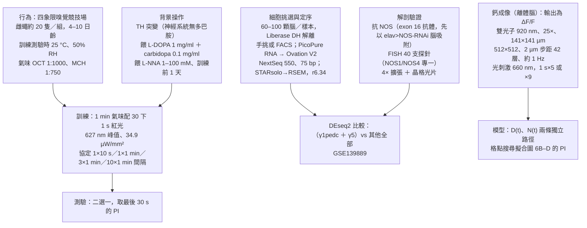
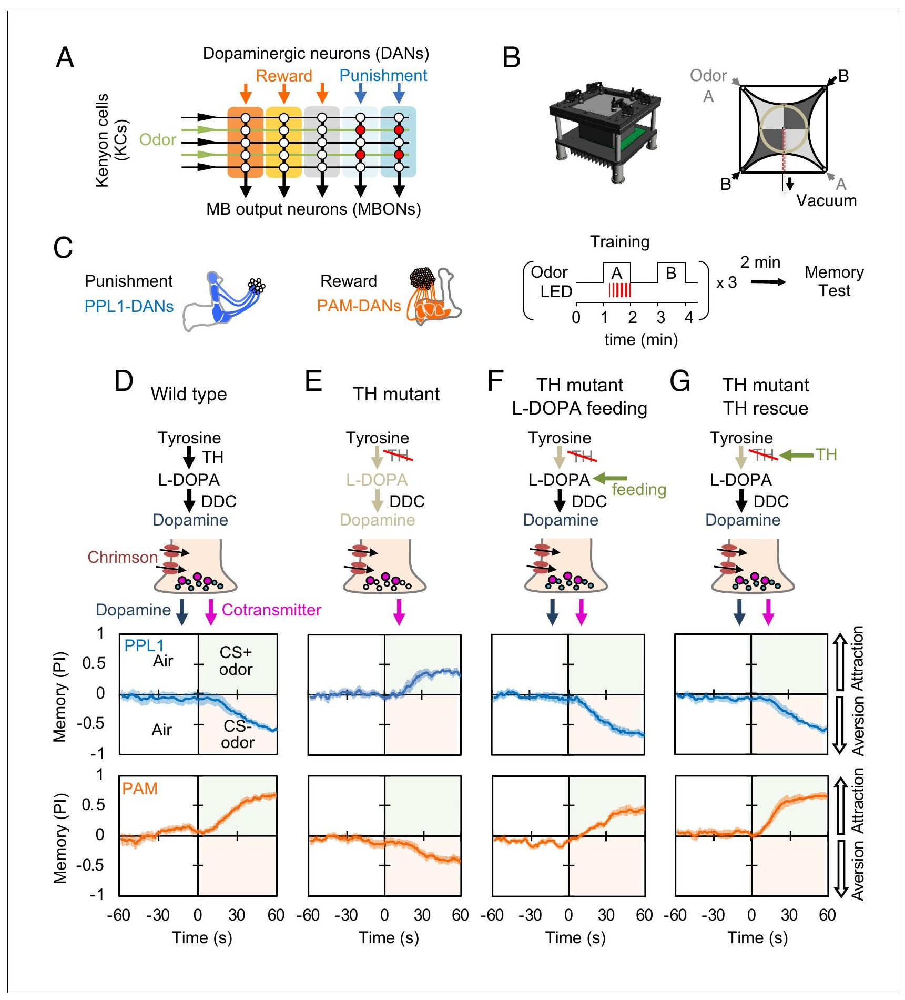
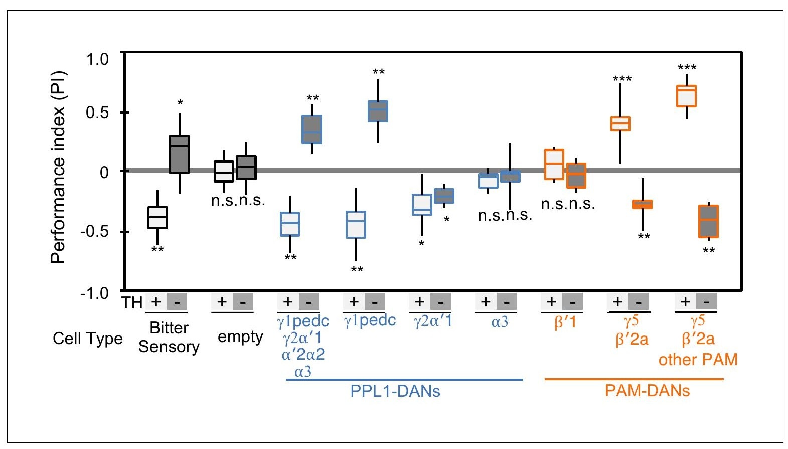
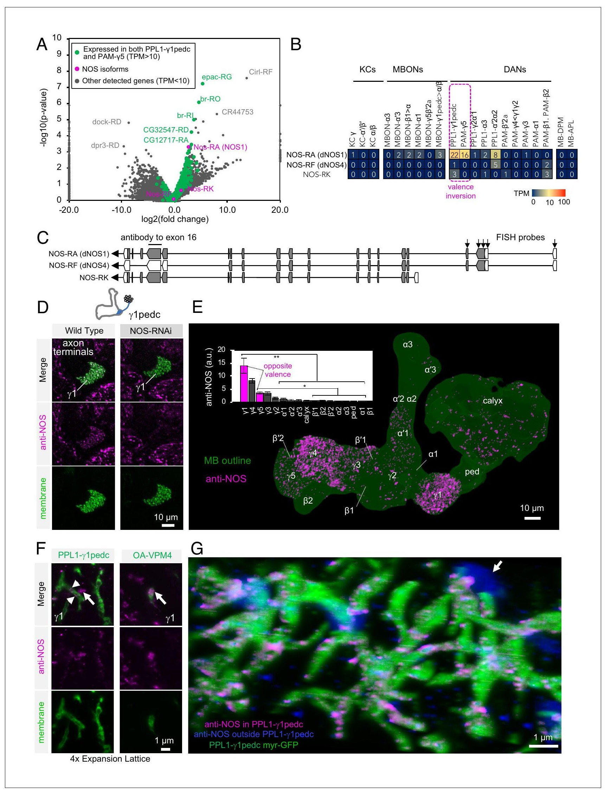
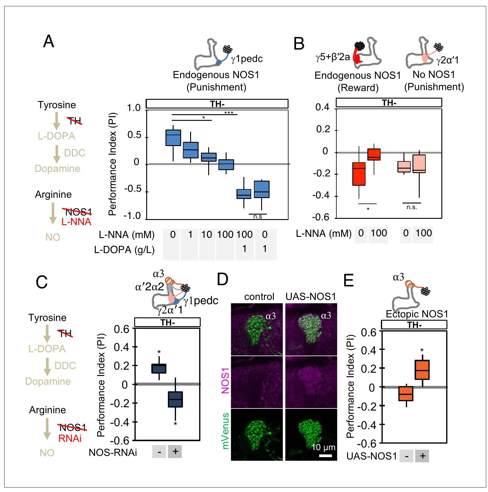
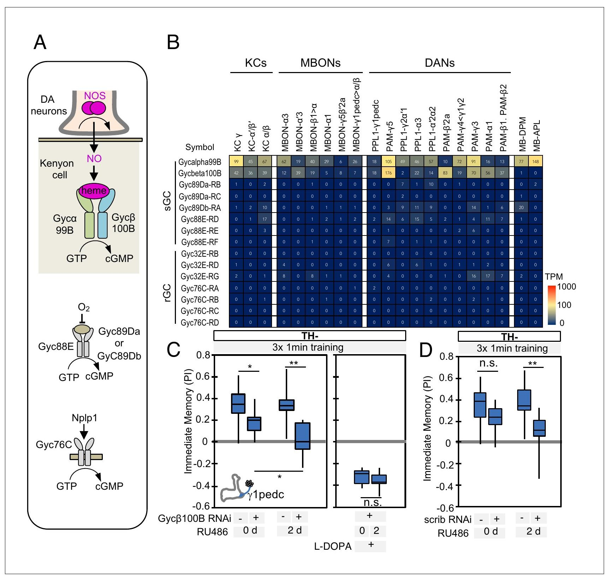
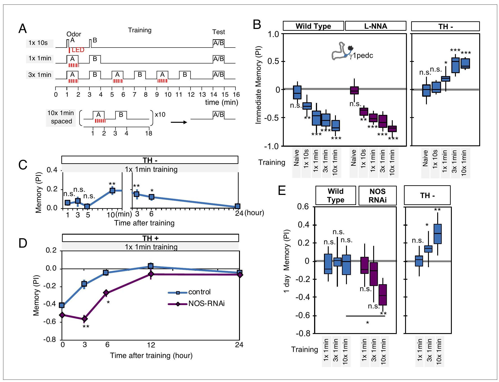
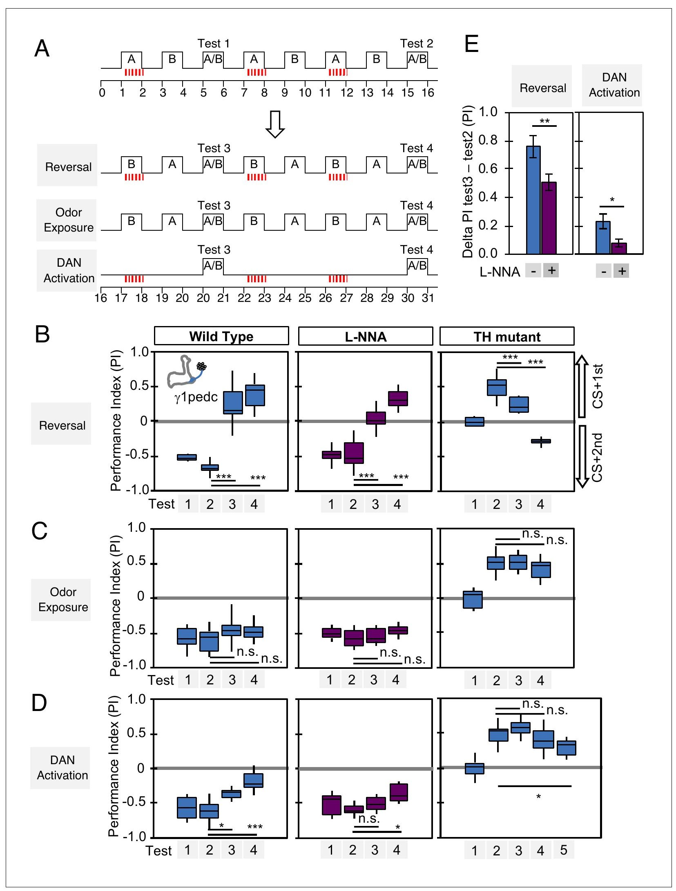
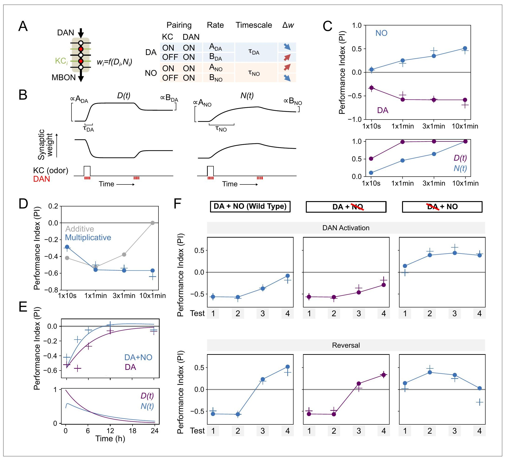
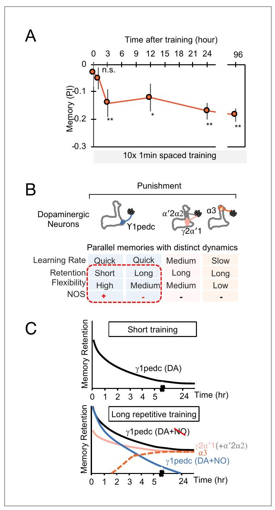

<!-- 本機 PDF：papers/2019-Nitric%20oxide%20acts%20as%20a%20cotransmitter%20in%20a%20subset%20of%20dopaminergic%20neurons%20to%20diversify%20memory%20dynamics.pdf -->

# Nitric oxide acts as a cotransmitter in a subset of dopaminergic neurons to diversify memory dynamics

**一氧化氮在一部分多巴胺神經元裡充當共同傳遞物，使記憶動態多樣化**

| 項目 | 內容 |
|---|---|
| **出處** | eLife 8, e49257 (2019). doi: 10.7554/eLife.49257 [全文（PMC 免費閱讀）](https://pmc.ncbi.nlm.nih.gov/articles/PMC6948953/) |
| 日期 | 收稿 2019-06-12・接受 2019-11-13・刊出 2019-11-14（PDF 第 1 頁）。eLife 是單篇編號（e49257），沒有起迄頁；PDF 共 33 頁 |
| 通訊作者 | Yoshinori Aso（asoy@janelia.hhmi.org）、Gerald M. Rubin（rubing@janelia.hhmi.org）。PDF 只有英文名 |
| 作者 | 共 14 人：Yoshinori Aso、Robert P Ray、Xi Long、Daniel Bushey、Karol Cichewicz、Teri-TB Ngo、Brandi Sharp、Christina Christoforou、Amy Hu、Andrew L Lemire、Paul Tillberg、Jay Hirsh、Ashok Litwin-Kumar、Gerald M Rubin。**PDF 未標示共同第一作者**（已查作者列的上標與註腳）。分工：Aso 構思、取得並分析資料、督導；Litwin-Kumar 負責模型的形式分析；Lemire 與 Ray 負責程式與分析；Cichewicz、Sharp、Hirsh 提供材料（TH 突變株相關） |
| 機構 | Janelia Research Campus, Howard Hughes Medical Institute（美國維吉尼亞州 Ashburn）；Department of Biology, University of Virginia（Charlottesville）；Department of Neuroscience, Columbia University（紐約） |
| 資料庫 | 全部轉錄體資料存於 NCBI Gene Expression Omnibus，編號 GSE139889。驅動品系的表現樣式見 www.janelia.org/split-gal4。**模型程式碼未釋出**（PDF 的 Additional files 只列三個補充檔與透明報告表，沒有程式碼條目） |
| 補充資料 | 圖補充共 20 張（圖 1 有 2、圖 2 有 1、圖 3 有 10、圖 4 有 1、圖 5 有 3、圖 6 有 1、圖 8 有 2；圖 7 與圖 9 沒有），補充檔 1（RNA-seq 的 TPM 全表）、2（關鍵材料表）、3（基因型與餵藥對照表），以及影片 1。**以上全部不在本機 PDF 內，本庫未取得**；凡依賴它們的內容一律標 ？待查 |
| 編輯／審查 | 審查編輯（Reviewing editor）Mani Ramaswami（Trinity College Dublin，愛爾蘭）。PDF 未列其他審查人姓名；決定信與作者回覆另有 DOI（.sa1／.sa2），本庫未取得 |
| 經費 | HHMI（11 位作者）；NIH R01 GM84128（Cichewicz、Hirsh）；Simons Foundation Global Brain（Aso、Litwin-Kumar、Rubin）；Burroughs Wellcome Fund、Gatsby Charitable Foundation、NSF DBI-1707398（皆為 Litwin-Kumar） |

> 與本庫有關的作者：無。本篇的第一與通訊作者 Aso、Rubin 同時是本庫 [[s-aso-2014-mbon-valence]]、[[s-aso-2016-dan-cell-type-rules]] 的作者，本篇多處把 Aso & Rubin 2016 當成前提直接引用。本篇也引用了本庫的 Hige 2015、Cohn 2015、Handler 2019、Gervasi 2010、Tomchik 2009、Burke 2012、Ichinose 2015、Mao 2009、Tully 1985。
>
> **本篇為 Creative Commons Attribution（CC BY）開放取用**（PDF 第 1 頁：「This article is distributed under the terms of the Creative Commons Attribution License, which permits unrestricted use and redistribution provided that the original author and source are credited」；未註明版本號），版權屬作者（Copyright Aso et al.）。圖片可在標明出處的條件下自由使用與散布。本庫仍依規定只給全文連結、不放 PDF；每張圖下方標明出處與授權。

---

## 為什麼重要

> 本節假設讀者已略知果蠅嗅覺學習的輪廓，並且會用到一些本節不解釋的詞（突觸＝兩顆神經元之間傳訊的接點，軸突＝神經元伸出去送訊號的那根長纖維，酵素＝催化特定化學反應的蛋白質）。**完全不熟的讀者請先看「科普文」一節**，那一節從零開始、名詞都在當場解釋。術語的完整清單在「專業文」開頭的「本頁用語」表；本節的「見 3.x」「見四、主張 N」指的都是「專業文」裡的小節編號。
>
> 本頁的三個標記：`※ 推論` 指論文沒有明說、本頁自己推得的內容；`？待查` 指需要本頁未取得的補充資料才能確認、刻意不填的內容；`[[雙括號]]` 是連到本知識庫另一頁的連結。

**第一，它在本庫裡加了一條新的訊號路徑。** 本庫此前收錄的論文所描繪的學習圖像裡，只有一種增強訊號（reinforcement signal，即告訴突觸「現在該改變了」的教學訊號；要注意這個詞說的是「觸發改變」，至於突觸最後是變強還是變弱，是另一回事）：多巴胺。本庫把這個問題收在主題頁 [[t-dopamine-to-plasticity]]。KC 指 Kenyon 細胞，是蕈狀體的主要神經元，一個氣味只活化其中一小群。那一頁問的是「KC 的軸突怎麼讀出多巴胺」，已知的環節有兩個：KC 膜上有兩種多巴胺受體（接收多巴胺的蛋白，名稱見 [[s-handler-2019-dopamine-receptor-timing]]）負責接訊號，接到之後由 cAMP 這個小分子把訊號往下傳（Tomchik 2009〔[[s-tomchik-2009-camp-dynamics]]〕、Gervasi 2010）。本篇指出**一部分**多巴胺神經元（DAN）除了多巴胺還送出第二種訊號——一氧化氮（nitric oxide, NO）。本篇找到的是 γ1pedc 與 γ5 這兩格的 DAN，不是全部 DAN（論文標題寫的就是 a subset of dopaminergic neurons，「一部分」）。注意「做 NO 的」與「行為上會反轉的」兩份名單不完全重合：有 NOS 證據的是 γ1pedc 與 γ5 這兩型；行為上會反轉的是三型，因為 γ5 和 β′2a 是由同一個驅動品系一起打開、沒有單獨測過，而 β′2a 也沒有單獨做過 RNA 定序（見四、主張四）。它不經多巴胺受體，而是作用在 KC 裡的可溶性鳥苷酸環化酶（sGC，一種碰到 NO 就製造 cGMP 的酵素），由它製造 cGMP（本篇沒有量過 cGMP，這一步是從「sGC 是必要的」推出來的，見 3.5）。cAMP（環腺苷單磷酸）與 cGMP（環鳥苷單磷酸）都是第二傳訊者（細胞外訊號進來後、在細胞內接手把訊號傳下去的小分子）。

**所以這是本庫目前收錄的論文裡，第一條與 cAMP 平行的第二傳訊者路徑，而且作用效果與多巴胺那一條相反。**（「第一條」只是就本庫已收的頁面而言，不是對整個文獻的斷言。） 「相反」指的不是訊號傳遞的方向，而是造成的記憶方向：在做不出多巴胺的果蠅裡，同一次訓練會造出方向相反的記憶（「價性反轉」，見下面第三點）。在正常果蠅裡，多巴胺把突觸壓低、NO 把突觸拉高（這一步是模型的假設，本篇沒有直接量到，見科普文「比喻在三處失效」第 3 條）。兩者在突觸上的作用方向相反（一個壓低、一個拉高），所以淨效果上會互相抵消；而兩者的時間尺度不同——多巴胺寫得快、退得也快，NO 慢慢累積——於是量到的記憶會先被多巴胺拉到一邊，再隨著多巴胺那一項退場、NO 那一項接手往回推，淨值回到接近原點。**「方向相反又比較慢」就是這樣縮短記憶的：它不是把記憶抹掉，而是後來才補上一個反向的量，把淨值推回去。**

**本篇有兩個可以各自開關、也可以同時用的操作，讀每個結果時都要先確定它用了哪些：****操作一＝拿掉多巴胺**（TH 突變果蠅）；**操作二＝拿掉 NO**（壓低 NOS，做法有全身餵抑制劑與只在特定細胞裡做 RNA 干擾兩種）。兩個都不用就是正常果蠅；只用操作一是「只剩 NO」；只用操作二是「只剩多巴胺」；**兩個一起用**則是本篇確認 NO 作用時最常見的組合（在 TH 突變果蠅身上再壓低 NOS）。

上面那條「回到原點」是「正常」與「只用操作二」相比看出來的，而且要分時段看：3 與 6 小時時，壓低 NOS 的記憶比正常強；要到 12 與 24 小時，兩者才都回到接近 0。這一條的細胞專一 RNA 干擾版本本頁查核過，全身給藥的版本在本庫未取得的補充圖裡（見 3.6 與「圖」一節對圖 6D 的解讀）。

第二，它給 [[t-timing-rules]] 與 [[t-memory-updating]] 一個分子層級的解釋。[[s-aso-2016-dan-cell-type-rules]]（同一組作者）在行為上發現各區室的三件事差很多：學習速率、記憶保留，以及彈性——彈性指舊記憶被新訓練改寫的難易，量法是「要重複幾次才改得過來」。（區室是這樣來的：蕈狀體的葉是 KC 軸突併成的纖維束；葉沿著軸突的走向被切成一格一格，每一格就是一個區室，由一型 DAN 送訊號進來、一型 MBON 把它讀出去。MBON ＝ 蕈狀體輸出神經元，它的活動推動果蠅靠近或走開。）γ1pedc 學得最快、忘得最快，就算做十次間隔訓練也撐不到一天；α3 學得慢但記得久。那篇把機制列為未知，並猜了三種可能（多巴胺釋放特性、各區室的生化反應、迴路性質）。本篇回答的是「各區室的生化反應不同」這一種——NO／sGC／cGMP 就是區室內部的生化差異（`※ 推論`：論文沒有逐一對應那三種可能）：**γ1pedc 與 γ5 這兩格的 DAN 另外會做 NO，NO 的作用方向與多巴胺相反，而且要十分鐘左右才展現出來（原文說 NO 的效應發展得比多巴胺慢），於是把這一格的記憶「剪短」——靠的是上面說的反向抵消，不是把記憶抹掉。同時它也讓這一格更容易被新經驗改寫（本篇把兩件事都量了，但沒有說明這兩個效果是不是同一個機制造成的，見 3.7）。**把 NOS（製造 NO 的酵素）壓低，γ1pedc 就能在十次間隔訓練之後留下一天的記憶——原本做不到的事（條件上的保留見科普文）。

第三，它提供了一個本庫其他篇都沒有的操作：**拿掉多巴胺之後，再看同一顆 DAN 能做什麼。** 在做不出多巴胺的 TH 突變果蠅裡活化懲罰型的 PPL1-γ1pedc，果蠅學到的不是躲開，而是喜歡這個氣味；反過來，在同樣做不出多巴胺的果蠅裡活化獎賞型的 PAM-γ5 與 PAM-β′2a（這兩型由同一個驅動品系一起打開，沒有單獨測過），本來會造出「喜歡」的訓練變成造出「躲開」。這個「價性反轉」（價性＝一個氣味對果蠅是好是壞）是整篇的起點，也是找出 NO 的篩選依據。但要注意它的邏輯代價：**整篇的分子證據幾乎都在「沒有多巴胺」這個人工背景裡取得**，NO 在正常果蠅裡做什麼，只能從「把 NOS 關掉之後記憶變久」這一類間接實驗推回去。詳見專業文第四、五節。

---

## 論文摘要（原文與中譯）

> Animals employ diverse learning rules and synaptic plasticity dynamics to record temporal and statistical information about the world. However, the molecular mechanisms underlying this diversity are poorly understood. The anatomically defined compartments of the insect mushroom body function as parallel units of associative learning, with different learning rates, memory decay dynamics and flexibility (Aso and Rubin, 2016). Here, we show that nitric oxide (NO) acts as a neurotransmitter in a subset of dopaminergic neurons in *Drosophila*. NO's effects develop more slowly than those of dopamine and depend on soluble guanylate cyclase in postsynaptic Kenyon cells. NO acts antagonistically to dopamine; it shortens memory retention and facilitates the rapid updating of memories. The interplay of NO and dopamine enables memories stored in local domains along Kenyon cell axons to be specialized for predicting the value of odors based only on recent events. Our results provide key mechanistic insights into how diverse memory dynamics are established in parallel memory systems.

（eLife 的摘要不分 Background／Results／Conclusion 段，照原樣一段。）

**中譯**（本節為忠實翻譯，非自撰內容）：

> 動物採用多樣的學習規則與突觸可塑性動態，來記錄世界的時間與統計資訊。然而，這種多樣性背後的分子機制仍所知甚少。昆蟲蕈狀體中以解剖界定的區室，作為聯結學習的平行單元運作，各自有不同的學習速率、記憶衰退動態與彈性（Aso and Rubin, 2016）。本文顯示，在果蠅中，一氧化氮（NO）在一部分多巴胺神經元裡作為神經傳遞物。NO 的作用發展得比多巴胺慢，並依賴突觸後 Kenyon 細胞中的可溶性鳥苷酸環化酶。NO 的作用與多巴胺相拮抗；它縮短記憶的保留時間，並促進記憶的快速更新。NO 與多巴胺的交互作用，使儲存在 Kenyon 細胞軸突沿線各局部區域的記憶，得以專門用來只根據近期事件預測氣味的價值。我們的結果，為「平行記憶系統中多樣的記憶動態如何建立」提供了關鍵的機制性見解。

---

## 科普文

想像一間教室裡有兩位老師，在同一塊白板上寫方向相反的內容。**老師甲**用奇異筆，一下筆就清楚，但顏色退得也快；**老師乙**用一種顯影很慢的墨水，下筆之後要等十分鐘左右字跡才浮出來，可是一旦浮出來就留得久（這一點只有在甲不在場時才看得到，見下面失效第 2 條）。這篇論文說，果蠅腦裡真的有這樣一對老師：**同一顆神經元同時送出兩種訊號——多巴胺（老師甲）與一氧化氮（老師乙）——兩者作用方向相反、快慢不同；結果不是單純的加減，而是替這一格的記憶訂出「能記多久」。**

**比喻對應，全文沿用：** 老師甲＝多巴胺，老師乙＝一氧化氮（nitric oxide，以下簡稱 NO）；白板＝一個區室（蕈狀體上的一小段，下面會解釋）裡的突觸強度；寫下的字＝突觸被改變的量；讀白板的人＝輸出神經元（MBON），它讀出這一格的記憶，決定果蠅靠近或走開。

**比喻在三處失效**，先說清楚，後面不再重複：

1. **乙不是把甲蓋掉。** 作者試過「乙寫的減掉甲寫的」這種算法，和實驗資料不符（理由見本節後段「被否決的是『相減』這個數學形式」那一段）；他們採用的是相乘的算法。兩位老師寫的字始終都在，只是合成一個結果。
2. **「留得久」只在沒有甲的時候看得到。** 乙那一份記憶能撐六小時以上，是在做不出多巴胺的突變果蠅身上量的。正常果蠅身上，兩份都會慢慢退回原點，所以不會幾小時後翻成相反的偏好。
3. **白板上寫了什麼，本篇幾乎沒有看到。** 「甲把突觸壓低、乙把它拉高」是模型的假設，本篇沒有任何突觸層級的量測可以直接支持（見最後一段）。

**先交代果蠅怎麼學。** 果蠅聞到氣味時，蕈狀體（mushroom body）裡一小群 Kenyon 細胞（KC）會活動，哪一群活動就代表哪個氣味。KC 把訊號送給蕈狀體輸出神經元（MBON），MBON 的活動推動果蠅靠近或走開。第三種角色是多巴胺神經元（DAN），它帶來「這是好事還是壞事」的訊號：氣味與懲罰同時出現時，被這個氣味活化的 KC 與 MBON 之間的接點（突觸）就變弱。蕈狀體沿著 KC 的長軸分成一格一格的區室，每格由一型 DAN 管、一型 MBON 讀。**代號怎麼讀，先講一次，後面全文沿用：** 區室的名字由葉名加編號組成，例如 γ1、γ5、α3、β′1——希臘字母是葉名（撇號用來區分名字相近但其實不同的葉：α 與 α′ 是兩條葉、β 與 β′ 是另外兩條），數字是沿著葉的段號。本篇出現的葉名共五個：α、α′、β、β′、γ。`pedc` 指柄（peduncle），即 KC 軸突在分葉之前的那一段。有些 DAN 的管區跨兩段，名字就把兩段連寫（γ2α′1 跨 γ2 與 α′1；γ1pedc 跨 γ1 與柄）。細胞的名字則是「群名－管區」：`PPL1` 與 `PAM` 是兩群 DAN 的名稱（PPL1 群多半報告懲罰、PAM 群多半報告獎賞，名稱的由來本篇沒有解釋），所以 `PPL1-γ1pedc` 是管 γ1pedc 的那一型懲罰 DAN，`MBON-γ1pedc` 是讀同一塊地方的輸出神經元。**同一串字可能指三種東西（那一格、管它的 DAN、讀它的 MBON），本頁一律寫出前綴或加上「這一格」來區分。**

本篇的主角是 γ1pedc 這一格（由 PPL1-γ1pedc 管，學得最快、忘得最快，每個腦半球只有一顆這一型細胞）與 γ5 這一格（由 PAM-γ5 管，屬於報告獎賞的那一群）。**突觸變弱為什麼等於躲開？** 以 γ1pedc 這一格為例：MBON-γ1pedc 的活動推動的是「靠近」，突觸變弱之後，這顆 MBON 對受訓氣味的反應跟著變小，推動靠近的力道變小，行為上就表現成躲開。反過來，若有什麼讓這個突觸變強，造出來的行為方向就相反。本篇只對 γ1pedc 這一格寫出這一步；γ5 那一格的 MBON 推動哪個方向，本篇沒有寫（`？待查`）。

**難題：為什麼各格的記憶能撐的時間差那麼多？** 一部分差別可能來自 KC 本身：KC 依軸突走進哪一條葉而分型，不同葉上的格子接的是不同型的 KC（γ1pedc 在 γ 葉、α3 在 α 葉）。但作者指出，**即使是同一束 KC 軸突上前後相鄰的格子，記憶動態也不一樣**（原文舉的例子是同在 α 葉上的 α1 與 α3），所以差別不可能全部推給 KC，格子本身一定也有差。前人（本庫 [[s-aso-2016-dan-cell-type-rules]]）只用光叫醒單一型 DAN——做法是用基因改造讓那一型神經元帶上 CsChrimson 這個通道蛋白，照紅光它就放電——就量出 γ1pedc 一次十秒訓練就學得起來、卻連做十次間隔訓練（訓練一次、休息一陣子、再訓練，重複十個循環，不是連著做十次）也留不住一天的記憶；α3 正好相反，單次訓練幾乎學不到，要十次間隔訓練才造得出記憶，但造出來就撐得久。原因不明。

**解法第一步：把多巴胺拿掉，看 DAN 還會做什麼（圖 1、圖 2）。** 作者用一種做不出多巴胺的突變果蠅（TH 突變：TH 是製造多巴胺的關鍵酵素），再用紅光叫醒特定的 DAN，同時給氣味。正常果蠅學到的是躲開這個氣味；沒有多巴胺的果蠅學到的卻是**喜歡**它。這種「同一次訓練在沒有多巴胺時造出方向相反的記憶」，本篇稱為**價性反轉**（價性＝一個氣味對果蠅是好事還是壞事）。

**本篇的分數怎麼看，先講一次，後面所有數字都照這個讀。** 競技場分成四個象限，測驗時兩種氣味各占一部分象限，看一群約 20 隻果蠅聚在哪邊，算成**表現指數**（performance index，以下簡稱 PI）＝（待在配過光那個氣味的象限的隻數 − 待在另一個氣味的象限的隻數）÷ 總隻數。（四個象限具體怎麼分配給兩個氣味，本篇沒有寫明，`？待查`。）所以 PI 從 −1 到 +1：**負值＝躲開配過光的氣味，正值＝喜歡它，0 ＝沒有偏好**，絕對值越大代表記憶越強。獎賞型的 PAM-γ5 與 PAM-β′2a 則倒過來，從喜歡變成躲開——這兩型是由同一個驅動品系一起打開的（驅動品系就是用基因改造讓特定幾型神經元帶上實驗工具蛋白的果蠅品系）。接著作者用兩種補救各排除一種解釋。**第一種：餵食 L-DOPA**（多巴胺的前驅物，細胞拿它做成多巴胺），而且是餵給**成蟲**；補回來之後記憶恢復正常，所以不太可能是「一輩子沒有多巴胺造成的發育缺陷」（原文的措辭也只是「與這個可能相左」）。**第二種：只在 PPL1 這幾型 DAN 裡補回 TH 酵素**，也恢復正常，所以不需要用「蕈狀體以外缺多巴胺」來解釋（原文的措辭是「只在 PPL1 裡補回來就**足以**恢復」，這種說法不等於排除了外面那條可能）。（兩者都見圖 1 的解讀。）補回多巴胺之後學習完全正常，表示迴路本身是好的、缺的只是多巴胺。所以寫進去的一定是多巴胺以外的東西。但「是被叫醒的那顆 DAN 自己送出來的」這一步，這兩個對照還證明不到——也可能是別的細胞趁多巴胺缺席時寫進去的，或是多巴胺在不同濃度下作用方向相反。要補上這一步，得等後面「解法第三步·其二」：**只在那幾型 DAN 裡**把 NOS 壓低，記憶就不見了，才確定訊號是從那幾顆細胞出來的。

更重要的是，這個反轉只發生在一部分細胞型。作者在圖 2 用了七個驅動品系，其中四欄出現反轉（除了下面列的兩組，還有一次打開四型 PPL1 的那條，以及 γ5、β′2a 再加其他 PAM 的那條）。把單獨或成對打開的那幾組挑出來看，結果分成三類：

- **會反轉的，是上面那兩組驅動品系**：一組打開 PPL1-γ1pedc 這一型，另一組同時打開 PAM-γ5 與 PAM-β′2a 這兩型（所以是兩組品系、三型細胞）。
- **PPL1-γ2α′1 不反轉：有沒有多巴胺，它造出來的都是「躲開」。** 這不是沒有資訊的結果，推理分兩步：這批果蠅做不出多巴胺，既然還學得到躲開，寫記憶的就一定是多巴胺以外的東西；而它寫出來的方向和多巴胺一樣，所以它那種第二訊號是「和多巴胺同向」的（原文的措辭是 a cotransmitter with the same sign of action as dopamine），在行為上看不出差別。它是什麼，本篇沒有找出來。
- **PPL1-α3 與 PAM-β′1 這一類，這組實驗給不出資訊。** 它們在沒有多巴胺時測不到記憶，但在**有**多巴胺的背景下、同樣的訓練量也測不到（圖 2 的這兩型，有多巴胺的那一欄與沒有多巴胺的那一欄都標 n.s.＝not significant，統計上與「完全沒有記憶」分不出來）。**作者的結論比較強**：他們寫這兩型「不表現能在沒有多巴胺時誘發記憶的共同傳遞物」。但本頁認為只能收到「在這個訓練量下測不到」——因為這組實驗一律只用「3×1 分鐘」（一分鐘的訓練做三回），而 α3 這一格在正常果蠅本來就要十次間隔訓練才造得出記憶，訓練量很可能根本不夠。

另外還有一欄很重要：作者不用紅光直接叫 DAN，而是活化**苦味感覺神經元**（前人證明它會順著迴路活化 PPL1 的 DAN），結果同樣反轉。**所以反轉不是「用光強迫一型 DAN 齊發」這個人工操作造出來的假象。** 不過這組果蠅同樣是 TH 突變，所以它排除的只是「直接用光叫」這個操作，沒有排除「整隻果蠅都沒有多巴胺」這個背景。

**所以不同的 DAN 帶的第二種訊號不一樣。** 嚴格說，本篇在這一步確定的只有兩件事：γ1pedc 與 γ5／β′2a 的第二訊號**與多巴胺反向**，γ2α′1 的第二訊號**與多巴胺同向**（α3、β′1 那一類沒有結論）。但光是這兩類就夠說明一件事：第二種訊號不是全腦統一的，而是逐型不同的——這正是「各格規則為什麼不同」可以著力的地方。

**解法第二步：看這幾型細胞開了哪些基因（圖 3）。** 作者用只標記特定細胞的果蠅品系，把細胞一顆一顆挑出來做 RNA 定序——也就是把細胞裡所有的**轉錄本**（細胞依基因抄出來的 RNA 訊息；一個基因開著，就會有它的轉錄本，量多表示開得旺）一次全部讀出來。難處在於 PPL1-γ1pedc 每側只有一顆，要把它從整顆腦裡挑出來而且挑得夠純。

比較的方式是：把兩型會反轉的細胞（**PPL1-γ1pedc 與 PAM-γ5**）合起來，對上其他所有細胞型（定序只做了 PAM-γ5 這一型，PAM-β′2a 沒有單獨定序；行為上的反轉是這兩型一起打開測到的）。符合「這兩型高、其他型低」的轉錄本最後只剩**六條**。六條裡只有一條可能是製造神經傳遞物的酵素，就是 **NOS**（一氧化氮合成酶，製造 NO 的酵素）；其餘五條分別是一個 cAMP 相關的交換因子、兩個轉錄因子的轉錄本、一個受體、一個酵素（分類是作者依公共資料庫的註解判斷的，本篇沒有對它們做功能實驗，見 3.3）。接著用抗體把蛋白質的位置標出來（抗體染色標的是 NOS 這個蛋白本身，不是 NO 這種氣體），在 **γ1 與 γ5 這兩格**看到訊號偏高（原文用 enriched，意思是比周圍多，不是說這兩格最強；注意這裡寫的是 γ1 這一格，而 PPL1-γ1pedc 的管區是 γ1 加上柄）。但這個結果不乾淨：γ3、γ4 兩格的訊號在統計上也顯著，其中 γ4 還比 γ5 強，而管 γ3、γ4 這兩格的 DAN，NOS 轉錄本卻很低。作者把那裡的訊號歸給非 DAN 的細胞、或發育期留下的表現（見圖 3 的解讀）。

**先提醒一件事：本篇用基因的方式壓低 NOS 或 sGC，一共做了四組不同的行為實驗，很容易讀成同一個**（另外還有全身餵抑制劑的版本，以及兩處只用來驗證工具、不看行為的壓低，不在這張表內）。下面每次出現都會註明，這裡先一次列出來對照：

| 編號 | 壓低什麼、壓在哪裡 | 哪種果蠅 | 看哪一份記憶 | 訓練量 |
|---|---|---|---|---|
| (1) | NOS，一次四型 PPL1 DAN | 做不出多巴胺 | 喜歡 | 3×1 分鐘 |
| (2) | NOS，只在 PPL1-γ1pedc 一型 | 正常 | 躲開 | 一分鐘一次 |
| (3) | NOS，品系論文沒交代 | 正常 | 躲開 | 十次間隔 |
| (4) | sGC，在 KC 裡 | 做不出多巴胺 | 喜歡 | 3×1 分鐘 |

**解法第三步：三種操作確認 NO 真的在做事（圖 4）。** 三組都在做不出多巴胺的果蠅身上做。下面以 γ1pedc 那份「喜歡」的記憶為主線；同一張圖另有一格做的是獎賞型那一邊——在同樣沒有多巴胺的背景下，γ5 加 β′2a 造出來的是「躲開」（這就是獎賞型的反轉），全身餵抑制劑同樣把它削掉，而 γ2α′1 那一型不受影響。

- **其一，把 NO 做不出來（全身給藥）。** 餵食 NOS 的抑制劑，那份「喜歡」的記憶隨劑量升高而變弱，最高劑量幾乎量不到。同一批實驗有一個重要對照：餵 L-DOPA 把多巴胺補回去之後，正常的躲避記憶照樣形成、不受抑制劑影響——證明這些果蠅並沒有「不能學習」，少掉的只是 NO 那一份。
- **其二，把 NO 做不出來（只在特定細胞裡）＝上表的 (1)。** 用 RNA 干擾（送進一段短 RNA，讓細胞把對應基因的訊息 RNA 分解掉，那個基因的蛋白就做得少）壓低 NOS。這裡用的驅動品系**一次打開四型 PPL1 DAN**：γ1pedc、γ2α′1、α′2α2、α3。結果那份「喜歡」不但不見了，還翻成「躲開」（從約 +0.17 變成約 −0.18）。這和其一的方向一致——兩種做法都顯示那份「喜歡」需要 NOS。至於為什麼不是停在 0、而是跑到負的那一邊：作者把多出來那一截歸給同一個品系裡的 γ2α′1，因為前面逐型測的時候，就只有 γ2α′1 被測出帶著「與多巴胺同向」的第二訊號（另外兩型 α′2α2 沒單獨測過、α3 測不到東西）。NOS 一被壓低，γ1pedc 那份反向的「喜歡」消失，剩下 γ2α′1 那份同向的就露出來了（見 3.4）。
- **其三，反過來做：把 NO 搬到別的格子。** 在本來幾乎不做 NOS 的 α3 那一格，硬是讓 DAN 做出 NOS，同樣用 3×1 分鐘訓練，它也能寫入「喜歡」的記憶了（約 +0.18；注意這是正值，與上一條的 −0.18 是相反的方向）。**所以 NO 這套機制不綁死在某一格，搬過去就能用。** 不過不要據此推論「NO 比多巴胺快」：同樣是 α3 這一格，靠多巴胺寫入記憶要十次間隔訓練、換成外加的 NOS 用 3×1 分鐘就夠，但這是「外加的 NOS」對「內生的多巴胺」，而外加進去的量是不是接近 γ1pedc 原本的量，本篇沒有辦法判斷（見 3.4）。

**NO 作用在誰身上？** 這一組仍然在做不出多巴胺的果蠅身上做（上表的 (4)）。答案的第一站是 KC。KC 裡有一種叫可溶性鳥苷酸環化酶（sGC）的酵素（「酵素」就是催化特定化學反應的蛋白質；「可溶性」是指這一種漂在細胞質裡，不像另一類鑲在細胞膜上），它碰到 NO 就製造 cGMP。要注意**本篇沒有量過 cGMP**：這條路線的後半段是從「少了 sGC 就學不到」推回去的。這個酵素是由兩種蛋白質拼成的（各叫一個次單元），作者用 RNA 干擾讓 KC 少做其中一個次單元（並另外確認了那個次單元的蛋白真的變少），NO 造出來的那份「喜歡」記憶就消失了。至於少了一個次單元是不是讓整個酵素拼不起來，本篇沒有量（`※ 推論`：少了一半理應組不成，但這是本頁的推想）。要注意這證明的是 KC 的 sGC 是**必要**的，不是說 KC 是唯一的標的——MBON 與 DAN 自己也表現 sGC（見本節最後一段「最容易被誤讀的一點」）。所以這條路線是：DAN 放出 NO → KC 的 sGC → cGMP，和「DAN 放出多巴胺 → KC 的受體 → cAMP」平行。cGMP 之後還有什麼、最後怎麼改到突觸上，本篇沒有做，作者自己也把它列為待查（見六、未來）。

**關鍵的差別在快慢，而這是兩組分開的時間曲線。**

- **老師甲（多巴胺）那一份**，在正常果蠅身上、一分鐘的單次訓練：訓練結束後一分鐘內就測得到；半衰期約兩三小時（這個值是引自第一作者早年的另一篇論文 Aso et al. 2012，不是本篇量的）。
- **老師乙（NO）那一份**，在做不出多巴胺的果蠅身上、同樣是一分鐘的單次訓練（只有在這個背景下才看得到它單獨的作品）：訓練結束後 1、3、5 分鐘都還量不到，10 分鐘才出現；之後 3 小時、6 小時都還在，24 小時回到 0。

也就是**一個快而短，一個慢而長**。

**那麼在正常果蠅身上，為什麼幾小時後不會翻成「喜歡」？** 兩者方向相反，慢慢累積的 NO 會在淨效果上把先寫下的多巴胺記憶抵消掉（多巴胺把突觸壓低、NO 把它拉高——見比喻失效第 3 條）。但抵消不等於翻轉：訓練結束後兩份都會被 DAN 的背景活動慢慢拉回 0，作者把行為資料套進模型算出來（擬合）的兩個退場速率是 2.7 × 10⁻³／分鐘與 1.6 × 10⁻³／分鐘，一個退得比另一個快約 1.7 倍（`※ 推論`：哪個值屬於多巴胺、哪個屬於 NO，是本頁依原文語序推定的——原文把兩個符號都印成同一個；照這個推定，退得快的是多巴胺。見 3.8）。**這兩個是模型裡的參數，不要和上面「半衰期兩三小時」混在一起**：那是行為上量到的整條曲線（甲退場與乙累積兩件事混在一起的淨結果），這裡是模型把兩者拆開之後各自的退場速率。甲先退、乙才接手往回推，所以淨值回到接近原點就停住，不會繼續跑到相反的那一邊。本篇沒有報告正常果蠅在幾小時後出現價性相反的記憶。作者把「平衡而不是遺忘」這個說法用在另一個觀察上，不是用在這條衰退曲線上：他們指的是「用 γ1pedc 做十次間隔訓練之後測不到一日記憶」這件事，說那可以看成（原文用 can be viewed as）兩條平行訊號之間的「平衡」，而不是資訊被遺忘掉。作者也自承要確認這個解釋，得先了解下游的訊號路徑（見四、主張五）。

**另外有一組實驗，直接支持的只是「NO 會縮短保留」，不是上面那個「平衡而非遺忘」的解釋。** **這一組和前面「解法第三步」那三個完全是另一回事**，差別有三：做在**正常果蠅**身上（有多巴胺）、看的是**躲開**那一份記憶、而且 RNA 干擾只針對 **PPL1-γ1pedc 這一型**（前面其二用的品系一次打開四型）。訓練量是一分鐘的單次配對。結果：

- **剛訓練完，兩組一樣強**——所以 NO 不影響學得多好。
- **3 小時與 6 小時，壓低 NOS 的那組明顯更強**（以 3 小時為例，壓低 NOS 約 −0.57、對照約 −0.17；負值代表躲開，絕對值越大代表記憶越強）。
- **12 小時與 24 小時，兩組都回到接近 0**——所以 NO 縮短的是保留的時間，不是把記憶整個換掉。

**也就是 NO 不影響學得多好，只影響記得多久。** 這一條有兩種獨立的操作得到一致的結論——上面這個只針對一型細胞的 RNA 干擾，以及在同樣的正常果蠅身上全身餵 NOS 抑制劑（後者的資料在本庫未取得的補充圖裡）——所以是全篇最硬的一段（見四、主張三）。

還有一個更戲劇性的結果。γ1pedc 這一格本來就算做十次間隔訓練也留不住一天的記憶（前面說過的前人發現，本篇在正常果蠅身上也重測了一次，1 次、3 次、10 次都沒有一日記憶）。**把 NOS 壓低之後——仍然是正常果蠅，多巴胺照常——同樣的十次間隔訓練就留下了一天的「躲開」記憶**（約 −0.45）。

**「這一格記不久」不是它的硬體限制，而是 NO 主動把它剪短的。** 這一條有一個保留：論文沒有交代這組實驗的 NOS 壓低組用的是哪一個驅動品系，所以它和同一張圖其他欄位是否在同樣條件下取得，無法確認（見五、第 4 條）。

**代價是什麼？** 記得久不一定好。作者接著測「改寫」（圖 7）：先用 3×1 分鐘訓練建立對氣味 A 的記憶，再給三種新經驗，看偏好改得多快。三組果蠅是正常、抑制 NOS（全身給藥）、做不出多巴胺。**注意第三組建立的記憶方向是相反的**：做不出多巴胺的果蠅學到的是「喜歡 A」（就是前面的價性反轉），另兩組學到的是「躲 A」，所以三組的分數不能直接並排比大小，要先換算成行為（見圖 7 的解讀）。

**整個圖 7 只用全身給藥做，沒有做只在特定細胞裡的版本**，所以它不能排除蕈狀體以外的 NOS 也參了一腳（見四、主張三）。

- **把氣味 B 配上光（逆轉配對）。** 三組在第一次逆轉之後偏好都動了，但只有正常果蠅動到「改成偏好新氣味」的程度；另兩組要再多訓練幾輪。量化的改變量：正常約 0.75、抑制 NOS 約 0.50（這裡的改變量是兩次測驗 PI 的差；PI 的範圍是 −1 到 +1，所以 0.75 是很大的改變）。
- **只聞兩個氣味、不給光。** 三組的偏好都沒有顯著改變。**這是關鍵的對照**：改寫需要 DAN 被叫醒，不是單純再聞一次氣味就會淡掉。
- **只叫醒 DAN、不給氣味**（增強訊號單獨出現，沒有任何氣味可以配對）。正常果蠅一次就把原本建立的那份反應削掉一截（改變量約 0.24），抑制 NOS 的要三次（第一次只有約 0.09），做不出多巴胺的要五次。（量化的那張圖只比了正常與抑制 NOS 兩組，沒有做不出多巴胺那一組的改變量數字。）

這裡要補一步：為什麼單獨叫醒懲罰型 DAN 會把記憶**削弱**而不是加強？依據是前人的觀察——只活化 DAN、而 KC 不同時活動時，可以**逆轉**先前配對造成的突觸變弱（Cohn 2015、Hattori 2017、Berry 2018）。本篇在自己的模型裡把這件事實作成「把突觸推回原來的強度（基線）」；推回基線是本篇自己的設定，本篇沒有處理它會不會超過基線（見圖 7 的解讀）。

**所以 NO 買到的是彈性：記得短，但改得快。** 不過「改得快」這一半的證據比「記得短」那一半弱——記得短有藥物與細胞專一兩種操作，改得快只有全身給藥這一種（見四、主張三）。

**最後作者把這一切寫成一個小模型。** 模型裡有兩個 0 到 1 之間的量：**D** 代表多巴胺（老師甲）造成的突觸改變，**N** 代表 NO（老師乙）造成的突觸改變。模型假設甲讓 KC→MBON 的突觸變弱、乙讓它變強。

這裡有兩種「快慢」要分開，混在一起很容易讀錯：

- **訓練當下寫得多快**，由參數 A 決定（單位是「每分鐘」：A 越大，配對時 D 或 N 往上限 1 爬得越快）。擬合出來的值是 A（多巴胺）＝ 4.3／分鐘、A（NO）＝ 0.96／分鐘，所以甲往上限衝的速度約是乙的四倍半。作者據此說，**一分鐘的單次配對就足以讓 D 接近上限**，也就是甲一次就把板子寫滿了。（這是模型擬合的結論：一分鐘訓練裡 KC 與 DAN 實際同時活動多久，論文沒有給，所以讀者沒辦法拿這兩個數字自己驗算，見 3.8。）
- **寫下的改變要多久才展現出來**，由時間常數 τ 決定（模型取 τ 甲＝ 30 秒、τ 乙＝ 10 分鐘）。τ 不是擬合出來的，是作者看了資料直接**設定**的（原文寫 Based on the data, we assume）：τ 乙取 10 分鐘，就是把「乙那一份記憶要等十分鐘才量得到」這個觀察寫進模型，不是對它的獨立解釋。

**剩下的問題是：這兩個量怎麼合成突觸強度 w？**（w 就是 KC→MBON 那個接點的強度；下面兩個式子裡的「∝」是「成正比」，意思是只看相對大小、不管單位。沒有受訓時 D ＝ N ＝ 0。）作者比了兩種算法。

**被否決的是「相減」這個數學形式**（w ∝ N − D），**不是**「兩者在淨效果上互相抵消」這件事——這個區分很重要，前面比喻失效第 1 條說的就是這個。相減為什麼不行：甲很快就寫滿（D 到頂），之後再加訓練只讓 N 繼續長，於是 N − D 往上回升、w 也回升；而 w 回升就等於躲避記憶變弱（理由就是前面「突觸變弱為什麼等於躲開」那一步反過來看）。所以相減模型會預測「練越多次記憶反而越弱」，與實驗資料不符。

**作者採用的是「相乘」**（w ∝ (1 − D)(1 + N)）。它沒有上面那個問題：只要甲造成的變弱夠強（D 接近 1），就算 N 不小，乘出來的突觸強度還是很小——這講的是剛訓練完、D 還接近上限的那段時間。訓練結束後 D 退得比 N 快（就是上面那兩個退場速率），(1 − D) 先回升、(1 + N) 這一項才開始主導，淨效果上的抵消就發生在這個階段。**改寫那一項是模型最有說服力的一步：** 作者用「只叫醒 DAN、不給氣味」那組資料定好 D 與 N 被推回基線的速率之後，**不再加任何新參數**就預測出了逆轉學習的動態，而相加版本做不到（這個比較的圖在本庫未取得的補充圖裡）。所以相乘版本能同時對上學習、衰退與改寫三組資料。

**但模型只管「配對當下與之後幾小時」這一段，作者自己點出一個例外：** 它解釋不了「做十次間隔訓練之後，不論少掉多巴胺還是少掉 NO，記憶都變得更持久」這個結果。作者說那應該是間隔訓練另外啟動了某種鞏固機制，而模型裡沒有任何代表突觸後細胞內部狀態的量（見 3.8）。

**最容易被誤讀的一點：這篇沒有證明「一氧化氮在正常果蠅裡讓突觸變強」。** 上一段模型裡那條「NO 讓突觸變強」，是為了解釋行為結果而採用的假設，整篇沒有任何突觸或細胞層級的量測可以直接支持它。本篇唯一的生理量測是鈣成像（量細胞內鈣濃度造成的螢光變化，指標是 ΔF/F，也就是螢光相對於刺激前的基準值變化了多少），它要回答的是「NO 除了 KC 之外還有沒有別的標的、有沒有讓下游的 MBON 反應改變」：在沒有多巴胺的果蠅裡叫醒 PPL1-γ1pedc，MBON-γ1pedc 的鈣訊號會長時間上升（本篇正文沒有寫這個「長時間」是多久，量化在圖 5 補充圖 2，本庫未取得，`？待查`），餵 NOS 抑制劑可以把它壓下去。但它量的是 MBON 這顆細胞自己的反應，不是 KC→MBON 這個接點的強度，所以不能用來判斷那個接點究竟是變強還是變弱；而且 MBON 自己也表現 sGC（DAN 也表現），所以 NO 可能是直接作用在 MBON 上，不一定動到了 KC 送進來的那個接點。作者自己在討論裡寫得很清楚：要檢驗這個想法「需要生理實驗」。同樣地，NO 的全部「寫入記憶」證據都來自沒有多巴胺的果蠅；在正常果蠅裡，NO 被證明的是**縮短保留、加速改寫**，不是寫入。

---

## 專業文

### 本頁用語

本頁各節可單獨查閱，故把反覆出現的詞集中在這裡。

| 詞 | 意思 |
|---|---|
| 蕈狀體（mushroom body, MB） | 果蠅腦中負責嗅覺學習與記憶的結構，左右各一 |
| 葉（lobe）、柄（peduncle） | 葉是 KC 的軸突併成的平行纖維束，DAN 的末梢與 MBON 的樹突都分布在葉上；柄是葉之前的那一段軸突束，`γ1pedc` 名稱裡的 `pedc` 就是指它。**本篇出現的葉名有 α、β、α′、β′、γ 五個**，區室名稱裡的希臘字母就是這些；本篇沒有寫出葉一共有幾條、怎麼分條，本頁不補。葉怎麼分格、柄算不算在內，見「區室」那一列。以上依本篇所引的 Aso 2014a（[[s-aso-2014-mb-architecture]]）；本篇正文只使用名稱、沒有描述葉與柄的解剖關係 |
| KC（Kenyon cell） | 蕈狀體的主要神經元，本篇引言寫「約 2000 顆」。每個氣味活化一小群 KC。KC 依軸突走進哪一條葉而分型，本篇正文提到「α/β KC」與「γ KC」，也提到一併定序了「三類 KC」，但沒有寫明是哪三類（見二、方法） |
| MBON | 蕈狀體輸出神經元，讀出 KC 的訊號、推動果蠅靠近或走開。學習改變的是 KC→MBON 的突觸 |
| DAN（dopaminergic neuron） | 多巴胺神經元。本篇寫「20 型 DAN、22 型 MBON」（引言，引 Aso 2014a（[[s-aso-2014-mb-architecture]]）、Mao and Davis 2009、Tanaka et al. 2008）；格數見「區室」那一列。這裡的「型（cell type）」指解剖與投射樣式相同的一群細胞，一型可能很多顆（如 PAM 群的各型），也可能只有一顆——本篇寫 PPL1-γ1pedc 是「每個腦半球一顆」，MBON-γ1pedc>α/β 這一型也是每個半球一顆（見二、方法）。**PPL1 群多半報告懲罰，PAM 群多半報告獎賞**；PPL1 與 PAM 是兩個 DAN 細胞群的名稱，本篇用到的 DAN 都屬於這兩群 |
| 章魚胺（octopamine）、OA-VPM3／VPM4 | 本篇只寫 OA-VPM3 與 OA-VPM4 是**章魚胺神經元**（octopaminergic），**沒有說明章魚胺是什麼**。這兩型細胞在本篇出現的唯一理由是：γ1 區有一些 NOS 訊號落在它們的末梢上；本篇沒有對它們做任何功能實驗（見 3.3） |
| 區室（compartment） | 葉沿長度分成的一格一格；依本篇引言，一格是由支配它的 DAN 末梢與讀取它的 MBON 樹突共同界定的。本篇圖 1A 圖說寫「葉裡有 15 個區室」（引 Tanaka 2008）。本頁為了好讀寫成「每格由一型 DAN 支配、一型 MBON 讀取」，這是簡化：型數與格數本來就不相等（依本篇所引的 Aso 2014a，20 型 DAN 中有 17 型只投射到一格、3 型投射到兩格，MBON 也有 8 型進到兩格；**本篇沒有列出投射到兩格的是哪三型 DAN**）。另：依本篇所引的 Aso 2014a，柄遠端核心（pedc）有專屬的一型 DAN 與一型 MBON，但不計入葉上的那 15 格；也就是說，「15 格」裡沒有 γ1pedc，而本篇與本頁提到「區室」時卻都把 γ1pedc 算成一個，所以「15 格」和本頁列舉的格子不是同一套帳，本篇沒有處理這個落差。本篇主角是 γ1pedc 與 γ5。見 [[c-mb-compartment]]、[[e-mbon-gamma1pedc]] |
| 區室與細胞型的命名（γ1pedc、γ5、β′2a、γ2α′1、α′2α2） | 細胞型名稱＝細胞群名＋區室名，例如 PPL1-γ1pedc 是 PPL1 群中支配 γ1pedc 那一格的 DAN。區室名稱裡的希臘字母是葉的名稱、數字是沿著那條葉的位置，撇號（′）是另一條葉（α 與 α′ 是兩條不同的葉）。一個名稱裡出現兩組「字母＋數字」時要分兩種情形看：`γ2α′1`、`α′2α2` 是**一型細胞同時佔兩格**；本篇寫的 `PAM-γ5／β′2a`（圖 2 的 x 軸標成「γ5 β′2a」）不是，它指的是**PAM-γ5 與 PAM-β′2a 兩型 DAN，由同一個驅動品系一起打開**（見 3.2）。※ 推論：本篇沒有說明這套命名規則，以上依本篇出現的名稱形式與圖 1A 判讀，規則出自本篇所引的 Aso 2014a |
| `>` 與 `∩` 兩個符號 | `>` 有兩種用法。一是細胞型名稱的一部分：`MBON-γ1pedc>α/β` 的 `>` 前是樹突所在的區室、`>` 後是軸突輸出去的區域（※ 推論：本篇只用這個名稱、沒有解釋寫法，此處依引言「MBON 把樹突分布在特定區室」判讀）。二是「驅動品系 > 被它打開的基因」，例如 `elav>NOS-RNAi`、`MB247-switch>shRNA`（`elav` 在本篇是全神經系統的驅動品系，方法節以 elav>NOS-RNAi 的腦做抗體吸附）。`R58E02∩DDC` 的 `∩` 是取交集：這是一個 split-GAL4 驅動品系（見本表 split-GAL4 那一列），兩段調控序列各帶半個活化子（這裡說的活化子，就是「驅動品系」那一列說的轉錄活化子；圖 1C 圖說把這個品系寫作 `R58E02-p65ADZp; DDC-ZpGAL4DBD`），只有兩段都作用到的細胞才會打開外加基因。**本篇沒有說明這套系統的運作方式**——活化子為什麼要切成兩半、兩半各負責什麼，本篇都沒有寫，只在圖 1C 圖說列出兩段序列的名稱 |
| 價性（valence） | 一個刺激對動物是好是壞。**正價性記憶**＝果蠅學到偏好受訓的那個氣味，**負價性記憶**＝果蠅學到躲開受訓的那個氣味（怎麼量出方向，見「PI」那一列）。**價性反轉（valence inversion）**＝同一次訓練在沒有多巴胺時造出方向相反的記憶，這是本篇的主題。另有一種不同的反轉要分開看：**時序依賴的價性反轉**＝在**正常**果蠅裡，若 PPL1-γ1pedc 的活化早於氣味，造出來的記憶價性也會翻過來；這一種不需要 NOS（見六、未來） |
| PI（performance index，表現指數） | 測驗時果蠅往哪一邊走的指標，範圍 −1 到 +1：＝（在氣味 A 象限的果蠅數 − 在氣味 B 象限的果蠅數）÷ 總數（圖 1C 圖說）。**氣味 A 就是訓練時配上紅光的那個氣味**，氣味 B 是沒有配光的對照氣味，所以 PI 為負表示躲開受訓氣味、為正表示偏好受訓氣味。本篇取測驗期最後 30 秒的平均。`？待查：四個象限如何分配給兩個氣味，本篇沒有寫明——圖 1C 圖說只說測驗是「兩個氣味之間的二擇一（binary choice between the two odors）」，而 PI 公式裡兩個氣味的「象限」都是複數`。另：每個條件都做兩組互換氣味的實驗再取平均（一組以 OCT 當受訓氣味、一組以 MCH）；兩組的 PI 都以受訓氣味為正方向，所以符號的意思一致、平均不會互相抵消（※ 推論：本篇只寫「取互換實驗的平均」，沒有寫用意；一般的用意是抵消果蠅對這兩個氣味本身的天生偏好）。另：圖 7 的逆轉學習是例外，那裡的正方向固定是「第一次被配對的氣味」那一側，後來改配另一個氣味也不換（見「圖」一節對圖 7 的解讀）。見 [[c-performance-index]] |
| 即時記憶、一日記憶、保留（retention） | **即時記憶**＝訓練結束後立即測得的記憶（圖 1C 圖說寫 "tested immediately after three repetitions of training bouts"）。**一日記憶**＝訓練後 24 小時測得的記憶。**保留（retention）**＝記憶隨時間過去還剩多少 |
| TH（tyrosine hydroxylase，酪胺酸羥化酶） | 多巴胺合成路徑的第一個酵素：酪胺酸 → L-DOPA（經 TH）→ 多巴胺（經 DDC）。**TH 突變**果蠅的神經系統做不出多巴胺（本篇引 Cichewicz 2017、Riemensperger 2011）。另：圖 2 的「＋」欄是 **TH 突變／TH⁺ 異型合子**（兩份 TH 基因裡還帶著一份正常的，所以做得出多巴胺），「−」欄是 TH 突變／TH 突變；本頁說「有多巴胺的背景」指的是前者，不是野生型（依圖 2 原圖說） |
| L-DOPA、carbidopa | L-DOPA 是多巴胺的前驅物，餵食可繞過 TH 補回多巴胺；carbidopa 抑制周邊（腦以外的身體部位）的 DDC，讓 L-DOPA 更多進到腦裡 |
| 共同傳遞物（cotransmitter） | 同一顆神經元在釋放它的主要傳遞物（這裡是多巴胺）之外，還一起釋放的另一種訊號分子。本篇的主張是：支配不同區室的 DAN 使用不同的共同傳遞物，而這造成各區室的學習規則不同；γ1pedc 與 γ5 這兩格用的是 NO。本篇稱 NO「是傳遞物」的判準，是突觸後的 KC 裡有接 NO 的受體（sGC）在等著——原文的用語是「推定的受體（putative receptor）」（四、討論）。sGC 並不是 KC 專屬的，MBON 與 DAN 也表現（見 3.5），所以這個判準說的是「突觸後的 KC 有受體在等著」，不是「只有 KC 有受體」 |
| 突觸小泡（synaptic vesicle）、清亮小泡、緻密核心小泡 | 神經元末梢裡裝著待釋放物質的小囊泡；在電子顯微鏡下分成清亮（clear）與緻密核心（dense-core）兩種外觀。**本篇只用到前人的一個觀察——同一個 DAN 末梢裡同時看到這兩種小泡，而且緻密核心小泡的大小逐型不同——並沒有說明兩種小泡各裝什麼**（見一、概述） |
| 第二傳訊者（second messenger） | 細胞外的訊號（例如多巴胺接到受體上、或 NO 擴散進來）通常不自己動手，而是在細胞內觸發製造一種小分子，再由這個小分子把訊號交給下游的酵素；這個小分子就是第二傳訊者。 本篇涉及兩條路線（箭頭表示訊號往下一棒傳）： 多巴胺 → Dop1R1（受體）→ 腺苷酸環化酶（酵素）→ **cAMP**（第二傳訊者）→ 蛋白激酶 A（酵素）（四、討論） NO → sGC（受體型酵素）→ **cGMP**（第二傳訊者） |
| NO（nitric oxide，一氧化氮） | 一種氣體訊號分子，由 NOS 以 L-精胺酸（L-arginine）為原料製造。體積小、可擴散，不經典型的突觸小泡釋放（這是 NO 這種分子本身的性質，不是本篇在找共同傳遞物時的前提；時序見一、概述） |
| NOS（nitric oxide synthase） | 製造 NO 的酵素。果蠅只有一個 *Nos* 基因，但有多種剪接版本（isoform），本篇用到的三個排起來是：**NOS-RA ＝ NOS1**（全長、有功能）／**NOS-RF ＝ NOS4**（截短）／**NOS-RK**（截短）。只有全長的 NOS1 有功能，截短的版本可作為顯性負向（dominant-negative，即會干擾正常版本運作的壞掉版本）；**本篇沒有用這個性質做任何實驗**，原文寫出這一句是為了交代「為什麼必須先確認表現的是哪一個剪接版本」（原文 "identifying the expressed splicing isoform of Nos was crucial"）。另：兩種偵測工具認得的版本不一樣——FISH 探針認得 NOS1 與 NOS4、不認得 NOS-RK；抗體認得 NOS1 與 NOS-RK、不認得 NOS4（用途見 3.3） |
| 攜鈣素（calmodulin） | 與鈣離子結合後再去調節其他蛋白質的小蛋白（本篇沒有說明它的作用方式）。本篇只用到一件事：果蠅的 NOS 受 Ca²⁺／攜鈣素調節（引 Regulski and Tully 1995），哺乳類腦中的神經型 NOS 也是（引 Abu-Soud and Stuehr 1993），所以 NO 的合成有可能隨神經活動而變 |
| L-NNA | NOS 的競爭性抑制劑（L-NG-Nitroarginine），本篇以餵食給藥，是全身性的 |
| sGC（soluble guanylate cyclase，可溶性鳥苷酸環化酶） | NO 的受體型酵素，由 **Gycα99B** 與 **Gycβ100B** 兩個次單元組成；與 NO 結合後把 GTP 轉成 **cGMP**。另：rGC（receptor guanylyl cyclase）是膜上的另一類、由胜肽配體活化（如 Nplp1→Gyc76C），本篇提到它只是為了交代一條**被排除的對照線索**——神經胜肽 Nplp1 這個候選共同傳遞物（細節見 3.3） |
| cGMP | 與 cAMP 平行的另一種第二傳訊者（見上面「第二傳訊者」那一列）。本篇的 cGMP 由 sGC 以 GTP 製造 |
| LTD、LTP | long-term depression／long-term potentiation：突觸長期變弱／長期變強。本篇在四、討論用這兩個縮寫談小腦（對應關係見一、概述的小腦類比） |
| RNA 干擾（RNAi）、shRNA | 讓細胞少做某個蛋白質的方法。shRNA（short hairpin RNA，短髮夾 RNA）是其中一種形式；本篇把兩者都當成「壓低某個蛋白質」的工具，對 NOS 同時用過 NOS-RNAi 與 NOS-shRNA 品系，沒有區分兩者的機制差異。本篇用 TRiP 的 NOS-RNAi、Gycβ100B-shRNA、scrib-shRNA；TRiP 是果蠅 RNAi 品系的公共資源庫（本篇引 Ni 2011「全基因組 shRNA 資源」） |
| 異位表現（ectopic expression） | 在本來不表現某基因的細胞裡硬是讓它表現。本篇在 PPL1-α3 與 PPL1-γ2α′1 異位表現 NOS |
| 驅動品系（driver） | 一段調控序列加上一個轉錄活化子，用來只在指定的細胞裡打開外加的基因（例如 CsChrimson 或某個 shRNA）。本篇的驅動品系名稱如 R52H03、R58E02、VT045661、MB320C、MB247 |
| MB247-switch、RU-486 | 一種可以「用藥開關」的驅動品系：餵 RU-486 才打開外加基因，所以操作限於成蟲期、不影響發育。本篇用它在 KC 裡開啟 shRNA |
| 蛋白質捕捉品系（protein trap） | 把螢光標籤（這裡是 EGFP）接在基因本身做出的蛋白質上，用來看那個蛋白質原本表現在哪裡。本篇用 Gycβ100B-EGFP（品系 MI08892，引 Venken 2011）看 Gycβ100B 在葉部的分布，也用它確認 shRNA 真的壓低了內源的 Gycβ100B（見 3.5） |
| *scribble*（*scrib*） | 一個支架蛋白基因，前人（Cervantes-Sandoval 2016）報告它是主動遺忘的元件：KC 裡少了它，電擊記憶留得更久 |
| split-GAL4、LexA | 只在一兩型神經元裡打開外加基因的驅動品系系統；LexA 是與 GAL4 並行的另一套，兩套可在同一隻果蠅分別控制不同細胞。見 [[e-split-gal4]] |
| 光遺傳（optogenetics） | 用光控制特定神經元活動的做法。本篇的實作是在指定的細胞裡表現 CsChrimson，再用紅光刺激（見本表 CsChrimson 那一列） |
| CsChrimson | 照紅光就讓神經元放電的通道蛋白。見 [[e-cschrimson]] |
| 嗅覺競技場（olfactory arena） | 四象限的自動化裝置，可以反覆訓練與測驗而不必搬動果蠅，用光代替電擊或糖。見 [[e-olfactory-arena]] |
| OCT、MCH | 本篇用的兩個氣味：3-辛醇（3-octanol，OCT，稀釋 1:1000）與 4-甲基環己醇（4-methylcyclohexanol，MCH，稀釋 1:750），都以石蠟油稀釋，都是人工氣味。兩者輪流當受訓氣味（見 PI 那一列）。本篇沒有說明為什麼兩者的稀釋比例不同 |
| 間隔訓練（spaced training） | 訓練之間插入休息。本篇的 10× 間隔訓練每個循環 18 分鐘（氣味 A 在第 1–2 分鐘、氣味 B 在第 3–4 分鐘，其餘為休息；※ 從圖 6A 判讀）。配上紅光的是氣味 A，所以每個循環裡真正的訓練發生在循環開頭那一段，其餘時間都沒有 DAN 活化 |
| 逆轉學習（reversal learning） | 先把氣味 A 配上 DAN 活化，之後改把氣味 B 配上，看偏好改得多快。本篇先做 3×1 分鐘間隔訓練建立記憶，再把原本的對照氣味配上 PPL1-γ1pedc 活化（圖 7A、7B） |
| 彈性（flexibility） | 舊記憶被新經驗改寫的難易。本篇摘要把它與學習速率、記憶衰退並列為各區室規則不同的三個面向（引 Aso & Rubin 2016）；本篇的量法是「要重複幾次新訓練才改得過來」（見 3.7） |
| 鞏固機制（consolidation mechanism） | 記憶從剛形成的狀態轉成比較穩定、能維持較久的狀態的歷程。本篇只說間隔訓練之後「另外招募了鞏固機制」，用來交代相乘模型解釋不了的那一段（10× 訓練後記憶變得更持久），沒有指明是哪一種；本篇在同一段提到的相關前人結果是「間隔訓練後頭 3 小時內 MBON-α3 需要蛋白質合成」（引 Pai 2013、Wu 2017，見 3.8） |
| ExM、LLSM | 擴張顯微術（expansion microscopy）把組織等比例脹大再拍，原本靠太近而分不開的結構就能分開；晶格光片顯微鏡（lattice light sheet microscopy）用薄片狀的光逐層掃過樣本，取得整個體積的立體影像。兩者合用是為了判斷兩個染色是否真的重疊。本篇用 4 倍擴張看 NOS 與 γ1pedc 末梢是否重疊（※ 兩種技術的原理與用途本篇沒有說明，這裡依名稱與本篇的用法概述） |
| FISH | 螢光原位雜交：用探針直接在組織上標出某個 RNA 的位置 |
| TPM | transcripts per million，RNA 定序的表現量單位。本頁對「這個數字算高還是低」的判斷見「圖」一節對圖 3B 的解讀（NOS1 的 22 與 16 TPM 以轉錄體的尺度屬中低表現量，可對照 Gycβ100B 在 PAM-γ5 的 176 TPM） |
| n.s.、a.u. | **n.s.** ＝不顯著（圖 4 圖說寫 "n.s., not significant"）。**a.u.** ＝任意單位（arbitrary units），本頁在圖 3E 的抗體訊號強度用這個單位；本篇沒有說明這個單位的定義 |
| 鈣成像、ΔF/F | 以螢光訊號的相對變化 ΔF/F 當成細胞反應的指標：基線取刺激開始前 5 秒的螢光中位數，ΔF 是螢光減掉基線，再除以基線（本篇方法節）。`？待查：本篇正文未寫所用的鈣指示劑`（基因型列在補充檔 3，本庫未取得） |
| 火山圖 | 一張散布圖，一個點是一個轉錄本：x 軸是兩邊表現量比值取 log2，y 軸是兩邊差異的 p 值取 −log10，所以愈靠上方、愈往左右兩側的點差得愈多也愈穩。本篇圖 3A 用這個形式比較「會價性反轉的兩型 DAN」與其他細胞型（「火山圖」是本頁對圖 3A 形式的稱法，本篇沒有用這個名稱） |
| DPM、APL | 本篇一併定序的另外兩型蕈狀體相關神經元，不屬於 DAN、KC 或 MBON。**本篇沒有說明它們是什麼細胞，也沒有說明它們的功能**，只把它們當成比較時「其他細胞型」那一邊的資料（見二、方法）。另：本篇為它們「每個重複分選 56 ± 18 顆」，是本篇各類細胞中最少的一組——本篇是按胞體大小調整要分選幾顆（胞體小的多收），目標是讓各類細胞的 cDNA 產量相近 |
| d(t)、n(t)、D(t)、N(t)、A、B、τ | 模型的量，一項一行： **小寫 d、n**：多巴胺與 NO 造成的即時改變（0 到 1），也就是配對當下就改變的那一層。 **大寫 D、N**：以時間常數 τ 跟著小寫走的那一層；真正進到突觸權重裡的是大寫這一層。 **為什麼要分兩層**：小寫是「改變已經發生」，大寫是「這個改變真正展現在突觸權重上」。原文方法節寫出了設這兩層的理由——"To model the time it takes for the effects of synaptic plasticity to occur"，意思是要把「突觸的改變展現出來所需的時間」也放進模型。兩層之間的這段延遲，就是本篇用來做出「NO 的作用發展得慢」的手法。 **A**：「KC 與 DAN 同時活動」時 d、n 往上趨近 1 的上升速率。 **B**：「DAN 活動但 KC 不活動」時 d、n 往下退回 0 的衰退速率。退回 0 在模型裡就是把突觸推回原來的強度（基線）；這一條的來源（前人看到的是「逆轉」）與本篇沒有處理的部分，見一、概述的「突觸規則」那一點。 **模型裡有兩組 B**：一組是訓練結束後 DAN 低度背景活動造成的衰退，方法節的原始符號是 `B^bg_D／B^bg_N`，值為 2.7／1.6 × 10⁻³ min⁻¹（哪個值屬於哪一項，原文印錯了符號，見第五節第 7 條）；另一組是 DAN 被光單獨活化時的衰退，方法節的原始符號是 `B_D／B_N`，值為 0.26／0.16 min⁻¹；本頁寫作 `B_DA／B_NO`，沿用的是圖 8E、8F 圖說的寫法（那兩張圖說把兩組 B 都寫成 B_DA／B_NO，這正是第五節第 7 條所說的一名二用）。 **幅度與速率的調和**：圖 8A 圖說說 A、B 決定配對所誘發之抑制或增強的「幅度」，方法節則把 A、B 定義成速率（min⁻¹），兩者不衝突——上限固定為 1 時，速率越大、同樣長度的配對造成的改變就越大。 **各參數的值**：A、B、τ 三個都各有一個多巴胺版與一個 NO 版（本頁寫作 A_DA／A_NO、B_DA／B_NO、τ_D／τ_N）。其中 **τ_D ＝ 30 秒、τ_N ＝ 10 分鐘**是依資料設定的固定值，不是擬合出來的自由參數（原文 "Based on the data, we assume"）；**A_DA ＝ 4.3 min⁻¹、A_NO ＝ 0.96 min⁻¹** 與上面兩組 B 則是擬合出來的（見二、方法） |
| γ（softmax 的 γ） | 把 MBON 的活化換算成「選哪個氣味」的機率時用的參數（原文的換算式是 softmax，見二、方法）。γ 越大，表示 MBON 的活化對選擇的影響越強；**γ ＝ 0 等於隨機選**（原文 "with g = 0 corresponding to random choices"）。注意：這個 γ 與區室名稱裡的 γ（γ 葉）是**完全無關的兩個符號**，只是恰好都借用同一個希臘字母 |
| 相乘模型 | 突觸權重 w ∝ (1 − D)(1 + N)，與相加模型 w ∝ N − D 相對。式子裡的 (1 + N) 代表「NO 使突觸變強」，這是**模型的假設**，不是本篇量到的結果：本篇說價性反轉「最容易用 NO 造成突觸增強來解釋」，並寫明要檢驗這個想法還需要生理實驗。本篇的結論只是「兩種形式之中只有相乘的那個在性質上和行為資料吻合」（見 3.8） |
| ※ 推論 | 論文沒有明說、本頁自行推得的內容，並寫出依據 |
| ？待查 | 值得查證但本頁刻意不填的內容 |

### 一、概述

**主要問題。** 蕈狀體各區室的學習規則（學習速率、記憶衰退、彈性）為什麼不同？作者的假說是：支配各區室的 DAN 除了多巴胺之外，還使用**不同的共同傳遞物（cotransmitter）**，而這些共同傳遞物造成了規則的差異。

**重要性。** 分兩層。對領域：若成立，它把「區室規則不同」這個現象從行為層級推進到分子層級，並且給出一個可操作的槓桿——關掉某一格的共同傳遞物，就能改變那一格能記多久（本篇的例子是把 γ1pedc 的 NOS 關掉之後，記憶留得更久，見 3.6）。對本庫：它在既有的 cAMP 之外，加進第二條第二傳訊者路徑（cGMP）。

**發表當時的領域現狀（2019）。**

- 區室規則：Aso & Rubin 2016（[[s-aso-2016-dan-cell-type-rules]]）以光遺傳逐型比較了學習速率、衰退與彈性，發現 PAM-α1 一次一分鐘訓練就能造出 24 小時記憶，PPL1-α3 要重複十次，PPL1-γ1pedc **在正常果蠅裡**十秒就能造出強的短期記憶、卻連十次一分鐘訓練也造不出長期記憶。這三個例子（α1、α3、γ1pedc）是用來說明各區室的規則差距有多大：要重複幾次訓練才造得出一天的記憶、甚至造不造得出來，都逐格不同。機制未知。
- 突觸規則：Hige 2015（[[s-hige-2015-heterosynaptic-plasticity]]）直接量到 DAN 活化讓同格、同時活動的 KC→MBON 突觸長期變弱；Cohn 2015、Berry 2018、Hattori 2017 則報告**單獨**活化 DAN（不給氣味，KC 不活動）可以**逆轉**配對造成的這種變弱。本篇在模型裡把這個逆轉實作成「把突觸推回原來的強度（基線）」，這是本篇的設定，本篇沒有處理會不會超過基線（見「圖」一節對圖 7 的解讀）。所以「KC 與 DAN 同時活動」和「DAN 單獨活動」是方向相反的兩種情形，這個對比是後面模型的骨架，而本篇 3.7 節「只活化 DAN、不給氣味」的實驗就是後一種情形。
- 共同傳遞物：囓齒類的 DAN 已知會共同釋放麩胺酸或 GABA（Tritsch 2012 等）；果蠅與哺乳類的單細胞表現分析都看到 DAN 表現多種神經胜肽（Croset 2018、Poulin 2014）；蕈狀體的電顯連結體（Takemura 2017、Eichler 2017）在同一個 DAN 末梢裡同時看到清亮小泡與緻密核心小泡，而且緻密核心小泡的大小逐型不同。一個末梢裡有兩種不同的小泡，表示那裡可能裝著不只一種可以釋放的物質；大顆的那種又逐型不同，暗示各型裝的東西不一樣。**這兩件事合起來就是本篇去找共同傳遞物的直接動機**（本篇沒有說明兩種小泡各裝什麼，本頁也不補）。至於 NO 本身並不靠小泡釋放，那是 NO 這種分子本身的性質（見本頁用語的「NO」那一列），與上面這個動機無關——動機來自小泡的觀察。※ 推論：小泡的觀察指出的是「DAN 末梢可能不只釋放一種東西」，這個動機成立與否並不取決於最後找到的分子是不是走小泡；本篇沒有再回頭討論小泡與 NO 的關係。
- NO 在果蠅腦的既有角色：Kuntz 2017 報告橢球體（ellipsoid body）的環狀神經元需要 NO/cGMP 做視覺工作記憶，但那裡的 NOS 被認為是**細胞自身作用**：NO 作用在製造它的那顆細胞自己的蛋白質上，而不是傳給鄰近的細胞。本篇的主張與它對比之處就是這一點——本篇認為這裡的 NO 是從 DAN 送給鄰居（突觸後的 KC）的訊號。本篇只把橢球體當成一個用來對比的例子，只引了前人這一個結果；橢球體本身是什麼、環狀神經元是什麼細胞，本篇都沒有說明。
- 小腦的類比：脊椎動物的小腦在結構上與蕈狀體有不少相似處，作者在討論中把兩者並列，並把對應關係寫了出來：小腦的平行纖維—普金斯細胞（parallel fiber–Purkinje cell）突觸相當於果蠅的 KC→MBON 突觸，小腦的攀緣纖維（climbing fiber）相當於 DAN。有了這組對應，小腦的那個結果就可以直接對照過來：小腦裡，攀緣纖維誘發的平行纖維—普金斯細胞突觸長期抑制（LTD，突觸長期變弱），可以和 NO 誘發的長期增強（LTP，突觸長期變強）並存（Lev-Ram 2002 等）。在小腦那個情形裡，突觸的淨權重沒有改變是因為並存的變弱與變強相互抵消，而不是從變弱中恢復過來。

**作者自陳的新意**是三點合一：在果蠅 DAN 中找到 NO 作為真正的傳遞物（判準見本頁用語的「共同傳遞物」那一列）；證明它的作用與多巴胺相反且較慢；並證明這個差異造成了區室之間記憶動態的差異。

### 二、方法

**行為。** 全部在四象限嗅覺競技場（[[e-olfactory-arena]]）裡做，用 CsChrimson 以紅光代替電擊或糖。一次訓練是「氣味 A 1 分鐘，期間給 30 下 1 秒紅光 → 1 分鐘無氣味無光 → 氣味 B 1 分鐘無光」，互換氣味的兩組取平均。四種協定：1×10 秒、1×1 分鐘、3×1 分鐘、10×1 分鐘間隔（每循環 18 分鐘，※ 從圖 6A 判讀）。協定寫法裡「次數×時間」的兩個數字是「配對做幾次」乘「每次氣味開多久」（※ 推論），至於每個協定實際給幾下光，正文沒有逐一寫出，要看圖 6A 的協定圖。兩種氣味 OCT 與 MCH（見本頁用語）以石蠟油稀釋成 1:1000 與 1:750。果蠅為雌性、羽化後 4–10 天，**飼養**在 21 °C、60% 濕度的黑暗環境，食物含視黃醛（羽化前 0.2 mM、之後 0.4 mM）——CsChrimson 需要視黃醛當輔因子，所以飼料裡要加（見 [[e-cschrimson]]）；**訓練與測驗**則在 25 °C、50% 濕度下進行，兩個階段的溫濕度本來就不同。一次測的是約 20 隻果蠅一整群，一個 PI 就是這一群的表現，圖例裡的 N 指的是這樣的組數（※ 推論）。統計用 Kruskal–Wallis 加 Dunn 事後檢定；圖 4C、4E、6B、6C、6E、9A 與兩張圖補充則用 Wilcoxon 符號等級檢定對 0 做比較、Bonferroni 校正。樣本數以 Aso & Rubin 2016 的標準差估計，效應量 0.15、檢定力 0.8、顯著水準 0.05；論文沒有寫 0.15 是哪一種尺度（PI 的絕對差還是標準化量），也沒有寫出據此算出來的樣本數（？待查），所以這一串只能讀成「作者做過樣本數估計」。

**藥物。** L-DOPA 1 mg/ml 與 carbidopa 0.1 mg/ml 直接混進融化的果蠅食物；L-NNA 1–100 mM 同法，訓練前 24 小時開始餵。餵食時長見圖 1 補充圖 1（未取得，？待查）。

**細胞分選與 RNA 定序。** 這是本篇最費工的一段。PPL1-γ1pedc 每個腦半球只有一顆，作者估計要約 **50,000 倍**的濃縮才能得到夠純的樣本；原文只用這個倍數說明純化的難度（論文沒有寫這個倍數是相對什麼算的，？待查）。每個樣本解剖 60–100 顆腦——這是方法節給的一般敘述，論文沒有說它適用於哪些細胞型——以 Liberase DH 在室溫消化 1 小時後打散，再用嘴吸式微管手挑或用 FACS 分選帶螢光的細胞（FACS 是依螢光把細胞一顆顆分開的分選儀）。先以 MBON-γ1pedc>α/β（每半球一顆，`>` 的寫法見本頁用語）試水溫：三個重複、約 350 顆細胞（本頁採「三個重複合計」的讀法），平均得 5.3 µg cDNA，重複之間 Pearson R ＝ 0.90。⚠️ 原文寫「Three replicates with ~350 cells」，沒有說明 350 是每個重複還是三個重複合計；若解讀成每個重複 350 顆，則與方法節「每個樣本 60–100 顆腦」、這一型「每半球一顆」對不上（單篇自身不一致，不需裁決）。正式實驗依細胞體大小調整挑選數，理由是各細胞型的細胞體大小不同、每顆細胞的 mRNA 量也就不同（原文 due to different soma sizes），目標是讓各型的 cDNA 產量接近，細胞體小的就多挑：每個重複 KC 1,000–2,500 顆，DPM 與 APL 56 ± 18 顆，PAM 群 546 ± 60 顆，PPL1 與 MBON 296 ± 15 顆——這幾個「±」是平均 ± 標準差，涵蓋該類底下所有受測細胞型，不是單一型；論文沒有說明每個樣本實際用了幾顆腦來湊到這個細胞數（？待查）。平均得 cDNA 3.39 ± 0.21 µg、對應讀數 17.7 ± 1.2 百萬條、重複之間 Pearson R ＝ 0.80 ± 0.02——論文把這個相關係數當作重複之間一致性的報告值，沒有設定通過門檻，也沒有拿它和任何標準比，更沒有說明它為什麼比前面試水溫那一步的 0.90 低（？待查）。共取 10 個 DAN 驅動品系（每個 2–4 個生物重複）、三類 KC（正文沒有寫明是哪三類，？待查）、DPM、APL（兩者都是蕈狀體裡的非 DAN 細胞，見本頁用語）與另外五型 MBON；定序這些非 DAN 細胞型，是為了給後面的比較提供「其他細胞型」那一邊的資料（※ 推論）。定序後以 STARsolo 比對到 FlyBase r6.34、RSEM 計數、DEseq2 比較。

**抗體與探針。** 抗 NOS 血清針對 exon 16（取自 Yakubovich 2010），先用「全神經系統 NOS 被 RNAi 壓低」的 30 顆腦吸附一天以降低非專一訊號（流程圖裡寫成 `elav>NOS-RNAi`：elav 是會在全神經系統打開外加基因的驅動品系，這裡 `>` 的寫法見本頁用語）——這些腦裡幾乎沒有 NOS，血清裡會認錯對象的抗體就會黏在這些腦組織上被一起丟掉，剩下的上清液才拿去染色（※ 推論：論文只寫了吸附的目的，沒有寫這個機制）——再經親和層析純化（論文只寫了做這一步，沒有說明它的作用）。FISH 用 40 支探針，針對 NOS1 與 NOS4 共有、NOS-RK 沒有的前四個外顯子。⚠️ 探針落在基因哪一端，正文與圖說對不上：圖 3C 圖說寫 first four exons（5′ 端），正文卻寫 c-terminus exons（3′ 端），是基因的兩頭；本頁採圖說的寫法（見第五節第 7 條）。兩個工具抓到的版本不一樣：探針認得 NOS1 與 NOS4，抗體認得 NOS1 與 NOS-RK，兩者的交集只有全長、有功能的 NOS1（NOS 的剪接版本見本頁用語），所以兩種訊號都出現的地方才算測到有功能的那個版本。擴張顯微術依 Tillberg 2016 做 4 倍擴張，以自製晶格光片顯微鏡成像。

**鈣成像。** 離體腦，量的是蕈狀體各區室的螢光相對刺激前基線的變化量（ΔF/F），用來看被光打開的那一型細胞有沒有讓下游跟著活動起來（鈣成像與 ΔF/F 見本頁用語；？待查：本篇正文未寫所用的鈣指示劑）。本篇的鈣成像在離體腦上做，行為實驗在活果蠅上做，本篇沒有討論這個差異。參數可以歸成三小組；這些參數本篇沒有用來支持任何結論，列出來是為了交代成像條件（※ 推論）。**視野與解析度**：雙光子 920 nm、25× 水鏡、141 × 141 µm 視野、512 × 512 像素、2 µm 步距共 42 層，激發功率 12 mW。**取樣率**：約 1 Hz。**光刺激**：660 nm LED 配數位微鏡；下面寫法裡的箭頭是「用光活化左邊那一型、記錄右邊那一型的螢光」（※ 推論）：PPL1-γ1pedc → MBON-γ1pedc 用 5 次、間隔 30 秒、最高 1.2 mW/mm²；測 PPL1-γ1pedc → PAM-DAN（這裡的 PAM-DAN 指 γ3、γ4、γ5 的 PAM DAN，依圖 5 補充圖 2 的標題；見 3.5）則用 9 次、間隔 30 秒、0.89 mW/mm²；每次 1 秒（論文沒有說明兩組為什麼用不同的次數與光強度，？待查）。ΔF/F 的基線取刺激前 5 秒的中位數。L-NNA 組為 100 mM、24 小時。

**模型。** 兩個變數 d(t)、n(t) 代表多巴胺與 NO 造成的即時改變。KC 與 DAN 同時活動時 d、n 以速率 A 趨近 1；DAN 活動但 KC 不活動時以速率 B 衰減回 0，也就是把突觸推回原來的強度（基線）——這是本篇的設定，本篇沒有處理會不會超過基線（見圖 7 的解讀；這個區別為什麼重要，見六、未來）。模型只定義了這兩種情形，「KC 活動但 DAN 不活動」與「兩者都不活動」並沒有定義（見圖 8 的解讀：圖 8A 的表只列了「KC ON ＋ DAN ON」與「KC OFF ＋ DAN ON」兩列）。訓練結束後的衰退是靠「DAN 的背景活動」處理的（模型的第二個假設，見 3.8），不是靠「兩者都不活動」。A 與 B 在方法節是速率（min⁻¹），圖 8A 圖說則說它們決定配對所誘發之抑制或增強的幅度；兩者不衝突：上限固定為 1 時，速率越大、同樣長度的配對造成的改變就越大。另外定義大寫的 D(t)、N(t)，它們以一階延遲跟隨小寫的 d、n（方法節的式 (3) 形如 τ_D·Ḋ(t) ＝ d(t) − D(t)、τ_N·Ṅ(t) ＝ n(t) − N(t)，意思是大寫的值會朝當下小寫的值靠過去，靠多快由時間常數決定），時間常數依資料設為 **τ_D ＝ 30 秒、τ_N ＝ 10 分鐘**；進入突觸權重的是大寫的 D、N。突觸權重在只有多巴胺時 w ∝ 1 − D，只有 NO 時 w ∝ 1 + N。氣味 A 與 B 各隨機活化 10% 的 KC——這是模型自己設的假設，原文括號裡也說結果不取決於 KC 的總數；兩個氣味活化的 KC 若有重疊，原文沒有說怎麼處理（？待查）——MBON 的活化為權重的平均，再經一個 softmax（參數 γ 決定 MBON 活化對選擇的影響力：γ 越大影響越強，γ ＝ 0 就等於隨機選；這個 γ 與區室名稱裡的 γ 葉是完全無關的兩個符號）換成選氣味 A 的機率。以格點搜尋最小化模型與圖 6B 四種協定 PI 的均方差，得 **A_DA ＝ 4.3 min⁻¹、A_NO ＝ 0.96 min⁻¹**（兩次擬合的 γ 是 14.8 與 12.6）。這一步在「沒有多巴胺」與「沒有 NO」兩種條件下各擬合一次，每次都用圖 6B 的四個協定。`？待查：14.8 與 12.6 各屬於哪一次擬合，本篇沒有明寫`——原文那一句是「the inferred values of g are similar for the two cases; 14.8 and 12.6, respectively」，其中 the two cases 可以指前一句「DA-null 與 NO-null 兩種條件」的順序，也可以指同一句「A_D 與 A_N」的順序，而這兩種讀法給出的對應剛好相反，所以本頁不做對應。γ 不是固定值，而是每次擬合時跟 A 一起被搜出來的自由參數，所以各次擬合得到的數字都不一樣。合併兩條路徑時比較相加 w ∝ N − D 與相乘 w ∝ (1 − D)(1 + N)，相乘的 γ ＝ 14.3、相加的 γ ＝ 24.6（論文沒有說相加模型要用 γ ＝ 24.6 代表什麼，本頁不替它解讀）；論文的結論是只有相乘模型在性質上和實驗資料吻合。相加形式在原文就是寫成 w ∝ N − D（PDF p.13「a difference between terms ...; that is, w ∝ N – D」）；它和前一句只有單一路徑時的 1 − D、1 + N 不是同一個基準——N ＝ 0 時相加式給的是 −D，不是 1 − D——論文沒有說明這個差異，也沒有討論它會不會影響「相加模型被否決」這個結論（？待查）；本頁照原文寫，不自行補常數項。再以圖 6D 擬合背景 DAN 活動造成的衰退速率——「背景 DAN 活動」指訓練結束之後 DAN 仍然有的低度自發活動，模型假設記憶就是被這個活動慢慢磨掉的——（2.7 × 10⁻³ 與 1.6 × 10⁻³ min⁻¹，⚠️ 兩者在 PDF 上都印成 B^bg_D，見第五節第 7 條；※ 推論：依前一句「B^bg_D and B^bg_N」的順序，2.7 × 10⁻³ 應為多巴胺、1.6 × 10⁻³ 應為 NO），以圖 7D 的「只活化 DAN、不給氣味」資料擬合 **B_DA ＝ 0.26 min⁻¹、B_NO ＝ 0.16 min⁻¹**（原文結果節寫 using the data of Figure 7D；擬合結果畫在圖 8F，方法節在這裡印成不存在的「Figure 7F」，見第五節第 7 條），再用這組參數**不加任何自由參數**預測逆轉學習。這兩組衰退速率是模型裡**不同的兩組參數**，不是同一個 B，所以差兩個數量級：慢的那一組（10⁻³ 量級，方法節寫 B^bg_D／B^bg_N）對應訓練結束後 DAN 的低度自發活動，快的那一組（方法節寫 B_D／B_N，本頁寫 B_DA／B_NO）對應 DAN 被光直接活化，原文也明說後者「different from the background levels above, since DANs are now activated」。而這裡的「不加任何自由參數」只指最後這一步：預測逆轉學習時用的是相乘模型那一組已經定好的參數（γ ＝ 14.3），逆轉這一組沒有再調任何參數，不是說整個模型沒有自由參數。

### 三、結果

#### 3.1 沒有多巴胺時，DAN 仍能寫入記憶，但價性相反（圖 1）

圖 1D–G 的記憶都是**3 次訓練回合後立即測驗**量到的（圖 1C 圖說「Memory was tested immediately after three repetitions of training bouts」）。在 TH 突變背景下活化 PPL1 的四型 DAN（γ1pedc、γ2α′1、α′2α2、α3 合一個品系），果蠅學到的是**喜歡**配對氣味（PI 約 +0.45，※ 從圖 1E 判讀），正常背景下則是躲開（約 −0.4）。這個 +0.45 是四型一起打開的淨結果，也就是混合訊號：其中 γ2α′1 在沒有多巴胺時仍造出負價性記憶（見 3.2）。圖 1E（四型合一）與 3.2 的圖 2（γ1pedc 單獨）是兩張不同的圖、不同的實驗，數值相近但不相等，不宜並排比大小。活化 PAM 群（R58E02∩DDC——這是一個 split-GAL4 驅動品系的名稱，兩段調控序列都作用到的細胞才會打開外加基因，`∩` 的寫法見本頁用語；這裡不是在講 DDC 這個酵素在實驗裡做了什麼）在正常果蠅造出喜好（約 +0.65），在 TH 突變則造出躲避（約 −0.45）。兩種排除：餵 L-DOPA 加 carbidopa 給成蟲，價性完全回到正常（圖 1F），所以不是「一輩子沒有多巴胺」造成的發育缺陷（作者引 Niens 2017 提出這個疑慮）；只在 PPL1 DAN 裡補回 TH cDNA 也足以回復（圖 1G）。PPL1 DAN 的末梢就在蕈狀體裡，所以補回的是蕈狀體裡的多巴胺訊號；原文用的字是 sufficient（足夠），意思是蕈狀體以外的多巴胺**訊號**不足以解釋這個反轉，所以這一步只能寫成「不需要用蕈狀體以外的多巴胺缺失來解釋」，不能寫成「排除了」。作者並指出，Riemensperger 2011 早已報告多巴胺缺失的果蠅在氣味—電擊制約後有**弱的**正價性記憶，本篇看到的強度大得多。

#### 3.2 價性反轉只發生在部分細胞型（圖 2）

七個驅動品系逐一測。圖 2 的 x 軸共九欄，除了苦味感覺神經元（Gr66a）與不含增強子的對照（empty）這兩欄之外，打開 DAN 的驅動品系正好是以下七個：

| 驅動品系打開的 DAN | TH 突變背景下的結果 |
|---|---|
| PPL1-γ1pedc＋γ2α′1＋α′2α2＋α3（四型合一） | 由負價性變成正價性（※ 從圖 2 判讀；※ 推論：這四型的組合與圖 1E 相同，但圖 2 的圖說沒有列出品系名，只有圖 1 的圖說寫了 R52H03∩TH） |
| PPL1-γ1pedc | **反轉**：負轉正 |
| PPL1-γ2α′1 | **不反轉**：有無多巴胺都是負價性 |
| PPL1-α3 | **沒有記憶**：無多巴胺時測不到顯著記憶（有多巴胺的背景下，3×1 分鐘訓練同樣測不到；圖 2 這一欄的「＋」與「−」兩根都標 n.s.） |
| PAM-β′1 | **沒有記憶**：無多巴胺時測不到顯著記憶（有多巴胺的背景下同樣測不到；圖 2 這一欄的「＋」與「−」兩根都標 n.s.） |
| PAM-γ5 與 PAM-β′2a（兩型 DAN，由同一個驅動品系一起打開） | **反轉**：正轉負 |
| PAM-γ5、PAM-β′2a 與其他 PAM | **反轉**：正轉負（※ 從圖 2 判讀；圖 2 這一欄的 x 軸標示是「γ5 β′2a other PAM」，圖 2 圖說沒有列出品系名，？待查） |

不反轉的 PPL1-γ2α′1 要分兩步看：這批果蠅根本做不出多巴胺，所以還寫得進記憶，就表示寫記憶的是多巴胺以外的東西；而它在有多巴胺和沒有多巴胺時造出來的都是**負**價性記憶，表示它那種共同傳遞物把記憶推的方向和多巴胺一樣（原文的措辭是 PDF p.4「suggesting a cotransmitter with the **same sign of action as** dopamine」），所以從行為上看不出差別。沒有記憶的 PPL1-α3 與 PAM-β′1，原文的結論是這兩型「不表現能在沒有多巴胺時誘發記憶的共同傳遞物」（PDF p.4 原文 these cells do not express a cotransmitter capable of inducing memory without dopamine）。要注意這個結論是從 3×1 分鐘這一個訓練量得到的，而這兩型在有多巴胺的背景下、同樣的訓練量也測不到記憶（見上表），所以它能收到的只是「在這個訓練量下測不到」。活化苦味感覺神經元（Gr66a-GAL4，前人證明它會活化 PPL1 DAN）同樣反轉，所以反轉不是「直接用光叫 DAN」這個人工操作的產物。不過要看清楚它排除的範圍：這組果蠅同樣是 TH 突變，所以它排除的只是「直接用光叫 DAN」這個操作，沒有排除「整隻果蠅都沒有多巴胺」這個背景。

#### 3.3 轉錄體比對找到 NOS（圖 3）

把兩型「會反轉」的細胞（PPL1-γ1pedc、PAM-γ5）的資料合併——定序對的是 PAM-γ5 這**一型**；3.2 的行為測驗則是 PAM-γ5 與 PAM-β′2a 由同一個驅動品系一起打開，圖 2 沒有單獨測 PAM-γ5，這兩件事要分開看——對上其他所有細胞型，畫成火山圖（一個點是一個轉錄本，x 軸是兩邊表現量比值取 log2、y 軸是兩邊讀數差異的 p 值取 −log10，所以愈靠上方、愈往兩側的點差得愈多也愈穩；見本頁用語）。在兩型中都超過 10 TPM 的轉錄本有 **2,981** 條（綠點），一型或兩型低於 10 TPM 的有 **31,539** 條（灰點，合計 34,520）。至於怎麼從這 2,981 條縮到最後的**六條**，論文只寫了「用 DEseq2 找在這兩型表現、其他細胞型不表現的轉錄本」，沒有寫出倍數變化或校正後 p 值的門檻，也沒有說 10 TPM 這個門檻是怎麼決定的（？待查）。從 2,981 條到這六條的中間步驟論文沒有交代，本頁無法重建，也不猜它是統計篩選還是人工挑選（？待查）。這六條之中，**NOS 是唯一可能編碼神經傳遞物合成酵素的一個**；其餘五條分別是 epac-RG（cAMP 活化的交換因子）、br-RO 與 br-RI（轉錄因子 *broad* 的兩個轉錄本）、CG32547-RD（一個 G 蛋白偶聯受體）、CG12717-RA（SUMO 專一的異肽酶）。要注意這個排除的性質：這五條的分類是作者依 FlyBase 的註解判斷的（PDF p.5「data reviewed in FlyBase」），本篇沒有對它們做功能實驗。另有兩個不完全吻合的候選：神經胜肽 DH44 只在 γ1pedc 高、γ5 沒有；Nplp1 在兩型都有，但其他 DAN 與 MBON 也有，且其受體 Gyc76C 在 KC 幾乎測不到。

剪接版本很關鍵：只有全長的 NOS1（NOS-RA）有功能，截短的可作顯性負向。RNA 定序顯示 NOS1 是表現量最高的版本（γ1pedc 22 TPM、γ5 16 TPM）——這裡的「最高」是跟同一個 *Nos* 基因的其他剪接版本比，不是跟全部基因比；22 TPM 以轉錄體的尺度來看算**中低**表現量（可對照同篇 sGC 次單元 Gycβ100B 在 PAM-γ5 的 176 TPM），詳見圖 3 的解讀。FISH（探針專一於 NOS1 與 NOS4）在 PPL1-γ1pedc 有訊號；抗體（專一於 NOS1 與 NOS-RK）染出 γ1 與 γ5 兩格的訊號明顯偏高（原文用 enriched，不是說這兩格最強），並在 PPL1-γ1pedc 表現 NOS-RNAi 後大幅消失。所以「兩種工具都有訊號才算測到有功能的 NOS1」這個標準，本篇只在 γ1pedc 上達成；γ5 只有抗體訊號與 RNA 定序，沒有 FISH 結果。4 倍擴張加晶格光片確認 NOS 與 γ1pedc 末梢重疊；同時發現 γ1 區另有**稀疏但大顆**的 NOS 點狀訊號在 γ1pedc 之外，形態符合章魚胺神經元 OA-VPM3／VPM4（「形態符合」指這些點狀訊號的分布樣式與這兩型末梢相符，圖 3F 圖說寫 match the pattern of terminals；本篇只寫這兩型是章魚胺神經元 octopaminergic，沒有說明章魚胺是什麼），表示那些細胞也做 NOS。這是一個旁證，不是本篇的操作對象（本篇沒有對這些細胞做任何功能實驗），它的意義見圖 3 的解讀。γ3 與 γ4 的抗體訊號也顯著，其中 γ4 的強度還在 γ5 之上，但 PAM-γ3、PAM-γ4 的 NOS 轉錄本很低，作者把那裡的訊號歸給非 DAN 細胞或發育期的表現（見圖 3 的解讀）。

#### 3.4 NOS 是「無多巴胺記憶」的必要條件，而且可以搬到別格（圖 4）

- **抑制劑**：L-NNA 0 / 1 / 10 / 100 mM，TH 突變背景下 PPL1-γ1pedc 造出的正價性記憶由約 +0.47 降到約 0（四個劑量依序約 +0.47／+0.23／+0.10／−0.02，※ 從圖判讀），呈劑量依賴；論文沒有給半效濃度之類的量化，圖 4A 的星號只標示圖上指定的那一對比較（原文 designated pair）。兩個對照說明這不是「吃了 L-NNA 就不會學」：補回 L-DOPA 後，同樣餵 L-NNA 的果蠅仍形成正常的負價性記憶；而且 L-NNA 的效果有細胞型專一性——γ1pedc 與「PAM-γ5 ＋ PAM-β′2a」那一組受影響，γ2α′1 不受影響。「細胞型專一」是原文用語（cell-type specific），指效果逐型不同，不是說藥只作用在某些細胞：L-NNA 是餵食、全身性的（見第五節第 3 條），這兩個對照也沒有排除它經由蕈狀體以外的 NOS 影響記憶。
- **RNAi**：只在 PPL1 的那組 DAN 裡壓低 NOS——「那組」就是 3.1 用的 γ1pedc、γ2α′1、α′2α2、α3 四型合一的品系（圖 4 圖說列出這四型）——TH 突變背景的記憶由正價性（約 +0.17）翻成負價性（約 −0.18）。這裡的 +0.17 不適合直接和 3.1 圖 1E 的 +0.45 並排比大小，主要的理由是兩張圖的果蠅**基因型不同**（圖 4C 這批另外帶 NOS-RNAi 相關的轉殖基因）；樣本數不同（圖 1E N ＝ 12–16、圖 4C N ＝ 8）是另一個差異，它影響的是檢定力，不是說數值本身不能比；圖 4C 要看的是同一張圖裡對照與 NOS-RNAi 這兩根之間的差。作者把殘留的負價性歸給 γ2α′1 的另一種未知共同傳遞物。
- **異位表現**：在本來沒有內生 NOS 的 PPL1-α3 裡表現 NOS，TH 突變果蠅經 3×1 分鐘訓練就形成正價性記憶（約 +0.18）；在 PPL1-γ2α′1 異位表現也造成價性反轉（圖 4 補充圖 1，未取得）。「沒有內生 NOS」是原文的說法（PDF p.8 原文寫「a compartment where we observed **no intrinsic NOS expression**」）。而圖 3B 的 NOS-RA 在 α3 是 2 TPM，低於火山圖 10 TPM 的門檻；本頁 3.5 把 0–2 TPM 描述成「量更低、甚至根本測不到」，照這個尺度，2 TPM 與「沒有內生 NOS」並不衝突，兩種說法並存。注意作為對比的事實：在正常果蠅裡，PPL1-α3 要 10 次間隔訓練才造得出負價性記憶（引 Aso & Rubin 2016）。這個對比要說的是，同樣是 α3 這一格，靠多巴胺寫入記憶得訓練 10 次，換成異位表現的 NOS 來寫，3×1 分鐘就夠了，而且寫出來的價性相反。不過這個對比不能用來推論 NO 本身比多巴胺快：3.6 說的「NO 比較慢」比的是同一格（γ1pedc）、同一種訓練協定下，正常果蠅（有多巴胺）與 TH 突變果蠅（只剩 NO）兩者的對比；這裡比的是 α3 這一格、異位表現的 NOS 對正常果蠅的多巴胺，不是同一個比較；而且「圖」一節對圖 4D 的解讀寫明「要判斷異位表現的量是否接近 γ1pedc 的內生量，本圖不夠」。

#### 3.5 NO 的受體在 KC：sGC 與 cGMP（圖 5）

小節標題雖然有 cGMP，但本篇從頭到尾沒有量過 cGMP；這條路徑是從「sGC 是必要的」推出來的（見第五節第 2 條）。RNA 定序顯示 sGC 的兩個次單元 Gycα99B 與 Gycβ100B 在 KC、MBON、DAN 都有表現（KC γ 為 Gycα99B 99 TPM、Gycβ100B 42 TPM；KC γ 指軸突走進 γ 葉的那一類 KC，本篇一併定序了三類 KC、正文沒有寫明是哪三類，見本頁用語；這個 γ 是葉的名稱，與模型 softmax 裡的參數 γ 無關，是兩個不同的符號，後者見二、方法）——「三類細胞都有表現」是中性敘述，不是說 KC 特別高：PAM-γ5 的同兩個基因是 105 與 176 TPM，比 KC γ 還高（見圖 5 的解讀），這正好支持本節後面「KC 是必要、不是唯一」那一段。其他鳥苷酸環化酶基因低得多，原文的說法是量更低、甚至根本測不到，例如 Gyc89Da 的兩個轉錄本在各細胞型多半只有 0–2 TPM；對照 3.3 用來篩選的 10 TPM 門檻，99 與 42 遠在門檻之上，0–2 則在門檻之下。蛋白質捕捉品系（見本頁用語）Gycβ100B-EGFP 在整個蕈狀體葉部都有（圖 5 補充圖 1，未取得）——這一句看的是蛋白質的分布，與前一句的 RNA 表現量是兩個層級的證據。用 MB247-switch 在**成蟲期**於 KC 誘發 Gycβ100B-shRNA（餵 RU-486 兩天），TH 突變背景下 PPL1-γ1pedc 造出的正價性記憶消失；同一批果蠅補回 L-DOPA 後，負價性記憶不受影響，所以不是一般性的學習缺陷。作者自承 MB247-switch 在沒有 RU-486 時也有明顯的滲漏表現，圖上未餵藥組也有部分效果。滲漏削弱的是哪一半，要分開看：「KC 裡減少 Gycβ100B 會削弱 NO 依賴的記憶」仍然成立（未餵藥組與餵藥組都往同一個方向變）；被削弱的是「這個操作限於成蟲、不影響發育」這一半，因為未餵藥組本來就已經在表現 shRNA（見圖 5 的解讀）。另外，*scrib* 被前人報告為主動遺忘的元件（見本頁用語），作者因此接著問「NO 造出的記憶是不是也需要它」：在 KC 誘發 *scrib*-shRNA 同樣削弱 NO 依賴的記憶，論文只寫到「暗示 NO 與記憶穩定度的調節有關」為止。這個結果的方向有張力（壓低一個主動遺忘的元件本來該讓記憶留得更久），所以不能直接讀成「NO 走的就是遺忘路徑」；作者在討論裡把這一點留為未解（完整的說明見四、主張六）。

同一節還放了兩個方向相反的結果，分開看才不會混。**往外擴的那一面：NO 可能還有別的標的。** MBON 與 DAN 也表現 sGC，而且作者量到在 TH 突變背景下活化 PPL1-γ1pedc，會讓 KC 的突觸後細胞 MBON-γ1pedc>α/β（`>` 的寫法見本頁用語）的鈣**長時間上升**，且被 L-NNA 壓制（圖 5 補充圖 2，未取得）——本篇正文沒有說這個「長時間」是多久，量化在那張補充圖裡（`？待查`）。所以 KC 只被證明是必要的標的，不是唯一的標的。**往內收的那一面：NO 的作用範圍有限。** 同一張補充圖裡，γ3、γ4、γ5 的 DAN 對 PPL1-γ1pedc 的活化沒有反應，作者推測 NO 擴散不到那 **30 µm** 的距離——原文是用單一個 30 µm 概括「要到達那些區室所需的距離」（PDF p.9），也就是 NO 若要從 γ1 區傳到 γ3、γ4、γ5 必須走的路程，並沒有分別給各格的距離，也沒有說這個距離是怎麼量的；本篇同樣沒有給「NO 一般能擴散多遠」當對照，所以「擴散不到」只是作者的推測。這個陰性結果還有一個因素沒排除：這一組（PPL1-γ1pedc → γ3／γ4／γ5 的 PAM DAN）用的光刺激強度比 MBON 那一組低（0.89 對 1.2 mW/mm²，見二、方法），論文沒有說明為什麼不同，所以「沒反應」也可能是光刺激比較弱造成的（**※ 推論**：論文沒有做這個保留）。要注意這裡的「γ5 的 DAN 沒有反應」講的是**它接不接收從 γ1 傳來的 NO**，與 3.3 的「PAM-γ5 自己會做 NOS」是兩件不同的事，兩者不衝突。

#### 3.6 兩條路徑的時間尺度不同（圖 6）

- **學習速率。** 正常果蠅只要 10 秒訓練就有顯著的負價性記憶，且餵 L-NNA 完全不影響任何協定下的即時記憶。TH 突變背景（只剩 NO）的結果相反——相反的是「學不學得到」，不是價性的方向：正常果蠅 10 秒就學得到，TH 突變背景下同樣的 1×10 秒訓練完全沒有可測的記憶。要到 1×1 分鐘才顯著（約 +0.2），3× 與 10× 才達約 +0.45。**NO 需要更長、更多次的訓練。**
- **發展速度。** TH 突變背景、1×1 分鐘訓練後，記憶在 1、3、5 分鐘都與 0 無顯著差異，**10 分鐘**才顯著（約 +0.19）；之後 3 小時（約 +0.15）、6 小時（約 +0.12）仍顯著，24 小時回到 0。作者拿它對比正常果蠅：多巴胺造的記憶訓練後 1 分鐘內就測得到，半衰期只有 2–3 小時（引 Aso 2012）。
- **NO 縮短保留。** 正常背景、1×1 分鐘訓練，只在 PPL1-γ1pedc 裡壓低 NOS，**即時記憶不變**，但 3 小時與 6 小時的負價性記憶顯著強於對照——這裡的「強」指絕對值更大，也就是更負（3 小時：NOS-RNAi 約 −0.57、對照約 −0.17；圖 6 的解讀列的是同一組數字，順序為「對照、NOS-RNAi」）。L-NNA 餵食得到同樣結果（圖 6 補充圖 1，未取得）。
- **NO 擋住了長期記憶。** 正常果蠅用 PPL1-γ1pedc 訓練，不論 1×、3× 還是 10× 間隔，都沒有顯著的一日記憶（這與 Aso & Rubin 2016 一致）。表現 NOS-shRNA 的果蠅在 10× 間隔訓練後出現顯著的一日**負價性**記憶（約 −0.45）；TH 突變背景則在 3× 與 10× 後出現顯著的一日**正價性**記憶（約 +0.13、+0.30）。這三組不一定是同一個驅動品系——圖 6 的圖說只交代了 TH 突變組用 VT045661-LexA，野生型與 NOS-shRNA 兩組用哪一個沒有寫（見第五節第 4 條）——所以數值不宜直接並排比大小，要看的是各組自己與 0 的比較。NOS-shRNA 的這個約 −0.45 與圖 6D 即時記憶的約 −0.43／−0.52 數值相近，但兩者是**不同實驗、不同協定**（圖 6E 是 10× 間隔訓練後的一日記憶，圖 6D 是 1×1 分鐘訓練後的時間歷程），不要並排解讀。
- **「NO 把記憶剪短」與「TH 突變留下一日記憶」為什麼不矛盾。** TH 突變果蠅有 NO、沒有多巴胺，卻在 3× 與 10× 後留下一日記憶，乍看與本節主軸相反。作者在原文同一段給了答案：NOS 的效果累積得慢，但一旦累積起來可以持久；NO 之所以看起來縮短保留，是因為它與多巴胺方向相反、在淨效果上把多巴胺寫下的記憶抵掉（不是說模型用相減，見主張五），而不是因為 NO 自己造的記憶短命。訓練量也要對齊才能比：上面「發展速度」那一項的 24 小時回到 0 是 1×1 分鐘訓練，這裡的一日記憶要 3× 或 10× 重複訓練才出現，兩者不是同一個協定。

#### 3.7 NO 加快記憶的更新（圖 7）

先以 3×1 分鐘訓練建立記憶，再給三種新經驗：

1. **逆轉配對**：三組（正常、L-NNA、TH 突變）都在第一次逆轉後偏好就改變了，但只有正常果蠅改到「偏好新氣味」的程度；L-NNA 與 TH 突變要多訓練幾輪。要注意 TH 突變組原本學到的是「喜歡 A」，它逆轉的方向與其他兩組相反，所以 PI 的正負號不能直接並排比大小，要先換算成行為（見圖 7 的解讀）。
2. **只聞兩個氣味、不給光**：三組的偏好都沒有顯著改變。這是重要的對照——更新需要 DAN 活化，不是單純再暴露。
3. **只活化 DAN、不給氣味**：正常果蠅一次就顯著削弱訓練造出來的那份躲避傾向（也就是制約反應），L-NNA 要三次，TH 突變要五次。這個操作會削弱已經建立的記憶，依據是前人的觀察：單獨活化 DAN 可以**逆轉**配對造成的突觸變弱（Cohn et al., 2015；Hattori et al., 2017；Berry et al., 2018）。本篇據此在模型裡設定成「DAN 活動而 KC 不活動時，D 與 N 都會下降，突觸被推回原來的強度（基線）」；推回基線是本篇自己的設定，本篇沒有處理它會不會超過基線（模型的寫法見 3.8，另見圖 7 的解讀）。

量化的比較在圖 7E。這裡的「PI 改變」是**兩次測驗 PI 的差**：以 3 次訓練建立的 PI（測驗 2），經第一次逆轉訓練或無氣味的 DAN 活化之後（測驗 3）的改變量。逆轉造成的改變，正常約 0.75、L-NNA 約 0.50（p < 0.01）；DAN 單獨活化造成的改變，正常約 0.24、L-NNA 約 0.09（p < 0.05）。PI 本身的範圍是 −1 到 +1，所以 0.75 是很大的改變量。圖 7E **只比了野生型與 L-NNA 兩組，沒有 TH 突變組**，所以這裡沒有 TH 突變的數字（見圖 7 的解讀）。

這也決定了小節標題能主張到哪裡：支持「NO 加快更新」的比較只有野生型對 L-NNA 這一對。TH 突變組缺的是多巴胺，它更新得慢並不是缺 NO 造成的（※ 推論：它反映的是「只有 NO 時，寫入與改寫都需要更多次配對」，與 3.6 的學習速率結果一致；論文沒有明說這個區分）。

#### 3.8 模型：相乘而非相加（圖 8、圖 9A）

模型有三個假設：

- 兩條路徑都依 KC 是否活動而雙向改變突觸。這一條有條件：模型只定義了「KC 與 DAN 同時活動」與「DAN 活動但 KC 不活動」兩種情形（都以 DAN 活動為前提），另外兩種組合（KC 活動而 DAN 不活動、兩者都不活動）沒有定義。
- 記憶衰退來自訓練後 DAN 的背景活動。
- 兩條路徑互相獨立、可以並存。

擬合得到 A_DA ＝ 4.3 min⁻¹、A_NO ＝ 0.96 min⁻¹，也就是**多巴胺的效應在 1×1 分鐘配對後就接近飽和，NO 遠慢**。這兩個數字能支持的結論就是它們的比值約 4.5 倍：同樣的配對條件下，多巴胺那一項趨近上限的速度約是 NO 的四倍半（原文只寫多巴胺比 NO 更快飽和，沒有提這個比值）。這是模型擬合的結果（圖 8C），論文沒有給出手算的步驟（例如 1 分鐘訓練裡 KC 與 DAN 實際共同活動的時間有多少），所以這兩個速率不適合拿來自行驗算。合併時，相加模型 w ∝ N − D 與資料不符，中間那一步是這樣：在 w ∝ N − D 裡，D 在 1×1 分鐘訓練後就已經接近上限，之後再加訓練只讓 N 繼續長，N − D 於是往 0 回升，模型便預測「練越多次，正常果蠅的負價性記憶反而越弱」；而資料側是圖 6B 四種協定（1×10 秒到 10×1 分鐘）下正常果蠅的負價性記憶，實際並沒有變弱。相乘模型 w ∝ (1 − D)(1 + N) 則吻合，理由是在相乘的形式下，只要多巴胺造成的抑制夠強（D 接近 1），即使有 NO 的增強，突觸權重仍然很小。再用圖 6D 擬合訓練後的背景衰退速率，就可以解釋本篇觀察到的「NO 使記憶壽命縮短」（原文 the NO-dependent reduction in memory lifetime）。要注意圖 6D 既是擬合這組速率所用的資料、也是這一步要解釋的觀察，所以這一步是配合既有資料，不是對新資料的預測；真正不加參數的預測是後面的逆轉學習那一步（另見第五節第 5 條）。中間那一步可以這樣補（**※ 推論**：論文只寫這個結果，沒有把這一步拆開講）：訓練結束後，D 與 N 都被 DAN 的背景活動慢慢拉回，而擬合出來的兩個速率不同——D 以 2.7 × 10⁻³ min⁻¹ 衰退、N 以 1.6 × 10⁻³ min⁻¹ 衰退（方法節把這一組寫成 B^bg_D／B^bg_N；哪個值屬於哪一項，原文印錯了符號，此處依二、方法的 ※ 推論對應），也就是多巴胺那一項退得比較快。(1 − D) 先回升，(1 + N) 這一項才開始主導，淨權重因此往回走；而 MBON-γ1pedc 的活動本來推動果蠅「靠近」，所以淨權重往回走，行為上就是躲避記憶變淡。沒有 NO 的那一邊就缺了這個往回推的力道：NOS 被壓低的果蠅只剩 (1 − D) 這一項，記憶同樣會隨 D 衰退而變淡，但少了方向相反的 (1 + N) 把淨值往回推，所以在 3 與 6 小時量到的負價性記憶比對照強。用 DAN 單獨活化的資料擬合 B_DA、B_NO 之後，**不加自由參數**就預測出逆轉學習的動態，相加模型則做不到（⚠️ 這一組 B_DA、B_NO 與上面背景衰退那一組是兩組不同的參數，圖 8E 的圖說卻把背景那一組也寫成 B_DA 與 B_NO；見第五節第 7 條）。

作者明確指出模型的一個例外：它**無法**解釋 10× 訓練後在「無多巴胺」或「無 NO」條件下記憶變得更持久（圖 6E），因此間隔訓練應另外招募了鞏固機制（見本頁用語）。圖 9A 是同一個缺口的第二個例子：PPL1-α3 的 10× 間隔訓練造出的長期記憶，在訓練後立即與 1 小時都量不到，3 小時後才顯著，並一直維持到 96 小時；作者把它連到「訓練後頭 3 小時 MBON-α3 需要蛋白質合成」的前人結果（Pai 2013、Wu 2017），並說目前的模型不含突觸後的參數——也就是模型裡的 D、N 只描述突觸本身的改變，沒有任何代表突觸後細胞（這裡是 MBON）內部狀態的量，例如蛋白質合成（**※ 推論**：原文只寫 does not account for the postsynaptic parameters，沒有說明指的是哪些量）。兩個例子指向同一件事：本模型處理的是配對當下的突觸改變，沒有處理間隔訓練之後的鞏固機制。所以這一段是**與前一句並列的補充**，不是推翻相乘模型的結論。

### 四、討論

以下六項主張取自論文的 Discussion；每項後面的「證據最強／中等偏強／中等／弱」是本頁的判斷，不是作者的用語（主張六不評等級，理由寫在該項裡）。

**主張一：NO 是 DAN 的共同傳遞物，不是細胞自身的訊號。** 證據中等偏強。支持點有三：NOS1 定位在 DAN 的軸突末梢；DAN 的突觸後細胞 KC 需要推定受體 sGC；異位表現 NOS 可以把表現型搬到別格。作者自己拿橢球體的 NO（Kuntz 2017，被認為作用在表現 NOS 的細胞自身）當對照。弱點是**沒有直接量到 NO 的釋放**；而關於「NOS 的活性會不會隨 DAN 的活動而改變」，本篇只能依賴「果蠅 NOS 受鈣／攜鈣素（calmodulin，見本頁用語）調節」這一條引用來的生化性質，沒有在 DAN 裡直接量過。

**主張二：NO 誘發 KC→MBON 突觸增強。** 證據弱，這是模型假設。作者自己寫「testing this idea and other possible mechanisms for NO action will require physiological experiments」。唯一的生理量測（NO 讓 MBON-γ1pedc 的鈣長時間上升）是下游的效應，不能區分「KC→MBON 突觸變強」與「NO 直接作用在 MBON 上」——而 MBON 本身也表現 sGC，作者在 3.5 節自己提出了這個可能。

**主張三：NO 縮短保留、加速更新。** 證據最強。這是全篇最硬的一段，因為它在**正常**果蠅（有多巴胺）裡做，而且即時記憶不變、只有 3 小時與 6 小時變強，排除了「學得比較好」這個替代解釋。不過兩半的證據量不一樣：**縮短保留**（圖 6D）有兩種獨立的操作（全身藥物 L-NNA 與細胞型專一的 RNAi）得到一致結果；**加速更新**（圖 7）只做了全身給藥的 L-NNA 這一種操作，而全身給藥不能排除蕈狀體以外的 NOS（見第五節第 3 條）。限制是行為終點單一（PI），且沒有任何神經層級的量測顯示記憶在突觸上留下的那個改變本身維持得比較久。

**主張四：這解釋了區室規則的多樣性。** 證據中等。相關性很好：會反轉的是 PPL1-γ1pedc，以及由同一個驅動品系一起打開的 PAM-γ5 與 PAM-β′2a 這兩型，而 NOS 高的細胞型正是 γ1pedc 與 PAM-γ5（PAM-γ5 的 RNA 定序是單獨對這一型做的，價性反轉則是兩型一起打開測到的）。因果也有（在 NOS 已被壓低、也就是表現 NOS-shRNA 的果蠅身上做 10× 間隔訓練，γ1pedc 就留下一日記憶）。但「多樣性」在懲罰那一側至少有四型（γ1pedc、γ2α′1、α′2α2、α3，這四型正是圖 9B 摘要表的四欄），而本篇只解釋了其中的 γ1pedc 一型（NOS-RA 22 TPM）；同組的 α′2α2 是 8 TPM，低於火山圖的 10 TPM 門檻、圖 9B 摘要表的 NOS 列也標成「−」，但它從未被單獨測過價性反轉（見第五節第 6 條）；本篇另一型 NOS 陽性的 PAM-γ5 屬於獎賞側，沒有進那張摘要表（見圖 9 的解讀）。這四型裡的 α′2α2，在圖 2 只出現在四型合一的品系裡、沒有單獨結果（見第五節第 6 條）。γ2α′1 的共同傳遞物仍未知，作者自己標為未解。

**主張五：可類比小腦。** 證據弱：這是類比與重新解釋，不是本篇的新資料。作者把「LTD 與 NO 誘發的 LTP 並存，使淨權重不變」（LTD／LTP 見本頁用語）的小腦模型搬過來。「淨權重不變」的意思是：兩個方向相反的改變同時存在、互相抵銷，所以量到的淨值沒有變。作者引的小腦文獻認為，這種平衡對防止記憶飽和、並讓運動學習可以逆轉很重要。由此得到一個重新解釋：PPL1-γ1pedc 間隔訓練後測不到一日記憶，**不一定是資訊消失（遺忘），也可以是兩個方向相反的訊號相抵**——「量不到記憶」與「資訊消失」是兩件事。這裡的「相抵」指的是**淨效果**上互相抵消（多巴胺把突觸壓低、NO 把突觸拉高，淨值因此回到接近原點），不是說模型用相減：3.8 否決掉的是 w ∝ N − D 這個**數學形式**，而淨效果上的抵消在相乘形式 (1 − D)(1 + N) 裡一樣成立——兩個因子一降一升，乘積可以回到接近 1。這個重新解釋與本篇的模型一致，但作者自承要確認它需要先了解下游的訊號路徑。

**主張六：NO 與主動遺忘的關係。** 作者刻意沒有把話說死，本頁因此也不評證據等級。他們指出 NO 的效果需要 KC 裡的 *scribble*，而 *scribble* 被前人報告為主動遺忘的元件；但接著寫「it is an open question whether the signaling pathways for forgetting ... are related to signaling cascades downstream of NO and guanylate cyclase」。這個保留是對的：*scrib*-shRNA 削弱的是「NO 造出的記憶」，若 NO 的作用等同於遺忘，壓低遺忘機制應該讓那份記憶更強而不是更弱（※ 推論：所以這個結果更像是 *scrib* 參與 NO 的訊號傳遞，而不是 NO 走遺忘路徑；論文沒有做這個推論）。

### 五、問題與限制

**1. 分子證據幾乎都取自「沒有多巴胺」的人工背景。** NOS 的必要性（圖 4A–C）、sGC 的必要性（圖 5C）、*scrib* 的必要性（圖 5D）、NO 記憶的動力學（圖 6C）全部在 TH 突變果蠅裡做。正常果蠅裡 NO 的作用，只有圖 6B 的陰性結果（正常果蠅餵 L-NNA，各協定的即時記憶都不受影響），以及圖 6D、6E 與圖 7 的「關掉 NOS 之後記憶變久、改寫變慢」這一類反向證據。TH 突變果蠅的 DAN 本身是否正常（放電、小泡、NOS 表現量），本篇沒有量。

**2. 沒有量 NO。** 整篇沒有任何 NO 或 cGMP 的直接量測。本機 PDF 全文（正文與圖說）中與 `sensor`、`imaging`、`cGMP` 有關的每一處都已逐字核對：cGMP 只出現在 RNA 表現與路徑討論裡；唯一量到細胞活動的成像是鈣成像，量的是 MBON-γ1pedc，以及 γ3、γ4、γ5 的 PAM DAN（見二、方法與 3.5）；抗體染色、FISH 與 4 倍擴張加晶格光片看的是分子的位置，不是活動。補充資料（各圖的圖補充與三個補充檔）本庫未取得，所以這個否定句的範圍限於這些文字。作者在討論中自己把「用新感測器直接量多巴胺與 NO 的釋放」列為未解。

**3. L-NNA 是全身性的。** NOS 在腦中廣泛表現（引 Kuntz 2017）。作者用兩個對照處理這個問題（補回 L-DOPA 後學習正常；γ2α′1 不受影響），這兩個對照確實排除了「L-NNA 讓果蠅不能學習」，但**不排除 L-NNA 經由蕈狀體以外的 NOS 影響記憶的保留與更新**。這一塊主要由**圖 6D** 的細胞型專一 RNAi 補上（圖 6 的圖說交代了圖 6D 用 MB320C）；圖 6E 雖然也有 RNAi，但它的 NOS 壓低組用哪個品系論文沒有交代（見第 4 條），所以補強的力道比圖 6D 弱。圖 7 的更新實驗則只有 L-NNA，沒有 RNAi 版本。

**4. 一個關鍵實驗沒有交代用了哪個驅動品系。** 圖 6 的圖說只寫「For activation of PPL1-γ1pedc, **VT045661-LexA** was used as the driver for experiments in B, C and in the TH mutant background data in E, and **MB320C split-GAL4** was used for wild-type and NOS-RNAi data in D」——也就是交代了圖 6D 用 MB320C、圖 6E 的 TH 突變組用 VT045661-LexA，但圖 6E 的野生型與 NOS-RNAi 兩組用的是哪一個，沒有寫（？待查）。不同的驅動品系在不同的細胞裡打開外加基因，而 GAL4 與 LexA 又是兩套獨立的系統（見本頁用語）。在不知道圖 6E 左、中兩欄用哪一套的情況下，就無法確定它們與同圖右欄（TH 突變、VT045661-LexA）是在同樣的條件下取得的——而「10× 訓練後出現一日記憶」正是本篇用來支持「NO 擋住長期記憶」的關鍵結果。「圖」一節對圖 6E 的解讀也有同樣的保留：開頭雖然直接寫「左與中用 MB320C」，但隨後標了 `？待查`，最後以 `※ 推論` 收尾。圖 6 各格的內容見 3.6。

**5. 要定的參數不少，能用來定它們的資料點卻很少。** 模型有好幾個自由參數得靠行為資料決定，而資料點就下面這幾個，所以模型與資料之間的約束很鬆。A_DA、A_NO 與 γ（softmax 的參數，不是區室名稱裡的 γ）不是一次擬合出來的：「無多巴胺」與「無 NO」兩種條件各擬合一次，每次都用圖 6B 的四個協定（四個點），無 NO 那次得 A_DA、無多巴胺那次得 A_NO，各自另有一個 γ（14.8 與 12.6）；合併兩條路徑時 γ 再重新調整（相乘 14.3、相加 24.6）。背景衰退另以圖 6D 的五個時間點——訓練後 0、3、6、12、24 小時（※ 從圖判讀，見 3.6 對圖 6 的解讀）——擬合。相乘與相加之爭建立在「相加模型預測重複配對後記憶變弱」這一點上，而這四個協定裡，相加與相乘的預測在 1×10 秒與 1×1 分鐘兩點幾乎重合，真正把兩者分開的只有 3×1 分鐘與 10×1 分鐘這兩點（見「圖」一節對圖 8D 的解讀）。模型程式碼未釋出，圖 8 補充圖 1（參數表）未取得，無法重做。

**6. 「NOS 陽性＝會反轉」的對應沒有看起來那麼乾淨。** 圖 3B 的 NOS-RA（NOS1）TPM：γ1pedc 22、γ5 16、**α′2α2 8**、α3 2、γ2α′1 1。NOS-RA 表現量第三高的那個 DAN 細胞型 PPL1-α′2α2 從未被單獨測過價性反轉——圖 2 測的七組裡，α′2α2 只出現在「γ1pedc＋γ2α′1＋α′2α2＋α3」這個四型合一的品系裡。所以「只有 γ1pedc 與 γ5 會反轉」是從**已測的組合**得到的結論，不是對全部 NOS 陽性細胞型的檢驗。對不上的還有 γ4：抗體訊號比 γ5 高，但 PAM-γ4 的 NOS 轉錄本很低，作者把訊號歸給非 DAN 細胞或發育期表現——兩套證據在 γ4 上是靠推論彌合的（見 3.3 與「圖」一節對圖 3E 的解讀）。

這裡的 8 TPM 與 3.3 的 10 TPM 不是同一件事。10 TPM 是**火山圖的篩選門檻**：綠點是「在 PPL1-γ1pedc 與 PAM-γ5 這兩型都高於 10 TPM」的轉錄本（圖 3A 圖說），而 α′2α2 並不是那個比較裡的「這兩型」之一，它屬於被拿來當對照的其他細胞型。α′2α2 的 8 TPM 低於火山圖的門檻，所以本條說的是「值得測而沒測」，不是「論文漏掉了一個已經過篩的候選」。這一條是本頁稽核出來的。

**7. 本頁稽核出來、論文自己沒處理的問題：圖號、符號與用字的引用錯誤共十條（其中幾條底下不只一處）；其中一條指向不存在的分格——方法節兩次寫到的「Figure 7F」。** 以下十條全部是單篇自身不一致（⚠️，不需裁決）。單篇自身不一致指的是同一篇論文的摘要、正文、圖說互相對不上；這種情形本庫只標記出來，不必在兩個來源之間做取捨（需要取捨的是跨來源的矛盾）。這十條收的只是「圖號、符號與用字」這一類；本頁另外還有一處 ⚠️ 不在這張表裡，寫在它出現的地方（二、方法的「~350 cells」是每個重複還是三個重複合計）。另外 3.4 的 α3「沒有內生 NOS」與圖 3B 的 2 TPM 兩種說法並存，但照本頁的尺度（0–2 TPM 已經是測不到的量級）兩者並不衝突，所以不算一處不一致。下面第 2、3 點會一口氣出現好幾種 B 系列符號，先對照一次：`B^bg_D／B^bg_N` ＝訓練結束後背景衰退那一組（2.7／1.6 × 10⁻³ min⁻¹）；`B_D／B_N`（本頁寫作 `B_DA／B_NO`）＝ DAN 單獨活化那一組（0.26／0.16 min⁻¹）。

- ⚠️ 方法「Predicting memory dynamics in reversal learning」兩次寫「Figure 7F」，但**圖 7 只有 A–E 五格**。依結果節，這兩處指的其實不是同一格：第一處（擬合 B_D、B_N 用的資料）應為**圖 7D**，第二處（用來預測逆轉學習的結果）應為**圖 8F**。（PDF 方法節寫 B_D 與 B_N，本頁二、方法寫成 B_DA 與 B_NO，兩種寫法指的是同一組參數。）
- ⚠️ 方法「Modeling memory decay」：`This leads to B^bg_D = 2.7 ×10⁻³ min⁻¹) and B^bg_D = 1.6 ×10⁻³ min⁻¹`——同一個符號印了兩次，第二個應為 B^bg_N；另有一個多出來的右括號。已用 300 dpi 重繪該頁的原始版面影像核對，確認這是論文印出來的樣子，不是 PDF 複製文字時產生的錯。
- ⚠️ B 系列符號一名二用：圖 8E 與圖 8F 的圖說都寫 B_DA／B_NO，但方法節給這兩格的是兩組不同的參數——圖 8E 擬合的那一組（背景 DAN 活動造成的衰退）方法節寫 B^bg_D／B^bg_N，值為 2.7／1.6 × 10⁻³ min⁻¹（※ 推論：哪個值配哪個符號，依原文那一句的語序推定，見上一點與二、方法）；圖 8F 擬合的那一組（DAN 單獨活化）方法節寫 B_D／B_N，值為 0.26／0.16 min⁻¹。
- ⚠️ 結果節：相加模型失敗的理由寫成「because of the slower accumulation of NO-dependent facilitation after **DA-dependent potentiation** has saturated」，但全篇多巴胺的作用都是 depression（抑制，突觸變弱）；potentiation 是增強，也就是突觸變強（見本頁用語的 LTD／LTP 那一列）。
- ⚠️ 結果節「the effects of DA and NO occur via independent pathways and can coexist (Figure 6)」——這是模型的假設，應指圖 8；同段下文也把相乘模型的曲線寫成「Figure 8C, blue curve」，而相乘與相加的對比在圖 8D（圖 8C 另有一條藍線是 NO，所以這個引用會把讀者帶到錯的格）。
- ⚠️ 圖 8 圖說：「In (C)-(F), crosses represent the means of data from Figure 7」。但 C 格的四種配對協定（1×10 s 到 10×1 min）來自圖 6B，E 格比對的是圖 6D 的 NOS-RNAi 資料（方法節自己寫「to fit the data ... from Figure 6D」）。
- ⚠️ 圖 4 圖說：「Asterisk indicates significance of designated pair in A and B, or from 0 in **C and D**」——D 格是免疫染色影像，沒有統計；應為 C 與 E。
- ⚠️ 圖 3E 圖說寫「Kruskal-Wallis with **Dann's** test」，方法節寫 Dunn's；方法節的統計句則寫成「Figures 4C, E, 6B, C and E **and E**, 9A」，重複了一個 E。
- ⚠️ FISH 探針做在基因的哪一頭，正文與圖說說法相反：正文寫 40 根探針針對「**c-terminus** exons that are present in NOS1 and NOS4, but not NOS-RK」，圖 3C 的圖說卻寫「Arrows indicate the **first four exons** of NOS1 and NOS4 where 40 FISH probes were designed」。c-terminus 指的是基因的 3′ 端，前四個外顯子在 5′ 端，兩種說法指向同一個基因的兩頭。
- ⚠️ 正文說在「all PPL1 DANs」表現 NOS-RNAi（圖 4C），圖說列的卻是 γ1pedc、γ2α′1、α′2α2、α3 四型，正文與圖說對不上。（另外，本庫另有一篇量了五型 PPL1、含 α′3，可供對照：[[s-huang-2024-dopamine-memory-dynamics]]；這一句是本庫的補充，不屬於論文內部的事。）

這些都不影響結論的方向，但上面第 1 點（方法節的「Figure 7F」）與第 2 點（B^bg 的符號印錯）會讓想照論文的式子自己把模型重寫一遍的人直接卡住。

### 六、未來

**論文自陳的方向。** 作者列了四件事。

1. 直接量 DAN 釋放的多巴胺與 NO（並列了幾種新感測器）。
2. 釐清 cGMP 的下游。這一件可以拆成三步。第一步，排除一個候選：PKG 是由 cGMP 活化的一種蛋白質激酶，前人在蟋蟀的培養 KC 裡報告它是 NO 作用的中介，但本篇在果蠅 KC 裡測不到那兩個 PKG 基因（*foraging* 與 *Pkg21D*），所以果蠅 KC 裡 cGMP 的下游可能不是 PKG。第二步，列出測得到的零件：環核苷酸閘控通道（指由環核苷酸——cAMP、cGMP 這一類——開關的離子通道；本篇只說它在 KC 測得到，沒說它在這條路徑上做什麼），以及專門分解 cGMP 的磷酸二酯酶 Pde9。第三步，接上 cAMP 那一側：作者引了兩個生化結果——sGC 可被 PKA 磷酸化而提高 NO 誘發的活性；而 *rutabaga* 這個基因編碼腺苷酸環化酶、也就是製造 cAMP 的酵素，從 *rutabaga* 突變腦取出的 sGC 活性比野生型低。推論是 cAMP 那一側壞掉，cGMP 那一側的酵素活性跟著下降，所以兩條路被認為互相串話。
3. 找出 γ2α′1 的共同傳遞物。
4. 用「在特定 DAN 誘發記憶、同時只在特定 KC 操作基因」的作法，把記憶基因的作用定位到 KC 軸突上的特定區室；作者寫的是上百個記憶基因，但本篇沒有列出是哪些基因。

**本庫關注的後續。** 這篇在本庫留下三個開口。其一，**第二傳訊者從一條變兩條**：[[t-dopamine-to-plasticity]] 整條線寫的是 cAMP，本篇加上 cGMP，而兩者可能透過 PKA 對 sGC 的磷酸化相連——庫內 [[s-gervasi-2010-pka-dynamics]] 正好量的是 PKA、[[e-rutabaga]] 正好是那個被引用的突變株。其二，**「DAN 送來的訊號不只多巴胺」**：[[t-timing-rules]] 的所有時序規則都假設增強訊號就是多巴胺，本篇指出至少在 γ1pedc 與 γ5 兩格不是；而本篇也明說 NOS 對「時序依賴的價性反轉」是不需要的（圖 5 補充圖 3，未取得，`？待查`）。這**不是**本頁別處講的「沒有多巴胺時的價性反轉」，而是另一種現象：在**正常**果蠅裡，若 PPL1-γ1pedc 的活化**早於**氣味（氣味等於預告「懲罰結束」），造出來的記憶價性也會翻成正的（引 Aso & Rubin 2016、Tanimoto 2004）。這種由先後次序決定的反轉不需要 NOS，而「沒有多巴胺時的價性反轉」則需要（圖 4A–C）；原文說前者與 Handler 2019 一致——時序造成的 LTD 轉 LTP 由不同的多巴胺受體介導。其三，**保留時間是被主動縮短的**：[[t-memory-updating]] 討論「記憶被抹掉還是被蓋過」，本篇提出第三種讀法——兩個方向相反、速度不同的訊號相抵，淨值看起來像忘了。

**尚未被回答的。** NO 在正常果蠅裡到底讓突觸變強，還是讓已經變弱的突觸回彈？兩者在行為上一樣，因為 PI 只讀出偏好偏向哪一邊、改變了多少，讀不出突觸現在停在哪裡；但在 KC→MBON 的突觸記錄上可以分開（※ 推論：記錄看得出突觸強度是停在基線上還是超過了基線，PI 看不出）。這正是庫內 [[s-hige-2015-heterosynaptic-plasticity]] 的作法可以直接接上的地方（在 γ1pedc 量突觸，同時餵 L-NNA 或壓低 NOS）。第四節主張五提到的小腦情形正好是對照：「兩個方向相反的改變並存、淨值不變」與「從變弱的狀態回復」是不同的兩回事（作者原文寫「the unaltered net synaptic weight results from a balance between coexisting LTD and LTP **rather than recovery from LTD**」）。

此外，NOS-RA 表現量第三高（8 TPM，低於火山圖的 10 TPM 門檻）但未被單獨測過的 PPL1-α′2α2 會不會也反轉；以及 NO 的 30 µm 擴散上限是否真的是距離問題，都沒有答案。那 30 µm 指的是 NO 若要從 γ1 區傳到 γ3、γ4、γ5 必須走的路程。γ1 到這三格其實是三段不同的距離，而原文只給一個 30 µm 把三段一起概括掉，沒有分別列出各格的數字（PDF p.9）。「γ3–γ5 的 DAN 沒反應，所以 NO 可能擴散不到」是作者由陰性結果反推的推測（見 3.5），不是量出來的：論文既沒有說這個距離是怎麼量的，也沒有給 NO 在腦組織裡能擴散多遠當參照——少了這個參照，就無從判斷 30 µm 對 NO 來說算遠還是算近，「是否真的是距離問題」也就答不了。

---

## 圖

> 本篇主圖 9 張全部收錄。所有圖都從 300 dpi 整頁渲染裁切。圖補充 20 張與三個補充檔不在 PDF 內，本庫未取得。

<small>圖片出處：Aso Y, Ray RP, Long X et al. *eLife* 8:e49257 (2019)，Figure 1。© 2019 Aso et al.，依 Creative Commons Attribution License（CC BY）授權使用；全文見 [PMC](https://pmc.ncbi.nlm.nih.gov/articles/PMC6948953/)。</small>

> **原圖說（Figure 1）：** Dopaminergic neurons can induce memories without dopamine, but with opposite valence. (A) Conceptual diagram of the circuit organization in the MB lobes. Sparse activity in the parallel axonal fibers of the KCs represent odor stimuli. DANs induce plasticity at KC to MBON synapses (represented by circles), when DAN and KC activity are coincident (red circles). The MB compartments (indicated by the colored rectangles) differ in their learning and memory decay rates. The actual MB lobes contains 15 compartments (Tanaka et al., 2008). (B) Design of the optogenetic olfactory arena and a diagram illustrating odor paths in the arena. (C) Schematic representation of the innervation patterns of the PPL1 (blue; R52H03-p65ADZp; TH-ZpGAL4DBD) and PAM cluster (orange; R58E02-p65ADZp; DDC-ZpGAL4DBD) DANs used to train flies. A diagram of the training protocol is also shown. Flies were trained and tested in the olfactory area. A 1 min odor exposure was paired with thirty 1 s pulses of red light (627 nm peak and 34.9 μW/mm²), followed by 1 min without odor or red light, and then presentation of a second odor for 1 min without red light. In one group of flies, odors A and B were 3-octanol and 4-methylcyclohexanol, respectively, while in a second group of flies, the odors were reversed. Memory was tested immediately after three repetitions of training bouts by giving flies a binary choice between the two odors in the olfactory area. (D–G) Odor memories induced by the collective optogenetic activation of PPL1-γ1pedc, PPL1-γ2α'1, PPL1-α'2α2 and PPL1-α3 DANs (upper panels; blue lines) or activation of PAM cluster DANs (lower panels; orange lines) in wild type (D), TH mutant (E), TH mutant feed 1 mg/ml L-DOPA and 0.1 mg/ml carbidopa (F), or TH mutant with cell-type specific expression of a wild-type TH cDNA (G; see the Materials and methods for drug treatment and supplemental information for genotypes). Time courses of the performance index (PI) during the test period are shown as the average of reciprocal experiments. The PI is defined as [(number of flies in the odor A quadrants) - (number of flies in odor B quadrants)]/ (total number of flies). Thick line and shading represent mean ± SEM. N = 12–16. Two split-GAL4 drivers R52H03-p65ADZp in attP40; TH-ZpGAL4DBD in VK00027 and R58E02-p65ADZp in attP40; DDC-ZpGAL4DBD in VK00027 were used for driving 20xUAS-CsChrimon-mVenus in PPL1 or PAM DANs, respectively.

**圖說中譯：** 多巴胺神經元可以在沒有多巴胺的情況下誘發記憶，但價性相反。(A) 蕈狀體葉部迴路組織的概念圖。KC 平行軸突纖維上的稀疏活動代表氣味刺激。DAN 在 DAN 與 KC 活動同時發生時（紅圈），於 KC 到 MBON 的突觸（以圓圈表示）誘發可塑性。各 MB 區室（彩色方框）的學習與記憶衰退速率不同。實際的 MB 葉部含 15 個區室（Tanaka et al., 2008）。(B) 光遺傳嗅覺競技場的設計，以及競技場內氣流路徑示意。(C) 用來訓練果蠅的 PPL1（藍）與 PAM 群（橘）DAN 支配樣式示意，以及訓練協定圖。1 分鐘氣味配 30 下 1 秒紅光（峰值 627 nm、34.9 μW/mm²），接著 1 分鐘無氣味無紅光，再給第二個氣味 1 分鐘、不給紅光。一組果蠅的氣味 A、B 分別是 3-辛醇與 4-甲基環己醇，另一組對調。三次訓練回合後立即測驗，讓果蠅在兩個氣味間二選一。(D–G) 集體光遺傳活化 PPL1-γ1pedc、γ2α′1、α′2α2 與 α3（上排，藍線）或活化 PAM 群（下排，橘線）所誘發的氣味記憶，分別在野生型（D）、TH 突變（E）、TH 突變餵 1 mg/ml L-DOPA 與 0.1 mg/ml carbidopa（F），或 TH 突變但以細胞型專一方式表現野生型 TH cDNA（G）。圖為測驗期 PI 的時間歷程，取互換氣味兩組的平均。PI ＝（氣味 A 四象限的果蠅數 − 氣味 B 四象限的果蠅數）÷ 總數。粗線與陰影為平均 ± 標準誤。N ＝ 12–16。

**解讀：**

- **D 與 E 之間的落差，不是「學不到」而是「學到相反」，這決定了全篇的推論方式。** 若 TH 突變只是削弱記憶，曲線會壓平；實際上它整條翻到另一側（PPL1 由約 −0.4 翻到約 +0.45，PAM 由約 +0.65 翻到約 −0.45；※ 從圖判讀，誤差約 ±0.05）。**正是這個「翻面」讓作者可以把反轉當成篩選共同傳遞物的表現型**——若只是變弱，就無法區分「另一種傳遞物」與「多巴胺不足」。
- **F 與 G 針對兩個不同層級的替代解釋，常被當成同一件事。** F（餵 L-DOPA）針對的是**發育**解釋：成蟲期補回多巴胺就夠。G（只在 PPL1 補回 TH）針對的是**部位**解釋：不必全腦有多巴胺。兩者都做了，結論才站得住；只做其中一個都留有漏洞。要注意兩者的強度：原文對 F 用的是 arguing against、對 G 用的是 sufficient，依 3.1 的判讀，這兩種措辭都不等於「排除」，只能說「不需要用那個解釋」。
- **A 圖畫的是 15 個區室，但本篇從頭到尾只操作其中六格。** 圖上的彩色方框是概念示意（引 Tanaka 2008），不是本篇的實驗範圍。讀圖時容易把「區室規則多樣」讀成對 15 格的陳述，實際的資料只涵蓋 γ1pedc、γ2α′1、α′2α2、α3、γ5／β′2a、β′1。
- **訓練協定的「30 下 1 秒光」是一個重要的劑量。** 本庫 [[s-aso-2016-dan-cell-type-rules]] 的 60 秒／30 下與 10 秒／3 下對比顯示，光的下數與氣味時長同時改變時分不出是時間還是劑量；本篇沿用同一裝置與同一「1 分鐘配 30 下」劑量，所以兩篇的 PI 可以互相參照（但本篇的 1×10 秒組只有 3 下光，這一點與 Aso 2016 的短訓練相同）。

<small>圖片出處：Aso Y, Ray RP, Long X et al. *eLife* 8:e49257 (2019)，Figure 2。© 2019 Aso et al.，依 CC BY 授權使用；全文見 [PMC](https://pmc.ncbi.nlm.nih.gov/articles/PMC6948953/)。</small>

> **原圖說（Figure 2）：** Cotransmitter effects differ among DAN cell types. The PI of olfactory memories measured immediately after 3 × 1 min training in TH mutant/TH+ heterozygotes (+) or TH mutant/TH mutant (-) background. Odor presentation was paired with either activation of bitter taste neurons (Gr66a-GAL4) or the indicated subset of DANs using the optogenetic activation protocol diagramed in Figure 1C. A split-GAL4 driver without enhancer (empty) was used as a control. The bottom and top of each box represents the first and third quartile, and the horizontal line dividing the box is the median; the PI was calculated by averaging the PIs from the final 30 s of each test period (see legend to Figure 1). The whiskers represent the minimum and maximum. N = 8–16. Asterisk indicates significance from the empty-GAL4 control. Comparison with chance level (i.e. PI = 0) resulted in identical statistical significance: *, p<0.05; **, p<0.01; ***, p<0.001; n.s., not significant.

**圖說中譯：** 共同傳遞物的效果因 DAN 細胞型而異。圖為在 TH 突變／TH⁺ 異型合子（+）或 TH 突變／TH 突變（−）背景下，3 × 1 分鐘訓練後立即量得的嗅覺記憶 PI。氣味呈現配合活化苦味感覺神經元（Gr66a-GAL4）或圖中標示的 DAN 子集，使用圖 1C 的光遺傳活化協定。以不含增強子的 split-GAL4 驅動品系（empty）為對照。盒的下緣與上緣為第一與第三四分位數，盒中橫線為中位數；PI 取每次測驗期最後 30 秒的平均（見圖 1 圖說）。鬚為最小值與最大值。N ＝ 8–16。星號表示與 empty-GAL4 對照的顯著差異；與機率水準（即 PI ＝ 0）比較得到完全相同的顯著性：\*p<0.05；\*\*p<0.01；\*\*\*p<0.001；n.s. 不顯著。

**圖說中譯（續）：** 驅動品系的表現樣式見圖 2 補充圖 1 與 www.janelia.org/split-gal4。

**解讀：**

- **這張圖該看的是三種結果，不是兩種。** 多數人會只記得「γ1pedc 與 γ5 反轉」。圖上其實有三類：反轉（γ1pedc：約 −0.45 → +0.5；γ5β′2a：約 +0.4 → −0.28）、**不反轉但保留**（γ2α′1：約 −0.3 → −0.22，兩邊都顯著）、**兩種背景下都測不到**（α3 與 β′1：TH 突變欄與正常欄兩根都標 n.s.，α3 約 −0.07／−0.05、β′1 約 +0.07／−0.02）——注意這一類不是「本來有、反轉後沒了」，而是有多巴胺時也測不到（見 3.2）。第二類是作者後來解釋圖 4C 殘留負價性記憶的依據，也是「共同傳遞物不只一種」的主要證據。※ 從圖判讀，誤差約 ±0.05。
- **α′2α2 從未被單獨測過。** 七組裡只有四型合一的那一組含 α′2α2。對照圖 3B，α′2α2 的 NOS1 表現量是 8 TPM（僅次於 γ1pedc 的 22 與 γ5 的 16），所以「NOS 陽性的就是會反轉的」這個對應關係，在第三高的那一型上沒有被檢驗（見第五節第 6 條）。
- **Gr66a 那一欄比看起來重要。** 它是全圖唯一不直接叫醒 DAN 的操作：活化苦味神經元（前人證明會經突觸活化 PPL1），同樣看到反轉（約 −0.38 → +0.25）。**這一欄排除了「反轉是 CsChrimson 強迫 DAN 齊發造成的假象」**，而這是所有光遺傳取代自然增強訊號的研究共有的疑慮（見本庫 [[s-tumkaya-2025-synthetic-memory-inception]] 的討論）。
- **兩種統計給出相同結果，這句話本身是資訊。** 圖說說「與 empty 對照比」和「與 0 比」顯著性完全相同，表示 empty 對照的 PI 確實貼近 0（圖上約 0），所以本圖的星號可以當成「有沒有學到」來讀。

<small>圖片出處：Aso Y, Ray RP, Long X et al. *eLife* 8:e49257 (2019)，Figure 3。© 2019 Aso et al.，依 CC BY 授權使用；全文見 [PMC](https://pmc.ncbi.nlm.nih.gov/articles/PMC6948953/)。</small>

> **原圖說（Figure 3）：** Identification of NOS1 in PPL1-γ1pedc and PAM-γ5 by RNA-Seq. (A) The RNA-Seq data of two cell types that showed the valence-inversion phenotype (i.e. PPL1-γ1pedc and PAM-γ5) were pooled and compared against the pooled data of all other cell types examined (DANs, MBONs, KCs). The -log10 of p-values for comparing number of counted transcripts between the pooled data of PPL1-γ1pedc and PAM-γ5 relative to that of all other cell types were plotted against the log2 of fold changes observed in the expression levels of transcripts. Different splice isoforms of genes are plotted separately (dots). Green dots represent the 2981 transcripts expressed at levels above 10 transcripts per million (TPM) in both PPL1-γ1pedc and PAM-γ5. Gray dots represent the 31,539 transcripts with expression levels below 10 TPM in one or both of these two DANs. Dots on +20 or −20 x-axis represent splice isoforms that were detected only in the pooled PPL1-γ1pedc and PAM-γ5 or in other cell types. Magenta dots show the three splice isoforms of NOS. (B) Mean TPM of NOS splicing isoforms. The magenta dashed line highlights PPL1-γ1pedc and PAM-γ5, the two cell types that showed the valence-inversion phenotype. (C) Map of the NOS locus. Exons and protein coding sequences are depicted as boxes and gray boxes, respectively. Only the full-length isoform NOS-RA (dNOS1) produces a functional NOS protein (Stasiv et al., 2001). The antibody we used was raised against exon16 (Kuntz et al., 2017; Yakubovich et al., 2010). Arrows indicate the first four exons of NOS1 and NOS4 where 40 FISH probes were designed to recognize these, but not NOS-RK transcripts. See Materials and methods for details of the position and sequence of the probes. (D) NOS immunoreactivity was observed in the γ1pedc compartment of the MB. Immunoreactivity was markedly reduced by expressing NOS-RNAi in PPL1-γ1pedc. (E) Distribution of NOS-immunoreactivity inside the MB is displayed. Voxels above mean +2SD of the entire brain are shown in 12-bit scale in magenta. The insert shows a quantification of NOS-immunoreactivity in each MB compartment. Signal in γ1 was significantly higher than 12 compartments indicated by the bracket (Kruskal-Wallis with Dann's test for selected pairs). Signal in γ5 was significantly higher than eight compartments indicated by the bracket; *, p<0.05; **, p<0.01; n = 12. (F) Lattice light sheet image of a 4x expanded brain shows colocalization of NOS immunoreactivity and the terminals of PPL1-γ1pedc (left; arrowheads). In addition, large but sparse NOS puncta were observed outside PPL1-γ1pedc (left; arrow); these puncta match the pattern of terminals of OA-VPM3 and/or OA-VPM4 (right; arrow), indicating that these octopaminergic neurons also expresses NOS. (G) 3D reconstruction of lattice light sheet image of the γ1 with pseudo colors for NOS inside (magenta) or outside (blue) the PPL1-γ1pedc DANs (green). The arrow indicates a large NOS puncta outside PPL1-γ1pedc.

**圖說中譯：** 以 RNA 定序在 PPL1-γ1pedc 與 PAM-γ5 中鑑定出 NOS1。(A) 把兩型出現價性反轉表現型的細胞（即 PPL1-γ1pedc 與 PAM-γ5）的 RNA-Seq 資料合併，與所有其他受檢細胞型（DAN、MBON、KC）的合併資料比較。縱軸為比較轉錄本計數所得 p 值的負對數（以 10 為底），橫軸為表現量倍數變化的對數（以 2 為底）。同一基因的不同剪接版本分別作點。綠點為在 PPL1-γ1pedc 與 PAM-γ5 兩者都高於每百萬轉錄本 10 條（TPM）的 2,981 條轉錄本。灰點為在這兩型 DAN 之一或兩者都低於 10 TPM 的 31,539 條。落在橫軸 +20 或 −20 的點，表示只在合併的 PPL1-γ1pedc 與 PAM-γ5 中、或只在其他細胞型中被偵測到的剪接版本。洋紅點為 NOS 的三個剪接版本。(B) NOS 各剪接版本的平均 TPM。洋紅虛線框出 PPL1-γ1pedc 與 PAM-γ5 這兩型出現價性反轉的細胞。(C) NOS 基因座圖。外顯子與蛋白質編碼序列分別以方框與灰框表示。只有全長版本 NOS-RA（dNOS1）產生有功能的 NOS 蛋白（Stasiv et al., 2001）。所用抗體針對第 16 外顯子。箭頭標出 NOS1 與 NOS4 的前四個外顯子，40 支 FISH 探針設計成辨認這些、但不辨認 NOS-RK 轉錄本。(D) 在 MB 的 γ1pedc 區室觀察到 NOS 免疫反應性；在 PPL1-γ1pedc 表現 NOS-RNAi 後顯著減少。(E) MB 內 NOS 免疫反應性的分布。超過全腦平均 +2 標準差的體素以洋紅、12 位元灰階顯示。插圖為各 MB 區室 NOS 免疫反應性的量化。γ1 的訊號顯著高於括號標出的 12 個區室（Kruskal–Wallis 加選定配對的 Dunn 檢定；原圖說印成 Dann's，見第五節第 7 條）；γ5 的訊號顯著高於括號標出的 8 個區室；\*p<0.05；\*\*p<0.01；n ＝ 12。(F) 4 倍擴張腦的晶格光片影像顯示 NOS 免疫反應性與 PPL1-γ1pedc 末梢重疊（左；箭頭頭）。此外在 PPL1-γ1pedc 之外觀察到大但稀疏的 NOS 點狀訊號（左；箭頭），其樣式符合 OA-VPM3 與／或 OA-VPM4 的末梢（右；箭頭），表示這些章魚胺神經元也表現 NOS。(G) γ1 的晶格光片影像三維重建，以偽色標示 PPL1-γ1pedc（綠）內（洋紅）或外（藍）的 NOS。箭頭指出 PPL1-γ1pedc 之外的一個大 NOS 點。

**解讀：**

- **B 圖是全篇的關鍵證據，也是全篇最薄的一張表。** 整個 NOS 假說建立在一列 TPM 數字上：NOS-RA 在 γ1pedc 為 22、γ5 為 16，其餘細胞型 0–8。**22 與 16 TPM 以轉錄體標準而言是中低表現量**（對照同篇圖 5B，sGC 次單元 Gycβ100B 在 PAM-γ5 是 176 TPM、KC γ 是 42），而每型只有 2–4 個生物重複。作者用功能實驗補上了因果（圖 4），但「NOS 的表現量高低逐型對應價性反轉」這個相關性本身，樣本很小。
- **E 圖的括號不是在比 γ1 與 γ5。** 圖說說 γ1 顯著高於 12 個區室、γ5 顯著高於 8 個區室；但 **γ1（約 14 a.u.）與 γ4（約 8.2）之間、以及 γ4 與 γ5（約 3.4）之間有沒有差，圖上沒有標**（※ 從 300 dpi 重繪判讀，誤差約 ±0.5 a.u.）。γ4 的抗體訊號其實是第二高，比 γ5 高，而 PAM-γ4 的 NOS 轉錄本很低——作者自己把 γ3、γ4 的訊號歸給非 DAN 細胞或發育期表現。**所以抗體與 RNA 兩套證據在 γ4 上不一致，這是靠推論彌合的，不是靠實驗。**
- **F 圖右半是一個意外發現，容易被略過：章魚胺神經元也做 NOS。** 這對本庫有直接影響——[[c-octopamine-reward-signal]] 記錄的是章魚胺作為獎賞訊號，而 OA-VPM3／VPM4 的末梢也在 γ1 區。若章魚胺神經元也釋放 NO，則「γ1 的 NO」在自然情況下不只來自 PPL1-γ1pedc。本篇的功能實驗全都操作 DAN，沒有碰章魚胺神經元。
- **A 圖的綠點／灰點切法決定了「只有六條轉錄本符合」這個結論。** 門檻是「兩型都 > 10 TPM」。若某個共同傳遞物的合成酵素在其中一型只有 8 TPM（例如剛好落在門檻下），它就會變成灰點而被排除。**這是一個會漏東西的篩選**，作者自己也寫「we cannot formally rule out a contribution of other genes and pathways」。

<small>圖片出處：Aso Y, Ray RP, Long X et al. *eLife* 8:e49257 (2019)，Figure 4。© 2019 Aso et al.，依 CC BY 授權使用；全文見 [PMC](https://pmc.ncbi.nlm.nih.gov/articles/PMC6948953/)。</small>

> **原圖說（Figure 4）：** NOS in DANs contributes to memory formation. (A) Increasing the dose of L-NNA reduced the positive-valence memory induced by activation of PPL1-γ1pedc in a TH mutant background. The ability to form an negative-valence memory was restored by feeding of L-DOPA plus carbidopa and this memory formation was not affected by L-NNA. N = 8–12. (B) Feeding of L-NNA in a TH mutant background reduced the negative-valence memory induced by activation of the combination of PAM-γ5 and PAM-β'2a, but not of PPL1-γ2α'1. N = 12–16 (C) Activation of PPL1 DANs (PPL1-γ1pedc, PPL1-γ2α'1, PPL1-α'2α2 and PPL1-α3) induced significant positive-valence memory in a TH mutant background. The valence of the induced memory was negative when NOS-RNAi was expressed in the same DANs. We postulate that the negative-valence memory observed when NOS-RNAi is expressed results from an as yet unidentified cotransmitter released by PPL1-γ2α'1 (see also panel B and Figure 2). N = 8 (D) NOS immunoreactivity in the α3 compartment in wild type (left) and after ectopic expression of NOS (right). (E) Activation of PPL1-α3 in which NOS was ectopically expressed induced significant positive-valence memory after 3 × 1 min training protocol in a TH mutant background (Figure 1C). Note that activation of PPL1-α3 can induce negative-valence memory in a wild-type background, but only after 10x spaced training (Aso and Rubin, 2016). N = 12 In A-C and E, memories assessed immediately after 3 × 1 min training are shown. The bottom and top of each box represents the first and third quartile, and the horizontal line dividing the box is the median. The whiskers represent the minimum and maximum. N = 8–16. Asterisk indicates significance of designated pair in A and B, or from 0 in C and D: *, p<0.05; ***, p<0.001; n.s., not significant.

**圖說中譯：** DAN 中的 NOS 參與記憶形成。(A) 提高 L-NNA 劑量，會減少 TH 突變背景下活化 PPL1-γ1pedc 所誘發的正價性記憶。餵食 L-DOPA 加 carbidopa 可回復形成負價性記憶的能力，且此記憶形成不受 L-NNA 影響。N ＝ 8–12。(B) 在 TH 突變背景餵食 L-NNA，減少了活化 PAM-γ5 與 PAM-β′2a 組合所誘發的負價性記憶，但不減少 PPL1-γ2α′1 所誘發者。N ＝ 12–16。(C) 在 TH 突變背景活化 PPL1 的 DAN（γ1pedc、γ2α′1、α′2α2、α3）誘發顯著的正價性記憶；在同一批 DAN 中表現 NOS-RNAi 時，所誘發記憶的價性為負。我們推測表現 NOS-RNAi 時觀察到的負價性記憶，來自 PPL1-γ2α′1 釋放的某種尚未鑑定的共同傳遞物（另見 B 格與圖 2）。N ＝ 8。(D) α3 區室在野生型（左）與異位表現 NOS 後（右）的 NOS 免疫反應性。(E) 在異位表現 NOS 的 PPL1-α3 上施以活化，於 TH 突變背景、3 × 1 分鐘訓練協定後誘發顯著的正價性記憶。注意在野生型背景下，活化 PPL1-α3 也能誘發負價性記憶，但需要 10 次間隔訓練（Aso and Rubin, 2016）。N ＝ 12。A–C 與 E 為 3 × 1 分鐘訓練後立即量得的記憶。盒的下緣與上緣為第一與第三四分位數，橫線為中位數，鬚為最小與最大值。N ＝ 8–16。星號表示 A、B 中所示配對的顯著性，或 C 與 D 中與 0 的比較：\*p<0.05；\*\*\*p<0.001；n.s. 不顯著。

**解讀：**

- **A 圖的右兩欄才是這張圖的論證核心，但它們畫得最不起眼。** 左四欄是劑量曲線（0 / 1 / 10 / 100 mM，PI 約 +0.47 / +0.23 / +0.10 / −0.02；※ 從圖判讀）。真正排除「L-NNA 讓果蠅變笨」的是右兩欄：補回 L-DOPA 後，餵與不餵 100 mM L-NNA 的 PI 都約 −0.6 且不顯著差異。**沒有這兩欄，整個劑量曲線可以被讀成全身性的毒性。**
- **C 圖的設計把一個混淆變成了證據。** 用的是四型合一的 PPL1 品系，所以 NOS-RNAi 同時打到 γ1pedc（NOS 陽性）與 γ2α′1（NOS 陰性、但有另一種與多巴胺同向的共同傳遞物）。結果不是「記憶消失」而是「翻成負價性」——作者把它解釋成 γ2α′1 的未知傳遞物露了出來。這個解釋與圖 2 的 γ2α′1 單獨結果一致，算是自洽的；但要注意它是**推測**（圖說用 postulate），不是直接量到。
- **E 圖是全篇唯一的充分性實驗，而它也揭露了一個不對稱。** 異位表現 NOS 讓 α3 在 TH 突變下能寫入記憶（約 +0.18，\*）。但對照圖 2，α3 在 TH 突變下本來「什麼都學不到」——所以這裡增加的不只是價性，而是**從無到有**。※ 推論：這表示 α3 的 KC→MBON 突觸本身有能力被改寫（sGC 在所有區室都有，作者在討論中正是這樣論證的），缺的只是上游的訊號；論文沒有把這一步寫成明確的結論。
- **D 圖沒有量化。** 它只有兩張代表性影像（野生型與異位表現），沒有像圖 3E 那樣的強度量化，也沒有 n；而圖說的統計句卻把 D 列進「與 0 比較」的格（見第五節的 ⚠️ 清單）。要判斷異位表現的量是否接近 γ1pedc 的內生量，本圖不夠。

<small>圖片出處：Aso Y, Ray RP, Long X et al. *eLife* 8:e49257 (2019)，Figure 5。© 2019 Aso et al.，依 CC BY 授權使用；全文見 [PMC](https://pmc.ncbi.nlm.nih.gov/articles/PMC6948953/)。</small>

> **原圖說（Figure 5）：** Soluble guanylate cyclase in the KCs is required to form NO-dependent memory. (A) Diagram of soluble or receptor guanylyl cyclases in *Drosophila*. (B) RNA-seq data indicate coexpression of Gycα99B and Gycβ100B in KCs, MBONs and DANs. For comparison, the expression levels of other guanylate cyclase genes are also shown. Note that RNA-Seq detected transcripts of neuropeptide gene Nplp1 in both PPL1-γ1pedc and PAM-γ5 (Figure 3—figure supplement 8), but expression of its receptor Gyc76C was barely detectable compared to Gycα99B and Gycβ100B. (C) Induction of Gycβ100B-shRNA in Kenyon cells by activating MB247-switch driver (Mao et al., 2004) with RU-486 feeding reduced the positive-valence memory induced by PPL1-γ1pedc. We also observed a partial effect in the flies without RU-486, presumably due to leaky expression (Figure 5—figure supplement 1E and F). Negative-valence memory with additional feeding of L-DOPA and carbidopa was not affected by Gycβ100B-shRNA induction in KCs. Memories immediately after 3 × 1 min training are shown. The bottom and top of each box represents the first and third quartile, and the horizontal line dividing the box is the median. (D) Induction of scrib-shRNA in KCs also reduced the positive-valence memory induced by activation of PPL1-γ1pedc in a TH mutant background. The whiskers represent the minimum and maximum. N = 12–16. Asterisk indicates significance of designated pair: *, p<0.05; **, p<0.01; n.s., not significant.

**圖說中譯：** KC 中的可溶性鳥苷酸環化酶是形成 NO 依賴記憶的必要條件。(A) 果蠅可溶性或受體型鳥苷酸環化酶的示意圖。(B) RNA-seq 資料顯示 Gycα99B 與 Gycβ100B 在 KC、MBON 與 DAN 中共同表現。為供比較，也列出其他鳥苷酸環化酶基因的表現量。注意 RNA-Seq 在 PPL1-γ1pedc 與 PAM-γ5 中都偵測到神經胜肽基因 Nplp1 的轉錄本，但其受體 Gyc76C 的表現量與 Gycα99B、Gycβ100B 相比幾乎測不到。(C) 以餵食 RU-486 活化 MB247-switch 驅動品系，在 Kenyon 細胞誘發 Gycβ100B-shRNA，減少了 PPL1-γ1pedc 誘發的正價性記憶。在沒有餵 RU-486 的果蠅也觀察到部分效果，推測是滲漏表現所致。額外餵食 L-DOPA 與 carbidopa 所形成的負價性記憶，不受 KC 中誘發 Gycβ100B-shRNA 的影響。圖為 3 × 1 分鐘訓練後立即量得的記憶。(D) 在 KC 誘發 scrib-shRNA 同樣減少了 TH 突變背景下活化 PPL1-γ1pedc 所誘發的正價性記憶。鬚為最小與最大值。N ＝ 12–16。星號表示所示配對的顯著性：\*p<0.05；\*\*p<0.01；n.s. 不顯著。

**解讀：**

- **C 圖的「0 d」組不是乾淨的對照，作者自己承認了。** 未餵 RU-486 的果蠅已經有部分效果（約 0.33 → 0.15，\*），這表示 MB247-switch 有滲漏。**所以「2 d」組的 0.33 → 0.05（\*\*）不能全部算成成蟲期誘發的效果**；真正成立的說法是「KC 裡減少 Gycβ100B 會削弱 NO 依賴的記憶」，而「這個操作限於成蟲、不影響發育」這一半被滲漏削弱了。L-DOPA 那一組（兩邊都約 −0.33，n.s.）仍是有效的特異性對照。
- **B 圖的數字可以反過來讀：sGC 不是 KC 專有的。** Gycα99B 在 PAM-γ5 是 105 TPM、Gycβ100B 是 176 TPM，都高於 KC γ 的 99／42。**也就是說，DAN 自己的 sGC 表現量比 KC 還高。** 本篇的功能實驗只在 KC 裡壓低 sGC，所以「NO 作用在 KC」只被證明為**必要**，不是**唯一**；作者在正文裡也寫了這個保留，並在圖 5 補充圖 2 看到 NO 影響 MBON。
- **D 圖的方向容易被讀反。** 壓低 *scrib*（被報告為主動遺忘的元件）**削弱**了 NO 造出的記憶。若 NO 的作用就是啟動遺忘，壓低遺忘元件應該讓記憶更強。所以這張圖支持的是「*scrib* 在 NO 的訊號路徑上」，而不是「NO ＝ 遺忘」。作者在討論裡的措辭（「it is an open question」）比圖說謹慎，值得照著引用。
- **A 圖畫出了一條本篇沒走的路。** 圖上同時畫了胜肽受體型的 Gyc76C（配體 Nplp1）。而 Nplp1 正是圖 3 被排除的候選之一——它在兩型 DAN 都有，但受體在 KC 幾乎測不到。**把它畫進同一張圖，等於把「為什麼選 NO 不選 Nplp1」的理由做成圖**，這是全篇少見的、把排除過程視覺化的設計。

<small>圖片出處：Aso Y, Ray RP, Long X et al. *eLife* 8:e49257 (2019)，Figure 6。© 2019 Aso et al.，依 CC BY 授權使用；全文見 [PMC](https://pmc.ncbi.nlm.nih.gov/articles/PMC6948953/)。</small>

> **原圖說（Figure 6）：** NO-dependent effect develops slowly, requires longer training than dopamine-dependent memory, and shortens memory retention. (A) Schematic diagram of training protocols. (B) Learning rate by activation of PPL1-γ1pedc in wild type (left; blue), wild type with L-NNA feeding (center; purple) or TH mutant backgrounds (right; blue). Memory scores were not significantly affected by L-NNA feeding in any of the training protocols in wild-type flies. A single 10 s training was insufficient to induce any detectable memory in a TH mutant background, but induced significant negative-valence memory in wild-type background. (C) Time course of NO-dependent, positive-valence memory induced by PPL1-γ1pedc in a TH mutant background after 1 × 1 min training. Data point and error bars indicate mean and SEM. N = 8–10. Note that the plot is split in the time axis to better display the kinetics. (D) After 1 × 1 min training, a cell-type-specific knock down of NOS in PPL1-γ1pedc prolonged the retention of negative-valence memory induced by PPL1-γ1pedc in wild-type background measured at 3 and 6 hr. Note that expression of NOS-RNAi did not affect the score of immediate memory. N = 12. (E) Effect of repetitive trainings on 1-day memory. Repetitive training with activation of PPL1-γ1pedc did not induced significant 1-day memory in wild-type background irrespective of training protocols (blue; left). Flies expressing NOS-shRNA showed significant 1 day memory after 10x spaced training (purple; center). In a TH mutant background (right), appetitive memory was induced by 3X and 10X repetitive training. For activation of PPL1-γ1pedc, VT045661-LexA was used as the driver for experiments in B, C and in the TH mutant background data in E, and MB320C split-GAL4 was used for wild-type and NOS-RNAi data in D. We made consistent observations with both global L-NNA inhibition of NOS and cell-type-specific NOS-RNAi (see Figure 6—figure supplement 1). The bottom and top of each box represents the first and third quartile, and the horizontal line dividing the box is the median. The whiskers represent the minimum and maximum. N = 12–16. Asterisk indicates significance between control and NOS-RNAi in D, between designated pair in E, or from 0 in all others: *, p<0.05; **, p<0.01; ***, p<0.001; n.s., not significant.

**圖說中譯：** NO 依賴的作用發展得慢、比多巴胺依賴的記憶需要更長的訓練，並縮短記憶保留。(A) 訓練協定示意圖。(B) 以活化 PPL1-γ1pedc 測得的學習速率，分別在野生型（左，藍）、餵食 L-NNA 的野生型（中，紫）與 TH 突變背景（右，藍）。野生型果蠅在任何訓練協定下，記憶分數都不受 L-NNA 餵食顯著影響。單次 10 秒訓練在 TH 突變背景不足以誘發任何可偵測的記憶，但在野生型背景誘發顯著的負價性記憶。(C) TH 突變背景、1 × 1 分鐘訓練後，PPL1-γ1pedc 誘發之 NO 依賴正價性記憶的時間歷程。資料點與誤差棒為平均與標準誤。N ＝ 8–10。注意本圖的時間軸是斷開的，以便顯示動力學。(D) 1 × 1 分鐘訓練後，在 PPL1-γ1pedc 中以細胞型專一方式壓低 NOS，延長了野生型背景下 PPL1-γ1pedc 誘發之負價性記憶在 3 與 6 小時的保留。注意表現 NOS-RNAi 並不影響即時記憶的分數。N ＝ 12。(E) 重複訓練對一日記憶的影響。在野生型背景下，以活化 PPL1-γ1pedc 做重複訓練，不論協定為何都沒有誘發顯著的一日記憶（藍，左）。表現 NOS-shRNA 的果蠅在 10 次間隔訓練後出現顯著的一日記憶（紫，中）。在 TH 突變背景（右），3 次與 10 次重複訓練誘發了喜好性記憶。活化 PPL1-γ1pedc 時，B、C 與 E 的 TH 突變背景資料使用 VT045661-LexA 作為驅動品系，D 的野生型與 NOS-RNAi 資料使用 MB320C split-GAL4。以全身性 L-NNA 抑制 NOS 與細胞型專一 NOS-RNAi 兩種方式，我們得到一致的觀察（見圖 6 補充圖 1）。盒與鬚同前。N ＝ 12–16。星號表示 D 中對照與 NOS-RNAi 之間、E 中所示配對之間，或其他所有格與 0 的比較：\*p<0.05；\*\*p<0.01；\*\*\*p<0.001；n.s. 不顯著。

**解讀：**

- **D 圖是全篇最硬的一張，因為它的對照寫在圖說裡而不是圖上：即時記憶不變。** 以下每一對都是「對照、NOS-RNAi」的順序（3.6 列同一組數字時是相反的順序，先寫 NOS-RNAi）：0 小時兩條線幾乎重合（對照約 −0.43、NOS-RNAi 約 −0.52），3 小時分開（對照約 −0.17、NOS-RNAi 約 −0.57，\*\*），6 小時仍分開（對照約 −0.05、NOS-RNAi 約 −0.27，\*），12 與 24 小時再度重合（※ 從圖判讀，誤差約 ±0.05）。**「學習不變、保留變長」這個組合，排除了「NOS-RNAi 讓果蠅學得更好」這個替代解釋**，而這是本篇所有正常背景實驗裡論證最完整的一處。
- **C 圖的斷軸要小心讀。** 左半是分鐘（1、3、5、10），右半是小時（3、6、24），兩段的橫軸比例完全不同。視覺上 10 分鐘的那一點與 3 小時的那一點幾乎等高（約 0.19 對 0.15），容易讀成「上升後維持」；實際上中間 10 分鐘到 3 小時之間沒有任何資料點（約 170 分鐘的空白）。**所謂「一旦形成就持久」，是由兩個時間點的連線撐起來的。**
- **E 圖的三組不能直接並排比大小。** 右欄（TH 突變）用 VT045661-LexA，這是圖說交代過的（B、C 與 E 的 TH 突變資料）。**左與中兩欄（野生型、NOS 被壓低）用哪個品系，圖說沒有寫**（？待查）：圖說只把 MB320C 指派給 D 格的野生型與 NOS-RNAi 資料。※ 推論：依圖說「MB320C ... for wild-type and NOS-RNAi data」的措辭，E 的這兩組大概也是 MB320C，但論文沒有明說（見第五節第 4 條）。另外，被壓低 NOS 的那一組在圖 6E 圖說裡叫 NOS-shRNA、在圖 6D 圖說裡叫 NOS-RNAi，本頁各處沿用所引圖說的用字，指的是同一種操作（壓低 NOS 的 RNA 干擾工具）。
- **B 圖的「L-NNA 不影響即時記憶」是一個陰性結果，而它承擔了很重的論證。** 它被用來說「NO 不參與學習、只參與保留」。但陰性結果的強度取決於檢定力：每組 N ＝ 12–16、PI 的盒鬚重疊很大，若 NO 對即時記憶有小幅影響，這個設計未必測得出來。論文沒有報告效應量或信賴區間（本庫 [[s-tumkaya-2025-synthetic-memory-inception]] 用的估計統計正好處理這一類問題）。

<small>圖片出處：Aso Y, Ray RP, Long X et al. *eLife* 8:e49257 (2019)，Figure 7。© 2019 Aso et al.，依 CC BY 授權使用；全文見 [PMC](https://pmc.ncbi.nlm.nih.gov/articles/PMC6948953/)。</small>

> **原圖說（Figure 7）：** Nitric oxide enhances fast update of memory. (A) Experimental design to measure dynamics of memory when flies encounter new experiences after establishing an initial odor memory by the 3 × 1 min spaced training pairing odor presentation and optogenetic PPL1-γ1pedc activation. (B) In reversal learning, the control odor in the first three trainings was now paired with activation of PPL1-γ1pedc. In all three cases, the first reversal learning was sufficient to modify the odor preference. However, only in wild-type flies was this change large enough that the flies preferred the new odor. In L-NNA fed or TH mutant (dopamine deficient) flies changing the odor preference required multiple training sessions with the new odor. (C) Three exposures to each of the two odors did not significantly change the odor preference in any of the three sets of flies. (D) One activation of PPL1-γ1ped without odor quickly reduced the conditioned response in wild type. L-NNA fed flies or dopamine deficient flies required three or five times, respectively, repetitions of PPL1-γ1ped activation to significantly reduce the conditioned response. The bottom and top of each box in (B–D) represents the first and third quartile, and the horizontal line dividing the box is the median. The whiskers represent the minimum and maximum. (E) Changes in PI induced by 3x training (as measured in Test 2) resulting from the first reversal training (left) or from DAN activation without odor presentation (right) (as measured in Test 3). The observed changes were significantly larger in wild-type flies compared to L-NNA fed flies. *, p<0.05; **, p<0.01.

**圖說中譯：** 一氧化氮加快記憶的更新。(A) 實驗設計：先以 3 × 1 分鐘間隔訓練（氣味呈現配光遺傳活化 PPL1-γ1pedc）建立初始氣味記憶，再讓果蠅遭遇新經驗，量測記憶的動態。(B) 逆轉學習中，前三次訓練裡的對照氣味改為配合 PPL1-γ1pedc 活化。三種情況下，第一次逆轉學習都足以改變氣味偏好；但只有野生型果蠅的改變大到讓牠們偏好新氣味。餵 L-NNA 或 TH 突變（缺多巴胺）的果蠅，要改變偏好需要多次以新氣味訓練。(C) 對兩個氣味各暴露三次，三組果蠅的氣味偏好都沒有顯著改變。(D) 在沒有氣味的情況下活化 PPL1-γ1pedc 一次，就迅速減少野生型的制約反應。餵 L-NNA 或缺多巴胺的果蠅，則分別需要三次或五次重複活化，才顯著減少制約反應。B–D 的盒與鬚同前。(E) 以 3 次訓練建立的 PI（測驗 2），經第一次逆轉訓練（左）或無氣味的 DAN 活化（右）後的改變量（測驗 3）。野生型的改變顯著大於餵 L-NNA 者。\*p<0.05；\*\*p<0.01。

**解讀：**

- **C 格是三格裡最重要的，而它是陰性結果。** 只重複聞兩個氣味、不給光，三組的偏好都沒有顯著改變。**這一格排除了「更新只是感覺適應或單純消退」**，把 B 與 D 的效果鎖定在「需要 DAN 活化」上。本庫 [[t-memory-updating]] 討論的消退（只聞 CS+、不給懲罰）在本篇這個裝置、這個時間尺度下沒有發生——這是條件的差別（本篇兩個氣味都重複聞、間隔短），不是與 Felsenberg 2018（[[s-felsenberg-2018-memory-extinction]]）矛盾（※ 推論）。
- **E 格把 B 與 D 從「幾次才顯著」變成「改變量多大」，這個轉換值得注意。** 「要幾次才顯著」依賴檢定力，組數改變結論就可能改變；E 直接比改變量（逆轉：約 0.75 對 0.50，\*\*；DAN 單獨活化：約 0.24 對 0.09，\*），結論穩健得多。**但 E 只比了野生型與 L-NNA，沒有 TH 突變組**，所以「NO 依賴的記憶更新得更慢」只能從 B、D 的次數讀出。
- **B 的三欄共用同一條縱軸，但同一個符號代表相反的行為。** 圖最右側的雙箭頭（CS+1st／CS+2nd）是整列共用的刻度說明：正值表示果蠅待在「第一次被配對的氣味」那一側。野生型學到的是躲避，所以測驗 1、2 落在負側（約 −0.52、−0.60）；TH 突變學到的是喜好，同樣的記憶卻落在正側（測驗 2 約 +0.48）。**所以不能把 TH 突變欄的正值讀成「學到的東西和野生型相反方向地強」，要先換算成行為。** 另外值得看的是 TH 突變欄的測驗 1（約 −0.02，等於還沒學到）與測驗 2（約 +0.48）之間的落差——兩次測驗之間只多了幾回合訓練，這與圖 6B「NO 記憶需要更多次配對」是同一個現象（※ 從圖判讀）。
- **這裡的「更新」至少混了兩種機制。** D 格的操作（只活化 DAN、不給氣味）在本庫其他篇裡被觀察到可以**逆轉配對造成的突觸變弱**（[[s-cohn-2015-coordinated-neuromodulation]]），或讓記憶被削弱（[[s-aso-2016-dan-cell-type-rules]]）；本篇在模型裡把前者實作成「推回原來的強度（基線）」，會不會超過基線本篇沒有處理（見 3.8 與第四節主張五）；B 格的逆轉則同時包含「舊記憶被削弱」與「新記憶被寫入」。本篇用同一個詞（fast updating）涵蓋兩者，模型也用同一組 B 參數處理，但行為資料分不出兩者的比重。

<small>圖片出處：Aso Y, Ray RP, Long X et al. *eLife* 8:e49257 (2019)，Figure 8。© 2019 Aso et al.，依 CC BY 授權使用；全文見 [PMC](https://pmc.ncbi.nlm.nih.gov/articles/PMC6948953/)。</small>

> **原圖說（Figure 8）：** Modeling dopamine and NO mediated plasticity (A) Summary of plasticity model for independent dopaminergic (DA) and NO pathways. Synaptic weight wi from KCi to an MBON is increased or decreased depending on the pairing protocol. A and B determine the magnitude of the depression or potentiation induced by pairing, and τ determines the timescale over which weight changes occur. (B) Illustration of the effects of the model in (A), for only DA (left) or only NO (right) dependent plasticity. In each plot, KC and DANs are first co-activated, followed by a later DA activation without KC activation. (C) Top: Model performance index (PI) for different pairing protocols. In (C)-(F), crosses represent the means of data from Figure 7. Bottom: Dynamics of D(t) and N(t) in the model. (D) Modeling effects of combined DA and NO dependent plasticity. Gray curve: synaptic weights w(t) are modeled as an additive function of DA and NO dependent effects D(t) and N(t), w(t) ∝ N(t) – D(t). Blue curve: a multiplicative interaction with w(t) ∝ (1 + N(t)) (1 – D(t)). (E) Modeling 24 hr memory decay following 1 × 1 min odor pairing. We assume a low level of spontaneous DAN activity and choose BDA and BNO to fit the data. Top: Performance index in model and data. Blue curve: control. Purple curve: only DA-dependent plasticity (compared to data from NOS-RNAi experiment). Bottom: Dynamics of D(t) and N(t) in the model. (F) Modeling effects of DAN activation and reversal learning. BDA and BNO are chosen to fit the effects of DAN activation (top). The model qualitatively reproduces the effects of reversal learning (bottom) with no free parameters.

**圖說中譯：** 多巴胺與 NO 介導之可塑性的建模。(A) 多巴胺（DA）與 NO 兩條獨立路徑的可塑性模型摘要。KCi 到 MBON 的突觸權重 wi 依配對協定而增加或減少。A 與 B 決定配對所誘發之抑制或增強的幅度，τ 決定權重改變發生的時間尺度。(B) (A) 的模型效果示意，分別為只有 DA（左）或只有 NO（右）依賴的可塑性。每張圖中，KC 與 DAN 先同時活化，之後再有一次沒有 KC 活化的 DA 活化。(C) 上：不同配對協定下模型的 PI。在 (C)–(F) 中，十字表示資料的平均值（圖說寫為「來自圖 7」）。下：模型中 D(t) 與 N(t) 的動態。(D) 合併 DA 與 NO 依賴可塑性的建模。灰線：突觸權重 w(t) 建模為 D(t) 與 N(t) 的相加函數，w(t) ∝ N(t) − D(t)。藍線：相乘的交互作用，w(t) ∝ (1 + N(t))(1 − D(t))。(E) 1 × 1 分鐘氣味配對後 24 小時記憶衰退的建模。假設 DAN 有低度的自發活動，並選擇 BDA 與 BNO 以擬合資料。上：模型與資料的 PI。藍線：對照。紫線：只有 DA 依賴的可塑性（對照 NOS-RNAi 實驗的資料）。下：模型中 D(t) 與 N(t) 的動態。(F) DAN 活化與逆轉學習效果的建模。BDA 與 BNO 選為擬合 DAN 活化的效果（上）。模型以無自由參數的方式，定性重現了逆轉學習的效果（下）。

**解讀：**

- **D 圖的論證只靠一個轉折點。** 相加模型（灰）與相乘模型（藍）在 1×10 s、1×1 min 幾乎重合，差別全在 3×1 min 與 10×1 min 兩點：相加模型預測 PI 往 0 回升（因為 NO 的累積追上來並抵銷），相乘模型預測維持在約 −0.57。**所以「相乘勝於相加」這個結論，由兩個資料點決定。** 作者另有圖 8F 與圖 8 補充圖 2 的逆轉學習作為第二項證據，後者未取得。
- **F 圖的「無自由參數」是這個模型最強的一句話，但要看清楚它免的是哪些參數。** B_DA 與 B_NO 是用上排（DAN 單獨活化）擬合的，下排（逆轉學習）沒有再調參數。免掉的是逆轉這一組的參數，不是全部——A_DA、A_NO 與 γ 是先前從圖 6B、6D 擬合來的。至於 τ_D 與 τ_N，方法節寫明不是擬合來的，而是依資料設定的固定值（原文「Based on the data, we assume τ_D = 30 s, and τ_N = 10 min」），見二、方法與第五節第 5 條。
- **C 與 E 的十字其實不是來自圖 7。** 圖說寫「crosses represent the means of data from Figure 7」，但 C 的四種配對協定（1×10 s 到 10×1 min）是圖 6B 的資料，E 比對的 NOS-RNAi 衰退曲線是圖 6D 的資料（方法節自己寫得很明確）。只有 F 的兩排確實對應圖 7D 與 7B。⚠️ 單篇自身不一致。
- **A 格的表只列了兩種配對情形，這決定了模型能說什麼、不能說什麼。** 表上只有「KC ON ＋ DAN ON」與「KC OFF ＋ DAN ON」兩列，沒有「DAN 低於基線」這一列。**所以本模型在形式上沒有處理「DAN 被壓低」的情況**，而本庫 [[s-huang-2024-dopamine-memory-dynamics]] 的模型正是把那種情況當成讓突觸變強的主要條件之一（見「相關」的矛盾候選）。

<small>圖片出處：Aso Y, Ray RP, Long X et al. *eLife* 8:e49257 (2019)，Figure 9。© 2019 Aso et al.，依 CC BY 授權使用；全文見 [PMC](https://pmc.ncbi.nlm.nih.gov/articles/PMC6948953/)。</small>

> **原圖說（Figure 9）：** The MB stores parallel memories with distinct dynamics. (A) Flies were trained with 10 × 1 min spaced protocol with activation of PPL1-α3 (Figure 6A) and tested at different retention times. Memory was not detectable immediately after training and at 1 hr, but became significant after 3 hr. Data point and error bars indicate mean and SEM. N = 12–16. *, p<0.05; **, p<0.01 (B) Summary of this study. NOS diversify memory dynamics of MB compartments by reducing memory retention but enhancing flexibility. (C) A conceptual model of how naturalistic punishment (e.g. heat) induce memories that have distinct dynamics as flies experience training events. Punishment activate all PPL1-α3, γ2α'1 (MB-MV1) and γ1pedc (MB-MP1) to similar level (Kirkhart and Scott, 2015; Mao and Davis, 2009). PPL1-α'2/α'2 (MB-V1) does not respond to heat and shock (Kirkhart and Scott, 2015; Mao and Davis, 2009) and cannot induce aversive memory by itself, but can have a synergistic effect on memory retention when coactivated with PPL1-γ2α'1 (Aso and Rubin, 2016). Top: A one-time short training event first induces memory only in the γ1pedc compartment because of the fast learning rate by PPL1-γ1pedc (Aso and Rubin, 2016; Hige et al., 2015). This short-training is insufficient to induce NO-dependent memory (Figure 6B). Bottom: When flies experience similar training repeatedly, stable memories will form in the compartments with slower learning rates (i.e. γ2α'1 and α3) (Aso and Rubin, 2016). Repetitive training also promotes NO-dependent processes to reduce memory retention and enhance flexibility in the γ1pedc. After repetitive training, PPL1-γ1pedc also regulates stability of memories (Awata et al., 2019; Plaçais et al., 2012), but NO's role in that process is unknown.

**圖說中譯：** 蕈狀體以不同的動態儲存平行的記憶。(A) 以 10 × 1 分鐘間隔協定活化 PPL1-α3 訓練果蠅，在不同保留時間測驗。訓練後立即與 1 小時都測不到記憶，3 小時後才顯著。資料點與誤差棒為平均與標準誤。N ＝ 12–16。\*p<0.05；\*\*p<0.01。(B) 本研究的摘要。NOS 藉由減少記憶保留、但增強彈性，使 MB 各區室的記憶動態多樣化。(C) 一個概念模型，說明自然的懲罰（例如熱）在果蠅經歷訓練事件時，如何誘發具有不同動態的記憶。懲罰以相近的程度活化 PPL1-α3、γ2α′1（MB-MV1）與 γ1pedc（MB-MP1）（Kirkhart and Scott, 2015；Mao and Davis, 2009）。PPL1-α′2/α′2（MB-V1）對熱與電擊沒有反應，自己也無法誘發嫌惡記憶，但與 PPL1-γ2α′1 共同活化時可對記憶保留產生協同效果（Aso and Rubin, 2016）。上：一次性的短訓練事件，因為 PPL1-γ1pedc 的學習速率快，首先只在 γ1pedc 區室誘發記憶；這種短訓練不足以誘發 NO 依賴的記憶。下：當果蠅重複經歷相似的訓練時，穩定的記憶會在學習速率較慢的區室（即 γ2α′1 與 α3）形成。重複訓練也促進 NO 依賴的歷程，在 γ1pedc 中減少記憶保留、增強彈性。重複訓練之後，PPL1-γ1pedc 也調控記憶的穩定度（Awata et al., 2019；Plaçais et al., 2012），但 NO 在該歷程中的角色未知。

**解讀：**

- **A 圖是全篇唯一不在講 NO 的資料，但它補上了 C 圖的另一半。** PPL1-α3 的 10× 間隔訓練記憶，0 小時與 1 小時都測不到（約 −0.03，n.s.），3 小時才顯著（約 −0.14，\*\*），並維持到 96 小時（約 −0.18，\*\*；※ 從圖判讀）。**「立即測不到、數小時後才出現」這個形狀，與圖 6C 的 NO 記憶（10 分鐘才出現）是同一類現象的兩個時間尺度**，論文沒有把兩者並排，但這正是 C 圖下半那兩條交叉曲線的資料基礎。
- **B 圖的表把四型 DAN 排成四欄，而 NOS 那一列只有 γ1pedc 是「＋」、γ5 不在表上。** 表上四欄是 γ1pedc、γ2α′1、α′2α2、α3（懲罰那一側），NOS 列為 ＋、−、−、−。**γ5（本篇另一型 NOS 陽性細胞）是獎賞型，沒有進這張摘要圖**，所以這張「本研究摘要」只摘了懲罰那一半。虛線框住的是 γ1pedc 與 γ2α′1 兩欄的「保留／彈性」對比。
- **C 圖是概念圖，不是本篇的資料。** 圖說裡的每一項事實都附了別人的文獻（Kirkhart & Scott 2015、Mao & Davis 2009、Aso & Rubin 2016、Hige 2015、Awata 2019、Plaçais 2012）。**本篇自己對這張圖的貢獻只有一句：「重複訓練促進 NO 依賴的歷程」**（來自圖 6E）。把 C 圖當成本篇的結論會高估它的證據。
- **C 圖預設懲罰會同時活化三型 DAN，而這個前提與本庫的新資料有張力。** 它引 Mao & Davis 2009（鈣成像；本庫 [[s-mao-2009-dopaminergic-neuron-types]]）說電擊把 α3、γ2α′1、γ1pedc 活化到「相近程度」。本庫 [[s-huang-2024-dopamine-memory-dynamics]] 以電壓成像逐型量放電，電擊讓 γ1pedc、γ2α′1、α3 顯著上升，但上升幅度逐型不同（γ1pedc 由每秒約 22 升到約 50 次）。※ 推論：「相近」在鈣成像的解析度下成立，在放電率上未必成立；本篇沒有這方面的資料。

---

## 相關

- [[numbers]] — 本篇貢獻了 NOS 各剪接版本與 sGC 次單元的 TPM、RNA 定序的細胞數與產量、各組行為 PI、NO 記憶的時間歷程，以及模型的全部六組參數
- 主題：[[t-dopamine-to-plasticity]]（NO→sGC→cGMP 是與 cAMP 平行的第二條路徑；異位表現 NOS 顯示 sGC 在所有區室都備妥）、[[t-memory-updating]]（NO 縮短保留、加速改寫，並提出「相抵」而非「遺忘」的讀法）、[[t-timing-rules]]（NOS 對時序依賴的價性反轉是不需要的，把那個反轉留給多巴胺受體）、[[t-mbon-dan-feedback]]（NO 從 PPL1-γ1pedc 作用到 MBON-γ1pedc 的鈣，但到不了 γ3–γ5 的 DAN）
- 概念：[[c-mb-compartment]]、[[c-kc-mbon-plasticity]]、[[c-camp-signaling]]、[[c-spaced-training]]、[[c-memory-consolidation]]、[[c-memory-extinction]]、[[c-performance-index]]、[[c-us-substitution]]、[[c-octopamine-reward-signal]]
- 實體：[[e-ppl1-gamma1pedc]]、[[e-ppl1-gamma2alpha1]]、[[e-ppl1-alpha3]]、[[e-ppl1-alpha2alpha2]]、[[e-mbon-gamma1pedc]]、[[e-mbon-gamma5beta2a]]、[[e-dopaminergic-neuron]]、[[e-kenyon-cell]]、[[e-mushroom-body]]、[[e-split-gal4]]、[[e-cschrimson]]、[[e-olfactory-arena]]、[[e-th-gal4]]、[[e-r58e02]]、[[e-rutabaga]]、[[e-dopamine-receptor]]
- 矛盾：與 [[syn-contradictions]] 1.9 相關——本篇的模型只定義「KC 與 DAN 同時活動」與「DAN 活動、KC 不活動」兩種情形，沒有「DAN 低於基線」這一項，而 Huang 2024 的模型把後者當成讓突觸變強的主要條件。兩篇對同一格（γ1pedc）提出不同的變強機制（Huang：DAN 放電低於平常；Aso 2019：DAN 活化時同時釋放的 NO），列為矛盾候選
- 2026-11-13 第一批整合時補上的連結 — 正文提到、相關節原本漏列的來源：[[s-tomchik-2009-camp-dynamics]]、[[s-handler-2019-dopamine-receptor-timing]]、[[s-aso-2014-mb-architecture]]、[[s-felsenberg-2018-memory-extinction]]、[[s-mao-2009-dopaminergic-neuron-types]]
- 待開頁面：`c-cgmp-signaling`（NO／sGC／cGMP 路徑）、`e-nos`（*Nos* 基因與 NOS1）、`e-gyc-beta-100b`（sGC 次單元）、`e-th-mutant`（做不出多巴胺的突變背景）、`e-pam-gamma5`、`e-mb247-switch`（RU-486 可誘發的 KC 驅動品系）、`c-cotransmitter`（共同傳遞物）、`c-active-forgetting`（主動遺忘與 *scribble*）、`e-expansion-microscopy`、`e-rnaseq-cell-sorting`

## 出處

Aso, Y., Ray, R. P., Long, X., Bushey, D., Cichewicz, K., Ngo, T.-T. B., Sharp, B., Christoforou, C., Hu, A., Lemire, A. L., Tillberg, P., Hirsh, J., Litwin-Kumar, A., and Rubin, G. M. (2019). Nitric oxide acts as a cotransmitter in a subset of dopaminergic neurons to diversify memory dynamics. *eLife* 8, e49257. https://doi.org/10.7554/eLife.49257

本篇依 Creative Commons Attribution License（CC BY）開放取用，版權屬作者（© 2019 Aso et al.）。圖片擷取自原文，依該授權在標明出處的條件下重製，本庫以教學與評論目的引用。全文請至 https://pmc.ncbi.nlm.nih.gov/articles/PMC6948953/ 免費閱讀。
