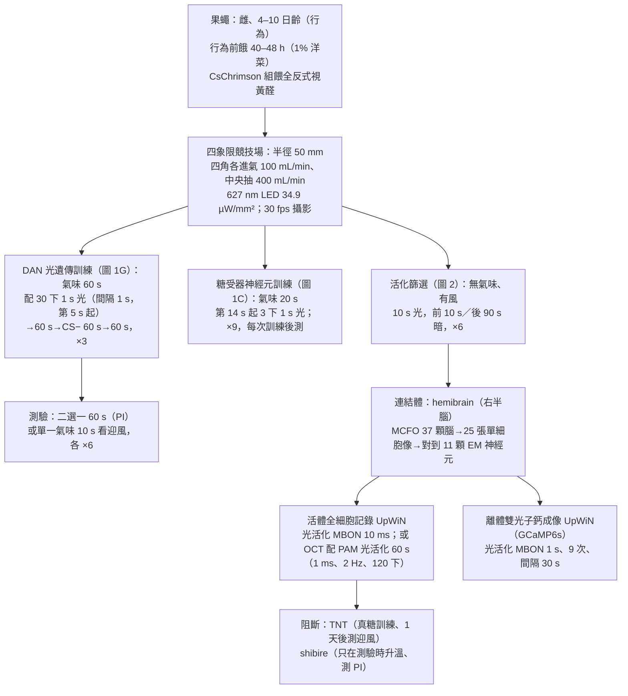
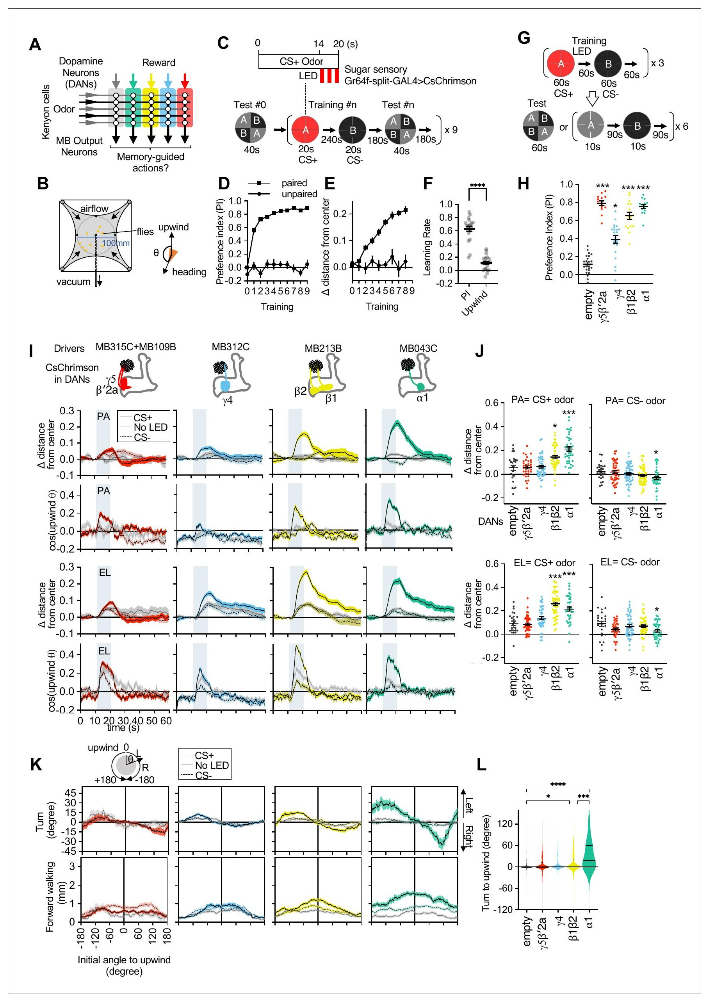
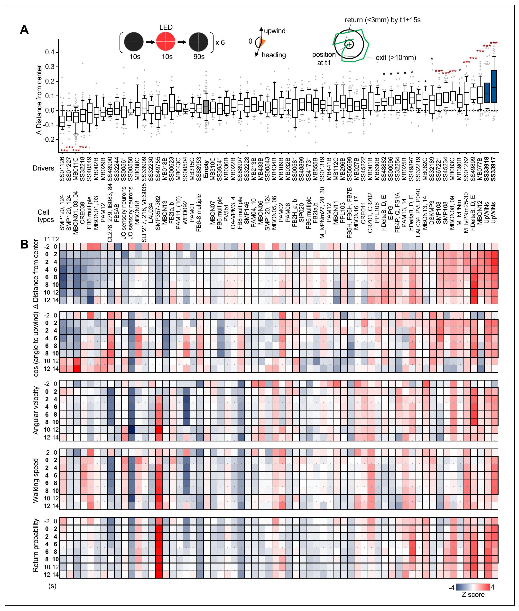
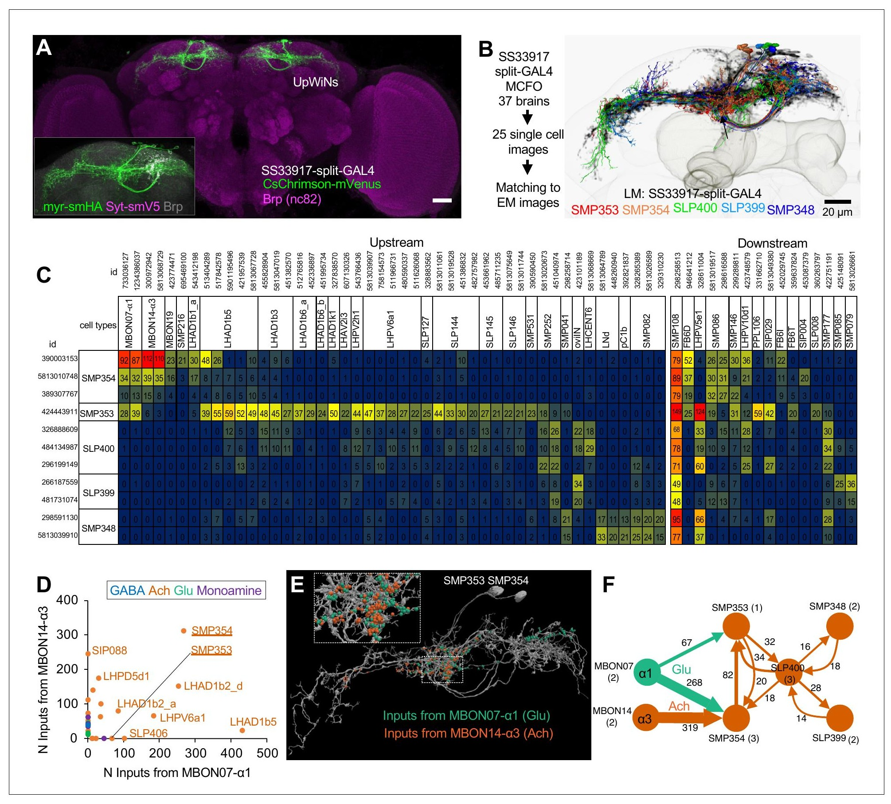
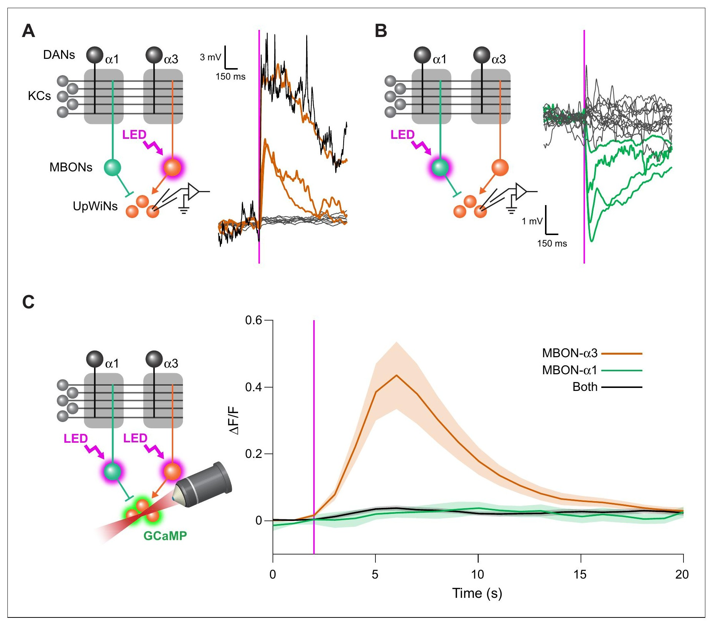
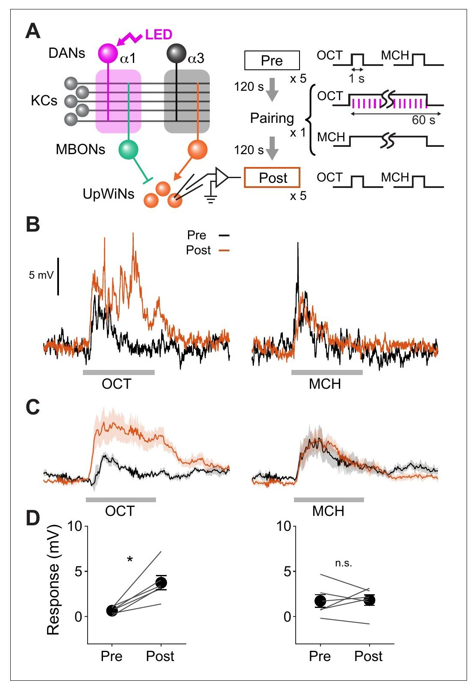
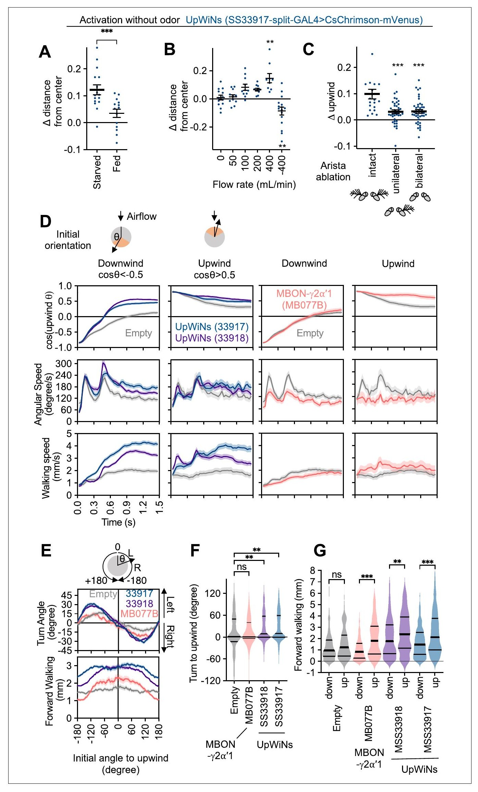
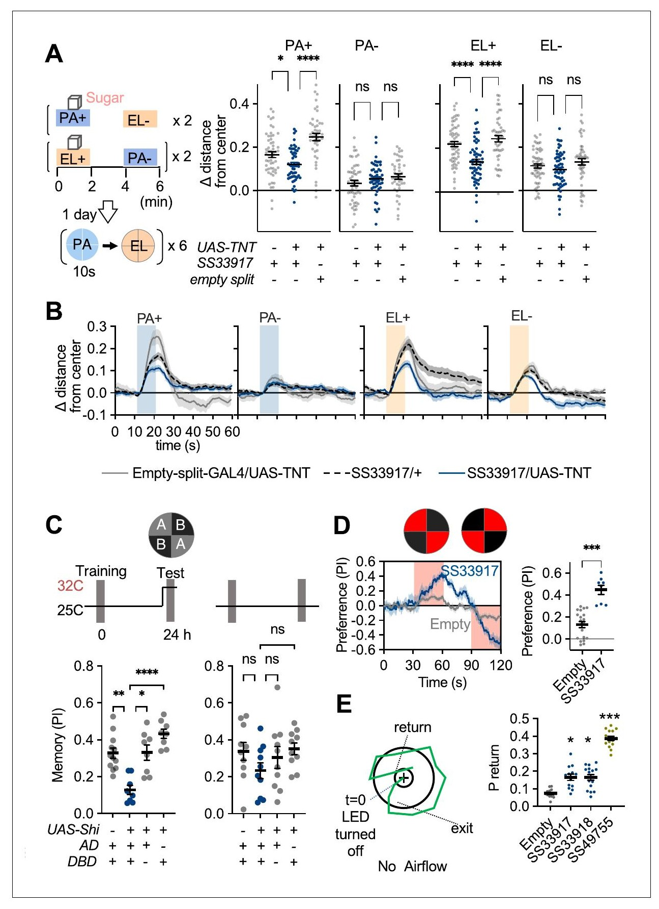

<!-- 本機 PDF：papers/2023-Neural%20circuit%20mechanisms%20for%20transforming%20learned%20olfactory%20valences%20into%20wind-oriented%20movement.pdf -->

# Neural circuit mechanisms for transforming learned olfactory valences into wind-oriented movement

**把學到的氣味好壞轉成迎風移動的神經迴路機制**

| 項目 | 內容 |
|---|---|
| **出處** | eLife 12, e85756 (2023). doi: 10.7554/eLife.85756 [全文（PMC 免費閱讀）](https://pmc.ncbi.nlm.nih.gov/articles/PMC10588983/) |
| 日期 | 預印本 2022-12-22；投稿 2022-12-22；接受 2023-09-07；刊出 2023-09-18（PDF 首頁）。修訂日期 PDF 未印 |
| 通訊作者 | Yoshinori Aso（asoy@janelia.hhmi.org）、Toshihide Hige（hige@email.unc.edu）。PDF 只有英文名 |
| 作者 | 共 8 人：Yoshinori Aso、Daichi Yamada、Daniel Bushey、Karen L Hibbard、Megan Sammons、Hideo Otsuna、Yichun Shuai、Toshihide Hige。無共同第一作者標記。Aso 主導行為、篩選與連結體分析；Yamada、Hige 做電生理；Bushey 做鈣成像（依作者貢獻與方法） |
| 機構 | Janelia Research Campus, Howard Hughes Medical Institute（Ashburn）；University of North Carolina at Chapel Hill 生物系、細胞生物與生理學系、Integrative Program for Biological and Genome Sciences |
| 資料庫 | 新 split-GAL4 品系的共軛焦影像：http://www.janelia.org/split-gal4 ；競技場設計檔：https://www.janelia.org/open-science/four-way-olfactometer-arena-fruit-flies 。連結體取自 neuPrint 的 hemibrain（只用右半腦） |
| 補充資料 | 圖 1–7 與影片 1–6 的說明在 PDF 內。**圖補充（figure supplements，至少 14 張：圖 1 有 1、圖 2 有 4、圖 3 有 4、圖 4 有 1、圖 5 有 2、圖 6 有 1、圖 7 有 1）、Source Data、影片本身、MDAR 檢核表都不在 PDF 內，本庫未取得**。相關內容一律標 ？待查 |
| 編輯／審查 | Reviewing Editor：Ilona C Grunwald Kadow（University of Bonn）。附 Editor's evaluation（「convincing evidence」）。決定信與作者回覆另有 DOI（eLife.85756.sa1、sa2），本庫未取得 |

> 與本庫有關的作者：第一作者 Aso 也是本庫 [[s-aso-2016-dan-cell-type-rules]] 與 [[s-aso-2014-mbon-valence]] 的第一作者；通訊作者 Hige 是 [[s-hige-2015-heterosynaptic-plasticity]] 的第一作者。本篇的競技場就是 Aso 2016 那一套（[[e-olfactory-arena]]）。
>
> **本篇為 CC BY 開放取用**（PDF 第 1 頁：「distributed under the terms of the Creative Commons Attribution License」，未印版本號），圖片可在標明出處的條件下自由使用與散布。本庫仍依規定只給全文連結、不放 PDF；每張圖下方標明出處與授權。

---

## 為什麼重要

> 本節假設讀者已略知果蠅嗅覺學習的輪廓。**完全不熟的讀者可以先看「科普文」一節**；術語另見「專業文」開頭的「本頁用語」表。

本庫先前的論文幾乎都停在蕈狀體裡面：多巴胺怎麼改變 KC→MBON 突觸（[[s-hige-2015-heterosynaptic-plasticity]]、[[s-handler-2019-dopamine-receptor-timing]]），各區室寫入記憶的規則（[[s-aso-2016-dan-cell-type-rules]]），MBON 怎麼回頭指揮 DAN（[[t-mbon-dan-feedback]]）。MBON 送出蕈狀體之後，訊號交給誰、怎麼變成具體動作，庫內只有 [[s-aso-2014-mbon-valence]] 的答案：活化某型 MBON 會讓果蠅靠近或走開，多型一起活化時效果大致相加（「價值平衡」模型）。這篇往下游走一步，找到一小群收 MBON 輸入的神經元（作者命名 UpWiN），並在單一神經元層級量到它把兩型相反價值的 MBON 加減起來。

第二個貢獻是方法上的提醒：**同一個記憶，用「二選一的分數」與用「迎風移動」去讀，結果可以完全不同。** 本篇讓果蠅在四個區室分別寫入獎賞記憶，四組在二選一測驗都有顯著偏好（γ5β′2a 那組的分數甚至和 α1 一樣高），卻只有 α1 與 β1β2 兩組會迎風走向氣味。本庫幾乎所有行為數字都是二選一的表現指數（[[c-performance-index]]），這篇直接示範了它看不到什麼：它告訴你果蠅偏向哪邊，不告訴你果蠅用什麼動作去接近。

第三，它把本庫兩篇電生理研究的結果接到行為上。[[s-huang-2024-dopamine-memory-dynamics]] 量到電擊訓練讓 MBON-α3 對受訓氣味的放電長期下降，本篇則顯示 MBON-α3 是乙醯膽鹼性、會興奮 UpWiN 的輸入（本篇引用的 Schnitzer et al. 2022 Research Square 預印本，作者與題目都與 Huang 2024 相符，※ 推論為同一研究）；[[s-ichinose-2015-reward-recurrent-circuit]] 的 MBON-α1 是麩胺酸性，本篇量到它抑制 UpWiN。弱點有三：UpWiN 的可塑性只在 6 顆細胞上量、而且用的是廣泛活化獎賞 DAN 的品系，不是只動 α1；阻斷實驗用的是從發育期就作用的毒素；圖 4C 與圖 7 的圖說沒有寫統計方法（見專業文第五節）。

---

## 論文摘要（原文與中譯）

> How memories are used by the brain to guide future action is poorly understood. In olfactory associative learning in *Drosophila*, multiple compartments of the mushroom body act in parallel to assign a valence to a stimulus. Here, we show that appetitive memories stored in different compartments induce different levels of upwind locomotion. Using a photoactivation screen of a new collection of split-GAL4 drivers and EM connectomics, we identified a cluster of neurons postsynaptic to the mushroom body output neurons (MBONs) that can trigger robust upwind steering. These UpWind Neurons (UpWiNs) integrate inhibitory and excitatory synaptic inputs from MBONs of appetitive and aversive memory compartments, respectively. After formation of appetitive memory, UpWiNs acquire enhanced response to reward-predicting odors as the response of the inhibitory presynaptic MBON undergoes depression. Blocking UpWiNs impaired appetitive memory and reduced upwind locomotion during retrieval. Photoactivation of UpWiNs also increased the chance of returning to a location where activation was terminated, suggesting an additional role in olfactory navigation. Thus, our results provide insight into how learned abstract valences are gradually transformed into concrete memory-driven actions through divergent and convergent networks, a neuronal architecture that is commonly found in the vertebrate and invertebrate brains.

（*eLife* 的摘要不分 Background／Results／Conclusion 段，照原樣一段。）

**中譯**（本節為忠實翻譯，非自撰內容）：

> 大腦如何使用記憶來引導之後的行動，目前所知甚少。在果蠅的嗅覺聯結學習中，蕈狀體的多個區室平行運作，為一個刺激指定價值。本文顯示，儲存在不同區室的獎賞記憶，引發不同程度的迎風移動。我們以光活化篩選一批新的 split-GAL4 驅動品系，並結合電子顯微鏡連結體，找到一群位在蕈狀體輸出神經元（MBON）下游、能觸發強烈迎風轉向的神經元。這些迎風神經元（UpWind Neurons, UpWiNs）分別整合來自獎賞記憶區室 MBON 的抑制性突觸輸入，與來自嫌惡記憶區室 MBON 的興奮性突觸輸入。獎賞記憶形成後，隨著抑制性的突觸前 MBON 反應被壓低，UpWiN 對預示獎賞的氣味反應增強。阻斷 UpWiN 損害獎賞記憶，並減少提取記憶時的迎風移動。光活化 UpWiN 也提高果蠅回到活化結束地點的機率，提示它在嗅覺導航中另有作用。因此，我們的結果說明了學到的抽象價值，如何經由發散與匯聚的網路逐步轉成具體的記憶驅動行動；這種神經架構在脊椎與無脊椎動物腦中都很常見。

---

## 科普文

想像一家公司的董事會。幾位董事各自代表不同部門，有人說「這案子好」，有人說「這案子不好」；董事會的結論只是「做」或「不做」。但「做」要怎麼做——派誰去、往哪走、走多快——是董事會之後的執行團隊決定的。果蠅的蕈狀體（mushroom body）就像那個董事會：它的輸出神經元（MBON）各自對一個氣味投下「好」或「不好」的票。這篇論文要找的，是接到這些票之後、真正去指揮腳的那一群執行者。

**先交代果蠅怎麼學。** 果蠅聞到氣味時，蕈狀體裡一小群 Kenyon 細胞（KC）放電，哪一群放電就代表哪個氣味。KC 把訊號交給 MBON，MBON 的活動推動果蠅靠近或走開。第三種角色是多巴胺神經元（DAN），帶來「好事或壞事」的訊號；氣味與 DAN 一起出現時，被這個氣味活化的 KC 與 MBON 之間的接點（突觸）會變弱。蕈狀體沿 KC 的長軸分成一格一格的「區室」，每一格由一型 DAN 管、一型 MBON 讀。所以學習改變的是「某一格的 MBON 對某個氣味反應多大」。

**難題一：同一個「喜歡」，可以用很多種動作去實現。** 實驗室量果蠅記憶，最常用的是二選一：讓一群果蠅在兩種氣味之間自由走動，數牠們停在哪一邊，算成一個分數（表現指數）。這個分數只說「偏向哪邊」，不說果蠅是怎麼走過去的。在自然界，氣味是被風吹來的，循著氣味找食物的果蠅會轉頭迎風、加速往前走——這叫迎風移動，也就是循風導航。作者想知道：不同區室存下的記憶，是不是會叫出不同的動作？

**第一個發現：分數一樣高，動作卻不一樣。** 作者把約 20 隻果蠅放進一個圓形競技場，四角吹進氣流、中央抽走，所以場內的風一律從外圈吹向中心；果蠅往外圈走就是迎風。訓練時用光遺傳學（讓神經元帶上照紅光就放電的蛋白）只叫醒某一格的獎賞型 DAN，代替真的糖。四組分別寫入 γ5β′2a、γ4、β1β2、α1 四個區室。二選一時，四組都偏好受訓氣味；其中 γ5β′2a 組的分數約 0.78，和 α1 組的約 0.75 不相上下。但只放一種氣味、看果蠅會不會迎風走時，只有 α1 與 β1β2 兩組明顯往外圈走，γ5β′2a 與 γ4 兩組和沒有訓練的對照組差不多。α1 那組還會依自己一開始面向哪裡，往迎風的方向轉。**所以「記得這個氣味是好的」與「會迎風去找它」是兩件事，不同區室的記憶負責的動作不同。**

**難題二：誰把 MBON 的票變成轉向？** 作者用 Janelia 新做的一大批驅動品系（每一條只在少數幾型神經元裡表現外加基因），逐條用光活化，看果蠅在有風、沒有氣味的場地裡會不會迎風走。約 63 條品系中，兩條（SS33917、SS33918）讓果蠅迎風走得最明顯。它們標到同一小群 8–11 顆神經元，作者叫它們「迎風神經元」（UpWiN）。

**解法：UpWiN 正好坐在兩票交會的地方。** 電子顯微鏡畫出的全腦接線圖（連結體）顯示，UpWiN 的分枝落在 MBON-α1 與 MBON-α3 兩型 MBON 的軸突交會處。α1 那一格存的是獎賞記憶，α3 那一格存的是懲罰記憶（Huang 2024 量到電擊訓練讓 MBON-α3 對受訓氣味的放電長期下降）。作者把電極插進活果蠅的 UpWiN：光活化 MBON-α3，UpWiN 被興奮，強到會放電；光活化 MBON-α1，UpWiN 被抑制。兩者同時活化時，鈣訊號幾乎是零，正好抵掉。這就是「價值平衡」模型預期的計算：**一型說好、一型說不好，UpWiN 讀的是兩者的差。**

訓練之後呢？作者讓一個氣味（3-辛醇，OCT）配上獎賞型 DAN 的光活化，另一個（4-甲基環己醇，MCH）不配。訓練前，UpWiN 對兩個氣味都只有弱反應；訓練後，對 OCT 的反應約變成原來的六倍，對 MCH 不變。作者的解釋是：訓練讓 MBON-α1 對 OCT 的反應變弱，UpWiN 少了抑制，於是對 OCT 興奮起來——就像董事會裡投反對票的人不再出聲。

**最後，UpWiN 是不是必要的？** 讓 UpWiN 表現破傷風毒素（從發育期起一直阻止它釋放傳遞物），再用真的糖訓練，一天後測：果蠅對受訓氣味的迎風移動變少。改用只在測驗時升溫才關掉 UpWiN 的工具，二選一的記憶分數從約 0.33 掉到約 0.12。另外，光活化 UpWiN 的果蠅比較會回到活化結束時的位置，像是「剛剛那裡有東西，回去看看」——作者把這比作蛾類追蹤費洛蒙時「失去氣味就橫向搜尋、碰到氣味就往上風衝」的反覆動作。

**代價與需要小心的地方。** 第一，量 UpWiN 可塑性的實驗只記錄了 6 顆細胞，而且訓練用的品系（R58E02-LexA）會叫醒很多格的獎賞 DAN，不只 α1；作者自己也承認 β1 那一格可能有貢獻。「MBON-α1 反應變弱」這一步本篇沒有量，是引用同團隊另一篇（Yamada 2023，[[s-yamada-2023-second-order-conditioning]]）。第二，破傷風毒素阻斷後，迎風移動是「變少」不是「消失」：受訓氣味仍比對照氣味引起更多迎風。第三，只在測驗時阻斷的那組實驗，對照組在高溫下根本不迎風，所以「測驗時需要 UpWiN 來迎風」其實沒有被直接檢驗，只檢驗了二選一的分數。

**最容易被誤讀的一點：這篇沒有說「迎風移動就是獎賞記憶的讀出」。** 它說的是：α1 這一格（和 β1β2）的記憶會叫出迎風轉向，而 γ5β′2a、γ4 兩格的記憶雖然一樣讓果蠅偏好受訓氣味，卻不叫出迎風動作。換句話說，**二選一的分數高，不保證果蠅會迎風；迎風移動少，也不代表記憶差。** 用二選一分數比較不同區室的記憶強弱時，看不到這層差別；拿迎風移動當唯一讀數時，又會漏掉 γ 葉那些不靠迎風表現的記憶。

---

## 專業文

### 本頁用語

本頁各節可單獨查閱，故把反覆出現的詞集中在這裡。

| 詞 | 意思 |
|---|---|
| 蕈狀體（mushroom body, MB） | 果蠅腦中負責嗅覺學習與記憶的結構，左右各一。見 [[e-mushroom-body]] |
| KC（Kenyon cell） | 蕈狀體的主要神經元。每個氣味活化一小群 KC |
| MBON（mushroom body output neuron） | 蕈狀體輸出神經元，讀出 KC 的訊號、送出蕈狀體。學習改變的是 KC→MBON 的突觸。見 [[e-mbon]] |
| DAN（dopaminergic neuron） | 多巴胺神經元，送來「好事或壞事」的訊號。**PAM 群多報告獎賞，PPL1 群多報告懲罰**。見 [[e-dopaminergic-neuron]] |
| 區室（compartment） | KC 軸突成束形成幾條「葉」，每條葉再分成一格一格，例如 α1（α 葉第 1 格）、γ4、β1β2（β1 與 β2 兩格）、γ5β′2a（γ5 與 β′2a 兩格）。每格由一型 DAN 支配、一型 MBON 讀取。見 [[c-mb-compartment]] |
| MBON 編號 | 本篇常同時寫兩種名字：MBON-α1＝MBON07（麩胺酸性）；MBON-α3＝MBON14（乙醯膽鹼性）；MBON-γ2α′1＝MBON12；MBON-β1>α 是樹突在 β1、軸突伸進 α 葉的 MBON。「Glu」「ACh」「GABA」分別指麩胺酸、乙醯膽鹼、γ-胺基丁酸三種神經傳遞物 |
| 價值（valence） | 一個刺激對動物是好是壞。「價值平衡」模型（valence-balance model）：多型 MBON 各自代表正或負的價值，未受訓時兩邊平衡；學習讓其中一些 MBON 對某氣味的反應變弱，打破平衡，偏向就出現 |
| UpWiN（UpWind Neuron） | 迎風神經元，本篇命名。由 split-GAL4 品系 SS33917（與 SS33918）定義的一群 8–11 顆神經元；在 hemibrain 連結體中對到 11 顆、5 型：SMP353（1 顆）、SMP354（3）、SLP400（3）、SLP399（2）、SMP348（2） |
| SMP、SLP、SIP、FB | 腦區縮寫：上內側前大腦（superior medial protocerebrum）、上外側前大腦（superior lateral protocerebrum）、上中間前大腦（superior intermediate protocerebrum）、扇形體（fan-shaped body，中央複合體的一部分）。hemibrain 的型名多以所在腦區開頭，例如 SMP354 |
| 側角（lateral horn, LH） | 與蕈狀體並行的另一個嗅覺中樞，一般認為負責先天的氣味反應。LHAD、LHPD、LHPV 開頭的型名都是側角神經元 |
| 中央複合體（central complex） | 果蠅腦中央與導航、方向感相關的構造；扇形體是其中一部分。hDeltaB、hDeltaC 等是扇形體內的柱狀神經元型名 |
| 迎風移動（upwind locomotion）、循風趨性（anemotaxis） | 依風向移動。本篇的競技場風從外圈吹向中央，所以「離中心的距離變大」＝迎風 |
| Δ distance from center | 迎風的主要讀數：果蠅「離中心的面積正規化距離」減去氣味（或光）開始時的值。面積正規化＝距離除以半徑後取平方，理由見方法 |
| cos(upwind θ) | 果蠅頭朝向與上風方向夾角的餘弦。1＝正對上風，−1＝背對上風 |
| 返回機率（return probability） | 果蠅離開某位置超過 10 mm 後，15 s 內回到該位置 3 mm 以內的機率 |
| PI（preference index） | 本篇的二選一分數：〔對角兩象限中氣味一的隻數 −另兩象限（氣味二或空氣）的隻數〕÷ 總隻數，取 60 s 測驗的最後 30 s 平均；兩組互換氣味取平均。範圍 −1 到 +1。見 [[c-performance-index]] |
| 學習速率（learning rate） | 本篇圖 1F 的定義：訓練 1 次後的反應 ÷ 訓練 9 次中的最高反應。1＝一次就學滿 |
| CS+、CS− | CS+ 是配過獎賞（糖或 DAN 光活化）的氣味；CS− 是同樣聞但沒配的對照氣味 |
| PA、EL、OCT、MCH | 乙酸戊酯（pentyl acetate）、乳酸乙酯（ethyl lactate），行為實驗用；3-辛醇（3-octanol）、4-甲基環己醇（4-methylcyclohexanol），電生理用 |
| 驅動品系、split-GAL4、LexA | 決定外加基因只在哪些細胞表現的果蠅品系。split-GAL4 只在一兩型神經元裡打開外加基因，AD 與 DBD 是它的兩半，兩半都在的細胞才表現（[[e-split-gal4]]）。LexA 是並行的另一套開關。「empty split-GAL4」是不含啟動子的空品系，當對照 |
| CsChrimson、Chrimson88、ChrimsonR | 照紅光就讓神經元放電的光敏通道（[[e-cschrimson]]） |
| TNT、shibire（Shi） | TNT＝破傷風毒素輕鏈，讓神經元無法釋放傳遞物，**從發育期起一直作用**；shibire^ts 升溫到限制溫度時才暫時關掉輸出（[[e-shibire-ts]]） |
| 全細胞記錄（whole-cell recording） | 把玻璃電極接上單顆細胞、直接量膜電位（[[c-whole-cell-patch-clamp]]）。本篇的 UpWiN 記錄在活果蠅上做 |
| 鈣成像、GCaMP6s、ΔF/F | 用遇鈣變亮的螢光蛋白看神經元活動（[[e-gcamp]]）；ΔF/F＝螢光相對基線的變化比例。本篇圖 4C 在取出的腦（離體，[[c-ex-vivo-explant]]）上做 |
| MCFO、NBLAST | MCFO（multi-color flip-out）讓一個品系裡隨機少數幾顆細胞各帶不同顏色，用來看單顆細胞的形狀；NBLAST 是比較神經元形狀相似度的演算法 |
| hemibrain、neuPrint | hemibrain 是用電子顯微鏡逐一追蹤的果蠅半腦連結體；neuPrint 是查詢它的網站 |
| 統計記號 | `*` p < 0.05、`**` p < 0.01、`***` p < 0.001、`****` p < 0.0001（圖上使用，圖說未定義）；ns 不顯著。本篇多用 Kruskal–Wallis 檢定加 Dunn 多重比較 |
| ※ 推論 | 論文沒有明說、本頁自行推得的內容，並寫出依據 |
| ？待查 | 值得查證但本頁刻意不填的內容 |

### 一、概述

**主要問題。** MBON 被認為代表價值，但活化它們不會叫出固定的動作序列（作者引 Aso 2014b）。那麼「學到的價值」在 MBON 下游怎麼變成具體的運動？作者的假說是：下游有神經元整合多型 MBON 的輸出，讀出它們之間的不平衡，並且不同區室的記憶接到不同的下游迴路，因而叫出不同的動作。

**重要性。** 若成立，它給了「價值平衡」模型第一個單細胞層級的解碼器：一顆神經元同時收獎賞區室 MBON 的抑制與嫌惡區室 MBON 的興奮。它也把本庫偏重「突觸怎麼變」的論文，接到「行為怎麼表現」。

**發表當時的領域現狀（2022 投稿、2023 刊出）。**

- MBON 代表價值：Aso et al. 2014b（本庫 [[s-aso-2014-mbon-valence]]）、Owald et al. 2015。多型 MBON 一起活化時效果大致相加（Aso 2014b）。
- 學習讓 KC→MBON 突觸在區室內長期變弱：Hige et al. 2015a（本庫 [[s-hige-2015-heterosynaptic-plasticity]]）、Cohn et al. 2015（[[s-cohn-2015-coordinated-neuromodulation]]）、Owald et al. 2015、Berry et al. 2018。
- MBON 下游的匯聚：Li et al. 2020 的蕈狀體連結體顯示，1550 顆 MBON 突觸後神經元中有 600 顆（39%）同時收至少另一型 MBON 的輸入。
- 各獎賞區室的記憶性質不同：α1 學得慢、可維持一天以上；γ5β′2a 一次就學會但短暫、易被覆寫（Aso & Rubin 2016，本庫 [[s-aso-2016-dan-cell-type-rules]]；Ichinose 2021；Yamada 2023）。α1 與營養價值學習有關（Yamagata 2015），γ4、β′2 與水的獎賞有關（Lin 2014）。
- 循風導航：果蠅遇到吸引的氣味時轉向上風並加速（Álvarez-Salvado 2018、Steck 2012、van Breugel & Dickinson 2014）；風向由觸角芒（arista）與 Johnston 器偵測，在中央複合體表示（Okubo 2020、Matheson 2022、Suver 2019）。Matheson 2022 已報告活化某些 MBON（含 MBON-α3、MBON-γ2α′1）會引發迎風移動。Handler 2019（本庫 [[s-handler-2019-dopamine-receptor-timing]]）用 DAN 光活化做假想訓練，能增加或減少迎風移動。

### 二、方法

hemibrain 的版本號本篇沒寫（？待查）；方法只說取自 neuPrint 的 hemibrain，並給了 Scheffer et al. 2020 與一個資料集 DOI。

**果蠅。** 22 °C、60% 濕度、12:12 小時光暗週期飼養。行為用 4–10 日齡雌蠅；鈣成像用 3–7 日齡雌蠅；電生理的果蠅在羽化當天收集、在暗處餵含 0.5 mM 視黃醛的食物 48–72 小時，**性別與是否飢餓，電生理方法都沒寫**（grep `female` 與 `starv` 在電生理段落皆無結果）。CsChrimson 行為組的食物：羽化前 0.2 mM、之後 0.4 mM 全反式視黃醛。

**競技場與讀數。** 用的是 Aso & Rubin 2016 的四象限競技場（[[e-olfactory-arena]]）。氣味以石蠟油稀釋：PA 1:10,000、EL 1:10,000。閥門切換後約 2 s 氣味到達、再約 3 s 充滿，所以「氣味開始」取閥門切換後 3.5 s。**競技場的溫度與濕度本篇沒寫**（？待查；Aso 2016 為 25 °C、50% 濕度）。

- 迎風讀數：每隻果蠅離中心的距離 r 除以半徑 50 mm 後取平方，當作「面積正規化距離」；每部影片在每個時間點平均後，減去氣味或光開始時的值。取平方是因為外圈面積大：40–50 mm 那一環的面積是 0–10 mm 的 9 倍（(50² − 40²) ÷ 10² ＝ 9，可驗算）。
- 個別軌跡只分析離邊緣 3 mm 以上的果蠅；一個畫格內角度變化超過 180° 或位置變化超過 5 mm 視為追蹤錯誤、排除。
- 轉向分析：依起始朝向以 ±30° 分組；圖 1L、6F 只取起始朝向在上風 ±90–150° 的果蠅，看前 10 格（333 ms）累積轉了多少度。
- PI：最後 30 s 平均；互換組取平均以抵銷位置偏好與天生氣味偏好。

**糖訓練（圖 7）。** 用吸過蔗糖再乾燥的 Whatman 3 MM 濾紙；訓練與保存溫度：訓練後放 21 °C 洋菜管。圖 7A 的示意：一組 PA 配糖 2 分鐘、EL 不配，另一組互換，各 ×2（※ 從圖判讀）；一天後各氣味 10 s、×6。shibire 實驗依圖 7C 的示意，限制溫度 32 °C、允許溫度 25 °C，**正文與方法都沒有寫溫度**（只在圖上）。

**電生理。** 玻璃電極 6–7 MΩ；以注入小於約 10 pA 的超極化電流把細胞維持在約 −60 mV；5 kHz 低通、10 kHz 取樣。氣味為飽和頂空蒸氣再以空氣稀釋到 1%；反應量取氣味開始後 0–1.2 s 的平均去極化。光刺激 625 nm、17 mW/mm²（經物鏡）。

**鈣成像。** 離體腦，20 °C；920 nm 雙光子、25× 物鏡；體積 231 × 231 × 42 µm、步距 2 µm、約 1.07 Hz。光活化 660 nm、1 s，圖 4C 為 12 µW/mm²；9 次、間隔 30 s，每隻動物取 9 次平均。

**連結體。** 只用右半腦的連結，理由是左半腦連結不完整。神經傳遞物種類用 Eckstein et al. 2020 的電顯影像預測（不是染色）；UpWiN 軸突末梢對乙醯膽鹼轉移酶染色呈陽性，引自 Yamada 2023。

**統計。** Kruskal–Wallis 加 Dunn 多重比較、t 檢定、或重複量數二因子 ANOVA 加 Tukey，「依圖說所示」。圖 2A 的資料點是「一部影片（一群果蠅的一次活化）」；圖 1J 的資料點是「單次試驗」。

### 三、結果

#### 3.1 不同區室的獎賞記憶叫出不同的動作（圖 1）

- **糖受器神經元訓練（圖 1D–F）：** 以 Gr64f split-GAL4 光活化糖受器神經元代替糖。PI 第 1 次訓練後就到約 0.55，第 9 次約 0.9；迎風（Δ distance）則逐次緩慢上升到約 0.2（※ 從圖判讀）。學習速率（第 1 次 ÷ 9 次中最高）：PI 約 0.63、迎風約 0.1，差異 \*\*\*\*（圖 1F；**圖說沒寫用了什麼檢定**）。
- **四組區室 DAN 光活化（圖 1H）：** 訓練 3 次後的 PI：空對照約 0.12、γ5β′2a 約 0.78（\*\*\*）、γ4 約 0.38（\*）、β1β2 約 0.65（\*\*\*）、α1 約 0.75（\*\*\*）；n ＝ 12–22（※ 從圖判讀）。
- **迎風（圖 1I–J）：** 只放 CS+ 時，α1 組（MB043C）與 β1β2 組（MB213B）的迎風顯著高於空對照（PA 為 CS+：約 0.21 \*\*\*、約 0.14 \*；EL 為 CS+：約 0.21 \*\*\*、約 0.26 \*\*\*）；γ5β′2a、γ4 兩組不顯著。α1 組對 CS− 的迎風反而低於對照（\*）。
- **轉向（圖 1K–L）：** 依起始朝向分組後，α1 組在氣味開始的 333 ms 內明顯往上風轉（對空對照 \*\*\*\*），β1β2 組較弱（\*）。γ5β′2a、γ4 兩組沒有偏向，但讓起初背風的果蠅「不定向地」改變朝向（依正文；相關資料在未取得的圖 1 補充圖 1）。

**評價：** 這組「PI 與迎風分離」的資料是本篇最乾淨、也最值得引用的結果：同一套訓練、同一個場地、同一批果蠅品系，兩種讀數給出不同的排序。限制有二。第一，迎風的資料點是單次試驗（n ＝ 24–60），同一群果蠅貢獻多個點；作者補充說，β1β2 與 α1 對 CS+ 的顯著性在「以六部影片平均」為單位時仍成立，但沒有給 γ5β′2a、γ4 在這個單位下的結果。第二，四組 DAN 品系的表現量與標到的細胞數不同（例如 γ5β′2a 是兩條品系合用），PI 都高不保證每組 DAN 被活化的程度相同。

#### 3.2 光活化篩選找到 UpWiN（圖 2）

- 約 63 條品系加 1 條空對照（※ 從圖 2A 計數；正文沒給總數，且作者說篩選「不是全面的」）。
- 經多重比較校正仍顯著（紅色星號）的：往下風 4 條（SMP120/124 兩條、MBON01/03/04、CRE039），與正文「Four lines」一致；往上風 8 條：SMP108 兩條（SS67221、SS45234）、MBON08/09（MB083C）、M_lvPNm25-30（SS01262）、hDeltaB/D/E（SS49899）、MBON12＝MBON-γ2α′1（MB077B），以及 UpWiN 的 SS33918、SS33917。另有 9 條只達未校正的 p < 0.05（黑色星號）。
- SS33917、SS33918 的迎風最強，尤其在 10 s 活化的開頭。兩者標到相似的 8–11 顆神經元。
- SMP357-362（SS49755）的「返回」表型最強（圖 2B 返回機率那一列的鮮紅欄）。

**評價：** 篩選的重點是「找到候選」，不是「排除其他」，作者自己也這麼說。要注意兩點：正文說「活化包括 MBON-α3 在內的某些 MBON 會引發顯著的迎風」，但圖 2A 上 MBON-α3 的品系 MB082C（細胞型別欄寫「MBON13, 14」，即同時標 α′2 與 α3）只有黑色星號，也就是未經多重比較校正（見第五節）。另一方面，MBON08/09（γ3、γ3β′1）的 MB083C 達到紅色 \*\*\*，正文沒有提到。

#### 3.3 UpWiN 的連結：兩型相反價值的 MBON 匯聚（圖 3）

- **對應：** SS33917 的 MCFO 影像來自 37 顆腦、得到 25 張單細胞影像，比對到 hemibrain 的 11 顆神經元、5 型（見本頁用語）。
- **MBON 直接輸入（圖 3C、F，可驗算）：** MBON-α1（右腦 2 顆）→SMP354（3 顆）共 268 個突觸（92 ＋ 87 ＋ 34 ＋ 32 ＋ 10 ＋ 13）、→SMP353 共 67 個（28 ＋ 39）；MBON-α3（2 顆）→SMP354 共 319 個（112 ＋ 110 ＋ 39 ＋ 35 ＋ 15 ＋ 8）。圖 3C 另列 MBON-α3→SMP353 共 9 個（6 ＋ 3），未畫進圖 3F。
- **匯聚的稀有度（圖 3D）：** 以 MBON-α1 與 MBON-α3 的輸入數畫散布圖，SMP354 位在右上角（約 268、319），作者說這種強匯聚在兩型 MBON 的下游中「例外」。
- **UpWiN 之間互相連結（圖 3F）**，作者據此認為它們以一群的方式運作。
- **主要下游：** 11 顆 UpWiN 全部輸出到同一顆 SMP108（圖 3C 該欄加總 882 個突觸，※ 本頁從圖 3C 數字加總）；其他主要下游包括 FB6D、FB6I、FB6T 等扇形體神經元，以及 LHPV5e1 等。SMP108 是與獎賞 DAN 連結最多的神經元，在二階制約中扮演要角（引 Yamada 2023）。
- **其他上游：** 大量側角神經元（LHAD1b5、LHAD1b3、LHPV6a1 等），尤其集中在 SMP353。

**評價：** 連結體數字精確、可驗算，是「匯聚」主張的堅實基礎。但「例外」這個詞要打折：圖 3D 上 LHAD1b2_d 也同時收到兩型 MBON 各約 250 與 150 個突觸（※ 從圖判讀），程度僅次於 SMP354。另外，11 顆 UpWiN 中只有 SMP354 的 3 顆同時收兩型 MBON 的大量輸入；SMP353 幾乎只收 MBON-α1，其餘 7 顆不直接收。所以「UpWiN 整合兩型輸入」在單細胞層級只對 3 顆成立，對整群則要靠 UpWiN 之間的互連（圖 3F）與圖 4 補充圖 1 的功能測試（未取得）。

#### 3.4 功能連結：MBON-α3 興奮、MBON-α1 抑制、兩者相抵（圖 4）

- **MBON-α3→UpWiN（圖 4A）：** 以 R64A11-LexA 標記 UpWiN、隨機挑細胞記錄；光活化 MBON-α3（MB082C）10 ms，11 顆中 3 顆（7 隻果蠅）被興奮，有的強到放電。
- **MBON-α1→UpWiN（圖 4B）：** 光活化 MBON-α1（MB310C），17 顆中 4 顆（12 隻）被抑制。
- 作者說這種「隨機性」與連結體一致。※ 推論：3/11 ＝ 27%、4/17 ＝ 24%；連結體上 11 顆中有 3 顆（27%）收大量 MBON-α3、4 顆（36%）收 MBON-α1，比例相近。但 R64A11-LexA 標到的細胞群不等於那 11 顆，這個比對只是粗略的。
- **整群整合（圖 4C，離體鈣成像）：** 活化 MBON-α3（改用 G0239-GAL4）時 UpWiN 的 ΔF/F 峰值約 0.43（n ＝ 5）；活化 MBON-α1 時看不到下降（n ＝ 11）；兩者同時活化時約 0.04（n ＝ 7），即 MBON-α3 的興奮被抵掉（※ 從圖判讀）。
- **UpWiN 之間的興奮性互連**（圖 4 補充圖 1，未取得；依正文：用 RNAi 壓掉被光活化那幾顆的 GCaMP 表現，光活化 SS67249 標的少數 UpWiN 時，其他 UpWiN 的軸突與樹突都出現興奮性鈣反應）。

**評價：** 電生理證據直接，但樣本小：被連到的細胞只有 3 顆與 4 顆。整合的證據（圖 4C）是離體、三組不同果蠅（三種基因型）的比較，**圖說沒有報告任何統計檢定**；「effectively canceled」是目視判斷。另外，圖 4A 與 4C 用來活化 MBON-α3 的品系不同（MB082C vs G0239-GAL4）；本庫 Aso 2014b 的圖說記錄 MB082C 也弱標 MBON-α′2，所以 4A 的興奮是否全部來自 MBON-α3 不能確定（※ 推論）。

#### 3.5 獎賞訓練讓 UpWiN 對 CS+ 的反應增強（圖 5）

- **協定：** R58E02-LexA 驅動 ChrimsonR（PAM 群 DAN），SS67249 標記 UpWiN（1–3 顆，含一顆形態像 SMP353）。訓練前 OCT、MCH 各 1 s ×5；配對 1 次：OCT 60 s 配光（1 ms、2 Hz、120 下），接著 MCH 60 s 不配；120 s 後再測 ×5。
- **結果：** OCT 反應由約 0.6 mV 升到約 3.7 mV（約 6 倍，※ 從圖判讀），MCH 約 1.7 mV 不變（n ＝ 6；圖說 p < 0.01、p ＝ 0.9）。互換 CS+ 的實驗（MCH 當 CS+）在圖 5 補充圖 2，未取得；正文說結果相同。
- **作者的解釋：** 最容易用 MBON-α1 被壓低造成的「去抑制」解釋（MBON-α1 對 CS+ 的反應下降引自 Yamada 2023，本篇沒量）；β1 區室的可塑性也可能有貢獻，因為 R58E02-LexA 含 β1 的 DAN，而 β1 的麩胺酸 MBON 直接接到 MBON-α1 與 MBON-α3 的樹突（引 Takemura 2017）。

**評價：** 結果方向一致（6 顆中 6 顆上升，※ 從圖 5D 判讀），是「UpWiN 帶有學習痕跡」的直接證據。但「機制是 α1 的去抑制」只是解釋，三個缺口：(1) R58E02-LexA 標到多型 PAM（作者自己點名 α1 與 β1；本庫對它到底標幾型另有爭議，見 [[e-r58e02]] 與 [[syn-contradictions]] 1.5）；(2) 本篇沒有在同一實驗量 MBON-α1；(3) 被記錄的 SS67249 細胞形態像 SMP353，而 SMP353 在連結體上幾乎只收 MBON-α1、不收 MBON-α3（圖 3C），所以這組資料能回答「α1 側」，回答不了「兩型輸入的平衡」。另一點：Aso 2016 說 α1 學得慢、需要較長的訓練；這裡一次 60 s 配對、2 分鐘後就看到六倍增強，※ 推論這更像是較快區室（β1 或其他 PAM 支配格）的貢獻，或 α1 在電生理上比在行為上敏感，本篇資料分不出。

#### 3.6 UpWiN 引發的是循風動作，而且依起始朝向而定（圖 6）

- **需要飢餓（圖 6A）：** 餓 40–48 h 的果蠅迎風約 0.12，飽食約 0.03（n ＝ 16、14，\*\*\*）。
- **需要風（圖 6B）：** 流量 0 時約 0；400 mL/min 約 0.15（\*\*）；氣流反向（−400）時果蠅往中心走，約 −0.09（\*\*）。
- **需要觸角芒（圖 6C）：** 完整約 0.10；切單側或雙側約 0.03（\*\*\*）。單側切除時果蠅仍會開始轉，但轉過頭、接不上往前走（影片 5）。
- **轉向依起始朝向（圖 6D–G）：** 光一開，果蠅（含空對照）的角速度在前約 300 ms 短暫上升，作者視為對光的驚嚇反應；但 UpWiN 組這段轉向明顯偏向上風（圖 6F，兩條品系對空對照皆 \*\*）。起初背風的果蠅會轉身並加速，起初迎風的則維持朝向並加速。對照：活化 MBON-γ2α′1（MB077B）只讓已迎風的果蠅保持朝向、改變步行速度，不會定向轉往上風。

**評價：** 三項操作（飢餓、風向、觸角芒）合起來，有效排除了「UpWiN 只是讓果蠅避開中央」的解釋（作者特別提 Besson & Martin 2005 的避中心行為）。風反向時果蠅往中心走，是最有說服力的一項。作者據此主張 UpWiN「還沒有指定低層的運動參數」（轉哪邊、加多少速要由下游結合風向決定，作者推測在中央複合體），這是合理但未檢驗的推論。

#### 3.7 阻斷 UpWiN 削弱記憶驅動的迎風；活化 UpWiN 提高返回機率（圖 7）

- **TNT（圖 7A–B）：** 真糖訓練、一天後測。PA 為 CS+ 時，迎風約為：SS33917/+ 對照 0.17、Empty/TNT 對照 0.25、SS33917/TNT 0.12（對兩組對照 \*、\*\*\*\*）；EL 為 CS+ 時約 0.21、0.24、0.13（皆 \*\*\*\*）；對 CS− 三組無差異（※ 從圖判讀）。
- **shibire（圖 7C）：** 只在測驗時升到 32 °C：SS33917/Shi 的 PI 約 0.12，三組對照約 0.32–0.43；允許溫度下四組無顯著差異（約 0.23–0.35）。**作者無法用這組實驗看迎風，因為對照組在限制溫度下不出現迎風**（資料未示），推測是更偏好周邊或氣味濃度改變。
- **象限偏好（圖 7D）：** 只在兩個對角象限照紅光時，SS33917 果蠅偏向照光象限（最後 5 s 的 PI 約 0.45，空對照約 0.13，\*\*\*）。作者認為這與風無關。
- **返回（圖 7E，無風）：** 返回機率空對照約 0.08、SS33917 約 0.17、SS33918 約 0.16（\*）、SS49755（SMP357-362）約 0.38（\*\*\*）。作者說這是在 UpWiN 組與對照組角速度相同的時段量的，所以不能用「轉得多」解釋（相關資料在未取得的圖 7 補充圖 1）。

**評價：** 「UpWiN 是記憶驅動迎風所需」的證據中等：TNT 讓 CS+ 的迎風少了約三成到五成（看和哪個對照比；兩個對照組本身就差約 0.08），但 SS33917/TNT 對 CS+ 的迎風（約 0.12）仍高於 CS−（約 0.05），所以是「削弱」而非「消除」（※ 推論）。TNT 從發育期就作用，可能影響發育或其他行為。shibire 實驗只證明測驗時需要 UpWiN 才有正常的 PI，迎風本身在測驗時是否需要 UpWiN，本篇沒有直接資料。**圖 7 的圖說沒有寫樣本數，也沒有寫統計檢定**，圖上卻有 \*、\*\*、\*\*\*、\*\*\*\* 等標記（見第五節）。

### 四、討論

**主張一：UpWiN 解碼相反價值 MBON 的不平衡，符合「價值平衡」模型。** 證據中等。一顆 SMP354 同時收 MBON-α1（麩胺酸、抑制）與 MBON-α3（乙醯膽鹼、興奮）是連結體與電生理共同支持的；「兩者同時活化時相抵」只有離體鈣成像、無統計。作者說同時活化兩型 MBON 「模擬未受訓狀態」，這是一個簡化：未受訓時兩型 MBON 對同一氣味的反應不一定一樣大。

**主張二：獎賞記憶讓 UpWiN 對 CS+ 的反應增強，機制是 MBON-α1 的去抑制。** 現象的證據強（6/6 上升），機制的證據弱（見 3.5 評價）。

**主張三：不同區室的記憶用不同的行為策略；α1 的記憶經由 UpWiN 驅動迎風。** 行為分離（圖 1）證據強；「經由 UpWiN」這一段是連結體加相關性推論。本篇沒有做「只寫入 α1 記憶、同時阻斷 UpWiN」的實驗；阻斷實驗用的是真糖訓練，會同時在多個區室寫入記憶。作者的生物學解釋是：α1 的 DAN 對糖反應弱、學得慢、記得久且不易消退（引 Yamagata 2015、Aso 2016、Ichinose 2015 等），所以果蠅只在「預期獎賞可靠」時才做循風導航。這是一個好的假說，本篇沒有檢驗。

**主張四：成蟲專有的蕈狀體輸出路徑可能專職循風趨性。** 依據是：幼蟲不用風向找吸引的氣味（Jovanic 2019），觸角芒、中央複合體在變態期才發育；γ、β′ 葉的 MBON 多數源自幼蟲（Truman 2023：17 型幼蟲 MBON 中 10 型發育成成蟲 MBON），而 α/β 葉的 KC、MBON-α1、MBON-α3、MBON-β1>α 是成蟲專有。作者另提出 γ 葉也存視覺記憶（Vogt 2014、2016），而迎風無助於接近與獎賞連結的視覺線索。這是全篇最推測性的部分，作者自己用 "speculate"。

**主張五：UpWiN 可能同時負責對先天吸引氣味的迎風，並透過 SMP108 讓 DAN 出現與動作相關的活動。** 依據是 UpWiN 收大量側角輸入，以及 Yamada 2023、Zolin 2021 的結果。本篇沒有直接資料。作者也指出：活化 SMP108 雖能引發迎風，但細節不同於 UpWiN，阻斷 SMP108 也不影響獎賞記憶提取（Yamada 2023），所以 UpWiN 可能經由別的下游（FB6D 等）驅動迎風。

### 五、問題與限制

**1. 量 UpWiN 可塑性的品系不是區室專一的。** R58E02-LexA 會叫醒多型 PAM；作者承認 β1 的可能貢獻。「α1 記憶 → UpWiN 增強 → 迎風」三步中，第一步與第二步沒有在同一實驗用 α1 專一的品系串起來。

**2. 「MBON-α1 反應被壓低」這一步本篇沒有量**，摘要卻寫成「as the response of the inhibitory presynaptic MBON undergoes depression」，讀起來像本篇的觀察。⚠️ 單篇自身不一致（摘要的措辭強於本篇資料）：這一步是引用 Yamada 2023（[[s-yamada-2023-second-order-conditioning]]）。

**3. 阻斷工具的限制。** TNT 從發育期起作用；shibire 實驗在限制溫度下對照組不迎風，所以「測驗時需要 UpWiN 來迎風」沒有被檢驗。

**4. 電生理的果蠅狀態不明。** 行為上 UpWiN 的效果要飢餓才明顯（圖 6A），但電生理方法沒寫是否飢餓或性別（grep 過 `starv`、`female`、`fed`）。※ 推論：若電生理用的是飽食果蠅，UpWiN 的反應大小可能與行為時不同。

**5. 統計報告不完整。** ⚠️ 單篇自身不一致：
- 圖 7 圖說沒有寫任何樣本數或統計檢定，圖上卻標了 \*、\*\*、\*\*\*、\*\*\*\*（grep 過 `p<`、`test`、`n=`）。
- 圖 4C「兩者相抵」沒有統計。
- 圖 1F 圖說沒寫檢定，圖上標 \*\*\*\*；圖 1L 圖說只定義 \* 與 \*\*\*，圖上有 \*\*\*\*。
- 圖 5D 圖說寫 OCT 的增強 p < 0.01，圖上只標一顆 \*（全篇其餘圖以 \* 表示 p < 0.05）。

**6. 正文與圖對不上的幾處。** ⚠️ 單篇自身不一致：
- 正文說「活化包括 MBON-α3 在內的某些 MBON 引發顯著的迎風」，圖 2A 上 MB082C 只有未校正的黑色星號；且該品系的細胞型別欄寫「MBON13, 14」，同時含 α′2。
- 圖 6D 圖說寫「cos(upwind angle) 高於 0.5 或低於 −0.5 分別歸為起初背風或迎風」，方向寫反了；圖 6D 的面板標題是「Downwind cosθ<−0.5」「Upwind cosθ>0.5」，與 cos 的定義（1＝正對上風）一致。
- 圖 6F–G 圖說寫「odor onset」，但圖 6 是無氣味的光活化。
- 正文一處寫「SS33197」，應為 SS33917（筆誤）。圖 6G 的 x 軸寫「MSS33918」「MSS33917」。

**7. 方法裡的一個數學錯誤。** 方法寫「果蠅在場地裡隨機分布時，平均 rᵢ 是 1/√2」（rᵢ 以半徑為 1 計）。在圓盤上均勻分布時，r 的平均是 2/3（∫₀¹ r · 2r dr ＝ 2/3），1/√2 ≈ 0.707 是 r 的中位數（一半面積在 r ＜ 1/√2 之內），也是 r² 平均值 1/2 的平方根。⚠️ 單篇自身不一致（※ 推論：本頁的計算）。不影響結果，因為作者實際用的是 r²，其隨機平均正是 1/2。

**8. 本庫稽核：二選一的 PI 與迎風移動在本篇自己的資料裡排序不同，而本篇的結論只用其中一種讀數驗證 UpWiN 的必要性。** 圖 1H 顯示 γ5β′2a 記憶的 PI（約 0.78）與 α1（約 0.75）相同，迎風卻沒有差別（圖 1J）。也就是說，**本篇自己證明了 PI 量不到迎風的成分。** 但圖 7C 的 shibire 實驗只能量 PI，結果是 PI 從約 0.33 掉到約 0.12。※ 推論：若 UpWiN 只負責 α1（與 β1β2）記憶的迎風成分，阻斷它應該只削掉 PI 的一部分，因為 γ5β′2a、γ4 等格的記憶照理仍能讓果蠅偏向 CS+；實測卻掉了約六成以上。這可能表示 UpWiN 在二選一測驗中還做了迎風以外的事（作者自己提到返回與象限偏好，圖 7D–E），也可能表示真糖訓練一天後的記憶主要存在 α1（作者引 Ichinose 2015、Yamagata 2015）。本篇沒有區分這兩種可能。

### 六、未來

**論文自陳的方向。**
- 以連結體為引導，追蹤圖 2 中其他有迎風或下風表型的細胞型別，拼出完整的嗅覺導航迴路。
- 找出 UpWiN 經由哪個下游驅動迎風：SMP108 不是必要的（Yamada 2023，[[s-yamada-2023-second-order-conditioning]]），候選是 FB6D、FB6I、FB6T，以及扇形體的 hDelta 類柱狀神經元（hDeltaC 已知整合風向與先天吸引氣味，Matheson 2022；本篇篩選中 hDeltaB/D/E 共同活化也引發迎風）。
- 飛行中的果蠅是否同樣用 UpWiN；本篇只研究步行。
- 成蟲蕈狀體如何把幼蟲源與成蟲專有區室的平行記憶整合成導航策略。

**本庫關注的後續。** 本篇的 MBON-α3 是 [[s-huang-2024-dopamine-memory-dynamics]] 的長期記憶讀出：電擊訓練讓 MBON-α3 對 CS+ 的放電下降 24 小時以上。※ 推論：若接到本篇的迴路，懲罰記憶會減少 UpWiN 對 CS+ 的興奮、因而減少迎風；這個預測沒有人測過。MBON-α1 的另一條出路是 [[s-ichinose-2015-reward-recurrent-circuit]] 的 MBON-α1→PAM-α1 迴圈（形成長期記憶所需），與本篇的 MBON-α1→UpWiN（讀出）是同一型細胞的兩個下游。「價值平衡」模型的行為證據在 [[s-aso-2014-mbon-valence]]（多型 MBON 活化的相加效應），本篇補上單細胞層級的解碼器。讀數的差異（PI 與迎風）應補進 [[c-performance-index]]；同為迎風讀數的 [[s-handler-2019-dopamine-receptor-timing]] 用廣泛的 PAM 品系（MB042B）做假想訓練，它的迎風改變來自哪幾格，可以拿本篇圖 1 對照（見整合建議）。

**尚未被回答的。** 只在 α1 寫入記憶、同時阻斷 UpWiN，迎風是否消失？MBON-α3 被懲罰記憶壓低後，UpWiN 對 CS+ 的反應是否下降、果蠅是否減少迎風？γ5β′2a、γ4 的記憶靠什麼動作讓果蠅偏向 CS+（作者只說「不定向的轉向」）？UpWiN 在飽食果蠅身上是否仍帶有學習痕跡？

---

## 圖

> 本篇主圖 7 張全部收錄，皆從 300 dpi 整頁渲染裁切。圖補充（figure supplements）不在 PDF 內，本庫未取得。

<small>圖片出處：Aso Y, Yamada D, Bushey D et al. *eLife* 12:e85756 (2023)，Figure 1。CC BY（© 2023 Aso et al.）；全文見 [PMC](https://pmc.ncbi.nlm.nih.gov/articles/PMC10588983/)。</small>

> **原圖說（Figure 1）：** Memories in specific set of mushroom body (MB) compartments drive upwind locomotion. (A) A conceptual diagram of the MB circuit. The colored rectangles represent individual MB compartments. (B) A diagram of a four-armed olfactory arena. In each experiment, approximately 20 female flies were introduced into the circular arena. (C) Protocols for optogenetic training and tests used. One of two odors (pentyl acetate [PA] and ethyl lactate [EL]) was presented for 20 s, and three 1 s pulses of 627 nm light were started at 14 s. Another odor was presented alone, and then preference between two odors was measured. The cycles of training and tests were repeated nine times. In the unpaired protocol, LED was started 90 s before the onset of 'CS+' odor. (D) Preference to the CS+ odor in binary choice. (E) Displacement of flies' position relative to the center of the arena during the initial 14 s of 20 s odor period as wind-directional response. (F) Learning rate defined as response after single training divided by peak response after 9× training. (G) Protocols for optogenetic training and the two different memory tests used in this work. (H) Appetitive memories assessed by binary choice between CS+ and CS− odors immediately after training with optogenetic activation of dopaminergic neurons (DANs) that express CsChrimson with drivers indicated in (I). Empty is a split-GAL4 driver without promoters for AD and DBD domains. Thick and thin horizontal lines represent means and SEMs. Dunn's multiple comparison tests compared to empty-split-GAL4 control, following Kruskal-Wallis test; n=12–22. (I) Time course of the area-normalized mean of fly's position relative to the center of the arena as compared with its mean position at odor onset and the cosine of the angle between the fly's orientation and the upwind direction (see Materials and methods). Flies of each genotype were trained with three protocols: (1) pentyl acetate (PA) was paired with the LED illumination and ethyl lactate (EL) was unpaired. (2) EL was paired with LED and PA was unpaired. (3) Neither odor was paired (No LED). Lines and filled areas around lines are mean and SEM. N=24–60. (J) The delta of distance from the center at the end of the 10 s odor period. Each dot represents data from individual trials. Black lines are mean and SEM. \*, p<0.05; \*\*\*, p<0.001; Dunn's multiple comparison tests compared to empty-split-GAL4 control, following Kruskal-Wallis test; n=24–60. The upwind displacements of MB213B and MB043C in response to CS+ odor were also significantly higher than the control when trial averages of six movies were compared. (K) Cumulative angle of turning and forward walking speed during the first 10 frames (333 ms; a time window we used for optogenetic experiments in Figure 6) following odor onset are plotted against initial angle to upwind, smoothened with ±30 degree bin. The number of trajectories analyzed for (CS+, CS−, No LED) conditions for MB109B+MB315C, MB312C, MB213B, and MB043C were (531, 562, 167), (710, 758, 814), (920, 1039, 919), and (449, 768, 531), respectively. Only flies that were 3 mm or more from the edge of the arena were analyzed. (L) The violin-plots of the cumulative angle of turn to the upwind orientation during the first 10 frames (333 ms) of odor onset. Only flies that oriented –90 to –150 or +90–150 degrees to the upwind direction at odor onset were analyzed. n=122, 137, 233, 239, 99 for empty-split-GAL4, MB109B+MB315C, MB312C, MB213B, and MB043C, respectively. \*, p<0.05; \*\*\*, p<0.001; Dunn's multiple comparison tests compared to empty-split-GAL4 control, following Kruskal-Wallis test.

**圖說中譯：** 特定一組蕈狀體（MB）區室的記憶驅動迎風移動。(A) 蕈狀體迴路概念圖，彩色長方形代表各個區室。(B) 四臂嗅覺競技場示意。每次實驗放入約 20 隻雌蠅。(C) 使用的光遺傳訓練與測驗協定。兩種氣味（乙酸戊酯 PA 與乳酸乙酯 EL）之一給 20 s，第 14 s 起給三下 1 s 的 627 nm 光；另一種氣味單獨給，再測兩氣味間的偏好。訓練與測驗循環重複九次。不配對協定中，光在「CS+」氣味開始前 90 s 給。(D) 二選一中對 CS+ 的偏好。(E) 20 s 氣味期間前 14 s，果蠅相對場地中心的位移，作為依風向的反應。(F) 學習速率，定義為訓練一次後的反應除以九次訓練中的最高反應。(G) 本研究使用的光遺傳訓練協定與兩種記憶測驗。(H) 以 (I) 所示品系驅動 CsChrimson、光活化多巴胺神經元（DAN）訓練後，立即以 CS+ 對 CS− 的二選一評估獎賞記憶。Empty 是 AD 與 DBD 兩半都沒有啟動子的 split-GAL4 品系。粗、細橫線為平均與標準誤。Kruskal–Wallis 檢定後以 Dunn 多重比較對 empty-split-GAL4 對照；n＝12–22。(I) 果蠅相對場地中心的面積正規化平均位置（相對於氣味開始時的平均位置），與果蠅朝向和上風方向夾角之餘弦的時間曲線（見方法）。每種基因型以三種協定訓練：(1) PA 配光、EL 不配；(2) EL 配光、PA 不配；(3) 兩者都不配（No LED）。線與周圍色帶為平均與標準誤。N＝24–60。(J) 10 s 氣味期間結束時與中心距離的變化量。每點為單次試驗。黑線為平均與標準誤。\*、p<0.05；\*\*\*、p<0.001；Kruskal–Wallis 後 Dunn 多重比較對 empty-split-GAL4 對照；n＝24–60。以六部影片的試驗平均比較時，MB213B 與 MB043C 對 CS+ 的迎風位移也顯著高於對照。(K) 氣味開始後前 10 格（333 ms；也是圖 6 光遺傳實驗所用的時間窗）的累積轉向角與前進步行，對起始的迎風夾角作圖，以 ±30° 平滑。MB109B＋MB315C、MB312C、MB213B、MB043C 在（CS+、CS−、No LED）條件下分析的軌跡數分別為 (531, 562, 167)、(710, 758, 814)、(920, 1039, 919)、(449, 768, 531)。只分析距場地邊緣 3 mm 以上的果蠅。(L) 氣味開始後前 10 格（333 ms）朝上風的累積轉向角小提琴圖。只分析氣味開始時朝向與上風夾 −90 至 −150° 或 +90 至 150° 的果蠅。empty-split-GAL4、MB109B＋MB315C、MB312C、MB213B、MB043C 的 n 分別為 122、137、233、239、99。\*、p<0.05；\*\*\*、p<0.001；Kruskal–Wallis 後 Dunn 多重比較對 empty-split-GAL4 對照。

**解讀：**
- **全圖真正該看的是 H 與 J 並排。** γ5β′2a 組（紅）在 H 的 PI 約 0.78，是四組最高，和 α1 組（綠，約 0.75）不相上下；但在 J 的迎風位移上，γ5β′2a 與空對照幾乎重疊，α1 卻明顯偏高。正文只說「儘管二選一偏好很強」，沒有把兩個數字擺在一起算。※ 推論：若以 PI 當記憶強度，會判斷 γ5β′2a 的記憶最強；若以迎風當記憶強度，會判斷它幾乎沒有記憶。兩個判斷都錯——它是一種「不叫出迎風」的記憶。
- **F 圖的「學習速率」比較的是兩種讀數的形狀，不是兩個區室。** 這組資料用的是糖受器神經元（Gr64f），會同時在多個區室寫入記憶。迎風學得慢（約 0.1），與 α1 學得慢（Aso 2016）方向一致，但這是本頁的連結，作者在此處只用它提出假說。
- **J 圖的單位是「單次試驗」，n 最多 60。** 一部影片約 20 隻果蠅、每次訓練後測 6 次，所以同一群果蠅貢獻多個點。作者補充「以六部影片平均」仍顯著的只有 MB213B 與 MB043C 對 CS+，α1 對 CS− 的那顆 \* 在這個單位下是否成立，沒有報告。
- **L 圖的星號比圖說多一級。** 圖上 α1 對空對照是 \*\*\*\*、β1β2 對 α1 是 \*\*\*，圖說只定義了 \* 與 \*\*\*。這也表示作者在 L 另外比了 β1β2 與 α1 兩組之間（α1 轉得比 β1β2 多），而圖說寫的是「對 empty 對照」。
- **I 圖的 cos 曲線提示 γ5β′2a 也有短暫的迎風朝向**（EL 為 CS+ 時峰值約 0.3），只是沒有轉成位移。正文也承認「flies tended to orient toward upwind during CS+ odor presentation」。所以「γ5β′2a 不迎風」精確地說是「轉向但不前進」。

<small>圖片出處：Aso Y, Yamada D, Bushey D et al. *eLife* 12:e85756 (2023)，Figure 2。CC BY（© 2023 Aso et al.）；全文見 [PMC](https://pmc.ncbi.nlm.nih.gov/articles/PMC10588983/)。</small>

> **原圖說（Figure 2）：** Identification of UpWind Neurons (UpWiNs) by activation screening. (A) Mean displacement of fly's position relative to the center of the arena during activation of various cell types defined by the indicated driver lines. Red asterisks indicate the results of Dunn's multiple comparison tests compared to empty-split-GAL4 control, following Kruskal-Wallis test;\*, p<0.05; \*\*, p<0.01; \*\*\*, p<0.001, n=18–132. Black asterisks indicate p<0.05 without correction for multiple comparisons. The median, first and third quartiles, 10 and 90 percentiles are displayed with outlier data points. Each of six movies from a group of flies was considered as a single data point. The conclusions about the UpWiNs lines (i.e. SS33917 and SS33918) did not change when trial averages of six movies were used for statistical tests. See Figure 2—figure supplement 2 and http://www.janelia.org/split-gal4 for expression patterns of CsChrimson in these driver lines. (B) Z-scores for five parameters for 2 s time bins (T1 to T2) before, during (bold numbers), and after the 10 s activation period. Z-scores for driver line were calculated by (value – mean)/(standard deviation). For calculating the probability of return, 15-s-long trajectories of each fly following each time point (t1) were analyzed. A fly was considered to revisit the original location at time0 if it moved away more than 10 mm and came back to within 3 mm distance from that location at time0 within 15 s. 'time0' ranges 0–45 s, because the movies were 60 s long. High Z-score at 8–10 s time bin indicate that flies tended to move back to their location at 8–10 s by 23–25 s (i.e. mostly dark period after LED was turned off).

**圖說中譯：** 以活化篩選找到迎風神經元（UpWiN）。(A) 活化各品系所定義的細胞型別時，果蠅相對場地中心的平均位移。紅色星號為 Kruskal–Wallis 後以 Dunn 多重比較對 empty-split-GAL4 對照的結果；\* p<0.05、\*\* p<0.01、\*\*\* p<0.001，n＝18–132。黑色星號表示未經多重比較校正的 p<0.05。圖示中位數、第一與第三四分位、第 10 與第 90 百分位及離群點。一群果蠅的六部影片各算一個資料點。以六部影片的試驗平均做統計時，關於 UpWiN 品系（SS33917 與 SS33918）的結論不變。這些品系的 CsChrimson 表現型態見圖 2 補充圖 2 與 http://www.janelia.org/split-gal4。(B) 10 s 活化期之前、期間（粗體數字）與之後，以 2 s 為一格（T1 到 T2）的五項參數 Z 分數。品系的 Z 分數＝（值 − 平均）／標準差。計算返回機率時，分析每隻果蠅在每個時間點（t1）之後 15 s 的軌跡；若果蠅離開超過 10 mm、並在 15 s 內回到距 time0 位置 3 mm 以內，視為重訪。由於影片長 60 s，time0 範圍為 0–45 s。8–10 s 格的 Z 分數高，表示果蠅傾向在 23–25 s（大致是 LED 關閉後的暗期）回到 8–10 s 時的位置。

**解讀：**
- **A 圖上大約 63 條品系（※ 從圖計數，正文未給總數）、紅色星號只有 12 條**：往下風 4 條、往上風 8 條。黑色星號另 9 條，未經校正，篩選中應視為「待確認」。
- **正文點名的 MBON-α3 落在黑色星號那一類。** MB082C（型別欄「MBON13, 14」）只有未校正的 \*；正文卻寫它「promoted significant upwind locomotion」並引 Matheson 2022 作為支持。相對地，MBON08/09（γ3、γ3β′1，MB083C）達到紅色 \*\*\*，正文沒提。本庫 Aso 2014b 記錄 γ3、γ3β′1 是 GABA 性 MBON、活化讓果蠅靠近（[[s-aso-2014-mbon-valence]]），這裡又引發迎風，兩篇一致，但本篇沒有討論它。
- **獎賞 DAN 本身被活化時不會引發迎風。** MB043C（PAM-α1）、MB213B、MB315C、MB109B 都在對照附近。所以圖 1 的迎風是「記憶被叫出」的結果，不是光活化 DAN 的直接作用——這是本圖對圖 1 的一個隱含控制，正文沒有點出。
- **MBON-α1（MB310C，型別欄「MBON07」）單獨活化沒有效果**，與 Aso 2014b 在二選一中「中位數約 0」一致。這與 MBON-α1 抑制 UpWiN 並不矛盾：一個抑制性輸入在 UpWiN 沒有基礎活動時，看不出效果（圖 4C 鈣成像也看不到下降）。
- **B 圖的返回機率列，SMP357-362（SS49755）一欄最紅**，紅到連活化結束後仍持續。UpWiN 兩欄的紅較淡；圖 7E 的數字顯示 UpWiN 的返回機率約為 SS49755 的四成多。

<small>圖片出處：Aso Y, Yamada D, Bushey D et al. *eLife* 12:e85756 (2023)，Figure 3。CC BY（© 2023 Aso et al.）；全文見 [PMC](https://pmc.ncbi.nlm.nih.gov/articles/PMC10588983/)。</small>

> **原圖說（Figure 3）：** Connectivity of UpWind Neurons (UpWiNs). (A) The expression pattern of CsChrimson-mVenus driven by split-GAL4 line SS33917. The scale bar is 20um. The insert image shows signals of membrane reporter myr-smHA and presynaptic reporter Syt-smV5 driven by the same driver. (B) Eleven EM-reconstructed neurons that correspond to UpWiNs defined by the SS33917 driver were identified by analyzing the morphology of individual neurons (Figure 3—figure supplements 1 and 2) and are displayed with outline of the MB and the standard brain. Individual neurons are color-coded to indicate the cell type to which they were assigned. (C) Connectivity of UpWiNs with major upstream and downstream neurons that have at least 20 connections with 1 of the 11 UpWiNs. The hemibrain body IDs of each neuron is shown as well as their assignment to specific cell types. Numbers indicate the number of synapses from the upstream neurons to UpWin neurons (left) or from the UpWiNs to the downstream neurons (right). (D) Interneurons downstream to mushroom body output neuron (MBON)-α1 and MBON-α3. Colors of dots indicate neurotransmitter prediction (Eckstein et al., 2020). See Figure 3—figure supplement 3 for more details. (E) Predicted postsynaptic sites in SMP353 and SMP354 (gray), which are juxtaposed to presynaptic sites from MBON-α1 (green) and MBON-α3 (orange). The insert (10 μm width) shows a magnified view of juxstaposed synapses. (F) Interconnectivity between UpWiNs. The numbers indicate the summed number of connections. The numbers in parentheses indicate the number of neurons per cell type.

**圖說中譯：** 迎風神經元（UpWiN）的連結。(A) split-GAL4 品系 SS33917 驅動 CsChrimson-mVenus 的表現型態。比例尺 20 µm。插圖為同一品系驅動膜標記 myr-smHA 與突觸前標記 Syt-smV5 的訊號。(B) 逐顆分析神經元形態（圖 3 補充圖 1、2），找到與 SS33917 所定義之 UpWiN 對應的 11 顆電顯重建神經元，與蕈狀體及標準腦的輪廓一起顯示。各神經元依其所屬型別上色。(C) UpWiN 與主要上下游神經元的連結；列入的是與 11 顆 UpWiN 中任一顆有至少 20 個連結者。標示各神經元的 hemibrain 編號與型別。數字為上游神經元到 UpWiN 的突觸數（左），或 UpWiN 到下游神經元的突觸數（右）。(D) MBON-α1 與 MBON-α3 下游的中間神經元。點的顏色表示預測的神經傳遞物（Eckstein et al., 2020）。詳見圖 3 補充圖 3。(E) SMP353 與 SMP354（灰）上預測的突觸後位點，與 MBON-α1（綠）、MBON-α3（橘）的突觸前位點相鄰。插圖（寬 10 µm）放大顯示相鄰的突觸。(F) UpWiN 之間的互連。數字為連結數總和；括號內為各型的神經元數。

**解讀：**
- **C 圖的數字可以驗算出 F 圖的箭頭粗細。** MBON-α1→SMP354 的 268 ＝ 92 ＋ 87 ＋ 34 ＋ 32 ＋ 10 ＋ 13，MBON-α3→SMP354 的 319 ＝ 112 ＋ 110 ＋ 39 ＋ 35 ＋ 15 ＋ 8，MBON-α1→SMP353 的 67 ＝ 28 ＋ 39，三者都對得上。C 圖另有 MBON-α3→SMP353 共 9 個突觸，F 圖沒畫。
- **D 圖的「例外」要看第二名。** SMP354 確實在右上角，但 LHAD1b2_d（約 250、150）也同時收到兩型 MBON 的可觀輸入（※ 從圖判讀）。正文說 SMP354 的強匯聚「exceptional」，較精確的說法是「最強」，不是「唯一」。
- **C 圖右側該看的是 SMP108 那一欄：11 顆 UpWiN 全部都接到它**，加總 882 個突觸（※ 本頁加總），是所有下游中最多的。作者在討論中說阻斷 SMP108 不影響獎賞記憶提取（Yamada 2023），所以 UpWiN 最強的輸出，不一定是驅動迎風的那一條。
- **C 圖左側 SMP353 那一列幾乎整列都亮**：它收大量側角輸入（LHAD1b5、LHAD1b3、LHPV6a1 等）。作者據此推測 UpWiN 也整合先天氣味價值。圖 5 記錄的細胞形態像 SMP353，所以它的氣味反應裡有多少來自側角、多少來自 MBON，本篇沒有拆開。
- **D 圖的神經傳遞物顏色是預測值**（Eckstein 2020 由電顯影像預測），不是染色；MBON-α1 為麩胺酸、MBON-α3 為乙醯膽鹼，與本篇正文的用詞（「glutamatergic MBON-α1」「cholinergic MBON-α3」）一致，圖 4 的電生理符號（抑制、興奮）也與之相符。

<small>圖片出處：Aso Y, Yamada D, Bushey D et al. *eLife* 12:e85756 (2023)，Figure 4。CC BY（© 2023 Aso et al.）；全文見 [PMC](https://pmc.ncbi.nlm.nih.gov/articles/PMC10588983/)。</small>

> **原圖說（Figure 4）：** UpWind Neurons (UpWiNs) integrate excitatory and inhibitory synaptic inputs from mushroom body output neurons (MBONs). (A) Functional connectivity between MBON-α3 and UpWiNs. Chrimson88-tdTomato was expressed in MBON-α3 by MB082C split-GAL4, and the photostimulation responses were measured by whole-cell current-clamp recording in randomly selected UpWiNs labeled by R64A11-LexA. 3 out of 11 neurons (7 flies) showed excitatory response. Mean voltage traces from individual connected (orange) and unconnected UpWiNs (gray) are overlaid. The connection was strong enough to elicit spikes (black; single-trial response in one of the connected UpWiNs). Magenta vertical line indicates photostimulation (10 ms). (B) Functional connectivity between MBON-α1 and UpWiNs. Chrimson88-tdTomato expression in MBON-α1 was driven by MB310C split-GAL4. 4 out of 17 neurons (12 flies) showed inhibitory response. Mean voltage traces from individual connected (green) and unconnected UpWiNs (gray) are overlaid. (C) Integration of synaptic inputs from MBON-α3 and MBON-α1. Population responses of UpWiNs were measured by two-photon calcium imaging at the junction between dendrites and axonal tracts (mean ∆F/F ± SEM) while photostimulating MBON-α3 (orange; n=5), MBON-α1 (green; n=11) or both (black; n=7). Expression of GCaMP6s was driven by R64A11-LexA, and Chrimson88-tdTomato by G0239-GAL4 (MBON-α3) and/or MB310C (MBON-α1). Photostimulation: 1 s (magenta). While activation of MBON-α1 did not evoke detectable inhibition in the calcium signal, it effectively canceled the excitation by MBON-α3.

**圖說中譯：** 迎風神經元（UpWiN）整合來自蕈狀體輸出神經元（MBON）的興奮性與抑制性突觸輸入。(A) MBON-α3 與 UpWiN 的功能連結。以 MB082C split-GAL4 在 MBON-α3 表現 Chrimson88-tdTomato，在 R64A11-LexA 標記的 UpWiN 中隨機挑選，以全細胞電流鉗記錄光刺激反應。11 顆中 3 顆（7 隻果蠅）出現興奮反應。疊畫有連結（橘）與無連結（灰）之 UpWiN 的平均電壓軌跡。連結強到足以引發放電（黑：一顆有連結之 UpWiN 的單次反應）。洋紅色直線為光刺激（10 ms）。(B) MBON-α1 與 UpWiN 的功能連結。以 MB310C split-GAL4 在 MBON-α1 表現 Chrimson88-tdTomato。17 顆中 4 顆（12 隻）出現抑制反應。疊畫有連結（綠）與無連結（灰）之 UpWiN 的平均電壓軌跡。(C) MBON-α3 與 MBON-α1 輸入的整合。以雙光子鈣成像在樹突與軸突徑的交界量 UpWiN 的群體反應（平均 ΔF/F ± 標準誤），同時光刺激 MBON-α3（橘；n＝5）、MBON-α1（綠；n＝11）或兩者（黑；n＝7）。GCaMP6s 由 R64A11-LexA 驅動，Chrimson88-tdTomato 由 G0239-GAL4（MBON-α3）及／或 MB310C（MBON-α1）驅動。光刺激 1 s（洋紅）。活化 MBON-α1 在鈣訊號上看不到可偵測的抑制，但有效抵消了 MBON-α3 的興奮。

**解讀：**
- **A、B 的比例尺不同，不要拿線高比較興奮與抑制哪個大。** A 是 3 mV／150 ms，B 是 1 mV／150 ms。※ 從圖判讀：A 的平均興奮約數 mV，B 的抑制約 1–2 mV。
- **C 圖的「相抵」是三組不同基因型、不同果蠅的平均比較，而且是離體腦。** 圖說沒有統計檢定；「Both」的曲線（峰值約 0.04）與 MBON-α1 單獨（約 0.03）幾乎重疊、遠低於 MBON-α3 單獨（約 0.43，※ 從圖判讀）。差距大到目視無疑，但沒有檢定，也沒有在同一顆腦裡先單獨、再同時活化。
- **A 與 C 活化 MBON-α3 用的是不同品系**（MB082C 與 G0239-GAL4）。本庫 Aso 2014b 記錄 MB082C 也弱標 MBON-α′2；C 的結果用另一條品系得到同樣的興奮，這在一定程度上是互相驗證，但本篇沒有這樣說明。
- **B 圖是全篇唯一直接證明「MBON-α1 抑制 UpWiN」的資料**，而鈣成像（C）看不到這個抑制。這提醒讀者：本庫多數 DAN／MBON 的結果來自鈣成像，抑制在鈣訊號上常常看不出來（同一個問題見 [[s-huang-2024-dopamine-memory-dynamics]] 延伸圖 13 的電壓與鈣對照）。

<small>圖片出處：Aso Y, Yamada D, Bushey D et al. *eLife* 12:e85756 (2023)，Figure 5。CC BY（© 2023 Aso et al.）；全文見 [PMC](https://pmc.ncbi.nlm.nih.gov/articles/PMC10588983/)。</small>

> **原圖說（Figure 5）：** Optogenetic appetitive conditioning enhances the response to the conditioned odor in UpWind Neurons (UpWiNs). (A) Optogenetic conditioning was performed by pairing photostimulation of PAM-dopaminergic neurons (DANs) with odor presentation. Expression of ChrimsonR-mVenus was driven by 58E02-LexA, and in vivo whole-cell recordings were made from UpWINs labeled by GFP using SS67249-split-GAL4. 1 min presentation of OCT was paired with LED stimulation (1 ms, 2 Hz, 120 times), followed by 1 min presentation of MCH alone. (B) Representative recording from a single fly. Gray bars indicate 1 s odor presentation. (C) Mean (± SEM) odor responses (n=6). Spikes were removed by a low-pass filter. (D) Summary data of mean (± SEM) odor-evoked membrane depolarization. Gray lines indicate data from individual neurons. Responses to OCT were potentiated (p<0.01; repeated-measures two-way ANOVA followed by Tukey's post hoc multiple comparisons test), while those to MCH did not change (p=0.9).

**圖說中譯：** 光遺傳獎賞制約增強迎風神經元（UpWiN）對受訓氣味的反應。(A) 以 PAM 群多巴胺神經元（DAN）的光刺激配對氣味，做光遺傳制約。ChrimsonR-mVenus 由 58E02-LexA 驅動；以 SS67249-split-GAL4 讓 UpWiN 帶 GFP，在活體做全細胞記錄。OCT 給 1 分鐘並配光刺激（1 ms、2 Hz、120 下），接著單獨給 MCH 1 分鐘。(B) 單隻果蠅的代表記錄。灰條為 1 s 氣味。(C) 平均（± 標準誤）氣味反應（n＝6）。以低通濾波去除放電。(D) 氣味引起之膜去極化的平均（± 標準誤）彙整。灰線為個別神經元。OCT 反應被增強（p<0.01；重複量數二因子 ANOVA 後 Tukey 事後多重比較），MCH 反應不變（p＝0.9）。

**解讀：**
- **D 圖的訓練前數值要一起看：訓練前 UpWiN 對 OCT（約 0.6 mV）比對 MCH（約 1.7 mV）還小**（※ 從圖判讀）。訓練後 OCT 升到約 3.7 mV，超過 MCH。也就是說，作為 CS+ 的 OCT 起點偏低，「增強」的倍數（約 6 倍）有一部分來自低起點；以絕對值算是增加約 3 mV。
- **D 圖只標一顆 \*，圖說卻寫 p < 0.01**；全篇其他圖以 \* 表示 p < 0.05。是標記筆誤還是圖說筆誤，PDF 無法判斷（⚠️ 單篇自身不一致）。
- **A 圖的示意把光畫在 α1 上，但 58E02-LexA 標的不只 α1。** 示意圖暗示「只動 α1」，正文卻承認 β1 也可能參與（見 3.5）。讀這張圖時，A 的粉紅色 α1 應讀成「至少包含 α1」。
- **6 條灰線在 OCT 一側全部上升**（※ 從圖判讀），方向一致，所以結論不是被單一細胞撐起來的；但 n ＝ 6、每隻果蠅一顆細胞，且只有一種協定、一個 2 分鐘的時間點，增強能維持多久沒有資料。

<small>圖片出處：Aso Y, Yamada D, Bushey D et al. *eLife* 12:e85756 (2023)，Figure 6。CC BY（© 2023 Aso et al.）；全文見 [PMC](https://pmc.ncbi.nlm.nih.gov/articles/PMC10588983/)。</small>

> **原圖說（Figure 6）：** Activity of UpWind Neurons (UpWiNs) bias turning direction. (A) Fed or 40–48 hr starved flies were compared to assess requirement of starved status for UpWiNs to promote upwind locomotion. n=14 (fed) and 16 (starved); \*\*\*, p<0.001, Mann-Whitney test. (B) Upwind locomotion during the 10 s activation of UpWiNs in the arena with various rates of airflow. n=9–16;\*\*, p<0.01; Dunn's multiple comparison tests compared to the zero flow condition. (C) Right side or both sides of aristae were ablated 1 day prior to experiments to measure upwind response during UpWiN activation. n=20 (intact) and 40 (unilateral and bilateral); \*\*\*, p<0.001; Dunn's multiple comparison tests compared to the intact control. (D) Behavioral kinematics of UpWiN activation. The trajectories of individual flies during first 1.5 s of 10 s LED period were grouped to initially facing downwind or upwind if cos(upwind angle) was above 0.5 or below –0.5, respectively. (E) Cumulative angle of turning and forward walking speed during the first 10 frames (333 ms) after the onset of LED plotted against initial angle to upwind smoothened with ±30 degree bin. The number of trajectories analyzed for (SS33917, SS33918, MB077B, empty-split-GAL4) were (2492, 3362, 772, 1582), respectively. Only flies that were at least 3 mm away from the edge of the arena were analyzed. (F–G) The violin-plots of the cumulative angle of turn to the upwind orientation or forward walking speed during the first 10 frames (333 ms) of odor onset. Only flies that oriented –90 to –150 or +90–150 degrees to upwind at the odor onset were analyzed. n=444, 540, 231, 219 for SS33917, SS33918, MB077B, empty-split-GAL4, respectively. \*\*, p<0.01; \*\*\*, p<0.001; Dunn's multiple comparison for the selected pairs, following Kruskal-Wallis test. Thick and thin horizontal lines are mean and SEM in (A–C) and median and quartile ranges in (F–G), respectively.

**圖說中譯：** 迎風神經元（UpWiN）的活動讓轉向偏向上風。(A) 比較飽食與餓 40–48 小時的果蠅，評估 UpWiN 引發迎風移動是否需要飢餓狀態。n＝14（飽食）與 16（飢餓）；\*\*\* p<0.001，Mann–Whitney 檢定。(B) 不同氣流速率的場地中，10 s 活化 UpWiN 期間的迎風移動。n＝9–16；\*\* p<0.01；以 Dunn 多重比較對零流量條件。(C) 實驗前 1 天切除右側或兩側觸角芒，量 UpWiN 活化時的迎風反應。n＝20（完整）與 40（單側與雙側）；\*\*\* p<0.001；以 Dunn 多重比較對完整對照。(D) UpWiN 活化的行為運動學。10 s LED 期間前 1.5 s 的個別果蠅軌跡，若 cos(上風夾角) 高於 0.5 或低於 −0.5，分別歸為起初背風或迎風。(E) LED 開始後前 10 格（333 ms）的累積轉向角與前進步行速度，對起始迎風夾角作圖，以 ±30° 平滑。SS33917、SS33918、MB077B、empty-split-GAL4 分析的軌跡數分別為 2492、3362、772、1582。只分析距場地邊緣至少 3 mm 的果蠅。(F–G) 氣味開始後前 10 格（333 ms）朝上風的累積轉向角或前進步行速度的小提琴圖。只分析氣味開始時朝向與上風夾 −90 至 −150° 或 +90 至 150° 的果蠅。SS33917、SS33918、MB077B、empty-split-GAL4 的 n 分別為 444、540、231、219。\*\* p<0.01；\*\*\* p<0.001；Kruskal–Wallis 後對選定配對做 Dunn 多重比較。(A–C) 的粗、細橫線為平均與標準誤；(F–G) 為中位數與四分位距。

**解讀：**
- **D 圖說的分組方向寫反了。** 圖說「高於 0.5 歸為背風、低於 −0.5 歸為迎風」，與 cos 的定義（1＝正對上風）相反；面板標題寫的才是對的（背風 cosθ < −0.5、迎風 cosθ > 0.5）。F–G 圖說的「odor onset」也應是 LED onset（⚠️ 單篇自身不一致，不影響結論）。
- **B 圖的 −400 才是關鍵對照。** 氣流反向時，風從中心吹向外圈，果蠅往中心走（約 −0.09），表示果蠅跟著的是風，不是場地的幾何。100、200 mL/min 有正值趨勢但不顯著，只有 400 顯著；※ 推論：這說明 UpWiN 的效果需要相當強的風才能被這個讀數量到。
- **D 圖第一列：空對照組也會轉，只是慢。** UpWiN 組在約 0.6 s 內就從背風（cos 約 −0.9）轉到 cos 約 0.5；空對照到 1.5 s 才約 0.1。角速度（第二列）在前 0.3 s 兩者相似，作者把這段視為對光的驚嚇；所以 UpWiN 的作用不是「讓果蠅轉」，而是「讓已經在轉的果蠅轉向上風、然後加速」（第三列步行速度約 4 對 2 mm/s）。
- **E 圖與圖 1K 的 α1 那一欄形狀相同**（起始角 −120° 附近向左轉約 +30°、+120° 附近向右轉約 −30°），這是作者主張「UpWiN 活化模擬 α1 記憶」的視覺依據。兩者是不同果蠅、不同刺激（光 vs 記憶中的氣味），相似是質性的。
- **MB077B（MBON-γ2α′1）在圖 2A 的迎風也是紅色 \*\*\*，但在 F 圖的轉向與空對照無差（ns）。** 所以「迎風位移」本身就可由兩種不同的運動策略產生：定向轉向（UpWiN）或維持已迎風者的朝向（MBON-γ2α′1）。光看圖 2A 的位移分不出來。

<small>圖片出處：Aso Y, Yamada D, Bushey D et al. *eLife* 12:e85756 (2023)，Figure 7。CC BY（© 2023 Aso et al.）；全文見 [PMC](https://pmc.ncbi.nlm.nih.gov/articles/PMC10588983/)。</small>

> **原圖說（Figure 7）：** UpWind Neurons (UpWiNs) are required for memory-driven upwind locomotion. (A) Upwind response to the odor associated with sugar in control genotypes and flies that express tetanus toxin (TNT) in UpWiNs. (B) Time course of upwind response. (C) Appetitive memories of control genotypes and flies expressing shibire (Shi) in UpWiNs were tested 1 day after odor-sugar conditioning at restrictive or permissive temperature. (D) Time course of fly's preference to quadrants with red LED light by SS33917>CsChrimson (blue) or empty-split-GAL4>CsChrimson (gray). The preference to red LED quadrants during the last 5 s of two 30 s activation period was significantly higher for SS33917>CsChrimson flies (right). (E) The probability of returning to the location where LED stimulation was terminated were measured as in Figure 2, but without airflow. See Figure 7—figure supplement 1 for the time courses and other parameters. UpWiN drivers are shown together with SS49755 from the screen.

**圖說中譯：** 記憶驅動的迎風移動需要迎風神經元（UpWiN）。(A) 對照基因型與在 UpWiN 表現破傷風毒素（TNT）的果蠅，對配過糖之氣味的迎風反應。(B) 迎風反應的時間曲線。(C) 對照基因型與在 UpWiN 表現 shibire（Shi）的果蠅，在氣味—糖制約 1 天後，於限制溫度或允許溫度下測驗獎賞記憶。(D) SS33917>CsChrimson（藍）或 empty-split-GAL4>CsChrimson（灰）果蠅對紅光象限之偏好的時間曲線。兩次 30 s 活化期最後 5 s 對紅光象限的偏好，SS33917>CsChrimson 顯著較高（右）。(E) 依圖 2 的方式、但在無風條件下量回到 LED 刺激結束位置的機率。時間曲線與其他參數見圖 7 補充圖 1。UpWiN 品系與篩選中的 SS49755 一併顯示。

**解讀：**
- **圖說沒有任何 n 與統計方法**，A、C、D、E 卻都有星號（A 與 C 甚至有 \*\*\*\*）。這是全篇唯一完全沒交代統計的圖，而它承載的是「UpWiN 是必要的」這個核心主張（⚠️ 單篇自身不一致；grep 過全文 `p<`、`test`、`n=`）。※ 從圖數點：A 每組約 40–60 點，C 每組約 8–12 點。
- **A 圖兩個對照組本身差很多。** PA+ 時 SS33917/+ 約 0.17、Empty/TNT 約 0.25（※ 從圖判讀）。TNT 組（約 0.12）對前者只有 \*，對後者 \*\*\*\*。以較嚴格的對照（SS33917/+）算，迎風少了約三成。而 TNT 組對 CS+（約 0.12）仍高於對 CS−（約 0.05），記憶驅動的迎風被削弱、沒有消失。
- **B 圖 PA+ 的 Empty/TNT 對照曲線在 30–60 s 掉到負值**（約 −0.05），另兩組沒有；這個對照組的時間曲線形狀與其他兩組不同，正文沒有解釋。
- **C 圖允許溫度下 SS33917/Shi（約 0.23）也偏低**，雖然 ns。※ 推論：若品系本身在允許溫度下就有輕微缺陷，限制溫度的效果（約 0.12）中有一小部分不是「測驗時阻斷」造成的；本篇沒有做兩溫度的交互作用檢定。
- **D 圖不需要記憶，也不需要風**：只是照光的象限，UpWiN 果蠅就偏向那裡，光關掉後在反轉象限的時段迅速轉負。這顯示 UpWiN 活化本身有「趨向」價值；所以在二選一測驗中（圖 7C），阻斷 UpWiN 降低 PI，未必只因為「不會迎風」（見專業文第五節第 8 條）。

---

## 相關

- [[numbers]] — 本篇貢獻了四區室記憶的 PI 與迎風位移、UpWiN 的連結體突觸數、功能連結比例（3/11、4/17）、訓練前後 UpWiN 反應、TNT 與 shibire 阻斷的效果、返回機率（草稿見 `.cache/batch1/s-aso-2023-upwind-neurons/numbers_section.md`）
- 主題：[[t-mbon-dan-feedback]]（UpWiN→SMP108→DAN 的間接回饋，本篇只引用 Yamada 2023（[[s-yamada-2023-second-order-conditioning]]））
- 概念：[[c-performance-index]]（PI 與迎風讀數的分離）、[[c-mb-compartment]]、[[c-kc-mbon-plasticity]]、[[c-us-substitution]]、[[c-whole-cell-patch-clamp]]、[[c-ex-vivo-explant]]
- 實體：[[e-mbon]]、[[e-dopaminergic-neuron]]、[[e-olfactory-arena]]、[[e-r58e02]]、[[e-split-gal4]]、[[e-cschrimson]]、[[e-shibire-ts]]、[[e-gcamp]]、[[e-mushroom-body]]、[[e-ppl1-alpha3]]、[[e-tnt]]
- 來源：[[s-aso-2014-mbon-valence]]（價值平衡、MBON 活化的相加效應）、[[s-aso-2016-dan-cell-type-rules]]（同一競技場、α1 學得慢）、[[s-ichinose-2015-reward-recurrent-circuit]]（MBON-α1 的另一個下游）、[[s-huang-2024-dopamine-memory-dynamics]]（MBON-α3 的長期改變）、[[s-handler-2019-dopamine-receptor-timing]]（同樣以迎風位移讀記憶）
- 矛盾：[[syn-contradictions]] 1.5（R58E02-LexA 標到的範圍；本篇提供新的一筆描述）
- 2026-11-13 第一批整合時補上的連結 — 新開的主題頁：[[t-mbon-to-action]]（MBON 學到的價值怎麼變成動作）、[[t-innate-learned-integration]]（先天與習得價值在哪裡整合）
- 待開頁面：[[e-mbon-alpha1]]、[[e-mbon-alpha3]]、`e-mb310c`、[[e-mcfo]]、[[e-hemibrain]]、`e-upwind-neurons`（UpWiN；目前與本篇一對一，不另開）、`c-valence-balance-model`（價值平衡模型）、`c-upwind-locomotion`（迎風移動／循風趨性的行為讀數）、`e-lateral-horn`、`e-smp108`、[[c-appetitive-memory]]

## 出處

Aso, Y., Yamada, D., Bushey, D., Hibbard, K. L., Sammons, M., Otsuna, H., Shuai, Y., and Hige, T. (2023). Neural circuit mechanisms for transforming learned olfactory valences into wind-oriented movement. *eLife* 12, e85756. https://doi.org/10.7554/eLife.85756

本篇為 CC BY 開放取用（Creative Commons Attribution License），版權屬作者。圖片擷取自原文，依該授權在標明出處的條件下重製，本庫以教學與評論目的引用。全文請至 https://pmc.ncbi.nlm.nih.gov/articles/PMC10588983/ 免費閱讀。
