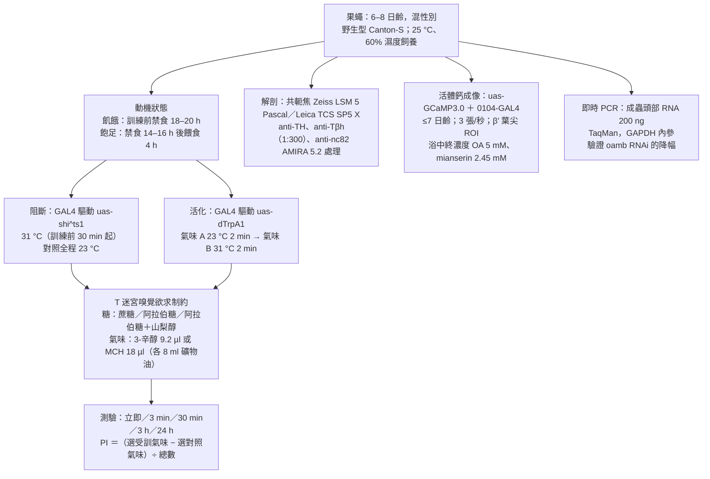
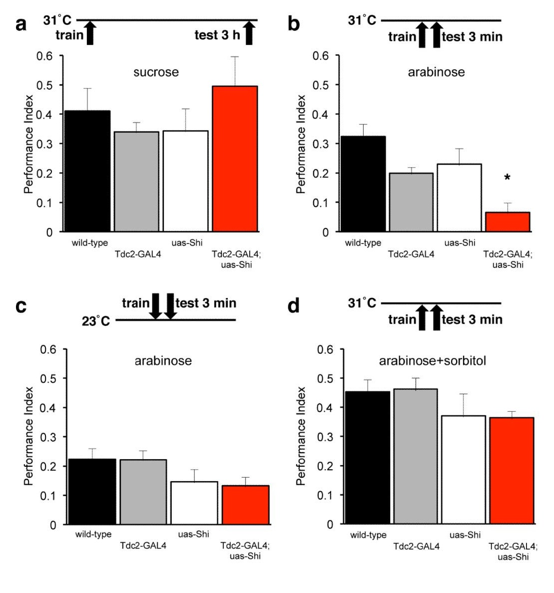
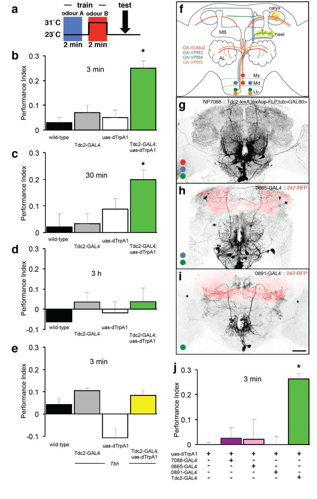
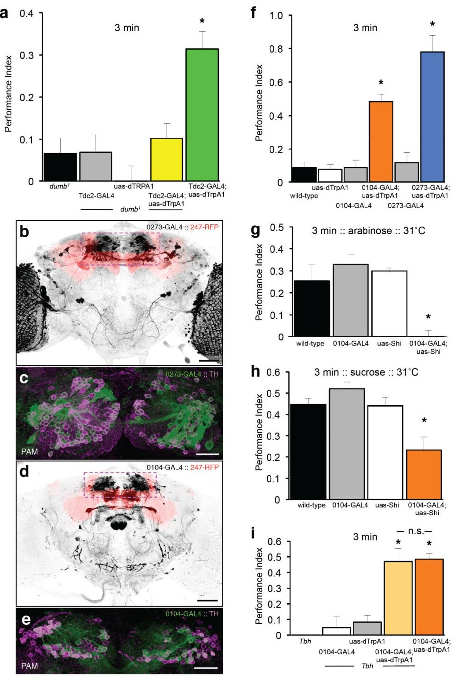
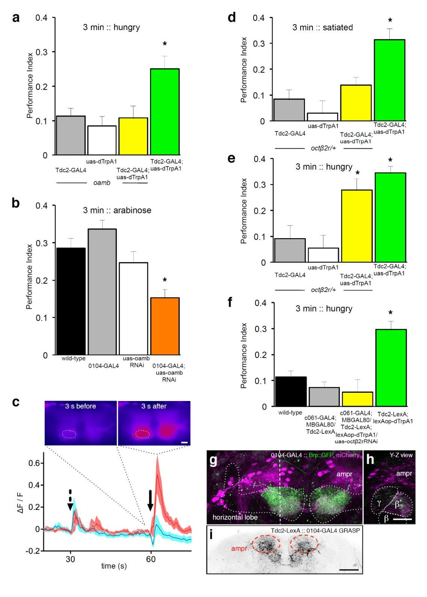

<!-- 本機 PDF：papers/2012-Layered%20reward%20signalling%20through%20octopamine%20and%20dopamine%20in%20Drosophila.pdf -->

# Layered reward signaling through octopamine and dopamine in *Drosophila*

**果蠅的獎賞訊號是分層的：章魚胺在上、多巴胺在下**

| 項目 | 內容 |
|---|---|
| **出處** | Nature 492(7429), 433–437 (2012). doi: 10.1038/nature11614 [全文（PMC 免費閱讀）](https://pmc.ncbi.nlm.nih.gov/articles/PMC3528794/) |
| 日期 | 刊期 2012-12-20（PDF 首頁）。投稿・修訂・接受日期本 PDF 未印：？待查。本 PDF 為 Europe PMC 作者稿，首頁載「available in PMC 2013 June 20」；查 DOI 取得 PMCID 時，Europe PMC 紀錄的首次發表日為 2012-10-28 |
| 通訊作者 | Scott Waddell（scott.waddell@cncb.ox.ac.uk）。PDF 只有英文名 |
| 作者 | 共 10 人：Christopher J. Burke、Wolf Huetteroth（**兩人為共同第一作者**，PDF 標 ＊）、David Owald、Emmanuel Perisse、Michael J. Krashes、Gaurav Das、Daryl Gohl、Marion Silies、Sarah Certel、Scott Waddell。與本庫有關者：無 |
| 機構 | University of Massachusetts Medical School 神經生物學系（Worcester）；University of Oxford 神經迴路與行為中心（CNCB）；Stanford University 神經生物學系；University of Montana 生物科學組與結構與功能神經科學中心。Krashes 現職 Beth Israel Deaconess Medical Center／哈佛醫學院。**作者的機構上標只有 1、2、4、5，沒有 3**（上標 3 被用來標「現職」），作者稿排版如此，不影響內容 |
| 資料庫 | 無（本篇沒有釋出資料或程式） |
| 補充資料 | 正文引用補充圖 S1–S10（S1 Tdc2 與酪胺、S2 子集阻斷、S3 PAM 解剖與 24 小時記憶、S4 *octβ1R*、S5 *oamb* RNAi 效率與蔗糖、S6 mianserin、S7 dNPF 受體、S8 Tdc2-LexA、S9 MB-MP1 阻斷、S10 GRASP）。PDF 第 8 頁只寫「Refer to Web version on PubMed Central for supplementary material」，**補充資料不在本 PDF 內，本庫未取得**；凡引到 S1–S10 的內容，本頁只能轉述正文的說法 |
| 編輯／審查 | *Nature* 不公開審查人，無 |

> 與本庫有關的作者：無。本篇是本庫 [[c-octopamine-reward-signal]] 陷阱 5 原本標為「？待查」的那篇：[[s-ichinose-2015-reward-recurrent-circuit]] 與 [[s-tumkaya-2025-synthetic-memory-inception]] 說「章魚胺在 PAM 多巴胺神經元的上游」時，引的就是本篇。
>
> 付費期刊（版權屬出版社）。本 PDF 是 **Europe PMC Funders Group 的作者稿**（Author Manuscript），不是出版社排版版，也不是 CC 授權；頁首每頁印「Nature. Author manuscript; available in PMC 2013 June 20」。全文請由資料表「出處」列的連結到 PMC 免費閱讀。**本庫不散布全文 PDF。** 本頁的圖擷取自原文，版權屬原出版社，以教學與評論目的引用，每張圖下方標明出處。

---

## 為什麼重要

**三個自稱要分清：本篇**＝這篇論文（Burke 等人，2012）；**本頁**＝你正在讀的這一頁（由本庫撰寫，共有「為什麼重要」「論文摘要」「科普文」「專業文」「圖」等幾節）；**本庫**＝這個知識庫整體。另外四個標記：`※ 從圖判讀` 表示這個數字論文沒有寫成文字，是本頁拿尺在圖上讀出來的，表現指數（定義見科普文）的誤差約 ±0.02；`※ 推論` 表示論文沒有明說，是本頁自己推的；`？待查` 表示值得查、但本頁刻意不填；`⚠️` 表示同一篇論文自己前後對不上（本庫記錄下來，不另外裁決）。

本庫到目前為止談獎賞，談的都是多巴胺（dopamine，一種神經傳導物質）。其中最常出現的是 PAM 群：一群多巴胺神經元，細胞體聚在腦的同一個區域，多半傳遞「這是好事」的訊號。庫內已有三篇都指向它——[[s-ichinose-2015-reward-recurrent-circuit]] 的 PAM-α1 迴圈（蕈狀體的葉被沿著長軸切成一格一格，每一格叫一個區室，α1 是其中一格；這條回路由支配 α1 的 PAM 神經元與 α1 的輸出神經元構成）、[[s-felsenberg-2018-memory-extinction]] 的 PAM 寫下相反記憶、[[s-tumkaya-2025-synthetic-memory-inception]] 用光活化 PAM 當人工獎賞。但在昆蟲研究的傳統裡，獎賞的訊號是**章魚胺**（octopamine, OA，昆蟲腦中的另一種神經傳導物質）：蜜蜂的 VUMmx1 這顆神經元，長年被認為代表糖獎賞本身（本篇只說果蠅的 OA-VUMa2 是 VUMmx1 的對應者，並把它放在「章魚胺＝昆蟲的獎賞」這個傳統下，沒有自己寫 VUMmx1 是不是章魚胺神經元）。本篇是把這兩套說法接起來的那一篇，也是本庫第一篇直接操作章魚胺神經元的來源。

本篇的結論是「分層」：章魚胺不是終點，而是上游。糖對果蠅有兩種好處，一是甜味，二是吃下去的熱量。章魚胺把其中**甜味**這一份傳給多巴胺神經元，多巴胺才把訊號送進蕈狀體（mushroom body, MB，腦中負責嗅覺學習的構造）。證據有三層：

- 阻斷章魚胺神經元，只有在用「甜但沒有熱量」的糖（阿拉伯糖）訓練時記憶才變差；用蔗糖（甜又有熱量）訓練則不受影響。這一組實驗能給的結論是「糖帶著熱量時，章魚胺可有可無」。**要再往前一步、說「熱量那一份走的是多巴胺」，靠的是另一邊的對照**：阻斷下游的多巴胺神經元時，連蔗糖訓練也明顯受損（見科普文第六套）。兩邊的測驗時間點不同（詳見科普文），所以這一步是方向一致的推論，不是同一條件下的對照。
- 人工活化章魚胺神經元能取代糖形成記憶，但這記憶撐不過 3 小時，而且在多巴胺受體（受體是細胞上接收某種化學物質的蛋白）壞掉的突變株（某個基因壞掉的果蠅品系）裡形不成。**要注意這個「撐不過 3 小時」只量在人工活化造出來的記憶上**；本篇沒有做「關掉章魚胺神經元、用阿拉伯糖訓練、量 3 小時記憶」這一組，所以摘要寫的「章魚胺只增強短期記憶」在本篇沒有對應的阻斷實驗（見科普文最後一段）。
- 反過來，活化 PAM 群多巴胺神經元，在完全做不出章魚胺的突變株裡照樣形成記憶。

對本庫來說，它直接填掉一個標著「？待查」的位置。[[c-octopamine-reward-signal]] 那一頁列有一張「引用時的陷阱」清單，其中第 5 條（陷阱 5）寫過一條推論：若獎賞真的走「章魚胺 → PAM 多巴胺 → KC」，那麼 [[s-tomchik-2009-camp-dynamics]] 與 [[s-gervasi-2010-pka-dynamics]] 把章魚胺直接泡在 Kenyon 細胞（KC，蕈狀體裡的那群神經元，一種氣味由其中一小群同時活動的組合來代表）上量到的反應，不一定是真實獎賞學習時 KC 收到的訊號；當時本庫沒有收錄本篇，無法評估這條路徑。現在可以評估了，而答案比原本的推論更細：本篇測了三種章魚胺受體，而查出有作用的那兩個，位置都在**多巴胺神經元**上——一種叫 OAMB，作用位置在 PAM 群；另一種叫 Octβ2R，作用位置在 MB-MP1——那是 PAM 群以外的另一型多巴胺神經元，平常傳遞的是壞事（這一點本篇是引 Aso 等人 2010，不是自己量的）；本篇也沒有排除 KC 上有章魚胺受體——本篇根本沒有測 KC。

[[syn-contradictions]] 登記了兩條尚未裁決的跨來源矛盾，編號 1.7 與 1.8，爭點都是把章魚胺直接施加在 KC 上量到的反應：1.7 是「單獨給多巴胺或章魚胺時，KC 的反應依不依賴 *rutabaga* 這個基因」（*rutabaga* 是果蠅的一個學習相關基因，見 [[e-rutabaga]]），1.8 是「章魚胺與乙醯膽鹼配對時是協同還是次加成」（乙醯膽鹼 acetylcholine 是另一種神經傳遞物；協同＝兩者一起給時的反應**大於**各自單獨反應相加，次加成＝**小於**相加），兩條都是 [[s-tomchik-2009-camp-dynamics]] 與 [[s-gervasi-2010-pka-dynamics]] 之間的牴觸。本篇讓這兩條矛盾多了一個可能的解釋方向——兩篇量到的反應，受體位置可能根本不同；但本篇全文搜 "Kenyon" 與 "KC" 都是 0 筆，沒有做任何 KC 層次的量測，所以不能判定哪一邊對。

---

## 論文摘要（原文與中譯）

> Dopamine (DA) is synonymous with reward and motivation in mammals. However, only recently has dopamine been linked to motivated behavior and rewarding reinforcement in fruit flies. Instead octopamine (OA) has historically been considered the signal for reward in insects. Here we show using temporal control of neural function in *Drosophila* that only short-term appetitive memory is reinforced by OA. Moreover, OA-dependent memory formation requires signaling through DA neurons. Part of the OA signal requires the α-adrenergic like OAMB receptor in an identified subset of mushroom body (MB)-targeted DA neurons. OA triggers an increase in intracellular calcium in these DA neurons and their direct activation can substitute for sugar to form appetitive memory, even in flies lacking OA. Analysis of the β-adrenergic like Octβ2R receptor reveals that OA-dependent reinforcement also requires an interaction with DA neurons that control appetitive motivation. These data suggest that sweet taste engages a distributed OA signal that reinforces memory through discrete subsets of MB-targeted DA neurons. In addition, they reconcile prior findings with OA and DA and suggest that reinforcement systems in flies are more similar to mammals than previously envisaged.

（*Nature* 的 Letter 摘要不分 Background／Results／Conclusion 段，照原樣一段。）

**中譯**（本節為忠實翻譯，非自撰內容）：

> 在哺乳類中，多巴胺（DA）等同於獎賞與動機。然而直到最近，多巴胺才被連上果蠅的動機性行為與獎賞性增強。長久以來，被認為是昆蟲獎賞訊號的反而是章魚胺（OA）。本文以果蠅神經功能的時間控制顯示，**只有短期**的欲求記憶由章魚胺增強。此外，依賴章魚胺的記憶形成，需要經過多巴胺神經元的訊號傳遞。章魚胺訊號的一部分，需要一群已指認的、投射到蕈狀體（MB）的多巴胺神經元中的 α-腎上腺素型受體 OAMB。章魚胺會讓這些多巴胺神經元的細胞內鈣上升，而直接活化它們可以取代糖來形成欲求記憶，即使在缺乏章魚胺的果蠅中也是如此。對 β-腎上腺素型受體 Octβ2R 的分析顯示，依賴章魚胺的增強還需要與另一群控制欲求動機的多巴胺神經元交互作用。這些資料顯示，甜味動用一個分散的章魚胺訊號，透過數個投射到蕈狀體的特定多巴胺神經元子群來增強記憶。此外，它們調和了先前關於章魚胺與多巴胺的發現，並顯示果蠅的增強系統比先前設想的更接近哺乳類。

---

## 科普文

想像一間餐廳的外場與內場。外場服務生聽到客人說「這道好吃」，但他不負責把這件事寫進菜單；他把話傳給內場主廚，主廚才決定要不要把這道菜記下來。這篇論文說，果蠅腦裡的獎賞訊號就是這樣分成兩層：**章魚胺（octopamine）是外場，多巴胺（dopamine）是內場。**

| 比喻 | 對應的東西 |
|---|---|
| 外場服務生 | 章魚胺神經元 |
| 客人說「這道好吃」 | 糖的甜味（不含吃下去的熱量） |
| 內場主廚 | PAM 群多巴胺神經元 |
| 寫進菜單 | 改寫蕈狀體裡的接點，也就是形成記憶 |

**比喻在兩處會失效。** 一是「把話傳過去」這一步：本篇只做到「章魚胺神經元與多巴胺神經元貼得很近」，以及「多巴胺神經元上少了接收章魚胺的那個受體就不行」，沒有量到果蠅真的吃糖時章魚胺放出多少、多巴胺神經元跟著動多少。二是本篇最後發現，外場要讓主廚動筆，還得同時對另一型平常傳「壞事」的多巴胺神經元作用——餐廳裡沒有這個角色。

**先把會反覆出現的幾個名字交代清楚。**

| 名字 | 是什麼 |
|---|---|
| 蕈狀體（mushroom body） | 果蠅腦中負責嗅覺學習的構造，左右各一。它的幾個部位在本文都會用到：**萼部**是 Kenyon 細胞接收氣味訊號那一端所在；**葉**是這些細胞把訊號送出去的那一端成束的地方，依位置分成 α、β、α′、β′、γ 幾條；**柄**是各葉根部共同的一段；**腳跟**是 γ 葉彎折靠近柄的那一段。葉再沿著長軸切成一格一格，每一格叫一個**區室**，名字就是「葉名＋編號」，例如 γ1。萼部、葉、柄、腳跟都屬於蕈狀體 |
| Kenyon 細胞（KC） | 蕈狀體的主要神經元。一種氣味由「哪一小群 KC 同時活動」這個組合來代表 |
| PAM 群 | 一群多巴胺神經元，細胞體聚在腦的同一個位置，多半傳遞「這是好事」。整群約 130 顆。本篇用兩個品系操作它：0273-GAL4 標到整群約 130 顆，0104-GAL4 只標到其中約 40 顆 |
| MB-MP1 | PAM 群以外的另一型多巴胺神經元（這是本篇用的舊稱）。本篇只寫它支配蕈狀體的**腳跟**；它後來的名字是 PPL1-γ1pedc、支配 γ1 這個區室與柄，那是本庫 [[e-ppl1-gamma1pedc]] 的資料，不是本篇寫的。平常傳遞的是壞事（這一點本篇是引 Aso 等人 2010，不是自己量的） |
| ampr | anterior medial protocerebrum 的縮寫，中文作前內側原腦，是蕈狀體**以外**的一個腦區（它與蕈狀體的相對位置、相距多遠，本頁未記錄，？待查）。本篇在這裡看到章魚胺神經元與多巴胺神經元貼得很近 |
| 增強（reinforcement） | 訓練當下告訴腦「剛才那件事是好事還是壞事」的那個訊號。本文說「章魚胺增強記憶」時，指的是**由它來造成記憶**，不是「讓既有的記憶變強」。論文摘要裡的「欲求記憶」就是本文說的「獎賞記憶」，同一件事 |
| 品系 | 一種經過基因改造的果蠅。本篇用品系來指定「遇熱開關要裝在哪些細胞裡」，因此可以單獨開關那些細胞。本文出現的品系名有 Tdc2-GAL4、NP7088、0665-GAL4、0891-GAL4、0104-GAL4、0273-GAL4，都是這種東西，名字本身沒有意義 |
| 突變株 | 某個特定基因壞掉的果蠅品系（「品系」是上一列的意思，涵蓋所有經過改造的果蠅；突變株是其中「某個基因壞掉」這一種）。果蠅的每個基因來自父母各一份，所以還要分「兩份都壞」與「只壞一份」 |
| 野生型 | 沒有帶任何人為改造的標準果蠅，本篇用的是 Canton-S 這一支 |
| 補充圖 | 論文正文之外另外附上的圖。本篇的補充圖**沒有包在本庫取得的那份 PDF 裡**，所以凡是標「本庫未取得」的結果，本頁只能照正文的敘述轉述，無法核對它的圖與統計 |

**本篇一共做了十二套實驗**，下面依這個順序出現。每一套底下還會有對照組與把關實驗，本文會一併寫出來：

1. 阻斷章魚胺神經元，用三種糖分別訓練（共四格，含一格溫度對照）
2. 人工活化章魚胺神經元
3. 只操作伸進蕈狀體的那幾類章魚胺神經元
4. 在多巴胺受體壞掉的突變株裡活化章魚胺神經元
5. 人工活化 PAM 群多巴胺神經元
6. 阻斷 PAM 群多巴胺神經元
7. 在做不出章魚胺的突變株裡活化 PAM
8. 兩種章魚胺受體（Octβ1R 與 OAMB）：突變株，以及只在一群細胞裡「敲低」（把某個基因的表現量壓低，但不是完全拿掉）
9. 鈣成像：把章魚胺灌在剖開的腦上
10. 第三種受體 Octβ2R 與餵食狀態
11. MB-MP1：那一型傳壞事的多巴胺神經元
12. 解剖：訊號在哪裡交接

**讀數有三種，另外一套只有影像。** 大部分實驗的讀數是行為分數（表現指數 PI，定義見下面〈先交代果蠅怎麼學〉那一段）；第九套是螢光亮度的相對變化（ΔF/F）；第八套另外量了 OAMB 這個基因在果蠅頭部的**轉錄本**——也就是這個基因被讀出來的 RNA 的量，可以代表這個基因開得多大，降約 40%；本篇沒有量 OAMB 蛋白。第十二套是解剖影像，沒有數值。

**兩個會影響能不能比高低的條件，先統一交代。**

一是**測驗時間點**：記憶本來就隨時間衰退，時間點不同的兩組不能比高低。論文寫出時間點的地方並不齊全：第一套的四格都有；第六套兩格都沒有逐格寫出時間點——阿拉伯糖那一格正文與圖說都沒給時間，蔗糖那一格只寫「初期記憶」；本頁把阿拉伯糖那一格記為 3 分鐘，依據是方法一節對所有 shi^ts1 阻斷實驗的概括協定（「訓練前 30 分鐘升到 31 °C，訓練與測驗全程維持，測 3 分鐘記憶」），而這句概括已經被圖 1a 反證（同樣是 shi^ts1 阻斷，測的卻是 3 小時的蔗糖記憶），所以只能當推定（※ 推論）。第三套「逐一關掉」與第十一套「把 MB-MP1 關掉」同樣只有方法一節的概括，論文沒有逐格寫出時間點。人工活化的實驗則除了第二套另外加測的 30 分鐘與 3 小時兩格以外，都是訓練後立即測驗，本頁記為 3 分鐘（※ 推論：依方法一節的活化協定，論文沒有在每張圖上重複標示）。

二是**餵食狀態**：本文一律用「飽足」（訓練前先禁食、再餵飽）與「飢餓」（訓練前禁食一晚）這兩個詞。飽足的果蠅對糖的記憶通常表現不出來（本篇作者群先前的結果，Krashes 等人 2009），所以這個條件會改變結果，本篇自己在第十套就示範了這一點。**但論文只在一部分實驗逐格寫了這個條件**，下面只要論文寫了就標出來，沒有逐格寫的標成「論文未逐格標明」——這不是本頁漏掉，是原文沒有寫在那一格上。另外論文第 4 頁有一句概括：「所有先前的實驗都用飽足果蠅（圖 2、圖 3 與補充圖 4）」，凡落在這個範圍內的格子，下面會註明這句概括。要注意這句話照字面也會把第六套（圖 3g、3h）包進去，但第六套是拿糖當獎賞訓練的，而飽足的果蠅對糖的記憶表現不出來、第六套的對照組卻有 0.25–0.52 的分數，所以第六套照理是飢餓果蠅，這句概括在那裡套不上（※ 推論）。第九套（灌藥在剖開的腦上）與第十二套（解剖）不涉及行為，這個條件不適用。

**先交代果蠅怎麼學「哪個氣味有糖」。** 果蠅聞到氣味時，蕈狀體裡一小群 KC 會活動。另外有一群多巴胺神經元，負責送來「這是好事還是壞事」的訊號。氣味和糖同時出現時，多巴胺神經元送來的訊號會改寫那一群 KC 與下游輸出神經元（蕈狀體把訊號送出去的神經元，果蠅靠它決定要靠近還是走開）之間的接點（突觸）；之後再聞到同一個氣味，果蠅就會往放著這個氣味的那一臂走。研究者用一種叫 T 迷宮（[[e-t-maze]]）的裝置量這件事：訓練後讓一群果蠅在 T 形管裡選邊，兩臂各放一種氣味，走向受訓氣味的果蠅數減去走向對照氣味的果蠅數，再除以總數，就是**表現指數**（performance index, PI，見 [[c-performance-index]]）。PI 落在 −1 到 1 之間，0 表示沒學到，數字越大表示越偏好受訓的那個氣味。本頁提到的每一個 PI 值，都是同一種基因型的果蠅用兩種氣味各訓練一次之後的平均，這樣可以抵銷果蠅本來就偏好某個氣味。

本頁引用的 PI 值多半論文沒有寫成文字，是本頁從圖上讀的，一律標 `※ 從圖判讀`，判讀誤差約 ±0.02——所以兩個相差 0.02 以內的值，不能當成有差別。要注意這個判讀誤差與論文說的「顯著／不顯著」是兩回事：後者是統計檢定的結論，比的是整組果蠅之間的差異，不是本頁讀圖的精度。

**各組對照是什麼。** 遇熱開關要兩個零件才能作用（一個指定細胞、一個提供開關），對照組的果蠅只帶其中一個零件，所以同樣經歷升溫、卻沒有任何細胞被操作。本篇的圖上多半並列三根對照柱。阻斷實驗的那三根，正文明寫是「只帶 GAL4 的、只帶 uas-*shi*^ts1 的、以及野生型」（第 2 頁講圖 1a 時寫了一次，第 3 頁講 0104 阻斷時又寫了一次）；**哪一根柱子對應哪一種基因型，本頁未記錄**。但不是每一張圖都三根，而且圖 4b 的正文只寫「顯著不同於兩個對照組」，圖上卻讀得出三根柱子（⚠️ 這是本篇自己前後對不上，見專業文第五節第 9 點）。下面只在本頁有記錄的地方寫出根數，沒寫的就是本頁未記錄，不是只有一根。

**難題：章魚胺到底是獎賞本身，還是只是傳話的？** 1993 年蜜蜂的研究找到一顆叫 VUMmx1 的神經元，只要活化它就能代替糖，讓蜜蜂學會一個氣味；從此「章魚胺＝昆蟲的獎賞」成了教科書說法（本篇把果蠅的 OA-VUMa2 稱為 VUMmx1 的對應者，並把它歸在這個傳統下，但沒有自己寫 VUMmx1 是章魚胺神經元）。果蠅這邊，缺少章魚胺的突變株（*Tβh*，做不出章魚胺的那個酵素壞了）學不會糖獎賞（Schwaerzel 等人 2003）。但同一時期，另一批研究把果蠅 PAM 群的多巴胺神經元連上了獎賞增強（Liu 等人 2012，與本篇同期；本篇對它的轉述只有這一句，沒有說它做過「取代糖」的實驗）。章魚胺能、多巴胺也能，兩種說法都有實驗支持，表示**這兩種物質不互斥**：可能是一前一後串在同一條路上，也可能是兩條平行的路。

**第一套：只在需要時關掉章魚胺神經元。** 作者用一個遇熱就失靈的工具（shibire^ts，[[e-shibire-ts]]）：平常 23 °C 一切正常，升到 31 °C 時，被指定的神經元送不出訊號。升溫從訓練前 30 分鐘就開始，訓練與測驗當下都在 31 °C（第 1 格量的是 3 小時後的記憶，訓練到測驗之間那 3 小時放在什麼溫度，論文與方法都沒有寫，？待查）。這一套有四格，每一格都是實驗組與三根對照柱並列；餵食狀態論文未逐格標明，而且圖 1 不在第 4 頁那句概括的範圍內（那句只點圖 2、圖 3 與補充圖 4）：

| 第幾格 | 訓練用的糖 | 溫度 | 測驗時間點 | 實驗組與對照組的差異 |
|---|---|---|---|---|
| 1 | 蔗糖（甜＋有熱量） | 31 °C | 訓練後 3 小時 | 沒有差異 |
| 2 | 阿拉伯糖（甜、沒熱量） | 31 °C | 訓練後 3 分鐘 | **明顯變差** |
| 3 | 阿拉伯糖 | 全程 23 °C，**所以這一格的神經元沒有被關掉**，是溫度對照（正文此處誤寫 25 °C，圖說與方法都寫 23 °C，⚠️ 見專業文第五節第 9 點） | 訓練後 3 分鐘 | 沒有差異 |
| 4 | 阿拉伯糖＋山梨醇（山梨醇本身不甜，提供的是熱量，所以這一格又是甜＋有熱量） | 31 °C | 訓練後 3 分鐘 | 沒有差異 |

要注意第 3 格那一列的「沒有差異」，意思不是「關掉也沒差」——那一格誰都沒被關掉。它的用途是溫度對照：同樣帶著遇熱開關的果蠅全程不升溫，表現就正常，所以第 2 格的記憶變差不是升溫本身造成的。另外第 1 格與其餘三格的時間點不同（3 小時對 3 分鐘），**這四格不能直接比高低**。

第 2 格的降幅是：實驗組 PI 約 0.065，三根對照柱約 0.32／0.20／0.23（平均 0.25），降約 74%（※ 從圖判讀，降幅是本頁算的；論文只寫「顯著受損」）。

**作者從這四格讀出什麼。** 他們的模型是：糖的熱量那一份**自己就足以**造成學習，而且那條路不經過章魚胺。所以只要糖帶著熱量（第 1 格的蔗糖、第 4 格的阿拉伯糖＋山梨醇），關掉章魚胺就看不出影響——不是甜味那一份沒有被切斷，而是剩下的熱量那一份已經夠用。真正能分辨的是第 2 格：把熱量拿掉之後，關掉章魚胺就出事了。**所以第一套能給的結論是：糖帶著熱量時，章魚胺可有可無；糖只有甜味時，少了章魚胺就學不好。** 至於熱量那一份走的是哪一條路，第一套沒有碰到，要等第六套。

**這裡有一個落差，本篇沒有處理。** 前面提過，一輩子做不出章魚胺的 *Tβh* 突變株學不會糖獎賞（Schwaerzel 等人 2003，用的是蔗糖）；而第 1 格把章魚胺神經元在訓練前後暫時關掉，蔗糖訓練卻照樣學得會。這兩個結果方向相反。可能的解釋至少有兩個：一是終生缺乏與暫時關掉不是同一件事（發育過程中少了章魚胺，可能連帶改變了別的東西）；二是暫時關掉並沒有把章魚胺神經元擋乾淨。**本篇沒有討論這個落差**，正文只說「*Tβh* 突變株形不成欲求記憶，但章魚胺釋放的確切角色仍不清楚」，並把第 1 格的結果形容為「意外」（※ 推論：上面那兩個可能是本頁列的，論文沒有列，本頁也不裁決哪一個對）。

**第二套：反過來，直接活化章魚胺神經元，看它能不能取代糖。** 作者換一個遇熱就讓神經元放電的工具（dTrpA1）：讓果蠅聞第一種氣味時保持 23 °C，聞第二種氣味時升到 31 °C，等於告訴果蠅「第二種氣味有好事」。結果果蠅真的學會喜歡第二種氣味——訓練後 3 分鐘測，PI 約 0.25，三根對照柱都在 0.03–0.07（※ 從圖判讀）——而且這些果蠅是**飽足**的，這本身就是一個發現，因為飽足的果蠅對糖的記憶通常表現不出來。

同一套往後測：這個人工記憶 30 分鐘還在（PI 約 0.20，飽足）；3 小時那一格裡，實驗組與三組對照的四根柱子全部落在 0 附近，而且**這一格的果蠅是飢餓的**——連飢餓狀態下測都沒有記憶。**所以「人工活化章魚胺神經元造出來的記憶撐不久」**；要注意這個「撐不久」只量在人工活化造出來的記憶上，不是自然訓練的記憶（詳見本節最後一段）。

同一套還做了一個把關實驗：Tdc2-GAL4 這個品系指定到的神經元，除了章魚胺也含**酪胺**（章魚胺的前驅物，本身也是一種訊號分子），所以要排除「起作用的其實是酪胺」。作者在完全做不出章魚胺的 *Tβh* 突變株裡活化同一群神經元——學不起來，可見起作用的是章魚胺。這一格的果蠅是**飢餓**的，與上面那兩格飽足的陽性結果不是同一個條件，嚴格說兩者不對齊；不過就方向而言，飢餓一般讓記憶更容易表現出來（第十套正是如此），所以「連飢餓狀態下都學不起來」是比較強的陰性結果，不是比較弱的（※ 推論：這個方向判斷是本頁補的，論文沒有討論條件不對齊這件事）。

**第三套，也是第一筆代價。** 這裡要說明一下「代價」的意思：要換到「獎賞訊號分兩層」這個解釋，有兩樣東西得放棄，本文把它們叫做兩筆代價。**第一筆是那顆「蜜蜂的明星神經元」在果蠅身上不管用。** 果蠅腦裡只有四類章魚胺神經元會伸進蕈狀體，依 Busch 等人 2009 的命名是 OA-VUMa2、OA-VPM3、OA-VPM4、OA-VPM5，其中 OA-VUMa2 就是蜜蜂 VUMmx1 的對應者。作者用三個品系來拆，三者是**一層套一層**的關係，不是三個互不重疊的子群：

| 品系 | 涵蓋哪幾類伸進蕈狀體的章魚胺神經元 |
|---|---|
| NP7088 | OA-VUMa2、OA-VPM3、OA-VPM4（不含 OA-VPM5） |
| 0665-GAL4 | OA-VPM3、OA-VPM4 |
| 0891-GAL4 | 只有 OA-VPM4 |

**三個品系逐一活化**（測訓練後 3 分鐘；餵食狀態論文未逐格標明，但這一格在圖 2 裡，落在第 4 頁那句「圖 2、圖 3 都是飽足果蠅」的概括內）——沒有一個能代替糖：三組的 PI 都在 0.03 以下，而同一張圖裡用涵蓋更廣的 Tdc2-GAL4 活化得到約 0.26，差了將近十倍（※ 從圖判讀；這是另一張圖裡另一次實驗的 Tdc2 組，與第二套那個 0.25 不是同一根柱子）。**三個品系逐一關掉**，也沒有一個讓阿拉伯糖的記憶變差（這一組只存在補充圖 2，本庫未取得）。

因為三個品系是套疊的，「逐一」指的是逐一測這三個品系，不等於四類細胞各被單獨測過：**關於 OA-VUMa2 的檢驗全部來自 NP7088 這一組**，另外兩個品系都不含它。第四類 OA-VPM5 三個品系都沒標到，要到第十二套才以解剖理由排除，而且那個理由排除的是「VPM5 直接作用在 PAM 或 MB-MP1 上」，不是排除它在別處有作用。

三個品系逐一開關都沒效，涵蓋更廣的 Tdc2-GAL4 卻有效，這能推到的結論是：**起作用的章魚胺神經元不是 OA-VUMa2，而且落在這三個品系涵蓋的範圍之外。** 至於它究竟是「分散在很多顆細胞上」還是「另有一顆沒被標到的關鍵細胞」，第三套本身分不開——**本篇到最後也沒有分開這兩個可能**，第十二套只是用解剖把候選名單縮小，然後由作者選了前者，見該套。

**第四到第七套：把中間那一層拆開。** 如果章魚胺是外場、多巴胺是內場，那麼有兩件事應該成立：內場停工時，外場再怎麼喊也沒用（第四套）；外場不在，內場自己照樣能寫（第七套）。另外兩套是補足這個圖像的：內場自己動手效果如何（第五套）、內場缺席時連有熱量的糖也學不好（第六套）。

- **第四套**：在多巴胺受體壞掉的突變株（*dumb¹*）裡活化章魚胺神經元，學不起來（突變背景各組 PI 在 0.00–0.10，同圖非突變背景的對照約 0.31；※ 從圖判讀。餵食狀態論文未逐格標明，但這一格在圖 3 裡，落在第 4 頁那句概括內）。
- **第五套**：直接活化 PAM 群多巴胺神經元（果蠅飽足），分數遠高於活化章魚胺神經元。只標到約 40 顆的 0104-GAL4 得到 PI 約 0.48，標到整群約 130 顆的 0273-GAL4 得到約 0.78（※ 從圖判讀）——都比第二套活化章魚胺神經元的約 0.25 高。
- **第六套**：反過來用 0104-GAL4 阻斷那約 40 顆 PAM（餵食狀態論文未逐格標明；照理是飢餓果蠅，理由見上面餵食狀態那一段，※ 推論）。用阿拉伯糖訓練（測驗時間點論文沒有逐格寫，依方法一節的阻斷協定推定為訓練後 3 分鐘，※ 推論），記憶幾乎歸零（實驗組約 0.005，三根對照柱約 0.25–0.33；※ 從圖判讀）；用蔗糖訓練，記憶也顯著受損（約 0.23，三根對照柱約 0.44–0.52，降約 51%），只是沒有歸零。
- **第七套**：在完全做不出章魚胺的 *Tβh* 突變株裡用 0104-GAL4 活化 PAM（果蠅飽足），分數與正常背景沒有差異——這兩根柱子（一根是突變背景、一根是正常背景，哪一根是哪一個本頁未記錄，？待查）約 0.47 與 0.49，圖上把「無差異」標在它們之間（※ 從圖判讀）。這兩根都是實驗組，不是對照柱。

**第六套是「熱量那一份走多巴胺」的依據，但這一步有一個前提。** 同樣用蔗糖訓練，關掉章魚胺神經元沒事（第一套第 1 格，量的是 3 小時記憶），關掉這群多巴胺神經元就顯著受損（第六套，論文只寫「初期記憶」，**沒有寫出確切時間點**）。要從這裡推出「熱量那一份是由多巴胺傳的」，得先接受一個前提：阻斷這群細胞的輸出，就把它承載的增強訊號都切掉了。本篇沒有直接量到「熱量訊號進到這群細胞裡」，只量到「少了它，連有熱量的糖也學不好」（※ 推論：這個前提是本頁點出的，論文沒有討論）。再加上兩邊的時間點不同，所以這個對比靠的是方向一致，不是同一條件下的數值比較。

第六套還有一個補充實驗：若只在訓練那段時間阻斷，蔗糖的 24 小時記憶被完全消除（補充圖 3B，本庫未取得）。它與上面那個「只受損、沒歸零」的結果差了兩件事——阻斷的時段不同（全程／只在訓練時），測驗的時間點也不同（初期／24 小時）——本篇沒有把這兩個因素分開，所以不能判斷落差來自哪一個。

**把第四到第七套合起來看，獎賞訊號的最後一棒在多巴胺手上：** 多巴胺系統壞掉時，章魚胺推不動（第四套）；章魚胺做不出來時，多巴胺照樣寫得進去（第七套）；直接推多巴胺的效果比推章魚胺大得多（第五套）；而且少了那約 40 顆多巴胺神經元，兩種糖都學不好（第六套）。一處保留在第四套：*dumb¹* 是全身性的突變，全身的多巴胺受體都壞了，所以它只能說「多巴胺系統要能運作」，不能指出多巴胺最後作用在哪一種細胞上。

**這裡先把容易混成一團的五組實驗排開。** 本篇有五組實驗長得幾乎一樣，都是「在某個突變株裡人工活化某群神經元」，差別只在幾個欄位；其中 *Tβh* 突變株出現兩次而結果相反，差別在活化的是哪一群：

| 出自哪一套 | 突變株（壞掉的是什麼） | 活化哪一群 | 餵食狀態 | 結果 |
|---|---|---|---|---|
| 第二套的把關 | *Tβh*（做不出章魚胺） | 章魚胺神經元 | 飢餓 | 學不起來 |
| 第四套 | *dumb¹*（多巴胺受體） | 章魚胺神經元 | 未逐格標明（概括為飽足） | 學不起來 |
| 第七套 | *Tβh*（做不出章魚胺） | PAM（約 40 顆） | 飽足 | **照樣學得起來** |
| 第八套 | *oamb*（章魚胺受體 OAMB） | 章魚胺神經元 | 飢餓 | 學不起來 |
| 第十套 | *octβ2R* 只壞一份 | 章魚胺神經元 | 飽足／飢餓各一格 | 飽足學不起來、飢餓學得起來 |

**第八、第九套：那中間是怎麼接的？** 作者查章魚胺的受體——章魚胺有好幾種受體，就像同一個聲音可以由不同的耳朵接收。第八套有四格結果：

- 缺少 Octβ1R 這種受體的果蠅（**飽足**，論文明寫），人工學習正常，所以它不是接點（補充圖 4，本庫未取得）。
- 缺少 OAMB 受體的果蠅（這種受體整個壞掉，測的是**飢餓**的果蠅），人工活化章魚胺神經元形不成記憶。
- 只在那群約 40 顆 PAM 多巴胺神經元裡把 OAMB 的量壓低（用 RNAi，一種把某個基因的表現量壓低、但不是完全拿掉的工具），用阿拉伯糖訓練，記憶變差（約 0.15，三根對照柱平均約 0.29，降約 47%；※ 從圖判讀。餵食狀態論文未逐格標明，而這一格在圖 4 裡，不在第 4 頁那句概括的範圍內）。**這四格裡以這一格最關鍵**，因為它把需求定位到特定的一群細胞上。本篇量到的敲低幅度是「整顆頭的 OAMB 轉錄本降約 40%」，那是全頭的平均，**不代表那約 40 顆細胞裡面降了多少**。
- 同一批果蠅改用蔗糖訓練則沒有影響（補充圖 5B，本庫未取得），與第一套的蔗糖結果一致。

**這裡有一個看起來矛盾、其實不矛盾的地方。** 第六套把那約 40 顆 PAM（0104-GAL4）的輸出整個阻斷，蔗糖訓練受損；第八套在**同樣這約 40 顆**細胞裡只把 OAMB 壓低，蔗糖訓練卻沒事。兩套動的是同一群細胞，差別在動手的層次：阻斷整顆細胞的輸出，等於同時切斷它送出去的**所有**訊號（甜味那一份、熱量那一份都算）；只拿掉 OAMB，切斷的只是它接收章魚胺的那一條，而章魚胺只傳甜味。蔗糖有熱量，所以剩下的那條路還在。

第九套是生理證據：把一種會隨鈣濃度變亮的螢光蛋白（GCaMP，[[e-gcamp]]）放進那約 40 顆 PAM 多巴胺神經元，直接把章魚胺灌在剖開的腦上——這些細胞果然亮起來（鈣濃度上升代表它們被推動），而且先加上阻斷章魚胺受體的藥（mianserin），亮度的上升就**顯著變小**。這裡要照圖說寫：圖說寫的是「顯著降低」，正文卻寫成「被消除」，⚠️ 這是本篇自己前後不一致，本頁採用圖說的說法。

**所以「章魚胺直接推動了這群多巴胺神經元」是三條證據合起來的推斷，不是直接量到的。** 三條是：(1) 把 OAMB 只在這群細胞裡壓低就會造成行為缺損（第八套）；(2) 外加章魚胺時這群細胞的鈣會上升（第九套）；(3) 先加阻斷劑，上升就變小（第九套）。第九套還有兩個保留：灌進去的章魚胺濃度是 5 mM，比本庫 [[s-gervasi-2010-pka-dynamics]] 用過的最高濃度（100 µM）高 50 倍，與果蠅腦裡真正釋放的量級關係不明；而且亮度量的是這些細胞在 β′ 葉尖的軸突端（送訊號那一端），而受體作用的位置推定在 ampr 的樹突端（接收那一端）——這個推定的依據是第十二套：那群細胞在 ampr 的分枝沒有突觸前的標記，所以判為樹突，而章魚胺神經元與它們貼在一起的地方正是 ampr（※ 推論：論文沒有說明為什麼選 β′ 葉尖來量）。

**第十、第十一套，第二筆代價：要放棄「獎賞訊號是一條只由『傳好事』的細胞構成的單行道」這個簡單圖像。** 事情還牽涉到餵食狀態，也牽涉到傳壞事的那條線——這就是本節開頭「比喻在兩處會失效」的第二點所指的事。 第三種章魚胺受體叫 Octβ2R。本篇用的是插入型的突變（在基因裡插進一段 DNA），兩份都帶這個插入的果蠅活不下來，所以只能測只壞一份的果蠅。第十套有兩格，只差餵食狀態：只少一份 Octβ2R 時，**飽足**的果蠅學不起人工記憶（PI 約 0.14，統計上不顯著）；同樣基因型的果蠅改成**飢餓**（訓練前禁食一晚）之後又學得起來（約 0.28，顯著；※ 從圖判讀）。所以少一份 Octβ2R 造成的缺陷會被飢餓狀態蓋過去；飢餓怎麼補償，本篇沒有量，只看到行為層次的相關。

同一套還排除了一條替代解釋：dNPF 是果蠅的一種神經肽（神經元釋放的訊號分子），本篇作者群先前發現它作用在 MB-MP1 上，使獎賞記憶只在飢餓的果蠅身上表現出來——那條路徑也會經過 MB-MP1，與下面第十一套的結論撞在一起，所以必須排除。作者在 dNPF 受體的突變株裡做人工學習，結果正常，所以章魚胺走的不是 dNPF 這條路（補充圖 7，本庫未取得）。

第十一套追問需要 Octβ2R 的地方在哪裡，答案是 MB-MP1——那一型平常傳**壞事**的多巴胺神經元（被活化時果蠅學到的是躲避，這一點本篇是引 Aso 等人 2010，不是自己量的）。主圖的結果是：在**飢餓**的果蠅身上一邊活化章魚胺神經元、一邊只在 MB-MP1 裡把 Octβ2R 壓低，人工獎賞記憶形不成（約 0.06，兩根對照柱約 0.07 與 0.11，同圖陽性對照約 0.30；※ 從圖判讀）。另有一個獨立驗證：活化章魚胺神經元的同時直接把 MB-MP1 關掉，也沒有記憶——但這一組在補充圖 9，本庫未取得，所以下面的結論主要靠主圖那一格。

**這個結果為什麼反直覺。** 既然 MB-MP1 平常傳的是壞事，直覺上拿掉它應該讓好事的記憶更容易形成；實際上兩種操作（拿掉它接收章魚胺的受體、或把它整個關掉）都讓獎賞記憶**形不成**。所以它不是單純的扯後腿者：它必須在場，而且必須被章魚胺經由 Octβ2R 作用到。**至於章魚胺是讓 MB-MP1 的活動變強還是變弱，本篇沒有量**，所以作者說的「調節負向訊號」具體是什麼，還沒有答案——這也是這一段最弱的地方：結論只到「需要它」，沒有機制。

**第十套與第十一套不是一組對照實驗。** 兩者都與 Octβ2R 有關，但操作不同：第十套是全身每個細胞都只剩一份 Octβ2R（輕、但到處都是），第十一套是只在 MB-MP1 這一型細胞裡壓低（重、但只有一處）。所以不能從「第十套飢餓救得回、第十一套在飢餓下仍然失敗」推出「這個缺陷連飢餓也救不回」——兩套改變的東西不一樣。本頁把兩套並列，只是要指出需要 Octβ2R 的位置之一在 MB-MP1（※ 推論：這個並列的限制是本頁指出的，論文沒有討論）。

**第十二套：訊號在哪裡交接。** 作者用兩種解剖手法。第一種是把突觸前端的一種蛋白（Bruchpilot）接上螢光標記，只標出神經元「送訊號」的那一端，結果看出那約 40 顆 PAM 的輸出落在蕈狀體 β′ 與 γ 兩條葉的尖端。第二種叫 GRASP，讓兩群細胞各帶半個螢光蛋白，膜貼得夠近時才拼出會發光的完整蛋白（**它顯示的是貼得近，不等於真有突觸**）。GRASP 的結果是：章魚胺神經元與 PAM 在 ampr 貼在一起；章魚胺神經元與 MB-MP1 則在**兩處**貼在一起——ampr 與蕈狀體的腳跟。

正因為對 MB-MP1 的訊號出現在兩處，作者就去找能同時覆蓋 ampr 與腳跟的候選細胞，再逐一排除：

- OA-VPM4 在腳跟與 γ 葉分枝很密、又伸進 ampr，所以是最可能同時碰到兩處的那一個；但它已被 0891-GAL4 單獨標到，而那個品系活化無效（第三套）。
- 另外幾類伸進 ampr 的章魚胺神經元是 OA-VUMa6、OA-VUMa7、OA-VUMa8 與 OA-VPM3。**前三類不伸進蕈狀體，所以不在前面那「四類」裡面**——前面那張表的欄位只算伸進蕈狀體的。這四類（VUMa6、a7、a8 與 VPM3）全都在 NP7088 的範圍內，而 NP7088 也無效。
- 只支配萼部的 OA-VPM5，在 ampr 與腳跟都沒有分枝（萼部與腳跟同屬蕈狀體，但是不同部位），所以不可能直接作用在 PAM 或 MB-MP1 上。

這裡要補一句：作者在排除候選時，找的是「能同時橋接兩處的單一細胞」；但最後的結論句寫的是「分散的一群神經元，**其中有些**在 ampr 有分枝」，照字面已經容許兩處各由不同的細胞負責。所以這個可能不是沒被想到，而是論文沒有針對它逐一檢驗（※ 推論：這個讀法是本頁指出的）。

作者由此選了「訊號分散在一組神經元上」這個解釋。**但這整段論證完全由排除構成**，而排除法要成立，候選名單必須列全、每個品系也確實標到名單上的細胞；本篇沒有做單細胞層級的驗證，所以它分不開兩種可能：一是訊號真的分散在多顆細胞上、標到其中幾顆都不夠，二是關鍵的那一顆根本沒被任何品系標到。作者自己在論文最後一句也留了退路，說章魚胺的增強可能還需要同時調控其他尚未指認的多巴胺神經元。**所以「分散」是作者在兩個選項中挑的那一個，不是被實驗逼出來的唯一答案。**

**最容易被誤讀的一點：本篇沒有證明「章魚胺只做短期記憶」。** 摘要寫「只有短期的欲求記憶由章魚胺增強」，但撐不過三小時的，是**人工活化**章魚胺神經元（第二套）造出來的記憶。在阻斷實驗這一側，作者唯一測過 3 小時的那一格用的是蔗糖（第一套第 1 格），而蔗糖本來就不需要章魚胺；**關掉章魚胺神經元、用阿拉伯糖訓練、量 3 小時記憶**這一格，本篇沒有做（本頁已 `grep` 過全文的 "arabinose"、"3 h" 與全部圖說確認）。所以「短期」這個限定來自人工活化的衰退曲線，不是來自自然訓練的實驗，引用時要連方法一起引。

---

## 專業文

### 本頁用語

本頁各節可單獨查閱，故把反覆出現的詞集中在這裡。

| 詞 | 意思 |
|---|---|
| 增強（reinforcement） | 告訴腦「剛才那件事是好事還是壞事」的訊號 |
| 欲求（appetitive）記憶／嫌惡（aversive）記憶 | 學會靠近配糖的氣味／學會避開配電擊的氣味 |
| 蕈狀體（mushroom body, MB） | 果蠅腦中負責嗅覺學習與記憶的構造，左右各一。見 [[e-mushroom-body]] |
| KC（Kenyon cell） | 蕈狀體的主要神經元。一種氣味由一群 KC 的活動組合來代表。見 [[e-kenyon-cell]] |
| 軸突、樹突 | 軸突是神經元送出訊號的那一端，樹突是接收的那一端 |
| 葉、萼部、腳跟（heel）、柄（peduncle） | 蕈狀體的幾個部位。KC 軸突成束處稱葉（α、β、α′、β′、γ）；萼部（calyx）是 KC 樹突所在；柄是各葉根部共同的一段；腳跟是 γ 葉彎折靠近柄的那一段。本篇靠這些部位判斷某一群多巴胺神經元把訊號送到哪裡、又從哪裡收訊號 |
| 區室（compartment）／格 | 蕈狀體的葉沿長軸切成一格一格，每格由特定的多巴胺神經元與輸出神經元負責。γ1 這種「葉名＋編號」就是區室名。見 [[c-mb-compartment]] |
| 多巴胺（dopamine, DA） | 神經元釋放的一種化學訊號。本篇的結論是獎賞訊號分兩層：章魚胺在上游，多巴胺在下游 |
| DAN（dopaminergic neuron） | 多巴胺神經元。**PAM** 與 **PPL1** 是依細胞體（神經元本體）所在位置命名的兩群：PAM 多傳遞獎賞、PPL1 多傳遞懲罰；本頁未記錄這兩個縮寫的全名與位置名（？待查）。見 [[e-dopaminergic-neuron]] |
| MB-MP1 | PPL1-γ1pedc 的舊名（本篇的寫法），支配 γ1 與柄這個區室的 DAN，傳遞懲罰。見 [[e-ppl1-gamma1pedc]] |
| 章魚胺（octopamine, OA） | 昆蟲腦中的一種調節物質，作用類似哺乳類的正腎上腺素（哺乳類腦中的一種調節物質）。本頁不嚴格區分「調節物質」與下一列的「神經傳遞物」，兩者都是神經元釋放出來、影響其他神經元的化學物質。見 [[c-octopamine-reward-signal]] |
| 酪胺（tyramine） | 章魚胺的前驅物，本身也是一種神經傳遞物。合成路徑：酪胺酸 →（TDC）→ 酪胺 →（Tβh）→ 章魚胺 |
| TDC、*Tdc2* | 酪胺酸脫羧酶，合成路徑的第一個酵素。*Tdc2* 是神經元版本的基因，*Tdc2*-GAL4 用來標記與操作大部分章魚胺神經元 |
| 突變株 | 某個基因壞掉的品系 |
| Tβh、*Tβh^nM18* | 酪胺 β-羥化酶，把酪胺變成章魚胺的酵素。*Tβh^nM18* 是它的突變株，完全做不出章魚胺，但酪胺照樣有（而且會累積）。所以在 *Tβh* 突變株做的實驗，必須另外排除「起作用的其實是酪胺」這個可能，本篇 3.2 節就是這樣做的 |
| 同型合子／異型合子、`/+` 的寫法 | 基因有兩份。兩份都壞是同型合子，一份壞、一份正常是異型合子，寫成 `octβ2R/+`。本篇 *octβ2R* 兩份都壞會死，所以只能測只壞一份的果蠅 |
| OA-VUMa2／VPM3／VPM4／VPM5 | 四類伸進蕈狀體的章魚胺神經元（依 Busch et al. 2009 的命名）。VUMa2 是蜜蜂 VUMmx1 的果蠅對應者 |
| 受體 | 細胞上接收某種化學物質的蛋白，決定這個細胞收不收得到這個訊號。同一種章魚胺可被不同受體接收，本篇要找的是「哪一個受體、長在哪一群細胞上」才是獎賞訊號的接點 |
| α-腎上腺素型／β-腎上腺素型 | 章魚胺受體的分類名稱，依各受體與哺乳類腎上腺素受體的相似程度而定。OAMB 屬 α 型，Octβ1R 與 Octβ2R 屬 β 型 |
| OAMB、Octβ2R、Octβ1R | 三種章魚胺受體。本篇查出的差別主要在位置：OAMB 位在 PAM 多巴胺神經元上（3.5 節），且被推動時會動員細胞內的鈣倉庫放鈣；Octβ2R 位在 MB-MP1 上（3.6 節），但本篇只做到行為與受體需求，沒有量它在細胞內的作用；Octβ1R 則用來排除：*octβ1R* 突變中人工學習正常（3.5 節），所以它不是接點。*oamb^584*、*octβ2R^f05679*、*octβ1R（oa2^f02819）* 是對應的突變株 |
| DopR、*dumb¹* | 多巴胺受體（即本庫 [[e-dopamine-receptor]] 的 DopR1／dDA1）。*dumb¹* 是它的突變株 |
| GAL4／UAS、LexA／lexAop | 兩套互相獨立的「開關—被開啟端」系統。GAL4 或 LexA 由一段調控序列（決定基因在哪些細胞開啟的 DNA）決定在哪些細胞製造；帶 GAL4 的那一半稱為驅動品系（driver），決定工具在哪些細胞作用。UAS 或 lexAop 接在要表現的基因前面。例：`Tdc2-GAL4` 表示「在章魚胺神經元裡製造 GAL4」，`uas-dTrpA1` 表示「要被打開的基因是 dTrpA1」；兩者放進同一隻果蠅寫成 `Tdc2-GAL4;uas-dTrpA1`（分號分隔不同染色體上的元件），dTrpA1 就只出現在章魚胺神經元裡。兩套並用，可在同一隻果蠅分別控制兩群細胞。見 [[e-split-gal4]] |
| GAL80 | GAL4 的抑制蛋白。c061 是一個驅動品系的名字，本篇用它接近 MB-MP1；`c061-GAL4;MBGAL80` 表示「用 c061 標記，但把蕈狀體裡的表現擋掉」，留下的是 MB-MP1 |
| InSITE 品系（0104、0273、0665、0891） | 本篇用的四個 PBac{IT.GAL4} 轉位子（可插進基因組的一段 DNA）插入品系，來自 Gohl et al. 2011 的 InSITE 系統：把同一段 DNA 插進基因組的不同位置，得到一批品系，各自在不同的細胞裡製造 GAL4，因而各自標記不同的神經元子群 |
| shibire^ts1（shi^ts1） | 溫度敏感工具：>29 °C 時擋住突觸囊泡回收、神經元送不出訊號，<25 °C 恢復。回答「少了這群神經元行不行」。見 [[e-shibire-ts]] |
| dTrpA1 | 溫度敏感的陽離子通道，>25 °C 就讓神經元放電。回答「這群神經元夠不夠」。本篇的活化溫度是 31 °C |
| RNAi | 降低指定基因表現量的工具。本篇用 *oamb^RNAi*（降幅約 40%，即減少約 40%、還剩約 60%）與 *octβ2R^RNAi* |
| GCaMP3.0 | 隨細胞內鈣濃度變亮的螢光蛋白，用來看神經元活動。ΔF/F＝亮度變化量除以基線亮度。見 [[e-gcamp]] |
| mianserin | 章魚胺受體的拮抗劑（阻斷劑），本篇用來確認鈣反應確實由章魚胺受體引起 |
| GRASP | 「跨突觸夥伴的 GFP 重組」。兩群細胞各帶 GFP 的一半，膜貼得夠近時才拼出會發光的 GFP，用來找可能的接觸點。**它顯示的是相鄰，不等於有突觸** |
| Brp::GFP、DenMark | Bruchpilot 是突觸活化區的蛋白；突觸活化區是突觸前端真正釋放訊號的那一小塊構造，標到它就等於標出送訊號那一端。Brp::GFP 標出突觸前；DenMark 標樹突 |
| anti-TH、anti-Tβh | 抗體染色試劑。anti-TH 對的是多巴胺合成所需的酵素，染到的就是會製造多巴胺的細胞（本篇用它判定「TH 陽性的 PAM 細胞」）；anti-Tβh 同理對應章魚胺神經元 |
| ampr | 前內側原腦（anterior medial protocerebrum），腦中的一個區域（本頁未記錄其確切位置）。本篇在此看到章魚胺神經元與多巴胺神經元貼得很近，指認為兩者的接觸區（3.7 節）；0104 標記的 PAM-DAN 的樹突推測在此 |
| 阿拉伯糖、山梨醇、蔗糖 | 糖同時帶有甜味與熱量兩種好處，本篇要分辨章魚胺負責哪一種，所以用這三種糖把兩個屬性拆開分別測：阿拉伯糖（arabinose）是果蠅代謝不了的糖，甜但無熱量；山梨醇（sorbitol）有熱量但不甜；蔗糖（sucrose）兩者兼具 |
| PI（performance index） | 表現指數：走向受訓氣味的果蠅數減走向對照氣味的數，除以總數；範圍 −1 到 1，0 代表沒學到。一個 PI 值是同基因型果蠅用兩種氣味各訓練一次的平均，如此可抵銷果蠅本來就偏好某個氣味。見 [[c-performance-index]] |
| 飽足（satiated）／飢餓（hungry） | 本篇的飽足＝先禁食 14–16 小時再餵食 4 小時；飢餓＝訓練前禁食 18–20 小時。兩組的前段處理相同，差別在最後 4 小時有沒有食物 |
| 人工記憶（implanted memory） | 不給真的糖，改以人工活化某群神經元配對氣味所形成的記憶。見 [[c-us-substitution]] |
| 「（補充圖 N，未取得）」 | 該結果只存在論文的補充資料裡，本庫沒有取得那份檔案，所以只能轉述正文的敘述，無法核對圖與統計 |
| ※ 推論 | 論文沒有明說、本頁自行推得的內容，並寫出依據 |
| ？待查 | 值得查證但本頁刻意不填的內容 |

### 一、概述

**主要問題。** 果蠅的糖獎賞訊號究竟由章魚胺傳遞，還是由多巴胺傳遞？兩者若都參與，誰在誰的上游？**本篇的答案是兩者都參與：章魚胺在上游，只傳遞甜味那一份；多巴胺在下游，是最後一棒。**

**重要性。** 2012 年以前，昆蟲的獎賞訊號與哺乳類被認為走不同的物質：哺乳類是多巴胺，昆蟲是章魚胺。本篇若成立，果蠅的增強系統就與哺乳類同型（多巴胺在最後一棒），而章魚胺退居上游的味覺訊號。這也直接影響本庫怎麼讀 [[s-tomchik-2009-camp-dynamics]] 與 [[s-gervasi-2010-pka-dynamics]]：那兩篇把章魚胺當成「獎賞的代用品」直接施加在 KC 上。本篇的結論讓那兩篇在 KC 上量到的反應，對應什麼生理情境（果蠅真的在學習時腦中發生的事）變得不清楚（詳見第五節第 8 點）。

**發表當時的領域現狀（2012）。**

- 章魚胺側：Hammer 1993 在蜜蜂找到 VUMmx1，活化它可代替糖獎賞；Hammer & Menzel 1998 以局部注射章魚胺，主張學習位點（記憶被寫在腦中的哪些地方）不只一處；本頁只轉述這個主張，不交代其推論過程。果蠅這邊，Schwaerzel et al. 2003 主張多巴胺與章魚胺分別對應嫌惡與欲求記憶，並報告 *Tβh* 突變株形不成欲求記憶。
- 多巴胺側：Liu et al. 2012 報告 PAM 群的一個子集傳遞氣味記憶的獎賞（本篇引為 ref 4，標為「Nature 2012」；它與本篇發表時間相近，應屬同期或略早，不是更早的既有基礎）；Kim, Lee & Han 2007 指出 *dumb¹*（DopR）突變的欲求記憶缺損可由在蕈狀體表現 DopR 救回。所謂救回，是把壞掉的基因只在某一群細胞裡補回去，缺損就消失，代表那群細胞是關鍵位置。
- 糖的兩種屬性：Burke & Waddell 2011（本篇第一作者的前作）與 Fujita & Tanimura 2011 都指出甜味與營養分別貢獻欲求記憶，阿拉伯糖／山梨醇這組試劑即出自此。
- 動機狀態：Krashes et al. 2009（本篇作者群）指出神經肽（神經元釋放的一種訊號分子）dNPF 調控 MB-MP1，使欲求記憶的**提取**限於飢餓的果蠅。形成＝訓練當下把記憶寫下來；提取＝事後把記憶拿出來、表現在行為上。本篇的 MB-MP1 與動機狀態（3.6 節）接的就是這條線。
- 解剖圖譜：Busch, Selcho, Ito & Tanimoto 2009 的章魚胺神經元圖譜給出 OA-VUMa2／VPM3／VPM4／VPM5 這四類伸進蕈狀體的細胞，本篇的子集策略——只操作這四類中的一部分，看少了誰會出事——完全建立在這份圖譜上。

**體裁。** *Nature* 的 Letter（短篇原著論文），四張主圖、十張補充圖。正文沒有分「Results／Discussion」小標，推論與結果混寫。

### 二、方法

**行為。**

- 制約（本頁與論文中「制約」與「訓練」指同一件事）沿用 Burke & Waddell 2011 的欲求嗅覺協定，並做了兩項修改：**修改的就是下面兩條溫度條目**（阻斷實驗的溫度安排、活化實驗的溫度安排），其餘條目是原協定的一般做法，不是修改。
- 測驗時間點：流程圖把「立即」與「3 min」並列，兩者指同一個時間點——本頁所稱「立即記憶」即訓練後 3 分鐘的測驗。
- 阻斷實驗的溫度：訓練前先在 31 °C 預熱 30 分鐘；**31 °C 在訓練與緊接著的 3 分鐘記憶測驗全程維持，中間不降溫**。對照組全程維持在允許溫度——即不會觸發這個遇熱工具的溫度，本篇是 23 °C。
- 活化實驗的溫度：先在 23 °C 給氣味 A 兩分鐘，移入預熱的新管、立刻在 31 °C 給氣味 B 兩分鐘，再回 23 °C 測驗。
- 3 小時記憶：訓練後放在鋪濕濾紙的塑膠管中；24 小時記憶：訓練後先放食物管 3 小時，再禁食 21 小時後測驗。
- 阻斷實驗的蔗糖組在 31 °C 下訓練並測驗 3 小時記憶（正文第 2 頁：「trained and tested for 3 h appetitive memory at 31°C」）；**訓練到測驗之間那 3 小時的保存溫度，正文與方法都未寫（？待查）**。未寫的只有這段保存溫度，訓練與測驗當下的溫度正文已明載。
- 統計：ANOVA 之後做預先設定的配對比較，Tukey HSD 事後檢定（PRISM）。「預先設定的配對比較」與「事後檢定」一般分屬兩種做法，論文把兩者並列寫在一起，本頁照實轉述。圖中的星號代表「該組與其他所有組都有顯著差異」。

**遺傳。** 流程圖裡的 Canton-S 是本篇使用的野生型（未帶人為突變的標準）品系；**本頁未記錄它實際出現在哪些實驗裡**。先說這一節最該注意的一點：**在突變背景的實驗中，異型合子對照也做在同一個突變背景裡**（例如 *oamb* 背景下的 Tdc2-GAL4/+ 與 uas-dTrpA1/+），所以比較的是「同樣是突變株，有沒有活化工具」。

雜交組合逐一列在方法中。以「在 *Tβh* 背景下活化 Tdc2 神經元」為例：用 *Tβh^nM18*/FM7i-GFP;uas-dTrpA1 雌蠅配 *Tβh^nM18*;Tdc2-GAL4 雄蠅，只取不帶 FM7i-GFP 的子代。這串符號的讀法是：斜線分隔同一對染色體上的兩份，分號分隔位在不同染色體上的元件；FM7i-GFP 是一條帶綠色螢光標記的染色體，用途是把子代分辨開來——不發綠光的那些，就是要的基因型。

**鈣成像。** 7 日齡以內的 uas-GCaMP3.0;0104-GAL4 果蠅（0104-GAL4 標記的是哪一群細胞，見 3.4 節），冰上麻醉後固定於成像腔，在 800 µl 無糖 HL3 類似液（模擬體液的生理鹽水）下打開頭殼。Pike CCD 相機、每秒 3 張、固定增益。加藥分兩次：

- 先記錄 30 秒自發基線，加入第一次的 100 µl——對照組加生理食鹽水，拮抗劑組加 mianserin（12.5 mM）。
- 再過 30 秒加入第二次的 100 µl——對照組加章魚胺（50 mM），拮抗劑組加章魚胺與 mianserin。
- 所以拮抗劑組的 mianserin 是**兩次都加**，浴中的 mianserin 來自這兩次的合計。浴中終濃度是章魚胺 5 mM、mianserin 2.45 mM——這是論文所給的數值；依本頁記錄的加藥步驟（兩次各 100 µl、12.5 mM）推不出完全相同的數字，差異的原因本頁無法判斷。5 mM 相對於其他研究用的濃度算高還是低，見第五節第 4 點。

影像以 StackReg 對位後，在 β′ 葉尖取標準化 ROI（影像上固定取樣的一小塊區域；為何取 β′ 葉尖，見 3.7 節與第五節第 4 點）；F 取前 24 張（＝前 8 秒）的平均。取施藥後 5 秒內的峰值做組間比較。

**解剖。**（這一段是 3.7 節解剖結果的方法來源。）原生螢光（不做抗體染色，直接看螢光蛋白自身發的光）用 4% 多聚甲醛冰浴解剖、室溫真空固定 60–120 分鐘。抗 Tβh 染色改用 Bouin 液固定 20 分鐘。一抗（直接結合目標蛋白的那支抗體）濃度：anti-Tβh 1:300、anti-nc82 與 anti-GFP 各 1:200、anti-TH（AB152, Millipore）1:200（anti-nc82 認的是什麼蛋白，本頁未記錄）。**部分影像中，腦表面的碎屑與觸角／味覺神經被人工從共軛焦切面中刪除，以便做出乾淨的投影圖**（方法明載）。

**即時 PCR。** 成蟲頭部總 RNA 以 Trizol 抽取、RNeasy 清洗並 DNase I 處理；200 ng 反轉錄後以 ABI PRISM 7000 做 TaqMan 定量（OAMB 探針 Dm02150048m_1，內參 GAPDH）。這是補充圖 5A 的「約 40% 降幅」的來源，支持 3.5 節的結果。

### 三、結果

#### 3.1 阻斷章魚胺神經元：只有「甜而無熱量」的糖受影響（圖 1）

以 Tdc2-GAL4 驅動 shi^ts1，在 31 °C 阻斷全部（或大部分）章魚胺神經元：

| 訓練用糖 | 測驗時間 | 結果 | 統計 |
|---|---|---|---|
| 蔗糖（甜＋有熱量） | 3 小時 | 無差異 | 全部 p > 0.4，n ≥ 6 |
| 阿拉伯糖（甜、無熱量） | 3 分鐘 | **顯著受損** | p < 0.05，n ≥ 10 |
| 阿拉伯糖（23 °C 對照） | 3 分鐘 | 無差異 | 全部 p > 0.1，n ≥ 8 |
| 阿拉伯糖＋山梨醇（甜＋有熱量） | 3 分鐘 | 無差異 | 全部 p > 0.4，n ＝ 8 |

**表中四列不能直接比高低。** 第一列量的是訓練後 3 小時的記憶，其餘三列量的是訓練後 3 分鐘的記憶。記憶本來就隨時間衰退，所以「蔗糖那組沒事、阿拉伯糖那組受損」不是在同一個時間點上的對比。本頁「圖」節對圖 1 的解讀也指出同一件事。

> 依圖 1 逐柱判讀（※）：阿拉伯糖組的 Tdc2-GAL4;uas-shi 約 0.065，三個對照約 0.32／0.20／0.23（平均 0.25），**降幅約 74%**。這個降幅是本頁算的，論文只說「significantly impaired」。

上面的「三個對照」指圖 1b 中與實驗組並排的三根對照柱。正文第 2 頁明寫這三組是「只帶 GAL4 的、只帶 uas-*shi*^ts1 的、以及野生型」（第 3 頁講 0104 阻斷時又寫了同一句）；**三根柱子各自對應哪一種，本頁未記錄**。

**評價。** 這個設計沿兩個方向做對照：一是溫度——阿拉伯糖這一組同時跑了 31 °C 與 23 °C（圖 1c），用來確認記憶受損來自阻斷而非升溫本身，本頁只記錄了這一組的溫度對照；二是糖——在有熱量與無熱量的糖之間互相比較。結論「章魚胺只傳遞甜味這一份」在本篇內部一致。弱點是阻斷的完全性未驗證（shi^ts1 的通病，見 [[e-shibire-ts]]），而「無差異」的三組都是陰性結果，n ＝ 6–8 時偵測小效應的能力有限——「看不出差異」不等於「確定沒有差異」。

#### 3.2 人工活化章魚胺神經元可取代糖，但記憶短命（圖 2a–e）

以 Tdc2-GAL4 驅動 dTrpA1，在氣味 B 出現時加熱到 31 °C：

- 立即（3 分鐘）記憶：Tdc2-GAL4;uas-dTrpA1 顯著高於全部其他組（p < 0.001，n ≥ 14），**而且果蠅是飽足的**。
- 30 分鐘仍顯著（p < 0.05，n ≥ 8）。
- 3 小時：全部組無差異，**即使餓著測**（p > 0.5，n ＝ 6）。
- 在 *Tβh* 突變株（做不出章魚胺）中活化 Tdc2 神經元：無顯著學習（p > 0.05，n ≥ 8）——確認起作用的是章魚胺本身，不是 Tdc2 神經元共同釋放的酪胺。

3 小時那一組也是陰性結果，且 n ＝ 6，所以 3.1 節評價裡的保留在此同樣適用：樣本這麼少時偵測小效應的能力有限。

**評價與一處條件落差。** 「人工記憶需要章魚胺」這一步很關鍵，因為 Tdc2-GAL4 標的細胞也含酪胺（補充圖 1）。但這一組圖的果蠅動機狀態並不一致：

| 圖 | 果蠅狀態 | 結果 |
|---|---|---|
| 圖 2b（3 分鐘）、2c（30 分鐘） | 飽足 | 陽性：形成人工記憶 |
| 圖 2d（3 小時） | 飢餓（原文「even in hungry flies」） | 陰性 |
| 圖 2e（*Tβh* 對照） | 飢餓（圖說明載） | 陰性 |

落差出在**圖 2e 與圖 2b、2c 之間**：圖 2e 是飢餓條件下的陰性結果，卻要拿來對照飽足條件下的陽性示範。本篇自己在圖 4d、4e 證明了飢餓與飽足會改變同一個實驗的結果（*octβ2R*/+ 飽足學不起來、飢餓學得起來），所以跨狀態的陰性結果需要保留。⚠️ 這是條件不對齊，不是數據互相矛盾。

#### 3.3 伸進蕈狀體的四類章魚胺神經元，既不充分也不必要（圖 2f–j）

作者用三個涵蓋範圍遞減的品系拆解。「涵蓋範圍」指該品系的 GAL4 會在哪幾類章魚胺神經元裡表現：

| 品系 | 涵蓋哪幾類伸進蕈狀體的章魚胺神經元 |
|---|---|
| NP7088 | 廣泛涵蓋 Tdc2 神經元，含 OA-VUMa2、OA-VPM3、OA-VPM4，**不含 OA-VPM5** |
| 0665-GAL4 | OA-VPM3 與 OA-VPM4 |
| 0891-GAL4 | 只有 OA-VPM4 |

（NP7088 涵蓋哪幾類，依本頁「圖」節對圖 2g–i 的判讀：色點紅＝VUMa2、藍＝VPM3、綠＝VPM4、橘＝VPM5，g 三點、h 兩點、i 一點。三個品系是巢狀的涵蓋關係，不是三個互斥的子群。NP7088 不屬於前面那四個 InSITE 品系（0104、0273、0665、0891），它的來源本頁未記錄（？待查）。）

- 活化任一組：均不形成欲求記憶（p > 0.05，n ≥ 6）；同圖的 Tdc2-GAL4 陽性對照約 0.26。這些果蠅是飽足還是飢餓，本頁未記錄。
- 阻斷任一組：阿拉伯糖記憶均未顯著受損（補充圖 2，未取得）。

**「廣泛涵蓋」不等於「全部涵蓋」。** NP7088 標到的，只是 Tdc2-GAL4 所標細胞的一部分；因此 3.2 節用 Tdc2-GAL4 活化有效、這裡用 NP7088 活化無效，兩段並不互相牴觸。把 3.2 的陽性結果與本節三組陰性結果合起來看，指向同一件事：**起作用的章魚胺神經元，包含這三個品系沒有標到的那些**——這正是下面選項 (b)「需要一個分散的、包含非蕈狀體章魚胺神經元的訊號」的由來。另外，本頁「圖」節已提醒圖 2g 顯示的是遺傳交集的結果，不是 NP7088 的完整表現樣式，所以它的涵蓋範圍本身也有不確定性（下面的評價有同樣的保留）。

**OA-VUMa2 是被哪一個品系測到的。** 三個品系中只有 NP7088 涵蓋 OA-VUMa2，0665 與 0891 都不含它。所以對 OA-VUMa2 的檢驗，全部來自 NP7088 那一組的陰性結果。

**本節直接測到的是三類，不是四類。** 小標題的「四類」是把 3.3 與 3.7 兩節合起來的結論。3.3 節以活化與阻斷直接測到的只有 OA-VUMa2、OA-VPM3、OA-VPM4；只支配萼部的 OA-VPM5 不在任何一個品系的涵蓋範圍內，要到 3.7 節才以解剖理由排除。

作者的推論鏈：蜜蜂 VUMmx1 的果蠅對應者 OA-VUMa2 因此「既不充分也不必要」；剩下的可能是（a）只支配萼部的 OA-VPM5 關鍵，或（b）需要一個分散的、包含非蕈狀體章魚胺神經元的訊號。到第 3.7 節，作者以「OA-VPM5 在 ampr 與腳跟都沒有分枝」排除了 (a)，選擇 (b)。

**評價。** 這是本篇最強的否定結果，也是推翻前人圖像的地方。但它完全建立在三個品系的涵蓋範圍上，而涵蓋範圍是引用 Busch et al. 2009 與圖 2g–i 的影像判定的；本篇沒有做單細胞解析度的驗證（例如 MCFO 之類的隨機單細胞標記）。品系涵蓋範圍的不確定，是本庫反覆踩到的坑（見 [[e-split-gal4]]、[[syn-contradictions]] 1.4、1.5）。

#### 3.4 多巴胺在章魚胺的下游（圖 3）

| 實驗 | 結果 |
|---|---|
| 在 *dumb¹*（DopR 突變）中活化 Tdc2 神經元 | 各組都形不成顯著記憶。同圖另外放了非突變背景的 Tdc2-GAL4;uas-dTrpA1 當陽性對照，它顯著高於同圖其他所有組（p < 0.001，n ≥ 8） |
| 活化 0273-GAL4（全部約 130 顆 PAM-DAN） | PI 約 0.78，顯著高於所有對照（p < 0.01，n ≥ 4） |
| 活化 0104-GAL4（約 40 顆 PAM-DAN） | PI 約 0.48。與 0273 出自同一格實驗，同樣顯著高於所有對照（p < 0.01，n ≥ 4） |
| 以 0104-GAL4 阻斷，阿拉伯糖訓練 | 記憶被**消除**，顯著低於三個對照組（p < 0.001，n ≥ 8） |
| 以 0104-GAL4 阻斷，蔗糖訓練 | 初期記憶**顯著受損但未消除**，顯著低於對照組（p < 0.05，n ≥ 6）。**本頁未記錄圖 3h 的測驗時間點** |
| 只在訓練期間阻斷 0104，測蔗糖 24 小時記憶 | 被消除（補充圖 3B，未取得） |
| 在 *Tβh*（沒有章魚胺）中活化 0104 或 0273 | 圖 3i 把 n.s. 標在兩根柱子之間，指的是：在 *Tβh* 背景與在野生型背景中活化，**兩組之間**沒有差異。至於 p < 0.001，說的是**各組各自**都顯著高於自己的對照組（n ≥ 6）；**本頁未記錄各組對照的基因型** |

表中兩列蔗糖實驗（第 5、6 列）的差別有兩個：阻斷時段不同（制約期間／只在訓練期間），測驗時間點也不同（初期記憶／24 小時記憶）。本篇沒有把這兩個因素分開，所以不能判斷「受損」與「被消除」的落差來自哪一個。

> 本頁推算（※）：下面兩個降幅都在阿拉伯糖的條件下測得，所以可以直接並列。
>
> - 阻斷這群 PAM-DAN，記憶幾乎歸零，降幅約 98%（0104;uas-shi 約 0.005 vs 三對照平均約 0.29）。
> - 阻斷章魚胺神經元，還留下約四分之一，降幅約 74%（3.1 節）。
>
> 論文對兩個操作都用「critical」（關鍵、不可少）形容，**但兩者不是同一個量級**——這個對比論文沒有並列。殘留的那約四分之一有兩種可能：一是章魚胺神經元沒有被擋乾淨（shi^ts1 的通病，3.1 節的評價已提過），二是這一份記憶另有章魚胺以外的輸入來源。本篇沒有分辨這兩者。
>
> 因此「章魚胺只傳遞甜味這一份，多巴胺傳遞全部」真正的依據不是上面的降幅差，而是**蔗糖條件下的對比**：阻斷章魚胺神經元，蔗糖訓練不受影響（3.1 節）；阻斷 0104，蔗糖訓練仍然顯著受損（本節）。

**評價。** 下游關係的證據是雙向的：上游壞掉時下游仍可寫入，下游壞掉時上游推不動。兩個方向互相支撐，比只做單向的充分性實驗強得多。保留之處出在 *dumb¹*：它是全身性突變，全身的 DopR 都壞了，所以本篇能支持的只是「多巴胺系統要能運作」。至於多巴胺最後作用在哪一種細胞上，本篇沒有做細胞專一的救援實驗（只在某一類細胞把 DopR 補回去、看記憶會不會跟著回來）；「DopR 要在 KC 上」是引用 Kim 2007 的結論，不是本篇的結果。

#### 3.5 接點在 OAMB：行為、受體與鈣成像（圖 4a–c）

- 在 *octβ1R*（oa2）突變中活化 Tdc2 神經元：學習正常（補充圖 4，未取得）。這一條的用意是排除另一種章魚胺受體 Octβ1R——它壞掉時學習照常，表示章魚胺不是經由它作用。
- 在 *oamb^584* 突變（飢餓）中活化 Tdc2 神經元：學不起來。同圖只有非突變背景的 Tdc2-GAL4/uas-dTrpA1 一組顯著高於其他所有組（p < 0.01，n ≥ 8）。
- 只在 0104-GAL4 的 PAM-DAN 裡以 RNAi 降低 OAMB，用阿拉伯糖訓練：顯著低於對照組（p < 0.05，n ≥ 18；圖 4b 有三根對照柱，見本頁「圖」節）。轉錄本（基因被讀出來的 RNA 量，可代表這個基因的表現量）降幅約 40%（補充圖 5A）。
- 同樣的果蠅改用蔗糖訓練：無效應（補充圖 5B，未取得）——與 3.1 節的蔗糖結果一致。
- 鈣成像：浴中加 5 mM 章魚胺，0104 標記的 PAM-DAN 在 β′ 葉尖的 GCaMP3.0 訊號顯著上升。另一組先加 2.45 mM mianserin 再加章魚胺，訊號**與沒加阻斷劑的那一組相比顯著降低**（兩組各 n ＝ 11）。

> 本頁推算（※）：圖 4b 中 0104-GAL4;uas-oamb^RNAi 約 0.153，三個對照約 0.287／0.336／0.247（平均 0.29），降幅約 47%；而轉錄本只降約 40%。這兩個百分比量的不是同一件事：47% 是**行為分數**（表現指數）比對照低的比例，40% 是成蟲**頭部 OAMB 轉錄本**比對照少的比例。本頁把兩者放在一起，只是要指出**部分敲低對應部分缺損**，與「OAMB 在這群細胞中是必要的」相容，並不是主張這兩個百分比可以直接對等。這同時表示這個行為缺損不是全有全無，而論文沒有討論劑量關係。

**評價。** 這一節是本篇的分子核心，三種證據（突變、細胞專一敲低、藥理與成像）互相補強。最大的保留是鈣成像的條件：它是**浴灌外加章魚胺到剖開的腦**，5 mM 是極高的濃度（與其他研究所用濃度的比較見第五節第 4 點，另見 [[c-octopamine-reward-signal]] 的劑量討論）。第二個保留是量測的位置：鈣訊號量在 β′ 葉尖，那是這群細胞的軸突端，而推定的章魚胺受體位置在 ampr 的樹突端（軸突、樹突見本頁用語）。**所以這條證據是間接的**：本篇沒有在推定的作用位置量過；這一點第五節第 4 點已標為 ※ 推論，並註明論文沒有說明為何選 β′ 葉尖。第三，本篇沒有在果蠅真正吃糖時量 PAM-DAN 的反應，所以「糖 → 章魚胺釋放 → PAM-DAN 被推動」的中間那一步沒有直接量到。

#### 3.6 Octβ2R、動機狀態與 MB-MP1（圖 4d–f）

- *octβ2R* 兩份基因都壞掉的果蠅活不下來（同型合子致死），所以只能測只壞一份的 *octβ2R*/+ 果蠅（這個寫法見本頁用語）。**飽足**的 *octβ2R*/+ 果蠅人工記憶形不成（全部組 p > 0.05，只有同圖的非突變對照顯著，p < 0.05，n ＝ 8）；同樣基因型**飢餓**後又形成（p < 0.05，n ≥ 6）。也就是說，少一份 Octβ2R 造成的缺陷會被飢餓狀態蓋過去，所以這個受體的需求與動機狀態有關；本篇只有行為層次的相關，沒有機制。
- 章魚胺的作用與 dNPF 無關：在 dNPF 受體突變株中人工學習正常（補充圖 7，未取得）。這一項排除的是一個替代解釋：概述提過 Krashes et al. 2009 指出神經肽 dNPF 透過 MB-MP1，讓欲求記憶的**提取**只發生在飢餓的果蠅身上；而本節的結果也落在 MB-MP1 上，不測這一項就無法排除「章魚胺其實是走 dNPF 這條線」。
- 一邊打開章魚胺神經元，一邊只在 MB-MP1 裡把 Octβ2R 壓低：記憶形不成。工具組合為 Tdc2-LexA 驅動 lexAop-dTrpA1 活化，c061-GAL4;MBGAL80 在 MB-MP1 表現 *octβ2R^RNAi*（全部組 p > 0.05，只有 Tdc2-GAL4/uas-dTrpA1 陽性對照顯著，p < 0.001，n ≥ 8）。
- 獨立驗證：活化章魚胺神經元的同時以 shi^ts1 阻斷 MB-MP1，也沒有顯著記憶（補充圖 9，未取得）。

**作者的解讀：** MB-MP1 若被人工活化會造成**嫌惡**增強（引 Aso et al. 2010），所以它對這套系統提供負向影響。上面兩個操作的方向值得注意：把 MB-MP1 上的 Octβ2R 壓低、或以 shi^ts1 把 MB-MP1 關掉，人工獎賞記憶**都形不成**——這與「拿掉負向訊號應該更容易學」的直覺相反。所以 MB-MP1 不是單純的障礙：它必須在場，而且必須被章魚胺經由 Octβ2R 作用到，獎賞增強才成立。作者把這稱為「調節負向訊號」。

**評價。** 這一段的因果方向是推論，不是量測。本篇沒有量章魚胺作用於 MB-MP1 時它的活動往哪個方向變（是被壓下去還是被推上去），所以「調節負向訊號」的具體內容未定。⚠️ 另見第五節第 5 點：Tdc2-LexA 這組實驗的工具組合換了一整套（LexA 驅動活化、GAL4 驅動 RNAi），與圖 2–4 其他各圖的 GAL4 活化不是同一個系統，陽性對照的絕對值因此不能跨圖比較。

#### 3.7 解剖：0104 的突觸前在 β′ 與 γ 葉尖，接觸點在 ampr（圖 4g–i）

- 0104-GAL4 同時表現 mCherry 與 Brp::GFP。mCherry 是另一個顏色的螢光標記，用來看整顆細胞的形狀；Brp::GFP 則只標出送訊號那一端（見本頁用語）。結果：突觸前標記只出現在水平葉尖端；Y–Z 切面顯示只在 β′ 與 γ 葉尖，β 葉沒有。ampr 中 Brp::GFP 陰性的分枝推定為樹突。
- GRASP：Tdc2-LexA 與 0104-GAL4 之間、Tdc2-LexA 與 c061-GAL4;MBGAL80（MB-MP1）之間，都在 ampr 出現強訊號；MB-MP1 這一組另外在蕈狀體腳跟出現訊號。
- 排除推理。既然 GRASP 在 ampr（對 PAM）與腳跟（對 MB-MP1）兩處都看到訊號，作者先找「同時碰得到這兩處」的單一候選細胞。最可能橋接 ampr 與腳跟的是 OA-VPM4，但它已被 0891-GAL4 乾淨標記，而 0891 的活化無效（3.3 節）；其餘支配 ampr（支配＝有分枝伸進該區）的 OA-VUMa6／a7／a8 與 VPM3 都在 NP7088 的涵蓋範圍內，而 NP7088 也無效——OA-VUMa6／a7／a8 是**不伸進蕈狀體、但支配 ampr 的另外幾類章魚胺神經元**（本頁的「四類」指的是伸進蕈狀體的那四類），所以排除清單也得把它們涵蓋進去；只支配萼部的 OA-VPM5 在 ampr 與腳跟都沒有分枝，不可能直接調控 PAM 或 MB-MP1。**結論：傳遞獎賞的章魚胺來自一組分散的神經元。**

**評價。** 這是一段完全由「排除」構成的論證。排除法要成立，候選名單必須列全，而且每個品系確實標到名單上的細胞；所以它的強度等於品系涵蓋範圍的可靠度（見 3.3 節的評價）。這也正是同一批陰性結果有兩個出口的原因：一個是作者選的「訊號分散在多顆細胞上，標到其中幾顆都不夠」，另一個是「關鍵的那一顆根本沒有被任何一個品系標到」。本篇沒有做單細胞解析度的驗證，所以分不開這兩者。作者自己在最後一句留了退路：「我們推測章魚胺的增強可能還需要同時調控其他未指認的多巴胺神經元，或涉及其他平行的章魚胺作用模式。」

### 四、討論

**主張一：章魚胺只傳遞甜味、不傳遞營養。** 證據強。三種糖的對比（蔗糖／阿拉伯糖／阿拉伯糖＋山梨醇）加上允許溫度對照，方向一致。營養那一份也經過 PAM 多巴胺神經元（正文第 3 頁：PAM「unlike OA neurons, they also contribute towards the reinforcing effects of nutritious sucrose」，中譯：PAM 多巴胺神經元「與章魚胺神經元不同，它們也貢獻有營養的蔗糖的增強效果」；補充圖 3B：只在訓練時阻斷 0104，蔗糖的 24 小時記憶就消失，補充圖本庫未取得、依正文轉述）；但多巴胺上游由誰傳遞營養訊號，本篇沒有處理。

**主張二：章魚胺增強的記憶是短期的。** 證據**中等偏弱**，而且摘要的說法比資料寬。衰退曲線（圖 2b–d）量的是**人工活化**造成的記憶；阻斷側唯一的 3 小時實驗用的是蔗糖（圖 1a），而蔗糖的記憶本來就不需要章魚胺。所以「自然訓練時章魚胺只貢獻短期記憶」這個句子，本篇沒有對應的實驗。見第五節第 7 點。

**主張三：多巴胺在章魚胺的下游。** 證據強。論證的主力是雙向實驗：*dumb¹* 讓多巴胺受體壞掉，章魚胺就推不動（上游被擋住）；*Tβh* 讓章魚胺做不出來，多巴胺照樣寫得進去（下游沒被擋住）。效果量的差距（PAM 活化 0.48–0.78 vs 章魚胺活化 0.25）是補充性的旁證：活化章魚胺神經元得到的分數低於直接活化 PAM，這與「章魚胺只提供其中一部分的輸入」相容；但效果量也受活化的細胞數與工具效率影響，所以這一條只是旁證，不是主要證據。

**主張四：OAMB 在 PAM-DAN 上提供接點。** 證據強度中上。細胞專一敲低 ＋ 鈣成像 ＋ 拮抗劑三條線互相支持。弱點是鈣成像用的是浴灌 5 mM 的外加章魚胺，與生理釋放的量級關係未知。

**主張五：獎賞的章魚胺訊號是分散的，不是 VUMa2 一顆。** 證據是三組否定結果。它推翻了「蜜蜂 VUMmx1 的果蠅同源細胞＝獎賞」這個直接類比，是本篇最有價值的結論；但否定結果的強度受品系涵蓋範圍與統計檢力限制（n ≥ 6）。

**主張六：章魚胺也要擺平負向的 MB-MP1。** 證據中等。兩條互相獨立的操作（RNAi 與 shi 阻斷）得到同向結果，這點不錯；但 MB-MP1 在章魚胺作用下的活動變化沒有量，而且與動機狀態的交互（圖 4d、4e）只有行為層次的相關，沒有機制。

**主張七：果蠅的增強系統比先前設想更接近哺乳類。** 這是論述，不是結果。它成立與否取決於「最後一棒是誰」這個類比層次，本篇沒有給跨物種的定量比較。

### 五、問題與限制

**1. 補充資料全部未取得。** 十張補充圖中，有四個關鍵結果只存在補充圖裡：子集阻斷的陰性結果（S2）、蔗糖 24 小時記憶（S3B）、*oamb* RNAi 的 40% 降幅與蔗糖對照（S5A、S5B）、MB-MP1 阻斷的獨立驗證（S9）。本頁只能轉述正文的敘述，無法檢查圖與統計。

**2. 品系涵蓋範圍是整個排除論證的單點依賴。** 3.3 與 3.7 的結論都靠「某品系標了／沒標某類細胞」，而這些判定大多引自 Busch et al. 2009 或由投影影像判讀。若 NP7088 漏標了某一類（或 Tdc2-GAL4 標到圖譜之外的章魚胺神經元），結論會變。

**3. shi^ts1 與 dTrpA1 的溫度操作本身是一種干擾。** 31 °C 既是阻斷／活化的開關，也改變果蠅的整體狀態。本篇做了允許溫度對照（圖 1c），這點做到了；允許溫度指不會觸發這個遇熱工具的溫度，本篇是 23 °C。但活化實驗（圖 2–4）用的是「氣味 A 在 23 °C、氣味 B 在 31 °C」的設計。特定氣味本身已被平衡掉：一個 PI 值是同一基因型用兩種氣味各訓練一次的平均（見本頁用語）。**真正與升溫完全同時發生的，是「被當成獎賞的那一次氣味呈現」**——不論該次呈現的是哪一種氣味，升溫都跟著它一起來。所以「果蠅學到的是氣味 B 配好事」與「果蠅學到的是氣味 B 配溫度變化」在設計上靠的是對照組（只帶 GAL4 或只帶 UAS 的果蠅同樣經歷溫度變化）來分離，不是靠平衡設計。也就是說，本篇用基因型對照組處理掉了這個混淆，但處理的方式是事後比對照，不是把升溫平均分配到兩種氣味上，所以溫度這個干擾仍然留在設計裡。

**4. 鈣成像的濃度與製備距離生理很遠。** 浴中終濃度 5 mM 章魚胺。本庫 [[s-tomchik-2009-camp-dynamics]] 的劑量反應曲線掃過的範圍是 10 nM–10 mM，5 mM 落在這個範圍的高端；[[s-gervasi-2010-pka-dynamics]] 用的是 1–100 µM，5 mM 比 Gervasi 用過的最高濃度高 50 倍。n ＝ 11，而且只量一個 ROI（β′ 葉尖），而 PAM-DAN 的樹突在 ampr——**量的是軸突端的鈣，受體作用的位置可能在樹突端**。量測的位置（β′ 葉尖的軸突末梢）與推定的受體作用位置（ampr 的樹突端）不是同一處，所以這個量測是間接的（※ 推論：依 3.7 節的 Brp::GFP 與 GRASP 結果；論文沒有說明為何選 β′ 葉尖）。

**5. 圖 4f 換了一整套工具系統。** 這組用 Tdc2-LexA 驅動活化、GAL4 驅動 RNAi，其餘各圖都是 GAL4 驅動活化。Tdc2-LexA 是本篇新做的品系（補充圖 8，未取得），其涵蓋範圍是否與 Tdc2-GAL4 相同，無法檢查。

**6. *octβ2R* 只能測異型合子。** 同型合子致死（論文以頁尾註標明；同型合子與異型合子見本頁用語）。只少一份基因就有行為表型，可能表示劑量敏感——這裡的劑量指的是**基因的份數**（兩份變一份），不是藥物濃度——也可能表示該突變株本身有其他影響。本篇沒有做回復突變，也沒有做細胞專一的救援——回復突變是把造成突變的那個改動還原回去、看表型是否跟著消失的對照實驗。

**7. 本庫稽核：摘要的「only short-term」在本篇沒有對應的阻斷實驗。** 阻斷章魚胺神經元 ＋ 阿拉伯糖 ＋ 3 小時記憶這一組，正文與四張主圖都沒有（已 `grep` 全文的 "arabinose"、"3 h" 與全部圖說確認）。本篇測過 3 小時記憶的阻斷實驗只有圖 1a，用的是蔗糖；而蔗糖條件下章魚胺本來就可有可無。所以摘要的限定詞來自圖 2b–d 的人工活化衰退曲線。**這是一個把「用 A 方法得到的限制」寫成「這個訊號的一般性質」的推廣**，讀者引用時要連方法一起引。

**8. 本庫稽核：本篇沒有測 KC 上有沒有章魚胺受體。** 全文（含方法與全部圖說）搜 "Kenyon" 與 "KC" 的結果是 0 筆；論文提到蕈狀體神經元的唯一一處是「prior work suggests that MB neurons are the likely eventual destination of appetitive reinforcement signals」（引前人文獻，第 2 頁），本篇自己沒有做任何 KC 層次的量測或操作。所以**本篇不能用來否定** [[s-tomchik-2009-camp-dynamics]] 與 [[s-gervasi-2010-pka-dynamics]] 在 KC 上量到的章魚胺反應，也不能用來裁決 [[syn-contradictions]] 1.7、1.8。這兩條的內容是：1.7 為「單獨給多巴胺或章魚胺時，KC 的反應依不依賴 *rutabaga*」（*rutabaga* 是果蠅的一個學習相關基因，見 [[e-rutabaga]]），1.8 為「章魚胺與乙醯膽鹼（acetylcholine，另一種神經傳遞物）配對是協同還是次加成」——協同指兩者一起給時的反應**大於**各自單獨反應相加，次加成則**小於**相加；兩條都發生在 [[s-tomchik-2009-camp-dynamics]] 與 [[s-gervasi-2010-pka-dynamics]] 之間，都標「未裁決」。本篇改變的是這些反應的**詮釋**：若生理上的獎賞訊號經由 PAM-DAN 進入蕈狀體，那麼直接浴灌章魚胺所量到的 KC 反應，其對應的生理情境就不清楚了（※ 推論）。

**9. 單篇自身不一致（不需裁決）。** 本庫把**兩份不同來源**的說法牴觸的情形登記為「矛盾」，留給人判定，稱為裁決。以下各條是**同一篇論文自己前後對不上**，記錄下來即可：沒有兩個來源要選，所以不需要裁決。
- ⚠️ **溫度對不上。** 正文第 2 頁寫「在 25 °C 訓練與測驗的各組之間沒有顯著差異（圖 1c）」，但圖 1c 的標示與方法一節都寫 **23 °C**。
- ⚠️ **mianserin 的效果，正文與圖說不同調。** 正文第 3 頁寫這個反應「被 mianserin 消除（abolished）」，圖 4c 的圖說只寫「顯著下降（significantly decreased）」。
- ⚠️ **圖 4b 的對照組數目，正文與圖對不上。** 正文第 3–4 頁寫「顯著不同於**兩個**對照組」，但圖 4b 上讀得出**三根**對照柱（0.287／0.336／0.247，見本頁「圖」節）。
- ⚠️ **圖 4h 的交叉引用指錯格。** 圖說寫「Y–Z 切面（在 b 中虛線的位置）」，但圖 4b 是柱狀圖（阿拉伯糖 ＋ *oamb* RNAi），虛線在圖 4g。
- ⚠️ **圖 4f 圖說引用第 42 筆文獻**（"Uas-octβ2R^RNAi efficacy has been reported42"），而本 PDF 的參考文獻只到第 37 筆。
- ⚠️ 正文把品系寫成「0273- and 0104-GAL4-GAL4 lines」（GAL4 重複），屬排版。
- 條件落差（見 3.2）：*Tβh* 的陰性對照在飢餓果蠅上做（圖 2e），而示範實驗主要在飽足果蠅上做（圖 2b、2c；只有圖 2d 用飢餓果蠅）；圖 3i 的 *Tβh* 實驗又回到飽足。本篇自己證明了狀態會翻轉結果（圖 4d vs 4e）。

**10. 本庫稽核：PAM 群的「約 130 顆」與庫內既有數字不同，但不是矛盾。** [[s-aso-2016-dan-cell-type-rules]] 寫 R58E02-GAL4 約 90 顆 PAM。本篇的 ~130 是「以 anti-TH 共染判定的 PAM 群全部細胞」——anti-TH 是對多巴胺合成所需酵素的抗體（見本頁用語），染得上的細胞就是會製造多巴胺的細胞。Aso 的 ~90 則是「某個驅動品系標到的數目」——**分母不同**。本庫把兩份來源相牴觸的情形登記成一筆待裁決的「矛盾」，簡稱開矛盾；依本庫規則先查定義欄再決定要不要開矛盾——定義欄是 [[numbers]] 這本數字登記簿裡記錄每個數字怎麼定義、怎麼量出來的欄位——此處兩個數字的定義欄本來就不同，故不開（見 [[numbers]]）。

### 六、未來

**論文自陳的方向。** 最後一段明寫兩個開口：章魚胺的增強可能還需要同時調控其他尚未指認的多巴胺神經元；也可能涉及其他平行的章魚胺作用模式。另外，營養訊號（不需要章魚胺的那一份）也經過 PAM 多巴胺神經元（正文第 3 頁），但多巴胺上游由誰傳遞營養訊號，本篇沒有處理。

**本庫關注的後續。** 這篇留下的開口，庫內有三處接得上。(a) [[c-octopamine-reward-signal]] 的陷阱 5 可以把「？待查」改寫成有來源的敘述，並把 [[s-tomchik-2009-camp-dynamics]]、[[s-gervasi-2010-pka-dynamics]] 的 KC 層次結果放到「受體位置不同」這個框架下重讀。(b) 本篇的 0104 標的是 β′／γ 葉尖的 PAM（※ 推論：依圖 4g、4h 的 Brp::GFP 分布，論文沒有寫出對應的區室名（見本頁用語））。[[s-ichinose-2015-reward-recurrent-circuit]] 的 PAM-α1 則寫入長期獎賞記憶，兩者是不是同一群需要對照。本篇人工植入的章魚胺記憶撐不過 3 小時，Ichinose 的 α1 迴圈管 24 小時記憶，兩者可能分屬不同的 PAM 子群；但同一篇（即本篇 Burke 2012）也說 0104 對蔗糖的 24 小時記憶是必要的——0104 既然參與得了 24 小時記憶，就不能單憑「章魚胺植入的記憶 3 小時就消失」斷定 0104 與 PAM-α1 分屬不同子群——所以這個推論只能限定在「章魚胺那一份」（※ 推論）。(c) [[e-ppl1-gamma1pedc]]（＝本篇的 MB-MP1）在本庫一向以「懲罰」的身分出現（Hige 2015〔[[s-hige-2015-heterosynaptic-plasticity]]〕、Aso 2016、Huang 2024）；本篇讓它在**獎賞**的迴路裡扮演一個必須被調節的角色，這一條要寫進該實體頁。

**尚未被回答的。** 真正吃糖時，章魚胺神經元放多少電、PAM-DAN 被推動多少，本篇沒有量（鈣成像是外加藥物）。章魚胺作用在 MB-MP1 上之後，MB-MP1 的活動往哪個方向變，也沒有量。這兩個缺口要等能在行為中同時量 DAN 活動的方法——本庫目前最接近的是 [[s-huang-2024-dopamine-memory-dynamics]] 的電壓成像，但它只量 PPL1 群，沒有量 PAM，也沒有測章魚胺。
---

## 圖

本篇共四張主圖，全部收錄（補充圖 S1–S10 不在 PDF 內，未取得）。四張圖都由 300 dpi 整頁渲染裁切，分格字母與座標軸均已確認完整。

<small>圖片出處：Burke CJ, Huetteroth W, Owald D et al. *Nature* 492(7429):433–437 (2012)，Figure 1。© 2012 Nature Publishing Group，教學引用；全文見 [PMC](https://pmc.ncbi.nlm.nih.gov/articles/PMC3528794/)。</small>

> **原圖說（Figure 1）：** Octopamine mediates the short-term reinforcing effects of sweet taste. **a**, Blocking OA neurons with *Tdc2*-GAL4/uas-*shi*^ts1 during conditioning with sucrose lacks consequence (all p>0.4, n≥6). **b**, Blocking OA neurons during conditioning with arabinose significantly impairs appetitive learning, (p<0.05, n≥10). **c**, No significant defect is observed when flies are conditioned with arabinose at 23°C, (all p>0.1, n≥8). **d**, Blocking OA neurons during conditioning with sorbitol supplemented arabinose has no significant effect (all p>0.4, n=8). Data are mean ± standard error of the mean (s.e.m.). Asterisks denote significant difference between marked groups and all others (all p<0.05, ANOVA).

**圖說中譯：** 章魚胺居中傳遞甜味的短期增強作用。(a) 以 *Tdc2*-GAL4/uas-*shi*^ts1 在蔗糖制約期間阻斷章魚胺神經元，沒有影響（全部 p > 0.4，n ≥ 6）。(b) 在阿拉伯糖制約期間阻斷章魚胺神經元，顯著損害欲求學習（p < 0.05，n ≥ 10）。(c) 在 23 °C 以阿拉伯糖制約時沒有顯著缺損（全部 p > 0.1，n ≥ 8）。(d) 以添加山梨醇的阿拉伯糖制約時，阻斷章魚胺神經元沒有顯著影響（全部 p > 0.4，n ＝ 8）。資料為平均值 ± 標準誤。星號表示被標記的組與其他所有組都有顯著差異（全部 p < 0.05，ANOVA）。

**解讀：**
- **這張圖真正該看的是 a 與 d 的「沒有差異」，不是 b 的星號。** b 證明章魚胺在某個條件下有用，a 與 d 才界定了那個條件：只要糖帶有熱量，章魚胺就可有可無。兩個陰性結果承擔了整篇論文的範圍限定。
- **算一下降幅，論文沒算。** b 圖中實驗組約 0.065、三個對照約 0.32／0.20／0.23（※ 從圖判讀），降幅約 74%，不是歸零。對比圖 3g 阻斷 PAM-DAN 時降到約 0.005（約 98%），兩者的量級不同——這支持「章魚胺只是訊號的一部分」，而不是「章魚胺＝獎賞訊號」。
- **四格的測驗時間不同，縱軸卻一樣。** a 是 3 小時記憶，b、c、d 是 3 分鐘記憶，但四格的縱軸都是 0–0.6 的表現指數。視覺上四格可以並排比較，實際上 a 與其餘三格量的是不同時間點的記憶，**不能跨格比高低**。
- **c 的整體水準明顯低於 b。** 23 °C 對照組的四根柱子都在 0.13–0.23 之間，而 b 的三個對照在 0.20–0.32。這表示低溫本身會壓低阿拉伯糖的記憶表現。它不影響 c 的結論（組間無差異），但提醒一件事：b 與 c 不是「同樣的實驗只差溫度」，兩者的基線不同。
- **踩煞車：本圖的任何一格都不足以支持摘要的「只有短期」。** a 是唯一測 3 小時的阻斷實驗，用的卻是章魚胺可有可無的蔗糖（見第五節第 7 點）。

<small>圖片出處：Burke CJ, Huetteroth W, Owald D et al. *Nature* 492(7429):433–437 (2012)，Figure 2。© 2012 Nature Publishing Group，教學引用；全文見 [PMC](https://pmc.ncbi.nlm.nih.gov/articles/PMC3528794/)。</small>

> **原圖說（Figure 2）：** OA neuron stimulation can replace sugar presentation during conditioning to form short-term appetitive memory. **a**, Conditioning protocol pairing a 2 min odour presentation with heat-activation (red) of uas-*dTrpA1* expressing neurons. **b**, *Tdc2*-GAL4/uas-*dTrpA1* driven OA neuron activation contingent with odour presentation forms appetitive olfactory memory in satiated flies (p<0.001, n≥14). **c**, Implanted memory remains significant 30 min after training in satiated flies (p<0.05, n≥8). **d**, No memory is observed at 3 h, even in hungry flies (p>0.5, n=6). **e**, Implanting memory with *Tdc2*-GAL4 neuron stimulation requires OA. Artificial conditioning does not form significant memory in hungry *Tβh* flies (p>0.05, n≥8). **f**, Schematic of all four OA neurons that innervate the MB calyx (OA-VUMa2, OA-VPM5, plus the antennal lobe, AL), heel (OA-VPM4, plus the MB γ lobe), or calyx and heel (OA-VPM3). Somata reside in the maxillary (Mx), mandibulary (Md), or labial (Lb) neuromere. **g**, NP7088-GAL4 expresses in many *Tdc2* positive OA neurons. Projection of OA neurons common to *Tdc2*-GAL4/*Tdc2*-LexA and NP7088-GAL4 revealed by genetic intersection. MB-OA cell types in each GAL4 are colour-coded. **h**, 0665-GAL4 labels MB-innervating OA-VPM3 and OA-VPM4 neurons; 247-RFP labeled MB (red). **i**, 0891-GAL4 specifically labels MB-innervating OA-VPM4 neurons. Scale bar 50 μm. **j**, Stimulating OA neuron subsets cannot replace sugar presentation in appetitive conditioning. (p>0.05, n≥6).

**圖說中譯：** 制約期間刺激章魚胺神經元可取代糖的呈現，形成短期欲求記憶。(a) 制約協定：2 分鐘氣味呈現配上表現 uas-*dTrpA1* 的神經元之熱活化（紅）。(b) 以 *Tdc2*-GAL4/uas-*dTrpA1* 在氣味呈現時活化章魚胺神經元，在**飽足**果蠅中形成欲求嗅覺記憶（p < 0.001，n ≥ 14）。(c) 植入的記憶在訓練後 30 分鐘於飽足果蠅中仍顯著（p < 0.05，n ≥ 8）。(d) 3 小時時觀察不到記憶，即使在飢餓果蠅中也是如此（p > 0.5，n ＝ 6）。(e) 以 *Tdc2*-GAL4 神經元刺激植入記憶需要章魚胺；人工制約在飢餓的 *Tβh* 果蠅中形不成顯著記憶（p > 0.05，n ≥ 8）。(f) 四類伸進蕈狀體的章魚胺神經元示意圖：支配萼部者為 OA-VUMa2 與 OA-VPM5（並支配嗅葉 AL），支配腳跟者為 OA-VPM4（並支配 γ 葉），同時支配萼部與腳跟者為 OA-VPM3。細胞體位於上顎（Mx）、下顎（Md）或唇（Lb）神經節。(g) NP7088-GAL4 在許多 *Tdc2* 陽性的章魚胺神經元中表現；以遺傳交集顯示 *Tdc2*-GAL4/*Tdc2*-LexA 與 NP7088-GAL4 共有的章魚胺神經元投射。各 GAL4 中的蕈狀體章魚胺細胞型別以顏色標示。(h) 0665-GAL4 標記支配蕈狀體的 OA-VPM3 與 OA-VPM4；247-RFP 標記蕈狀體（紅）。(i) 0891-GAL4 專一標記支配蕈狀體的 OA-VPM4。比例尺 50 µm。(j) 刺激章魚胺神經元的子群，不能在欲求制約中取代糖的呈現（p > 0.05，n ≥ 6）。

**解讀：**
- **j 是全篇最重要的一格，而它被放在角落。** 五根柱子中只有最右邊的 Tdc2 全體（約 0.26）有星號，另外三個子群都貼著 0。這一格推翻了「蜜蜂 VUMmx1 的果蠅同源細胞＝獎賞訊號」這個延續近二十年的類比。但它是陰性結果，n ≥ 6，而 7088 與 0665 兩組的誤差棒很長（上緣到約 0.09–0.11，※ 從圖判讀），所以「不能代替糖」的強度不如柱高看起來那麼確定。
- **b 與 e 的果蠅狀態不同，圖上看不出來。** b、c 是飽足，e 是飢餓（兩處圖說明載），而圖 4d、4e 證明飽足與飢餓會讓同一個實驗翻轉。e 是陰性結果，所以狀態差異值得記在旁邊。
- **d 的縱軸從 −0.1 開始，野生型那根是負的。** 四格的縱軸不一致（b、c 由 0 起，d、e 由 −0.1 起）。d 中四組都貼近 0，與「3 小時沒有記憶」一致；但負值表示當天的果蠅略偏好對照氣味，這類基線波動在 n ＝ 6 時會放大。
- **f 的示意圖與 g–i 的影像用同一組顏色對應**（紅＝VUMa2、藍＝VPM3、綠＝VPM4、橘＝VPM5），g、h、i 左下角的色點就是該品系涵蓋的型別：g 三點、h 兩點、i 一點。這組色點是讀懂 j 的鑰匙——**它顯示三個品系是巢狀的涵蓋關係，不是三個互斥的子群**，所以 j 的三個陰性結果不是三次獨立的測試。
- **踩煞車：g 的影像是「遺傳交集」的結果，不是 NP7088 的完整表現樣式。** 圖說寫的是 *Tdc2*-GAL4/*Tdc2*-LexA 與 NP7088 共有的部分。要判斷 NP7088 有沒有漏標某類章魚胺神經元，這張圖不夠——它顯示的恰好是兩者的交集。

<small>圖片出處：Burke CJ, Huetteroth W, Owald D et al. *Nature* 492(7429):433–437 (2012)，Figure 3。© 2012 Nature Publishing Group，教學引用；全文見 [PMC](https://pmc.ncbi.nlm.nih.gov/articles/PMC3528794/)。</small>

> **原圖說（Figure 3）：** Reinforcing DA neurons are functionally downstream of OA-dependent reinforcement. **a**, Memory cannot be implanted with *Tdc2* neuron stimulation in *dumb¹* (DopR) flies (all p>0.05, except *Tdc2*-GAL4/uas-*dTrpA1* control p<0.001, n≥8). **b**, 0273-GAL4 labels PAM-DA neurons (dashed box) that innervate the MB (red). **c**, 0273-GAL4 labels all ~130 TH-positive PAM-DA neurons. **d**, 0104-GAL4 labels PAM-DA neurons (dashed box). **e**, 0104-GAL4 labels ~40 TH-positive PAM-DA neurons. Scale bar 50 μm (b and d), 20 μm (c and e). **f**, Robust appetitive memory implanted with 0104-GAL4 and 0273-GAL4 neuron activation contingent with odour presentation. Memory of 0104-GAL4;uas-*dTrpA1* and 0273-GAL4;uas-*dTrpA1* flies is significantly different from all others (p<0.01, n≥4). **g**, Blocking DA neurons with 0104-GAL4/uas-*shi*^ts1 during arabinose conditioning abolishes appetitive learning (p<0.001, n≥8). **h**, Blocking 0104-GAL4 DA neurons during sucrose conditioning significantly impairs learning, (p<0.05, n≥6). **i**, 0104-GAL4 neuron stimulation forms appetitive memory in satiated *Tβh* flies (p<0.001, n≥6).

**圖說中譯：** 提供增強的多巴胺神經元在依賴章魚胺的增強之功能下游。(a) 在 *dumb¹*（DopR 突變）果蠅中，以 *Tdc2* 神經元刺激無法植入記憶（全部 p > 0.05，唯 *Tdc2*-GAL4/uas-*dTrpA1* 對照 p < 0.001，n ≥ 8）。(b) 0273-GAL4 標記支配蕈狀體（紅）的 PAM 多巴胺神經元（虛線框）。(c) 0273-GAL4 標記全部約 130 顆 TH 陽性的 PAM 多巴胺神經元。(d) 0104-GAL4 標記 PAM 多巴胺神經元（虛線框）。(e) 0104-GAL4 標記約 40 顆 TH 陽性的 PAM 多巴胺神經元。比例尺 50 µm（b、d）、20 µm（c、e）。(f) 在氣味呈現時活化 0104-GAL4 與 0273-GAL4 神經元，可植入強韌的欲求記憶；兩者的記憶與其他所有組都有顯著差異（p < 0.01，n ≥ 4）。(g) 以 0104-GAL4/uas-*shi*^ts1 在阿拉伯糖制約期間阻斷多巴胺神經元，消除欲求學習（p < 0.001，n ≥ 8）。(h) 在蔗糖制約期間阻斷 0104-GAL4 多巴胺神經元，顯著損害學習（p < 0.05，n ≥ 6）。(i) 在飽足的 *Tβh* 果蠅中，刺激 0104-GAL4 神經元可形成欲求記憶（p < 0.001，n ≥ 6）。

**解讀：**
- **f 與圖 2b 放在一起看，才看得出「分層」的意思。** 活化章魚胺神經元得到約 0.25，活化 40 顆 PAM 得到約 0.48，活化 130 顆 PAM 得到約 0.78（※ 從圖判讀）。章魚胺只能推出多巴胺可達效果的約三分之一。論文只用了「far greater」一詞，沒有並列這三個數字。
- **g 與 h 的對比是本圖的另一個重點。** 同一群多巴胺神經元、同樣的阻斷，阿拉伯糖組歸零（約 0.005），蔗糖組只降到約 0.23（對照約 0.44–0.52），約降一半。**多巴胺神經元同時承載甜味與營養兩份訊號**（正文第 3 頁明寫 PAM 也貢獻營養的增強效果）。依 g、h 的降幅差，**在 3 小時記憶這個時間點，只有甜味那一份完全依賴這 40 顆**（※ 推論）；正文另說只在訓練時阻斷 0104，蔗糖的 24 小時記憶就消失（補充圖 3B，未取得），所以「營養那一份不完全依賴這 40 顆」只適用於初期記憶。
- **i 的 n.s. 標在兩根柱子之間，是本圖最該看的統計。** 它說的是「在 *Tβh* 背景與野生型背景中活化 0104，兩者沒有差異」——也就是章魚胺不在時，多巴胺照樣寫入。陰性結果通常弱，但此處它與 a 的陽性結果方向相反、互相支撐，合起來才構成「上游—下游」的論證。
- **c、e 的計數靠的是重疊判讀，圖上無法複驗。** 綠（GAL4）與洋紅（anti-TH）重疊的細胞體要在共軛焦堆疊中逐一數；投影圖上細胞體彼此遮擋，讀者無法從這張圖驗算 130 與 40。論文也沒有給每隻腦的計數或標準差。
- **b、d 的虛線框標的是「PAM 多巴胺神經元」，但框內同時有蕈狀體的紅色訊號。** 兩張圖的視覺重點其實是「投射重疊」而不是「細胞身分」；細胞身分要看 c、e。另外 d 中可見 0104 在中線附近有額外的強標記（※ 從圖判讀），正文只說「兩個品系都不標 PPL1」（補充圖 3A），沒有交代 PAM 以外的標記。

<small>圖片出處：Burke CJ, Huetteroth W, Owald D et al. *Nature* 492(7429):433–437 (2012)，Figure 4。© 2012 Nature Publishing Group，教學引用；全文見 [PMC](https://pmc.ncbi.nlm.nih.gov/articles/PMC3528794/)。</small>

> **原圖說（Figure 4）：** OA-dependent reinforcement functions through discrete groups of DA neurons. **a**, Memory cannot be implanted with *Tdc2* neuron stimulation in hungry *oamb* flies. Only *Tdc2*-GAL4/uas-*dTrpA1* flies display significant learning (p<0.01, n≥8). **b**, Memory formation with arabinose requires *oamb* in 0104-GAL4 neurons. Memory of 0104-GAL4;uas-*oamb*^RNAi flies is significantly different to control groups (p<0.05, n≥18). Uas-*oamb*^RNAi causes ~40% decrease in *oamb* transcript (Supplementary Fig. 5A). **c**, Applying 5 mM OA to the exposed fly brain drives an increase in intracellular Ca²⁺, measured using GCaMP3.0, in 0104-DA neurons. OA-evoked response (red trace) is significantly decreased in brains treated with 2.45 mM mianserin (blue trace, see also Supplementary Fig. 6). First dotted arrow; time of mianserin or vehicle application. Solid arrow; OA or OA with mianserin application. Traces averaged (each *n* = 11 flies); solid line represents mean and shaded areas s.e.m. Panels, representative pseudocoloured images of fluorescence intensity 3 s before (left) and 3 s after (right) OA application. Dotted circle, analysed region of interest. Scale bar 10 μm. **d**, Memory cannot be implanted with *Tdc2* neuron stimulation in satiated *octβ2R*/+ heterozygous flies (p>0.05 all groups, except *Tdc2*-GAL4/uas-*dTrpA1*, p<0.05, n=8). **e** Memory implantation is restored in hungry *octβ2R*/+ flies. *Tdc2*-GAL4/uas-*dTrpA1* flies and *Tdc2*-GAL4/uas-*dTrpA1*; *octβ2R*/+ flies are significantly different to all other groups (p<0.05, n≥6). **f**, Memory cannot be formed with *Tdc2* neuron stimulation in flies that express *octβ2R*^RNAi in MB-MP1 neurons (all p>0.05 except *Tdc2*-GAL4/uas-*dTrpA1* control, p<0.001, n≥8). Uas-*octβ2R*^RNAi efficacy has been reported. **g**, 0104-GAL4 co-expression of mCherry (magenta) and Bruchpilot::GFP (Brp::GFP, green) reveals presynaptic label in the horizontal MB lobe tips. Brp::GFP negative processes in ampr are presumed PAM-DA dendrites. **h**, Y-Z section (at the level of dashed line in b) reveals Brp::GFP expression only in β′ and γ lobe tips. Scale bar 20 μm. **i**, GRASP indicates contact between OA and 0104-DA neurons in the ampr (dashed circles). Scale bar 50 μm.

**圖說中譯：** 依賴章魚胺的增強透過數個特定的多巴胺神經元群運作。(a) 在飢餓的 *oamb* 突變果蠅中，以 *Tdc2* 神經元刺激無法植入記憶；只有 *Tdc2*-GAL4/uas-*dTrpA1*（非突變）果蠅顯示顯著學習（p < 0.01，n ≥ 8）。(b) 以阿拉伯糖形成記憶需要 0104-GAL4 神經元中的 *oamb*；0104-GAL4;uas-*oamb*^RNAi 果蠅的記憶與對照組有顯著差異（p < 0.05，n ≥ 18）。uas-*oamb*^RNAi 使 *oamb* 轉錄本下降約 40%（補充圖 5A）。(c) 對暴露的果蠅腦施加 5 mM 章魚胺，以 GCaMP3.0 量到 0104 多巴胺神經元的細胞內鈣上升；以 2.45 mM mianserin 處理的腦，章魚胺誘發的反應（紅線）顯著下降（藍線，另見補充圖 6）。第一個虛線箭頭為 mianserin 或溶劑施加的時間，實線箭頭為章魚胺或章魚胺加 mianserin 施加的時間。曲線為平均（各 *n* ＝ 11 隻果蠅）；實線為平均值，陰影為標準誤。上方為螢光強度的代表性偽彩影像，分別在章魚胺施加前 3 秒（左）與後 3 秒（右）。虛線圈為分析的感興趣區。比例尺 10 µm。(d) 在飽足的 *octβ2R*/+ 異型合子果蠅中，以 *Tdc2* 神經元刺激無法植入記憶（全部 p > 0.05，唯 *Tdc2*-GAL4/uas-*dTrpA1* p < 0.05，n ＝ 8）。(e) 在飢餓的 *octβ2R*/+ 果蠅中，記憶植入恢復；*Tdc2*-GAL4/uas-*dTrpA1* 與 *Tdc2*-GAL4/uas-*dTrpA1*; *octβ2R*/+ 果蠅皆與其他所有組有顯著差異（p < 0.05，n ≥ 6）。(f) 在 MB-MP1 神經元中表現 *octβ2R*^RNAi 的果蠅，以 *Tdc2* 神經元刺激無法形成記憶（全部 p > 0.05，唯 *Tdc2*-GAL4/uas-*dTrpA1* 對照 p < 0.001，n ≥ 8）。uas-*octβ2R*^RNAi 的效率已有文獻報告。(g) 0104-GAL4 共表現 mCherry（洋紅）與 Bruchpilot::GFP（綠）顯示突觸前標記位於蕈狀體水平葉尖端；ampr 中 Brp::GFP 陰性的分枝推定為 PAM 多巴胺神經元的樹突。(h) Y–Z 切面（在 b 中虛線的位置）顯示 Brp::GFP 只表現在 β′ 與 γ 葉尖。比例尺 20 µm。(i) GRASP 顯示章魚胺神經元與 0104 多巴胺神經元在 ampr 的接觸（虛線圈）。比例尺 50 µm。

**解讀：**
- **c 圖藏著一個視覺陷阱：30 秒處的那個尖峰兩組都有，而且和 mianserin 組對章魚胺的反應一樣大。** 第一個（虛線）箭頭只是加入溶劑或 mianserin，兩條曲線都跳到約 0.2（※ 從圖判讀）；60 秒處加章魚胺時，紅線衝到約 0.50（陰影上緣約 0.67），藍線先掉到約 −0.18 再升到約 0.13。**也就是說，mianserin 組對章魚胺的反應，和「單純加液體」造成的機械干擾同一個量級。** 作者把 30 秒的尖峰當成施藥假影處理（未在圖說中說明），但它正好提供了判讀 60 秒反應的參照：紅線約是這個假影的 2.5 倍，藍線則否。
- **c 的 ROI 選在 β′ 葉尖，不是在受體可能作用的位置。** 依 g、h，0104 的突觸前在 β′／γ 葉尖，而推定的樹突在 ampr；GRASP（i）顯示章魚胺的接觸點也在 ampr。**量的位置與推定的受體作用位置不同**（※ 推論：論文沒有說明為何選 β′ 葉尖；可能是訊號強度或光學可及性的考量）。
- **b 的對照組中，uas-*oamb*^RNAi/+ 那根（約 0.247）已經低於另外兩個對照（0.287、0.336）。** 實驗組約 0.153。若以最接近的對照（0.247）為基準，降幅約 38%；若以三者平均（0.29）為基準，約 47%。論文只報「顯著不同於兩個對照組」。**而轉錄本只降約 40%**——部分敲低對應部分缺損，這個對應關係論文沒有討論。
- **d 與 e 並排，是本篇關於動機狀態最強的一格。** 同一個基因型（*Tdc2*-GAL4/uas-*dTrpA1*; *octβ2R*/+）在飽足時約 0.14、無星號，在飢餓時約 0.28、有星號。兩格的差別只有餵食狀態。這也回頭提醒：本篇其他「飽足果蠅也學得起來」的結果（圖 2b、圖 3f、3i），其對照不能直接移植到飢餓條件。
- **i 的 GRASP 只能說「膜貼得很近」。** 虛線圈內的訊號確實集中在 ampr 兩側，但 GRASP 陽性不等於有功能性突觸，作者在正文也只寫「plausible sites of synaptic contact」（可能的突觸接觸位置）。圖上沒有任何突觸層級的證據。
- **h 的圖說指錯了格**（寫「b 中虛線的位置」，虛線實際在 g）：⚠️ 見第五節第 9 點。

---

## 相關

- [[numbers]] — 本篇貢獻了章魚胺／多巴胺神經元阻斷與活化的表現指數、PAM 群的細胞數（約 130 與約 40）、鈣成像的濃度與峰值、*oamb* RNAi 的轉錄本降幅
- 概念：[[c-octopamine-reward-signal]]（本篇是把章魚胺放到多巴胺上游的原始來源）、[[c-us-substitution]]（人工活化取代糖）、[[c-performance-index]]、[[c-mb-compartment]]
- 實體：[[e-dopaminergic-neuron]]、[[e-ppl1-gamma1pedc]]（＝本篇的 MB-MP1）、[[e-shibire-ts]]、[[e-gcamp]]、[[e-dopamine-receptor]]、[[e-t-maze]]、[[e-mushroom-body]]、[[e-kenyon-cell]]、[[e-split-gal4]]、[[e-dtrpa1]]
- 主題：[[t-dopamine-to-plasticity]]、[[t-mbon-dan-feedback]]
- 相關來源：[[s-tomchik-2009-camp-dynamics]]、[[s-gervasi-2010-pka-dynamics]]（兩篇把章魚胺直接施加在 KC 上）、[[s-ichinose-2015-reward-recurrent-circuit]]、[[s-tumkaya-2025-synthetic-memory-inception]]（兩篇引用本篇作為「章魚胺在 PAM 上游」的依據）
- 矛盾：[[syn-contradictions]] 1.7、1.8 的背景改變了，但本篇**不裁決**這兩條（見第五節第 8 點）
- 2026-11-13 第一批整合時補上的連結 — 正文提到、相關節原本漏列的來源：[[s-hige-2015-heterosynaptic-plasticity]]
- 待開頁面（本庫尚未建立的頁面名稱；`e-` 開頭為實體頁，`c-` 開頭為概念頁）：[[e-grasp]]、`e-tdc2-gal4`、`e-tbh`、`e-oamb`、`e-octbeta2r`、`e-pam-cluster`、[[c-appetitive-memory]]、`c-sweet-vs-nutrient`

## 出處

Burke, C. J., Huetteroth, W., Owald, D., Perisse, E., Krashes, M. J., Das, G., Gohl, D., Silies, M., Certel, S., and Waddell, S. (2012). Layered reward signaling through octopamine and dopamine in *Drosophila*. *Nature* 492(7429), 433–437. https://doi.org/10.1038/nature11614

本 PDF 為 Europe PMC Funders Group 的作者稿（Author Manuscript），版權屬原出版社（© 2012 Nature Publishing Group），非 CC 授權。圖片擷取自原文，本庫以教學與評論目的引用，不代表出版社授權。全文請至 https://pmc.ncbi.nlm.nih.gov/articles/PMC3528794/ 免費閱讀。
