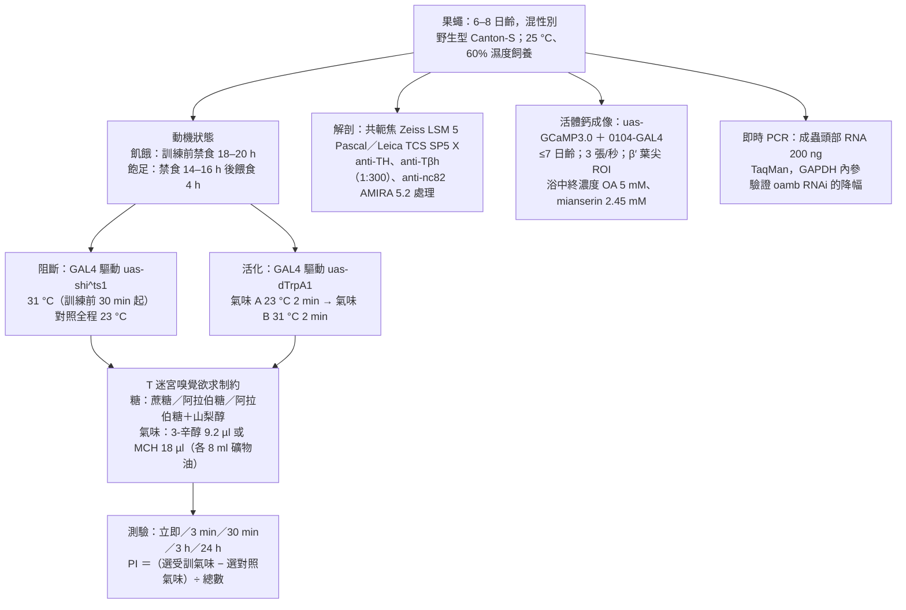
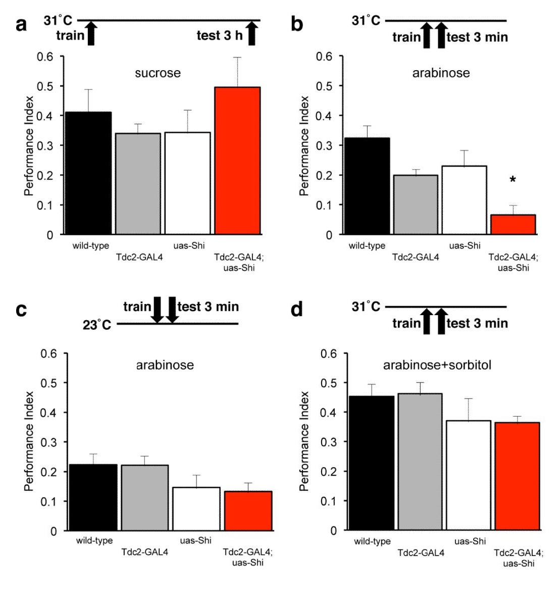
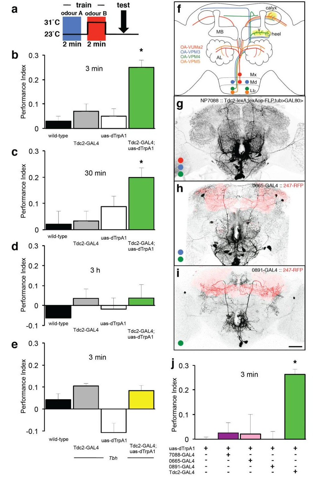
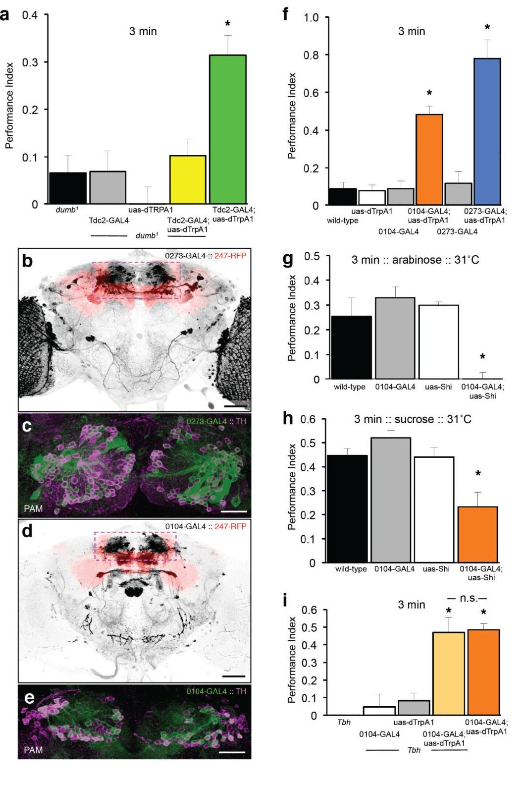
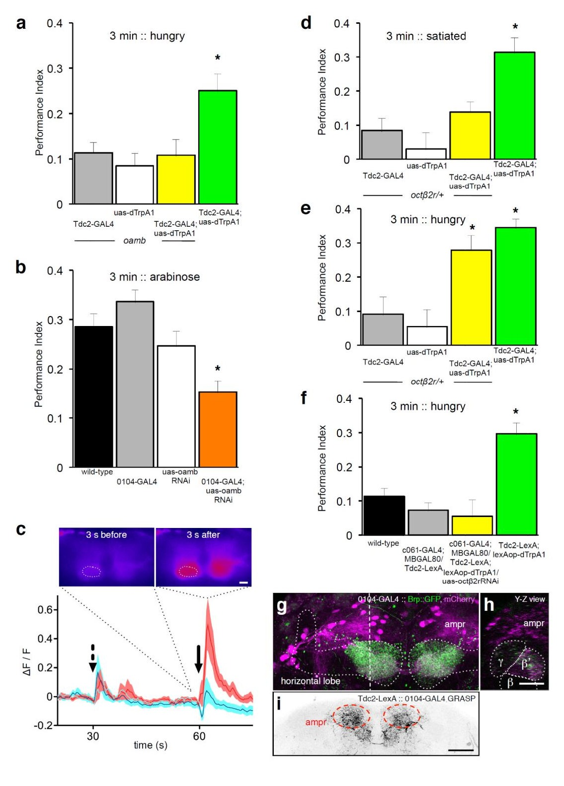

<!-- 本機 PDF：papers/2012-Layered%20reward%20signalling%20through%20octopamine%20and%20dopamine%20in%20Drosophila.pdf -->

# Layered reward signaling through octopamine and dopamine in *Drosophila*

**果蠅的獎賞訊號是分層的：章魚胺在上、多巴胺在下**

| 項目 | 內容 |
|---|---|
| **出處** | Nature 492(7429), 433–437 (2012). doi: 10.1038/nature11614 [全文（PMC 免費閱讀）](https://pmc.ncbi.nlm.nih.gov/articles/PMC3528794/) |
| 日期 | 刊期 2012-12-20（PDF 首頁）。投稿・修訂・接受日期本 PDF 未印：？待查。本 PDF 為 Europe PMC 作者稿，首頁載「available in PMC 2013 June 20」；查 DOI 取得 PMCID 時，Europe PMC 紀錄的首次發表日為 2012-10-28 |
| 通訊作者 | Scott Waddell（scott.waddell@cncb.ox.ac.uk）。PDF 只有英文名 |
| 作者 | 共 10 人：Christopher J. Burke、Wolf Huetteroth（**兩人為共同第一作者**，PDF 標 ＊）、David Owald、Emmanuel Perisse、Michael J. Krashes、Gaurav Das、Daryl Gohl、Marion Silies、Sarah Certel、Scott Waddell。與本庫有關者：無 |
| 機構 | University of Massachusetts Medical School 神經生物學系（Worcester）；University of Oxford 神經迴路與行為中心（CNCB）；Stanford University 神經生物學系；University of Montana 生物科學組與結構與功能神經科學中心。Krashes 現職 Beth Israel Deaconess Medical Center／哈佛醫學院。**作者的機構上標只有 1、2、4、5，沒有 3**（上標 3 被用來標「現職」），作者稿排版如此，不影響內容 |
| 資料庫 | 無（本篇沒有釋出資料或程式） |
| 補充資料 | 正文引用補充圖 S1–S10（S1 Tdc2 與酪胺、S2 子集阻斷、S3 PAM 解剖與 24 小時記憶、S4 *octβ1R*、S5 *oamb* RNAi 效率與蔗糖、S6 mianserin、S7 dNPF 受體、S8 Tdc2-LexA、S9 MB-MP1 阻斷、S10 GRASP）。PDF 第 8 頁只寫「Refer to Web version on PubMed Central for supplementary material」，**補充資料不在本 PDF 內，本庫未取得**；凡引到 S1–S10 的內容，本頁只能轉述正文的說法 |
| 編輯／審查 | *Nature* 不公開審查人，無 |

> 與本庫有關的作者：無。本篇是本庫 [[c-octopamine-reward-signal]] 陷阱 5 原本標為「？待查」的那篇：[[s-ichinose-2015-reward-recurrent-circuit]] 與 [[s-tumkaya-2025-synthetic-memory-inception]] 說「章魚胺在 PAM 多巴胺神經元的上游」時，引的就是本篇。
>
> 付費期刊（版權屬出版社）。本 PDF 是 **Europe PMC Funders Group 的作者稿**（Author Manuscript），不是出版社排版版，也不是 CC 授權；頁首每頁印「Nature. Author manuscript; available in PMC 2013 June 20」。全文請由資料表「出處」列的連結到 PMC 免費閱讀。**本庫不散布全文 PDF。** 本頁的圖擷取自原文，版權屬原出版社，以教學與評論目的引用，每張圖下方標明出處。

---

## 為什麼重要

本庫到目前為止談獎賞，談的都是多巴胺：[[s-ichinose-2015-reward-recurrent-circuit]] 的 PAM-α1 迴圈、[[s-felsenberg-2018-memory-extinction]] 的 PAM 寫下相反記憶、[[s-tumkaya-2025-synthetic-memory-inception]] 用光活化 PAM 當人工獎賞。但在昆蟲研究的傳統裡，獎賞的訊號是**章魚胺**（octopamine, OA）：蜜蜂的 VUMmx1 神經元被認為代表糖獎賞本身。本篇是把這兩套說法接起來的那一篇，也是本庫第一篇直接操作章魚胺神經元的來源。

本篇的結論是「分層」：章魚胺不是終點，而是上游。它把糖的**甜味**這一份傳給多巴胺神經元，多巴胺才把訊號送進蕈狀體（mushroom body, MB）。證據有三層：阻斷章魚胺神經元只在用「甜但沒有熱量」的糖訓練時才有影響；人工活化章魚胺神經元能取代糖形成記憶，但這記憶撐不過三小時，而且在多巴胺受體突變株裡形不成；反過來，活化 PAM 群多巴胺神經元，在完全沒有章魚胺的突變株裡照樣形成記憶。

對本庫來說，它直接填掉一個標著「？待查」的位置。[[c-octopamine-reward-signal]] 的陷阱 5 寫過一條推論：若獎賞真的走「章魚胺 → PAM 多巴胺 → KC」，那麼 [[s-tomchik-2009-camp-dynamics]] 與 [[s-gervasi-2010-pka-dynamics]] 把章魚胺直接泡在 Kenyon 細胞（KC）上量到的反應，不一定是真實獎賞學習時 KC 收到的訊號；當時本庫沒有收錄本篇，無法評估這條路徑。現在可以評估了——而答案比原本的推論更細：本篇指認的章魚胺受體不在 KC 上，而在**多巴胺神經元**上（OAMB 在 PAM，Octβ2R 在 MB-MP1）；本篇也沒有排除 KC 上的章魚胺受體，它根本沒有測。這讓矛盾 1.7、1.8 的「條件差異」多了一個維度，但沒有裁決它們（見專業文第五節第 8 點）。

---

## 論文摘要（原文與中譯）

> Dopamine (DA) is synonymous with reward and motivation in mammals. However, only recently has dopamine been linked to motivated behavior and rewarding reinforcement in fruit flies. Instead octopamine (OA) has historically been considered the signal for reward in insects. Here we show using temporal control of neural function in *Drosophila* that only short-term appetitive memory is reinforced by OA. Moreover, OA-dependent memory formation requires signaling through DA neurons. Part of the OA signal requires the α-adrenergic like OAMB receptor in an identified subset of mushroom body (MB)-targeted DA neurons. OA triggers an increase in intracellular calcium in these DA neurons and their direct activation can substitute for sugar to form appetitive memory, even in flies lacking OA. Analysis of the β-adrenergic like Octβ2R receptor reveals that OA-dependent reinforcement also requires an interaction with DA neurons that control appetitive motivation. These data suggest that sweet taste engages a distributed OA signal that reinforces memory through discrete subsets of MB-targeted DA neurons. In addition, they reconcile prior findings with OA and DA and suggest that reinforcement systems in flies are more similar to mammals than previously envisaged.

（*Nature* 的 Letter 摘要不分 Background／Results／Conclusion 段，照原樣一段。）

**中譯**（本節為忠實翻譯，非自撰內容）：

> 在哺乳類中，多巴胺（DA）等同於獎賞與動機。然而直到最近，多巴胺才被連上果蠅的動機性行為與獎賞性增強。長久以來，被認為是昆蟲獎賞訊號的反而是章魚胺（OA）。本文以果蠅神經功能的時間控制顯示，**只有短期**的欲求記憶由章魚胺增強。此外，依賴章魚胺的記憶形成，需要經過多巴胺神經元的訊號傳遞。章魚胺訊號的一部分，需要一群已指認的、投射到蕈狀體（MB）的多巴胺神經元中的 α-腎上腺素型受體 OAMB。章魚胺會讓這些多巴胺神經元的細胞內鈣上升，而直接活化它們可以取代糖來形成欲求記憶，即使在缺乏章魚胺的果蠅中也是如此。對 β-腎上腺素型受體 Octβ2R 的分析顯示，依賴章魚胺的增強還需要與另一群控制欲求動機的多巴胺神經元交互作用。這些資料顯示，甜味動用一個分散的章魚胺訊號，透過數個投射到蕈狀體的特定多巴胺神經元子群來增強記憶。此外，它們調和了先前關於章魚胺與多巴胺的發現，並顯示果蠅的增強系統比先前設想的更接近哺乳類。

---

## 科普文

想像一間餐廳的外場與內場。外場服務生嚐到客人說「這道好吃」，但他不負責把這件事寫進菜單；他把話傳給內場主廚，主廚才決定要不要把這道菜記下來。這篇論文說，果蠅腦裡的獎賞訊號就是這樣分成兩層：**章魚胺（octopamine）是外場，多巴胺（dopamine）是內場。**

**先交代果蠅怎麼學「哪個氣味有糖」。** 果蠅聞到氣味時，蕈狀體（mushroom body，腦中負責嗅覺學習的構造）裡一小群 Kenyon 細胞（KC）會活動，哪一群活動就代表哪個氣味。另外有一群多巴胺神經元，負責送來「這是好事還是壞事」的訊號。氣味和糖同時出現時，那一群 KC 與下游輸出神經元之間的接點（突觸）被改寫，之後再聞到同一個氣味，果蠅就會往那邊走。研究者用一種叫 T 迷宮（[[e-t-maze]]）的裝置量這件事：訓練後讓一群餓著的果蠅在 T 形管裡選邊，兩臂各放一種氣味，選對邊的比例減去選錯邊的比例，就是**表現指數**（performance index, PI，見 [[c-performance-index]]），0 表示沒學到。

**難題：章魚胺到底是獎賞本身，還是只是傳話的？** 1993 年蜜蜂的研究找到一顆叫 VUMmx1 的章魚胺神經元，只要活化它就能代替糖，讓蜜蜂學會一個氣味；從此「章魚胺＝昆蟲的獎賞」成了教科書說法。果蠅這邊，缺少章魚胺的突變株（*Tβh*，做不出章魚胺的酵素壞了）學不會糖獎賞。但 2012 年前後，另一批研究發現果蠅的 PAM 群多巴胺神經元也能代替糖。兩套說法同時成立，就表示其中一個在另一個的上游——問題是哪一個在上面。

**解法一：只在需要時關掉章魚胺神經元。** 作者用一個遇熱就失靈的工具（shibire^ts，[[e-shibire-ts]]）：平常 23 °C 一切正常，升到 31 °C 時，被指定的神經元送不出訊號。把章魚胺神經元在訓練期間關掉，再用蔗糖訓練——果蠅照樣學得會。這很意外。作者接著想到：蔗糖有兩種好處，一是甜味，二是熱量；也許章魚胺只管甜味，而熱量這一份自己就夠了。於是改用**阿拉伯糖**（arabinose，甜但果蠅代謝不了、沒有熱量）訓練，這次關掉章魚胺神經元，記憶明顯變差。再把阿拉伯糖加上無味但有熱量的山梨醇，效果又恢復。**所以章魚胺負責的是「甜」這一份，不是「飽」那一份。**

**解法二：反過來，直接活化章魚胺神經元，看它能不能取代糖。** 作者換一個遇熱就讓神經元放電的工具（dTrpA1）：讓果蠅聞第一種氣味時保持 23 °C，聞第二種氣味時升到 31 °C，等於告訴果蠅「第二種氣味有好事」。結果果蠅真的學會喜歡第二種氣味，而且這些果蠅是**吃飽的**——通常吃飽的果蠅對糖的記憶表現不出來。但這個人工記憶 30 分鐘還在，3 小時就沒了，連餓著測也沒有。**章魚胺造出來的，是撐不久的記憶。**

**解法三：把中間那一層拆開。** 如果章魚胺是外場、多巴胺是內場，那麼內場停工時，外場再怎麼喊也沒用；反過來，外場不在，內場自己照樣能寫。兩個實驗正好是這兩句話：在多巴胺受體壞掉的突變株（*dumb¹*）裡活化章魚胺神經元，學不起來；在完全沒有章魚胺的 *Tβh* 突變株裡活化 PAM 多巴胺神經元，學得和正常果蠅一樣好。而且活化多巴胺神經元得到的分數（PI 約 0.48 與 0.78）遠高於活化章魚胺神經元（約 0.25）。**獎賞訊號的最後一棒在多巴胺手上。**

**那中間是怎麼接的？** 作者查章魚胺的受體。章魚胺有好幾種受體，就像同一個聲音可以由不同的耳朵接收。缺少 OAMB 受體的果蠅，章魚胺活化形不成記憶；進一步只在那群 PAM 多巴胺神經元裡把 OAMB 的量壓低（RNAi），阿拉伯糖的記憶就變差。作者再把一種會隨鈣濃度變亮的螢光蛋白（GCaMP，[[e-gcamp]]）放進這些多巴胺神經元，直接把章魚胺倒在剖開的腦上——這些多巴胺神經元果然亮起來，而且先加阻斷劑（mianserin）就亮不起來。**章魚胺確實直接推動了這群多巴胺神經元。**

**代價一：那顆「蜜蜂的明星神經元」在果蠅身上不管用。** 果蠅腦裡只有四類章魚胺神經元會伸進蕈狀體，其中 OA-VUMa2 就是蜜蜂 VUMmx1 的對應者。作者用三個只標記其中一部分的果蠅品系，逐一活化——沒有一個能代替糖；逐一關掉，也沒有一個讓阿拉伯糖的記憶變差。**所以傳遞獎賞的章魚胺訊號是分散的，不是一顆明星細胞。** 這是本篇最反直覺的一段，也是它推翻前人圖像的地方。

**代價二：事情還牽涉到「餓不餓」。** 另一種章魚胺受體 Octβ2R 只要少一份（整個拿掉會死），吃飽的果蠅就學不起人工記憶；但同樣這些果蠅餓一晚之後又學得起來。作者追下去，發現要 Octβ2R 的地方是另一顆多巴胺神經元 MB-MP1——而這顆平常傳遞的是**壞事**（它被活化時果蠅學到的是躲避）。把它的 Octβ2R 壓低，或在活化章魚胺神經元的同時把它關掉，人工記憶都形不成。**獎賞訊號要成立，不只要推一把好的那條線，還要同時擺平壞的那條。**

**最容易被誤讀的一點：本篇沒有證明「章魚胺只做短期記憶」。** 摘要寫「只有短期的欲求記憶由章魚胺增強」，但撐不過三小時的，是**人工活化章魚胺神經元**造出來的記憶。在阻斷實驗這一側，作者唯一測過 3 小時的那一組用的是蔗糖（而蔗糖本來就不需要章魚胺）；**關掉章魚胺神經元、用阿拉伯糖訓練、量 3 小時記憶**這一組，本篇沒有做。所以「短期」這個限定來自人工活化的衰退曲線，不是來自自然訓練的實驗。

---

## 專業文

### 本頁用語

本頁各節可單獨查閱，故把反覆出現的詞集中在這裡。

| 詞 | 意思 |
|---|---|
| 蕈狀體（mushroom body, MB） | 果蠅腦中負責嗅覺學習與記憶的構造，左右各一。見 [[e-mushroom-body]] |
| KC（Kenyon cell） | 蕈狀體的主要神經元，代表氣味。見 [[e-kenyon-cell]] |
| 葉、萼部、腳跟（heel）、柄（peduncle） | KC 軸突成束處稱葉（α、β、α′、β′、γ）；萼部（calyx）是 KC 樹突所在；柄是各葉根部共同的一段；腳跟是 γ 葉彎折靠近柄的那一段 |
| DAN（dopaminergic neuron） | 多巴胺神經元。依細胞體位置分群：**PAM** 群多傳遞獎賞、**PPL1** 群多傳遞懲罰。見 [[e-dopaminergic-neuron]] |
| MB-MP1 | PPL1-γ1pedc 的舊名（本篇的寫法），支配 γ1 與柄這一格的 DAN，傳遞懲罰。見 [[e-ppl1-gamma1pedc]] |
| 章魚胺（octopamine, OA） | 昆蟲腦中的一種調節物質，作用類似哺乳類的正腎上腺素。見 [[c-octopamine-reward-signal]] |
| 酪胺（tyramine） | 章魚胺的前驅物，本身也是一種神經傳遞物。合成路徑：酪胺酸 →（TDC）→ 酪胺 →（Tβh）→ 章魚胺 |
| TDC、*Tdc2* | 酪胺酸脫羧酶，合成路徑的第一個酵素。*Tdc2* 是神經元版本的基因，*Tdc2*-GAL4 用來標記與操作大部分章魚胺神經元 |
| Tβh、*Tβh^nM18* | 酪胺 β-羥化酶，把酪胺變成章魚胺的酵素。*Tβh^nM18* 是它的突變株，完全做不出章魚胺，但酪胺照樣有（而且會累積） |
| OA-VUMa2／VPM3／VPM4／VPM5 | 四類伸進蕈狀體的章魚胺神經元（依 Busch et al. 2009 的命名）。VUMa2 是蜜蜂 VUMmx1 的果蠅對應者 |
| OAMB、Octβ2R、Octβ1R | 三種章魚胺受體。OAMB 屬 α-腎上腺素型，動員細胞內鈣倉庫放鈣；Octβ1R、Octβ2R 屬 β-腎上腺素型。*oamb^584*、*octβ2R^f05679*、*octβ1R（oa2^f02819）* 是對應的突變株 |
| DopR、*dumb¹* | 多巴胺受體（即本庫 [[e-dopamine-receptor]] 的 DopR1／dDA1）。*dumb¹* 是它的突變株 |
| GAL4／UAS、LexA／lexAop | 兩套互相獨立的「開關—被開啟端」系統。GAL4 或 LexA 由一段調控序列決定在哪些細胞製造，UAS 或 lexAop 接在要表現的基因前面。兩套並用，可在同一隻果蠅分別控制兩群細胞。見 [[e-split-gal4]] |
| GAL80 | GAL4 的抑制蛋白。`c061-GAL4;MBGAL80` 表示「用 c061 標記，但把蕈狀體裡的表現擋掉」，留下的是 MB-MP1 |
| InSITE 品系（0104、0273、0665、0891） | 本篇用的四個 PBac{IT.GAL4} 轉位子插入品系，來自 Gohl et al. 2011 的 InSITE 系統，各自標記不同的神經元子群 |
| shibire^ts1（shi^ts1） | 溫度敏感工具：>29 °C 時擋住突觸囊泡回收、神經元送不出訊號，<25 °C 恢復。回答「少了這群神經元行不行」。見 [[e-shibire-ts]] |
| dTrpA1 | 溫度敏感的陽離子通道，>25 °C 就讓神經元放電。回答「這群神經元夠不夠」。本篇的活化溫度是 31 °C |
| RNAi | 降低指定基因表現量的工具。本篇用 *oamb^RNAi*（降幅約 40%）與 *octβ2R^RNAi* |
| GCaMP3.0 | 隨細胞內鈣濃度變亮的螢光蛋白，用來看神經元活動。ΔF/F＝亮度變化量除以基線亮度。見 [[e-gcamp]] |
| mianserin | 章魚胺受體的拮抗劑（阻斷劑），本篇用來確認鈣反應確實由章魚胺受體引起 |
| GRASP | 「跨突觸夥伴的 GFP 重組」。兩群細胞各帶 GFP 的一半，膜貼得夠近時才拼出會發光的 GFP，用來找可能的接觸點。**它顯示的是相鄰，不等於有突觸** |
| Brp::GFP、DenMark | Bruchpilot 是突觸活化區的蛋白，Brp::GFP 標出突觸前（送訊號那一端）；DenMark 標樹突 |
| ampr | 前內側原腦（anterior medial protocerebrum），本篇指認的章魚胺—多巴胺接觸區；0104 標記的 PAM-DAN 的樹突推測在此 |
| 阿拉伯糖、山梨醇、蔗糖 | 阿拉伯糖（arabinose）甜但無熱量；山梨醇（sorbitol）有熱量但不甜；蔗糖（sucrose）兩者兼具 |
| PI（performance index） | 表現指數：走向受訓氣味的果蠅數減走向對照氣味的數，除以總數。一個 PI 值是同基因型果蠅用兩種氣味各訓練一次的平均。見 [[c-performance-index]] |
| 飽足（satiated）／飢餓（hungry） | 本篇的飽足＝先禁食 14–16 小時再餵食 4 小時；飢餓＝訓練前禁食 18–20 小時 |
| 人工記憶（implanted memory） | 不給真的糖，改以人工活化某群神經元配對氣味所形成的記憶。見 [[c-us-substitution]] |
| ※ 推論 | 論文沒有明說、本頁自行推得的內容，並寫出依據 |
| ？待查 | 值得查證但本頁刻意不填的內容 |

### 一、概述

**主要問題。** 果蠅的糖獎賞訊號究竟由章魚胺傳遞，還是由多巴胺傳遞？兩者若都參與，誰在誰的上游？

**重要性。** 2012 年以前，昆蟲的獎賞訊號與哺乳類被認為走不同的物質：哺乳類是多巴胺，昆蟲是章魚胺。本篇若成立，果蠅的增強系統就與哺乳類同型（多巴胺在最後一棒），而章魚胺退居上游的味覺訊號。這也直接影響本庫怎麼讀 [[s-tomchik-2009-camp-dynamics]] 與 [[s-gervasi-2010-pka-dynamics]]：那兩篇把章魚胺當成「獎賞的代用品」直接施加在 KC 上。

**發表當時的領域現狀（2012）。**

- 章魚胺側：Hammer 1993 在蜜蜂找到 VUMmx1，活化它可代替糖獎賞；Hammer & Menzel 1998 以局部注射章魚胺支持多處學習位點。果蠅這邊，Schwaerzel et al. 2003 主張多巴胺與章魚胺分別對應嫌惡與欲求記憶，並報告 *Tβh* 突變株形不成欲求記憶。
- 多巴胺側：Liu et al. 2012（本篇引為 ref 4，標為「Nature 2012」，當時應為同期或先行）報告 PAM 群的一個子集傳遞氣味記憶的獎賞；Kim, Lee & Han 2007 指出 *dumb¹*（DopR）突變的欲求記憶缺損可由在蕈狀體表現 DopR 救回。
- 糖的兩種屬性：Burke & Waddell 2011（本篇第一作者的前作）與 Fujita & Tanimura 2011 都指出甜味與營養分別貢獻欲求記憶，阿拉伯糖／山梨醇這組試劑即出自此。
- 動機狀態：Krashes et al. 2009（本篇作者群）指出神經肽 dNPF 調控 MB-MP1，使欲求記憶的**提取**限於飢餓的果蠅。
- 解剖圖譜：Busch, Selcho, Ito & Tanimoto 2009 的章魚胺神經元圖譜給出 OA-VUMa2／VPM3／VPM4／VPM5 這四類伸進蕈狀體的細胞，本篇的子集策略完全建立在這份圖譜上。

**體裁。** *Nature* 的 Letter（短篇原著論文），四張主圖、十張補充圖。正文沒有分「Results／Discussion」小標，推論與結果混寫。

### 二、方法

**行為。**

- 制約沿用 Burke & Waddell 2011 的欲求嗅覺協定，並做了兩項修改。阻斷實驗：31 °C 預熱 30 分鐘，並在訓練與 3 分鐘記憶測驗全程維持；允許溫度對照全程 23 °C。活化實驗：先在 23 °C 給氣味 A 兩分鐘，移入預熱的新管、立刻在 31 °C 給氣味 B 兩分鐘，再回 23 °C 測驗。
- 3 小時記憶：訓練後放在鋪濕濾紙的塑膠管中；24 小時記憶：訓練後先放食物管 3 小時，再禁食 21 小時後測驗。阻斷實驗的蔗糖組在 31 °C 下訓練並測驗 3 小時記憶（正文第 2 頁：「trained and tested for 3 h appetitive memory at 31°C」）；**訓練到測驗之間那 3 小時的保存溫度，正文與方法都未寫（？待查）**。
- 統計：ANOVA 之後做預先設定的配對比較，Tukey HSD 事後檢定（PRISM）。圖中的星號代表「該組與其他所有組都有顯著差異」。

**遺傳。** 雜交組合逐一列在方法中（例如要在 *Tβh* 背景下活化 Tdc2 神經元，用 *Tβh^nM18*/FM7i-GFP;uas-dTrpA1 雌蠅配 *Tβh^nM18*;Tdc2-GAL4 雄蠅，只取不帶 FM7i-GFP 的子代）。**對照組的設計值得注意：在突變背景的實驗中，異基因型對照也做在同一個突變背景裡**（例如 *oamb* 背景下的 Tdc2-GAL4/+ 與 uas-dTrpA1/+），所以比較的是「同樣是突變株，有沒有活化工具」。

**鈣成像。** 7 日齡以內的 uas-GCaMP3.0;0104-GAL4 果蠅，冰上麻醉後固定於成像腔，在 800 µl 無糖 HL3 類似液下打開頭殼。Pike CCD 相機、每秒 3 張、固定增益。先記錄 30 秒自發基線，加入 100 µl 生理食鹽水或 mianserin（12.5 mM）；再過 30 秒加入 100 µl 章魚胺（50 mM）或章魚胺加 mianserin，使浴中終濃度為章魚胺 5 mM、mianserin 2.45 mM。影像以 StackReg 對位後，在 β′ 葉尖取標準化 ROI；F 取前 24 張（＝前 8 秒）的平均。取施藥後 5 秒內的峰值做組間比較。

**解剖。** 原生螢光用 4% 多聚甲醛冰浴解剖、室溫真空固定 60–120 分鐘。抗 Tβh 染色改用 Bouin 液固定 20 分鐘。一抗濃度：anti-Tβh 1:300、anti-nc82 與 anti-GFP 各 1:200、anti-TH（AB152, Millipore）1:200。**部分影像中，腦表面的碎屑與觸角／味覺神經被人工從共軛焦切面中刪除，以便做出乾淨的投影圖**（方法明載）。

**即時 PCR。** 成蟲頭部總 RNA 以 Trizol 抽取、RNeasy 清洗並 DNase I 處理；200 ng 反轉錄後以 ABI PRISM 7000 做 TaqMan 定量（OAMB 探針 Dm02150048m_1，內參 GAPDH）。這是補充圖 5A 的「約 40% 降幅」的來源。

### 三、結果

#### 3.1 阻斷章魚胺神經元：只有「甜而無熱量」的糖受影響（圖 1）

以 Tdc2-GAL4 驅動 shi^ts1，在 31 °C 阻斷全部（或大部分）章魚胺神經元：

| 訓練用糖 | 測驗時間 | 結果 | 統計 |
|---|---|---|---|
| 蔗糖（甜＋有熱量） | 3 小時 | 無差異 | 全部 p > 0.4，n ≥ 6 |
| 阿拉伯糖（甜、無熱量） | 3 分鐘 | **顯著受損** | p < 0.05，n ≥ 10 |
| 阿拉伯糖（23 °C 對照） | 3 分鐘 | 無差異 | 全部 p > 0.1，n ≥ 8 |
| 阿拉伯糖＋山梨醇（甜＋有熱量） | 3 分鐘 | 無差異 | 全部 p > 0.4，n ＝ 8 |

> 依圖 1 逐柱判讀（※）：阿拉伯糖組的 Tdc2-GAL4;uas-shi 約 0.065，三個對照約 0.32／0.20／0.23（平均 0.25），**降幅約 74%**。這個降幅是本頁算的，論文只說「significantly impaired」。

**評價。** 這是乾淨的雙向對照設計（高溫 vs 允許溫度、有熱量 vs 無熱量），結論「章魚胺只傳遞甜味這一份」在本篇內部一致。弱點是阻斷的完全性未驗證（shi^ts1 的通病，見 [[e-shibire-ts]]），而「無差異」的三組都是陰性結果，n ＝ 6–8 時偵測小效應的能力有限。

#### 3.2 人工活化章魚胺神經元可取代糖，但記憶短命（圖 2a–e）

以 Tdc2-GAL4 驅動 dTrpA1，在氣味 B 出現時加熱到 31 °C：

- 立即（3 分鐘）記憶：Tdc2-GAL4;uas-dTrpA1 顯著高於全部其他組（p < 0.001，n ≥ 14），**而且果蠅是飽足的**。
- 30 分鐘仍顯著（p < 0.05，n ≥ 8）。
- 3 小時：全部組無差異，**即使餓著測**（p > 0.5，n ＝ 6）。
- 在 *Tβh* 突變株（做不出章魚胺）中活化 Tdc2 神經元：無顯著學習（p > 0.05，n ≥ 8）——確認起作用的是章魚胺本身，不是 Tdc2 神經元共同釋放的酪胺。

**評價與一處條件落差。** 「人工記憶需要章魚胺」這一步很關鍵，因為 Tdc2-GAL4 標的細胞也含酪胺（補充圖 1）。但**圖 2b、2c 的示範做在飽足果蠅上（圖 2d 另以飢餓果蠅重做，原文「even in hungry flies」），圖 2e 的 *Tβh* 對照做在飢餓果蠅上**（圖說明載）。本篇自己在圖 4d、4e 證明了飢餓與飽足會改變同一個實驗的結果（*octβ2R*/+ 飽足學不起來、飢餓學得起來），所以跨狀態的陰性結果需要保留。⚠️ 這是條件不對齊，不是數據互相矛盾。

#### 3.3 伸進蕈狀體的四類章魚胺神經元，既不充分也不必要（圖 2f–j）

作者用三個涵蓋範圍遞減的品系拆解：NP7088（廣泛涵蓋 Tdc2 神經元，但不含 OA-VPM5）、0665-GAL4（OA-VPM3 與 OA-VPM4）、0891-GAL4（只有 OA-VPM4）。

- 活化任一組：均不形成欲求記憶（p > 0.05，n ≥ 6）；同圖的 Tdc2-GAL4 陽性對照約 0.26。
- 阻斷任一組：阿拉伯糖記憶均未顯著受損（補充圖 2，未取得）。

作者的推論鏈：蜜蜂 VUMmx1 的果蠅對應者 OA-VUMa2 因此「既不充分也不必要」；剩下的可能是（a）只支配萼部的 OA-VPM5 關鍵，或（b）需要一個分散的、包含非蕈狀體章魚胺神經元的訊號。到第 3.7 節，作者以「OA-VPM5 在 ampr 與腳跟都沒有分枝」排除了 (a)，選擇 (b)。

**評價。** 這是本篇最強的否定結果，也是推翻前人圖像的地方。但它完全建立在三個品系的涵蓋範圍上，而涵蓋範圍是引用 Busch et al. 2009 與圖 2g–i 的影像判定的；本篇沒有做單細胞解析度的驗證（例如 MCFO 之類的隨機單細胞標記）。品系涵蓋範圍的不確定，是本庫反覆踩到的坑（見 [[e-split-gal4]]、[[syn-contradictions]] 1.4、1.5）。

#### 3.4 多巴胺在章魚胺的下游（圖 3）

| 實驗 | 結果 |
|---|---|
| 在 *dumb¹*（DopR 突變）中活化 Tdc2 神經元 | 無顯著記憶；同圖的非突變 Tdc2-GAL4;uas-dTrpA1 對照 p < 0.001（n ≥ 8） |
| 活化 0273-GAL4（全部約 130 顆 PAM-DAN） | PI 約 0.78，顯著高於所有對照（p < 0.01，n ≥ 4） |
| 活化 0104-GAL4（約 40 顆 PAM-DAN） | PI 約 0.48，顯著 |
| 以 0104-GAL4 阻斷，阿拉伯糖訓練 | 記憶被**消除**（p < 0.001，n ≥ 8） |
| 以 0104-GAL4 阻斷，蔗糖訓練 | 初期記憶**顯著受損但未消除**（p < 0.05，n ≥ 6） |
| 只在訓練期間阻斷 0104，測蔗糖 24 小時記憶 | 被消除（補充圖 3B，未取得） |
| 在 *Tβh*（沒有章魚胺）中活化 0104 或 0273 | 與野生型背景無統計差異（圖 3i 標 n.s.；p < 0.001，n ≥ 6） |

> 本頁推算（※）：阿拉伯糖條件下，阻斷 PAM-DAN 的降幅約 98%（0104;uas-shi 約 0.005 vs 三對照平均約 0.29），阻斷章魚胺神經元只有約 74%（3.1 節）。**兩者都「critical」，但不是同一個量級**——這個對比論文沒有並列，它支持的正是「章魚胺只傳遞甜味這一份，多巴胺傳遞全部」。

**評價。** 下游關係的證據是雙向的（上游壞掉時下游仍可寫入；下游壞掉時上游推不動），這比單向的充分性實驗強得多。保留之處：*dumb¹* 是全身性突變，所以「多巴胺系統要能運作」成立，「DopR 要在 KC 上」則是引用 Kim 2007，本篇沒有做細胞專一的救援。

#### 3.5 接點在 OAMB：行為、受體與鈣成像（圖 4a–c）

- 在 *octβ1R*（oa2）突變中活化 Tdc2 神經元：學習正常（補充圖 4，未取得）。
- 在 *oamb^584* 突變（飢餓）中：學不起來；只有非突變的 Tdc2-GAL4/uas-dTrpA1 顯著（p < 0.01，n ≥ 8）。
- 只在 0104-GAL4 的 PAM-DAN 裡以 RNAi 降低 OAMB，用阿拉伯糖訓練：顯著低於兩個對照（p < 0.05，n ≥ 18）。轉錄本降幅約 40%（補充圖 5A）。
- 同樣的果蠅改用蔗糖訓練：無效應（補充圖 5B，未取得）——與 3.1 節的蔗糖結果一致。
- 鈣成像：浴中加 5 mM 章魚胺，0104 標記的 PAM-DAN 在 β′ 葉尖的 GCaMP3.0 訊號顯著上升；先加 2.45 mM mianserin 則顯著降低（各 n ＝ 11）。

> 本頁推算（※）：圖 4b 中 0104-GAL4;uas-oamb^RNAi 約 0.153，三個對照約 0.287／0.336／0.247（平均 0.29），降幅約 47%；而轉錄本只降約 40%。**部分敲低對應部分缺損**，與「OAMB 在這群細胞中是必要的」相容；但也表示這個行為缺損不是全有全無，論文沒有討論劑量關係。

**評價。** 這一節是本篇的分子核心，三種證據（突變、細胞專一敲低、藥理與成像）互相補強。最大的保留：鈣成像是**浴灌外加章魚胺到剖開的腦**，5 mM 是極高的濃度（見下節與 [[c-octopamine-reward-signal]] 的劑量討論），而且沒有在真正吃糖時量 PAM-DAN 的反應。所以「糖 → 章魚胺釋放 → PAM-DAN 被推動」的中間那一步，本篇沒有直接量到。

#### 3.6 Octβ2R、動機狀態與 MB-MP1（圖 4d–f）

- *octβ2R* 同型合子致死，只能測 *octβ2R*/+ 異型合子。**飽足**的 *octβ2R*/+ 果蠅人工記憶形不成（p > 0.05；非突變對照 p < 0.05，n ＝ 8）；同樣基因型**飢餓**後又形成（p < 0.05，n ≥ 6）。
- 章魚胺的作用與 dNPF 無關：在 dNPF 受體突變株中人工學習正常（補充圖 7，未取得）。
- 以 Tdc2-LexA 驅動 lexAop-dTrpA1 活化章魚胺神經元，同時以 c061-GAL4;MBGAL80 在 MB-MP1 表現 *octβ2R^RNAi*：記憶形不成（p > 0.05；陽性對照 p < 0.001，n ≥ 8）。
- 獨立驗證：活化章魚胺神經元的同時以 shi^ts1 阻斷 MB-MP1，也沒有顯著記憶（補充圖 9，未取得）。

**作者的解讀：** MB-MP1 若被人工活化會造成**嫌惡**增強（引 Aso et al. 2010），所以它對這套系統提供負向影響；章魚胺必須經 Octβ2R 調節這個負向訊號，獎賞增強才成立。

**評價。** 這一段的因果方向是推論，不是量測。本篇沒有量章魚胺作用於 MB-MP1 時它的活動往哪個方向變（是被壓下去還是被推上去），所以「調節負向訊號」的具體內容未定。⚠️ 另見第五節第 5 點：Tdc2-LexA 這組實驗的工具組合換了一整套（LexA 驅動活化、GAL4 驅動 RNAi），與圖 2–4 其他各圖的 GAL4 活化不是同一個系統，陽性對照的絕對值因此不能跨圖比較。

#### 3.7 解剖：0104 的突觸前在 β′ 與 γ 葉尖，接觸點在 ampr（圖 4g–i）

- 0104-GAL4 同時表現 mCherry 與 Brp::GFP：突觸前標記只出現在水平葉尖端；Y–Z 切面顯示只在 β′ 與 γ 葉尖，β 葉沒有。ampr 中 Brp::GFP 陰性的分枝推定為樹突。
- GRASP：Tdc2-LexA 與 0104-GAL4 之間、Tdc2-LexA 與 c061-GAL4;MBGAL80（MB-MP1）之間，都在 ampr 出現強訊號；MB-MP1 這一組另外在蕈狀體腳跟出現訊號。
- 排除推理：最可能橋接 ampr 與腳跟的是 OA-VPM4，但它已被 0891-GAL4 乾淨標記，而 0891 的活化無效（3.3 節）；其餘支配 ampr 的 OA-VUMa6／a7／a8 與 VPM3 都在 NP7088 的涵蓋範圍內，而 NP7088 也無效；只支配萼部的 OA-VPM5 在 ampr 與腳跟都沒有分枝，不可能直接調控 PAM 或 MB-MP1。**結論：傳遞獎賞的章魚胺來自一組分散的神經元。**

**評價。** 這是一段完全由「排除」構成的論證，它的強度等於品系涵蓋範圍的可靠度（見 3.3 節的評價）。作者自己在最後一句留了退路：「我們推測章魚胺的增強可能還需要同時調控其他未指認的多巴胺神經元，或涉及其他平行的章魚胺作用模式。」

### 四、討論

**主張一：章魚胺只傳遞甜味、不傳遞營養。** 證據強。三種糖的對比（蔗糖／阿拉伯糖／阿拉伯糖＋山梨醇）加上允許溫度對照，方向一致。營養那一份也經過 PAM 多巴胺神經元（正文第 3 頁：PAM「unlike OA neurons, they also contribute towards the reinforcing effects of nutritious sucrose」；補充圖 3B：只在訓練時阻斷 0104，蔗糖的 24 小時記憶就消失，補充圖本庫未取得、依正文轉述）；但多巴胺上游由誰傳遞營養訊號，本篇沒有處理。

**主張二：章魚胺增強的記憶是短期的。** 證據**中等偏弱**，而且摘要的說法比資料寬。衰退曲線（圖 2b–d）量的是**人工活化**造成的記憶；阻斷側唯一的 3 小時實驗用的是蔗糖（圖 1a），而蔗糖的記憶本來就不需要章魚胺。所以「自然訓練時章魚胺只貢獻短期記憶」這個句子，本篇沒有對應的實驗。見第五節第 7 點。

**主張三：多巴胺在章魚胺的下游。** 證據強。雙向實驗（*dumb¹* 擋住上游、*Tβh* 不擋下游）加上效果量的差距（PAM 活化 0.48–0.78 vs 章魚胺活化 0.25）。

**主張四：OAMB 在 PAM-DAN 上提供接點。** 證據強度中上。細胞專一敲低 ＋ 鈣成像 ＋ 拮抗劑三條線互相支持。弱點是鈣成像用的是浴灌 5 mM 的外加章魚胺，與生理釋放的量級關係未知。

**主張五：獎賞的章魚胺訊號是分散的，不是 VUMa2 一顆。** 證據是三組否定結果。它推翻了「蜜蜂 VUMmx1 的果蠅同源細胞＝獎賞」這個直接類比，是本篇最有價值的結論；但否定結果的強度受品系涵蓋範圍與統計檢力限制（n ≥ 6）。

**主張六：章魚胺也要擺平負向的 MB-MP1。** 證據中等。兩條互相獨立的操作（RNAi 與 shi 阻斷）得到同向結果，這點不錯；但 MB-MP1 在章魚胺作用下的活動變化沒有量，而且與動機狀態的交互（圖 4d、4e）只有行為層次的相關，沒有機制。

**主張七：果蠅的增強系統比先前設想更接近哺乳類。** 這是論述，不是結果。它成立與否取決於「最後一棒是誰」這個類比層次，本篇沒有給跨物種的定量比較。

### 五、問題與限制

**1. 補充資料全部未取得。** 十張補充圖中，有四個關鍵結果只存在補充圖裡：子集阻斷的陰性結果（S2）、蔗糖 24 小時記憶（S3B）、*oamb* RNAi 的 40% 降幅與蔗糖對照（S5A、S5B）、MB-MP1 阻斷的獨立驗證（S9）。本頁只能轉述正文的敘述，無法檢查圖與統計。

**2. 品系涵蓋範圍是整個排除論證的單點依賴。** 3.3 與 3.7 的結論都靠「某品系標了／沒標某類細胞」，而這些判定大多引自 Busch et al. 2009 或由投影影像判讀。若 NP7088 漏標了某一類（或 Tdc2-GAL4 標到圖譜之外的章魚胺神經元），結論會變。

**3. shi^ts1 與 dTrpA1 的溫度操作本身是一種干擾。** 31 °C 既是阻斷／活化的開關，也改變果蠅的整體狀態。本篇做了允許溫度對照（圖 1c），這點做到了；但活化實驗（圖 2–4）用的是「氣味 A 在 23 °C、氣味 B 在 31 °C」的設計，**溫度與氣味身分完全共變**，所以「果蠅學到的是氣味 B 配好事」與「果蠅學到的是氣味 B 配溫度變化」在設計上靠的是對照組（只帶 GAL4 或只帶 UAS 的果蠅同樣經歷溫度變化）來分離，不是靠平衡設計。

**4. 鈣成像的濃度與製備距離生理很遠。** 浴中終濃度 5 mM 章魚胺；本庫 [[s-tomchik-2009-camp-dynamics]] 的劑量反應範圍是 10 nM–10 mM，[[s-gervasi-2010-pka-dynamics]] 用 1–100 µM。5 mM 比 Gervasi 的最高濃度高 50 倍。n ＝ 11，只量一個 ROI（β′ 葉尖），而 PAM-DAN 的樹突在 ampr——**量的是軸突端的鈣，受體作用的位置可能在樹突端**（※ 推論：依 3.7 節的 Brp::GFP 與 GRASP 結果；論文沒有說明為何選 β′ 葉尖）。

**5. 圖 4f 換了一整套工具系統。** 這組用 Tdc2-LexA 驅動活化、GAL4 驅動 RNAi，其餘各圖都是 GAL4 驅動活化。Tdc2-LexA 是本篇新做的品系（補充圖 8，未取得），其涵蓋範圍是否與 Tdc2-GAL4 相同，無法檢查。

**6. *octβ2R* 只能測異型合子。** 同型合子致死（論文以頁尾註標明）。只少一份基因就有行為表型，可能表示劑量敏感，也可能表示該插入有其他影響；本篇沒有做回復突變或細胞專一的救援。

**7. 本庫稽核：摘要的「only short-term」在本篇沒有對應的阻斷實驗。** 阻斷章魚胺神經元 ＋ 阿拉伯糖 ＋ 3 小時記憶這一組，正文與四張主圖都沒有（已 `grep` 全文的 "arabinose"、"3 h" 與全部圖說確認）。本篇測過 3 小時記憶的阻斷實驗只有圖 1a，用的是蔗糖；而蔗糖條件下章魚胺本來就可有可無。所以摘要的限定詞來自圖 2b–d 的人工活化衰退曲線。**這是一個把「用 A 方法得到的限制」寫成「這個訊號的一般性質」的推廣**，讀者引用時要連方法一起引。

**8. 本庫稽核：本篇沒有測 KC 上有沒有章魚胺受體。** 全文（含方法與全部圖說）搜 "Kenyon" 與 "KC" 的結果是 0 筆；論文提到蕈狀體神經元的唯一一處是「prior work suggests that MB neurons are the likely eventual destination of appetitive reinforcement signals」（引前人文獻，第 2 頁），本篇自己沒有做任何 KC 層次的量測或操作。所以**本篇不能用來否定** [[s-tomchik-2009-camp-dynamics]] 與 [[s-gervasi-2010-pka-dynamics]] 在 KC 上量到的章魚胺反應，也不能用來裁決 [[syn-contradictions]] 1.7、1.8。它改變的是這些反應的**詮釋**：若生理上的獎賞訊號經由 PAM-DAN 進入蕈狀體，那麼直接浴灌章魚胺所量到的 KC 反應，其對應的生理情境就不清楚了（※ 推論）。

**9. 單篇自身不一致（不需裁決）。**
- ⚠️ **溫度對不上。** 正文第 2 頁寫「在 25 °C 訓練與測驗的各組之間沒有顯著差異（圖 1c）」，但圖 1c 的標示與方法一節都寫 **23 °C**。
- ⚠️ **圖 4h 的交叉引用指錯格。** 圖說寫「Y–Z 切面（在 b 中虛線的位置）」，但圖 4b 是柱狀圖（阿拉伯糖 ＋ *oamb* RNAi），虛線在圖 4g。
- ⚠️ **圖 4f 圖說引用第 42 筆文獻**（"Uas-octβ2R^RNAi efficacy has been reported42"），而本 PDF 的參考文獻只到第 37 筆。
- ⚠️ 正文把品系寫成「0273- and 0104-GAL4-GAL4 lines」（GAL4 重複），屬排版。
- 條件落差（見 3.2）：*Tβh* 的陰性對照在飢餓果蠅上做（圖 2e），而示範實驗主要在飽足果蠅上做（圖 2b、2c；只有圖 2d 用飢餓果蠅）；圖 3i 的 *Tβh* 實驗又回到飽足。本篇自己證明了狀態會翻轉結果（圖 4d vs 4e）。

**10. 本庫稽核：PAM 群的「約 130 顆」與庫內既有數字不同，但不是矛盾。** [[s-aso-2016-dan-cell-type-rules]] 寫 R58E02-GAL4 約 90 顆 PAM。本篇的 ~130 是「以 anti-TH 共染判定的 PAM 群全部細胞」，Aso 的 ~90 是「某個驅動品系標到的數目」——**分母不同**，依本庫規則先查定義欄再決定要不要開矛盾，此處不開（見 [[numbers]]）。

### 六、未來

**論文自陳的方向。** 最後一段明寫兩個開口：章魚胺的增強可能還需要同時調控其他尚未指認的多巴胺神經元；也可能涉及其他平行的章魚胺作用模式。另外，營養訊號（不需要章魚胺的那一份）也經過 PAM 多巴胺神經元（正文第 3 頁），但多巴胺上游由誰傳遞營養訊號，本篇沒有處理。

**本庫關注的後續。** 這篇留下的開口，庫內有三處接得上。(a) [[c-octopamine-reward-signal]] 的陷阱 5 可以把「？待查」改寫成有來源的敘述，並把 [[s-tomchik-2009-camp-dynamics]]、[[s-gervasi-2010-pka-dynamics]] 的 KC 層次結果放到「受體位置不同」這個框架下重讀。(b) [[s-ichinose-2015-reward-recurrent-circuit]] 的 PAM-α1 寫入長期獎賞記憶，而本篇的 0104 標的是 β′／γ 葉尖的 PAM（※ 推論：依圖 4g、4h 的 Brp::GFP 分布，論文沒有寫出對應的區室名），兩者是不是同一群需要對照——本篇人工植入的章魚胺記憶撐不過 3 小時，Ichinose 的 α1 迴圈管 24 小時記憶，兩者可能分屬不同的 PAM 子群；但同一篇也說 0104 對蔗糖的 24 小時記憶是必要的，所以這個推論只能限定在「章魚胺那一份」（※ 推論）。(c) [[e-ppl1-gamma1pedc]]（＝本篇的 MB-MP1）在本庫一向以「懲罰」的身分出現（Hige 2015〔[[s-hige-2015-heterosynaptic-plasticity]]〕、Aso 2016、Huang 2024）；本篇讓它在**獎賞**的迴路裡扮演一個必須被調節的角色，這一條要寫進該實體頁。

**尚未被回答的。** 真正吃糖時，章魚胺神經元放多少電、PAM-DAN 被推動多少，本篇沒有量（鈣成像是外加藥物）。章魚胺作用在 MB-MP1 上之後，MB-MP1 的活動往哪個方向變，也沒有量。這兩個缺口要等能在行為中同時量 DAN 活動的方法——本庫目前最接近的是 [[s-huang-2024-dopamine-memory-dynamics]] 的電壓成像，但它只量 PPL1 群，沒有量 PAM，也沒有測章魚胺。

---

## 圖

本篇共四張主圖，全部收錄（補充圖 S1–S10 不在 PDF 內，未取得）。四張圖都由 300 dpi 整頁渲染裁切，分格字母與座標軸均已確認完整。

<small>圖片出處：Burke CJ, Huetteroth W, Owald D et al. *Nature* 492(7429):433–437 (2012)，Figure 1。© 2012 Nature Publishing Group，教學引用；全文見 [PMC](https://pmc.ncbi.nlm.nih.gov/articles/PMC3528794/)。</small>

> **原圖說（Figure 1）：** Octopamine mediates the short-term reinforcing effects of sweet taste. **a**, Blocking OA neurons with *Tdc2*-GAL4/uas-*shi*^ts1 during conditioning with sucrose lacks consequence (all p>0.4, n≥6). **b**, Blocking OA neurons during conditioning with arabinose significantly impairs appetitive learning, (p<0.05, n≥10). **c**, No significant defect is observed when flies are conditioned with arabinose at 23°C, (all p>0.1, n≥8). **d**, Blocking OA neurons during conditioning with sorbitol supplemented arabinose has no significant effect (all p>0.4, n=8). Data are mean ± standard error of the mean (s.e.m.). Asterisks denote significant difference between marked groups and all others (all p<0.05, ANOVA).

**圖說中譯：** 章魚胺居中傳遞甜味的短期增強作用。(a) 以 *Tdc2*-GAL4/uas-*shi*^ts1 在蔗糖制約期間阻斷章魚胺神經元，沒有影響（全部 p > 0.4，n ≥ 6）。(b) 在阿拉伯糖制約期間阻斷章魚胺神經元，顯著損害欲求學習（p < 0.05，n ≥ 10）。(c) 在 23 °C 以阿拉伯糖制約時沒有顯著缺損（全部 p > 0.1，n ≥ 8）。(d) 以添加山梨醇的阿拉伯糖制約時，阻斷章魚胺神經元沒有顯著影響（全部 p > 0.4，n ＝ 8）。資料為平均值 ± 標準誤。星號表示被標記的組與其他所有組都有顯著差異（全部 p < 0.05，ANOVA）。

**解讀：**
- **這張圖真正該看的是 a 與 d 的「沒有差異」，不是 b 的星號。** b 證明章魚胺在某個條件下有用，a 與 d 才界定了那個條件：只要糖帶有熱量，章魚胺就可有可無。兩個陰性結果承擔了整篇論文的範圍限定。
- **算一下降幅，論文沒算。** b 圖中實驗組約 0.065、三個對照約 0.32／0.20／0.23（※ 從圖判讀），降幅約 74%，不是歸零。對比圖 3g 阻斷 PAM-DAN 時降到約 0.005（約 98%），兩者的量級不同——這支持「章魚胺只是訊號的一部分」，而不是「章魚胺＝獎賞訊號」。
- **四格的測驗時間不同，縱軸卻一樣。** a 是 3 小時記憶，b、c、d 是 3 分鐘記憶，但四格的縱軸都是 0–0.6 的表現指數。視覺上四格可以並排比較，實際上 a 與其餘三格量的是不同時間點的記憶，**不能跨格比高低**。
- **c 的整體水準明顯低於 b。** 23 °C 對照組的四根柱子都在 0.13–0.23 之間，而 b 的三個對照在 0.20–0.32。這表示低溫本身會壓低阿拉伯糖的記憶表現。它不影響 c 的結論（組間無差異），但提醒一件事：b 與 c 不是「同樣的實驗只差溫度」，兩者的基線不同。
- **踩煞車：本圖的任何一格都不足以支持摘要的「只有短期」。** a 是唯一測 3 小時的阻斷實驗，用的卻是章魚胺可有可無的蔗糖（見第五節第 7 點）。

<small>圖片出處：Burke CJ, Huetteroth W, Owald D et al. *Nature* 492(7429):433–437 (2012)，Figure 2。© 2012 Nature Publishing Group，教學引用；全文見 [PMC](https://pmc.ncbi.nlm.nih.gov/articles/PMC3528794/)。</small>

> **原圖說（Figure 2）：** OA neuron stimulation can replace sugar presentation during conditioning to form short-term appetitive memory. **a**, Conditioning protocol pairing a 2 min odour presentation with heat-activation (red) of uas-*dTrpA1* expressing neurons. **b**, *Tdc2*-GAL4/uas-*dTrpA1* driven OA neuron activation contingent with odour presentation forms appetitive olfactory memory in satiated flies (p<0.001, n≥14). **c**, Implanted memory remains significant 30 min after training in satiated flies (p<0.05, n≥8). **d**, No memory is observed at 3 h, even in hungry flies (p>0.5, n=6). **e**, Implanting memory with *Tdc2*-GAL4 neuron stimulation requires OA. Artificial conditioning does not form significant memory in hungry *Tβh* flies (p>0.05, n≥8). **f**, Schematic of all four OA neurons that innervate the MB calyx (OA-VUMa2, OA-VPM5, plus the antennal lobe, AL), heel (OA-VPM4, plus the MB γ lobe), or calyx and heel (OA-VPM3). Somata reside in the maxillary (Mx), mandibulary (Md), or labial (Lb) neuromere. **g**, NP7088-GAL4 expresses in many *Tdc2* positive OA neurons. Projection of OA neurons common to *Tdc2*-GAL4/*Tdc2*-LexA and NP7088-GAL4 revealed by genetic intersection. MB-OA cell types in each GAL4 are colour-coded. **h**, 0665-GAL4 labels MB-innervating OA-VPM3 and OA-VPM4 neurons; 247-RFP labeled MB (red). **i**, 0891-GAL4 specifically labels MB-innervating OA-VPM4 neurons. Scale bar 50 μm. **j**, Stimulating OA neuron subsets cannot replace sugar presentation in appetitive conditioning. (p>0.05, n≥6).

**圖說中譯：** 制約期間刺激章魚胺神經元可取代糖的呈現，形成短期欲求記憶。(a) 制約協定：2 分鐘氣味呈現配上表現 uas-*dTrpA1* 的神經元之熱活化（紅）。(b) 以 *Tdc2*-GAL4/uas-*dTrpA1* 在氣味呈現時活化章魚胺神經元，在**飽足**果蠅中形成欲求嗅覺記憶（p < 0.001，n ≥ 14）。(c) 植入的記憶在訓練後 30 分鐘於飽足果蠅中仍顯著（p < 0.05，n ≥ 8）。(d) 3 小時時觀察不到記憶，即使在飢餓果蠅中也是如此（p > 0.5，n ＝ 6）。(e) 以 *Tdc2*-GAL4 神經元刺激植入記憶需要章魚胺；人工制約在飢餓的 *Tβh* 果蠅中形不成顯著記憶（p > 0.05，n ≥ 8）。(f) 四類伸進蕈狀體的章魚胺神經元示意圖：支配萼部者為 OA-VUMa2 與 OA-VPM5（並支配嗅葉 AL），支配腳跟者為 OA-VPM4（並支配 γ 葉），同時支配萼部與腳跟者為 OA-VPM3。細胞體位於上顎（Mx）、下顎（Md）或唇（Lb）神經節。(g) NP7088-GAL4 在許多 *Tdc2* 陽性的章魚胺神經元中表現；以遺傳交集顯示 *Tdc2*-GAL4/*Tdc2*-LexA 與 NP7088-GAL4 共有的章魚胺神經元投射。各 GAL4 中的蕈狀體章魚胺細胞型別以顏色標示。(h) 0665-GAL4 標記支配蕈狀體的 OA-VPM3 與 OA-VPM4；247-RFP 標記蕈狀體（紅）。(i) 0891-GAL4 專一標記支配蕈狀體的 OA-VPM4。比例尺 50 µm。(j) 刺激章魚胺神經元的子群，不能在欲求制約中取代糖的呈現（p > 0.05，n ≥ 6）。

**解讀：**
- **j 是全篇最重要的一格，而它被放在角落。** 五根柱子中只有最右邊的 Tdc2 全體（約 0.26）有星號，另外三個子群都貼著 0。這一格推翻了「蜜蜂 VUMmx1 的果蠅同源細胞＝獎賞訊號」這個延續近二十年的類比。但它是陰性結果，n ≥ 6，而 7088 與 0665 兩組的誤差棒很長（上緣到約 0.09–0.11，※ 從圖判讀），所以「不能代替糖」的強度不如柱高看起來那麼確定。
- **b 與 e 的果蠅狀態不同，圖上看不出來。** b、c 是飽足，e 是飢餓（兩處圖說明載），而圖 4d、4e 證明飽足與飢餓會讓同一個實驗翻轉。e 是陰性結果，所以狀態差異值得記在旁邊。
- **d 的縱軸從 −0.1 開始，野生型那根是負的。** 四格的縱軸不一致（b、c 由 0 起，d、e 由 −0.1 起）。d 中四組都貼近 0，與「3 小時沒有記憶」一致；但負值表示當天的果蠅略偏好對照氣味，這類基線波動在 n ＝ 6 時會放大。
- **f 的示意圖與 g–i 的影像用同一組顏色對應**（紅＝VUMa2、藍＝VPM3、綠＝VPM4、橘＝VPM5），g、h、i 左下角的色點就是該品系涵蓋的型別：g 三點、h 兩點、i 一點。這組色點是讀懂 j 的鑰匙——**它顯示三個品系是巢狀的涵蓋關係，不是三個互斥的子群**，所以 j 的三個陰性結果不是三次獨立的測試。
- **踩煞車：g 的影像是「遺傳交集」的結果，不是 NP7088 的完整表現樣式。** 圖說寫的是 *Tdc2*-GAL4/*Tdc2*-LexA 與 NP7088 共有的部分。要判斷 NP7088 有沒有漏標某類章魚胺神經元，這張圖不夠——它顯示的恰好是兩者的交集。

<small>圖片出處：Burke CJ, Huetteroth W, Owald D et al. *Nature* 492(7429):433–437 (2012)，Figure 3。© 2012 Nature Publishing Group，教學引用；全文見 [PMC](https://pmc.ncbi.nlm.nih.gov/articles/PMC3528794/)。</small>

> **原圖說（Figure 3）：** Reinforcing DA neurons are functionally downstream of OA-dependent reinforcement. **a**, Memory cannot be implanted with *Tdc2* neuron stimulation in *dumb¹* (DopR) flies (all p>0.05, except *Tdc2*-GAL4/uas-*dTrpA1* control p<0.001, n≥8). **b**, 0273-GAL4 labels PAM-DA neurons (dashed box) that innervate the MB (red). **c**, 0273-GAL4 labels all ~130 TH-positive PAM-DA neurons. **d**, 0104-GAL4 labels PAM-DA neurons (dashed box). **e**, 0104-GAL4 labels ~40 TH-positive PAM-DA neurons. Scale bar 50 μm (b and d), 20 μm (c and e). **f**, Robust appetitive memory implanted with 0104-GAL4 and 0273-GAL4 neuron activation contingent with odour presentation. Memory of 0104-GAL4;uas-*dTrpA1* and 0273-GAL4;uas-*dTrpA1* flies is significantly different from all others (p<0.01, n≥4). **g**, Blocking DA neurons with 0104-GAL4/uas-*shi*^ts1 during arabinose conditioning abolishes appetitive learning (p<0.001, n≥8). **h**, Blocking 0104-GAL4 DA neurons during sucrose conditioning significantly impairs learning, (p<0.05, n≥6). **i**, 0104-GAL4 neuron stimulation forms appetitive memory in satiated *Tβh* flies (p<0.001, n≥6).

**圖說中譯：** 提供增強的多巴胺神經元在依賴章魚胺的增強之功能下游。(a) 在 *dumb¹*（DopR 突變）果蠅中，以 *Tdc2* 神經元刺激無法植入記憶（全部 p > 0.05，唯 *Tdc2*-GAL4/uas-*dTrpA1* 對照 p < 0.001，n ≥ 8）。(b) 0273-GAL4 標記支配蕈狀體（紅）的 PAM 多巴胺神經元（虛線框）。(c) 0273-GAL4 標記全部約 130 顆 TH 陽性的 PAM 多巴胺神經元。(d) 0104-GAL4 標記 PAM 多巴胺神經元（虛線框）。(e) 0104-GAL4 標記約 40 顆 TH 陽性的 PAM 多巴胺神經元。比例尺 50 µm（b、d）、20 µm（c、e）。(f) 在氣味呈現時活化 0104-GAL4 與 0273-GAL4 神經元，可植入強韌的欲求記憶；兩者的記憶與其他所有組都有顯著差異（p < 0.01，n ≥ 4）。(g) 以 0104-GAL4/uas-*shi*^ts1 在阿拉伯糖制約期間阻斷多巴胺神經元，消除欲求學習（p < 0.001，n ≥ 8）。(h) 在蔗糖制約期間阻斷 0104-GAL4 多巴胺神經元，顯著損害學習（p < 0.05，n ≥ 6）。(i) 在飽足的 *Tβh* 果蠅中，刺激 0104-GAL4 神經元可形成欲求記憶（p < 0.001，n ≥ 6）。

**解讀：**
- **f 與圖 2b 放在一起看，才看得出「分層」的意思。** 活化章魚胺神經元得到約 0.25，活化 40 顆 PAM 得到約 0.48，活化 130 顆 PAM 得到約 0.78（※ 從圖判讀）。章魚胺只能推出多巴胺可達效果的約三分之一。論文只用了「far greater」一詞，沒有並列這三個數字。
- **g 與 h 的對比是本圖的另一個重點。** 同一群多巴胺神經元、同樣的阻斷，阿拉伯糖組歸零（約 0.005），蔗糖組只降到約 0.23（對照約 0.45–0.52），約降一半。**多巴胺神經元同時承載甜味與營養兩份訊號**（正文第 3 頁明寫 PAM 也貢獻營養的增強效果）。依 g、h 的降幅差，**在 3 小時記憶這個時間點，只有甜味那一份完全依賴這 40 顆**（※ 推論）；正文另說只在訓練時阻斷 0104，蔗糖的 24 小時記憶就消失（補充圖 3B，未取得），所以「營養那一份不完全依賴這 40 顆」只適用於初期記憶。
- **i 的 n.s. 標在兩根柱子之間，是本圖最該看的統計。** 它說的是「在 *Tβh* 背景與野生型背景中活化 0104，兩者沒有差異」——也就是章魚胺不在時，多巴胺照樣寫入。陰性結果通常弱，但此處它與 a 的陽性結果方向相反、互相支撐，合起來才構成「上游—下游」的論證。
- **c、e 的計數靠的是重疊判讀，圖上無法複驗。** 綠（GAL4）與洋紅（anti-TH）重疊的細胞體要在共軛焦堆疊中逐一數；投影圖上細胞體彼此遮擋，讀者無法從這張圖驗算 130 與 40。論文也沒有給每隻腦的計數或標準差。
- **b、d 的虛線框標的是「PAM 多巴胺神經元」，但框內同時有蕈狀體的紅色訊號。** 兩張圖的視覺重點其實是「投射重疊」而不是「細胞身分」；細胞身分要看 c、e。另外 d 中可見 0104 在中線附近有額外的強標記（※ 從圖判讀），正文只說「兩個品系都不標 PPL1」（補充圖 3A），沒有交代 PAM 以外的標記。

<small>圖片出處：Burke CJ, Huetteroth W, Owald D et al. *Nature* 492(7429):433–437 (2012)，Figure 4。© 2012 Nature Publishing Group，教學引用；全文見 [PMC](https://pmc.ncbi.nlm.nih.gov/articles/PMC3528794/)。</small>

> **原圖說（Figure 4）：** OA-dependent reinforcement functions through discrete groups of DA neurons. **a**, Memory cannot be implanted with *Tdc2* neuron stimulation in hungry *oamb* flies. Only *Tdc2*-GAL4/uas-*dTrpA1* flies display significant learning (p<0.01, n≥8). **b**, Memory formation with arabinose requires *oamb* in 0104-GAL4 neurons. Memory of 0104-GAL4;uas-*oamb*^RNAi flies is significantly different to control groups (p<0.05, n≥18). Uas-*oamb*^RNAi causes ~40% decrease in *oamb* transcript (Supplementary Fig. 5A). **c**, Applying 5 mM OA to the exposed fly brain drives an increase in intracellular Ca²⁺, measured using GCaMP3.0, in 0104-DA neurons. OA-evoked response (red trace) is significantly decreased in brains treated with 2.45 mM mianserin (blue trace, see also Supplementary Fig. 6). First dotted arrow; time of mianserin or vehicle application. Solid arrow; OA or OA with mianserin application. Traces averaged (each *n* = 11 flies); solid line represents mean and shaded areas s.e.m. Panels, representative pseudocoloured images of fluorescence intensity 3 s before (left) and 3 s after (right) OA application. Dotted circle, analysed region of interest. Scale bar 10 μm. **d**, Memory cannot be implanted with *Tdc2* neuron stimulation in satiated *octβ2R*/+ heterozygous flies (p>0.05 all groups, except *Tdc2*-GAL4/uas-*dTrpA1*, p<0.05, n=8). **e** Memory implantation is restored in hungry *octβ2R*/+ flies. *Tdc2*-GAL4/uas-*dTrpA1* flies and *Tdc2*-GAL4/uas-*dTrpA1*; *octβ2R*/+ flies are significantly different to all other groups (p<0.05, n≥6). **f**, Memory cannot be formed with *Tdc2* neuron stimulation in flies that express *octβ2R*^RNAi in MB-MP1 neurons (all p>0.05 except *Tdc2*-GAL4/uas-*dTrpA1* control, p<0.001, n≥8). Uas-*octβ2R*^RNAi efficacy has been reported. **g**, 0104-GAL4 co-expression of mCherry (magenta) and Bruchpilot::GFP (Brp::GFP, green) reveals presynaptic label in the horizontal MB lobe tips. Brp::GFP negative processes in ampr are presumed PAM-DA dendrites. **h**, Y-Z section (at the level of dashed line in b) reveals Brp::GFP expression only in β′ and γ lobe tips. Scale bar 20 μm. **i**, GRASP indicates contact between OA and 0104-DA neurons in the ampr (dashed circles). Scale bar 50 μm.

**圖說中譯：** 依賴章魚胺的增強透過數個特定的多巴胺神經元群運作。(a) 在飢餓的 *oamb* 突變果蠅中，以 *Tdc2* 神經元刺激無法植入記憶；只有 *Tdc2*-GAL4/uas-*dTrpA1*（非突變）果蠅顯示顯著學習（p < 0.01，n ≥ 8）。(b) 以阿拉伯糖形成記憶需要 0104-GAL4 神經元中的 *oamb*；0104-GAL4;uas-*oamb*^RNAi 果蠅的記憶與對照組有顯著差異（p < 0.05，n ≥ 18）。uas-*oamb*^RNAi 使 *oamb* 轉錄本下降約 40%（補充圖 5A）。(c) 對暴露的果蠅腦施加 5 mM 章魚胺，以 GCaMP3.0 量到 0104 多巴胺神經元的細胞內鈣上升；以 2.45 mM mianserin 處理的腦，章魚胺誘發的反應（紅線）顯著下降（藍線，另見補充圖 6）。第一個虛線箭頭為 mianserin 或溶劑施加的時間，實線箭頭為章魚胺或章魚胺加 mianserin 施加的時間。曲線為平均（各 *n* ＝ 11 隻果蠅）；實線為平均值，陰影為標準誤。上方為螢光強度的代表性偽彩影像，分別在章魚胺施加前 3 秒（左）與後 3 秒（右）。虛線圈為分析的感興趣區。比例尺 10 µm。(d) 在飽足的 *octβ2R*/+ 異型合子果蠅中，以 *Tdc2* 神經元刺激無法植入記憶（全部 p > 0.05，唯 *Tdc2*-GAL4/uas-*dTrpA1* p < 0.05，n ＝ 8）。(e) 在飢餓的 *octβ2R*/+ 果蠅中，記憶植入恢復；*Tdc2*-GAL4/uas-*dTrpA1* 與 *Tdc2*-GAL4/uas-*dTrpA1*; *octβ2R*/+ 果蠅皆與其他所有組有顯著差異（p < 0.05，n ≥ 6）。(f) 在 MB-MP1 神經元中表現 *octβ2R*^RNAi 的果蠅，以 *Tdc2* 神經元刺激無法形成記憶（全部 p > 0.05，唯 *Tdc2*-GAL4/uas-*dTrpA1* 對照 p < 0.001，n ≥ 8）。uas-*octβ2R*^RNAi 的效率已有文獻報告。(g) 0104-GAL4 共表現 mCherry（洋紅）與 Bruchpilot::GFP（綠）顯示突觸前標記位於蕈狀體水平葉尖端；ampr 中 Brp::GFP 陰性的分枝推定為 PAM 多巴胺神經元的樹突。(h) Y–Z 切面（在 b 中虛線的位置）顯示 Brp::GFP 只表現在 β′ 與 γ 葉尖。比例尺 20 µm。(i) GRASP 顯示章魚胺神經元與 0104 多巴胺神經元在 ampr 的接觸（虛線圈）。比例尺 50 µm。

**解讀：**
- **c 圖藏著一個視覺陷阱：30 秒處的那個尖峰兩組都有，而且和 mianserin 組對章魚胺的反應一樣大。** 第一個（虛線）箭頭只是加入溶劑或 mianserin，兩條曲線都跳到約 0.2（※ 從圖判讀）；60 秒處加章魚胺時，紅線衝到約 0.50（陰影上緣約 0.67），藍線先掉到約 −0.18 再升到約 0.13。**也就是說，mianserin 組對章魚胺的反應，和「單純加液體」造成的機械干擾同一個量級。** 作者把 30 秒的尖峰當成施藥假影處理（未在圖說中說明），但它正好提供了判讀 60 秒反應的參照：紅線約是這個假影的 2.5 倍，藍線則否。
- **c 的 ROI 選在 β′ 葉尖，不是在受體可能作用的位置。** 依 g、h，0104 的突觸前在 β′／γ 葉尖，而推定的樹突在 ampr；GRASP（i）顯示章魚胺的接觸點也在 ampr。**量的位置與推定的受體作用位置不同**（※ 推論：論文沒有說明為何選 β′ 葉尖；可能是訊號強度或光學可及性的考量）。
- **b 的對照組中，uas-*oamb*^RNAi/+ 那根（約 0.247）已經低於另外兩個對照（0.287、0.336）。** 實驗組約 0.153。若以最接近的對照（0.247）為基準，降幅約 38%；若以三者平均（0.29）為基準，約 47%。論文只報「顯著不同於兩個對照組」。**而轉錄本只降約 40%**——部分敲低對應部分缺損，這個對應關係論文沒有討論。
- **d 與 e 並排，是本篇關於動機狀態最強的一格。** 同一個基因型（*Tdc2*-GAL4/uas-*dTrpA1*; *octβ2R*/+）在飽足時約 0.14、無星號，在飢餓時約 0.28、有星號。兩格的差別只有餵食狀態。這也回頭提醒：本篇其他「飽足果蠅也學得起來」的結果（圖 2b、圖 3f、3i），其對照不能直接移植到飢餓條件。
- **i 的 GRASP 只能說「膜貼得很近」。** 虛線圈內的訊號確實集中在 ampr 兩側，但 GRASP 陽性不等於有功能性突觸，作者在正文也只寫「plausible sites of synaptic contact」（可能的突觸接觸位置）。圖上沒有任何突觸層級的證據。
- **h 的圖說指錯了格**（寫「b 中虛線的位置」，虛線實際在 g）：⚠️ 見第五節第 9 點。

---

## 相關

- [[numbers]] — 本篇貢獻了章魚胺／多巴胺神經元阻斷與活化的表現指數、PAM 群的細胞數（約 130 與約 40）、鈣成像的濃度與峰值、*oamb* RNAi 的轉錄本降幅
- 概念：[[c-octopamine-reward-signal]]（本篇是把章魚胺放到多巴胺上游的原始來源）、[[c-us-substitution]]（人工活化取代糖）、[[c-performance-index]]、[[c-mb-compartment]]
- 實體：[[e-dopaminergic-neuron]]、[[e-ppl1-gamma1pedc]]（＝本篇的 MB-MP1）、[[e-shibire-ts]]、[[e-gcamp]]、[[e-dopamine-receptor]]、[[e-t-maze]]、[[e-mushroom-body]]、[[e-kenyon-cell]]、[[e-split-gal4]]、[[e-dtrpa1]]
- 主題：[[t-dopamine-to-plasticity]]、[[t-mbon-dan-feedback]]
- 相關來源：[[s-tomchik-2009-camp-dynamics]]、[[s-gervasi-2010-pka-dynamics]]（兩篇把章魚胺直接施加在 KC 上）、[[s-ichinose-2015-reward-recurrent-circuit]]、[[s-tumkaya-2025-synthetic-memory-inception]]（兩篇引用本篇作為「章魚胺在 PAM 上游」的依據）
- 矛盾：[[syn-contradictions]] 1.7、1.8 的背景改變了，但本篇**不裁決**這兩條（見第五節第 8 點）
- 2026-11-13 第一批整合時補上的連結 — 正文提到、相關節原本漏列的來源：[[s-hige-2015-heterosynaptic-plasticity]]
- 待開頁面（本庫尚未建立的頁面名稱；`e-` 開頭為實體頁，`c-` 開頭為概念頁）：[[e-grasp]]、`e-tdc2-gal4`、`e-tbh`、`e-oamb`、`e-octbeta2r`、`e-pam-cluster`、[[c-appetitive-memory]]、`c-sweet-vs-nutrient`

## 出處

Burke, C. J., Huetteroth, W., Owald, D., Perisse, E., Krashes, M. J., Das, G., Gohl, D., Silies, M., Certel, S., and Waddell, S. (2012). Layered reward signaling through octopamine and dopamine in *Drosophila*. *Nature* 492(7429), 433–437. https://doi.org/10.1038/nature11614

本 PDF 為 Europe PMC Funders Group 的作者稿（Author Manuscript），版權屬原出版社（© 2012 Nature Publishing Group），非 CC 授權。圖片擷取自原文，本庫以教學與評論目的引用，不代表出版社授權。全文請至 https://pmc.ncbi.nlm.nih.gov/articles/PMC3528794/ 免費閱讀。
