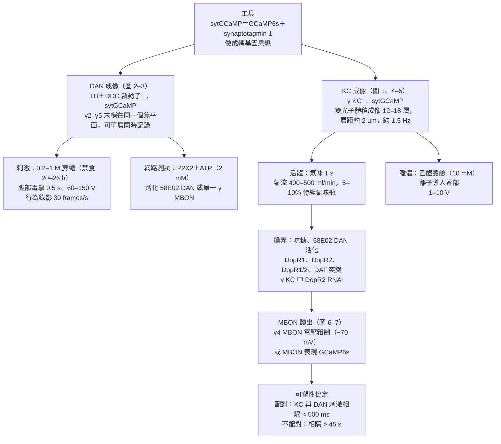
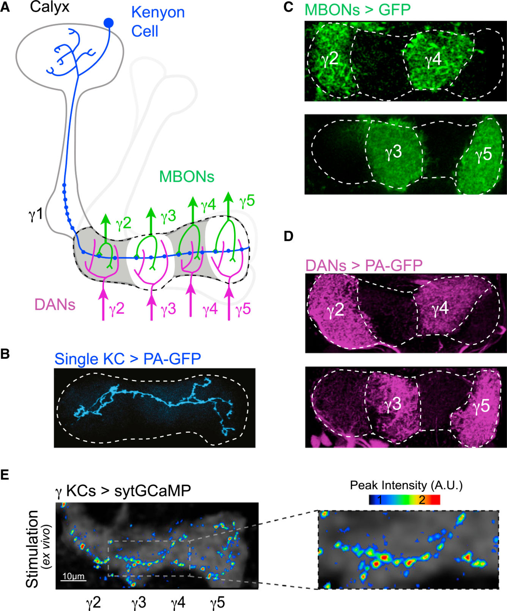
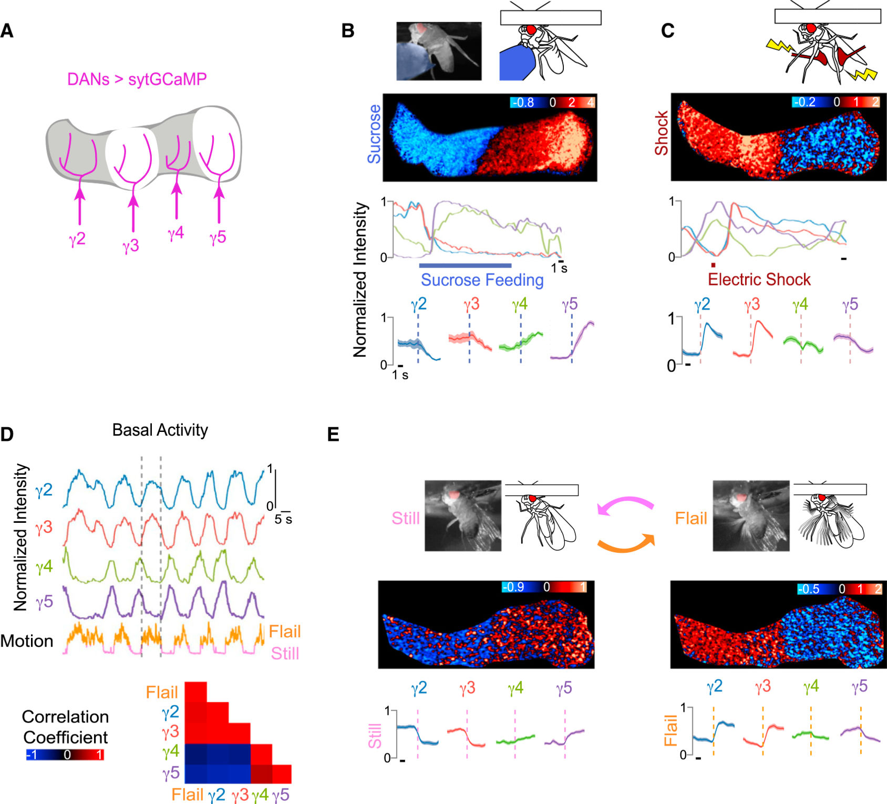
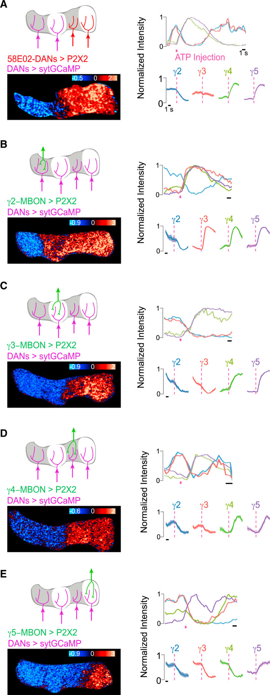
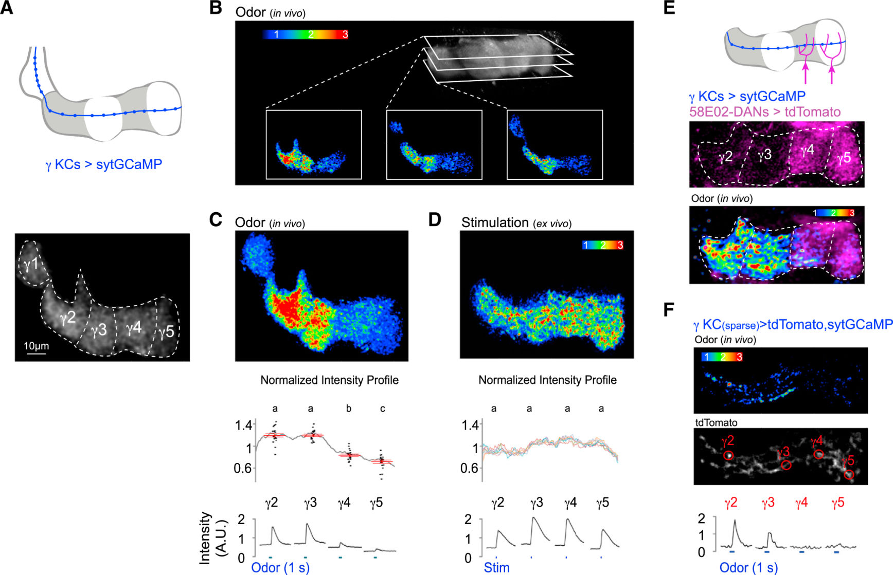
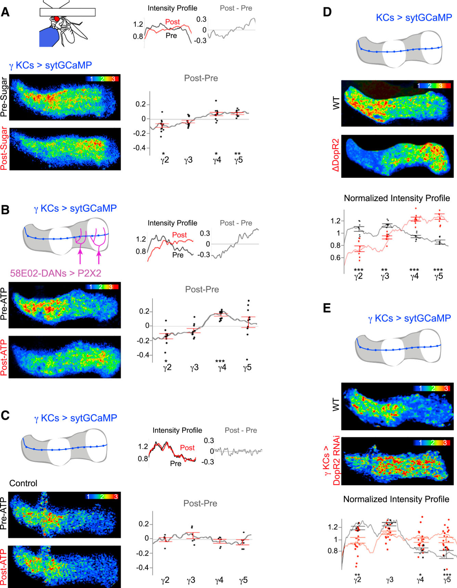
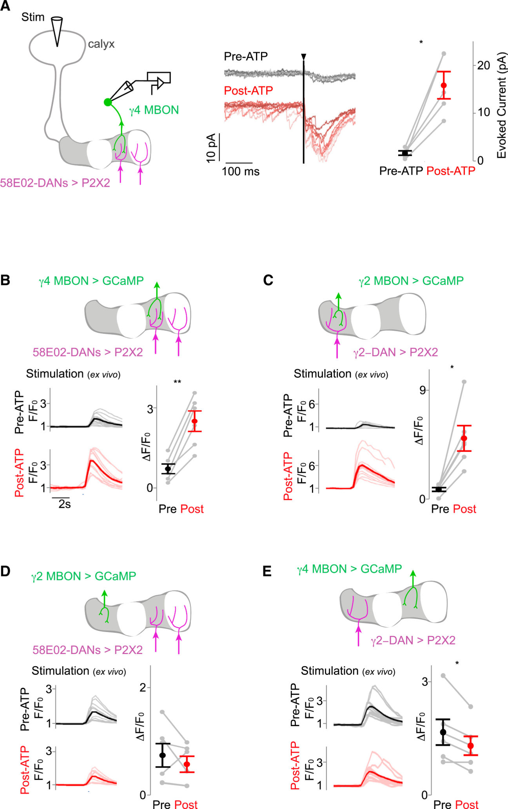
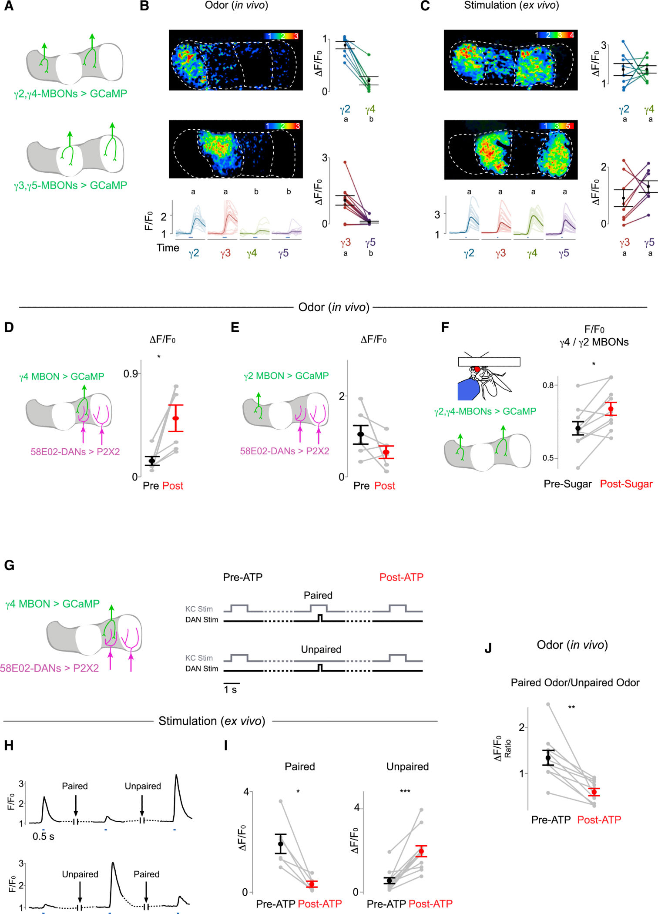

<!-- 本機 PDF：papers/2015-Coordinated%20and%20compartmentalized%20neuromodulation%20shapes%20sensory%20processing%20in%20Drosophila.pdf -->

# Coordinated and Compartmentalized Neuromodulation Shapes Sensory Processing in *Drosophila*

**協同且分區的神經調節塑造果蠅的感覺處理**

| 項目 | 內容 |
|---|---|
| **出處** | Cell 163(7), 1742–1755 (2015). doi: 10.1016/j.cell.2015.11.019 [全文（PMC 免費閱讀）](https://pmc.ncbi.nlm.nih.gov/articles/PMC4732734/) |
| 日期 | 刊期 2015-12-17（*Cell* 163(7)）；PDF 首頁印「available in PMC 2016 December 17」（作者稿在 PMC 公開的日期）。線上先行、投稿、修訂、接受日期本 PDF 未載：？待查 |
| 通訊作者 | Vanessa Ruta（ruta@rockefeller.edu） |
| 作者 | 共 3 人：Raphael Cohn、Ianessa Morantte、Vanessa Ruta。無共同第一作者標示。分工：Cohn 與 Ruta 構思並撰寫；Cohn 做全部實驗與分析，但圖 5E、S1G、S4B、S5B、S5E 由 Morantte 完成 |
| 機構 | Laboratory of Neurophysiology and Behavior, The Rockefeller University（美國紐約） |
| 資料庫 | 無公開資料庫或程式碼連結（行為影像以自寫 MATLAB 程式分析） |
| 補充資料 | Supplemental Experimental Procedures、圖 S1–S7、表 S1、影片 S1–S3。**本 PDF 不含補充資料**，本頁凡依賴補充資料的內容一律標 `？待查（補充資料未取得）` |
| 經費 | David Rockefeller Graduate Student Fellowship（Cohn）；New York Stem Cell Foundation、Pew、McKnight、Sloan、Irma T. Hirschl、Sinsheimer 各獎項與 NIH New Innovator Award DP2 NS0879422013（Ruta） |

> 與本庫有關的作者：無。另注意：Cohn、Morantte、Ruta 三人也是本庫 [[s-handler-2019-dopamine-receptor-timing]] 的作者，兩篇出自同一實驗室，用了同一組實驗工具（各工具的意思見專業文第一節的術語表）。
>
> 付費期刊（版權屬出版社 Elsevier，Cell Press）。本 PDF 是 NIH「HHS Public Access」作者稿（未經期刊最後排版的版本），PDF 內沒有印版權行，搜尋 Creative Commons／license／© 皆無結果，**沒有 CC 授權**。全文請由資料表「出處」列的連結到 PMC 免費閱讀（PMC 公開的作者稿）。**本庫不散布全文 PDF。** 本頁的圖擷取自原文，版權屬原出版社，以教學與評論目的引用，每張圖下方標明出處。

---

## 為什麼重要

果蠅的蘑菇體（mushroom body, MB）是腦中一個區域，依本篇引言，它最為人知的角色是嗅覺學習：過去的經驗改變果蠅之後對某個氣味的反應。MB 裡約 2,000 顆 Kenyon 細胞（Kenyon cell, KC）以稀疏的小群代表氣味（每種氣味只活化一小群）。KC 的軸突（送出訊號的長纖維）成束排成幾條「葉」（lobe），本篇研究的是 γ 型 KC 和它們組成的 γ 葉；每顆 γ KC 只有一條軸突，橫穿整條 γ 葉。γ 葉沿長度分成 γ1–γ5 五格，稱為區室（compartment）。每一格各有自己的輸出神經元（MB output neuron, MBON）接收 KC 的訊號，也各有自己的多巴胺神經元（dopaminergic neuron, DAN）把軸突伸進來（以上取自本篇引言與圖 1）。KC 交訊號給 MBON 的接點叫突觸（synapse），同樣的 KC 活動讓 MBON 收到多少，就是這個突觸的「強度」。論文引言說，獎賞與懲罰分別活化不同的 DAN，而 MBON 是 MB 唯一已知的對外出口。從這個解剖排列，作者推出一個猜想：**同一條 KC 軸突在不同格的突觸，可能被各格自己的 DAN 調成不同強度，於是同一個氣味能經由不同的 MBON 送出不同的訊息。** 在本篇之前，這只是從解剖推出來的可能。

本篇用三種新做法測這個猜想。第一，sytGCaMP：神經元活動時細胞內的鈣會升高，鈣指示蛋白（GCaMP）遇鈣就變亮；作者把它綁在只存在於突觸前末梢（軸突上把訊號交出去的那一點）的蛋白上，於是只有末梢會發光，可以逐格看 KC 末梢與 DAN 末梢的活動。第二，用基因工程讓選定的神經元多帶一種遇 ATP 就打開的通道（P2X2），再噴 ATP，就只活化那幾格的 DAN 或某一顆 MBON。第三，用電極記錄 γ4 MBON 收到的突觸電流。結果有三層。**(1) DAN 不是各自為政**：吃糖時 γ4/γ5 的 DAN 興奮、γ2/γ3 的 DAN 被抑制，電擊時正好相反；被固定住的果蠅掙扎時，DAN 出現像電擊的樣式，靜止時出現像吃糖的樣式；活化任何一格的 MBON 都會改變每一格的 DAN。**(2) 同一條 KC 軸突在不同格的末梢反應不同**：在活的果蠅身上，γ2/γ3 的末梢鈣反應強、γ4/γ5 弱。作者用三條證據說明這個差別來自多巴胺，也就是「DAN 越活躍的格，KC 末梢反應越強」：第一，頭被固定的果蠅最常處在掙扎樣式，而掙扎時正是 γ2/γ3 的 DAN 活躍；第二，把腦取出來放在培養液裡做實驗時，DAN 的自發活動大幅減少（作者說資料未在論文中呈現），這個差別也跟著消失；第三，剔除多巴胺受體 DopR2（接收多巴胺的分子；本篇另以只在 KC 減少它的實驗確認它在 KC 上起作用）的突變果蠅，強弱樣式整個倒過來。**(3) 多巴胺能把 KC→MBON 突觸往兩個方向調**：不搭配 KC 刺激、單獨活化 γ4/γ5 的 DAN，γ4 MBON 對所有測過的氣味收到的訊號都變強；同一批 DAN 若和 KC 刺激（在取出的腦裡把乙醯膽鹼這種化學物質滴到 KC 的接收端，模擬氣味）同時活化（相隔 < 500 ms），訊號反而變弱。

本庫已收的三篇，量的都是「氣味與多巴胺配對」（讓兩者在一次訓練裡先後出現，是學習的實驗模型）造成的突觸改變：[[s-tomchik-2009-camp-dynamics]] 量 KC 軸突裡的 cAMP（多巴胺作用在 KC 上之後，細胞內產生的一種訊號小分子），[[s-hige-2015-heterosynaptic-plasticity]] 量 γ1pedc 格（γ1 一帶的區室名稱）MBON 的電流變弱，[[s-handler-2019-dopamine-receptor-timing]] 系統地改變氣味與多巴胺之間的時間差。本篇加進兩件它們沒處理的事。一是**沒有氣味時的多巴胺**（果蠅的狀態、吃糖）也會持續改寫突觸，而且是讓它變強。二是**突觸前末梢的鈣**可以逐格看到，而它會隨多巴胺改變。Handler 2019 引用本篇，作為「沒有氣味時的多巴胺釋放造成增強」的依據之一；但兩篇在「多巴胺與 KC 相隔多久就不再有作用」上給出不同的圖像：本篇相隔 45 秒以上仍讓突觸變強，Handler 2019 相隔 6 秒就幾乎沒有作用（見專業文第四節與第五節第 6 條）。

---

## 論文摘要（原文與中譯）

> 本篇的 SUMMARY 是不分段的單段摘要（不是 Background／Results／Conclusion 結構），以下照原文排列。摘要中的「交換機」是比喻，指同一路輸入可以被轉接到不同的出口；「功能性突觸成像」指本篇的 sytGCaMP；「突觸後目標」指一條 KC 軸突沿途連接的各個 MBON；「神經調節」（neuromodulation）在本篇指多巴胺這類物質改變其他神經元的興奮性與突觸強度；「突觸可塑性」指突觸強度可以被改變；「外在情境」對應吃糖、電擊這類刺激，「內在狀態」對應掙扎或靜止這類行為狀態。
>
> Learned and adaptive behaviors rely on neural circuits that flexibly couple the same sensory input to alternative output pathways. Here, we show that the *Drosophila* mushroom body functions like a switchboard in which neuromodulation reroutes the same odor signal to different behavioral circuits, depending on the state and experience of the fly. Using functional synaptic imaging and electrophysiology, we reveal that dopaminergic inputs to the mushroom body modulate synaptic transmission with exquisite spatial specificity, allowing individual neurons to differentially convey olfactory signals to each of their postsynaptic targets. Moreover, we show that the dopaminergic neurons function as an interconnected network, encoding information about both an animal's external context and internal state to coordinate synaptic plasticity throughout the mushroom body. Our data suggest a general circuit mechanism for behavioral flexibility in which neuromodulatory networks act with synaptic precision to transform a single sensory input into different patterns of output activity.

**中譯**（本節為忠實翻譯，非自撰內容）：

> 學習而來的與適應性的行為，仰賴能把同一個感覺輸入彈性地接到不同輸出路徑的神經迴路。我們在此顯示，果蠅的蘑菇體運作起來像一台交換機：神經調節依果蠅的狀態與經驗，把同一個氣味訊號改接到不同的行為迴路。藉由功能性突觸成像與電生理，我們揭示蘑菇體的多巴胺輸入以極精細的空間專一性調節突觸傳遞，讓單一神經元能把嗅覺訊號以不同方式傳給它的每一個突觸後目標。此外，我們顯示多巴胺神經元以一個彼此相連的網路運作，同時編碼動物的外在情境與內在狀態，以協調整個蘑菇體的突觸可塑性。我們的資料提示一種行為彈性的普遍迴路機制：神經調節網路以突觸層級的精度作用，把單一感覺輸入轉換成不同的輸出活動樣式。

---

## 科普文

想像一條長長的走廊，走廊一側站著一排廣播員，另一側每隔一段有一扇門，門後坐著不同部門的主管。廣播員念的稿子對每扇門都一樣，但每扇門上有一個音量旋鈕，由站在那扇門旁的一位管理員轉。管理員把旋鈕轉大，那一扇門後的主管就聽得清楚；轉小，就聽不太到。於是同一份稿子，各部門聽到的音量並不一樣。對應關係是：廣播員＝Kenyon 細胞（KC），稿子＝氣味訊號，門＝區室，主管＝輸出神經元（MBON），管理員＝多巴胺神經元（DAN），旋鈕＝KC 與 MBON 之間的突觸（神經元之間傳訊號的接點）有多強。

這篇論文問的是：**這些旋鈕是不是真的被各自轉動？誰在轉？依據什麼轉？**

**難題**在於旋鈕太小。一條 KC 軸突沿途在五個區室各留下許多突觸，以前的鈣影像（用會隨細胞內鈣濃度發光的蛋白，間接看神經元的活動）看到的是整條纖維的平均亮度，分不出同一條纖維在不同門口的表現。

**解法一是一盞只在門口亮的燈。** 突觸要放出訊號前，末梢裡的鈣會升高。作者把鈣指示蛋白 GCaMP6s 綁在 synaptotagmin 上，做成 sytGCaMP。synaptotagmin 只待在突觸小泡（末梢裡裝著傳遞物質、準備釋放的小囊）上，它只在突觸前末梢發光，所以沿著一條軸突會看到一顆一顆的亮點，每顆大約是一個突觸所在。

**用這盞燈先看管理員。** 作者在所有 γ 葉 DAN 的末梢放 sytGCaMP，看果蠅吃糖水與被電擊時的反應。吃糖時，γ4 與 γ5 的 DAN 變亮，γ2 與 γ3 的反而變暗。電擊時倒過來：γ2、γ3 變亮，γ4、γ5 變暗。也就是說，**一件事不是只叫醒一位管理員，而是讓一半的人轉大、另一半的人轉小**。更意外的是，果蠅沒受任何刺激時，這兩種樣式也會輪流出現：頭被固定的果蠅會在「靜止」與「亂踢掙扎」之間切換。掙扎時的樣式像被電擊，靜止時像吃到糖。作者接著讓某一格的 DAN 或某一顆 MBON 帶上一種遇到 ATP 就打開的通道（P2X2），再噴 ATP 單獨叫醒它，發現其他格的 DAN 也跟著變。所以**管理員之間彼此連通，也聽主管的回報**。

**再看廣播員。** 在活的果蠅上，同一個氣味讓 KC 末梢在 γ2、γ3 很亮，在 γ4、γ5 很暗。作者只標少數幾顆 KC，確認這不是「不同的 KC 去了不同的格」，而是**同一條軸突在不同門口的亮度就不同**。把腦取出來、DAN 安靜下來之後，直接刺激 KC，五個門口變得一樣亮。作者另外在正文中報告（細節在補充圖 S2D，本頁未取得），頭被固定的果蠅雖然在兩種狀態間切換，但「γ2/γ3 的 DAN 活躍」的掙扎樣式明顯佔多數。KC 末梢「強 γ2/γ3、弱 γ4/γ5」的樣式正好與此相符，也就是 DAN 較活躍的格，末梢反應較強。果蠅吃糖之後，或用 ATP 叫醒 γ4/γ5 的 DAN 之後，樣式就往 γ4、γ5 那一側偏。把多巴胺受體 DopR2 剔除，樣式整個倒過來，變成 γ4/γ5 較強。照前面的邏輯，拿掉受體似乎應該讓五格變得一樣（像取出的腦），為什麼會倒過來，論文沒有解釋；它只說明多巴胺訊號參與決定這個樣式。

**最後直接量主管聽到多少。** 作者把電極接到 γ4 的主管上，刺激 KC，量它收到的電流。叫醒 γ4/γ5 的 DAN 之後，電流大了約十倍（約 1.5 → 16 pA，※ 從圖判讀）。另外用螢光看 MBON 的活動（不是電極）：只叫醒 γ2 的 DAN，γ2 的主管聽得更清楚，γ4 的主管反而略降。換成真的氣味也一樣：叫醒 γ4/γ5 的 DAN 後，γ4 的主管對每一種氣味都反應更大。

**轉折在時機。** 如果在 KC 正在發訊號的同時（兩者相隔不到 0.5 秒）叫醒 DAN，γ4 的旋鈕反而轉小。若 DAN 與前後的 KC 刺激都相隔超過 45 秒（論文稱「不配對」），旋鈕轉大。0.5 秒到 45 秒之間，本篇沒有測。在同一顆取出的腦裡交替做這兩種實驗程序（協定），旋鈕可以來回轉。在活的果蠅上，兩種氣味中只有和 DAN 一起出現的那一種，γ4 主管對它的反應相對另一種變小。

**代價與限制。** 全篇沒有測果蠅的行為選擇，所以「同一個氣味因此被送去不同的行為迴路」是推論。活化 DAN 用的是 ATP 加外加通道，不是真的獎懲（吃糖除外）。只看了 γ 葉的 γ2–γ5，γ1 沒有系統地成像，只偶爾看到。KC 末梢的樣式是「正規化」後的相對值（各格亮度除以整條葉的平均之類的處理，細節在補充資料），所以一格變亮必然伴隨別格「相對」變暗。

**最容易被誤讀的一點：「旋鈕轉小」的實驗，起點是已經轉大的旋鈕。** 圖 7I 的配對組，圖說寫明是從「已被增強的狀態」開始配對，也就是突觸先前已被單獨的 DAN 活化轉大過（※ 推論：最可能的來源是同一顆腦裡先做的不配對協定，細節在補充圖 S7，未取得）。所以這個實驗直接證明的是「配對能把增強過的突觸壓回去」，不等於「配對能讓一個從未被動過的突觸變弱」。在活果蠅上的氣味實驗（圖 7J）量的是兩種氣味反應的比值，比值下降也可能部分來自沒配對的氣味被增強。本篇的「氣味專一的減弱」要帶著這兩個條件引用。

---

## 專業文

### 一、概述

**主要問題。** 同一條 KC 軸突穿過好幾個區室；每個區室有自己的 DAN 與 MBON。多巴胺能不能逐格地、各自地調整 KC→MBON 突觸？DAN 群體的活動樣式由什麼決定？這種調整會不會讓同一個氣味在不同 MBON 上產生不同的輸出？

**重要性。** 引言把這個問題放在兩個框架裡。第一是 MB 的學習模型：論文引 Heisenberg 2003、Keene & Waddell 2007，說 MB 在嗅覺學習中不可或缺，而獎賞與懲罰活化不同的 DAN 子群，每一子群只投射到一個區室（Aso et al. 2012；Liu et al. 2012；Yamagata et al. 2015 等）。第二是哺乳類中腦多巴胺系統：引言說它的神經元種類與功能差異很大（異質性），目標腦區的接線又複雜，讓人難以分辨它如何選擇性地改變某一條路徑（Beier et al. 2015；Lammel et al. 2014；Lerner et al. 2015），而多巴胺可能經由擴散在遠處作用（Rice et al. 2011），這也讓「它只改哪一條路徑」更難界定。MB 的區室排列整齊：每一格的 DAN、MBON 與 KC 突觸位置都已知，所以可以逐格檢查多巴胺改了哪裡，作者因此拿它來研究這個問題。

**發表當時的領域現狀（2015）。** 依引言：KC 以稀疏的小群代表氣味（Campbell et al. 2013），每顆 KC 在萼部（calyx，KC 樹突所在、接收嗅覺輸入的區域）整合多個嗅小球（glomerulus，上游嗅覺系統中處理不同氣味成分的單位，本篇未進一步說明）的輸入（Caron et al. 2013；Gruntman & Turner 2013）；MBON 是 MB 唯一已知的對外出口（Aso et al. 2014a；Tanaka et al. 2008），其集體活動被認為會影響先天與學得的氣味偏好（Aso et al. 2014b；Hige et al. 2015；Owald et al. 2015。這裡的 Hige et al. 2015 是 Hige 等人發表在 *Nature* 的另一篇，不是本庫收錄的 *Neuron* 那篇）。Aso et al. 2014a 的解剖顯示，不同區室的 DAN 與 MBON 的纖維會伸到 MB 外的同一塊腦區（論文稱 protocerebrum）而互相重疊，所以兩者可能彼此相連。MB 也參與依情境調整先天嗅覺偏好（Lewis et al. 2015；Owald et al. 2015）。本篇沒有引用 [[s-tomchik-2009-camp-dynamics]]，也沒有引用 [[s-hige-2015-heterosynaptic-plasticity]]（*Neuron*）；後者與本篇同年同月發表（2015-12）。

**體裁：** 原著論文（活體與離體雙光子成像〔一種能看清腦組織深處的螢光顯微鏡技術〕＋膜片鉗電生理＋基因突變）。

**讀專業文前的術語與標記**（後文首次出現時不再重複解釋）：

| 詞 | 意思 |
|---|---|
| KC、MBON、DAN | Kenyon 細胞（KC）代表氣味；MB 輸出神經元（MBON）接收 KC 的訊號；多巴胺神經元（DAN）把軸突伸進各區室。訊號方向是 KC → MBON，DAN 在旁調節 |
| γ 葉、γ1–γ5 | γ 型 KC 的軸突成束形成 γ 葉，沿長度分五個區室。本篇的 MBON 與 DAN 都以區室命名，例如「γ4 MBON」「γ2 DAN」 |
| sytGCaMP | 本篇新做的工具：鈣指示蛋白 GCaMP6s 接在突觸小泡蛋白 synaptotagmin 的 C 端（連接方式見方法，屬建構細節）。因為只待在突觸前末梢，量到的是末梢的鈣，不是整個細胞質的鈣 |
| 突觸前鈣 | 末梢裡的鈣濃度。論文引言說它是神經傳遞的關鍵調節者，也是神經調節的作用對象（Regehr 2012），所以作者拿它當突觸功能的讀數 |
| P2X2＋ATP | P2X2 是一種遇到 ATP 就打開的離子通道。把它放進某群神經元，再用玻璃管噴 ATP，就能只活化那群神經元。本篇用它活化 DAN 與 MBON |
| 58E02 | 一段調控序列（啟動子片段，Liu et al. 2012），本篇用它在「一部分 DAN，包括支配 γ4 與 γ5 的那些」（原文「a subset of DANs, including those innervating the γ4 and γ5 compartments」，PDF 第 5 頁）表現 P2X2 或紅色螢光蛋白 tdTomato；後文簡稱「γ4 與 γ5 的 DAN」。這個品系實際標到哪些 DAN，各篇說法不同，見 [[syn-contradictions]] 1.5。γ3 的 DAN 有時被標到、有時沒有，所以「活化 γ4/γ5 DAN」有時也包括 γ3（見 3.3）。本篇沒有說這群 DAN 屬於哪個細胞群；Handler 2019 用同一段序列做成的 R58E02-LexA 品系（LexA 是另一套與 GAL4 並行的驅動系統），稱之為 PAM 群（該篇以 PAM 群代表獎賞訊號） |
| TH、DDC 啟動子 | 兩段合成多巴胺所需酵素（酪胺酸羥化酶、多巴脫羧酶）的調控序列；兩者合用，讓 sytGCaMP 或 PA-GFP 出現在支配 γ 葉每一格的 DAN |
| PA-GFP | 光活化綠色螢光蛋白：用特定光照過的地方才會發綠光，可以只把一顆細胞「點亮」看形狀 |
| 活體（in vivo）、離體（ex vivo，brain explant） | 活體：固定在支架上（見下方「拴繫果蠅」）、腦部打開以便在顯微鏡下成像的活果蠅；DAN 成像時一併錄下的掙扎／靜止，就是這些被固定的果蠅的動作。離體：把腦取出放在培養液中。作者說離體腦裡 DAN 的基礎活動大幅減少（資料未示） |
| 乙醯膽鹼離子導入 | 用電壓脈衝把乙醯膽鹼（acetylcholine）從玻璃管推到萼部（KC 樹突所在），直接刺激 KC，模擬氣味 |
| 膜片鉗、電壓箝制 | 膜片鉗（patch clamp）：把玻璃電極貼在細胞上，直接量細胞的電位或電流。電壓箝制（voltage clamp）：由儀器把細胞膜電位固定在設定值，此時量到的是流入細胞的電流 |
| EPSC、潛時 | 興奮性突觸後電流：電壓箝制下，從突觸流進 MBON 的電流。潛時（latency）是從刺激到電流出現的時間；中間每多經過一個突觸就會多花一段時間，所以潛時短表示訊號可能是直接（單突觸）傳來的 |
| 驅動品系、啟動子 | 決定某個外加基因只在哪些細胞表現的果蠅品系；它靠的是一段調控序列（啟動子），例如 58E02、TH。γ2 DAN、各 γ MBON 的專一品系名稱主文沒寫（？待查） |
| 突變、RNAi | 突變：整隻果蠅的該基因都失效。RNAi：只在選定的細胞（本篇是 γ KC）裡降低該基因的表現量，通常降不到零 |
| A.U. | arbitrary units，任意單位：只能在同一張圖內比大小的螢光強度 |
| 15 個區室 | 除了 γ 葉，KC 軸突還組成其他幾條葉；全部葉加起來共 15 個區室（本篇討論引 Aso et al. 2014a 的脈絡），γ1–γ5 是其中 5 個。與圖 4C「15 個成像平面」的 15 無關，只是恰好相同 |
| 時間差的正負號 | 本頁引用 Handler 2019 時，時間差＝DAN 刺激開始時刻減 KC 刺激（或氣味）開始時刻；負號表示 DAN 在前 |
| 「增強」的兩個意思 | 「增強經驗／增強訊號」（reinforcement）指獎賞或懲罰；「突觸增強」（potentiation）指突觸變強。本頁單獨說「增強」時指後者 |
| ΔF/F0、F/F0 | 螢光相對基線的變化比例（ΔF/F0）或比值（F/F0），作為活動量 |
| 正規化強度輪廓 | 沿 γ 葉長度畫出 sytGCaMP 峰值亮度的曲線，再正規化。正規化的確切算法在補充方法：？待查（補充資料未取得）。後文說明為何它是相對值 |
| 配對、不配對 | 方法定義：配對＝KC 與 DAN 刺激在 < 500 ms 內先後給；不配對＝兩者相隔 > 45 s。除非註明，所有 DAN 活化實驗都是不配對 |
| DopR1、DopR2、DopR1/2、DAT | 兩種多巴胺受體（DopR1/2 指兩者都突變的雙突變）與多巴胺回收轉運子（DAT，把多巴胺從突觸間隙清掉；Kume et al. 2005） |
| 拴繫（tethered）果蠅 | 背部黏在支架上、腳懸空的果蠅；可以踢腳但不能移動。也有讓牠在可自由轉動的球上走的變體 |
| 標 * 的顯著性 | 圖 5–7 圖說：* p < 0.05、** p < 0.005、*** p < 0.0005。圖 4C 與 7B–C 的小寫字母：字母不同表示 p < 0.05（經多重比較校正的 t 檢定）。圖 5–7 的成對比較用哪一種檢定，主文沒寫：？待查（補充資料未取得） |
| ⚠️ | 本頁標記不一致或矛盾的符號 |
| ※ 推論 | 論文沒有明說、本頁自行推得的內容 |
| ※ 從圖判讀 | 本頁從圖上目測讀出的數值，論文沒有明列；誤差約為該圖最小刻度的一半 |
| ？待查 | 需要補充資料或其他來源才能確認、本頁刻意不填的內容 |

### 二、方法

**光學工具。** sytGCaMP 由 GCaMP6s 與果蠅 synaptotagmin 1 以一小段連接序列（3×GS）接成，再以 PhiC31 定點插入法放進果蠅基因組的三個位置（attP40、attP5、VK00005）做成轉基因果蠅；這些是建構細節，不影響後文理解。它先在補充圖 S1 驗證：與果蠅本身的突觸蛋白出現在同一位置（共定位），表示它確實待在突觸，且只在突觸前末梢偵測到鈣流入（S1B–G，？待查）。用一段選擇性啟動子讓它在全部 γ KC 表現（S1H，啟動子名稱 ？待查）。驗證時在離體腦裡局部刺激萼部，只活化一顆 KC，再以雙光子體積成像抓到它整個軸突分支（圖 1E）。

**成像。** Bruker Ultima 雙光子顯微鏡；體積成像用 8 kHz 共振掃描鏡加壓電 Z 軸驅動，每個體積 12–18 層、層距約 2 µm、約 1.5 Hz，涵蓋整個 γ 葉。氣味以 2 mm 鐵氟龍管送出，連續氣流 400–500 ml/min，觸發時把 5%–10% 的氣流從只裝石蠟油（溶劑，無氣味的對照）的 10 ml 玻璃瓶改經裝有稀釋氣味的瓶子。**用了哪些氣味、濃度多少，主文沒寫**（搜過 octanol、methylcyclohexanol、ethyl、pentyl：？待查，補充資料未取得）。果蠅的性別與日齡主文也沒寫（搜過 female、male、days old）。

**電生理。** 以 GCaMP 或 GFP 螢光定位 γ4 MBON 與 KC 細胞體，做膜片鉗記錄（方法引 Ruta et al. 2010）；KC 的記錄用來檢查 DAN 活化是否改變 KC 本身的電位與放電（補充圖 S6B，見 3.6）。電壓箝制的設定值為 −70 mV（論文寫「名義上」，因為儀器無法把整顆細胞完全箝住）。電壓箝制有時壓不住 MBON 自己放出的動作電位（神經元的放電），這種電流會混進量測；方法說它很少出現，且因振幅遠大於突觸電流，容易辨認。

**外加活化。** 玻璃刺激電極（7–10 MΩ）裝 2 mM ATP 或 10 mM 乙醯膽鹼。ATP 管放在中葉（medial lobe，γ 葉所在、往腦中線方向伸的那幾條葉）背側，也就是 DAN 樹突（DAN 接收輸入的一端，位在葉外）與 MBON 軸突所在處，以正壓脈衝噴出（論文沒有說明選這個位置的理由）；**每次噴多久、壓力多大，主文沒寫**（？待查）。乙醯膽鹼以電壓脈衝導入萼部。部分實驗改用「紅移的 channelrhodopsin」（照紅光就活化的通道，論文沒寫是哪一種）活化 DAN（補充圖 S6A，？待查）。

**行為與刺激。** 拴繫果蠅以紅外光 LED 照明、Point Grey Firefly 相機（94 mm 焦距鏡頭）錄影，30 frames/s，以自寫 MATLAB 程式抽出動作軌跡。給糖：禁食 20–26 小時後，以馬達驅動的微操作器送上浸過 0.2–1 M 蔗糖的紙芯。電擊：鋼電極貼在腹部，施加 0.5 s、60–150 V 的脈衝。**本篇沒有任何「事後測氣味偏好」的行為實驗**：錄影只用來把 DAN 活動對上果蠅的動作（搜過 T-maze、preference、performance index、conditioning：conditioning 只出現在引用他人研究的句子）。

### 三、結果

#### 3.1 區室的解剖與 sytGCaMP（圖 1）

<small>圖片出處：Cohn R, Morantte I, Ruta V. *Cell* 163(7):1742–1755 (2015)，Figure 1。© 2015 Elsevier Inc. 教學引用；全文見 [PMC](https://pmc.ncbi.nlm.nih.gov/articles/PMC4732734/)。</small>

> **原圖說（Figure 1）：** Compartmentalized Architecture of the Mushroom Body. (A) Schematic of mushroom body anatomy focusing on the γ lobe. Each γ Kenyon cell (KC, blue) receives olfactory input in the calyx and projects a single axon into the γ lobe (dashed line). KCs form en passant synapses with mushroom body output neurons (MBONs, green) and receive modulatory input from dopaminergic neurons (DANs, magenta) within discrete anatomic compartments (shown for γ2–γ5). (B) A single γ KC axon photolabeled with PA-GFP projects its axon across the complete length of the lobe (dashed line). (C) Segregated dendritic innervation of MBONs is revealed by expression of GFP in pairs of MBONs in each panel using MBON-specific drivers. (D) Compartmentalized axonal projections of DANs photolabeled with PA-GFP in alternating compartments. PA-GFP is expressed under the TH and DDC promoters. (E) sytGCaMP expressed in all γ KCs with only a single KC functionally activated. Maximum intensity projection shows peak fluorescence from multiple T-series in different Z planes. Magnified view shows individual KC synaptic puncta (right). See also Figure S1.

**圖說中譯：** 蘑菇體的區室構造。(A) 以 γ 葉為主的 MB 解剖示意圖。每顆 γ Kenyon 細胞（KC，藍）在萼部接收嗅覺輸入，並把單一軸突伸進 γ 葉（虛線）。KC 以「路過式」（en passant，軸突經過時順路形成）突觸連到 MBON（綠），並在各個分立的解剖區室內接收 DAN（洋紅）的調節輸入（圖中畫出 γ2–γ5）。(B) 以 PA-GFP 光標記的單一 γ KC 軸突橫越整條葉（虛線）。(C) 用 MBON 專一的驅動品系（見術語表），每格畫面讓一對 MBON 表現 GFP，顯示 MBON 的樹突彼此分隔。(D) 在相間的區室以 PA-GFP 光標記 DAN，顯示其軸突投射分區；PA-GFP 由 TH 與 DDC 啟動子驅動。(E) 全部 γ KC 表現 sytGCaMP，但只功能性地活化一顆 KC；最大強度投影顯示不同 Z 平面多組時間序列的峰值螢光；右為放大圖，可見單顆 KC 的突觸點。另見圖 S1。

**解讀：**

- **這張圖要看的是 B 與 E 的配合，不是 A 的示意圖。** B 證明「一條軸突穿過所有格」（後文在補充圖 S4A 擴大到 > 80 顆 KC 都如此），E 證明「這條軸突在每一格都有會發光的突觸點」。兩者合起來，後面「同一條軸突在不同格亮度不同」的發現才有意義：差別不能歸因於軸突沒到那一格，也不能歸因於那一格沒有突觸。
- **E 是離體的。** 單顆 KC 在離體腦中被刺激，γ2–γ5 都有亮點，亮點強度在各格都落在同一個色階範圍（1–2 A.U.），沒有哪一側明顯較亮（※ 從圖判讀）。這張圖其實已經是圖 4D「離體時各格一樣亮」的單細胞版本，正文沒有這樣指出。
- **A 的示意只畫了 γ2–γ5。** γ1 只標出位置，沒有畫 DAN 與 MBON。全篇的區室分析也以 γ2–γ5 為主（第 3.3 節：γ1「沒有常規成像」）。所以本篇對 γ1 的結論很少；本庫 [[s-hige-2015-heterosynaptic-plasticity]] 研究的 γ1pedc（Hige 2015 對 γ1 一帶區室的命名，pedc 的意思該頁也未解釋；可視為大致對應本篇的 γ1），在本篇幾乎沒有對應資料。

#### 3.2 DAN 群體以相反的樣式代表情境與狀態（圖 2）

<small>圖片出處：Cohn R, Morantte I, Ruta V. *Cell* 163(7):1742–1755 (2015)，Figure 2。© 2015 Elsevier Inc. 教學引用；全文見 [PMC](https://pmc.ncbi.nlm.nih.gov/articles/PMC4732734/)。</small>

> **原圖說（Figure 2）：** DAN Network Activity Reflects Both External Sensory Stimuli and Internal Behavioral State. (A) The sytGCaMP was expressed in DANs of all γ-lobe compartments, driven by the combination of TH and DDC promoters and imaged in response to sucrose ingestion and electric shock. (B and C) Sucrose ingestion and electric shock. Schematic of stimulus (top) with representative heatmap (ΔF/F0) and normalized intensity trace of DAN sytGCaMP response to the stimulus (B, sucrose; C, shock) below are shown. (Bottom) Stimulus-triggered averages ± SEM for DANs of each compartment are shown. (B, n = 10 traces in nine flies; C, n = 21 traces in 11 flies). Fluorescence in other lobes is masked for clarity. Black scale bar indicates 1 s throughout figures unless otherwise noted. (D) Representative normalized fluorescence traces of γ lobe DANs aligned to fly's motion (top). Dashed lines delineate start and end of a single representative bout of flailing. Cross-correlations between motion trace and activity in DANs of each compartment are shown (bottom, n = 12 traces in six flies). (E) Schematic and still image from video showing the fly in flailing (right) and quiescent (left) behavioral states (top). Representative heatmap (ΔF/F0) of DAN activity in response to start and stop of flailing is shown (middle). Average DAN fluorescence ± SEM in each compartment aligned to the start and stop of flailing is shown (bottom, n = 14 traces in six flies). See also Figure S2, Table S1, and Movies S1 and S2.

**圖說中譯：** DAN 網路活動同時反映外在感覺刺激與內在行為狀態。(A) 以 TH 與 DDC 啟動子合用，讓 γ 葉各區室的 DAN 表現 sytGCaMP，成像其對吃糖與電擊的反應。(B、C) 吃糖與電擊。上為刺激示意，下為代表性熱圖（ΔF/F0）與 DAN sytGCaMP 的正規化強度曲線（B 為蔗糖，C 為電擊）。最下為各區室 DAN 以刺激對齊的平均 ± SEM（B：9 隻果蠅共 10 條紀錄；C：11 隻共 21 條）。其他葉的螢光已遮蔽。黑色比例尺除另註明外全圖皆為 1 s。(D) γ 葉 DAN 的代表性正規化螢光曲線，與果蠅的動作對齊（上）；虛線標出一次代表性掙扎的起訖；下為動作曲線與各區室 DAN 活動的互相關（6 隻果蠅共 12 條紀錄）。(E) 上為果蠅掙扎（右）與靜止（左）兩種行為狀態的示意與錄影畫面；中為掙扎開始與停止時 DAN 活動的代表性熱圖（ΔF/F0）；下為各區室 DAN 螢光以掙扎起訖對齊的平均 ± SEM（6 隻共 14 條紀錄）。另見圖 S2、表 S1、影片 S1 與 S2。

**解讀：**

- **最該看的是 D 的相關矩陣，而不是 B、C 的刺激反應。** 吃糖與電擊引出相反樣式並不意外，因為論文引言已說兩者活化不同的 DAN。新的是 D：**沒有任何外加刺激時，DAN 的兩組（γ2/γ3 對 γ4/γ5）就以相反相位擺盪**，而擺盪幾乎完全跟著果蠅的掙扎走。圖說只說畫的是「動作與各格 DAN 的互相關」，但圖上其實是一張三角矩陣，也包含 DAN 與 DAN 之間的相關；矩陣中的值是同一時刻的相關係數，還是容許時間錯開後的最大相關（互相關），圖說沒寫。矩陣中「掙扎」與 γ2、γ3 是深紅（強正相關），與 γ4、γ5 是深藍（強負相關），γ4 與 γ5 彼此是較淺的紅（※ 從圖判讀，色階 −1 到 1，矩陣沒有標數值）。這張矩陣在後文很關鍵：3.4 會看到活體中 KC 末梢在 γ2/γ3 較強，作者的解釋是「拴繫果蠅多半處在掙扎樣式 → γ2/γ3 的 DAN 較活躍 → 這兩格的 KC 末梢被調得較強」，這條推理的第一步就是本圖。
- **踩煞車：相關不等於方向。** 圖上只能說 DAN 活動與掙扎同步，不能說「掙扎狀態驅動 DAN」。反過來（DAN 活動參與觸發掙扎）或兩者都由第三個訊號驅動，圖上都排除不了。論文用的動詞是「correlated」，但討論段進一步寫成「動物的行為狀態可能本身就是一種增強刺激」（意思是：狀態本身就能像獎賞或懲罰一樣改變突觸）；後者是推論。
- **B、C 下方的四條平均曲線不能跨格比高低。** 縱軸是「正規化強度」。從 0–1 的刻度看，每一格的時間曲線是各自換算到自己的範圍（※ 推論，確切算法在補充方法，？待查；這與 KC 末梢「沿葉長度的輪廓」的正規化是兩件事），所以同樣的高度在不同格代表不同的實際亮度。例如 B 中 γ5 的曲線升得最高，只表示 γ5 相對於自己的範圍變化最大，不表示 γ5 DAN 的實際反應最大。能比的是同一格的前後：C 中 γ4 自己由約 0.65 降到約 0.55（※ 從圖判讀），比同圖 γ5 的下降（約 0.6 → 0.35，※ 從圖判讀）小得多，正文仍寫「inhibited the γ4 and γ5 DANs」。這不是誇大，但 γ4 被電擊抑制的證據比 γ5 弱。
- **sytGCaMP 量的是 DAN 末梢的鈣，不是多巴胺本身。** 本篇沒有任何直接量多巴胺的感測器（搜過 GRAB、dopamine sensor）。正文說它用來「洞察多巴胺釋放的樣式」，這是以末梢鈣代替釋放量的推論。
- **統計不在主文。** 圖 2 沒有任何顯著性標示，正文引用表 S1（？待查，補充資料未取得）。n 以「紀錄條數」計，而 B 的 10 條來自 9 隻果蠅、E 的 14 條來自 6 隻，同一隻果蠅貢獻多條，若統計以條數為單位會高估獨立樣本數（※ 推論，取決於表 S1 怎麼算）。

#### 3.3 DAN 之間、MBON 到 DAN 的功能連結（圖 3）

<small>圖片出處：Cohn R, Morantte I, Ruta V. *Cell* 163(7):1742–1755 (2015)，Figure 3。© 2015 Elsevier Inc. 教學引用；全文見 [PMC](https://pmc.ncbi.nlm.nih.gov/articles/PMC4732734/)。</small>

> **原圖說（Figure 3）：** Functional Communication between Compartments Coordinates DAN Network Activity. (A–E) DAN sytGCaMP activity patterns evoked by activation of P2X2 expressed in the (A) 58E02+ DANs innervating γ4-5, (B) γ2 MBON, (C) γ3 MBON, (D) γ4 MBON, and (E) γ5 MBON. The sytGCaMP was expressed in DANs of all γ-lobe compartments using the TH and DDC promoters. Schematic of stimulus (top left), representative heatmap (bottom left, ΔF/F0), normalized intensity trace for representative experiment shown (top right), and stimulus-triggered averages ± SEM for DANs of each compartment (bottom right) are shown. ATP stimulation is shown as pink bar (58E02, n = 8; γ2, n = 8; γ3, n = 8; γ4, n = 8; γ5, n = 12). See also Table S1.

**圖說中譯：** 區室之間的功能聯繫協調 DAN 網路活動。(A–E) 以 P2X2 活化下列神經元時，DAN sytGCaMP 的活動樣式：(A) 支配 γ4–5 的 58E02+ DAN；(B) γ2 MBON；(C) γ3 MBON；(D) γ4 MBON；(E) γ5 MBON。sytGCaMP 以 TH 與 DDC 啟動子在 γ 葉各區室的 DAN 表現。左上為刺激示意，左下為代表性熱圖（ΔF/F0），右上為該次代表實驗的正規化強度曲線，右下為各區室 DAN 以刺激對齊的平均 ± SEM。粉紅條為 ATP 刺激（58E02 n = 8；γ2 n = 8；γ3 n = 8；γ4 n = 8；γ5 n = 12）。另見表 S1。

**解讀：**

- **把五格右下的平均曲線讀成一張表，比正文清楚**（※ 從圖判讀，↑ 興奮、↓ 抑制、— 幾乎不變）：

  | 被活化者 | γ2 DAN | γ3 DAN | γ4 DAN | γ5 DAN |
  |---|---|---|---|---|
  | A：58E02 DAN（γ4–5；γ4、γ5 的 ↑ 是被直接活化的細胞本身，只有 γ2 的 ↓ 是網路效應） | ↓ | — | ↑ | ↑ |
  | B：γ2 MBON | ↓ | ↑ | ↑ | ↑ |
  | C：γ3 MBON | ↓ | ↓ | ↑ | ↑ |
  | D：γ4 MBON | ↓ | ↓（小） | ↑ | ↑ |
  | E：γ5 MBON | ↓ | ↓ | ↓ | ↑（小） |
  | 參照：吃糖（圖 2B） | ↓ | ↓ | ↑ | ↑ |
  | 參照：電擊（圖 2C） | ↑ | ↑ | ↓（小） | ↓ |

  > 依圖 3A–E 與圖 2B–C 各格右下（或最下）的平均曲線，以刺激前後的高低判讀。最後兩列是本頁補上的參照，論文把它們放在另一張圖。

- **並列之後才看得出：四種 MBON 活化（B–E）中，沒有一種重現「電擊樣式」。** 這表示 MBON 對 DAN 的回饋不是單純地把某一種獎懲樣式「重播」出來（※ 推論）。 C、D 接近吃糖樣式；B（γ3 與 γ4/γ5 一起上升）與 E（γ2–γ4 一起下降）兩種都不是。正文說每一顆 MBON 的活化都引出「類似生理增強經驗」的分布式樣式（similar to the distributed activity patterns evoked by physiological reinforcement experiences），這句話只在「多格同時改變、有升有降」這個寬鬆意義上成立。⚠️ 論文自身不一致：正文措辭比圖寬鬆，但沒有與圖相反，所以不影響「功能上相連」的結論。
- **本圖在全篇論證中的角色。** 3.2 看到兩組 DAN 反向起伏；本圖說明這種協同可能怎麼產生：DAN 彼此、以及 MBON 對 DAN，在功能上連成網路。後文 3.4–3.6 再看這種 DAN 樣式如何改變 KC 末梢與 KC→MBON 突觸。
- **A 的 γ3 平均幾乎是平的，正文已經解釋。** 58E02 對 γ3 的標記不穩定，γ3 DAN「常被抑制，偶爾被活化」，平均起來互相抵消。※ 推論：γ3 DAN 被 58E02 標到時，ATP 直接活化它；沒被標到時，它經由網路被抑制（論文只說「由於標記不穩定」，沒寫出這一步）。這表示 A 的 n = 8 裡混著兩種不同的實驗條件；正文沒有把兩種分開報告。
- **連結是直接還是間接，本篇沒有區分。** 正文用的詞是「直接或間接的溝通」與「多突觸的交互作用」（multisynaptic interactions），沒有做阻斷突觸傳遞，或同時記錄兩顆細胞的實驗。所以這張圖證明的是「功能上相連」，不是「誰直接接到誰」。
- **ATP 噴在同一個地點，所以需要「無 P2X2」對照。** 噴藥處同時有 DAN 的樹突與 MBON 的軸突；若 ATP 本身（不經 P2X2）就能影響附近的 DAN，圖上的 DAN 變化就不一定來自被活化的 MBON。方法說刺激 DAN 與 MBON 的 ATP 管都放在「中葉背側、DAN 樹突與 MBON 軸突所在處」。主文只對 KC 成像（圖 5C）報了「不表現 P2X2 的對照」，對 DAN 成像（本圖）沒有報同樣的對照（本頁在論文主文 PDF 中搜尋 control 一詞，只出現在圖 5C 的圖說）。ATP 本身是否會直接影響 DAN，本圖無從判斷：？待查（補充資料未取得）。

#### 3.4 同一條 KC 軸突在不同區室的鈣反應不同（圖 4）

<small>圖片出處：Cohn R, Morantte I, Ruta V. *Cell* 163(7):1742–1755 (2015)，Figure 4。© 2015 Elsevier Inc. 教學引用；全文見 [PMC](https://pmc.ncbi.nlm.nih.gov/articles/PMC4732734/)。</small>

> **原圖說（Figure 4）：** Compartmentalized Ca2+ Domains along KC Axons In Vivo. (A) Schematic (top) and representative basal fluorescence of sytGCaMP expressed in γ KCs labeled with approximate compartmental borders (bottom) are shown. (B) Volumetric two-photon resonant imaging of odor-evoked sytGCaMP reveals asymmetric presynaptic Ca2+ in γ KCs in each imaging plane. (C) Maximum-intensity Z-projection of all 15 imaging planes sampled through the γ lobe in the example shown in (B) (top). Average normalized odor-evoked profile of sytGCaMP fluorescence intensity along the γ lobe (gray line, n = 21 flies) and peak intensity for each compartment (black dots, n = 21) with mean ± SEM in red (middle) are shown. Odor-evoked time courses were imaged in each compartment for representative experiment shown above (bottom, blue lines indicate 1-s odor stimulus). (D) Representative image of sytGCaMP signal in γ KCs in response to direct stimulation of KCs by acetylcholine iontophoresis into the mushroom body calyx in a brain explant (top). Normalized intensity profiles for ex vivo stimulation across a range of iontophoretic voltages (1–10 V) with average profile for each voltage in a different colored line are shown (n = 6). Stimulation-evoked time courses were imaged in each compartment for representative experiment shown above (bottom, blue lines indicate stimulation). (E) tdTomato expressed in γ4 and γ5 DANs using 58E02-LexA (top, middle). Compartmentalized KC sytGCaMP responses in the same fly shows synaptic Ca2+ domains have sharp boundaries that align to the border between γ3 and γ4 compartments. (F) Odor response in a sparse subset of γ KCs expressing sytGCaMP (heatmap, top) and tdTomato (grayscale, middle). Odor-evoked time courses were measured at individual synaptic boutons (bottom). All KC heatmaps in this figure represent peak fluorescence. Values marked with different lowercase letters represent significant differences (p < 0.05 by t test with correction for multiple comparisons). See also Figures S3 and S4 and Movie S3.

**圖說中譯：** 活體中 KC 軸突沿線的分區鈣區域。(A) 上為示意；下為 γ KC 表現 sytGCaMP 的代表性基礎螢光，標出大致的區室邊界。(B) 以雙光子共振掃描做體積成像，氣味誘發的 sytGCaMP 顯示，γ KC 的突觸前鈣在每一個成像平面都不對稱。(C) 上：(B) 這個例子中，穿過 γ 葉的全部 15 個成像平面的最大強度 Z 投影。中：沿 γ 葉的氣味誘發 sytGCaMP 正規化平均輪廓（灰線，n = 21 隻果蠅），以及各區室的峰值強度（黑點，n = 21），紅色為平均 ± SEM。下：上方代表實驗在各區室的氣味誘發時間曲線（藍線為 1 s 氣味）。(D) 上：離體腦中以乙醯膽鹼離子導入萼部直接刺激 KC 時，γ KC sytGCaMP 訊號的代表圖。中：離體刺激在一系列離子導入電壓（1–10 V）下的正規化強度輪廓，每個電壓的平均輪廓以不同顏色畫出（n = 6）。下：上方代表實驗在各區室的刺激誘發時間曲線（藍線為刺激）。(E) 以 58E02-LexA 讓 γ4、γ5 的 DAN 表現 tdTomato（上、中）；同一隻果蠅的 KC sytGCaMP 分區反應顯示，突觸鈣區域有銳利邊界，對齊 γ3 與 γ4 區室的交界。(F) 少數 γ KC 同時表現 sytGCaMP（熱圖，上）與 tdTomato（灰階，中）時的氣味反應；在單一突觸小結（bouton）量氣味誘發的時間曲線（下）。本圖所有 KC 熱圖皆為峰值螢光。小寫字母不同者表示有顯著差異（p < 0.05，經多重比較校正的 t 檢定）。另見圖 S3、S4 與影片 S3。

**解讀：**

- **C 的正規化輪廓把差異壓小了，下方的原始曲線才看得出有多懸殊。輪廓圖的縱軸是含基線的峰值螢光（F）再正規化，下方曲線則是原始螢光強度（A.U.），兩者的量不同。** 正規化輪廓的平均峰值約為 γ2 ≈ 1.2、γ3 ≈ 1.2、γ4 ≈ 0.85、γ5 ≈ 0.72（※ 從圖判讀），γ2 對 γ5 只差約 1.7 倍。但同一個例子的原始時間曲線（C 下），γ2、γ3 的氣味反應高出基線約 1 A.U.，γ4 約 0.2，γ5 幾乎看不出反應（※ 從圖判讀）。輪廓圖畫的是「峰值螢光」（圖說末段），含基線亮度，所以比值被壓縮：γ5 在原始曲線上幾乎沒有反應，輪廓上卻還有 0.72，這 0.72 幾乎全是基線亮度（※ 推論）。**引用「γ2/γ3 比 γ4/γ5 強多少」時，不要用輪廓圖的比值。**
- **D 是全篇最重要的對照。** 它的邏輯是：取出的腦裡 DAN 的自發活動大幅減少（正文，資料未示）；若此時各格的 KC 末梢反應變得一樣，活體中的強弱差別就不是 KC 軸突本身的性質，而來自活體中的 DAN 活動。但它說「一樣」的方式值得看細。離體時 1–10 V 的六條平均輪廓都在 0.9–1.1 之間，四格的字母全是 a（無顯著差異），而且輪廓在不同電壓下形狀相同，表示均勻性不隨刺激強度改變。不過 D 下方的單一例子，γ2 的反應（約 1.4 A.U.）明顯低於 γ3、γ4（約 2.0 A.U.）（※ 從圖判讀）。這是單一例子；六隻果蠅的平均輪廓沒有顯著差異，所以結論「離體時各格大致相同」成立，但不是完全平坦。
- **F 是「同一條軸突」的直接證據，但只有一個例子。** 「稀疏標記」指只讓少數幾顆 KC 帶上螢光蛋白，這樣一條一條的軸突彼此分得開；sytGCaMP 顯示鈣反應，紅色的 tdTomato 則把這幾條軸突的形狀畫出來，讓作者判斷哪些突觸小結長在同一條軸突上（是否確實只有一條、怎麼確認，圖說沒寫）。在這種標記下，同一條軸突上 γ2 的突觸小結（bouton，軸突上的突觸膨大處）反應約 1.8 A.U.，γ3 約 1.0，γ4、γ5 接近 0（※ 從圖判讀，原始強度）。圖說沒有給 F 的 n；正文另引補充圖 S3C（？待查）。這是全篇「同一神經元把同一訊號以不同強度送給不同目標」最直接的證據；這個證據有多可靠，取決於 S3C 有多少例。
- **E 的邊界對齊是重要的定位證據。** KC 鈣反應強弱的交界，正好落在 58E02 標記的 γ4 DAN 起點，也就是 γ3/γ4 的交界。這排除了「鈣反應沿軸突平滑衰減」的解釋：衰減不會剛好在區室邊界上急轉。
- **γ1 的觀察支持「不是動作電位傳不到遠端」。** 正文說 γ1（最靠近 KC 細胞體的一格）的鈣反應常常比遠端更低。如果訊號只是沿軸突越傳越弱，近端應該最強；實際不是，所以作者排除了「動作電位沒傳到底」。這個推理合理，但 γ1「沒有常規成像」，C 的輪廓左端那一小段是唯一的圖上證據。

#### 3.5 多巴胺訊號決定 KC 突觸前鈣的分布（圖 5）

<small>圖片出處：Cohn R, Morantte I, Ruta V. *Cell* 163(7):1742–1755 (2015)，Figure 5。© 2015 Elsevier Inc. 教學引用；全文見 [PMC](https://pmc.ncbi.nlm.nih.gov/articles/PMC4732734/)。</small>

> **原圖說（Figure 5）：** Dopaminergic Signaling Shapes the Distribution of KC Presynaptic Ca2+. (A) Representative odor-evoked KC sytGCaMP response before and after sucrose ingestion (bottom left). Normalized intensity profiles pre- and post-sugar ingestion and the change due to sugar feeding (post-pre) for the representative images are shown (top right). Average change in normalized intensity profile induced by sugar ingestion is shown (bottom right, n = 11 flies). (B) Schematic of γ lobe P2X2 expression under the 58E02 promoter (top left) and representative odor-evoked responses in γ KCs expressing sytGCaMP, pre- and post-activation of 58E02+ DANs with ATP (bottom left). Normalized intensity profiles and change due to DAN activation for the representative images are shown (top right). Average change in normalized intensity profile induced by DAN activation is shown (bottom right, n = 10 flies). (C) As in (B), but all are shown in control flies lacking P2X2 expression (n = 6 flies). (D) Representative odor-evoked response of γ KCs expressing sytGCaMP in DopR2 mutant and wild-type flies (top). Fluorescence in other lobes is masked for clarity. Average normalized odor-evoked profile across the γ lobe and compartmental averages (bottom) in flies mutant for DopR2 (red, n = 8) and wild-type (black, n = 8) are shown. (E) As in (D), but this compares γ KC-specific knockdown of DopR2 using RNAi (red, n = 14) to wild-type flies (black, n = 5). All KC heatmaps in this figure represent peak fluorescence to odor stimulation (Experimental Procedures). Error bars in all panels are SEM. Significant differences in relative compartment intensity compared to wild-type are indicated as follows: *p < 0.05, **p < 0.005, and ***p < 0.0005. See also Figure S5.

**圖說中譯：** 多巴胺訊號塑造 KC 突觸前鈣的分布。(A) 左下：吃糖前後 KC sytGCaMP 的代表性氣味反應。右上：代表圖在吃糖前後的正規化強度輪廓，以及吃糖造成的變化（後減前）。右下：吃糖造成的正規化輪廓平均變化（n = 11 隻果蠅）。(B) 左上：58E02 啟動子在 γ 葉表現 P2X2 的示意；左下：以 ATP 活化 58E02+ DAN 前後，表現 sytGCaMP 的 γ KC 的代表性氣味反應。右上：代表圖的正規化強度輪廓與 DAN 活化造成的變化。右下：DAN 活化造成的正規化輪廓平均變化（n = 10）。(C) 同 (B)，但為不表現 P2X2 的對照果蠅（n = 6）。(D) 上：DopR2 突變與野生型果蠅中，表現 sytGCaMP 的 γ KC 的代表性氣味反應；其他葉的螢光已遮蔽。下：DopR2 突變（紅，n = 8）與野生型（黑，n = 8）沿 γ 葉的正規化平均氣味輪廓與各區室平均。(E) 同 (D)，但比較在 γ KC 專一以 RNAi 減少 DopR2（紅，n = 14）與野生型（黑，n = 5）。本圖所有 KC 熱圖皆為氣味刺激的峰值螢光（見方法）。誤差棒皆為 SEM。與野生型相比，各區室相對強度的顯著差異標示為 * p < 0.05、** p < 0.005、*** p < 0.0005。另見圖 S5。

**解讀：**

- **拿論文自己的數字算它沒算的量：A、B 的「後減前」四格加起來幾乎是零。** A：γ2 ≈ −0.08、γ3 ≈ −0.05、γ4 ≈ +0.07、γ5 ≈ +0.08，總和 ≈ +0.02；B：γ2 ≈ −0.13、γ3 ≈ −0.07、γ4 ≈ +0.17、γ5 ≈ +0.06，總和 ≈ +0.03（※ 從圖判讀）。※ 推論：這很可能是「正規化輪廓」造成的。若輪廓是除以整條葉的平均（算法在補充方法，？待查；四格相加約為零與此相符），一格變亮，其他格就一定「相對」變暗。**所以 γ2 的「下降」不是獨立的證據**：資料與「只有 γ4 變亮、γ2 絕對值不變」完全相容。正文用了「relatively increased／relatively decreased」，措辭是精確的；但摘要與討論把它讀成「雙向調節」（有的格被調強、有的格被調弱），只看相對值撐不起「雙向」。
- **這個問題在圖 7E 得到旁證。** 圖 7E 與 5B 條件相同（活體、給氣味、活化 58E02 DAN），只是讀出換成 γ2 MBON：它的氣味反應「不受影響」（n.s.）。（圖 6D 也看 γ2 MBON，但是在取出的腦裡用乙醯膽鹼刺激 KC，條件不同，見 3.6。）若 γ2 的 KC 末梢鈣真的絕對下降了，γ2 MBON 應該收得少；它沒有顯著改變。兩張圖放在一起，較簡單的讀法是 γ2 的「下降」主要是正規化造成的（※ 推論）。但這個旁證不強：7E 的平均其實降了約四成，只是 n = 6 不顯著（見 3.7），所以也不能排除 γ2 真有小幅下降。
- **C 的對照很乾淨。** 不表現 P2X2 時，四格的變化都在 0 附近、無星號。這排除了「噴 ATP 或重複給氣味本身就改變輪廓」。
- **D 與 E 的差別要看清楚。** DopR2 突變（D）讓輪廓**倒過來**：野生型 γ2 ≈ 1.08、γ3 ≈ 1.12、γ4 ≈ 0.95、γ5 ≈ 0.87；突變 γ2 ≈ 0.75、γ3 ≈ 0.95、γ4 ≈ 1.22、γ5 ≈ 1.25，四格都顯著（※ 從圖判讀）。只在 γ KC 用 RNAi 減少 DopR2（E）則讓輪廓**變平**：RNAi 組四格約 0.95–1.1，γ3 不顯著（※ 從圖判讀）。正文說 RNAi「similarly altered」，方向一致但程度不同。RNAi 的效果較弱，可能來自減量不完全（※ 推論）；另一個可能是：「倒轉」有一部分來自 KC 以外的 DopR2（突變讓全身的 DopR2 都失效，RNAi 只在 γ KC），這個可能論文沒有討論。另外 E 的野生型 n = 5、RNAi n = 14，兩組樣本數不平衡。
- **D 的野生型與圖 4C 的輪廓不完全一樣**（D：γ2 ≈ 1.08；4C：γ2 ≈ 1.2，※ 從圖判讀）。兩者都是野生型的同一種量測，差異可能來自遺傳背景不同（實驗室的「野生型」對照可能來自不同品系，基因組其餘部分略有差異；論文沒有說 D 的野生型是哪一株）。比較突變效果時應以同圖的野生型為準。
- **本節的方向規則與它的缺口。** 圖 5A–B 顯示：某格的 DAN 被活化（吃糖或 ATP），那一格的 KC 末梢鈣就相對變高；這與 3.2 的「掙扎 → γ2/γ3 DAN 活躍」和 3.4 的「活體中 γ2/γ3 末梢較強」串成同一條規則。照這條規則，拿掉受體應該讓輪廓「變平」；DopR2 突變卻讓它「倒過來」，論文沒有解釋為什麼。
- **踩煞車：DopR1 的結果只在補充圖。** 正文說 DopR1 突變的表型「較細微」（S5C）、DopR1/DopR2 雙突變仍不對稱（S5D）、DAT 突變的輪廓「顯著改變」並「類似雙突變」（S5E）。作者的用意是：DAT 不改變 DAN 放電多少，只改變放出的多巴胺在突觸間隙停留多久；DAT 突變也能改變樣式，表示決定樣式的是多巴胺本身被接收的情形，而不只是 DAN 的放電。至於 DAT 突變（多巴胺清得較慢）與雙受體突變（收不到多巴胺）為何結果相似，論文沒有說明。三者都 ？待查（補充資料未取得）。雙突變「仍不對稱」，作者據此推論還有其他受體或調節路徑參與；不對稱的方向（像野生型還是像 DopR2 突變）主文沒寫，？待查。

#### 3.6 DAN 活化讓 KC→MBON 突觸變強，而且限在本格（圖 6）

<small>圖片出處：Cohn R, Morantte I, Ruta V. *Cell* 163(7):1742–1755 (2015)，Figure 6。© 2015 Elsevier Inc. 教學引用；全文見 [PMC](https://pmc.ncbi.nlm.nih.gov/articles/PMC4732734/)。</small>

> **原圖說（Figure 6）：** DANs Selectively Potentiate KC-MBON Synaptic Transmission in Individual Compartments. (A) Schematic of experimental setup. Synaptic currents were measured in the γ4 MBON (green) by voltage-clamp recordings in response to direct KC stimulation by acetylcholine iontophoresis in the calyx (Stim). P2X2-expressing 58E02+ DANs (magenta) were activated by local ATP injection (left). Representative γ4 MBON recordings (center) show overlay of ten KC stimulations pre- (grayscale) and post-(redscale) activation of 58E02+ DANs by ATP injection. Note the potentiation evident in both spontaneous and evoked EPSCs. Vertical line denotes 2-ms KC stimulation. Amplitude of evoked currents in the γ4 MBON pre- and post-ATP injection is shown (right, average of ten stimulations each in n = 5 recordings). (B–E) MBON responses to KC stimulation are potentiated by activation of DANs within the same compartment, but not in other compartments. Schematic (top), time courses (bottom left), and quantification of responses to KC stimulation (bottom right) before and after ATP injection were recorded in (B) the γ4 MBON with activation of the γ4-γ5 (58E02+) DANs (n = 6), (C) the γ2 MBON with activation of the γ2 DAN (n = 6), (D) the γ2 MBON with activation of the γ4-5 DANs (n = 6), and (E) the γ4 MBON with activation of the γ2 DAN (n = 6). All pairwise comparisons plot mean ± SEM. Significance of change after activation is indicated as follows: *p < 0.05 and **p < 0.005. See also Figure S6.

**圖說中譯：** DAN 在個別區室選擇性增強 KC→MBON 突觸傳遞。(A) 左：實驗設置示意。以電壓箝制記錄 γ4 MBON（綠）的突觸電流，刺激方式為乙醯膽鹼離子導入萼部直接刺激 KC（Stim）；表現 P2X2 的 58E02+ DAN（洋紅）以局部注射 ATP 活化。中：γ4 MBON 的代表紀錄，疊合十次 KC 刺激，分別在以 ATP 活化 58E02+ DAN 之前（灰階）與之後（紅階）；注意自發 EPSC（沒有刺激時自己出現的突觸電流）與誘發 EPSC（刺激 KC 引起的）都被增強。垂直線為 2 ms 的 KC 刺激。右：注射 ATP 前後 γ4 MBON 誘發電流的振幅（每次紀錄各取十次刺激的平均，n = 5 筆紀錄）。(B–E) 活化同一區室的 DAN 會增強 MBON 對 KC 刺激的反應，活化其他區室的則不會。上為示意，左下為時間曲線，右下為注射 ATP 前後對 KC 刺激的反應量化：(B) γ4 MBON，活化 γ4–γ5（58E02+）DAN（n = 6）；(C) γ2 MBON，活化 γ2 DAN（n = 6）；(D) γ2 MBON，活化 γ4–5 DAN（n = 6）；(E) γ4 MBON，活化 γ2 DAN（n = 6）。所有成對比較畫的是平均 ± SEM。活化後變化的顯著性：* p < 0.05、** p < 0.005。另見圖 S6。

**解讀：**

- **增強的起點接近零。** A 用膜片鉗量電流（pA），B–E 改用 MBON 的鈣成像（ΔF/F0）。A 右：活化前誘發電流約 1.5 pA，活化後約 16 pA（※ 從圖判讀），約十倍。C 也類似：γ2 MBON 的 ΔF/F0 由約 0.5 升到約 4.8（※ 從圖判讀）。在離體腦裡，KC 刺激原本幾乎引不出 γ4 MBON 的電流，DAN 活化後才出現。所以「增強」在這個製備裡更像是「從近乎沉默變成有反應」。不過「起點接近零」不一定普遍：同一種讀出（離體 γ4 MBON 的鈣成像 ΔF/F0），本圖 6B 活化前約 0.7，後面圖 7C 卻約 1.5–2，可能是兩組實驗的 KC 刺激強度不同（※ 推論，論文沒有並列）。
- **定位在 KC→MBON 突觸的證據有三條，都合理。** 潛時短表示電流是直接（單突觸）傳來的；抑制 KC 讓電流消失，表示來源是 KC；KC 本身的電位與放電不變，表示變的是兩者之間的突觸。 EPSC 的平均潛時 3.8 ± 0.1 ms，夠短，與單突觸傳遞相符（作者依據 Kazama & Wilson 2008 的數值，本頁未查該篇）；在 KC 樹突噴 GABA（一種讓神經元安靜下來的抑制性神經傳遞物）會讓突觸事件消失（補充圖 S6A；正文把紅移 channelrhodopsin 的實驗也放在 S6A，同一張補充圖含兩組實驗，？待查）；58E02 DAN 活化不改變 γ KC 靜止時的膜電位（基礎膜電位）或被刺激時的放電（S6B，？待查）。最後一條與 [[s-hige-2015-heterosynaptic-plasticity]] 的「KC 本身興奮性不變」是同一類對照。
- **E 是正文標題「選擇性」的反例，正文有報告但沒有放大。** 只活化 γ2 DAN，γ4 MBON 的反應「小而顯著地」下降（約 1.4 → 1.1，約 −20%，*，※ 從圖判讀）。所以 γ2 DAN 對 γ4 的作用不是零，而是方向相反。正文的寫法是「造成小而顯著的抑制」，並仍總結為「空間受限的增強」。**更精確的說法是：增強限在本格，但他格可以出現小幅的減弱。** 機制可能是 DAN 之間的網路連結，也可能是多巴胺擴散。但 3.3 節只測了反方向（活化 γ4–5 DAN 會抑制 γ2 DAN），沒有測活化 γ2 DAN 對 γ4 DAN 的影響，而且離體腦裡 DAN 網路是否仍在運作，本篇沒有檢驗（※ 推論）。
- **D 與圖 5B 的「γ2 相對下降」放在一起看。** 活化 58E02 DAN 時，γ2 MBON 約 0.8 → 0.6（約 −25%），n = 6 不顯著（※ 從圖判讀）。和 7E 一樣，不顯著不等於不變：它與「γ2 下降是正規化造成」相容，也不能排除 γ2 真有小幅下降（※ 推論）。而且 D 是離體，5B 是活體，製備不同。
- **四組各 n = 6，A 為 n = 5。** 方向一致（A–C 每一條個別線都上升），效果大，證據強。成對比較用的是哪一種檢定，主文沒寫（？待查）。

#### 3.7 狀態依賴與雙向的 KC→MBON 調節（圖 7）

<small>圖片出處：Cohn R, Morantte I, Ruta V. *Cell* 163(7):1742–1755 (2015)，Figure 7。© 2015 Elsevier Inc. 教學引用；全文見 [PMC](https://pmc.ncbi.nlm.nih.gov/articles/PMC4732734/)。</small>

> **原圖說（Figure 7）：** State-Dependent and Bidirectional Modulation of KC-MBON Signaling. (A) Schematic shows pairs of MBONs expressing soluble GCaMP6s used for functional imaging in (B) and (C). (B and C) Representative heatmaps of evoked fluorescence (top left in each panel, ΔF/F0), time courses (bottom left), and scatterplots (right) of responses to odor stimuli (blue line) in pairs of MBONs in vivo (B, n = 8 for γ2 versus γ4, n = 11 for γ3 versus γ5) and evoked by calycal stimulation in a brain explant (C, n = 8 for each pair). Values marked with different lowercase letters represent significant differences (p < 0.05 by t test with correction for multiple comparisons). (D and E) MBON olfactory responses are potentiated by activation of DANs within the same compartment, but not in other compartments. (D) Schematic (left) and quantification of γ4 MBON odor responses before and after stimulation of the γ4-5 (58E02+) DANs are shown (n = 6, right). (E) As in (D), but γ2 MBON response with activation of the γ4-5 DANs was quantified (n = 6). (F) Ratio between odor-evoked responses in the γ4 MBON and γ2 MBON before and after sugar feeding is shown (n = 10). (G) Schematic (left) and experimental design (right) for (H)–(J). The γ4 MBON responses to direct KC stimulation (in H–I) or odor stimuli (in J) were recorded before and after 58E02+ DAN activation that was either temporally paired or unpaired with KC stimulation. Dashed lines here and below represent >45-s delays. (H) Representative γ4 MBON GCaMP responses to KC stimulation showing bidirectional modulation of KC-MBON signaling by activation of 58E02+ DANs depending upon whether DAN and KC activation were temporally paired or unpaired. Blue lines indicate time of KC stimulation. (I) Changes in γ4 MBON responses to KC stimulation following activation of 58E02+ DANs that was either paired (left, n = 6, starting from a potentiated state) or unpaired (right, n = 12, starting from a depressed state) with KC stimulation are shown (see Figure S7 and Supplemental Experimental Procedures). (J) Change in γ4 MBON response to an odor that was paired with 58E02+ DAN activation using P2X2 relative to a second odor that was unpaired is shown (n = 10). All pairwise comparisons in this figure represent the mean (±SEM) with significant changes indicated as follows: *p < 0.05, **p < 0.005, and ***p < 0.0005. See also Figure S7.

**圖說中譯：** KC→MBON 訊號的狀態依賴與雙向調節。(A) 示意圖：(B)、(C) 功能成像所用、表現可溶性 GCaMP6s 的 MBON 對。(B、C) 各格左上為誘發螢光的代表熱圖（ΔF/F0），左下為時間曲線，右為散布圖：成對 MBON 在活體中對氣味刺激（藍線）的反應（B：γ2 對 γ4 n = 8，γ3 對 γ5 n = 11），以及離體腦中萼部刺激誘發的反應（C：每對 n = 8）。小寫字母不同者有顯著差異（p < 0.05，經多重比較校正的 t 檢定）。(D、E) 活化同一區室的 DAN 會增強 MBON 的嗅覺反應，活化其他區室的不會。(D) 左為示意，右為刺激 γ4–5（58E02+）DAN 前後 γ4 MBON 氣味反應的量化（n = 6）。(E) 同 (D)，但量的是活化 γ4–5 DAN 時 γ2 MBON 的反應（n = 6）。(F) 吃糖前後 γ4 MBON 與 γ2 MBON 氣味反應的比值（n = 10）。(G) 左為示意，右為 (H)–(J) 的實驗設計：在與 KC 刺激配對或不配對的 58E02+ DAN 活化前後，記錄 γ4 MBON 對直接 KC 刺激（H–I）或氣味（J）的反應。此處與下方的虛線代表 > 45 s 的延遲。(H) γ4 MBON GCaMP 對 KC 刺激的代表反應，顯示 KC→MBON 訊號依 DAN 與 KC 活化是否在時間上配對而受 58E02+ DAN 雙向調節；藍線為 KC 刺激的時間。(I) 58E02+ DAN 活化與 KC 刺激配對（左，n = 6，從已增強的狀態開始）或不配對（右，n = 12，從已減弱的狀態開始）之後，γ4 MBON 對 KC 刺激的反應變化（見圖 S7 與補充實驗程序）。(J) 以 P2X2 活化 58E02+ DAN 並與之配對的氣味，相對於另一個未配對的氣味，γ4 MBON 反應的變化（n = 10）。本圖所有成對比較皆為平均（± SEM），顯著變化標示為 * p < 0.05、** p < 0.005、*** p < 0.0005。另見圖 S7。

**解讀：**

- **先講本圖的主結論。** B–C：活體中 γ2/γ3 的 MBON 對氣味反應遠大於 γ4/γ5，離體時沒有差別。D–E：DAN 主要增強自己那一格的 MBON。F：吃糖（標題所說的「狀態依賴」指的就是這一格）改變 γ4 與 γ2 的相對反應。G–J：DAN 與 KC 配對讓 γ4 反應下降，不配對讓它上升。以下各點是引用這些結論時要附的條件。
- **I 的「起始狀態」是引用時一定要一併附上的條件，而它只寫在圖說。** 實驗是在同一顆腦裡輪流做兩種協定，所以每一輪的起點，是前一輪留下的狀態（配對組 n = 6、不配對組 n = 12，n 算的是什麼單位，主文沒寫：？待查）。配對組「從已增強的狀態開始」（約 2.0 → 0.35，*，※ 從圖判讀），不配對組「從已減弱的狀態開始」（約 0.6 → 2.0，***）。正文描述這組實驗時只寫「配對造成減弱，與單獨活化 DAN 的強烈增強相反」，沒有提起點。所以 I 直接顯示的是：**配對能把增強過的突觸壓回去，不配對能把壓過的突觸拉回來**。配對能否讓一個未經增強的突觸變弱，要看補充圖 S7（？待查）。H 的兩條示範紀錄（先配對後不配對、先不配對後配對）顯示兩種順序都可行，但每種只有一個例子。
- **J 量的是比值，比值下降有兩個來源。** 「配對氣味／未配對氣味」由約 1.35 降到約 0.6（**，n = 10，※ 從圖判讀）。正文說單獨活化 DAN 會增強 γ4 MBON 對「所有測過的氣味」的反應（圖 7D 加補充圖 S7A–B）；J 的配對協定裡也活化了 DAN。所以比值下降可能是「配對氣味被減弱」，也可能是「未配對氣味被增強而配對氣味沒有」，或兩者都有。正文寫「相對於未配對氣味，配對氣味的反應顯著降低」，措辭精確；討論與摘要的「氣味專一的減弱」（odor-specific depression）則比 J 能支持的強。⚠️ 論文自身不一致（措辭層級）。另外配對前的比值是 1.35 而不是 1，表示兩種氣味原本的反應就不一樣大，論文沒有說兩種氣味是哪兩種、是否對調過。
- **E 的「不受影響」是 n = 6 的不顯著，平均卻降了約四成**（約 1.05 → 0.6，※ 從圖判讀；六條線中有四條下降）。正文寫「unaffected」。把「不顯著」寫成「不受影響」，是常見的過度措辭（不顯著只表示沒偵測到差異，不表示沒有差異）；這裡不推翻 D 的區室專一結論，但若 γ2 真有小幅下降，就與 3.6 節的圖 6E 對稱：活化 γ4–5 DAN 讓 γ2 MBON 略降（圖 7E，活體），活化 γ2 DAN 讓 γ4 MBON 略降（圖 6E，離體）。兩者製備不同，只能提示他格的小幅減弱可能是普遍現象（※ 推論）。
- **F 的吃糖效果只能以相對值讀。** F 用的是 γ4 對 γ2 的比值（論文沒說為何用比值）。比值由約 0.62 升到約 0.70（*，n = 10，※ 從圖判讀），約 +13%。比值無法拆回 γ4、γ2 各自的變化：若 γ2 不變，γ4 約升 13%；若 γ2 同時下降（吃糖會抑制 γ2/γ3 的 DAN，圖 2B），γ4 的升幅更小；若 γ2 上升，γ4 的升幅可以更大。所以本圖只能說吃糖讓 γ4 相對 γ2 大了約一成，不能和 D 的 ATP 活化（γ4 MBON 自己的反應約 0.15 → 0.53）直接比幅度。正文用「enhanced」描述兩者，沒有比較幅度。
- **B 與 C 是 MBON 層級對圖 4C、4D 的重做，結論一致而且更清楚。** 活體中 γ2 ≈ 0.9 對 γ4 ≈ 0.2，γ3 ≈ 1.05 對 γ5 ≈ 0.05（ΔF/F0，※ 從圖判讀）；離體時兩對都無顯著差異。差距在 MBON 層級（約 4.5 倍、20 倍）比 KC 末梢輪廓（約 1.4–1.7 倍）大得多，原因之一是 4C 的輪廓含基線：分子與分母都加上一段相同的基線亮度，比值就會靠近 1（見 3.4）。

#### 3.8 數字總表：各操弄對 γ4 與 γ2 MBON 的效果

| 實驗（圖） | 製備 | 被活化／操弄者 | 讀出 | n | 前 → 後 | 顯著性 |
|---|---|---|---|---|---|---|
| 6A | 離體 | 58E02 DAN（不配對） | γ4 MBON EPSC（pA） | 5 | 約 1.5 → 16* | * |
| 6B | 離體 | 58E02 DAN | γ4 MBON ΔF/F0 | 6 | 約 0.7 → 2.5* | ** |
| 6C | 離體 | γ2 DAN | γ2 MBON ΔF/F0 | 6 | 約 0.5 → 4.8* | * |
| 6D | 離體 | 58E02 DAN | γ2 MBON ΔF/F0 | 6 | 約 0.8 → 0.6* | n.s. |
| 6E | 離體 | γ2 DAN | γ4 MBON ΔF/F0 | 6 | 約 1.4 → 1.1* | * |
| 7D | 活體，氣味 | 58E02 DAN | γ4 MBON ΔF/F0 | 6 | 約 0.15 → 0.53* | * |
| 7E | 活體，氣味 | 58E02 DAN | γ2 MBON ΔF/F0 | 6 | 約 1.05 → 0.6* | n.s. |
| 7F | 活體，氣味 | 吃糖 | γ4／γ2 比值（F/F0） | 10 | 約 0.62 → 0.70* | * |
| 7I 左 | 離體 | 58E02 DAN，**配對**（從已增強狀態） | γ4 MBON ΔF/F0 | 6 | 約 2.0 → 0.35* | * |
| 7I 右 | 離體 | 58E02 DAN，不配對（從已減弱狀態） | γ4 MBON ΔF/F0 | 12 | 約 0.6 → 2.0* | *** |
| 7J | 活體，兩種氣味 | 58E02 DAN 與一種氣味配對 | 配對／未配對氣味比值 | 10 | 約 1.35 → 0.6* | ** |
| **參照：Handler 2019 離體 γ4，DAN 與 KC 相隔 ±6 s** | 離體 | PAM（R58E02-LexA） | γ4 MBON ΔF/F | 見該頁 | 幾乎不變 | n.s. |

> 「前 → 後」欄數值後的 * 表示本頁從圖上判讀，誤差約為該圖最小刻度的一半；**「顯著性」欄的星號才是論文的 p 值門檻**（* p < 0.05、** p < 0.005、*** p < 0.0005），兩者符號相同、意思不同。最後一列的 PAM 見術語表 58E02 一列。**最後一列是本頁補上的參照**，數值見 [[s-handler-2019-dopamine-receptor-timing]] 與 [[numbers]]。並列之後可以看到：同一實驗室、同一個 γ4 MBON、同一類離體 P2X2 製備，本篇「DAN 與 KC 相隔 > 45 s」得到約三倍的增強（最乾淨的是 6B：從未經調整的狀態單獨活化 DAN，約 0.7 → 2.5；7I 右約 0.6 → 2.0，但它從已減弱的狀態開始，部分可能只是回升），Handler 2019「相隔 6 s」幾乎不變。見第四節主張四與第五節第 6 條。

### 四、討論

**主張一：DAN 以群體、雙向的樣式代表情境與內在狀態，而不是各格各自代表一種價值。** 證據中等偏強。吃糖、電擊與掙扎／靜止都引出 γ2/γ3 與 γ4/γ5 相反的樣式（圖 2），而且在可自由轉動的球上走路時、或給氣味時，DAN 之間（γ2/γ3 對 γ4/γ5）的相關會改變（S2B–C，？待查）。弱點有二：動作與 DAN 的關係只是相關（3.2）；DAN 活動以末梢鈣代替多巴胺釋放。作者把它類比到哺乳類中腦 DAN 的獎懲對立（引 Cohen et al. 2012；Lammel et al. 2012、2014；Lerner et al. 2015），本篇沒有檢驗這個類比。

**主張二：DAN 與 MBON 組成相互連通的網路。** 證據中等。活化任一格的 MBON 都改變每一格的 DAN（圖 3），所以功能上相連成立；但沒有區分直接與間接連結，「ATP 不經 P2X2 直接影響附近 DAN」的可能沒有在主文排除，若有這種作用，DAN 的變化就不一定來自被活化的 MBON（3.3）。作者據此推測「增強經驗可能由 DAN 興奮與抑制的組合樣式代表」，這是假說。

**主張三：多巴胺讓同一條 KC 軸突的不同區段功能不同，區室是「經驗依賴輸出的基本功能單位」。** KC 末梢層級的證據強：邊界對齊（4E）、單一軸突上各突觸小結（軸突上的突觸膨大處）的反應（4F）、離體均勻（4D）、DopR2 依賴（5D–E）。MBON 層級的證據也強（7B–C、6B–C）。弱點是 KC 末梢資料全為正規化後的相對值，「某格下降」不能單獨解讀（3.5）；他格的小幅減弱（6E，可能還有 7E）表示「區室專一」不是絕對的。

**主張四：DAN 單獨活化讓 KC→MBON 突觸增強且不分氣味；與 KC 同時活化則減弱且氣味專一。** 增強部分證據強（6A–C、7D，效果大，個別紀錄方向一致）。減弱部分證據中等：配對實驗從已增強的狀態開始（7I），活體的氣味專一只以比值呈現（7J）。作者說這兩種方向與先前提出的學習後突觸變化相符（引 Aso et al. 2014b；Owald et al. 2015；Séjourné et al. 2011），並推測方向由不同的多巴胺受體或下游訊號決定：DopR1 對學習必要（引 Kim et al. 2007；Qin et al. 2012）但在本篇的鈣分布上作用細微；DopR2 強烈影響鈣分布，並與「持續性多巴胺釋放經 DopR2 干擾已學記憶的維持」相符（引 Berry et al. 2012、2015）。這是討論段的推測，本篇沒有在配對實驗中操弄受體。

> ⚠️ 矛盾｜本篇：58E02 DAN 與 KC 刺激相隔 > 45 s（「不配對」），單獨活化 DAN 讓 γ4 MBON 對 KC 刺激的反應增強約三倍（圖 6B，約 0.7 → 2.5，**）；不配對協定也讓反應由約 0.6 升到約 2.0（圖 7I，***，但起點是已減弱的狀態）。[[s-handler-2019-dopamine-receptor-timing]]：同一實驗室、同一 γ4 MBON、同類離體 P2X2 製備，DAN 與 KC 刺激的開始時刻相差 6 s（不論誰先）時「幾乎沒有可塑性」，該篇還有一個簡單模型（以 KC 內兩種訊號相減來預測突觸變化，見第六節「受體分工」），也預測 ±6 s 無可塑性。為什麼算衝突：相隔 6 s 的 DAN 活化，對 KC 來說也已經不是「同時發生」；若本篇「不同時的 DAN 活化讓突觸變強」成立，6 s 時也應看到增強，Handler 卻幾乎看不到。Handler 2019 正文以「較強或較長的多巴胺釋放在沒有氣味時會造成增強（Berry et al. 2018；Cohn et al. 2015）」帶過，但本篇主文沒有給 ATP 噴注的時長或壓力，兩篇的 DAN 刺激強度無法比較｜未裁決。※ 推論：可能的調和是「相隔 6 s 與相隔 > 45 s 的差別」或「刺激強度不同」，兩者都沒有被直接測過。

**主張五：同一個氣味因此能依動物的狀態與經驗，被送去不同的行為迴路（「交換機」）。** 證據弱，是推論。全篇沒有任何行為輸出的量測（第二節「行為與刺激」）；MBON 輸出如何影響行為，作者引的是 Aso et al. 2014a、Lewis et al. 2015、Owald et al. 2015。討論進一步推測，情境依賴的調節「可能侵蝕」氣味專一的學習記憶，讓眼前的情境壓過不再有預測力的舊記憶，並與哺乳類的基底核（basal ganglia，論文說那裡的多巴胺被認為能選擇動機行為與增強學習所需的迴路狀態）類比（引 Graybiel et al. 1994；Grillner et al. 2005 等）。這些都是合理的假說，本篇沒有檢驗。

### 五、問題與限制

**1. 沒有行為讀出。** 摘要的「把同一個氣味改接到不同的行為迴路」與標題的「塑造感覺處理」，都止於 MBON 的活動。果蠅是否因此改變對氣味的選擇，本篇沒有量。

**2. 只在 γ 葉，且以 γ2–γ5 為主。** γ1「沒有常規成像」；其他葉只有補充圖 S3G 的 KC 末梢鈣（？待查）。摘要寫「協調整個蘑菇體的突觸可塑性」，討論寫「所有 15 個區室」，都超出資料範圍。⚠️ 論文自身不一致（摘要與討論的範圍大於結果）。

**3. 活化是人工的。** 自然刺激只有吃糖（用在 DAN、KC 末梢與 MBON 三種實驗）和電擊（只用在 DAN 成像）；其餘實驗的 DAN 都用 P2X2＋ATP 活化；只有補充圖 S6A 的一組改用「紅移 channelrhodopsin」（一種照紅光就讓神經元放電的外加通道，論文沒寫是哪一種，見二、方法）。ATP 的時長、壓力、P2X2 表現量，主文都沒寫（？待查）。58E02 對 γ3 的標記不穩定（3.3），所以「活化 γ4/γ5 DAN」有時也包括 γ3。

**4. KC 末梢資料是正規化的相對值。** 輪廓的變化四格相加約為零（3.5）。「γ2 相對下降」不能單獨當成多巴胺減弱 γ2 末梢的證據；本篇也沒有報告絕對的末梢鈣變化。

**5. 減弱實驗的起點與讀出（3.7）。** 離體的配對減弱從已增強狀態開始；活體的氣味專一以比值表示。兩者都讓「配對讓一個未經調整的突觸變弱」這個最常被引用的說法，只有間接支持。KC 末梢的鈣在配對後如何改變，本篇沒有量（配對實驗只量 MBON）。

**6. ⚠️ 與 Handler 2019 的時間尺度對不上（跨來源，未裁決）。** 見第四節主張四的方框。本篇只有兩個時間點（< 500 ms、> 45 s），中間完全沒有取樣；Handler 2019 掃了 −6 到 +6 s，在 ±6 s 看不到可塑性。若兩篇都對，則 6 s 到 45 s 之間，或刺激強度上，必有一個未被測量的轉折。

**7. 補充資料未取得。** 論文的大量支撐只在補充：sytGCaMP 的驗證（S1）、球上走路與氣味時的 DAN 相關（S2）、每種氣味與濃度都得到同樣樣式（S3E、S4H）、禁食不改變輪廓（S3E）、> 80 顆單一 KC 的形態（S4A）、增強持續到約 1 小時（S5A）、DopR1 與雙突變與 DAT（S5C–E）、GABA 與 KC 興奮性對照（S6A–B，見 3.6）、配對與起始狀態的細節（S7）、統計（表 S1）。本頁對這些一律只依正文轉述，細節 ？待查（補充資料未取得）。

**8.（本頁稽核）正文措辭在三處比圖強。後兩處指向同一件事：「減弱」與「他格不受影響」的證據比「增強」弱得多；第一處則關於 DAN 網路樣式。**

- 圖 3：每一顆 MBON 的活化都被說成「類似生理獎懲經驗」的樣式，但四種中沒有一種是電擊樣式（3.3）。
- 圖 7E：平均降約四成、n = 6 不顯著，被寫成「unaffected」；圖 6E 他格出現顯著的小幅減弱，結論仍寫「空間受限」（3.6、3.7）。
- 圖 7I、7J：起點為已增強狀態，以及比值讀出，在正文與摘要被寫成無條件的「氣味專一減弱」（3.7）。

這些都不推翻主結論（單獨的 DAN 活化讓本格突觸大幅增強，且活體中的分區樣式依賴多巴胺）。但引用本篇作為「配對讓突觸變弱」或「區室完全獨立」的證據時，要附上這三個條件。

**本頁另記錄的論文自身不一致，共 8 項**（皆標 ⚠️ 或在上文點出，不需裁決）：(1) 摘要與討論的範圍「整個 MB／15 個區室」大於資料（γ2–γ5）；(2) 摘要的「改接到不同行為迴路」沒有行為資料；(3) 圖 5B 的 γ2 末梢相對下降，與圖 6D、7E 的 γ2 MBON 不顯著；(4) 「氣味專一減弱」對應的圖 7J 只有比值；(5) 圖 7I 的起始狀態只寫在圖說，正文的描述因此讀起來是無條件的減弱；(6) 正文說 DopR2 RNAi「similarly altered」，但 RNAi 是變平而非倒轉；(7) 圖 3 的 MBON 活化樣式被說成類似生理增強；(8) 圖 6E 的他格減弱與「選擇性」的標題並存。

### 六、未來

**論文自陳的方向。** (1) 多巴胺如何在同一區室內引導相反方向的突觸改變，其分子機制「仍待闡明」，可能取決於不同受體，或取決於能偵測「KC 活動與多巴胺是否同時出現」的下游訊號（論文稱巧合偵測器，coincidence detector）；(2) 增強經驗可能以 DAN 興奮與抑制的組合樣式代表；(3) MBON 的輸出與側角（lateral horn，作者稱其被認為介導對氣味的刻板反應）的輸出匯合，可能是學習與情境影響先天偏好的位置。

**本庫關注的後續。**
- **受體分工**：本篇推測「不同受體決定方向」，[[s-handler-2019-dopamine-receptor-timing]]（同一實驗室）四年後在 γ4 給了答案：DopR1 經由 cAMP（細胞內的一種訊號小分子）推動減弱；DopR2 讓內質網（細胞內儲存鈣的小倉庫）放出鈣，推動增強；而放鈣只在多巴胺比 KC 活動先到約 1 秒內時發生（Handler 2019 在多巴胺早 1.2 s 與 0.6 s 看到放鈣，早 6 s 沒有；見該頁）。本篇的「配對」依圖 7G 示意是 DAN 脈衝落在 KC 刺激期間（KC 先開始），屬於 Handler 的「同時或 KC 先、DAN 後（順向）」，兩篇都得到減弱；本篇的「不配對」則落在 Handler 沒有測的範圍（> 45 s）。本篇的 DopR2 突變也指向 DopR2 與「讓末梢變強」有關（※ 推論：拿掉 DopR2 後，原本 DAN 活躍的 γ2/γ3 反而變弱；但「為什麼是倒轉而不是變平」本篇沒有解釋，見 3.5，而且本篇量的是末梢鈣，不是突觸強弱）。
- **時間尺度**：本篇只有 < 500 ms 與 > 45 s 兩點；Handler 2019 的六點掃描在 ±6 s 看不到可塑性。兩者如何銜接，見第五節第 6 條；本庫應考慮把它列入 [[syn-contradictions]]。
- **突觸前端**：突觸變弱，可能是 KC 末梢送得少（突觸前），也可能是 MBON 收得少（突觸後）。本庫主題頁 [[t-dopamine-to-plasticity]] 討論這個問題的小節（標題「第四環：改變發生在突觸的哪一側」），以及 [[syn-contradictions]] 3.1、3.2，寫的是「突觸前還是突觸後，沒有一篇直接量過」。本篇用 sytGCaMP 直接看到了 KC 末梢鈣隨多巴胺逐格改變，也量了 MBON 的突觸電流；但兩者在不同製備、不同果蠅，而且配對後的末梢鈣沒有量。所以本篇推進了「末梢鈣會不會被多巴胺改變」（會），沒有回答「配對造成的減弱發生在哪一側」。
- **區室專一**：[[s-hige-2015-heterosynaptic-plasticity]] 在 γ1pedc 與鄰格之間測了兩個方向（活化鄰格的 DAN 看 γ1pedc 的 MBON，以及在 γ1pedc 誘發改變後看鄰格的 MBON），都沒看到越界。本篇的圖 6E 在 γ2 DAN 與 γ4 MBON 之間看到小而顯著的效果，方向是變弱（與本格的變強相反）。兩篇測的是不同格、不同協定（本篇是單獨活化 DAN，Hige 是配對），不構成直接矛盾；但 [[c-mb-compartment]] 的「每格的 DAN 只調整自己那一格」需要加上這個例外。
- 主題頁：[[t-dopamine-to-plasticity]]、[[t-timing-rules]]。

**尚未被回答的。** (1) 6 s 到 45 s 之間，以及不同 DAN 刺激強度下，「單獨 DAN 增強」從何時開始出現；(2) 配對能否讓一個未經調整的突觸變弱；(3) KC 末梢鈣在配對後的絕對變化；(4) DAN 之間、MBON 到 DAN 的連結哪些是直接的；(5) 這些 MBON 輸出的改變是否真的改變果蠅對氣味的選擇；(6) γ1 與其他葉是否遵守同樣的規則。

---

## 相關

- [[numbers]] — 本篇貢獻 DAN 成像各 n、KC 末梢正規化輪廓各格值、DopR2 突變與 RNAi 輪廓、γ4／γ2 MBON 的增強與減弱幅度（EPSC 約 1.5 → 16 pA 等）、配對 < 500 ms 與不配對 > 45 s 的定義、吃糖與電擊參數
- 本庫已有的相關頁：[[e-mushroom-body]]、[[e-kenyon-cell]]、[[e-dopaminergic-neuron]]、[[e-mbon]]、[[e-gcamp]]、[[c-mb-compartment]]、[[c-kc-mbon-plasticity]]、[[c-coincidence-detection]]、[[c-cs-us-timing]]、[[c-us-substitution]]
- 同一實驗室的後續：[[s-handler-2019-dopamine-receptor-timing]]；同年的 γ1pedc 突觸研究：[[s-hige-2015-heterosynaptic-plasticity]]；KC 軸突 cAMP：[[s-tomchik-2009-camp-dynamics]]
- 主題：[[t-dopamine-to-plasticity]]、[[t-timing-rules]]、[[t-mbon-dan-feedback]]（活化一型 MBON 改變整排 DAN 的活動樣式）；矛盾與空缺：[[syn-contradictions]]
- 本批（2026-10-25 第二批）已開頁、與本篇相關：[[e-p2x2]]、[[e-r58e02]]、[[e-dopamine-receptor]]、[[e-th-gal4]]、[[e-mbon-gamma4]]、[[e-mbon-gamma2alpha1]]、[[c-presynaptic-calcium]]、[[c-kc-mbon-plasticity]]、[[c-ex-vivo-explant]]、[[c-whole-cell-patch-clamp]]
- 待開頁面：`e-sytgcamp`、`e-dat`、`c-dan-network`、`c-behavioral-state`

## 出處

Cohn, R., Morantte, I., & Ruta, V. (2015). Coordinated and compartmentalized neuromodulation shapes sensory processing in *Drosophila*. *Cell*, 163(7), 1742–1755. https://doi.org/10.1016/j.cell.2015.11.019

圖片擷取自原文，版權屬原出版社（© 2015 Elsevier Inc.），本庫以教學與評論目的引用，不代表出版社授權。全文請至 https://pmc.ncbi.nlm.nih.gov/articles/PMC4732734/ 免費閱讀。
