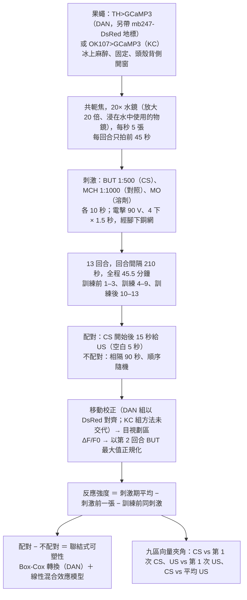
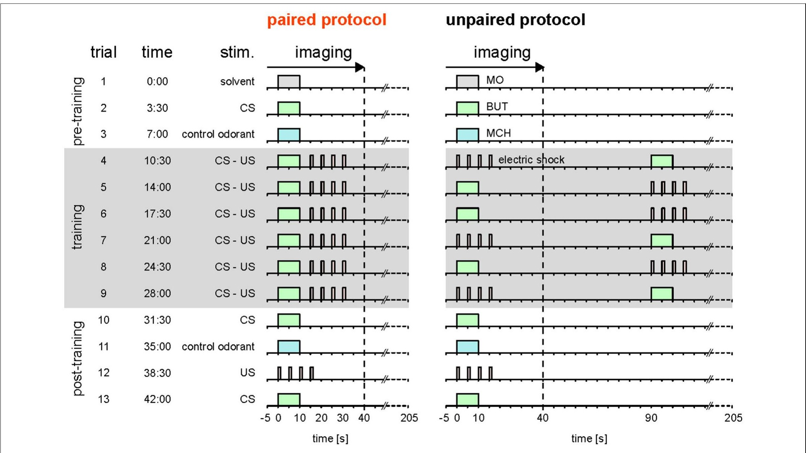
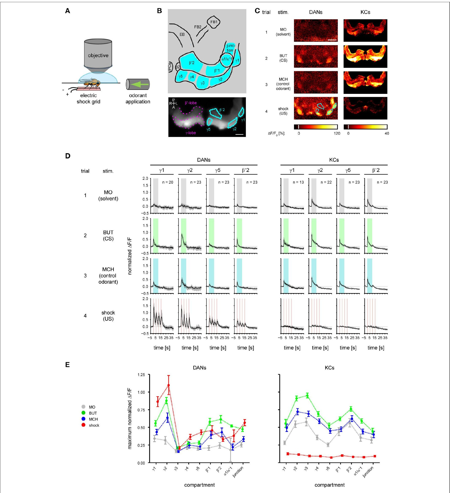
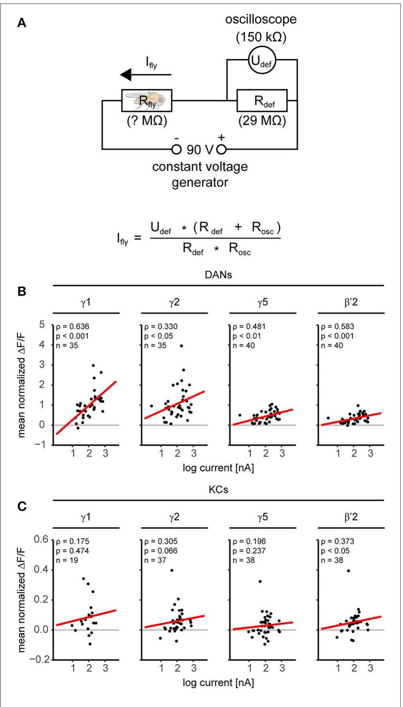
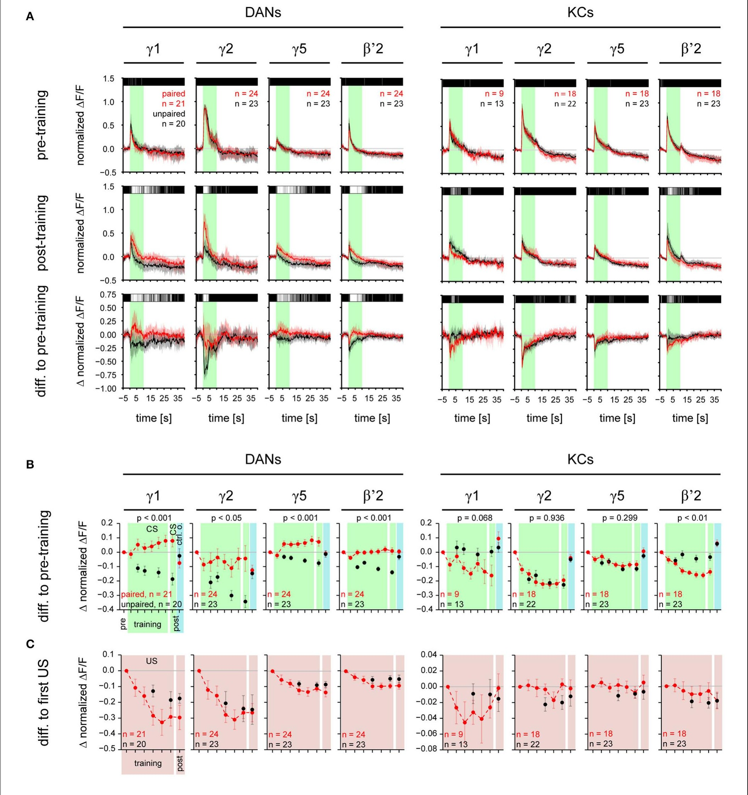
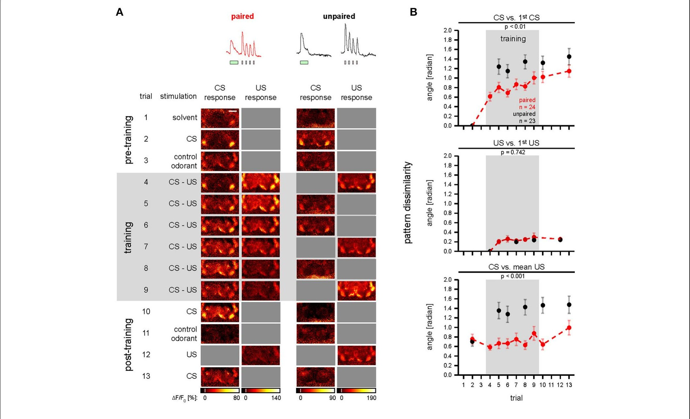
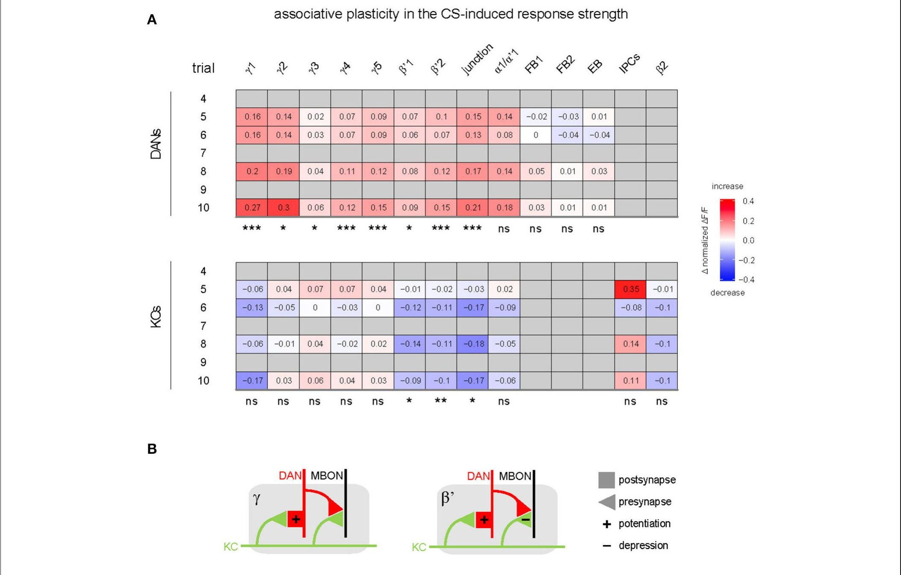

<!-- 本機 PDF：papers/2017-Trace%20Conditioning%20in%20Drosophila%20Induces%20Associative%20Plasticity%20in%20Mushroom%20Body%20Kenyon%20Cells%20and%20Dopaminergic%20Neurons.pdf -->

# Trace Conditioning in *Drosophila* Induces Associative Plasticity in Mushroom Body Kenyon Cells and Dopaminergic Neurons

**果蠅的痕跡制約在蕈狀體 Kenyon 細胞與多巴胺神經元中誘發聯結式可塑性**

| 項目 | 內容 |
|---|---|
| **出處** | Front Neural Circuits 11, 42 (2017). doi: 10.3389/fncir.2017.00042 [全文（PMC 免費閱讀）](https://pmc.ncbi.nlm.nih.gov/articles/PMC5476701/) |
| 日期 | 刊出 2017-06-20（投稿 2017-03-28・接受 2017-05-29；修訂日期 PDF 未印）。Frontiers 為線上期刊，以文章編號 42 代替頁碼 |
| 通訊作者 | Paul Szyszka（paul.szyszka@uni-konstanz.de）。PDF 只有英文名 |
| 作者 | 共 4 人：Kristina V. Dylla、Georg Raiser、C. Giovanni Galizia、Paul Szyszka。分工：Dylla 做全部實驗與分析，補充圖 5（氣味濃度對照）由 Raiser 做；四人共同設計實驗與撰寫 |
| 機構 | Department of Biology, Neurobiology, University of Konstanz（德國康斯坦茨大學） |
| 資料庫 | 影像移動校正程式：https://github.com/grg2rsr/xyt_movement_correction 。原始資料未說明存放處 |
| 補充資料 | 正文引用補充圖 1–6、補充表 1–2 與 Supplemental Experimental Procedures（方法細節）。**都不在 PDF 內，本庫未取得**。因此果蠅的性別與日齡、電擊脈衝之間的間隔、各區室的完整數值與統計模型細節都是 ？待查 |
| 編輯／審查 | 編輯 Deborah Baro（Georgia State University）。具名審查人：Divya Sitaraman（University of San Diego）、Andre Fiala（University of Göttingen）、Andrew Dacks（West Virginia University）。Sitaraman 2015 是本篇引用的文獻之一 |

> 與本庫有關的作者：無。本篇的痕跡制約協定取自 Galili et al. 2011（Galizia、Szyszka 是該篇共同作者；本庫未收錄）；引用了本庫的 Tomchik 2009、Gervasi 2010、Hige 2015、Cohn 2015、Aso 2016、Felsenberg 2017，以及以 Tully & Quinn 1985 為名引用的本庫 Tully 1985。
>
> **本篇為 CC BY 開放取用**（PDF 第 14 頁：Copyright © 2017 Dylla, Raiser, Galizia and Szyszka，Creative Commons Attribution License），圖片可在標明出處的條件下自由使用與散布。本庫仍依規定只給全文連結、不放 PDF；每張圖下方標明出處與授權。

---

## 為什麼重要

> 本節假設讀者已略知果蠅嗅覺學習的輪廓。**完全不熟的讀者可以先看「科普文」一節**；術語另見「專業文」開頭的「本頁用語」表。

本庫「時序規則」主題頁（[[t-timing-rules]]）收了兩種資料：行為上的時間窗（Tully 1985、Tomchik 2009：氣味結束後空白越久，學得越差）與分子或突觸上的時間窗，也就是在分子或突觸層級量到「氣味與多巴胺隔多久仍有效」（Tomchik 2009 量 cAMP，一種細胞內的訊號小分子，見本頁用語；Hige 2015 與 Handler 2019 量突觸）。中間缺一塊：**氣味和電擊隔開幾秒的痕跡制約（trace conditioning）訓練進行時，蕈狀體裡的神經元實際怎麼變。** 這篇在活果蠅上，一邊做 5 秒空白的痕跡制約，一邊用鈣成像同時看九個區室（蕈狀體分成的一格一格）的多巴胺神經元（DAN）與 Kenyon 細胞（KC）。在此之前，本庫與痕跡制約有關的神經資料只有 Tomchik 2009：在取出的腦裡，用化學物質模擬氣味與多巴胺、改變兩者的時間差。

第二個貢獻是給「DAN 會不會學」一筆早期的區室解析資料。本庫 Huang 2024 用電壓成像（直接量膜電位，能看到放電減少；鈣成像不易看到減少）看到 α3 格的 DAN 學會對受訓氣味放電；這篇早七年，用鈣成像看到 γ 葉與 β′ 葉多數格的 DAN 對受訓氣味的反應**相對於不配對組**變大。兩篇對「這個習得反應從哪裡來」給的解釋不同。

- **Huang 2024 的解釋**：歸給蕈狀體輸出神經元（MBON）對 DAN 的回饋（[[t-mbon-dan-feedback]]）。某一格的 MBON 原本會抑制別格的 DAN。訓練讓這個 MBON 對受訓氣味的反應變弱，所以它對 DAN 的抑制只在聞到這個氣味時鬆開，DAN 才開始對受訓氣味放電。
- **這篇的解釋**：改變發生在 KC→DAN 的突觸上，也就是「KC 把訊號傳給 DAN 的接點」（Cervantes-Sandoval 2017 剛報告這種接點）。論證分三步。第一，幾乎所有格的 DAN 一起變；據作者所知，各型 DAN 沒有共同的輸入（MBON 或其他神經元都沒有）能解釋這種一起變。第二，KC 推測是所有 DAN 唯一共同的氣味輸入。第三，相對於不配對組，同一格的 DAN 較大，KC 卻不變或較小，所以 DAN 的改變不是從 KC 繼承來的，而是發生在 DAN 接收 KC 訊號的那一端。這一步比的是兩組之差，不需要 DAN 比訓練前變大；所以即使多數格只是「沒掉下去」（見科普文），論證仍成立。

兩者都是推論，而且看的是不同的格。

第三，它直接檢驗「果蠅 DAN 是否像猴子的多巴胺神經元那樣編碼預測誤差」（預測誤差＝預期的獎懲與實際獎懲之間的差距）。比較的兩組是：配對組（氣味結束後空白 5 秒再電擊）與不配對組（氣味與電擊次數相同，但相隔 90 秒），詳見科普文。若編碼預測誤差，被氣味預告過的電擊在配對組應引起較小的反應。結論是否定的：電擊引起的反應配對組與不配對組一樣，預期的電擊沒來時 DAN 也沒有往下掉。

但這個否定結論有兩個弱點。

- **第一，方法的限制。** 它用的是鈣成像，而本庫 Huang 2024 示範過鈣成像不容易看到放電「減少」。
- **第二，同一批 DAN 在別的研究裡被認為帶有預期落空的訊號。** DAN 分兩群：PPL1 群多半報告懲罰，PAM 群多半報告獎賞（見本頁用語）。本篇 γ5、β′2 格的 DAN 是 TH-GAL4 標到的少數 PAM 群細胞，與本庫 Felsenberg 2018 討論的是同一群。Felsenberg 2018 認為消退是另外寫入一個「好事」記憶來抵消舊記憶（「該來的懲罰沒來」被記成好事），所以由報告獎賞的 PAM 負責。Felsenberg 2018 的模型是：學會之後，受訓氣味本身會經由 MBON 回饋驅動這群 PAM 放電。若接下來電擊沒來，這陣「由氣味引起的 DAN 放電」就成為教果蠅「沒那麼危險」的訊號，也就是記憶消退。※ 本頁推論：這個訊號真正發揮作用，是在「聞到氣味而電擊沒來」的時候；本篇看到「訓練後 γ5 DAN 對受訓氣味的反應變大」，代表這個訊號的來源已經就位，作者卻解讀為與預測誤差無關。所以「沒有預測誤差」的結論要附條件（細節見專業文第五節第 3 條）。

詳見專業文第四、五節。

---

## 論文摘要（原文與中譯）

> Dopaminergic neurons (DANs) signal punishment and reward during associative learning. In mammals, DANs show associative plasticity that correlates with the discrepancy between predicted and actual reinforcement (prediction error) during classical conditioning. Also in insects, such as *Drosophila*, DANs show associative plasticity that is, however, less understood. Here, we study associative plasticity in DANs and their synaptic partners, the Kenyon cells (KCs) in the mushroom bodies (MBs), while training *Drosophila* to associate an odorant with a temporally separated electric shock (trace conditioning). In most MB compartments DANs strengthened their responses to the conditioned odorant relative to untrained animals. This response plasticity preserved the initial degree of similarity between the odorant- and the shock-induced spatial response patterns, which decreased in untrained animals. Contrary to DANs, KCs (α'/β'-type) decreased their responses to the conditioned odorant relative to untrained animals. We found no evidence for prediction error coding by DANs during conditioning. Rather, our data supports the hypothesis that DAN plasticity encodes conditioning-induced changes in the odorant's predictive power.

（Frontiers 的摘要不分 Background／Results／Conclusion 段，照原樣一段。）

**中譯**（本節為忠實翻譯，非自撰內容）：

> 多巴胺神經元（DAN）在聯結學習中傳遞懲罰與獎賞的訊號。在哺乳類，DAN 在古典制約期間表現出聯結式可塑性，而這種可塑性與「預期的增強」和「實際的增強」之間的差距（預測誤差）相關。在昆蟲，例如果蠅，DAN 也表現出聯結式可塑性，但了解較少。本文在訓練果蠅把一個氣味與一個時間上分開的電擊聯結起來（痕跡制約）的同時，研究 DAN 及其突觸夥伴——蕈狀體（MB）中的 Kenyon 細胞（KC）——的聯結式可塑性。在多數蕈狀體區室中，相對於未受訓的動物，DAN 對條件氣味的反應增強。這種反應可塑性保留了氣味與電擊所引起的空間反應樣式之間原本的相似程度，而在未受訓的動物中這個相似程度下降。與 DAN 相反，KC（α′/β′ 型）相對於未受訓的動物，對條件氣味的反應減弱。我們沒有找到 DAN 在制約期間編碼預測誤差的證據。我們的資料反而支持這個假說：DAN 的可塑性編碼的是制約造成的、氣味預測力的改變。

---

## 科普文

想像一個新進的警衛，他的工作是一聽到警報就按下「危險」按鈕。訓練時，每次門口的花香飄過，五秒後警報就響。幾輪之後，你會發現警衛聞到花香就已經把手放到按鈕上了，雖然警報還沒響。這篇論文問的是：果蠅腦裡負責按「危險」按鈕的多巴胺神經元，會不會也這樣「學會」對預告危險的氣味起反應？如果會，牠是像猴子的多巴胺神經元那樣，學會之後「對警報本身就不再大驚小怪」，還是只是多學了一件事？

**先交代果蠅怎麼學。** 果蠅聞到氣味時，蕈狀體（mushroom body）裡一小群 Kenyon 細胞（KC）會活動，哪一群活動就代表哪個氣味。KC 的長纖維（軸突）成束排成幾條「葉」，每條葉沿長度分成一格一格的區室，例如 γ1、γ2……γ5。每一格有自己的多巴胺神經元（DAN）送來「好事或壞事」的訊號（報壞事的主要是 PPL1 群，報好事的主要是 PAM 群），也有自己的輸出神經元（MBON）讀出 KC 的訊號、推動果蠅靠近或走開。氣味和電擊湊在一起時，DAN 讓該格 KC 與 MBON 之間的接點（突觸）改變，下次再聞到這個氣味，果蠅的反應就不同了。

**難題一：氣味和電擊沒有湊在一起，還學得到嗎？** 標準的訓練讓氣味和電擊重疊。這篇用的是痕跡制約（trace conditioning）：氣味 10 秒，**結束後空白 5 秒**才開始電擊。空白期間果蠅要在腦裡「留著」氣味的痕跡。本庫的 Tully 1985 與 Tomchik 2009 在行為上量過：空白越長學得越差，但幾秒到十幾秒的空白仍學得到一些。這篇的作者選痕跡制約還有一個實用的理由：氣味和電擊在時間上分開，才分得出神經元是在對氣味反應、還是在對電擊反應。

**解法：一邊訓練，一邊看。** 作者讓果蠅頭部固定、腳站在銅網上（通電就是電擊），打開頭殼，用鈣成像看神經元：神經元活動時細胞內鈣增加，一種螢光蛋白（GCaMP3）就變亮。一批果蠅讓 DAN 帶這種蛋白，另一批讓 KC 帶。每隻果蠅接受 13 回合、共 45.5 分鐘的流程（3＋6＋4＝13）：

| 階段 | 回合 | 內容 |
|---|---|---|
| 訓練前 | 第 1–3 回合 | 依序聞溶劑（礦物油）、受訓氣味（丁醇）、對照氣味（甲基環己醇） |
| 訓練 | 第 4–9 回合 | 6 回合「丁醇 → 空白 5 秒 → 電擊」 |
| 訓練後 | 第 10–13 回合 | 依序丁醇、甲基環己醇、單獨電擊，最後再一次丁醇（用來檢查鈣訊號是否隨時間衰退） |

關鍵在對照組：**不配對組**收到一模一樣數量的氣味和電擊，只是兩者相隔 90 秒、順序打亂。兩組的差別，就只剩「氣味和電擊有沒有湊在一起」，作者把這個差別稱為聯結式可塑性。

**看到的第一件事：DAN 對受訓氣味的反應，相對於不配對組變大了。** 作者在九個區室量到 DAN。其中八個看得到「配對組相對較大」的顯著差異：γ1–γ5、β′1、β′2，以及 junction（各葉在根部交會的區域）。差值是配對組減不配對組的反應強度；反應強度以「第 2 回合丁醇引起的最大反應」為 1 換算成相對值。顯著的八格差值在 0.06–0.30 之間。第九格 α1/α′1 的差值是 0.18，落在這個範圍內，卻不顯著，所以不顯著不是因為差值小，可能是樣本少或變異大（本頁推論；圖 2E、6A 有些格只有 2 隻）。第一回合訓練後就分得出來。對照氣味的反應兩組一樣，所以這個改變是對受訓氣味專一的。有趣的是，γ3、γ4、γ5、β′1 這幾格的 DAN 過去並不被認為參與電擊學習，作者自己也說「令人意外」。

**但要小心「變大」的意思。** 仔細看圖，配對組 DAN 的反應大致維持在訓練前的水準，有幾格略升；**不配對組卻一路往下掉**。例如 γ2 格，配對組比訓練前還略低，只是不配對組掉得更多。作者也承認，不配對組的下降可能是神經元重複聞到同一氣味而疲乏、氣味濃度逐漸變淡，或螢光蛋白被光漂白，實驗設計分不出來。所以比較穩當的說法是：**配對讓 DAN 對受訓氣味的反應「沒有掉下去」**，只有 γ1、γ4、γ5 三格是真的比訓練初期升高。

**看到的第二件事：KC 的方向相反。** KC 也在同樣九格量了。在 β′ 葉的兩格與 junction，KC 對受訓氣味的反應相對於不配對組變小。γ 葉各格則沒有顯著差異；例如 γ1 的差值是 −0.17（同樣的相對值，負值表示配對組較小），但 p＝0.068，未達顯著，樣本也少。

鈣訊號量的位置，是 KC 軸突穿過該格、與 MBON 接觸的地方。作者據此推測：變小的是 KC→MBON 接點的「突觸前減弱」，也就是 KC 這一端送出的訊號變弱。※ 這是從量測位置推論的，沒有直接量突觸。

**看到的第三件事：DAN 沒有像猴子那樣「預測」。** 1990 年代猴子的研究發現，多巴胺神經元學會之後，對預告獎賞的線索放電，對獎賞本身反而不再反應；預期的獎賞沒來時，放電會掉到平常以下。這種「預期與實際的差距」叫預測誤差。如果果蠅 DAN 也這樣，訓練後對電擊的反應應該在配對組變小，而且只給氣味、不給電擊時，原本該電擊的那一刻 DAN 應該往下掉。作者兩樣都沒看到：電擊反應兩組一樣（兩組都隨訓練逐漸變小），預期的電擊沒來時也看不出下掉。作者的結論是：果蠅 DAN 學到的是「這個氣味預告電擊」，不是「實際與預期差多少」。

**代價與需要小心的地方。** 第一，牠們有沒有真的學會，這套裝置量不到：頭固定在顯微鏡下時，沒有行為讀數。作者只能說「協定和行為實驗相近，相信學會了」。第二，DAN 的訊號是用 TH-GAL4 這個驅動品系標的（讓特定細胞帶螢光蛋白的基因工具，詳見本頁用語）。每格裡常有好幾顆 DAN 混在一起發光，作者說只有 γ2 與 α′1 兩格是單一顆。這是同一顆 PPL1-γ2α′1 細胞，同時支配 γ2 與 α′1。本篇分析時把 α′1 與 α1 合併成「α1/α′1」一區，合併區是否仍只有一顆，論文未說明（？待查）。混在一起的缺點是：看不出單一細胞各自怎麼變。第三，鈣成像對「活動減少」不敏感：本庫 Huang 2024 用電壓成像示範過，DAN 放電明顯下降時鈣訊號幾乎不變。所以「預期的電擊沒來時 DAN 沒有往下掉」，可能只是鈣成像看不到。

**最容易被誤讀的一點：這篇的「DAN 增強了對受訓氣味的反應」是相對於不配對組的比較，不是說 DAN 的反應比訓練前大。** 在多數格裡，它比較接近「配對組保住了、不配對組掉下去」。另外，「沒有預測誤差」是在鈣成像、5 秒空白的痕跡制約、每隻果蠅只有兩次「只給氣味」的測驗（訓練後的第 10 與第 13 回合；訓練前那次果蠅還不會預期電擊，不算；第 11 回合給的是從未配過電擊的對照氣味，也不算）下得到的否定結果；它說的是「沒找到」，不是「證明沒有」。

---

## 專業文

### 本頁用語

本頁各節可單獨查閱，故把反覆出現的詞集中在這裡。

| 詞 | 意思 |
|---|---|
| 蕈狀體（mushroom body, MB） | 果蠅腦中負責嗅覺學習與記憶的結構，左右各一。見 [[e-mushroom-body]] |
| KC（Kenyon cell） | 蕈狀體的主要神經元。每個氣味活化一小群 KC。見 [[e-kenyon-cell]] |
| DAN（dopaminergic neuron） | 多巴胺神經元，送來「好事或壞事」的訊號。**PPL1 群多半報告懲罰，PAM 群多半報告獎賞**。命名規則：名字前段是細胞群（PPL1、PAM），後段是它支配的區室；pedc 是蕈狀體柄（peduncle）。例如 PPL1-γ1pedc 支配 γ1 與柄，PPL1-γ1 只支配 γ1（依名稱）。見 [[e-dopaminergic-neuron]] |
| MBON（mushroom body output neuron） | 蕈狀體輸出神經元，讀出 KC 的訊號，推動果蠅靠近或走開。本篇沒有量 MBON |
| 葉、區室（lobe, compartment） | KC 軸突成束排成 α/β、α′/β′、γ 等「葉」；每條葉沿長度分成幾格，例如 γ1 是 γ 葉第 1 格。本篇說蕈狀體葉共 15 格（α1–3、β1–2、α′1–3、β′1–2、γ1–5）。有些格再細分，例如 β′2a 是 β′2 的一部分。見 [[c-mb-compartment]] |
| 水平葉（medial lobe） | 往腦中線水平伸出的葉，即 β、β′、γ 葉 |
| junction | 本篇自訂的一個區域：各葉在根部交會處。作者聲明把它和合併的「α1/α′1」都當成區室稱呼 |
| 九個區室 | 本篇 DAN 與 KC 都有資料的九區：γ1、γ2、γ3、γ4、γ5、β′1、β′2、α1/α′1、junction（依圖 2B、2E、6A；正文的清單與此不同，見第五節第 6 條）。β2 不在其中，只出現在 KC 的表 |
| FB、EB、IPCs | 扇形體（fan-shaped body）、橢圓體（ellipsoid body）：中央複合體的兩個構造，不屬蕈狀體，作者拿它們的 DAN 當對照。IPCs：製造胰島素的細胞（insulin-producing cells），OK107 也會標到 |
| CS、US | CS（conditioned stimulus，條件刺激）是氣味；US（unconditioned stimulus，非條件刺激）是電擊。本篇的 CS 是丁醇（BUT），對照氣味是 4-甲基環己醇（MCH），溶劑是礦物油（MO） |
| 痕跡制約（trace conditioning） | CS 結束後空白一段時間才給 US。本篇是 CS 10 秒、空白 5 秒（CS 開始到 US 開始 15 秒）。對比的「標準制約」讓 CS 與 US 重疊。見 [[c-cs-us-timing]] |
| 配對組、不配對組（paired, unpaired） | 兩組收到相同數量的 CS 與 US。配對組 CS 開始後 15 秒給 US；不配對組 CS 與 US 開始相隔 90 秒、順序隨機排 |
| 回合（trial） | 實驗的時間單位，每 210 秒一回合，共 13 回合。訓練前 1–3 依序給 MO、BUT、MCH；訓練 4–9；訓練後 10–13 依序給 BUT、MCH、電擊、BUT |
| 聯結式可塑性（associative plasticity） | 本篇的操作型定義：配對組與不配對組的反應強度差異。排除了重複刺激本身造成的改變 |
| 非聯結式效應 | 不靠「CS 與 US 湊在一起」的改變：敏感化（被電後對什麼都更敏感）、習慣化（重複聞到同一氣味反應變小）、偽制約（單純挨電就讓氣味反應改變）。本篇用不配對組來扣除 |
| 突觸減弱（depression） | 突觸傳遞變弱：同樣的上游訊號，下游反應變小。發生在送出訊號那一端時稱「突觸前減弱」 |
| KC→DAN 突觸 | KC 把訊號傳給 DAN 的接點，Cervantes-Sandoval et al. 2017 報告 |
| cAMP、腺苷酸環化酶、*rutabaga*、巧合偵測 | cAMP 是細胞內的訊息分子；腺苷酸環化酶是製造 cAMP 的酶。*rutabaga* 是一個基因，產物是一種腺苷酸環化酶。巧合偵測：只有氣味（KC 內鈣升高）與多巴胺同時或相近時間到，才產生強訊號 |
| 鈣成像、GCaMP3 | 神經元活動時細胞內鈣增加，GCaMP3 這種螢光蛋白就變亮。本篇每秒拍 5 張。見 [[e-gcamp]] |
| ΔF/F0 | 螢光的相對變化：(當下亮度 − 基線亮度) ÷ 基線亮度 |
| 反應軌跡（response trace） | 本篇把每隻果蠅的 ΔF/F0 除以「第 2 回合丁醇反應在反應最強那一區的最大值」，使不同果蠅可以比較 |
| 反應強度（response strength） | 三步算出。第一步：取刺激期間反應軌跡的平均；氣味取 10 秒，電擊取四下各 1.5 秒通電期間。第二步：再減去刺激開始前一張影像的值，原文說是為了校正基線螢光的差異；F0 是每回合開頭固定一段的平均，這一步則以每次刺激前那一張為零點。第三步：減去訓練前同一刺激的值，CS 用第 2 回合、MCH 用第 3 回合、US 用第 4 回合（第一次電擊）。所以 0 ＝與訓練前一樣 |
| GAL4／UAS、驅動品系 | 兩段式基因工具。GAL4 決定在哪些細胞開；UAS 後面接要表現的基因（本篇是 GCaMP3）。兩者在同一隻果蠅裡，基因才在 GAL4 指定的細胞表現。帶 GAL4 的品系稱驅動品系 |
| 同型合子（homozygous） | 兩條同源染色體都帶同一個轉殖基因，確保每隻子代都帶到 |
| TH-GAL4、OK107-GAL4、mb247-DsRed | TH-GAL4 標部分 DAN（見 [[e-th-gal4]]）；OK107-GAL4 標全部 KC；mb247-DsRed 讓蕈狀體帶紅色螢光，當作找區室與校正移動的地標 |
| 預測誤差（prediction error） | 實際得到的增強與預期之差（增強〔reinforcement〕＝獎懲本身，例如電擊或糖）。猴子的多巴胺神經元在學會後：對線索放電、對預期中的獎賞不再反應、預期的獎賞沒來時低於平常（Schultz et al. 1997，本篇引用） |
| 預測力（predictive power） | 本篇用語：CS 能預告 US 的程度。作者主張 DAN 的可塑性編碼的是這個，而不是預測誤差 |
| 空間活動樣式、夾角 | 把一隻果蠅九個區室的反應強度排成一個九維向量；兩個樣式的差異用兩向量的夾角表示（0＝形狀相同，π/2 ≈ 1.57 弧度＝完全不相關）。夾角只看形狀、不看整體大小 |
| 二階制約（second-order conditioning） | 先學會 CS1 預告電擊，再讓 CS2 配 CS1（不給電擊），果蠅也會躲 CS2。作者推測 DAN 對 CS 的習得反應可能為此服務 |
| 線性混合效應模型 | 同一隻果蠅多次量測的統計模型，把果蠅當隨機效應。本篇的顯著性多半來自它的重複量數變異數分析。`*` p < 0.05、`**` p < 0.01、`***` p < 0.001；ns 不顯著 |
| ※ 推論 | 論文沒有明說、本頁自行推得的內容，並寫出依據 |
| ？待查 | 值得查證但本頁刻意不填的內容 |

### 一、概述

**主要問題。** 哺乳類的 DAN 在古典制約期間會改變反應，編碼的是預測誤差。本篇問果蠅 DAN 的可塑性是否也是如此；若否，它編碼什麼？

作者重新檢驗 Riemensperger et al. 2005（本庫未收錄）的主張。該篇主張：果蠅 DAN 對 CS 的反應會增強，但編碼的是「US 的預測」，而不是預測誤差。本篇結論與它一致，作者寫「支持」此假說；本篇說的「預測力」與 2005 年的「US 的預測」是同一件事（原文 "predictive power of the CS, e.g., US-prediction"）。本篇補強的是兩點：

- （一）逐區室分析，不把整個葉的 DAN 合在一起。
- （二）改用 5 秒空白的痕跡制約，讓 CS 與 US 的反應在時間上分得開。

**重要性。** 若 DAN 本身會學，「DAN 只是被動送出 US 訊號」的蕈狀體學習模型就不完整。作者指出，當時的模型（Busto 2010、Owald & Waddell 2015）都沒有納入 DAN 的氣味反應與它的聯結式增強。本篇也是少數在活果蠅上、訓練進行中同時看 DAN 與 KC 的研究。

**發表當時的領域現狀（2017）。**

- DAN 的區室分工：Aso et al. 2010、2012、2014a 確立 γ1、γ2、β2 等格的 DAN 傳遞電擊訊號；Aso & Rubin 2016（本庫 [[s-aso-2016-dan-cell-type-rules]]）比較各型的學習規則。
- KC→MBON 突觸的可塑性：Cohn 2015、Hige 2015a（本庫）在活果蠅或離體腦上看到配對造成的突觸減弱。
- 巧合偵測：Tomchik & Davis 2009、Gervasi 2010（本庫）支持 *rutabaga* 腺苷酸環化酶在 KC 中偵測「鈣＋多巴胺」同時出現。
- 痕跡制約：Galili et al. 2011 建立果蠅的嗅覺痕跡制約行為協定；Shuai et al. 2011 報告痕跡制約依賴 KC 上的多巴胺受體、但不依賴 *rutabaga*（兩篇本庫皆未收錄，內容依本篇引述）。
- 上兩條合起來看：若痕跡制約不靠 *rutabaga*，表示痕跡制約可能用另一種分子做巧合偵測（見第四節討論的主張六）。
- DAN 的多重角色：同一顆 PPL1-γ1pedc 身兼三職。它傳遞增強訊號。它閘控長期記憶，也就是決定長期記憶能不能形成（Plaçais 2012、Musso 2015）。它控制狀態依賴的提取，例如果蠅飢餓時才提取得到記憶（Krashes 2009）。這表示同一顆 DAN 的角色比「被動送出增強訊號」複雜，與本篇的問題相呼應。
- 本篇刊出時，Cervantes-Sandoval et al. 2017 剛報告 KC→DAN 突觸。作者據此提出，DAN 的可塑性可能就發生在這個突觸上（DAN 那一端）。

### 二、方法

**果蠅與品系。** 兩組都用 GAL4／UAS 讓 GCaMP3 只在目標細胞表現（見本頁用語）。

品系寫法中，「;」表示同一隻果蠅同時帶兩個轉殖基因；「>」表示用前者（GAL4）驅動後者（UAS-GCaMP3）。

- DAN 組：同型合子的 UAS-GCaMP3; TH-GAL4 雌蠅與同型合子 mb247-DsRed 雄蠅雜交，子代稱 TH>GCaMP3。
- KC 組：UAS-GCaMP3 雄蠅 × OK107-GAL4 雌蠅，子代稱 OK107>GCaMP3。

KC 組的雜交沒有列 mb247-DsRed。方法節說 KC 的區室依 GCaMP3 劃定。方法節又說移動校正以每張影像的 mb247-DsRed 對齊；KC 組沒有 DsRed 時怎麼做移動校正，正文沒交代（？待查）。成像果蠅的性別與日齡：？待查（補充方法未取得）。

**TH-GAL4 在本篇標到誰（依本篇引述 Mao & Davis 2009（[[s-mao-2009-dopaminergic-neuron-types]]）、Aso 2010、2014a）。**

| 區室 | 被標到的 DAN |
|---|---|
| γ1 | 1–2 顆 PPL1-γ1pedc 與 1 顆 PPL1-γ1 |
| γ2 與 α′1 | 1 顆 PPL1-γ2α′1 |
| β2β′2a、β′2、γ5 | PAM 群中 12 顆被標到：3 顆支配 β2β′2a，其餘支配 β′2 或 γ5 |
| γ3、γ4、β′1 | 看得到被標的 PAM 末梢（引 Pech 2013） |

作者提醒，支配水平葉的 PAM 約 120 顆，TH-GAL4 只標到其中一小部分。

**刺激。** 氣味在礦物油中稀釋：BUT 1:500、MCH 1:1000。兩者稀釋比不同的理由，論文未說明。

電擊為 90 V 恆壓、4 下、每下 1.5 秒，加在果蠅腳下的銅網上。脈衝之間的間隔正文沒寫（？待查）。圖 1 示意圖上，4 下約分布在 CS 開始後 15–30 秒之間（※ 從圖判讀，示意圖不一定按比例）。

作者用橋式電路（bridge circuit，原文用語；取樣 16 kHz）記錄每隻果蠅實際流過的電流（圖 3A）。結論先講：電流換算正確，只是圖說字面容易誤會。

接法：一顆已知電阻（R_def＝29 MΩ）與示波器（內阻 R_osc＝150 kΩ）並聯，這個組合再與果蠅串聯。U_def 是示波器在這個組合兩端量到的電壓。換算式 I_fly ＝ U_def ×(R_def＋R_osc)/(R_def×R_osc) 已把並聯算進去。※ 推論：兩者並聯約 149 kΩ，由示波器內阻主導；圖說字面寫「量 29 MΩ 上的電壓」，容易誤以為量測電阻是 29 MΩ，對結果沒有影響。

氣味的動態用光離子偵測器（miniPID）量過，關閉很快（補充圖 4A，未取得）。

**不預先暴露。** 重複接觸同一刺激，反應會逐漸變小直到穩定（習慣化）。有些生理實驗會先讓動物反覆聞刺激，直到反應穩定（作者舉 Hige 2015a 為例）。本篇刻意不這樣做，理由是行為制約（Tully & Quinn 1985）也不預先暴露。※ 推論：代價是訓練前三回合的反應仍在下降期，不配對組隨回合下降的一部分可能就是這個（見 3.3）。

**協定（圖 1）。** 各回合給的刺激見本頁用語「回合」。回合間隔 210 秒，第 13 回合在 42:00 開始，加 3.5 分鐘共 45.5 分鐘（可驗算：12 × 3.5 ＝ 42）。

每回合只拍前 45 秒，所以**不配對組每回合只拍到排在前面的那個刺激**：第 4、7、9 回合拍到電擊，第 5、6、8 回合拍到 CS（圖 1、5A、6A 的灰格）。配對組的 45 秒成像窗則同時涵蓋 CS 與 US。兩組每回合都拍 45 秒，作者說這樣做是為了讓兩組的總曝光（因而漂白）相同。統計只用兩組都有紀錄的回合（圖 4 圖說）。

訓練後第 13 回合再給一次 CS，用來偵測鈣訊號隨時間衰退（run-down）。

**區室與左右腦。** 依 Tanaka 2008、Aso 2014a 目視劃定區室。先左右腦分開分析，以線性混合效應模型檢驗左右差異。部分區室左右有差（不配對組 DAN 的電擊反應、配對組 KC 的 CS 反應，補充表 1）。作者因此只取一側做後續分析：選 γ1 看得到的那一側。原文稱 γ1 為「underrepresented」，意即 γ1 在部分果蠅的某一側成像不清楚；原因論文未說明。

**正規化。** 基線 F0 取第 3–24 張的平均（※ 推論：每秒 5 張、成像從 CS 前 5 秒開始，約為 CS 前 4.6 到 0.4 秒）。ΔF/F0 再除以「第 2 回合 BUT 反應在反應最強那一區的最大值」。

**空間樣式。** 九區的平均反應強度構成九維向量。差異用歐氏距離與夾角 φ（cos φ ＝ 兩向量內積 ÷ 兩向量長度相乘）量。主文只呈現夾角，歐氏距離在補充圖 6（未取得）。三種比較各回答一個問題：

| 比較 | 回答的問題 |
|---|---|
| CS vs 第 1 次 CS | 氣味反應的樣式自己變了多少 |
| US vs 第 1 次 US | 電擊反應的樣式變了多少 |
| CS vs 平均 US | 氣味樣式和電擊樣式像不像。作者問的是：CS 樣式會不會變得更像 US 樣式，反映 CS 的預測力 |

第 1 次 CS 指第 2 回合（訓練前）的 BUT，第 1 次 US 指第 4 回合的電擊，兩者在不同回合。「平均 US」平均的是哪幾回合，論文沒寫（？待查）。※ 推論：論文說向量用「正規化的平均反應強度」。若照「反應強度」定義扣掉訓練前值，第 1 次 CS 的向量會全為 0，夾角無法算；所以這裡用的應是未扣訓練前值的版本（論文未明說）。

**統計。** DAN 資料先做 Box-Cox 轉換，使分布接近常態。接著以線性混合效應模型與其重複量數變異數分析（R 的 lme）檢驗四項：回合之間、左右腦之間、「實驗組別之間」、配對與不配對之間。論文同時列出後兩項；「實驗組別」指什麼，論文未說明（？待查，模型細節在補充表 1，未取得）。圖 4A 逐張影像的兩組比較用 Wilcoxon 檢定；未校正多重比較，只作視覺標示。
### 三、結果

#### 3.1 規模

- DAN 組（圖 4）：配對 21–24 隻、不配對 20–23 隻（依區室）。KC 組：配對 9–18 隻、不配對 13–23 隻。KC 的 γ1 最少（配對 9 隻），因為 γ1 是「較少被看到」的區室。
- 上面的 21–24 等是圖 4 的隻數。
- 圖 2E 的 n ＝ 2–23、圖 6A 的 n ＝ 2–24：「2」是某些區室某些組的最小值，例如 α1/α′1。論文沒有逐一列出是哪一格（※ 推論：α1/α′1 的 MO 誤差棒極大，可能就是這種格）。
- 電流與反應的相關（圖 3B–C）：每區 19–40 隻。※ 推論：40 大於任一組的單組隻數，應是配對與不配對兩組合併。

#### 3.2 訓練前：各區對氣味與電擊的反應不同（圖 2、3）

- 所有區室的 DAN 與 KC 都對氣味有反應，強弱一般是 BUT > MCH > MO。KC 對溶劑 MO 的反應比 DAN 大。
- DAN 對電擊的反應比 KC 大得多；γ1、γ2 最強。
  - ※ 從圖 2E 判讀：γ1、γ2 的電擊最大值約 0.87、1.10，同區 BUT 約 0.56、0.88。
  - 這裡的「最大值」是反應軌跡的最高點，沒有扣訓練前值，和「反應強度」（見本頁用語）不同。
  - 正規化的分母是「第 2 回合 BUT 在反應最強那一區」的最大值，所以單一區的值可以大於 1。本節後面的「約 0.2」「約 0.1」也是這種最大值。
- γ3 的 DAN 對所有刺激都只有約 0.2。
- KC 對電擊幾乎沒有反應（約 0.1，且九區相近）。
- 過去 Akalal 2010 曾報告 KC 對電擊有強反應，但那篇是把電擊加在果蠅腹部。作者認為差別來自這點：本篇的電擊加在腳上。
- 電擊反應隨流經果蠅的電流的對數上升：迴歸斜率 0.024（α1/α′1）到 0.715（γ1）ΔF/F 每 log(nA)。
  - ΔF/F 是正規化值（以第 2 回合 BUT 的最大值為 1）。
  - log 的底數論文未寫（？待查），所以斜率的絕對意義不明。
  - 只能比較各區的相對大小：γ1 最陡。
- 除 α1/α′1 外，所有區室的 DAN 都顯著相關（Spearman ρ：γ1 0.636、γ2 0.330、γ5 0.481、β′2 0.583）。圖 3B 只畫了這四個示範區的 ρ，其餘各區在補充表 2（未取得）。KC 只有 β′ 葉與 γ3 有正相關（圖上 β′2 ρ ＝ 0.373、p < 0.05）。
- 作者據此說 DAN 能編碼電擊強度，這可能解釋行為上電擊越強、學得越好（Tully & Quinn 1985）。

#### 3.3 訓練中與訓練後：DAN 對 CS 的反應相對增強（圖 4、6A）

- 配對組相對於不配對組，DAN 對 CS 的反應在 9 區中的 8 區較大：γ1–γ5、β′1、β′2、junction（圖 6A 的顯著標記；α1/α′1 不顯著）。FB1、FB2、EB 的 DAN 都不顯著。
- 訓練後第 10 回合的配對減不配對差值（圖 6A，正規化 ΔF/F）：γ1 0.27、γ2 0.30、γ3 0.06、γ4 0.12、γ5 0.15、β′1 0.09、β′2 0.15、junction 0.21、α1/α′1 0.18（ns）。
  - 0.27 的意思是：兩組差了第 2 回合 BUT 最大反應的 27%。
  - ※ 推論（見圖 6 解讀）：差值只是第 10 回合（訓練後）的值，顯著標記看的是整段訓練期的混合效應模型（圖 4B 的 p 值）。各區的樣本數與變異也不同。所以 γ3 差 0.06 卻顯著，α1/α′1 差 0.18 卻不顯著。
- 第一個訓練回合之後（第 5 回合）就看得出差異。※ 推論：第 4 回合不配對組沒有拍 CS，所以第 5 回合是最早能比較的一點，「第一回合後就出現」也等於「最早能量到的時候就已出現」。
- 若不跟不配對組比，只看配對組自己從第一個訓練回合到訓練後有沒有升高（原文 "from the first training trial to the post training trial"，基準是第一個訓練回合，不是訓練前），顯著上升的只有 γ1、γ4、γ5（γ1 F(1,20) ＝ 4.39、γ4 F(1,22) ＝ 6.23、γ5 F(1,23) ＝ 6.67，都是 p < 0.05）。
- 不配對組在多數區室隨回合下降。作者列出三種可能：重複刺激造成的非聯結式可塑性、CS 濃度下降、螢光蛋白被漂白。
- 額外的對照實驗顯示 DAN 對濃度敏感：初始濃度的 100% 比 60% 反應大（補充圖 5，未取得）。這只說明「CS 濃度下降」這個解釋說得通，沒有證明不配對組的下降就是濃度造成的。
- 對照氣味 MCH 兩組無差異，所以改變是 CS 專一的。
- 與電擊強度無關：CS 反應的改變，與每回合果蠅實際受到的電擊（US）強度不相關（補充圖 3E，未取得）。這排除了一種可能：配對組 CS 反應變大，不是因為某些果蠅剛好被電得比較強。

#### 3.4 KC 對 CS 的反應相對減弱，只在 β′ 與 junction（圖 4、6A）

- 配對組相對於不配對組，KC 對 CS 的反應在 3 區較小：β′1（*）、β′2（**）、junction（*）。第 10 回合差值 −0.09、−0.10、−0.17。
- 比 DAN 晚一個回合出現（第 6 回合）。
- γ1 的 KC 第 10 回合差值也是 −0.17，但不顯著（圖 4B 訓練期 p ＝ 0.068；配對 9 隻）。見第五節第 4 條。

#### 3.5 電擊反應沒有聯結式改變（圖 4C）

- DAN 與 KC 對電擊的反應，配對組與不配對組沒有差異。
- 兩組 DAN 的電擊反應都隨訓練下降。※ 從圖 4C 判讀（以第一次電擊、即第 4 回合為 0）：

| 區室 | 配對組 | 不配對組 |
|---|---|---|
| γ1 | 約 −0.3 | 約 −0.13～−0.19（只有 3 點） |
| γ2 | 約 −0.27～−0.31 | 約 −0.21～−0.25 |
| γ5 | 約 −0.09～−0.14 | 約 −0.09～−0.14 |
| β′2 | 約 −0.1 | 約 −0.05 |

- 表中的範圍是不同回合的值。不配對組的「3 點」是第 7、9、12 回合。
- ※ γ1 配對組看起來比不配對組降得多，但作者的檢定不顯著；不配對組只有 3 個點、誤差大。
- 訓練後只給 CS 時，原本該電擊的時段 DAN 活動沒有改變（圖 4A、補充圖 1）。若編碼預測誤差，此時 DAN 應往下掉。依據是圖 4A 的軌跡（含逐影格的兩組 Wilcoxon 比較）；論文沒有說明另有專門的檢定。

#### 3.6 空間樣式：配對組 CS 樣式保持與電擊樣式的相似（圖 5）

以下三種比較都是 DAN 的空間樣式（九區排成向量、用夾角比較，見本頁用語；向量的算法見第二節「空間樣式」）。

- **CS vs 第 1 次 CS**：兩組的 CS 樣式都逐漸偏離訓練前，不配對組偏離得較多（p < 0.01）。※ 從圖 5B 判讀：配對組到第 13 回合約 1.15 弧度，不配對組約 1.45。兩組的 CS 樣式都偏離很多（π/2 ≈ 1.57 弧度＝完全不相關），差別只在程度。
- **US vs 第 1 次 US**：兩組都只偏離約 0.2–0.3 弧度，兩組無差（p ＝ 0.742）。
- **CS vs 平均 US**：作者想知道配對之後，氣味引起的樣式會不會變得像電擊引起的樣式，藉此檢驗 CS 是否獲得「預測力」（見本頁用語）。
  - 結果：配對組在訓練中到訓練後各回合都維持在 0.6–1.0 弧度（34–57°，約在「相同」與「完全不相關」的中間），不配對組由 0.7 偏離到 1.5 弧度（40–86°）（p < 0.001）。
  - 0.6–1.0 是訓練期間各回合平均值的範圍；逐回合有波動，沒有單調上升（※ 從圖 5B 判讀）。
  - 作者在摘要的寫法是：配對組「保留了原本的相似程度」，不配對組的相似程度下降。
  - 作者以此「支持」DAN 可塑性編碼 CS 預測力的假說。這是相對於不配對組的比較，不是配對組變得更像。
  - ※ 推論（與圖 5 解讀一致）：配對組沒有變得更像電擊樣式，所以這是較弱的支持。
  - 驗算：0.6 rad ＝ 34.4°、1.0 rad ＝ 57.3°、0.7 rad ＝ 40.1°、1.5 rad ＝ 85.9°。
- KC 的空間樣式沒有任何聯結式改變（補充圖 6，未取得）。
### 四、討論

**主張一：DAN 對 CS 的反應有聯結式增強，遍及 γ 與 β′ 葉。** 證據中等。配對與不配對的設計扣除了刺激數量的差別。增強只對 CS 出現，對照氣味 MCH 兩組無差。八區的方向一致。

但「增強」主要是相對量。在 γ2、β′2 等格，配對組本身大致停在訓練前的水準或略低；兩組的差異主要來自不配對組下降（圖 4B：γ2 配對組約 −0.05、不配對組約 −0.35；見第五節第 10 條）。

不配對組為什麼下降，作者列了漂白與氣味濃度下降兩種可能。※ 推論：不論下降來自這類物理因素，還是來自習慣化（重複聞同一氣味後反應變小，屬非聯結式），配對組也應同樣下降；所以兩組之差可以歸給「配對」本身，是聯結式的。本篇分不開的是生物上該怎麼描述：是配對讓 DAN 的反應「變大」，還是配對「阻止了不配對組那樣的下降」。

**主張二：KC 在 β′ 葉的反應減弱，反映 KC→MBON 突觸的突觸前減弱。** 證據弱到中等。KC 的鈣訊號是整個區室數百顆 KC 的總和。作者用的是一般的細胞質 GCaMP3，不是專門標在突觸前末梢的感測器。

所以「突觸前」是從位置推論的：量的是 KC 軸突在 β′ 葉那一格的鈣，而那裡正是 KC 與 MBON 接觸的地方。

作者也指出，標準制約的研究（Wang 2008、Akalal 2010、2011，本庫未收錄）在 KC 葉看到的是增強，本篇看到的是減弱。差別可能來自痕跡制約與標準制約的不同，也可能來自其他實驗參數。

**主張三：DAN 的可塑性位在 KC→DAN 突觸（圖 6B）。** 證據弱，屬假說。KC→DAN 突觸是 KC 把訊號傳給 DAN 的接點（見本頁用語）。作者的推理分三步：

- 各格的 DAN 一起變，需要有一個各格 DAN 共用的來源來解釋（「共同輸入」指的就是這種共用來源）。MBON 除了輸出，也會回頭接到 DAN；若一型 MBON 接到多格 DAN，就構成共同輸入。作者說，據其所知，各型 DAN 既沒有共同的 MBON 輸入，也沒有其他共同輸入。
- KC 推測是所有支配蕈狀體的 DAN 唯一共同的氣味輸入（Cervantes-Sandoval 2017 報告了 KC→DAN 突觸）。
- 同一格的 KC 反應不變或變小，DAN 的反應卻變大。所以 DAN 的改變不是從 KC 繼承來的，而發生在 DAN 這一側（突觸後）。

這個推理有兩處要保留：（一）「沒有共同的 MBON 輸入」是作者「據我們所知」的陳述，本庫 Cohn 2015、Huang 2024 都報告了跨格的 MBON→DAN 影響（見 [[t-mbon-dan-feedback]]）；（二）作者自己也承認可能有跨區室的側向調節（引 Cohn 2015）。

**主張四：果蠅 DAN 不編碼 US 預測誤差。** 證據弱到中等，是否定結論。兩個檢驗都是「沒看到差異」。第一，若 DAN 編碼預測誤差，電擊被氣味預告後，配對組的電擊反應應比不配對組小；結果兩組一樣。第二，訓練後只給 CS、US 沒來時，DAN 也沒有下降。

這個結論有四點限制：

- 鈣成像對 DAN 活動的下降不敏感（第五節第 2 條）。
- 每隻果蠅訓練後只有第 10、13 兩次「只給 CS」的機會（第 11 回合是對照氣味 MCH，第 12 回合是電擊）。
- 痕跡制約下，US 出現在 CS 開始後 15 秒，但沒有行為證據說明果蠅預期電擊就在這一刻來。預測誤差的下降要在「預期電擊會來的那一刻」才看得到；若果蠅預期的時刻不同，分析就可能看錯時段。
- 沒有行為讀數證明牠們學會了（第五節第 1 條）。

另外，第五節第 3 條也讓這個結論需要附條件。

兩組的 US 反應都隨訓練下降：γ1 配對組約 −0.3，不配對組約 −0.13～−0.19（正規化 ΔF/F，相對第一次電擊；※ 從圖 4C 判讀）。γ1 配對組看起來降得較多，但檢定不顯著，而且不配對組只有 3 個資料點。※ 推論：每隻果蠅下降的幅度不同，這份個體差異會加大變異，讓兩組之間的小差異更難達到顯著；γ1 的情形可能就是一例。

**主張五：DAN 編碼 CS 的預測力，可能用於二階制約或 US 身分的編碼。** 屬延伸假說。「US 身分的編碼」指區分「是哪一種增強物」，例如電擊與其他種類的懲罰。論文只寫「DAN 空間樣式的聯結式改變（圖 5），使它們可能編碼 US 身分」，沒有進一步推導。「預測力」的依據見 3.6：相對於不配對組，配對組的 CS 樣式保持與電擊樣式相似。

作者給了可檢驗的預測：若 DAN 對 CS1 的習得反應，是二階制約中 CS1 能充當增強訊號的基礎，那麼在 CS2–CS1 配對時阻斷這些 DAN 的輸出，應消除二階制約。本篇未做這個實驗。

**主張六：痕跡制約的巧合偵測不靠 *rutabaga*。** 屬推論與引述（巧合偵測、*rutabaga*、cAMP 見本頁用語）。作者的兩個理由：

- （一）US 來時，KC 的 CS 鈣反應已回到基線（圖 2D、補充圖 2）。
- （二）痕跡制約不需要 *rutabaga*（引 Shuai 2011）。

作者因此提出非 *rutabaga* 的腺苷酸環化酶，或蛋白激酶 C（另一種細胞內訊號酶），當候選。

※ 推論：第一個理由看圖 2D 大致成立。CS 開始後 15 秒（氣味結束後 5 秒），KC 的平均軌跡已接近基線。

但這與本庫 [[s-tomchik-2009-camp-dynamics]] 的看法不同。Tomchik 2009 在取出的腦上，用乙醯膽鹼模擬氣味（激發 KC），用多巴胺模擬電擊。乙醯膽鹼開始後 15 秒才給多巴胺，仍看到依賴 *rutabaga* 的 cAMP 協同；「協同」指兩者一起給時 cAMP 上升超過各自單獨給時的總和。Tomchik 2009 並把這個時間窗和行為上的痕跡制約並列。所以「鈣已回到基線」不足以排除 *rutabaga*。見 [[c-coincidence-detection]]。

### 五、問題與限制

**1. 沒有行為讀數。** 作者自陳：成像時無法量學習。所以「DAN 的改變對應學會」是靠協定相近推論的。所沿用的 Galili 2011 行為協定得到多少學習分數（學習指數，定義見第六節），本篇沒寫（？待查）。

**2. 鈣成像對 DAN 活動「減少」不敏感，削弱「沒有預測誤差」的結論。** ※ 推論，依據是本庫 [[s-huang-2024-dopamine-memory-dynamics]] 的延伸圖 13：同一型 DAN 對吸引氣味的放電明顯下降時，鈣訊號幾乎不變；放電是用電壓成像（直接量神經元膜電位，看得到放電減少）量到的。

本篇用的 GCaMP3 比 Huang 2024 的 jGCaMP7b 更早一代，取樣每秒 5 張。此外，圖 2D、4A 的軌跡在刺激後普遍緩慢漂到基線以下，訓練前後、兩組都有。一個小的「US 缺席時下降」會混在這段漂移裡。

**3. 同一群 DAN 裡，有本庫認為會編碼「該來的電擊沒來」的細胞。** ※ 推論。本篇的 γ5、β′2 DAN 是 TH-GAL4 標到的少數 PAM。

- **Felsenberg 的模型。** 本庫 [[s-felsenberg-2018-memory-extinction]] 主張嫌惡記憶的消退靠 PAM（以 γ5 為主）。消退指動物學會「氣味預告電擊」後，再聞這個氣味卻不被電，原本的躲避就減弱。驅動這些 PAM 的是 β′2 與 γ5 格各一型 MBON（M4β′、M6）。受訓後，這兩型 MBON 對 CS 的反應增強，再回頭驅動 PAM。
- **依模型的預測。** 訓練後，γ5 PAM 對 CS 的反應應該變大。
- **本篇的觀察。** 這正是本篇在 γ5 看到的：第 10 回合配對組減不配對組的差值 0.15（***）。作者把「γ5 DAN 對 CS 增強」讀成與預測誤差無關、用途不明（令人意外）。在 Felsenberg 2018 的模型裡，正是這種「氣味引起的 PAM 放電」在電擊沒來時教動物消退。
- **條件差異。** 兩篇的條件差很多：痕跡 vs 標準制約、成像 vs 阻斷神經元輸出的行為實驗、本篇沒有消退訓練。所以不能直接對接。但這個讀法讓「沒有預測誤差」的結論需要附條件。

**4. 「KC 只在 β′ 減弱、γ 不減弱」的檢定力不足。** γ1 的 KC 第 10 回合差值 −0.17，和顯著的 junction（−0.17）一樣大，只是配對組只有 9 隻、p ＝ 0.068。圖 6B 的模型卻把它畫成「γ 葉 KC 沒有突觸減弱」。※ 推論：γ1 的「沒有」更適合讀成「沒測出」。

**5. 圖 3B 的數值尺度與圖 2E 對不上。** 圖 3B 的縱軸是「電擊期間的平均正規化 ΔF/F」，γ1 多數果蠅落在 0.5–1.5，群體平均約 1（※ 從圖判讀）。圖 2E 同區 DAN 電擊反應是「各隻最大值的平均」，約 0.87。

若是同一批果蠅、同一回合，刺激期平均不可能高於最大值。但兩圖的樣本可能不同：圖 2E 只用不配對組訓練前第 4 回合；圖 3B 每區 35–40 隻，應是兩組合併，也可能合併多回合。所以只能說兩圖看起來對不上，論文未交代（細節可能在補充資料，？待查）。⚠️ 單篇自身不一致（定義未交代），不影響「DAN 反應隨電流增加」的定性結論。

**6. ⚠️ 單篇自身不一致：九個區室的清單。** 結果節第一段寫 DAN 與 KC 都記錄了九區「α1/α′1、β2、β′1–2、γ1–γ5」。但其他地方都用 junction 而不是 β2：

- 圖 2B 的青色（分析區）不含 β2、含 junction。
- 圖 2E 的 x 軸、圖 6A 的 DAN 表都是 junction，沒有 β2（β2 只出現在 KC 表，DAN 那一欄是灰格）。
- 同一段稍後的「8/9 區（γ1–5、β′1–2、junction）」也用 junction。

正文清單把 junction 誤寫成 β2。不影響結論。

**7. ⚠️ 單篇自身不一致：圖 5B 圖說的顏色。** 圖說寫「不配對組（紅）比配對組（黑）偏離更多」。但圖上紅色標「paired」、黑色標「unpaired」，且黑點較高。圖說把兩組的顏色寫反了；內容（不配對組偏離較多）與正文一致。

**8. ⚠️ 單篇自身不一致：圖號引錯一處、描述與圖不符一處。**

- （a）討論說「KC 在 γ2 與 γ3 對氣味反應最強（Figure 2A …）」。圖 2A 是裝置示意圖，應為圖 2E。
- （b）討論說 β′2 的 DAN「對氣味與電擊的反應一樣強（Figure 2E）」。但圖 2E 上 β′2 的 BUT 約 0.61、MCH 約 0.43、電擊約 0.33（※ 從圖判讀），電擊明顯較小。比較接近「一樣強」的是 β′1（BUT 約 0.58、電擊約 0.46）。

**9. 摘要的「未受訓的動物」（untrained animals）。** 對照組是不配對組，收到與配對組一樣多的氣味與電擊，並非未受訓。正文都寫「unpaired group」。這是用詞問題；但讀者若以為對照是完全沒受刺激的果蠅，會高估效應的意義。

**10. 本庫稽核：「DAN 增強」主要是「不配對組下降」，摘要沒有交代。** 從圖 4B 判讀（※）：

| 區室 | 配對組（訓練後） | 不配對組（訓練後） | 兩組差 | 與圖 6A 對照 |
|---|---|---|---|---|
| γ2 | 約 −0.05（低於訓練前） | 約 −0.35 | 0.30 | 與圖 6A 的 0.30 吻合 |
| γ1 | 約 +0.08 | 約 −0.19 | 0.27 | 吻合 |
| β′2 | 約 0 | 約 −0.14 | 約 0.14 | 與圖 6A 的 0.15 吻合 |

所以摘要的「DAN strengthened their responses」，在 γ2、β′2 等格指的是「相對不配對組較強」，不是比訓練前強。以第一個訓練回合為基準，真正比訓練初期升高的只有 γ1、γ4、γ5（正文有報告 F 檢定，但摘要沒區分）。從圖 4B 看，γ1、γ5 配對組訓練後也高於訓練前，約 +0.07～+0.08（※ 從圖判讀）；γ4 不在圖 4 中，無從判讀。

這影響兩件事：

- 能不能拿本篇當「DAN 學會對 CS 放電」的證據。比較穩當的說法是「配對保住了 DAN 對 CS 的反應」。
- 與 Huang 2024 比較時要小心。那篇的 α3 DAN 是在同一隻果蠅上「由降轉升」的絕對變化：訓練前，受訓氣味讓它放電減少；訓練幾回合後，同一氣味讓它放電增加。兩篇的「DAN 學會」不是同一個量。

### 六、未來

**論文自陳的方向。**
- 用二階制約檢驗 DAN 對 CS 的習得反應是否充當 CS1 的增強訊號：在 CS2–CS1 配對時阻斷 DAN 輸出，或阻止其可塑性。
- 找出痕跡制約的分子巧合偵測器：非 *rutabaga* 的腺苷酸環化酶或蛋白激酶 C。
- 在單一 DAN 層級解析各型的可塑性（本篇多數區室是多顆 DAN 的平均）。
- γ3–5、β′1 的 DAN 在電擊學習中的功能，可能是現行行為協定量不到的。

**本庫關注的後續。** 「DAN 對 CS 的習得反應」與「預期落空」兩條線，庫內已有後續：

- [[s-huang-2024-dopamine-memory-dynamics]] 用電壓成像（見第五節第 2 條）在 α3 看到 DAN 由降轉升的絕對改變（見第五節第 10 條），並把它歸給 MBON 回饋。
- [[s-felsenberg-2018-memory-extinction]] 把 γ5 PAM 對 CS 的驅動歸給 M4β′／M6，用於消退。
- 三篇並排見 [[t-mbon-dan-feedback]]。

時序上，本篇的 5 秒空白痕跡制約可以放到 [[c-cs-us-timing]] 的行為曲線上。這條曲線用的分數是 Tully 1985 的學習指數 Λ：躲開受訓氣味的果蠅比例，減去躲開對照氣味的比例；0 表示沒學到，1 表示全部躲開受訓氣味。依 Tully 1985 與 Tomchik 2009，聞 60 秒氣味後，空白 0 秒 Λ 約 0.47，空白 15 秒約 0.22。※ 推論：5 秒空白應落在可學的範圍內；但本篇氣味只有 10 秒，兩者不能直接換算。

巧合偵測的分子問題，與 [[s-tomchik-2009-camp-dynamics]]、[[s-gervasi-2010-pka-dynamics]] 的 *rutabaga* 說法有張力，見 [[c-coincidence-detection]]。

**尚未被回答的。**
- 用電壓成像重做本篇的協定，US 缺席時 DAN 是否下降？
- 同一隻果蠅上同時量 DAN 與行為，相對增強是否預測學習分數？
- 不配對組的下降有多少是習慣化、多少是漂白？
- γ1 的 KC 在較大樣本下是否也減弱？
- 痕跡制約下，KC 的 cAMP 是否在空白之後仍與多巴胺協同？

---
## 圖

> 本篇主圖 6 張全部收錄，皆從 300 dpi 整頁渲染裁切。圖說照原文抄錄；圖 4 的圖說在 PDF 跨兩頁，此處合併。

<small>圖片出處：Dylla KV, Raiser G, Galizia CG, Szyszka P. *Front Neural Circuits* 11:42 (2017)，Figure 1。CC BY；全文見 [PMC](https://pmc.ncbi.nlm.nih.gov/articles/PMC5476701/)。</small>

> **原圖說（Figure 1）：** Stimulation protocols. Paired and unpaired stimulation protocol. Both protocols were identical except for the training phase. Pre-training (trial 1–3): 10-s-long pulses of the solvent (MO; gray), the olfactory CS (BUT; green), and the control odorant (MCH; blue) were applied. Training (trial 4–9, shaded in gray): each of the six training trials consisted of a 10-s-long CS pulse and four 1.5-s-long 90 V US pulses (electric shock; red). The interval between the onsets of CS and US was 15 s in the paired protocol and 90 s in the unpaired protocol. In the unpaired group, the sequence of CS and US was pseudorandomized. Note that in both groups there was a stimulus-free gap between CS and US. Post-training (trial 10–13): CS, control odorant and US were followed by a last CS presentation at the end of the protocol to detect a possible run-down of calcium signals. The inter-trial interval was 210 s. Calcium imaging was performed during the first 45 s of each trial. Therefore, for the unpaired group only the first stimulus in each trial was recorded. The time of trial onsets is given in minutes. Each protocol lasted 45.5 min.

**圖說中譯：** 刺激流程。配對與不配對的刺激流程，兩者除訓練期外完全相同。訓練前（第 1–3 回合）：給 10 秒的溶劑（MO；灰）、嗅覺 CS（BUT；綠）與對照氣味（MCH；藍）。訓練（第 4–9 回合，灰底）：六個訓練回合各含一次 10 秒的 CS 與四下 1.5 秒、90 V 的 US（電擊；紅）。CS 與 US 開始的間隔，配對流程為 15 秒，不配對流程為 90 秒。不配對組的 CS 與 US 順序為偽隨機。注意兩組的 CS 與 US 之間都有一段無刺激的空白。訓練後（第 10–13 回合）：依序給 CS、對照氣味、US，最後再給一次 CS，用來偵測鈣訊號可能的衰退。回合間隔 210 秒。每回合只在前 45 秒做鈣成像，所以不配對組每回合只記錄到第一個刺激。回合開始時間以分鐘表示。每個流程共 45.5 分鐘。

**解讀：**
- **該看的是圖右半（不配對組）每個訓練回合裡，電擊（紅）與 CS（綠）誰先出現。這決定了全篇能比什麼。** 不配對組第 4、7、9 回合先電擊，第 5、6、8 回合先給 CS。45 秒的成像窗只蓋得到先來的那個刺激。
  - 成像時間軸從刺激前 5 秒起算（−5 到 40 秒），所以共 45 秒。所以兩組能並排比較的 CS 只有第 5、6、8 回合與訓練後；US 只有第 4、7、9 回合與訓練後。圖 6A 的灰列正是這樣來的（見後文圖 6）。
- **不配對組並非「沒有時間關係」。** 先電擊的那三回合，CS 在電擊開始後 90 秒出現。先給 CS 的那三回合，電擊在 CS 開始後 90 秒出現。
  - 本庫 [[s-cohn-2015-coordinated-neuromodulation]] 在取出的腦裡做過類似的時間安排：DAN 的活化與前後的 KC 刺激都相隔超過 45 秒（不論先後）。結果 γ4 格 KC→MBON 的突觸仍然變強（[[syn-contradictions]] 1.3）。
  - ※ 推論：不配對組的 CS 與電擊相隔 90 秒，屬同一類情況。所以先電擊與先給氣味的回合都可能受影響。若同樣的事發生在活體，不配對組不是一個中性的對照，而可能帶有自己的可塑性。
  - 本篇沒有「只給 CS」或「只給 US」的對照組，無法分開這一點。
- **配對組的 CS 開始到 US 開始是 15 秒。** 換成本庫 Tully 1985 的起算點（CS 結束到 US 開始），是 5 秒的空白。
  - Tully 1985、Tomchik 2009 比較過「空白 0 秒」與「空白 15 秒」兩個條件，用的氣味長 60 秒；本篇的氣味只有 10 秒。
  - 兩篇的行為曲線，橫軸是氣味結束到電擊的空白長度，縱軸是學習指數（定義見第六節「本庫關注的後續」）。
  - 所以不能直接把曲線上的分數套到這裡（見 [[c-cs-us-timing]] 陷阱第 1、7 條）。
- **訓練後只有第 10 與第 13 回合是「只給 CS、不給 US」。**
  - 所以每隻果蠅只有兩個資料點可檢驗「預期的電擊沒來」，檢定力有限。
  - 第 10 回合同時是計算聯結式可塑性的主要時間點（圖 6A 的最後一列）。

<small>圖片出處：Dylla KV, Raiser G, Galizia CG, Szyszka P. *Front Neural Circuits* 11:42 (2017)，Figure 2。CC BY；全文見 [PMC](https://pmc.ncbi.nlm.nih.gov/articles/PMC5476701/)。</small>

> **原圖說（Figure 2）：** Odorant- and electric shock-induced responses in dopaminergic neurons (DANs) and Kenyon cells (KCs) differ between mushroom body (MB) compartments. (A) During calcium imaging electric foot shock and odorants were applied to the fly. (B) Top: schematic view of the analyzed regions. FB, fan-shaped body; EB, ellipsoid body; IPCs, insulin-producing cells. Nine MB compartments (indicated by cyan) were analyzed in both KCs and DANs. Bottom: DsRed raw fluorescence image with the MB β'- and γ-lobe (magenta) indicated in the right brain hemisphere. Four exemplary MB compartments γ1, γ2, γ5, and β'2 (cyan) are indicated in the left hemisphere. Dorsal view; P, posterior; L, left; A, anterior; R, right. Scale bar: 40 µm. (C) Color-coded activity patterns obtained for stimulations with odorants and electric shock in DANs (*TH>GCaMP3* fly) and KCs (*OK107>GCaMP3* fly) in the unpaired group prior to training (trial 1–4). The four exemplary MB compartments are identical to those in (B). Scale bar: 80 µm. (D) Response traces obtained for stimulation with odorants and electric shock in DANs and KCs in γ1, γ2, γ5, and β'2. Traces are normalized to the strongest response amplitude induced by the first BUT (CS) presentation in any region of interest, and show the median and quartiles over all flies in the unpaired group [number of flies (n) is indicated in the figure]. (E) Maximum response obtained for stimulation with odorants and electric shock in DANs and KCs in nine compartments. All curves represent the mean and SEM, n = 2–23.

**圖說中譯：** 多巴胺神經元（DAN）與 Kenyon 細胞（KC）對氣味與電擊的反應，在蕈狀體（MB）各區室之間不同。(A) 鈣成像期間對果蠅施加足部電擊與氣味。(B) 上：分析區域示意圖。FB：扇形體；EB：橢圓體；IPCs：製造胰島素的細胞。九個蕈狀體區室（青色）在 KC 與 DAN 都有分析。下：DsRed 原始螢光影像，右腦半球標出 β′ 葉與 γ 葉（洋紅），左腦半球標出四個示範區室 γ1、γ2、γ5、β′2（青色）。背側觀；P 後、L 左、A 前、R 右。比例尺 40 µm。(C) 不配對組在訓練前（第 1–4 回合），DAN（*TH>GCaMP3* 果蠅）與 KC（*OK107>GCaMP3* 果蠅）對氣味與電擊的色碼活動樣式。四個示範區室同 (B)。比例尺 80 µm。(D) γ1、γ2、γ5、β′2 的 DAN 與 KC 對氣味與電擊的反應軌跡。以任一區對第一次 BUT（CS）的最強反應幅度正規化，顯示不配對組全部果蠅的中位數與四分位數（n 標在圖上）。(E) 九個區室的 DAN 與 KC 對氣味與電擊的最大反應。所有曲線為平均 ± 標準誤，n ＝ 2–23。

**解讀：**
- **圖說的「訓練前（第 1–4 回合）」包含第 4 回合。** 不配對組第 4 回合先給電擊，這時電擊還沒和氣味配對過，所以作者把它算成訓練前的電擊反應。
- **E 圖左右兩張的縱軸不是同一把尺。** DAN 與 KC 各自除以「自己」第 2 回合 BUT 在最強區的最大值（第 2 回合就是圖說的「第一次 BUT」）。所以兩張圖的 1.0 代表不同的絕對量。
  - KC 的電擊反應約 0.1，是「相對於 KC 自己的氣味反應」小，不是絕對小。
  - 作者在正文也提醒：反應是以 BUT 反應正規化的，而且個別 KC 對電擊的反應可能比對氣味強（原文 "individual KCs could respond stronger to shock than to odorants"）。
  - ※ 推論（作者未說明理由）：每一格的訊號是數百顆 KC 的總和，少數 KC 的強反應在總和裡可能被稀釋。
  - 這張圖能說的是「DAN 的電擊／氣味比遠高於 KC」，不能說「DAN 的電擊反應比 KC 大幾倍」。
- **E 圖真正有資訊的是 DAN 那張圖裡，紅色（電擊）與綠色（BUT）兩條線的相對高低。**
  - γ1、γ2 的電擊反應高過 BUT（約 0.87 vs 0.56、1.10 vs 0.88，※ 從圖判讀）。
  - γ4、γ5 電擊略高於 BUT；β′1、β′2 則是 BUT 高於電擊。
  - 也就是說，所謂「懲罰型」的 PPL1 格（γ1、γ2）電擊壓過氣味；PAM 格（γ4、γ5、β′）氣味與電擊的反應量級相當，甚至氣味較大。
  - PAM 格（γ4、γ5、β′1）在訓練前就對電擊有反應。
  - 作者說 γ3–γ5、β′1 的 DAN 過去不被認為參與氣味–電擊學習。作者覺得「令人意外」（原文 surprising）的，是後面圖 4、圖 6 在這些格看到的聯結式可塑性；此處先預告。
- **這是本篇一個主張最直接的證據。** 作者的原話是：CS 路徑與 US 路徑之間、以及不同 US 路徑之間的分離，不如當時蕈狀體學習模型所假設的嚴格。
  - 白話說：當時的模型假設氣味（CS）由 KC 傳、電擊（US）由 DAN 傳，兩條路分開。
  - 本篇看到多數 DAN 也對氣味有反應，而且會隨訓練改變，表示兩條路沒有分得那麼乾淨。
  - E 圖這一點在訓練前就看得到，不必靠訓練後的比較。
  - 「不同 US 路徑之間」作者沒有展開。※ 推論：可能指懲罰型（PPL1）與獎賞型（PAM）兩群；E 圖上 PAM 格也對電擊反應，可視為這點的線索。
- **γ3 的 DAN 對所有刺激都只有約 0.2，與溶劑 MO 相同。** ※ 推論：這一格的 DAN 訊號可能接近背景，後面圖 6A 中 γ3 的聯結式差值只有 0.06（第 10 回合配對減不配對的差值；顯著各格約 0.06–0.30）卻標顯著，這一格的結果要保守看。
- **D 圖可以驗證作者的「US 來時 KC 鈣已回到基線」。**
  - 以 KC 的 BUT 列看：反應在氣味開始後 1–2 秒達高峰，到 15 秒（電擊開始的時刻）大致回到基線附近，γ2 與 β′2 仍略高（※ 從圖判讀）。
  - β 與 β′ 葉的 KC 在氣味結束時另有一個 off 反應（氣味關掉時才出現的反應；原文 "KCs in the β- and β'-lobe showed off-responses to the offset of odorants"）。
  - 這是第四節討論的主張六的論據：KC 的鈣在電擊來之前已大致退回基線，所以把氣味和電擊連起來的不是 KC 的鈣，應有別的東西留著（痕跡制約「需要另一種痕跡」）。
  - off 反應發生在氣味結束（10 秒）時，使 β′2 到 15 秒仍略高（※ 從圖判讀）。所以「US 來時 KC 鈣已回到基線」在 β′ 葉不完全成立。這是對作者論證的一點保留，不是支持。
  - 另外，GCaMP3 量的是細胞質鈣，不等於 KC 內所有可能的痕跡（如 cAMP，見本頁用語）都已歸零。
- **所有軌跡在刺激後都緩慢漂到 0 以下**，連只給溶劑的 MO 列也是。這對第五節第 2 條很重要：任何「低於基線」的訊號都要和這個漂移比。
- E 圖的 α1/α′1 MO 誤差棒從約 0 到 0.35，n 可能很小（圖說 n ＝ 2–23）；這一區的值不宜引用。

<small>圖片出處：Dylla KV, Raiser G, Galizia CG, Szyszka P. *Front Neural Circuits* 11:42 (2017)，Figure 3。CC BY；全文見 [PMC](https://pmc.ncbi.nlm.nih.gov/articles/PMC5476701/)。</small>

> **原圖說（Figure 3）：** Dopaminergic neurons are more sensitive to the electric shock strength than KCs. (A) Electric circuit for monitoring the current flow through the fly during electric shock application. The voltage generator provided constant 90 V pulses. The current flow through the fly (I_fly) was determined by measuring with an oscilloscope (R = 150 kΩ) the voltage (U_def) over a defined resistor (R_def = 29 MΩ). (B) Relationship between electric shock-induced responses in DANs and individual current flow. Responses correlated with current in all four compartments in DANs (red regression line). Results of a Spearman rank correlation test and the number of flies (n) are indicated in the figure. (C) Same analysis as in B, but for KCs. Responses in KCs were small as compared to DANs, nevertheless responses correlated with current in β'2. For all analyzed regions see Supplementary Table 2.

**圖說中譯：** 多巴胺神經元比 KC 對電擊強度更敏感。(A) 電擊期間監測流經果蠅電流的電路。電壓產生器提供恆定 90 V 的脈衝。流經果蠅的電流（I_fly）由示波器（R ＝ 150 kΩ）量測一顆已知電阻（R_def ＝ 29 MΩ）上的電壓（U_def）求得。(B) DAN 的電擊反應與個別果蠅電流的關係。四個區室的 DAN 反應都與電流相關（紅色迴歸線）。圖上標出 Spearman 等級相關檢定的結果與果蠅數（n）。(C) 同 B，但為 KC。KC 的反應比 DAN 小，但 β′2 的反應仍與電流相關。全部分析區域見補充表 2。

**解讀：**
- **同樣 90 V，不同果蠅實際受到的電流差了約兩個數量級（正文沒提）。** B、C 圖的 x 軸是流經果蠅電流的對數（log 電流），範圍約 0.5 到 2.9（※ 從圖判讀）。若以 10 為底，等於約 3 nA 到 800 nA（論文沒寫底數，？待查）。所以協定寫的「90 V 電擊」，不代表每隻果蠅受到的刺激量相同。B 圖又顯示 DAN 的電擊反應隨電流增加。※ 推論：電流差是原始電擊反應（圖 2E、3B）個體差異的一個重要來源。圖 4C 已扣掉各隻第一次電擊的反應，固定的電流差在那裡大致抵銷。
- **電流差不影響圖 4B 的 CS 結果。** 作者在補充圖 3E 檢查過：訓練造成的 CS 反應改變，與該果蠅的電擊強度不相關（補充圖未取得）。
- **A 圖算出的電流正確，只是圖說對量測電阻的寫法容易誤會。** 示波器有內部電阻（R ＝ 150 kΩ），它和 29 MΩ 的已知電阻（R_def）並聯，也就是兩者同時跨在同一段電路上。A 圖的換算式用的是兩者並聯後的總電阻。※ 推論：並聯後約 149 kΩ，幾乎就是示波器內阻。圖說字面「over a defined resistor (29 MΩ)」容易讓人以為該用 29 MΩ 去算。※ 推論：若誤用 29 MΩ，算出的電流絕對值會小約 200 倍（29 MΩ／149 kΩ ≈ 195），但各果蠅之間的相對大小不變。所以「電流差約兩個數量級」與 B、C 圖的相關分析都不受影響。
- **縱軸尺度要小心（見第五節第 5 條）。** B 圖縱軸是電擊期間的「平均」正規化 ΔF/F，圖 2E 是同一種反應的「最大值」。平均照理不會大於最大值。但 γ1 在 B 圖多數果蠅落在 0.5–1.5，群體平均約 1（※ 從圖判讀），高於圖 2E γ1 各隻最大值的平均約 0.87。兩圖樣本可能不同：圖 2E 只用不配對組第 4 回合；B 圖每區 35–40 隻，應是兩組合併（※ 推論）。所以只能說兩圖看起來對不上、論文未交代，數值不宜直接比較。
- **踩煞車：** B 圖四區的相關都顯著，但一致程度不同。ρ（Spearman 等級相關係數，1 ＝ 完全同向、0 ＝ 無關）為：γ1 0.636（n ＝ 35）、β′2 0.583（n ＝ 40）、γ5 0.481（n ＝ 40）、γ2 0.330（n ＝ 35）。等級相關只看「電流較大的果蠅，反應是否也較大」，不受迴歸線斜率影響。γ5、β′2 的迴歸線斜率小，是因為這兩區的電擊反應本來就小；各區縱軸用同一種正規化，斜率不宜跨區比較。所以電流與反應的單調關係在 γ1、β′2 最一致，γ5 次之，γ2 散布最大。
- **C 圖（KC）：** KC 四區的 ρ 為 0.175–0.373，只有 β′2 顯著。DAN 與 KC 的縱軸各自正規化，不能直接比大小。※ 推論：所以標題「DAN 比 KC 對電擊強度更敏感」指的是相關較強、較一致，不是斜率較大。

<small>圖片出處：Dylla KV, Raiser G, Galizia CG, Szyszka P. *Front Neural Circuits* 11:42 (2017)，Figure 4。CC BY；全文見 [PMC](https://pmc.ncbi.nlm.nih.gov/articles/PMC5476701/)。</small>

> **原圖說（Figure 4）：** CS-induced responses change during training in a compartment-specific manner in DANs and KCs. (A) Normalized DAN and KC response traces obtained for stimulations with the CS for γ1, γ2, γ5, and β'2 in the paired (red) and the unpaired (black) group, before and after training. Top: during pre-training the responses to the CS did not differ between the paired and the unpaired group. Middle: Post-training, in DANs in all four compartments the response to the CS was stronger in the paired than in the unpaired group. In KCs, in β'2 the response to the CS was weaker in the paired than in the unpaired group. Bottom: difference in response traces between post- and pre-training. Positive values reflect an increase, negative values a decrease in response strength after training. Traces represent the median and quartiles [number of flies (n) is indicated in the figure]. The bar code above the traces indicates the p-value obtained for each frame from a Wilcoxon test between paired and unpaired group (black: p ≥ 0.05, dark gray: p < 0.05, light gray: p < 0.01, white: p < 0.001). All traces of the paired group are shown in Supplementary Figures 1, 2. (B) CS-induced response strength in DANs and KCs during the six training trials and the post-training. The pre-training response strength to the CS or the control odorant was subtracted from each value. DANs: During training the CS-induced response strength increased in the paired group relative to the unpaired group in all four compartments (p-values are indicated in the figure; mixed-effect model for repeated-measures ANOVA). Post-training the response strength induced by the CS was higher in the paired than in the unpaired group in all four compartments. The response strength induced by the control odorant (blue background) did not differ between the paired and unpaired group (Supplementary Figure 3A). KCs: During training the CS-induced response strength decreased in the paired group relative to the unpaired group in β'2, but not in the other three compartments. Post-training the CS-induced response strength was lower in the paired than in the unpaired group in β'2 only. The response strength induced by the control odorant (blue background) did not differ between the paired and unpaired group (Supplementary Figure 3B). (C) US-induced response strength in DANs and KCs during the six training trials and the post-training. The first US-induced response strength was subtracted from each value. In both, DANs and KCs, US-induced responses did not differ between the paired and the unpaired groups. All values represent the mean and SEM. For all analyzed regions see Supplementary Figures 3A,B. Note, that both the paired and unpaired protocol comprise six CS (and six US) presentations. However, in the unpaired group, we recorded DAN and KC activity only during three CS and three US, in order to keep the total imaging exposure times (and thus bleaching) for the paired and the unpaired groups equal. For statistics we used only those trials which have been recorded in both the paired and unpaired group.

**圖說中譯：** DAN 與 KC 對 CS 的反應在訓練中依區室改變。(A) 配對組（紅）與不配對組（黑）在訓練前後，γ1、γ2、γ5、β′2 的 DAN 與 KC 對 CS 的正規化反應軌跡。上：訓練前兩組對 CS 的反應沒有差異。中：訓練後，DAN 在四個區室中配對組對 CS 的反應都比不配對組強；KC 在 β′2 配對組比不配對組弱。下：訓練後減訓練前的反應軌跡差，正值表示訓練後反應增加、負值表示減少。軌跡為中位數與四分位數（n 標在圖上）。軌跡上方的條碼表示每一個影格（時間點）兩組 Wilcoxon 檢定的 p 值（黑：p ≥ 0.05；深灰：p < 0.05；淺灰：p < 0.01；白：p < 0.001）。配對組全部軌跡見補充圖 1、2。(B) 六個訓練回合與訓練後，DAN 與 KC 對 CS 的反應強度；每個值都已減去訓練前對 CS 或對照氣味的反應強度。DAN：訓練期間，四個區室配對組相對於不配對組的 CS 反應強度都增加（p 值標在圖上；混合效應模型的重複量數變異數分析）。訓練後四個區室配對組對 CS 的反應都高於不配對組。對照氣味（藍底）兩組無差異（補充圖 3A）。KC：訓練期間只有 β′2 配對組相對於不配對組的 CS 反應減少，其他三區沒有；訓練後也只有 β′2 配對組較低。對照氣味（藍底）兩組無差異（補充圖 3B）。(C) 六個訓練回合與訓練後，DAN 與 KC 對 US 的反應強度；每個值都已減去第一次 US 的反應強度。DAN 與 KC 的 US 反應，兩組都無差異。所有值為平均 ± 標準誤。全部分析區域見補充圖 3A、B。注意配對與不配對流程都包含六次 CS（與六次 US），但不配對組只記錄了三次 CS 與三次 US 期間的活動，以使兩組的總成像曝光時間（因而漂白）相同。統計只用兩組都有紀錄的回合。

**解讀：**
- **B 圖要同時看黑點（不配對組），不能只看紅點（配對組）。** 縱軸 0 ＝ 與訓練前相同。以下數值都是※ 從圖判讀。
  - DAN 配對組（紅）：γ1、γ5 略升到 +0.05～+0.08；β′2 停在 0 附近；γ2 反而在 −0.05～−0.12 之間。
  - DAN 不配對組（黑）：γ1、γ2、β′2 明顯下降（γ2 到約 −0.35）；γ5 只略降，約 −0.03～−0.08。
  - 所以在 γ1、γ2、β′2，「配對組比不配對組強」的差值大半來自不配對組往下掉。γ5 不同：差值有相當部分來自配對組上升。這是本頁第五節第 10 條的依據。
  - 這一點問的是「差值的數值從哪一組來」，從圖上直接看得到。
- **另一個問題是：這個差值能不能歸給配對？可以；分不開的只是生物上怎麼描述。** 這和上一點不衝突。
  - CS 反應隨訓練下降，可能有三個來源：螢光蛋白被光漂白、氣味濃度逐漸變淡、重複聞到 CS 而反應變小（習慣化）。
  - 每回合兩組都拍 45 秒（見第二節），所以到任何一個回合為止，兩組累積的照光量都相同。
  - 比較是在同一回合之間做的；統計只用兩組都有紀錄的回合。
  - 兩組聞到 CS 的次數也相同（都是 6 次）。
  - 所以這三種下降在兩組應一樣大，相減後抵銷，兩組的差值仍是聯結式的。
  - ※ 推論：分不開的是這個差值的生物意義：配對是讓 DAN 對 CS 的反應「變大」，還是讓它「沒有像不配對組那樣下降」（第四節主張一）。
- **C 圖是作者「沒有預測誤差」的主要依據，但兩組的電擊反應都隨訓練下降。** C 圖縱軸是相對於第一次電擊的反應變化。從圖判讀（※）：γ1 配對組降到約 −0.3，不配對組約 −0.13～−0.19；γ2 配對組約 −0.3，不配對組約 −0.21～−0.25。哺乳類預測誤差的特徵是「只有配對組」的電擊反應下降，因為電擊已被氣味預告。γ1 配對組降得較多，方向符合預測誤差，但作者的檢定不顯著。不配對組只有 3 個點，檢定力有限（※ 推論）。兩組共同的下降可能來自不靠聯結的習慣化或漂白；只屬配對組的額外下降，必須疊在這個共同下降之上才看得出來。所以 C 圖對預測誤差是「沒找到證據」，不是反證，也不是強的否定證據。
- **A 圖中排與下排可以檢查「預期的電擊沒來」時 DAN 有沒有往下掉。** 中排是訓練後只給 CS 的回合（※ 應為第 10 回合）。下排是訓練後減訓練前的軌跡差。要看的時段是 CS 開始後 15 秒起、原本給四下電擊的那段（圖 1 示意約 15–30 秒）。配對組在這段沒有可見的下降，中排與下排都是。γ1 中排反而是不配對組（黑）比配對組（紅）略低約 0.1，上方條碼有零星顯著影格（※ 從圖判讀）。這個方向與預測誤差的預期（配對組該下降）相反。整體上這支持作者的描述。但如第五節第 2 條所說，鈣成像對活動下降不敏感，而且中排軌跡本來就在緩慢漂移。
- **KC 的 γ1 欄（B 圖右半第一欄）：** 配對組（紅）在訓練中一路往下到約 −0.15，不配對組（黑）在 0 附近。兩組差異 p ＝ 0.068，未達 0.05；配對組只有 9 隻。β′2 的差異則顯著（p < 0.01，配對組 18 隻）。兩區結果不同，可能主要是樣本數不同，不一定代表 γ1 的 KC 沒有改變（第五節第 4 條）。

<small>圖片出處：Dylla KV, Raiser G, Galizia CG, Szyszka P. *Front Neural Circuits* 11:42 (2017)，Figure 5。CC BY；全文見 [PMC](https://pmc.ncbi.nlm.nih.gov/articles/PMC5476701/)。</small>

> **原圖說（Figure 5）：** Odor—shock conditioning affects CS-induced spatial activity patterns in DANs. (A) Single animal examples showing color-coded images of responses induced during conditioning in single *TH>GCaMP3* flies of the paired and unpaired group. Gray squares indicate non-availability of data due to the experimental protocol. Scale bar: 80 µm. (B) Dissimilarity of spatial activity patterns in DANs was quantified as the angle between vectors that comprise the response strengths of all nine compartments. CS vs. 1st CS: during training the CS-induced spatial activity patterns became dissimilar to the pre-training spatial activity pattern. This effect was stronger in the unpaired (red) than in the paired group (black). US vs. 1st US: during training the US-induced spatial activity patterns became dissimilar to the first US-induced spatial activity pattern in the paired and unpaired group, however, there was no difference between the paired and the unpaired group. CS vs. mean US: during training the CS-induced spatial activity patterns became dissimilar to the mean US-induced activity pattern in the unpaired group, but not in the paired group. All traces represent the mean and SEM [p-values and number of flies (n) are indicated in the figure; mixed-effect model for repeated-measures ANOVA]. See Supplementary Figure 6 for KC data and for a pattern analysis with Euclidean distances.

**圖說中譯：** 氣味—電擊制約影響 DAN 中由 CS 引起的空間活動樣式。(A) 單隻果蠅的例子：配對組與不配對組各一隻 *TH>GCaMP3* 果蠅在制約期間反應的色碼影像。灰格表示因實驗流程而沒有資料。比例尺 80 µm。(B) DAN 空間活動樣式的差異，以「九個區室反應強度構成的向量」之間的夾角量化。CS vs 第 1 次 CS：訓練期間，CS 引起的空間樣式與訓練前的樣式變得不同；不配對組（紅）比配對組（黑）更明顯。US vs 第 1 次 US：訓練期間，兩組 US 引起的空間樣式都與第一次 US 的樣式變得不同，但兩組沒有差異。CS vs 平均 US：訓練期間，不配對組的 CS 樣式與平均 US 樣式變得不同，配對組則沒有。所有曲線為平均 ± 標準誤（p 值與果蠅數標在圖上；混合效應模型的重複量數變異數分析）。KC 的資料與以歐氏距離做的樣式分析見補充圖 6。

**解讀：**
- **先說 B 圖怎麼讀。** 每一回合，九個區室各取刺激期間的正規化平均反應（未扣訓練前值；見第二節「空間樣式」）。九個數排在一起就是一個「九維向量」。兩個樣式之間的差異，用兩個向量的夾角表示：夾角 0 弧度＝各區的相對高低完全一樣，夾角越大＝樣式越不像。夾角只看各區的相對比例，不看整體反應大小。
- **圖說的顏色寫反了（⚠️，第五節第 7 條）。** 圖上紅＝配對組（n ＝ 24），黑＝不配對組（n ＝ 23），與圖 4 一致。圖說卻寫「不配對組（紅）」。圖說的內容（不配對組偏離較多）沒錯，只有顏色標錯。
- **這張圖回答的問題是作者在正文提出的：** "does the CS-induced activity pattern become more similar to the US-induced activity pattern?"（CS 引起的樣式會不會變得更像 US 引起的樣式？）。答案是否定的：配對組沒有變得更像，只是維持原有的相似程度；不配對組則變得更不像。
- **下圖「CS vs 平均 US」的比較基準，是整段訓練中 US 樣式的平均。** 中圖顯示 US 樣式與第一次 US 的夾角約 0.2–0.3 弧度。這比上圖 CS 樣式的偏離（約 1.15–1.45 弧度）小得多。圖說說 US 樣式「變得不同」，是指統計上有偏離；這裡說「變動很小」，是相對於 CS 而言，兩者不衝突。所以下圖兩組的差別，主要來自 CS 樣式的變化。這和上圖說的是同一件事的另一面：配對組的 CS 樣式變化較少。
- **※ 推論：不配對組的夾角變大，不一定代表「學」到什麼。** 假設不配對組的 CS 反應整體下降，而各區下降的比例不同（例如訊號本來就弱的 γ3 先掉到雜訊水準），向量方向就會偏，夾角就變大。圖 4 顯示兩組 CS 反應大小也有差（見圖 4 解讀）。兩組夾角的差與兩組反應大小的差，都可能源自同一件事：不配對組的反應往下掉。
- **配對組的 CS 樣式本身也變了**（※ 從圖判讀）：到第 13 回合，它與訓練前的 CS 樣式夾角約 1.15 弧度（66°）。摘要說的「保留了…原本的相似程度」（"preserved the initial degree of similarity"），指的是配對組 CS 樣式與平均 US 樣式的夾角維持在 0.6–1.0 弧度，不是說 CS 樣式本身不變。
- **A 圖上方的示範軌跡值得一看。** 配對組那隻果蠅，CS 反應（綠框下）之後跟著四個電擊峰，電擊峰比 CS 峰高。不配對組電擊單獨出現時，四個峰也很明顯。這張最能直觀看出：痕跡制約下（氣味結束後隔一段空白才電擊），CS 反應與 US 反應在時間上是分開的。

<small>圖片出處：Dylla KV, Raiser G, Galizia CG, Szyszka P. *Front Neural Circuits* 11:42 (2017)，Figure 6。CC BY；全文見 [PMC](https://pmc.ncbi.nlm.nih.gov/articles/PMC5476701/)。</small>

> **原圖說（Figure 6）：** Summary of associative effects of odor—shock conditioning in DANs and KCs. (A) Values and color code show the difference in response strength to the CS between the paired and unpaired group for the different MB compartments and other regions innervated by either DANs (top), or KCs and IPCs (bottom; differences were calculated on the post-training response strength plotted in Figure 4B and Supplementary Figures 3A,B). Associative effects were defined as significant difference between the paired and the unpaired group (statistical significances are indicated below each table). In DANs, odor—shock conditioning induced an associative increase in the response to the CS in most compartments. In KCs, odor—shock conditioning induced an associative decrease in the response to the CS in three compartments (n = 2–24; mixed-effect model for repeated-measures ANOVA). Non-availability of data is indicated by gray. (B) Hypothetic circuit model of associative plasticity induced by odor—shock trace conditioning in β'- and γ-compartments. KC axons (green) traverse a compartment (gray) of either the β'- or γ-lobe. Each compartment is innervated by compartment-specific DANs (red) and mushroom body output neurons (MBONs; black). During trace conditioning, odor—induced KC and shock-induced DAN activity induce postsynaptic potentiation at the KC-to-DAN synapse, and induce synaptic depression in β'-KCs, but not in γ-KCs.

**圖說中譯：** 氣味—電擊制約在 DAN 與 KC 中聯結式效應的總結。(A) 數值與色碼表示配對組與不配對組對 CS 反應強度的差，分列各蕈狀體區室與其他區域：上表為 DAN 支配的區域，下表為 KC 與 IPCs（差值以圖 4B 與補充圖 3A、B 的訓練後反應強度計算）。聯結式效應定義為配對組與不配對組之間的顯著差異（顯著性標在各表下方）。DAN 在多數區室中，氣味—電擊制約誘發對 CS 反應的聯結式增加；KC 在三個區室中誘發聯結式減少（n ＝ 2–24；混合效應模型的重複量數變異數分析）。灰色表示無資料。(B) 氣味—電擊痕跡制約在 β′ 與 γ 區室誘發聯結式可塑性的假說迴路。KC 軸突（綠）穿過 β′ 或 γ 葉的一個區室（灰）。每個區室由該區專屬的 DAN（紅）與蕈狀體輸出神經元（MBON；黑）支配。痕跡制約期間，氣味引起的 KC 活動與電擊引起的 DAN 活動，在 KC→DAN 突觸誘發突觸後增強，並在 β′ 葉 KC（但不在 γ 葉 KC）誘發突觸減弱。

**解讀：**
- **這張表是全篇數字的出處。** 表的列是第 4–10 回合；有數值的是第 5、6、8 回合（訓練中）與第 10 回合（訓練後），其餘為灰格。圖說說差值以「訓練後反應強度」計算。但表裡有訓練中的回合（5、6、8），所以這裡的「訓練後」不可能只指訓練結束後的回合。※ 推論：應是指圖 4B 那種已扣除訓練前值的反應強度（見本頁用語「反應強度」）。
- **第 10 回合那一列可以直接用圖 4B 驗算。** 例如 DAN γ2 的 0.30 ＝ 圖 4B 配對組約 −0.05 減不配對組約 −0.35。所以表上的正值是「兩組之差」，不是「配對組比訓練前增加多少」（第五節第 10 條）。在這個例子裡，兩組的 CS 反應其實都比訓練前低，只是配對組降得少。
- **表下的 `*`／ns 是整段訓練的檢定，不是只檢第 10 回合**（※ 推論，依兩圖對照）。這些標記與圖 4B 上方的 p 值一一對得上：DAN γ1 p<0.001＝`***`，γ2 p<0.05＝`*`，KC γ1 p＝0.068＝ns，β′2 p<0.01＝`**`。圖 4B 的 p 值來自混合效應模型（把同一隻果蠅的多個回合一起分析的變異數分析）。
- **顯著標記與數值大小不同步。** γ3 的差值只有 0.06 卻標 `*`；α1/α′1 有 0.18 卻是 ns。KC 的 γ1 −0.17 是 ns，junction 同樣 −0.17 卻是 `*`。差別來自各區的樣本數與個體間變異不同（n ＝ 2–24）。
- **※ 推論：「8/9 區顯著」「3/9 區顯著」這種區數也不能當精確計數。** 區數是把各格「顯著／不顯著」加起來；既然各格的有無受樣本數與變異左右，加總出來的區數也同樣受影響。至少 α1/α′1 與 KC γ1 兩格的「無」，可能是檢定力不足（樣本少、偵測不到真實差異）。
- **對照區的資訊比想像中多。** DAN 那半邊有 FB1、FB2、EB 三格，屬於中央複合體（蕈狀體以外的腦區，見本頁用語）。它們的差值都在 ±0.05 內，且不顯著。這說明配對效應不是全腦 DAN 一起變。本篇的陰性對照在同一隻果蠅身上，引用時值得一併提。
- **KC 表裡多了 IPCs 與 β2，DAN 表沒有。** IPCs（製造胰島素的細胞）也被 OK107（KC 用的驅動品系）標到。IPCs 第 5 回合的差值 0.35 是全表最大，但不顯著。這一格不是 KC，不應混入「KC 的可塑性」。
- **B 圖是假說，不是結果。** 要分清楚哪些是量到的、哪些是推的：
  - 量到的：KC 的鈣訊號（在 β′ 葉，配對組相對變小），以及 DAN 的鈣訊號（配對組相對變大）。
  - 推的（a）：KC 鈣訊號變小的位置，正是 KC 軸突與 MBON 接觸的地方，所以作者讀成「KC→MBON 突觸前減弱」。
  - 推的（b）：同一格 DAN 的反應變大、KC 的反應卻沒變大，所以作者讀成「KC→DAN 突觸後增強」（改變發生在 DAN 這一側）。
  - 兩者都沒有直接量突觸：本篇沒有量 KC→DAN 的突觸傳遞，也沒有阻斷 KC 輸出、看 DAN 對 CS 的反應是否消失。
- **junction 在 B 圖沒有交代**（※ 從圖與正文對照）。討論寫 KC 的反應在 β′ 葉所有區室與 junction 都減弱。但 B 圖的模型只畫 γ 與 β′ 兩種區室，沒有畫 junction。
- **B 圖與 A 表有一處不完全相符。** 圖中 γ 葉 KC→MBON 沒有標「−」（沒有減弱），但 γ1 KC 的差值是 −0.17（p ＝ 0.068），大小與顯著的 junction 一樣。

---

## 相關

- [[numbers]] — 本篇的協定參數（10 秒 CS、5 秒空白、90 V × 4 × 1.5 秒、回合間隔 210 秒）、電流相關係數與斜率、圖 6A 第 10 回合的各區差值、空間樣式夾角
- 主題：[[t-timing-rules]]（痕跡制約下的神經資料；*rutabaga* 是否為痕跡制約的巧合偵測器）、[[t-mbon-dan-feedback]]（DAN 對 CS 的習得反應來自 KC→DAN 還是 MBON 回饋）、[[t-dopamine-to-plasticity]]（配對後 KC 軸突鈣在 β′ 減弱）
- 概念：[[c-cs-us-timing]]、[[c-coincidence-detection]]、[[c-mb-compartment]]、[[c-kc-mbon-plasticity]]
- 實體：[[e-dopaminergic-neuron]]、[[e-kenyon-cell]]、[[e-th-gal4]]、[[e-gcamp]]、[[e-mushroom-body]]、[[e-ppl1-gamma1pedc]]、[[e-ppl1-gamma2alpha1]]、[[e-rutabaga]]
- 來源：[[s-tully-1985-classical-conditioning]]、[[s-tomchik-2009-camp-dynamics]]、[[s-huang-2024-dopamine-memory-dynamics]]、[[s-felsenberg-2018-memory-extinction]]、[[s-cohn-2015-coordinated-neuromodulation]]
- 待開頁面：`e-ok107-gal4`（KC 的驅動品系）、`c-reward-prediction-error`（預測誤差）、[[c-nonassociative-learning]]（非聯結式效應與不配對對照）、[[c-second-order-conditioning]]（二階制約）、`e-mb247-dsred`（蕈狀體螢光地標）

## 出處

Dylla, K. V., Raiser, G., Galizia, C. G., and Szyszka, P. (2017). Trace conditioning in *Drosophila* induces associative plasticity in mushroom body Kenyon cells and dopaminergic neurons. *Frontiers in Neural Circuits* 11, 42. https://doi.org/10.3389/fncir.2017.00042

本篇為 CC BY 開放取用，版權屬作者（© 2017 Dylla, Raiser, Galizia and Szyszka）。圖片擷取自原文，依該授權在標明出處的條件下重製，本庫以教學與評論目的引用。全文請至 https://pmc.ncbi.nlm.nih.gov/articles/PMC5476701/ 免費閱讀。
