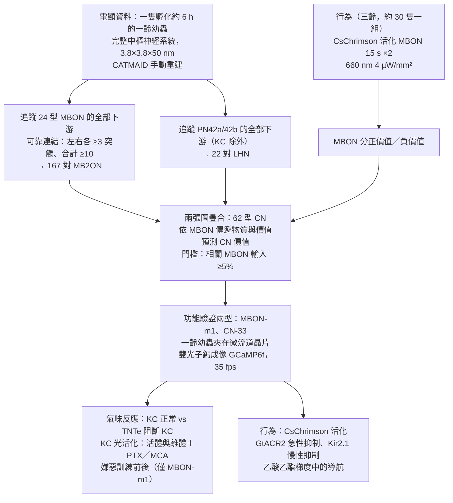
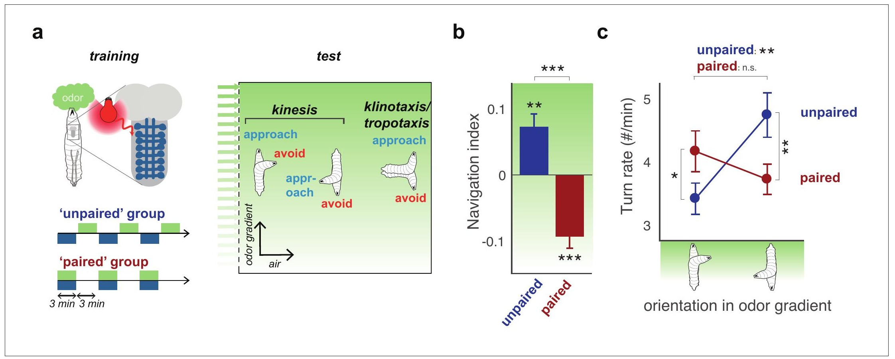
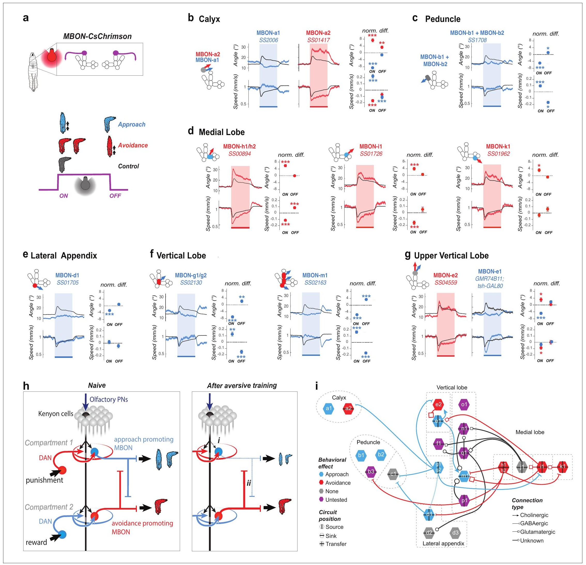
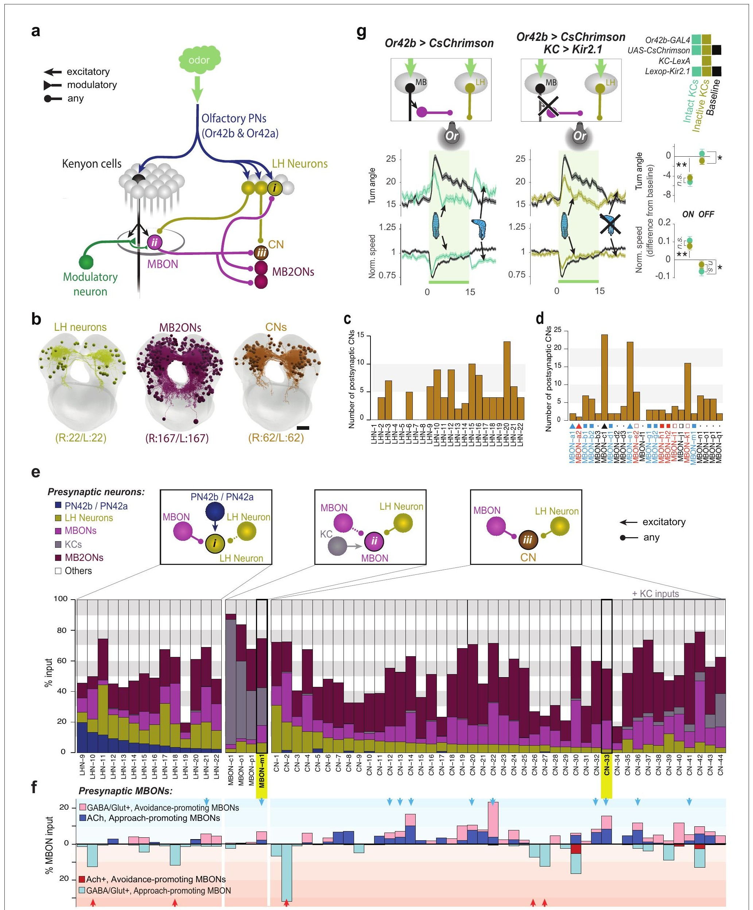
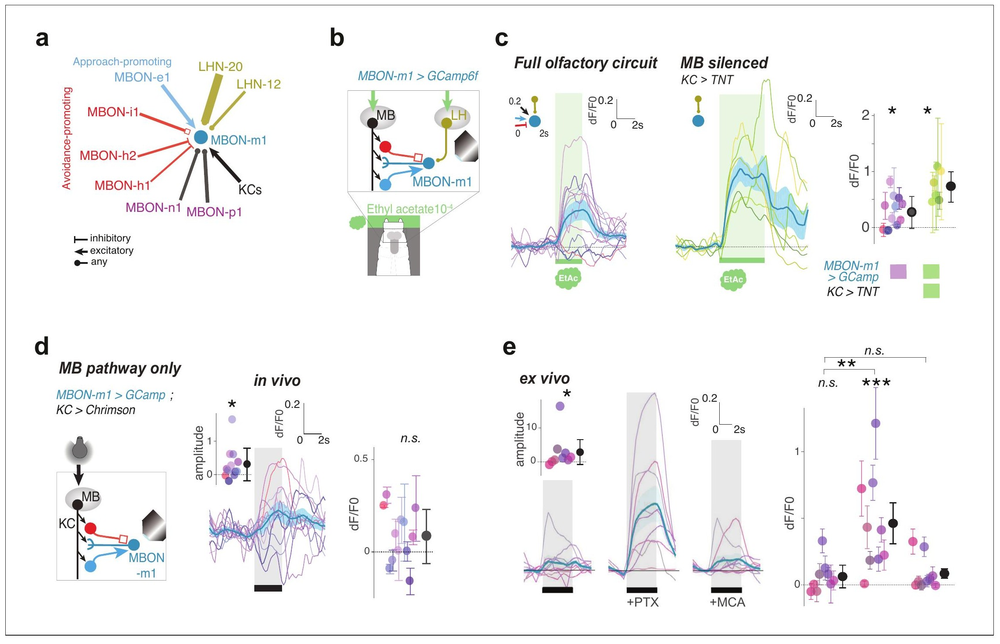
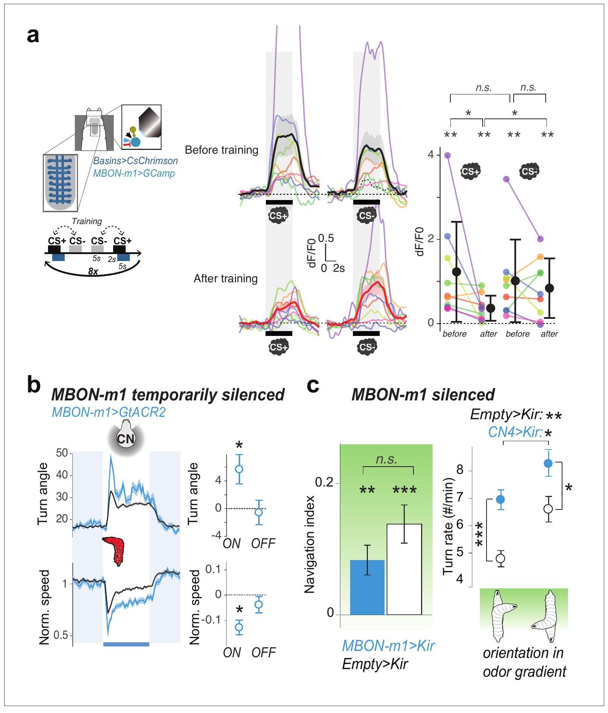
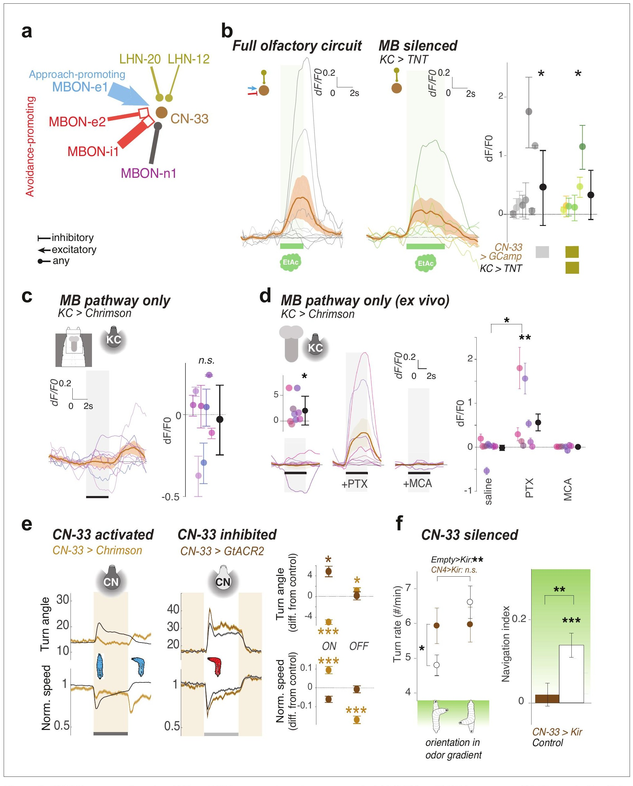
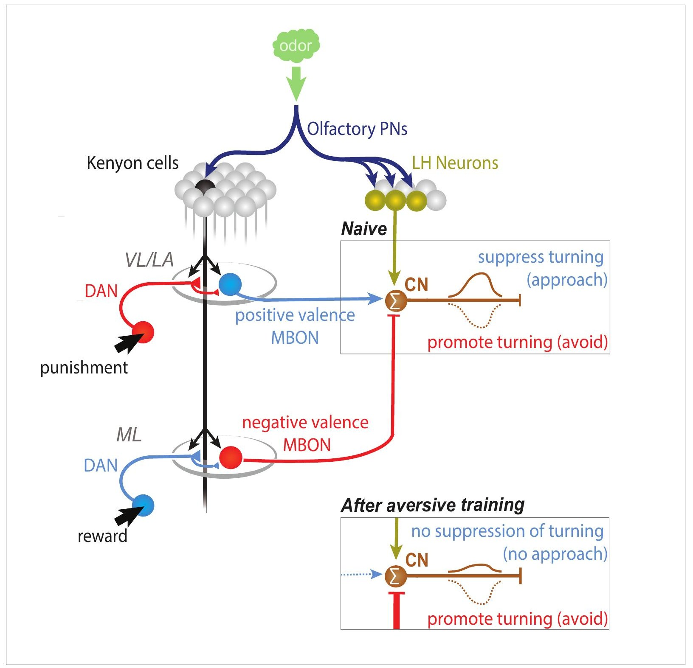

<!-- 本機 PDF：papers/2021-Circuits%20for%20integrating%20learned%20and%20innate%20valences%20in%20the%20insect%20brain.pdf -->

# Circuits for integrating learned and innate valences in the insect brain

**昆蟲腦中整合習得價值與先天價值的迴路**

| 項目 | 內容 |
|---|---|
| **出處** | eLife 10, e62567 (2021). doi: 10.7554/eLife.62567 [全文（PMC 免費閱讀）](https://pmc.ncbi.nlm.nih.gov/articles/PMC8616581/) |
| 日期 | 預印本 2020-04-24；投稿 2020-09-30；接受 2021-11-03；刊出 2021-11-10。修訂日期 PDF 未印。*eLife* 為線上期刊，以文章編號 e62567 取代頁碼（PDF 共 36 頁） |
| 通訊作者 | Claire Eschbach（ce394@cam.ac.uk）、Albert Cardona（ac2040@cam.ac.uk）、Marta Zlatic（mzlatic@mrc-lmb.cam.ac.uk）。PDF 只有英文名 |
| 作者 | 共 16 人：Claire Eschbach、Akira Fushiki（兩人為共同第一作者）、Michael Winding、Bruno Afonso、Ingrid V Andrade、Benjamin T Cocanougher、Katharina Eichler、Ruben Gepner、Guangwei Si、Javier Valdes-Aleman、Richard D Fetter、Marc Gershow、Gregory SXE Jefferis、Aravinthan DT Samuel、James W Truman、Albert Cardona、Marta Zlatic |
| 機構 | HHMI Janelia Research Campus（PDF 印作「Richmond, United Kingdom」，照原文）；MRC Laboratory of Molecular Biology 神經生物學部（Cambridge）；University of Cambridge 動物學系、生理發育與神經科學系；Columbia University 神經科學與神經學系暨 Zuckerman Mind Brain Institute；UCLA 分子細胞與發育生物學系；New York University 物理系、神經科學中心、神經科學研究所；Harvard University 物理系、腦科學中心；University of Washington 生物系 |
| 資料庫 | 電顯影像與重建：https://l1em.catmaid.virtualflybrain.org/?pid=1 （幼蟲第一齡的完整中樞神經系統）；行為分析程式：https://github.com/GershowLab |
| 補充資料 | 主圖 7 張在 PDF 內。**圖補充（figure supplement；圖 2 有 3 張、圖 3 有 6 張、圖 4 有 2 張、圖 5 有 1 張、圖 6 有 2 張）、Supplementary file 1（全部重建神經元的鄰接矩陣）、Supplementary file 2（影像資料的統計結果）、各圖的 Source data 都不在 PDF 內，本庫未取得**；PDF 只印出它們的標題。審查信（Decision letter）與作者回覆只有連結 |
| 編輯／審查 | 審查編輯 K VijayRaghavan（National Centre for Biological Sciences, TIFR, India）。PDF 首頁附有「Editor's evaluation」一段；審查人姓名 PDF 未列 |

> 與本庫有關的作者：無。本篇引用了本庫的 Tully 1985、Mao 2009、Aso 2014a、Aso 2014b、Hige 2015a、Cohn 2015、Aso 2016。
>
> **本篇為 CC BY 開放取用**（PDF 第 1 頁：「distributed under the terms of the Creative Commons Attribution License, which permits unrestricted use and redistribution provided that the original author and source are credited」），圖片可在標明出處的條件下自由使用與散布。本庫仍依規定只給全文連結、不放 PDF；每張圖下方標明出處與授權。
>
> **這是幼蟲的研究。** 本篇所有實驗都在果蠅幼蟲上做：電子顯微鏡重建用一隻孵化約 6 小時的第一齡幼蟲，鈣成像用第一齡幼蟲，行為用第三齡幼蟲。幼蟲蕈狀體的區室與細胞名稱（例如 MBON-m1、DAN-g1、「側附區」）是幼蟲專用的命名，**與成蟲的 MBON-γ1pedc>α/β、PPL1-α3 之類名稱是兩套系統，論文沒有把兩者逐一對應**。讀本頁時請勿把兩套名字混用，見「本頁用語」。

---

## 為什麼重要

> 本節假設讀者已略知果蠅嗅覺學習的輪廓。**完全不熟的讀者可以先看「科普文」一節**；術語另見「專業文」開頭的「本頁用語」表。

本庫截至 2026-11-13 已寫成的來源頁，多半停在蕈狀體的出口：學習改變了 KC→MBON 的突觸，MBON 的活動推動靠近或走開。但 MBON 的訊號送到哪裡、如何和「天生就喜歡或討厭」的訊號合併成一個行動，這些來源頁都沒有逐一追蹤（同批收錄中的其他論文是否處理，以各自的來源頁為準）。成蟲的 Aso 2014b（[[s-aso-2014-mbon-valence]]）指出 MBON 的軸突集中送到幾個「匯聚區」，其中之一是側角（lateral horn，處理先天氣味反應的腦區），作者推測先天與習得價值在那裡整合，但沒有逐一追蹤下游的神經元。本篇在幼蟲上把這件事做完：用電子顯微鏡追蹤**全部 24 型 MBON 的全部下游**（167 對神經元），再追蹤一條天生吸引的氣味通路經過側角的全部下游（22 對），找出同時收兩邊輸入的 62 型「匯聚神經元」。

第二，它給了一個可以檢驗的讀出規則。一小類匯聚神經元（論文說 10 型）從「推動靠近」的 MBON 收到興奮、從「推動走開」的 MBON 收到抑制，同時從側角收到興奮。這類細胞就像一台秤：先天的吸引放在一邊，學到的好壞放在兩邊，秤的讀數決定幼蟲要不要轉彎。作者對其中兩型（MBON-m1、CN-33）做了鈣成像與行為操作，證實它們確實被吸引氣味經側角活化、確實同時收到蕈狀體的興奮與抑制、活化時減少轉彎、抑制時增加轉彎；其中 MBON-m1 在嫌惡訓練後對受訓氣味的反應下降。

第三，它和本庫兩條線接得上，也和其中一條有落差。一是 MBON→DAN 回饋（[[t-mbon-dan-feedback]]）：62 型匯聚神經元中有 18 型直接接到多巴胺等調控神經元，CN-33 本身就是作者前一篇論文（Eschbach et al. 2020，本庫未收）證明能當教學訊號的回饋神經元，所以「讀出價值」與「回頭指揮學習」可能由同一批細胞負責。二是成蟲的 Huang 2024（[[s-huang-2024-dopamine-memory-dynamics]]）：它主張先天與習得價值在**多巴胺神經元**上相加；本篇主張兩者在**蕈狀體下游**的匯聚神經元上相加。兩篇是不同發育階段、不同層級的細胞，不構成矛盾，但「整合發生在哪裡」因此至少有三個候選位置（成蟲匯聚區的推測、成蟲 DAN、幼蟲匯聚神經元），見專業文第六節。本篇的弱點是功能證據集中在兩型細胞、每組只有 6–12 隻幼蟲，且電顯、成像與行為用的是三個不同齡期的幼蟲。

---

## 論文摘要（原文與中譯）

> Animal behavior is shaped both by evolution and by individual experience. Parallel brain pathways encode innate and learned valences of cues, but the way in which they are integrated during action-selection is not well understood. We used electron microscopy to comprehensively map with synaptic resolution all neurons downstream of all mushroom body (MB) output neurons (encoding learned valences) and characterized their patterns of interaction with lateral horn (LH) neurons (encoding innate valences) in *Drosophila* larva. The connectome revealed multiple convergence neuron types that receive convergent MB and LH inputs. A subset of these receives excitatory input from positive-valence MB and LH pathways and inhibitory input from negative-valence MB pathways. We confirmed functional connectivity from LH and MB pathways and behavioral roles of two of these neurons. These neurons encode integrated odor value and bidirectionally regulate turning. Based on this, we speculate that learning could potentially skew the balance of excitation and inhibition onto these neurons and thereby modulate turning. Together, our study provides insights into the circuits that integrate learned and innate valences to modify behavior.

（*eLife* 的摘要不分 Background／Results／Conclusion 段，照原樣一段。）

**中譯**（本節為忠實翻譯，非自撰內容）：

> 動物的行為同時受演化與個體經驗塑造。平行的腦內通路分別編碼線索的先天價值與習得價值，但它們在選擇行動時如何被整合，仍不清楚。我們在果蠅幼蟲上，以電子顯微鏡在突觸解析度下全面描繪了所有蕈狀體（MB）輸出神經元（編碼習得價值）下游的所有神經元，並刻畫它們與側角（LH）神經元（編碼先天價值）的交互模式。連結體揭示了多種同時接收 MB 與 LH 輸入的匯聚神經元。其中一個子集從正價值的 MB 與 LH 通路接收興奮性輸入、從負價值的 MB 通路接收抑制性輸入。我們證實了其中兩型神經元來自 LH 與 MB 通路的功能性連結及其行為角色。這些神經元編碼整合後的氣味價值，並雙向調節轉彎。據此我們推測，學習可能使這些神經元上的興奮與抑制失衡，從而調節轉彎。整體而言，本研究為整合習得與先天價值以改變行為的迴路提供了洞見。

---

## 科普文

想像一間小公司要決定「要不要買某個供應商的貨」。公司裡有兩個部門會發表意見。一個是**老員工**，憑天生的直覺說話：這家的東西聞起來不錯，買。另一個是**檔案室**，翻過往紀錄說話：上次跟這家買，結果出了事。兩個意見要在某個地方碰頭，才能變成一個決定。這篇論文問的就是：在果蠅幼蟲的腦裡，這個「碰頭的地方」在哪裡、長什麼樣子。

**先交代兩個部門。** 氣味進入幼蟲的腦之後，訊號兵分兩路。一路送到蕈狀體（mushroom body），那裡的 Kenyon 細胞（KC）記錄「這個氣味以前配過什麼」，再由蕈狀體輸出神經元（MBON）把結論送出去：這就是檔案室，掌管**習得價值**（學來的好壞）。另一路送到側角（lateral horn），掌管**先天價值**（天生的好惡）：大多數氣味幼蟲天生就喜歡。這兩路在果蠅成蟲身上早就知道，但它們的輸出在哪裡合流，一直沒有完整的地圖。

**幼蟲怎麼「走向」氣味。** 幼蟲不是直直爬向氣味源，而是邊爬邊轉彎：往好方向爬時（喜歡的氣味變濃）就少轉彎、繼續爬；往壞方向爬時（喜歡的氣味變淡）就多轉彎、換方向。久而久之就會靠近氣味源。所以「轉彎多寡」就是幼蟲的行為讀數。作者先確認學習會改變這個讀數：把一種天生喜歡的氣味（乙酸乙酯）和「人工懲罰」配在一起（用光活化一群感受疼痛的神經元，叫 Basin），幼蟲之後在這個氣味的濃度梯度裡就變成往濃處爬時多轉彎、往淡處爬時少轉彎，也就是由靠近變成躲開。

**難題一：哪些 MBON 代表「好」、哪些代表「壞」。** 幼蟲每邊腦有 24 型 MBON。作者用光一型一型活化它們，看幼蟲的反應。活化某些 MBON，幼蟲少轉彎、爬更快，就像聞到更濃的喜歡氣味：這些叫「正價值」MBON（推動靠近）。活化另一些，幼蟲多轉彎、爬更慢：這些叫「負價值」MBON（推動走開）。有幾型沒有可見的效果，還有幾型沒有測。**和成蟲一樣，推動靠近的 MBON 多半住在「學懲罰」的區室，推動走開的多半住在「學獎賞」的區室；所以懲罰讓推動靠近的那一側變弱，天平就倒向走開。**

**解法：把下游全部畫出來。** 作者在一隻幼蟲的完整中樞神經系統電顯影像裡，追蹤了全部 MBON 的下游，共 167 對神經元；再追蹤一條天生吸引的氣味通路（從嗅覺受體 Or42a、Or42b 開始）在側角的下游，共 22 對。兩張圖疊起來，找到 62 型同時收兩邊輸入的「匯聚神經元」（convergence neuron, CN）。合流有三種形式：有的 MBON 直接接到側角神經元上（14 型）；有的側角神經元直接接到 MBON 上（4 型）；更多的是兩邊一起接到第三者身上（44 型）。

**一台秤。** 在這 62 型裡，有一類特別引人注意：它從推動靠近的 MBON 收到興奮、從推動走開的 MBON 收到抑制，同時從天生吸引的側角通路收到輸入。作者說這類有 10 型。它們像一台秤：沒學過時，兩側蕈狀體的力量互相抵消，秤的讀數由側角的「天生喜歡」決定，細胞被氣味活化，幼蟲少轉彎、走向氣味；學到「這氣味配過懲罰」之後，推動靠近的那一側變弱，秤偏向抑制，細胞不再被氣味活化，幼蟲就多轉彎、不再靠近。

作者對其中兩型做了實驗。**MBON-m1**（它本身是 MBON，也收側角輸入，所以同時算匯聚神經元）與 **CN-33** 都被乙酸乙酯活化；把 KC 的輸出全部關掉，它們照樣被活化，表示這份活化來自側角。直接用光活化全部 KC 時，有的幼蟲裡它們變活躍、有的變安靜、有的不動；加入阻斷抑制性傳遞的藥物後，全部變成強烈活化，表示蕈狀體確實同時送來興奮與抑制。活化它們，幼蟲少轉彎；抑制它們，幼蟲多轉彎。最後，對 MBON-m1 做嫌惡訓練，它對受訓氣味的反應大約掉到原來的三成，對照氣味則幾乎不變（※ 從圖判讀）。

**代價。** 第一，功能實驗只做了 10 型中的 2 型，每組 6–12 隻幼蟲，個體之間差異極大。第二，所有「正價值、負價值」的判定都來自人工活化時的轉彎反應，不是自然的氣味反應。第三，學習只在一型細胞上量過反應下降，**沒有量到它變成被抑制**，論文自己也承認在顯微鏡下的訓練可能不夠強。第四，電顯用的是剛孵化約 6 小時的一齡幼蟲，鈣成像用一齡，行為用三齡；三者是同一套腦的不同發育階段，連線是否不變，論文沒有交代。

**最容易被誤讀的一點：這篇沒有證明「學習改變了匯聚神經元上的興奮—抑制平衡」。** 它證明的是：解剖上有興奮與抑制兩種輸入、藥理上兩種輸入都在作用、訓練後 MBON-m1 對受訓氣味的反應變小。「平衡被學習推向抑制」是把這三件事串起來的推測——摘要用的字是「我們推測」（we speculate）。而且所有細胞名稱都是幼蟲的，**不能直接拿來推論成蟲的哪一型 MBON 做同樣的事**。

---

## 專業文

### 本頁用語

本頁各節可單獨查閱，故把反覆出現的詞集中在這裡。

| 詞 | 意思 |
|---|---|
| 蕈狀體（mushroom body, MB） | 果蠅腦中負責嗅覺學習與記憶的結構，左右各一。幼蟲與成蟲都有，但形狀與區室劃分不同 |
| KC（Kenyon cell） | 蕈狀體的主要神經元，每個氣味活化一小群。本篇引 Honegger 2011 說自然氣味約活化 5% 的 KC |
| MBON（mushroom body output neuron） | 蕈狀體輸出神經元。**本篇的 MBON 名稱是幼蟲命名**：以字母加數字編號（MBON-a1、a2、b1…q1，共 24 型，取自 Eichler et al. 2017 的幼蟲連結體）。字母大致對應區室，與成蟲以區室命名的 MBON-γ1pedc>α/β 等**不是同一套系統**，論文沒有把兩者對應 |
| DAN、調控神經元 | DAN 是多巴胺神經元，送來懲罰或獎賞的教學訊號。論文說幼蟲蕈狀體的「調控神經元」以多巴胺性為主，另有章魚胺性與傳遞物質未知者（Supplementary file 1 的分類：DAN、OAN、MBIN）。本篇提到的 DAN-g1、DAN-d1 也是幼蟲名稱 |
| 幼蟲蕈狀體的區室 | 本篇圖 2 用的幼蟲區室名：萼（calyx）、柄（peduncle）、側附區（lateral appendix, LA）、垂直葉（vertical lobe, VL）、垂直葉上段（upper vertical lobe, UVL）、內側葉（medial lobe, ML）。**這不是成蟲的 α/β、α′/β′、γ 葉與其 15 格**。依圖 7 的示意，懲罰型 DAN 在 VL/LA，獎賞型 DAN 在 ML |
| 側角（lateral horn, LH）、LHN | 嗅覺投射神經元的另一個目的地，一般認為處理先天氣味反應。LHN 是側角神經元。本篇只追蹤一條天生吸引通路（PN42a、PN42b）的下游 22 對 LHN，**不是整個側角** |
| ORN、PN | 嗅覺受體神經元（ORN）偵測氣味；投射神經元（PN）把訊號送往蕈狀體與側角。Or42a、Or42b 是對乙酸乙酯反應最強的兩型受體；PN42a、PN42b 是接它們的 PN |
| MB2ON | 蕈狀體第二階輸出神經元：MBON 的直接下游。條件見「可靠連結」 |
| CN（convergence neuron，匯聚神經元） | 同時收 MBON 與 LHN 輸入的神經元。包括三種：收 MBON 輸入的 LHN（LHN-CN）、收 LHN 輸入的 MBON（MBON-CN，例如 MBON-m1）、兩邊都收的 MB2ON（CN-1 至 CN-44）。論文為簡潔仍稱前兩種為 LHN 與 MBON |
| FBN（feedback neuron）、FAN | 回饋神經元：直接接到蕈狀體調控神經元上的神經元。CN-33 的另一個名字 FAN-7 來自 Eschbach 2020（本庫未收） |
| 可靠連結 | 左右兩側對應的神經元各至少 3 個突觸、合計至少 10 個突觸。本篇所有「強連結」都依這個條件 |
| 正價值、負價值 MBON | 以人工活化時的行為判定：活化後少轉彎（和／或爬更快），或活化結束時多轉彎，歸為正價值（推動靠近）；反之歸為負價值（推動走開）。**這是行為效果的分類，不是量到它們對好氣味或壞氣味的自然反應** |
| 興奮性、抑制性 | 依 Eichler 2017 的傳遞物質標定推斷：乙醯膽鹼＝興奮；GABA＝抑制；麩胺酸「可能」抑制（引 Liu & Wilson 2013，作用於氯離子通道）。LHN 的傳遞物質未知 |
| 側向抑制 | 一型 MBON 抑制另一型 MBON。本篇特指價值相反的兩型之間的抑制 |
| 導航指數（navigation index） | 幼蟲沿氣味梯度方向的平均速度 ÷ 平均爬行速度。+1＝全部直直往濃處爬，−1＝全部往淡處爬，0＝沒有偏向 |
| 轉彎率 | 每分鐘轉彎次數。本篇比較「朝向梯度（±15°）」與「背向梯度（±15°）」兩種姿態下的轉彎率 |
| 轉彎角（turn angle） | 幼蟲身體後 2/3 的脊線擬合直線，到前 1/5 脊線上最遠一點的距離（以角度表示）。數值越大表示轉得越多 |
| ON、OFF 反應 | 光活化開始（ON）與結束（OFF）之後的行為變化。OFF 反應被當成「活動降低」的效果 |
| 反向相關分析（reverse correlation） | 讓紅光強度隨機起伏、持續控制 CsChrimson，再回頭平均「每次轉彎之前」的光強度變化，看活動上升或下降之後幼蟲比較會轉彎 |
| CsChrimson、GtACR2、Kir2.1、TNTe | 四種操作工具。CsChrimson 照紅光讓神經元放電；GtACR2 照藍光讓神經元暫時被抑制（急性）；Kir2.1 是鉀離子通道，讓神經元持續被抑制（從發育起，慢性）；TNTe 是破傷風毒素輕鏈，讓神經元無法釋放傳遞物質（從發育起） |
| PTX、MCA | 兩種藥：picrotoxin（PTX）阻斷 GABA 與麩胺酸的氯離子通道受體（拿掉抑制）；mecamylamine（MCA）阻斷菸鹼型乙醯膽鹼受體（拿掉興奮）。本篇各 0.1 mM |
| 離體（explant） | 把幼蟲中樞神經系統取出，泡在溶液中做實驗，見 [[c-ex-vivo-explant]] |
| ΔF/F₀ | 鈣成像讀數：螢光比基線多出的比例。本篇用 GCaMP6f，見 [[e-gcamp]] |
| 一齡、三齡幼蟲 | 幼蟲經兩次蛻皮分三個齡期。本篇電顯與成像用一齡（較小、較透明），行為用三齡 |
| Basin | 幼蟲腹神經索中一群接收疼痛（機械性傷害）訊號的中間神經元。本篇用光活化它們代替真的懲罰（「人工懲罰」） |
| CS+、CS− | 配過懲罰的氣味（CS+）與對照氣味（CS−） |
| 統計記號 | `*` p < 0.05、`**` p < 0.01、`***` p < 0.001（圖 5c、6f 的圖說另寫 `**` p < 0.001、`***` p < 0.0001）；n.s. 為不顯著。行為用 Welch Z 檢定，鈣成像用 Wilcoxon 檢定，變異分解用 ANOVA |
| ※ 推論、？待查 | 本庫標記：前者為論文未明說、本頁自行推得；後者為值得查證但刻意不填 |

### 一、概述

**主要問題。** 先天價值（側角）與習得價值（蕈狀體）由平行通路編碼，兩者衝突時（例如天生喜歡的氣味配過懲罰），腦如何得出一個行動？是先整合成一個數值，還是兩股驅力各自競爭？作者把問題拆成三步：哪些 MBON 代表正價值或負價值；MBON 的下游如何比較兩種價值的 MBON；這些下游又如何與側角的輸出合流。

**重要性。** 本庫收錄的成蟲論文都在處理「學習怎麼改變 KC→MBON」，本篇處理的是下一步「MBON 的改變怎麼被讀出來」。截至 2026-11-13 本庫已寫成的來源頁中，它是唯一從突觸層級完整描繪 MBON 下游、也是唯一以幼蟲為對象的學習迴路研究（同批收錄尚在進行，這個「唯一」日後可能失效）。

**發表當時的領域現狀（2020 投稿、2021 刊出）。** 依論文引言與討論的引用：

- 先天與習得價值分屬不同腦區，在哺乳類（Sosulski et al. 2011；Root et al. 2014）與昆蟲（Marin et al. 2002；Heimbeck et al. 2001）都有報告。
- 成蟲的 MBON 推動靠近或走開（Aso et al. 2014b，即本庫 [[s-aso-2014-mbon-valence]]；Owald & Waddell 2015）；配對讓同區室的 KC→MBON 驅動減弱（Séjourné et al. 2011；Hige et al. 2015a，即本庫 [[s-hige-2015-heterosynaptic-plasticity]]）。「未學習時正負兩側 MBON 的氣味驅動相當、輸出互相抵消，由側角引導行為」是作者稱為「主流模型」的說法（Owald & Waddell 2015）。
- 成蟲已看到 MBON 直接接到側角神經元、而且這條路是讀出記憶所需（Dolan et al. 2018、2019）；成蟲的全腦或半腦連結體也開始描繪這些交互（Bates et al. 2020；Li et al. 2020；Schlegel et al. 2021）。這些都不在本庫。
- 幼蟲的蕈狀體連結體（Eichler et al. 2017）與「MBON 經回饋神經元指揮 DAN」的架構（Eschbach et al. 2020）由同一團隊發表，也不在本庫；本篇的 MBON 名稱、傳遞物質與 DAN 的價值都取自這兩篇。

### 二、方法

流程圖由上而下是：先在一份電顯資料上畫出兩張下游圖並疊合，用行為實驗給每型 MBON 標上價值，據此預測哪些匯聚神經元代表正價值，再挑兩型用鈣成像與行為操作驗證。

**電子顯微鏡重建。** 樣本是一隻孵化約 6 小時的雌性一齡幼蟲（Canton S G1 × w1118）的完整中樞神經系統，連續切片穿透式電顯，解析度 3.8 × 3.8 × 50 nm，首次發表於 Ohyama et al. 2015。重建用 CATMAID 網頁軟體。突觸要符合四個成熟突觸的標準（T 形突起、成群小囊、突觸間隙、突觸後緻密區）。驗證方式是左右兩側對應的神經元各自獨立重建，比對是否有相同的連結。作者引 Schneider-Mizell 2016 估計單一突觸的偽陽性率為 0.0167（每 60 個約錯 1 個），假設錯誤互相獨立，2 個突觸的連結全是錯的機率為 0.0167² ≈ 0.00028（約每 3,586 條錯 1 條；本庫驗算一致）。「可靠連結」定為左右各至少 3 個突觸、合計至少 10 個。預測 CN 的價值時，要求相關 MBON 的輸入合計至少佔該 CN 總輸入的 5%。相似度矩陣把強連結轉成 0/1，以「相同位置都是 1 的數目 ÷（相同 ＋ 不同）」計分，再做階層分群（R 的 heatmap.2）。致謝列出重建工作量的分配：Feng Li 9%、Avinash Khandelwal 8% 等，另有「許多人」3%。

**行為：MBON 活化篩選。** 三齡幼蟲約 30 隻一組，在 4% 瓊脂上錄影 120 秒，於第 30 秒與第 75 秒各給 15 秒的 660 nm 紅光（4 µW/mm²）。以 MultiWormTracker 即時追蹤，丟掉被追蹤不到 5 秒或移動不到一個體長的物件。ON 反應取亮燈後 5 秒（圖 2 圖說寫 0–5 s）；OFF 反應方法寫「熄燈後 10 秒」，圖 2 圖說寫「熄燈後 2–7 s」（⚠️ 兩處不同，見第五節）。對照是空白品系（y w;attP40;attP2）× UAS-CsChrimson，Nexp ＝ 343、幼蟲超過 10,000 隻；對照幼蟲本身對紅光有輕微的嫌惡反應。MBON-e1 用 GAL4 品系 GMR74B11 加 tsh-GAL80 去掉腹神經索的表現。

**行為：反向相關分析。** 30–50 隻幼蟲，藍光固定 3.7 µW/cm² 以遮蔽紅光的視覺效果（使幼蟲適應光、不再被光嚇到），紅光強度以布朗隨機漫步變動（每秒更新 112 次，0–911 µW/cm²），計算轉彎觸發平均。作者說藍光對嗅覺受體神經元的擾動不到紅光的 0.3%。

**行為：學習與導航。** 兩組各 30 隻三齡幼蟲。配對組在含乙酸乙酯的平板上照紅光 3 分鐘（629 nm，2.5 µW/mm²，活化 GMR72F11 標記的 Basin），再移到無氣味、黑暗的平板 3 分鐘，共 3 輪；不配對組氣味與光錯開。之後放進 25 cm² 的線性梯度裝置（32 個三通閥調出線性梯度）測導航。正文寫氣味為「體積稀釋 10⁴ 倍」，方法寫訓練與梯度都用「4·10⁻⁶ 稀釋」（⚠️）。天生導航實驗（測 Kir2.1）則在 25 × 25 cm 方盤一側貼五張濾紙，各滴 12 µl 的 10⁻⁴ 乙酸乙酯。方法說每種條件重複 7–10 次，以 Welch z 檢定比較。

**鈣成像。** 一齡幼蟲用 0.1% triton 水推進微流道晶片（通道寬 300 µm、高 70 µm，末端收窄到 60 µm 卡住幼蟲），讓背器官（容納 21 個 ORN 的嗅覺器官）對著刺激通道。氣味為 n-乙酸戊酯 10⁻³（AM）、乙酸乙酯 10⁻⁴（EA）、甲醇 10⁻¹（ME）、3-辛醇 10⁻⁴（OCT，方法有列，主圖未用），以水稀釋，每次 5 秒。雙光子顯微鏡 925 nm、25× NA 1.1 水浸物鏡，每秒 35 張，6 層、層距 2 µm。訊號以 tdTomato 校正，ΔF/F₀ 的基線取刺激前 5 秒。圖 4、圖 6 的分數取氣味開始後前 3 秒。

**嫌惡訓練（成像中）。** CS+ 5 秒，從第 2 秒起給 5 秒的 660 nm 雷射（約 480 µW/mm²）照向 Basin 的末梢，與 CS+ 重疊 3 秒；CS− 單獨 5 秒。每回合兩次 CS+、兩次 CS−，間隔 20 ± 3 秒水流，約 120 秒；連做 8 回合。四種配對組合：AM+/EA−（4 隻）、EA+/AM−（3 隻）、EA+/ME−（1 隻）、ME+/EA−（1 隻），合計 9 隻（本庫驗算一致）。訓練前後各測 1–2 回合。

**離體藥理。** 取出中樞神經系統，貼在聚離胺酸塗層的蓋玻片上；KC 以 GMR14H06-LexA 驅動 CsChrimson，625 nm 照 3 秒、連續 4 次（間隔約 15 秒）。同一個樣本依序在生理食鹽水、PTX、MCA 中各測一次（一半樣本先 MCA 後 PTX），中間以 4 ml 緩衝液沖洗。

**資料排除。** 移動假影嚴重到約 10% 的紀錄無法對齊者剔除；訓練組若訓練前或後對任何氣味都沒有鈣反應（可能已死亡或感覺器官沒對到氣流）也剔除。被剔除的隻數論文未報。

**補充資料。** 驅動品系的對照表在方法節（PDF 第 22–23 頁）。十四張圖補充、兩份補充檔與全部 Source data 本庫未取得，相關的數值（例如 CN 分群、KC 阻斷後的導航、每隻幼蟲的鈣軌跡、ANOVA 的 F 值與 r²）一律 ？待查。

### 三、結果

#### 3.1 學習改變的是轉彎的方向依賴（圖 1）

天生喜歡的乙酸乙酯配人工懲罰後，導航指數由不配對組的正值變成配對組的負值（圖 1b；正文寫 +0.1 與 −0.1，圖上約 +0.07 與 −0.09，※ 從圖判讀）。轉彎率呈交叉：不配對組朝向梯度時約 3.4 次／分、背向時約 4.75 次／分；配對組朝向約 4.2、背向約 3.75（※ 從圖判讀）。配對組朝向與背向的差異不顯著（圖上標 n.s.），不配對組顯著（**）。

※ 推論（本庫計算）：「背向減朝向」的轉彎率差，不配對組約 +1.35 次／分，配對組約 −0.45 次／分。**學習讓方向依賴翻號，但翻過去之後的幅度只有原本的三分之一，且不顯著。** 正文說配對組「turned more when crawling up the gradient, than down」，這句話在圖上沒有顯著性支持；導航指數的翻號（*** ）才是可靠的證據。

#### 3.2 MBON 的價值（圖 2）

24 型 MBON 中，作者以 split-GAL4 測了 15 個品系（涵蓋 18 型；b1/b2、g1/g2、h1/h2 各兩型無法分開操作）。依圖 2 與圖 3d 整理：

| 類別 | 型別 | 型數 |
|---|---|---:|
| 正價值（推動靠近） | a1、b1、b2、d1、e1、g1、g2、m1 | 8 |
| 負價值（推動走開） | a2、e2、h1、h2、i1、k1 | 6 |
| 無可見效果 | c1、d2、d3、j1 | 4 |
| 未測 | b3、f1、n1、o1、p1、q1 | 6 |
| **合計** | | **24** |

> 依圖 2b–g、圖 2i 的圖例與圖 3d 的橫軸逐一讀出。圖 2 圖說以「型」為單位寫「負價值 5 型、正價值 6 型」，是把 b1/b2、g1/g2、h1/h2 各算一型；圖 3f 圖說以「顆」為單位寫正價值 6 抑制性 ＋ 2 興奮性＝8、負價值 5 抑制性 ＋ 1 興奮性＝6，與本表一致。**同一件事的兩個數（5 與 6、6 與 8），差在 b/g/h 三對算一型還是兩型。**

圖說：負價值 MBON 多半（3/5）住在獎賞記憶的區室，其餘住在功能未知的區室；正價值 MBON 多半（4/6）住在懲罰記憶的區室（區室的記憶方向引自 Eschbach 2020）。萼與垂直葉上段兩處未知功能的區室，各有一對效果相反的 MBON（a1/a2、e1/e2）。

各 MBON 的效果細節不同：正價值 MBON 中 d1、e1 不加快速度；a1、g1/g2、m1 在 OFF 時增加轉彎。負價值中 h1/h2、i1 的轉彎增加很快適應，a2、k1 則持續整整 15 秒；k1 不減速。作者據此推測不同區室的記憶可能以不同的運動方式表現。

反向相關分析（圖 2—圖補充 3，本庫未取得）：負價值 MBON 活動上升後幼蟲轉彎，正價值 MBON 活動下降後幼蟲轉彎。這排除了「MBON 只是放大紅光引起的驚嚇」的可能。

**傳遞物質與價值的對應（本庫整理，※ 推論）。** 圖 3d 橫軸以符號標示每型 MBON 的傳遞物質，但圖說沒有說明符號。依正文已知的四例對照（e1 為乙醯膽鹼、i1 與 e2 為麩胺酸、h1/h2 中至少一型為 GABA），三角形＝乙醯膽鹼、實心方塊＝GABA、空心方塊＝麩胺酸。照此讀：正價值的 a1、e1 為乙醯膽鹼，b1、b2、d1、g1、g2、m1 為 GABA；負價值的 a2 為乙醯膽鹼，h1、h2 為 GABA，e2、i1、k1 為麩胺酸。這與圖 3f 圖說的「正價值 6 抑制 ＋ 2 興奮、負價值 5 抑制 ＋ 1 興奮」完全吻合。**對照成蟲：本庫 [[s-aso-2014-mbon-valence]] 記錄成蟲推動走開的 MBON 全是麩胺酸性、推動靠近的全是 GABA 或乙醯膽鹼性。幼蟲推動靠近這一側符合（GABA 或乙醯膽鹼），推動走開這一側不符：有 GABA 性（h1、h2）與乙醯膽鹼性（a2）。** 所以「傳遞物質決定價值方向」不能從成蟲推到幼蟲。

#### 3.3 MBON 之間的側向抑制（圖 2h–i）

依 Eichler 2017 的連結與傳遞物質，作者數到 6 處「負價值 MBON 以抑制性突觸接到正價值 MBON」、3 處「正價值 MBON 以抑制性突觸接到負價值 MBON」。作者推測嫌惡學習讓正價值 MBON 的驅動下降時，會同時解除它對負價值 MBON 的抑制，放大兩側的差距（圖 2h 的機制 ii），並引成蟲的 Owald 2015 為已觀察到的例子。但側向抑制只存在於部分 MBON 之間，作者因此轉往下一層找比較的位置。

#### 3.4 MBON 下游：167 對 MB2ON（圖 3a–b、d）

| 量 | 值 | 說明 |
|---|---:|---|
| MB2ON | 167 對 | 左右各 167（圖 3b） |
| 只收一型 MBON 輸入 | 101 | |
| 收多型 MBON 輸入 | 66 | 101 ＋ 66 ＝ 167 |
| 　其中只收同價值 MBON | 13 | |
| 　其中收相反價值 MBON | 27 | 13 ＋ 27 ＝ 40；其餘 26 型的組合含無效果或未測的 MBON（※ 推論，論文未列） |
| 　　其中一側興奮、另一側抑制 | 18 | |
| 直接回饋到調控神經元（FBN） | 40 | 已於 Eschbach 2020 重建 |
| 經一層中介回饋到調控神經元 | 58 | |

> 依正文第 8 頁逐項讀出；加總由本庫驗算。

※ 推論（本庫計算）：直接或兩步回饋到調控神經元的合計 98/167 ≈ 59%。**MBON 的下游有過半同時是學習訊號的上游。**

每型 MBON 接到的匯聚神經元數差很多：MBON-c1 約 24 型、e1 約 22 型、k1 約 16 型，多數在 5 型以下（圖 3d，※ 從圖判讀）。c1 是活化後沒有可見效果的那一型（見 3.2），卻是接到最多匯聚神經元的 MBON；論文沒有討論這一點。

#### 3.5 側角下游與匯聚的三種形式（圖 3a、c、e、g）

PN42a、PN42b 只接 KC 與側角的 22 對 LHN（正文說「不顯著地接到其他神經元」）。作者沒有能單獨標記這些 LHN 的品系，所以用間接方式確認這條路代表正價值：光活化 Or42b，同時用 Kir2.1 關掉 KC。KC 被關掉後，ON 時的轉彎減少照舊（兩組 n.s.），OFF 時的轉彎增加消失（圖 3g；Or42b 正常組 250 隻、KC 關閉組 300 隻、對照 350 隻）。作者的結論是側角通路足以產生「濃度上升時少轉彎」，而蕈狀體參與「濃度下降時多轉彎」；關掉 KC 的幼蟲在乙酸乙酯梯度中導航也較差（圖 3—圖補充 4，本庫未取得，數值 ？待查）。

匯聚的三種形式與數目（圖 3e）：

| 形式 | 例 | 型數 |
|---|---|---:|
| (i) MBON 直接接到 LHN | LHN-9 至 LHN-22 | 14 |
| (ii) LHN 直接接到 MBON | MBON-c1、o1、p1、m1 | 4 |
| (iii) MBON 與 LHN 一起接到 MB2ON | CN-1 至 CN-44 | 44 |
| **合計 CN** | | **62** |

> 14 ＋ 4 ＋ 44 ＝ 62，與討論節「每側 62 個神經元」及圖 3b 的 R:62/L:62 一致（本庫驗算）。

※ 推論（本庫計算）：22 型 LHN 中有 14 型（64%）直接收 MBON 輸入；167 型 MB2ON 中有 44 型（26%）也收 LHN 輸入。**論文把 (i) 寫成「some MBONs synapse directly onto some LHNs」，但在這條吸引通路上，接受蕈狀體直接輸入的 LHN 是多數，不是少數。** 這使討論節「先天與習得的表徵在某種程度上仍保持分開」的說法變弱。

62 型匯聚神經元中有 18 型同時是回饋神經元（直接接到調控神經元）。部分 CN 收到 KC 的直接輸入卻沒被歸為 MBON，理由是 KC 輸入太弱（< 3 突觸）、只在單側、屬於軸突對軸突，或沒有調控神經元的輸入（圖 3e 圖說列出 CN-35 至 CN-44 中的數型）。

#### 3.6 預測 CN 的價值（圖 3f）

依 MBON 的傳遞物質與價值：從興奮性正價值 MBON 與抑制性負價值 MBON 收輸入（或從多型抑制性負價值 MBON 收輸入）者，預測為正價值 CN（藍箭頭）；從多型抑制性正價值 MBON 收輸入者，預測為負價值 CN（紅箭頭）。正文說「突出的一類」正價值 CN 有 N ＝ 10。

**⚠️ 從圖判讀，圖 3f 的藍箭頭有 11 個**：LHN 區 1 個（約在 LHN-21）、MBON-m1、CN-12、CN-13、CN-14、CN-19、CN-22、CN-32、CN-33、CN-36、CN-41。紅箭頭 5 個（LHN-10、LHN-18、CN-2、CN-26、CN-27）。差的那一個可能是 LHN 區的箭頭不被計入，或本庫判讀有誤；論文沒有列出 10 型的名單（Supplementary file 1 未取得，？待查）。另外，藍箭頭的定義包含「只收多型抑制性負價值 MBON 輸入」者，所以 10（或 11）型並不全都符合正文與摘要說的「同時收正價值 MBON 的興奮與負價值 MBON 的抑制」。

※ 推論（本庫計算）：藍箭頭 11／62 ≈ 18%，紅箭頭 5／62 ≈ 8%。其餘約四分之三的匯聚神經元，作者沒有給價值預測。

#### 3.7 MBON-m1：被側角活化、被蕈狀體雙向調控、學習後反應下降（圖 4、圖 5a）

MBON-m1 的輸入（圖 4a）：興奮性的正價值 MBON-e1；抑制性的負價值 MBON-h1、h2（GABA）、i1（麩胺酸）；傳遞物質未知的 MBON-n1、p1；LHN-12、LHN-20；以及 KC。

| 實驗 | n | 結果（※ 從圖判讀者標明） |
|---|---:|---|
| 乙酸乙酯，KC 正常（活體） | 12 | 平均顯著上升，約 0.27 ΔF/F₀（※）；個體由抑制到強烈興奮都有 |
| 乙酸乙酯，KC 以 TNTe 阻斷（活體） | 6 | 仍顯著上升，約 0.72 ΔF/F₀（※） |
| 光活化全部 KC（活體） | 12 | 平均 ΔF/F₀ 與 0 無差別（n.s.）；振幅（最大減最小）顯著增加 |
| 光活化 KC（離體），食鹽水 → PTX → MCA | 9 | 約 0.07 → 0.45（**）→ 約 0.1（※） |
| 嫌惡訓練前後（活體） | 9 | CS+ 約 1.2 → 0.35（*）；CS− 約 1.0 → 0.85（n.s.）；訓練後 CS+ 與 CS− 有顯著差別（*）（※） |

※ 推論（本庫計算）：訓練後 CS+ 反應約剩原來的 29%，CS− 約剩 85%。**把 CS− 的自然衰減扣掉，CS+ 的專一下降約為三分之二。**

兩點值得注意。第一，KC 被阻斷時，MBON-m1 對氣味的反應**看起來比 KC 正常時大**（約 0.72 對 0.27），圖說只報兩組各自與 0 比較的顯著性，沒有報兩組之間的比較（CN-33 的圖說則明寫「兩組無顯著差異」）。若這個差距是真的，表示未學習時蕈狀體對 MBON-m1 的淨作用偏抑制，而不是作者模型假設的「接近 0」（※ 推論；n ＝ 6 與 12，差距可能來自個體變異）。第二，正文說訓練造成 CS+「劇烈下降的有 9 隻中的 3 隻」、另有 3 隻 CS− 上升，但圖 5a 右圖中 CS+ 的連線大多數向下；「3/9」指的是「劇烈」的程度，論文未定義門檻。

作者提出 MBON-m1 對 CS+ 下降的兩條可能路徑：(i) 直接：KC 與 DAN-g1、DAN-d1 一起活化，壓低 KC→MBON-m1；(ii) 間接：其他區室的學習解除了對 MBON-m1 的抑制者的抑制（例如正價值 MBON-g1/g2 被壓低後，負價值 MBON-i1 被解除抑制，進而更抑制 MBON-m1）。**兩者沒有被區分。**

#### 3.8 CN-33：同樣的模式，沒有學習實驗（圖 6）

CN-33 的輸入（圖 6a）：興奮性正價值 MBON-e1；麩胺酸性負價值 MBON-i1、e2；傳遞物質未知的 MBON-n1；LHN-12、LHN-20（與 MBON-m1 相同的兩型 LHN）。**它沒有 KC 的直接輸入**，所以蕈狀體對它的作用一定經過 MBON（或 MB2ON）。

| 實驗 | n | 結果 |
|---|---:|---|
| 乙酸乙酯，KC 正常 | 8 | 顯著上升，約 0.47（※） |
| 乙酸乙酯，KC 阻斷 | 6 | 顯著上升，約 0.33（※）；兩組無顯著差異（圖說） |
| 光活化 KC（活體） | 8 | 平均 n.s.；振幅顯著增加；熄燈時略升，作者解讀為抑制後的反彈 |
| 光活化 KC（離體），食鹽水 → PTX → MCA | 8 | 約 0 → 0.55（**）→ 約 0（※） |

CN-33 沒有做學習實驗。

#### 3.9 行為：雙向控制轉彎（圖 2f、圖 5b–c、圖 6e–f）

| 操作 | MBON-m1 | CN-33 |
|---|---|---|
| CsChrimson 活化（ON） | 轉彎減少、速度增加（圖 2f；Nexp 9、450 隻） | 轉彎減少、速度增加（Nexp 11、400 隻） |
| 活化結束（OFF） | 轉彎增加 | 轉彎增加 |
| GtACR2 急性抑制 | 轉彎增加（Nexp 4、95 隻；對照 Nexp 20、700 隻） | 轉彎增加 |
| Kir2.1 慢性抑制：轉彎率（朝向／背向） | 約 7.0／8.3，對照約 4.8／6.6（※） | 約 5.95／6.0，對照約 4.8／6.6（※） |
| Kir2.1：導航指數 | 約 0.085 對 0.14，**n.s.**（※） | 約 0.02 對 0.14，**顯著**（※） |

※ 推論（本庫計算）：「背向減朝向」的轉彎率差，MBON-m1 被抑制時約 1.3（對照 1.8），CN-33 被抑制時約 0.05。**MBON-m1 被關掉時，幼蟲整體轉得更多，但仍保有約七成的方向依賴；CN-33 被關掉時，方向依賴幾乎全沒了。** 兩個細胞同屬一類，關掉後的效果卻差很大；作者以「另有約 10 型部分重複的 CN」解釋 MBON-m1 的效果小，但這個解釋同樣適用於 CN-33，論文沒有說明為什麼兩者不同。

另外，圖 5c 與圖 6f 的對照組數值看來完全相同（4.8／6.6、0.14），方法也都寫對照 Nexp ＝ 10，※ 推論為同一組對照資料重複使用。這不是錯誤，但兩組比較因此不獨立。

CN-33 的品系 SS02108 每側標兩顆形態相似的神經元（CN-33 與 MB2ON-86），並微弱標記腹神經索中接收嫌惡機械感覺的局部中間神經元。作者用兩個對照排除它們：以 tsh-LexA 驅動 Killer Zipper 去掉腹神經索表現，以及單獨活化 MB2ON-86（SS04330）。這些對照在圖 6—圖補充 2，本庫未取得（？待查）。

### 四、討論

**主張一：先天與習得價值在蕈狀體下游整合，而且有三種匯聚形式。** 證據是完整的電顯重建，**這是本篇最強的部分**：全部 MBON 的下游、一條吸引通路的全部 LHN 下游，左右對照驗證、有明確的連結門檻。限制在於側角只追了一條通路（Or42a/Or42b），所以「62 型」是這條吸引通路與蕈狀體的匯聚，不是整個側角；天生嫌惡的通路（例如二氧化碳）怎麼匯聚，本篇沒有資料。

**主張二：一類 CN 以「正價值 MBON 興奮、負價值 MBON 抑制」比較兩側驅動，算出習得價值。** 解剖上成立，但依賴三層推斷：MBON 的傳遞物質（引 Eichler 2017）、麩胺酸是抑制（引 Liu & Wilson 2013 的成蟲嗅葉資料）、MBON 的價值（由人工活化判定）。功能上，PTX 讓 KC 活化變成強烈興奮，證明抑制性輸入存在；但 PTX 同時阻斷 GABA 與麩胺酸受體，**分不出抑制來自哪一型 MBON，也分不出是 MBON 直接給的還是經過中介**（作者在 MBON-m1 段落自己也承認可能經由 MB2ON）。

**主張三：這些 CN 編碼整合後的氣味價值（摘要：「encode integrated odor value」）。** 這是摘要裡最強的用語。支持的證據是：被吸引氣味經側角活化（兩型）、活化與抑制雙向控制轉彎（兩型）、學習後反應下降（一型）。**「整合」需要同一顆細胞在先天與習得訊號衝突時的反應，這個實驗只在 MBON-m1 上做了（嫌惡訓練，n ＝ 9），而且只看到反應下降、沒有看到轉為抑制。** 摘要後半自己改用「推測」，前後語氣不一。

**主張四：學習把 CN 上的興奮—抑制平衡推向抑制。** 討論節寫「For one of these neurons, we indeed verified that aversive learning skews inputs towards inhibition」。資料是 MBON-m1 對 CS+ 的鈣反應下降；**訓練後沒有量興奮與抑制輸入各自的大小（例如訓練後再做 PTX 實驗），所以「輸入被推向抑制」沒有被驗證**，只是與資料相容的解釋之一（另一個是興奮性輸入變弱、抑制不變）。同一節後文又說「我們沒有觀察到嫌惡學習後 MBON-m1 被抑制」。⚠️ 同一篇裡的措辭不一，見第五節。

**主張五：個體差異大，來源是蕈狀體。** ANOVA 顯示個體間變異顯著大於個體內變異，KC 正常時個體間變異佔總變異的比例較高。作者推測反映了每隻幼蟲不同的經驗或狀態。數值在 Supplementary file 2（？待查）。這是合理的解讀，但作者自己也列出技術來源：CsChrimson 表現量不同（只確認有表現、未定量）、頭部在通道中的位置影響氣味接觸。

**主張六：CN 也回饋到調控神經元，可能調節學習。** 18 型 CN 直接回饋；CN-33 在 Eschbach 2020 被證明配氣味時能形成記憶。本篇自己沒有新的回饋實驗，這一條是引用前作加上解剖。

### 五、問題與限制

**1. 三個齡期拼成一個模型。** 電顯是孵化約 6 小時的一齡幼蟲，鈣成像是一齡，行為（MBON 價值篩選、學習、導航）是三齡。作者確認一齡幼蟲能學習（圖 5—圖補充 1，本庫未取得），但沒有確認三齡的連線與一齡相同。

**2. 價值是由人工活化定義的。** 「正價值 MBON」是「被光活化時減少轉彎」的 MBON，不是「被好氣味活化」的 MBON。作者先依成蟲文獻假設這兩件事相同，再用它定義全部的 CN 預測。

**3. 側角只追了一條吸引通路。** 22 對 LHN 是 PN42a/42b 的下游；LHN 的傳遞物質未知（作者說沒有品系可以標記），所以「側角給興奮」完全來自 MBON-m1 與 CN-33 在 KC 阻斷後仍被氣味活化這一項功能證據，而不是解剖。

**4. 功能驗證樣本小、只做兩型、學習只做一型。** 鈣成像每組 6–12 隻；學習 9 隻，用了四種不同的氣味組合，每種 1–4 隻。

**5. 學習沒有在行為上與 CN 連起來。** 成像中的訓練（8 回合、人工懲罰）沒有測同一批幼蟲的行為；作者引 Eschbach 2020 的自由爬行學習分數 −0.3 當作參考，並說要等「自動化的單隻訓練與追蹤顯微鏡」才能把學到的行為強度與 CN 反應對起來。

**6. KC 阻斷不能分辨 MBON 直接作用與經中介的作用。** 對 CN-33 而言這一點作者已承認；對 MBON-m1 而言，KC 輸入、MBON 輸入、MB2ON 輸入三者在 PTX 實驗中都被一起操作。

**7. 本頁稽核出來、論文自己沒處理的問題。** 摘要／正文／圖／方法之間的不一致（皆標 ⚠️，不需裁決）：

- **(a) 品系 SS02108 的細胞名不一致。** 結果節稱它驅動 CN-33/FAN-7；方法節寫「SS02108 (for CN-4)」，品系表寫「CN-4 + MB2ON-86」；圖 6f（CN-33）的圖上標籤寫「CN4>Kir」；**圖 5c（MBON-m1）的圖上標籤也寫「CN4>Kir」**；圖 6d 圖說寫「onto CN-3」。同一個代號 CN-4 指到兩個不同的細胞，而圖 3e 另有一個真正的 CN-4。
- **(b) 品系表的「Figure」欄與正文對不上。** MBON-m1（SS02163）標「two and 6」，實際出現在圖 2、4、5；SS02108 標「four and 5」，實際是圖 6。方法正文另寫 MBON-m1 的品系為「SS02163f」。
- **(c) Or42b 實驗的基因型，方法與圖 3g 對調。** 方法：Or42b-LexA 驅動 LexAop-CsChrimson、GMR14H06-GAL4（KC）驅動 UAS-Kir2.1；圖 3g 的表格：Or42b-GAL4、UAS-CsChrimson、KC-LexA、LexAop-Kir2.1。
- **(d) 學習實驗的氣味濃度兩個版本。** 正文「體積稀釋 10⁴ 倍」（即 10⁻⁴）；方法「4·10⁻⁶ 稀釋」，相差 25 倍。
- **(e) OFF 反應的時間窗兩個版本。** 圖 2 圖說「熄燈後 2–7 s」；方法「熄燈後 10 s」。
- **(f) 正價值 CN 的數目。** 正文與討論 N ＝ 10，圖 3f 的藍箭頭從圖判讀為 11（見 3.6）。
- **(g) 「學習把輸入推向抑制」的措辭。** 討論節寫「we indeed verified that aversive learning skews inputs towards inhibition」，同一節後文寫「We did not observe inhibition of MBON-m1 following aversive learning」，資料只有反應下降（見第四節主張四）。
- **(h) 引用編號。** 圖 2h 圖說把「嫌惡學習壓低 KC→正價值 MBON 的突觸」引為 Hige et al. 2015b（標題為 MBON 氣味編碼的個體化）；正文同一論點引的是 Hige et al. 2015a（即本庫的 [[s-hige-2015-heterosynaptic-plasticity]]）。
- **(i) 圖 1 的重複數。** 圖說 N ＝ 10 次重複；方法「每種條件重複 7–10 次」。正文的 ±0.1 是圖上約 +0.07／−0.09 的概數。
- **(j) 圖 3d 的傳遞物質符號沒有圖例。** 本頁 3.2 的對應是 ※ 推論。

另外三項本庫的計算（皆為 ※ 推論）：學習後轉彎率的方向依賴只翻回原幅度的三分之一且不顯著（3.1）；吸引通路上 64% 的 LHN 直接收 MBON 輸入，與「少數」的措辭不符（3.5）；KC 阻斷時 MBON-m1 的氣味反應看起來反而更大，未檢定（3.7）。

### 六、未來

**論文自陳的方向。** (1) 測試另一類「被正價值 MBON 抑制」的 CN（紅箭頭）是否以活動上升代表負價值、促進轉彎，與正價值 CN 合成雙向的價值碼；(2) 以自動化單隻訓練與追蹤顯微鏡，把學到的行為強度與同一隻幼蟲的 CN 反應對起來；(3) 檢驗強烈嫌惡學習是否能讓 CN 被受訓氣味抑制、把靠近翻成躲避；(4) 以此連結體約束價值計算與行動選擇的模型。

**本庫關注的後續。** 本篇與本庫三條線接得上：

- **先天與習得在哪裡整合。** 成蟲的 [[s-aso-2014-mbon-valence]] 從 MBON 軸突的分布推測側角等「匯聚區」整合兩種價值；成蟲的 [[s-huang-2024-dopamine-memory-dynamics]] 在 PPL1 多巴胺神經元上看到先天價值（喜歡的氣味讓懲罰型 DAN 安靜）與習得價值相加；本篇在幼蟲的蕈狀體下游看到匯聚神經元。三篇的整合位置分別是 MBON 的輸出區、DAN、MB2ON。※ 推論：三者不互斥，可能同時存在；但「先天價值進入學習迴路」（Huang 2024）與「先天價值與學習結果在出口合流」（本篇）是兩種不同的計算，前者會改變學什麼，後者只改變表現什麼。
- **MBON 下游與回饋共用細胞。** 本篇 62 型 CN 中 18 型直接回饋到調控神經元，與 [[t-mbon-dan-feedback]] 的成蟲回饋迴路（Ichinose 2015、Felsenberg 2017／2018、Huang 2024）相呼應；但本篇的回饋是**經過 MBON 下游一層**，不是 MBON 直接接 DAN，與那頁表中的各條連結層級不同。
- **側向抑制。** 本篇數到的 9 處 MBON 之間的側向抑制，與成蟲 Felsenberg 2018（[[s-felsenberg-2018-memory-extinction]]）的 MVP2 抑制 M4β′／M6、Aso 2014 推測的「骨牌」相呼應，但幼蟲與成蟲的細胞不能對應。

同批收錄的 [[s-aso-2023-upwind-neurons]] 是本庫第一篇處理成蟲「MBON 下游的哪一顆細胞讀出記憶」的來源（迎風神經元整合 MBON-α1 與 MBON-α3），可作為本篇的成蟲對照；另見 [[s-yamada-2023-second-order-conditioning]]（同一批 SMP353/354 也通往多巴胺神經元）與 [[t-mbon-to-action]]。論文引用的成蟲研究 Dolan 2018、2019 不在本庫。（2026-11-13 更正：原寫「本庫的成蟲論文目前沒有任何一篇處理」，撰寫時同批的 Aso 2023 已收錄。）

**尚未被回答的。** (1) 匯聚神經元上的興奮—抑制平衡，學習之後到底怎麼變（需要訓練後的藥理分解）；(2) 為什麼同類的 MBON-m1 與 CN-33 被關掉後效果差這麼多；(3) 天生嫌惡的氣味通路與蕈狀體怎麼匯聚；(4) 幼蟲的這套「秤」在成蟲身上有沒有對應的細胞。

---

## 圖

> 本篇主圖 7 張全部收錄（圖補充不在 PDF 內）。所有圖都從 300 dpi 整頁渲染裁切，未含圖說；圖說照錄於下。

<small>圖片出處：Eschbach C, Fushiki A, Winding M et al. *eLife* 10:e62567 (2021)，Figure 1。CC BY；全文見 [PMC](https://pmc.ncbi.nlm.nih.gov/articles/PMC8616581/)。</small>

> **原圖說（Figure 1）：** Aversive learning modulates turning to switch odor approach to avoidance. (a) The behavior of larvae in a linear gradient (Gershow et al., 2012) of an innately attractive odor, ethyl acetate, (EA) is recorded after odor presentation is intercalated ('unpaired' training protocol) or coincident ('paired' training protocol) with fictive punishment (optogenetic activation of nociceptive basin neurons [Ohyama et al., 2015]). Larvae navigate via kinesis, modulating turn rate over time and in response to different conditions, and via klinotaxis/tropotaxis, choosing turn side (Gershow et al., 2012; Gomez-Marin and Louis, 2012; Schulze et al., 2015; Gepner et al., 2015). Here, we record turn rate as a function of larval orientation in the odor gradient (c). (b) Navigation index following paired and unpaired protocols (computed by dividing the mean velocity in the direction of the gradient by the mean crawling speed). The positive index after the unpaired protocol indicates that larvae approach the odor, the negative index after the paired protocol indicates they avoid it. (c) Turn rate as a function of larval orientation in the gradient. Unpaired group larvae approach the odor by turning less in response to an increase in odor concentration (when crawling up the gradient, toward the odor source), and more in response to a decrease in odor concentration (when crawling down the gradient, away from the odor source). Paired group larvae avoid the odor by turning more in response to an increase in the odor concentration (when crawling up the gradient), and by turning less in response to a decrease in odor concentration (when crawling down the gradient). Values are mean s.e.m. \*: p < 0.05, \*\*: p < 0.01 in a Welch Z-test, N = 10 repeats.

**圖說中譯：** 嫌惡學習調節轉彎，把對氣味的靠近轉為躲避。(a) 在一種天生吸引的氣味乙酸乙酯（EA）的線性梯度中記錄幼蟲行為；之前的氣味呈現與人工懲罰（光遺傳活化感受傷害的 Basin 神經元）錯開（「不配對」訓練）或同時（「配對」訓練）。幼蟲以「動態調節」（kinesis：隨時間與情況改變轉彎率）與「趨向性」（klinotaxis／tropotaxis：選擇往哪一側轉）導航。本圖記錄轉彎率對幼蟲在梯度中朝向的關係（c）。(b) 配對與不配對訓練後的導航指數（梯度方向的平均速度 ÷ 平均爬行速度）。不配對後為正，表示靠近氣味；配對後為負，表示躲開。(c) 轉彎率與幼蟲在梯度中朝向的關係。不配對組在濃度上升時（往氣味源爬）少轉、在濃度下降時（離開氣味源）多轉，因而靠近；配對組在濃度上升時多轉、下降時少轉，因而躲開。數值為平均 ± 標準誤。\* p < 0.05、\*\* p < 0.01，Welch Z 檢定，N ＝ 10 次重複。

**解讀：**
- **c 圖該看的是配對組自己那條線的顯著性：n.s.** 圖說說配對組「多轉」與「少轉」，但圖上配對組朝向與背向的差異沒有達到顯著，幅度（約 0.45 次／分）也只有不配對組（約 1.35）的三分之一（※ 從圖判讀後計算）。所以學習的效果主要是「把天生的方向依賴消掉」，翻成相反方向的部分很弱。這與後文模型的「學習讓 CN 不再被活化（不靠近）」相符，與「強烈學習讓 CN 被抑制（主動躲）」的延伸版則沒有直接證據。
- **b 圖的顯著性是兩組各自與 0 比、以及兩組互比**：配對組相對 0 為 ***，不配對組為 **。正文的 ±0.1 是概數，圖上約 +0.07／−0.09（※）。
- **這裡的懲罰不是真的懲罰**，是用紅光活化 Basin；氣味只有一種（乙酸乙酯），沒有第二種對照氣味，所以這是「單一氣味配對 vs 不配對」的設計，不是成蟲 T 迷宮的雙氣味差異分數（見 [[c-performance-index]]）。

<small>圖片出處：Eschbach C, Fushiki A, Winding M et al. *eLife* 10:e62567 (2021)，Figure 2。CC BY；全文見 [PMC](https://pmc.ncbi.nlm.nih.gov/articles/PMC8616581/)。</small>

> **原圖說（Figure 2）：** Positive- and negative-valence MBONs repress and promote turning, respectively. (a) We recorded the behavior of larvae expressing CsChrimson in one or two pairs of MBONs and classified their responses to a 15 s red light stimulation as approach-like (blue larva), avoidance-like (red larva), or neutral by comparing them to controls. Approach-like responses are characterized by significantly decreased turning and/or increased crawling speed in response to an increase (at the onset of optogenetic activation), and/or increased turning and decreased crawling in response to a decrease in MBON activity (at the offset of optogenetic activation). Avoidance-like responses are characterized by the reverse responses. We classified MBONs whose activation suppresses turning and promotes approach as positive-valence MBONs (blue in b–i), and those whose activation promotes turning and promoted avoidance as negative-valence MBONs (red in b–i). (b–g) Behavioral response to optogenetic activation of MBONs (GAL4 lines indicated in italic; see Figure 2—figure supplement 1 for expression patterns). Turn angle (deg) is the absolute value of the distance from the least-squares line fit of the posterior 2/3 of the animal's spine points to the point in the anterior 1/5 of the animal's spine most distant from that line. Left, schematics depicting compartments innervated by MBONs, colored according to memory induced when odor is paired with DAN activation in that compartment: appetitive (blue), aversive (red), or unknown (gray, Eschbach et al., 2020). Middle, time series of mean (+/− s.e.m) turn angle (top) and crawling speed (normalized to baseline prior to stimulation, bottom). Shading indicates the period of optogenetic activation. Right, the difference between the experimental (red or blue dots with error bars) and control (dotted line at 0) turn angle (top) and crawling speed (bottom) averaged over a time window after the onset (0–5 s, normalized to baseline before light) and offset (2–7 s. after light off, normalized to baseline during light) of optogenetic stimulation. Note that the control animals (black curve in b–g) display a slightly aversive response to the onset of red light used for optogenetic activation. The control is the empty GAL4 line y w;attP40;attP2 crossed to UAS-CsChrimson (Nexp = 343, Nlarvae >10,000) for all lines except for MBON-e1 (g) for which the control line is yw;;attP2 crossed to UAS-CsChrimson; tsh-GAL80. Plots are mean +/− s.e.m. \*: p < 0.05, \*\*: p < 0.01, \*\*\*: p < 0.001 (Welch's Z test). (b) Activating the two calyx-MBONs induced opposite responses: approach and avoidance, for MBON-a1 (Nexp = 7, Nlarvae = 250) and MBON-a2 (Nexp = 7, Nlarvae = 280), respectively. (c) Activating peduncle-MBONs, MBON-b1/b2 together (Nexp = 8, Nlarvae = 340) induced approach. MBON-c1 activation had no significant effect (Figure 2—figure supplement 2). (d) Activating medial lobe MBONs induced avoidance: MBON-h1/h2 (Nexp = 10, Nlarvae = 450), MBON-i1 (Nexp = 6, Nlarvae = 240), and MBON-k1 (Nexp = 6, Nlarvae = 210). MBON-j1 activation had no significant effect (Figure 2—figure supplement 2). (e) Activating the lateral appendix-MBON-d1 (Nexp = 9, Nlarvae = 250) induced approach. MBON-d2 and -d3 activation did not have a significant effect (Figure 2—figure supplement 2). (f) Activating the vertical lobe-MBONs induced approach: MBON-g1/g2 (Nexp = 6, Nlarvae = 210) and MBON-m1 (Nexp = 9, Nlarvae = 450). (g) Activating the two MBONs in the tip of vertical lobe had opposite effects: MBON-e2 (Nexp = 5, Nlarvae = 140) and -e1 (Nexp = 6, Nlarvae = 250, using tsh-GAL80 to eliminate nerve cord expression) induced avoidance- and approach-like responses, respectively. Note that most negative-valence MBONs innervate appetitive-memory com- partments (3/5), and the remainder innervate compartment with unknown roles. By contrast, most positive-valence MBONs (4/6) innervate aversive-memory compartment, and the remainder innervate compartments with unknown roles. (h) Schematic showing a naive state (left) and two main mechanisms (right) potentially enabling the MB network to switch from encoding positive or neutral to negative valence after aversive learning. Left, In a naive state KC-connections to positive- and negative-valence MBONs is similar. Right, (i) aversive learning depresses the synapse between the conditioned odor-KCs and positive-valence MBONs (Hige et al., 2015b), skewing the balance towards negative-valence MBONs. (ii) Decreased conditioned odor drive to inhibitory positive-valence MBONs can disinhibit the negative-valence MBONs. (i) Synaptic-resolution circuit diagram from Eichler et al., 2017 overlaid with MBON neurotransmitter profiles also from Eichler et al., 2017 and valence (b–g), reveals lateral inhibition between MBONs that encode opposite valence. Blue rim, positive-valence; red rim, negative-valence; grey rim, no behavioral effect; purple; not tested. Arrows, excitatory cholinergic; bars, inhibitory GABAergic; squares, glutamatergic, likely inhibitory (Liu and Wilson, 2013) connections; circles, unknown neurotransmitter. Vertical and horizontal bars, source (i.e. emitting projections), sink (i.e. receiving projections), or transfer MBONs (i.e. emitting and receiving projections).

**圖說中譯：** 正價值與負價值 MBON 分別抑制與促進轉彎。(a) 記錄在一或兩對 MBON 中表現 CsChrimson 的幼蟲，與對照比較，把它們對 15 秒紅光刺激的反應分為類靠近（藍色幼蟲）、類躲避（紅色幼蟲）或中性。類靠近：MBON 活動上升（光活化開始）時轉彎顯著減少和／或爬行加快，和／或活動下降（光活化結束）時轉彎增加、爬行變慢；類躲避則相反。活化後抑制轉彎、促進靠近者歸為正價值 MBON（b–i 中藍色），促進轉彎與躲避者歸為負價值 MBON（紅色）。(b–g) 光活化各 MBON 的行為反應（斜體為 GAL4 品系；表現樣式見圖 2—圖補充 1）。轉彎角定義見本頁用語。左：MBON 支配之區室的示意，依「在該區室活化 DAN 並配氣味所形成的記憶」上色：獎賞（藍）、嫌惡（紅）、未知（灰，Eschbach 2020）。中：轉彎角（上）與爬行速度（下，以刺激前基線標準化）的平均 ± 標準誤時間序列；陰影為光活化期間。右：實驗組（紅或藍點）與對照（0 虛線）在光活化開始後（0–5 s，以亮燈前基線標準化）與結束後（熄燈後 2–7 s，以亮燈期間為基線）的轉彎角（上）與速度（下）差值。注意對照幼蟲（b–g 黑線）對紅光開始有輕微嫌惡反應。對照為空白 GAL4 品系 × UAS-CsChrimson（Nexp ＝ 343，幼蟲 > 10,000），MBON-e1 例外，其對照為 yw;;attP2 × UAS-CsChrimson; tsh-GAL80。平均 ± 標準誤；\* p < 0.05、\*\* p < 0.01、\*\*\* p < 0.001（Welch Z）。(b) 活化萼部的兩型 MBON 引起相反反應：MBON-a1 靠近（Nexp 7、250 隻）、MBON-a2 躲避（Nexp 7、280 隻）。(c) 一起活化柄部 MBON-b1/b2（Nexp 8、340 隻）引起靠近；MBON-c1 無顯著效果（圖 2—圖補充 2）。(d) 活化內側葉 MBON 引起躲避：h1/h2（Nexp 10、450 隻）、i1（Nexp 6、240 隻）、k1（Nexp 6、210 隻）；j1 無顯著效果。(e) 活化側附區 MBON-d1（Nexp 9、250 隻）引起靠近；d2、d3 無顯著效果。(f) 活化垂直葉 MBON 引起靠近：g1/g2（Nexp 6、210 隻）、m1（Nexp 9、450 隻）。(g) 垂直葉尖端的兩型效果相反：e2（Nexp 5、140 隻）類躲避、e1（Nexp 6、250 隻，用 tsh-GAL80 去除腹神經索表現）類靠近。注意多數負價值 MBON（3/5）支配獎賞記憶區室，其餘支配功能未知區室；多數正價值 MBON（4/6）支配嫌惡記憶區室，其餘支配功能未知區室。(h) 示意未學習狀態（左）與兩種可能讓 MB 網路在嫌惡學習後由編碼正或中性價值轉為負價值的機制（右）。左：未學習時 KC 對正、負價值 MBON 的連結相當。右：(i) 嫌惡學習壓低受訓氣味 KC 與正價值 MBON 之間的突觸（Hige et al. 2015b），使平衡偏向負價值 MBON；(ii) 受訓氣味對抑制性正價值 MBON 的驅動下降，可解除對負價值 MBON 的抑制。(i) 取自 Eichler 2017 的突觸解析度迴路圖，疊上同篇的 MBON 傳遞物質與本圖 b–g 的價值，顯示價值相反的 MBON 之間有側向抑制。藍框正價值、紅框負價值、灰框無行為效果、紫色未測。箭頭為興奮性乙醯膽鹼、橫槓為抑制性 GABA、方塊為麩胺酸（可能抑制）、圓點為傳遞物質未知。直槓、橫槓與十字分別表示來源（只送出投射）、匯點（只接收投射）與轉運 MBON（兩者皆有）。

**解讀：**
- **i 圖是全篇唯一畫出幼蟲 MBON 之間連線的地方，也是本庫「側向抑制」唯一的幼蟲資料。** 該看的是紅線（負價值 MBON 發出的抑制）有多少條終止在藍色細胞上：正文數到 6 處，反方向 3 處。圖上還有 MBON-c1、j1 這些「無行為效果」的灰色細胞也參與網路，c1 更是下游最多的 MBON（圖 3d）——**「活化沒有效果」不等於「不參與」**。
- **ON 與 OFF 的分類標準是「和／或」**，所以同一個「正價值」標籤下，有的只有 ON 效果（d1）、有的 OFF 效果更明顯（g1/g2、m1）。把這些合成一類，是後面所有 CN 預測的前提。
- **對照組本身對紅光有嫌惡反應**（黑線在亮燈時轉彎角升高），所以「正價值」MBON 的效果有一部分是「壓掉對照的驚嚇」。作者用反向相關分析（圖補充 3，本庫未取得）處理這一點。
- **左側小示意的區室顏色來自另一篇（Eschbach 2020）**，是「在那一格活化 DAN 會形成什麼記憶」，不是本篇量的。
- **h 圖 (i) 引的是 Hige 2015b**，但壓低 KC→MBON 突觸的資料在 Hige 2015a（本庫 [[s-hige-2015-heterosynaptic-plasticity]]），引用編號疑誤（⚠️，第五節 (h)）。

<small>圖片出處：Eschbach C, Fushiki A, Winding M et al. *eLife* 10:e62567 (2021)，Figure 3。CC BY；全文見 [PMC](https://pmc.ncbi.nlm.nih.gov/articles/PMC8616581/)。</small>

> **原圖說（Figure 3）：** Patterns of convergence between innate and learnt olfactory pathways. (a) Schematic of interactions between the LH and MB. All neurons (167 pairs) postsynaptic to all MBONs (MB2ONs, dark purple) and all neurons (22 pairs) postsynaptic to two olfactory PNs in an innately attractive LH pathway (LHNs, dark yellow, Figure 3—figure supplement 1). This revealed three types of convergence: (i) some LHNs receive direct MBON input, (ii) some MBONs receive direct LHN input, and (iii) many MB2ONs receive direct MBON and LHN input. Collectively we call neurons that receive convergent MBON and LHN input convergence neurons (CNs). Some LHNs that receive direct MBON input also receive reliable input from other LHNs, and some MBONs (MBON-m1) that receive direct LHN input also receive reliable input from other MBONs(e), and are therefore also CNs (LHN-CNs and MBON-CNs), but we continue to call them LHNs and MBONs for brevity. (b) Projections of the reconstructed brain neurons. (c) Number of CNs downstream of each LHN. Some target more CNs than others. (d) Number of CNs downstream of each MBON. Some target more CNs than others. (e) All identified neurons receiving convergent LH and MB inputs. Top schematics show the three different types of convergent interactions described in (a). The bar graphs show the fraction of inputs each neuron receives from different types of neurons. Some CNs receive direct KC input, but were not classified as MBONs because connections from individual KCs were weak ( < 3 synapses) or asymmetric ( ≥ 3 KC connection(s) only present in one hemilateral partner) (CN-35,–36, −37,–38, −39,–40, –42), KC inputs were axo-axonic (CN-43), or do not receive any modulatory neuron input (CN-44, Eichler et al., 2017). Some CNs receive asymmetric or subthreshold PN input (e.g. CN-5) and are therefore not considered LHNs. f. Some CNs were predicted to encode positive (blue arrows) or negative (red arrows) value based on MBON inputs. Figure shows fraction of input each neuron receives from inhibitory (light blue, bottom) or excitatory (dark blue, top) positive-valence MBONs (respectively 6 and 2 MBONs form these categories), and inhibitory (light red, top) or excitatory (dark red, bottom) negative-valence MBONs (respectively 5 and 1 MBONs form these categories). CNs receiving excitatory and inhibitory inputs from positive- and negative-valence MBON(s), respectively, or inhibitory inputs from multiple negative-valence MBONs could encode positive valence (blue arrows). CNs integrating inhibitory inputs from multiple positive-valence MBONs could encode negative valence (red arrows). Only neurons with at least 5% of input from the appropriate MBONs were included in the predictions (blue arrows, red arrows). g. Increase in ORN42b activity (as when the animal crawls towards an odor source) represses turning via the LH pathway, indicating this LH pathway signals positive valence. Plots and quantification as in Figure 2b–f. Left, In untrained larvae, onset and offset of optogenetic activation of ORN42b reduced and increased turning, respectively (cyan, N = 250), compared to controls (black, N = 350). Middle, Silencing KCs with Kir2.1 (dark yellow, N = 300) did not alter the onset response but abolished the offset response. Right, quantification. \*: p < 0.05, \*\*: p < 0.01 (Welch's Z test).

**圖說中譯：** 先天與習得嗅覺通路之間的匯聚模式。(a) 側角與蕈狀體交互的示意。全部 MBON 的突觸後神經元（167 對，MB2ON，深紫）與一條天生吸引側角通路中兩型嗅覺 PN 的全部突觸後神經元（22 對，LHN，深黃，圖 3—圖補充 1）。由此看到三種匯聚：(i) 部分 LHN 收到 MBON 的直接輸入；(ii) 部分 MBON 收到 LHN 的直接輸入；(iii) 許多 MB2ON 同時收到 MBON 與 LHN 的直接輸入。收到 MBON 與 LHN 匯聚輸入的神經元統稱匯聚神經元（CN）。收 MBON 直接輸入的部分 LHN 也收其他 LHN 的可靠輸入；收 LHN 直接輸入的部分 MBON（MBON-m1）也收其他 MBON 的輸入（e），因此也是 CN（LHN-CN 與 MBON-CN），但為簡潔仍稱它們為 LHN 與 MBON。(b) 重建的腦神經元投影。(c) 每型 LHN 下游的 CN 數，各型不同。(d) 每型 MBON 下游的 CN 數，各型不同。(e) 全部收到側角與蕈狀體匯聚輸入的神經元。上方示意 (a) 的三種匯聚；長條圖為每顆神經元的輸入中來自各類神經元的比例。部分 CN 收到 KC 的直接輸入但未被歸為 MBON，因為來自單一 KC 的連結弱（< 3 突觸）或不對稱（≥ 3 突觸的 KC 連結只出現在單側）（CN-35 至 CN-40、CN-42）、KC 輸入為軸突對軸突（CN-43），或沒有任何調控神經元輸入（CN-44，Eichler 2017）。部分 CN 的 PN 輸入不對稱或低於門檻（例如 CN-5），因而不算 LHN。(f) 依 MBON 輸入，部分 CN 被預測為編碼正價值（藍箭頭）或負價值（紅箭頭）。圖示每顆神經元的輸入中來自抑制性（淺藍，下）或興奮性（深藍，上）正價值 MBON（分別 6 與 2 型），以及抑制性（淺紅，上）或興奮性（深紅，下）負價值 MBON（分別 5 與 1 型）的比例。分別從正價值與負價值 MBON 收興奮與抑制、或從多型負價值 MBON 收抑制的 CN，可能編碼正價值（藍箭頭）；整合多型正價值 MBON 抑制的 CN，可能編碼負價值（紅箭頭）。只有相關 MBON 輸入至少 5% 者納入預測。(g) ORN42b 活動上升（如幼蟲往氣味源爬時）經側角通路抑制轉彎，表示這條側角通路代表正價值。作圖與量化同圖 2b–f。左：未訓練幼蟲中，光活化 ORN42b 的開始與結束分別減少與增加轉彎（青色，N ＝ 250），對照為黑色（N ＝ 350）。中：以 Kir2.1 關閉 KC（深黃，N ＝ 300）不改變開始時的反應，但消除結束時的反應。右：量化。\* p < 0.05、\*\* p < 0.01（Welch Z）。

**解讀：**
- **e 圖該看的是黃色（LHN 輸入）有多少。** CN-1 至 CN-44 的輸入中，LHN 除了 CN-1（約 30%）等少數，多數只佔約 5–15%（※ 從圖判讀），MB2ON（深紫）與「其他」才是大宗。**「匯聚神經元」的定義只要求兩邊都有可靠連結，不要求兩邊份量相當**；把 62 型都讀成「先天與習得各半」會高估側角的份量。
- **f 圖的箭頭從圖上數是藍 11、紅 5**（※ 從圖判讀），正文的「10 型」與圖差一（⚠️，第五節 (f)）。而且箭頭的條件寫在圖說裡是「或」：只收多型抑制性負價值 MBON 的也算藍箭頭，所以藍箭頭並不全都是「正價值 MBON 興奮 ＋ 負價值 MBON 抑制」這種秤的結構。
- **c 圖有 5 型 LHN（LHN-1、4、5、7、8）下游沒有任何 CN**，而 d 圖中下游 CN 最多的 MBON-c1 在圖 2 是「活化無效果」。**連結最多的節點不是行為效果最明顯的節點**；這提示 CN 不只讀價值，也可能讀別的東西（作者在討論中提到內在狀態等）。
- **g 圖的 OFF 反應**：KC 關掉後，ORN42b 熄燈時的轉彎增加消失（Kir 組沒有轉彎上升）。所以「濃度下降時多轉彎」這個天生導航的一半要靠蕈狀體。**這和「未學習時蕈狀體淨輸出接近 0」（模型第 iv 步）有張力**：若淨輸出真的為 0，關掉它不應改變天生行為。

<small>圖片出處：Eschbach C, Fushiki A, Winding M et al. *eLife* 10:e62567 (2021)，Figure 4。CC BY；全文見 [PMC](https://pmc.ncbi.nlm.nih.gov/articles/PMC8616581/)。</small>

> **原圖說（Figure 4）：** MBON-m1 receives functional inputs from LH and MB. (a) MBON and LHN inputs onto MBON-m1 revealed by EM reconstruction. (b) Calcium activity of MBON-m1 in response to an innately attractive odor (EA) (c) and/or to optogenetic activation of CsChrimson-expressing KCs (d) was imaged in vivo in first instar larvae immobilised in a microfluidic chip as in Si et al., 2019. (c–e) Plots show fluorescence normalized to baseline (prior to odor presentation, δF/F0). Scores are calculated for the first 3 s of odor presentation. \*: p < 0.05, \*\*: p < 0.01, \*\*\*: p < 0.001, Wilcoxon test. See Figure 4—figure supplement 2 for individual animal responses. (c) Left, In untrained larvae MBON-m1 is excited by the innately attractive odor (N = 12). Middle, Silencing the MB pathway (by expressing TNTe in KCs) does not impair the excitatory response of MBON-m1 to the innately attractive odor (N = 6). This confirms a functionally excitatory connection from LHNs to MBON-m1. Right, quantification shows significant MBON-m1 responses to odor in the presence (left) and absence (middle) of a functional MB pathway. The comparison suggests that in the naive animals the excitatory odor drive could come mainly from the LH pathway. (d) Across the population of untrained larvae, the average change in δF/F0 in response to optogenetic activation of KCs is not significantly different from 0. However, the amplitude of δF/F0 (|max δF/F0 - min δF/F0|) was significantly increased after, compared to before, KC activation, suggesting that MBON-m1 receives functionally excitatory inputs from the MB in some individuals, and inhibitory in others (N = 12). (e) Activation of KCs in brain explants together with pharmacological blockers confirm mixed inhibitory and excitatory inputs from the MB pathway (N = 9). In saline, MBON-m1 response to KC activation does not differ from zero, with excitatory or inhibitory responses depending on individuals (inset shows the amplitudes of the responses significantly differ from zero). However, when bathed with PTX, thereby blocking chloride gating GABA and glutamate receptors, MBON-m1 is robustly excited by KC activation. Bath with MCA mostly abolishes the response to KC activation.

**圖說中譯：** MBON-m1 接收來自側角與蕈狀體的功能性輸入。(a) 電顯重建顯示的 MBON-m1 之 MBON 與 LHN 輸入。(b) 在微流道晶片中固定的一齡幼蟲上，活體成像 MBON-m1 對天生吸引氣味（EA）（c）和／或對光活化表現 CsChrimson 之 KC（d）的鈣活動（方法同 Si et al. 2019）。(c–e) 螢光以氣味呈現前的基線標準化（δF/F0）；分數取氣味呈現的前 3 秒。\* p < 0.05、\*\* p < 0.01、\*\*\* p < 0.001，Wilcoxon 檢定。個別動物反應見圖 4—圖補充 2。(c) 左：未訓練幼蟲的 MBON-m1 被天生吸引氣味興奮（N ＝ 12）。中：關閉 MB 通路（在 KC 表現 TNTe）不損及 MBON-m1 對該氣味的興奮反應（N ＝ 6），證實 LHN 到 MBON-m1 有功能性的興奮連結。右：量化顯示 MB 通路存在（左）與不存在（中）時，MBON-m1 對氣味的反應都顯著；比較提示未學習動物的興奮性氣味驅動可能主要來自側角通路。(d) 在未訓練幼蟲族群中，光活化 KC 引起的 δF/F0 平均變化與 0 無顯著差異；但 δF/F0 的振幅（|最大 − 最小|）在 KC 活化後顯著大於活化前，提示 MBON-m1 在某些個體收到 MB 的功能性興奮輸入、在另一些收到抑制（N ＝ 12）。(e) 在取出的腦中活化 KC 並加藥理阻斷劑，證實來自 MB 通路的抑制與興奮混合輸入（N ＝ 9）。在食鹽水中，MBON-m1 對 KC 活化的反應與 0 無差別，個體間有興奮或抑制（插圖顯示反應振幅顯著不為 0）；但浸泡 PTX（阻斷氯離子門控的 GABA 與麩胺酸受體）時，MBON-m1 被 KC 活化強烈興奮；浸泡 MCA 則大致消除對 KC 活化的反應。

**解讀：**
- **c 圖右邊兩組平均看來是 KC 阻斷組較大**（約 0.72 對 0.27 ΔF/F₀，※ 從圖判讀），圖說卻只說「不損及」反應，沒有報兩組比較。若要說「興奮主要來自側角」，這張圖支持；但它也提示 KC 正常時蕈狀體對 MBON-m1 有淨抑制（※ 推論），與模型「未學習時蕈狀體淨輸出接近 0」不完全一致。n ＝ 12 與 6，個體差異又大，不能下定論。
- **d 圖的關鍵量是「振幅」**：平均不變、振幅變大，被讀成「有的個體興奮、有的抑制」。但振幅（最大減最小）在任何雜訊增加時都會變大，單靠它無法區分「雙向反應」與「反應不穩定」；真正支持雙向輸入的是 e 圖的藥理。
- **e 圖最該看的是 MCA 那一組**：加 MCA 之後反應回到接近 0，表示 PTX 揭露的興奮靠乙醯膽鹼。但 KC 本身就是膽鹼性的，所以 MCA 同時阻斷了「KC→MBON-m1 的直接興奮」與「KC→其他 MBON 的輸入」，**分不出興奮來自 KC 直接、還是 MBON-e1 間接**。
- 刺激是**全部 KC 一起活化**，作者自己指出自然氣味只活化約 5%；這是上限情境，不是氣味情境。

<small>圖片出處：Eschbach C, Fushiki A, Winding M et al. *eLife* 10:e62567 (2021)，Figure 5。CC BY；全文見 [PMC](https://pmc.ncbi.nlm.nih.gov/articles/PMC8616581/)。</small>

> **原圖說（Figure 5）：** MBON-m1 activity regulates approach and is modified by experience. (a) Calcium activity of MBON-m1 was imaged in vivo (as in Figure 4b), before and aversive after training. Fictive punishment (optogenetic activation of Basins) was delivered 2 s after the exposure to the paired odor (CS+). Another odor (CS-) was presented without punishment. The response to CS+, but not to CS-, significantly decreased after training (N = 9). Curves show average fluorescence normalized to baseline (i.e. before odor presentation)+/− s.e.m. Plots show mean fluorescence scores during odor delivery per animal, and their average+/− s.e.m. in black. The odors presented were different for different animals and were one of the following 4 combinations of CS+/CS- odors: n-amyl acetate AM+/EA- (N = 4), EA+/AM- (N = 3), EA+/ME- (N = 1), ME+/EA- (N = 1) (where AM: n-amyl acetate 10–3, EA: ethyl acetate 10–4, ME: methanol 10–1). \*: p < 0.05, \*\*: p < 0.01 in a paired Wilcoxon test. (b) Acute optogenetic silencing of MBON-m1 (with GtACR2, Nexp = 4, Nlarvae = 95; control empty line: Nexp = 20, Nlarvae = 700) increases turning, in contrast to its activation which reduces turning (Figure 2f). Plot and quantification as in Figure 2b–g. \*: p < 0.05 in Welch's Z test. (c) Constitutively silencing MBON-m1 (with Kir2.1, Nexp = 9; control empty line: Nexp = 10) also induced an increase in turn frequency during odor navigation (in a gradient of ethyl acetate), consistent with acute inactivation results (left panel), \*: p < 0.05, \*\*: p < 0.001, \*\*\*: p < 0.0001 in Welch's Z test. We also observed a reduction in the approach of the attractive odor source, likely due to a reduced ability to modulate turn rate as a function of orientation in odor gradient, but the effect did not reach significance (right panel), n.s.: p > 0.05.

**圖說中譯：** MBON-m1 的活動調節靠近，並隨經驗改變。(a) 活體成像（同圖 4b）嫌惡訓練前後 MBON-m1 的鈣活動。人工懲罰（光活化 Basin）在配對氣味（CS+）呈現 2 秒後給予；另一氣味（CS−）不配懲罰。訓練後對 CS+ 的反應顯著下降，對 CS− 則否（N ＝ 9）。曲線為以氣味前基線標準化的平均螢光 ± 標準誤；點圖為每隻動物在氣味期間的平均螢光分數，黑色為平均 ± 標準誤。不同動物用不同氣味，為以下四種 CS+/CS− 組合之一：AM+/EA−（4 隻）、EA+/AM−（3 隻）、EA+/ME−（1 隻）、ME+/EA−（1 隻）（AM：n-乙酸戊酯 10⁻³；EA：乙酸乙酯 10⁻⁴；ME：甲醇 10⁻¹）。\* p < 0.05、\*\* p < 0.01，成對 Wilcoxon 檢定。(b) 以 GtACR2 急性光遺傳抑制 MBON-m1（Nexp 4、95 隻；空白品系對照 Nexp 20、700 隻）增加轉彎，與活化時減少轉彎相反（圖 2f）。作圖與量化同圖 2b–g；\* p < 0.05，Welch Z。(c) 以 Kir2.1 持續抑制 MBON-m1（Nexp 9；空白對照 Nexp 10）在氣味導航中（乙酸乙酯梯度）同樣增加轉彎頻率，與急性抑制一致（左）；\* p < 0.05、\*\* p < 0.001、\*\*\* p < 0.0001，Welch Z。也觀察到靠近吸引氣味源的能力降低，可能因為依梯度朝向調節轉彎率的能力下降，但未達顯著（右），n.s.：p > 0.05。

**解讀：**
- **a 圖右上的括號要讀清楚**：下排「\*」是 CS+ 訓練前對訓練後、以及訓練後 CS+ 對訓練後 CS−；上排「n.s.」是訓練前 CS+ 對訓練前 CS−、以及 CS− 訓練前對訓練後。所以**訓練後 CS+ 與 CS− 的差別是顯著的**，這是這張圖支持「聯結式改變」最重要的一個比較（※ 依括號位置判讀）。
- **CS+ 約由 1.2 降到 0.35（約剩三成），CS− 約由 1.0 降到 0.85**（※ 從圖判讀後計算）。**降低之後仍是正值**：受訓氣味仍讓 MBON-m1 興奮，只是較少。這正是作者在討論中承認的「沒有觀察到抑制」；按模型，這樣的幼蟲應該「不靠近」，而不是「躲開」。
- **四種氣味組合混在一起**，而且乙酸乙酯在 4 隻是 CS−、在 4 隻是 CS+。紫色那一隻的起始值（約 4）遠高於其他，單一個體就佔了平均值很大一部分。
- **c 圖的導航指數 n.s.**：關掉 MBON-m1 後幼蟲仍能靠近氣味（約 0.085 對 0.14，※）。轉彎率整體升高，但「背向多於朝向」的方向依賴仍在（約 1.3 對 1.8 次／分，※ 從圖判讀後計算）。圖上標籤寫「CN4>Kir」，指的是 MBON-m1（⚠️，第五節 (a)）。

<small>圖片出處：Eschbach C, Fushiki A, Winding M et al. *eLife* 10:e62567 (2021)，Figure 6。CC BY；全文見 [PMC](https://pmc.ncbi.nlm.nih.gov/articles/PMC8616581/)。</small>

> **原圖說（Figure 6）：** CN-33 integrates functional LH and MB inputs and regulates approach. (a) MBON and LHN inputs onto CN-33 revealed by EM reconstruction. (b–d) Calcium responses of CN-33 in untrained larvae to an innately attractive odor (EA) (b), or to optogenetic activation of KCs (c–d). Plots show fluorescence normalized to baseline (before odor presentation, δF/F0) and scores are calculated for the first 3 s of odor presentation. Individual animal traces are shown in Figure 6—figure supplement 1. \*: p < 0.05, \*\*: p < 0.01 in Wilcoxon test. (b) Calcium responses of CN-33 to an innately attractive odor (EA) was imaged in vivo as in Figure 4b–c, either with the MB pathway intact (left) or blocked (by expressing TNTe in KCs) (middle). Left, On average, in untrained larvae, CN-33 is excited by the innately attractive odor (N = 8). Middle, Silencing the MB pathway does not impair the excitatory response of CN-33 to the innately attractive odor (N = 6). This confirms a functionally excitatory connection from LHNs to CN-33. Right, quantification shows no significant difference between CN-33 responses to odor in the presence (left) and absence (middle) of a functional MB pathway, suggesting in naive animals the excitatory odor drive could come mainly from the LH. (c–d) CN-33 responses to optogenetic activation of KCs in vivo (c) and in brain explant (d) confirm functional excitatory and inhibitory connections from MBONs to CN-33. c. Across the population of untrained larvae the average change in δF/F0 in response to optogenetic activation of KCs does not differ from zero. We observed a slight excitation at light offset, possibly due to inhibitory rebound. Also, the amplitude of δF/F0 (|max δF/F0 - min δF/F0|) was significantly increased after, compared to before, KC activation, suggesting that, similar to MBON-m1, CN-33 receives functionally excitatory inputs from the MB in some individuals, and inhibitory in others (N = 8). (d) Activation of KCs in brain explants together with pharmacological blockers confirm mixed inhibitory and excitatory inputs from the MB pathway (N = 8) onto CN-3. While responses to KC activation do not differ from zero in saline or MCA bath, blocking inhibitory signal integration with PTX unravels excitatory inputs derived from MBONs. (e) Optogenetic activation of CN-33 (as in Figure 2b–g, Nexp = 11, Nlarvae = 400; control empty line: Nexp = 20, Nlarvae = 700) leads to decreased and increased turning at onset and offset of activation, respectively (left). Acute optogenetic inactivation of CN-33 (as in Figure 5b) increases turning (middle). Plots and quantification (right) as in Figure 2b–g. See Figure 6—figure supplement 2 for additional controls. (f) Constitutively silencing CN-33 (with Kir2.1, Nexp = 8, Nlarvae = 146; control empty line: Nexp = 10) abolished the ability of larvae to modulate turn rate as a function of orientation in odor gradient (left panel) and significantly impairs approach of an innately attractive odor in untrained animals (right panel). \*: p < 0.05, \*\*: p < 0.001, \*\*\*: p < 0.0001 in Welch's Z test. See Figure 6—figure supplement 2 for additional controls. \*: p < 0.05, \*\*\*: p < 0.001 in Welch's

**圖說中譯：** CN-33 整合側角與蕈狀體的功能性輸入並調節靠近。(a) 電顯重建顯示的 CN-33 之 MBON 與 LHN 輸入。(b–d) 未訓練幼蟲的 CN-33 對天生吸引氣味（EA）（b）或對光活化 KC（c–d）的鈣反應。螢光以氣味前基線標準化（δF/F0），分數取氣味呈現前 3 秒。個別動物軌跡見圖 6—圖補充 1。\* p < 0.05、\*\* p < 0.01，Wilcoxon 檢定。(b) 依圖 4b–c 的方式活體成像 CN-33 對 EA 的鈣反應，MB 通路正常（左）或被阻斷（KC 表現 TNTe，中）。左：未訓練幼蟲的 CN-33 平均被天生吸引氣味興奮（N ＝ 8）。中：關閉 MB 通路不損及這個興奮反應（N ＝ 6），證實 LHN 到 CN-33 有功能性興奮連結。右：量化顯示 MB 通路存在與否，CN-33 的氣味反應無顯著差異，提示未學習動物的興奮性氣味驅動可能主要來自側角。(c–d) 活體（c）與離體（d）光活化 KC 時的 CN-33 反應，證實 MBON 到 CN-33 的功能性興奮與抑制連結。(c) 在未訓練幼蟲族群中，光活化 KC 引起的 δF/F0 平均變化與 0 無差別；熄燈時觀察到輕微興奮，可能是抑制後的反彈。振幅在 KC 活化後顯著大於活化前，提示與 MBON-m1 相同，CN-33 在某些個體收到 MB 的興奮輸入、在另一些收到抑制（N ＝ 8）。(d) 在取出的腦中活化 KC 並加藥理阻斷劑，證實 MB 通路對「CN-3」的抑制與興奮混合輸入（N ＝ 8）。在食鹽水或 MCA 中對 KC 活化的反應與 0 無差別；以 PTX 阻斷抑制訊號後，顯露出來自 MBON 的興奮輸入。(e) 光活化 CN-33（同圖 2b–g；Nexp 11、400 隻；空白對照 Nexp 20、700 隻）在活化開始與結束時分別減少與增加轉彎（左）；急性光遺傳抑制 CN-33（同圖 5b）增加轉彎（中）；量化（右）同圖 2b–g。其他對照見圖 6—圖補充 2。(f) 以 Kir2.1 持續抑制 CN-33（Nexp 8、146 隻；空白對照 Nexp 10）消除了幼蟲依梯度朝向調節轉彎率的能力（左），並顯著損害未訓練幼蟲對天生吸引氣味的靠近（右）。\* p < 0.05、\*\* p < 0.001、\*\*\* p < 0.0001，Welch Z。其他對照見圖 6—圖補充 2。\* p < 0.05、\*\*\* p < 0.001，Welch（圖說在此中斷）。

**解讀：**
- **f 圖是本篇最強的行為證據**：關掉單一型 CN-33，轉彎率的方向依賴幾乎消失（背向減朝向約 0.05 對 1.8 次／分，※ 從圖判讀後計算），導航指數由約 0.14 降到約 0.02（※）。對照同類的 MBON-m1（圖 5c，仍保有約七成方向依賴、導航 n.s.），**兩型的份量差很大，論文沒有解釋**。
- **但 f 圖的品系不是只標 CN-33。** SS02108 還標 MB2ON-86 與腹神經索中接收嫌惡機械感覺的中間神經元；排除它們的對照在圖補充 2（本庫未取得，？待查）。Kir2.1 是從發育起就作用，也不能排除發育期的代償或缺陷。
- **f 圖與圖 5c 的對照組數值看來相同**（4.8／6.6、0.14，※），推測為同一組對照重複使用。
- **d 圖 PTX 組的分布**：8 隻中 2 隻約 1.5–1.8、1 隻約 0.5，其餘接近 0（※ 從圖判讀）。平均約 0.55 的顯著性主要由這兩隻撐起。
- 圖說中的「CN-3」與圖 6f 圖上的「CN4>Kir」都是指 CN-33（⚠️，第五節 (a)）。

<small>圖片出處：Eschbach C, Fushiki A, Winding M et al. *eLife* 10:e62567 (2021)，Figure 7。CC BY；全文見 [PMC](https://pmc.ncbi.nlm.nih.gov/articles/PMC8616581/)。</small>

> **原圖說（Figure 7）：** CN-33 integrates LH and MB-derived inputs. CNs whose activation suppresses turning are activated by innately attractive odors in naive animals via the LH pathway (when the net MB output onto them is 0). Learning could bidirectionally skew the net MB output onto the CNs towards excitation (appetitive learning), or inhibition (aversive learning). After aversive learning the conditioned odor would activate these CNs less, failing to suppress turning, or sometimes even inhibit them, thereby inducing turning and inducing avoidance.

**圖說中譯：** CN-33 整合側角與蕈狀體來源的輸入。活化後抑制轉彎的 CN，在未學習動物中經側角通路被天生吸引氣味活化（此時蕈狀體對它們的淨輸出為 0）。學習可雙向地把蕈狀體對 CN 的淨輸出推向興奮（獎賞學習）或抑制（嫌惡學習）。嫌惡學習後，受訓氣味對這些 CN 的活化變少，無法抑制轉彎，甚至有時抑制它們，從而引起轉彎與躲避。

**解讀：**
- **這張圖是模型，不是資料**，圖題寫「CN-33」，但 CN-33 沒有做任何學習實驗；學習後反應下降只在 MBON-m1 上量過。圖題該讀成「這一類 CN 的假說」。
- **該看的是「Naive」框裡的括號條件「淨輸出為 0」**。本頁圖 3g（關掉 KC 會改變天生的 OFF 反應）與圖 4c（關掉 KC 後 MBON-m1 的氣味反應看來更大）都對這個前提有疑問。它在族群平均上大致成立（圖 4d、6c 平均 n.s.），在個體上則從興奮到抑制都有。
- **「Naive」框只畫了一條側角輸入、一條正價值 MBON、一條負價值 MBON**；真實的 MBON-m1 還有傳遞物質未知的 n1、p1 與 KC 直接輸入。模型裡的「Σ」把這些都省略了。
- 示意中懲罰型 DAN 在 VL/LA、獎賞型在 ML，是幼蟲區室；**不能拿成蟲的 PPL1／PAM 與 α/β、γ 葉直接套用**。

---

## 相關

- [[numbers]] — 本篇貢獻了 MBON 價值分類的型數、MB2ON／LHN／CN 的數目與組成、側向抑制的處數、鈣成像與行為的樣本數與從圖判讀的反應值、電顯偽陽性率與可靠連結門檻
- 主題：[[t-mbon-dan-feedback]]（CN 中有 18 型直接回饋到調控神經元；CN-33 即回饋神經元 FAN-7；回饋發生在 MBON 下游一層）、[[t-memory-updating]]（只是旁及：學習結果怎麼被讀出）
- 概念：[[c-mb-compartment]]（幼蟲的區室系統與成蟲不同）、[[c-ex-vivo-explant]]（幼蟲中樞神經系統離體加 PTX／MCA）、[[c-kc-mbon-plasticity]]（本篇假設嫌惡學習壓低 KC→正價值 MBON，未在幼蟲直接量突觸）、[[c-performance-index]]（本篇用導航指數，不是 PI）
- 實體：[[e-mbon]]、[[e-kenyon-cell]]、[[e-dopaminergic-neuron]]、[[e-mushroom-body]]、[[e-split-gal4]]、[[e-cschrimson]]、[[e-gcamp]]
- 相關來源：[[s-aso-2014-mbon-valence]]（成蟲 MBON 價值與傳遞物質的通則、匯聚區的推測）、[[s-huang-2024-dopamine-memory-dynamics]]（成蟲：先天與習得價值在 DAN 上相加）、[[s-felsenberg-2018-memory-extinction]]（成蟲 MBON 之間的抑制）、[[s-hige-2015-heterosynaptic-plasticity]]（本篇引為 KC→MBON 壓低的依據）
- 矛盾：無跨來源矛盾；與 Aso 2014 的「傳遞物質決定價值方向」在幼蟲不成立，屬發育階段不同，列為引用陷阱（見整合建議）
- 待開頁面：`e-lateral-horn`（側角）、`c-convergence-neuron`（匯聚神經元）、[[c-valence-coding]]、[[c-feedforward-inhibition]]（MBON 之間的側向抑制）、[[e-catmaid]]、`e-tnt`（破傷風毒素輕鏈）、`e-kir2-1`、`e-gtacr2`、`e-larval-l1-connectome`（一齡幼蟲電顯資料）、`e-basin-neurons`、`c-larval-chemotaxis`（幼蟲以轉彎導航）、`c-reverse-correlation`

## 出處

Eschbach, C., Fushiki, A., Winding, M., Afonso, B., Andrade, I. V., Cocanougher, B. T., Eichler, K., Gepner, R., Si, G., Valdes-Aleman, J., Fetter, R. D., Gershow, M., Jefferis, G. S. X. E., Samuel, A. D. T., Truman, J. W., Cardona, A., and Zlatic, M. (2021). Circuits for integrating learned and innate valences in the insect brain. *eLife* 10, e62567. https://doi.org/10.7554/eLife.62567

本篇為 CC BY 開放取用（Creative Commons Attribution License），版權屬作者。圖片擷取自原文，依該授權在標明出處的條件下重製，本庫以教學與評論目的引用。全文請至 https://pmc.ncbi.nlm.nih.gov/articles/PMC8616581/ 免費閱讀。
