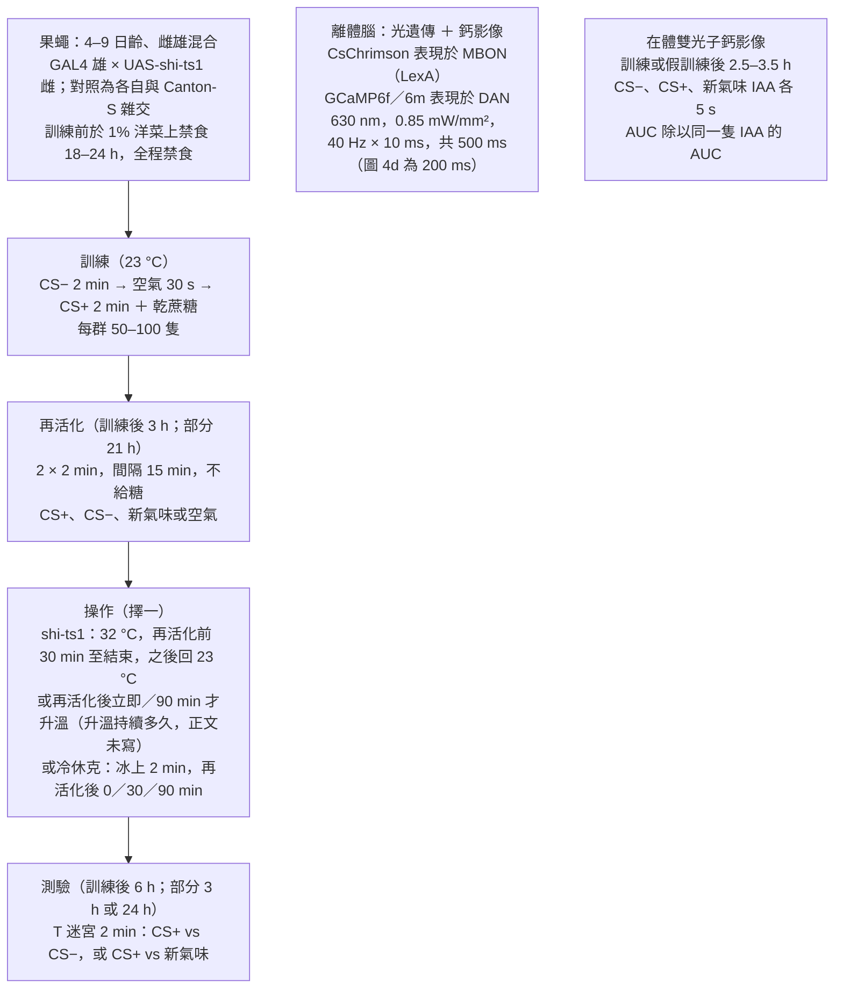
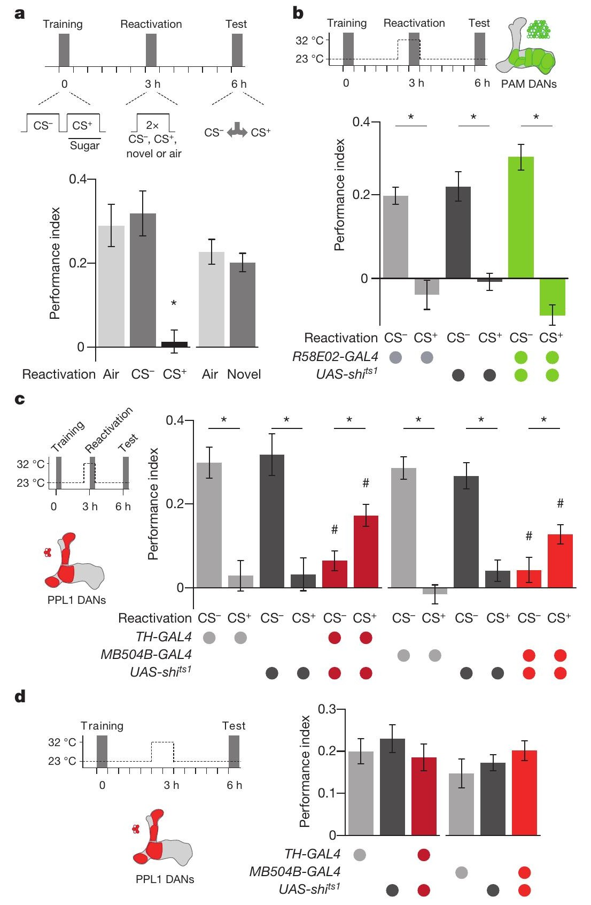
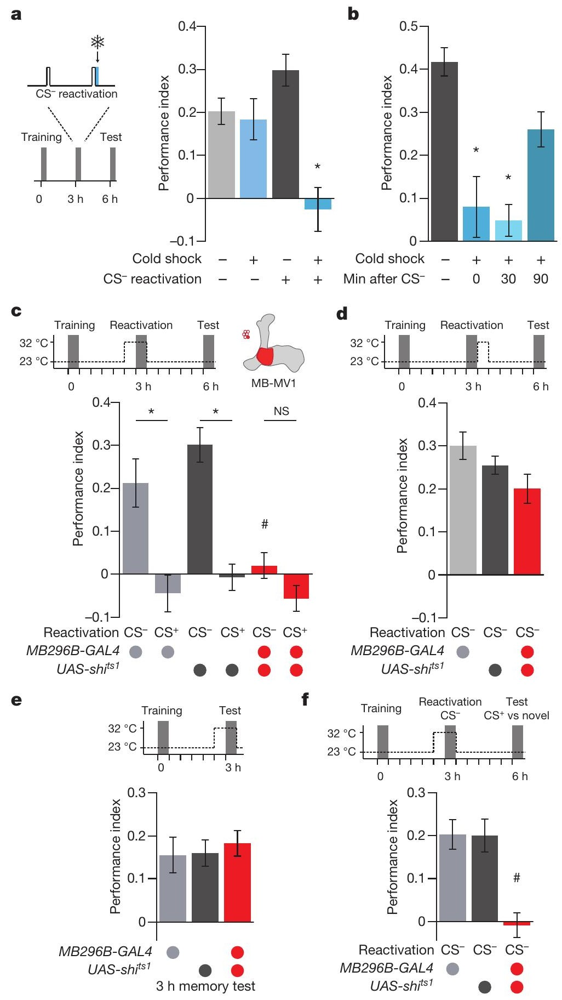
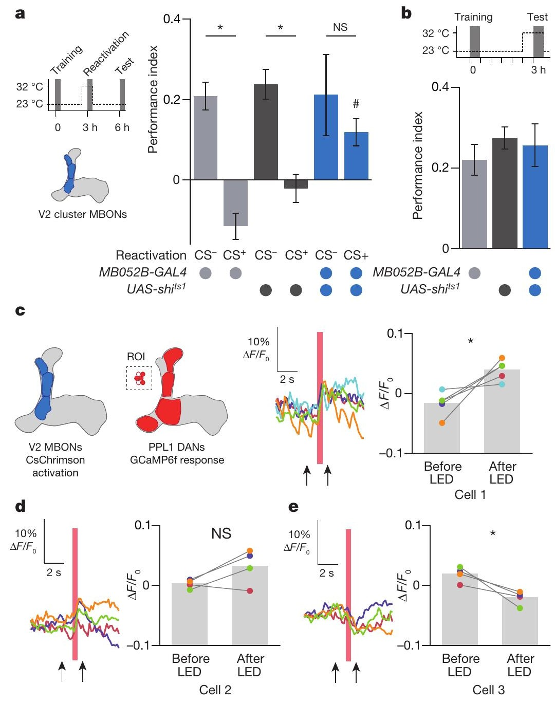
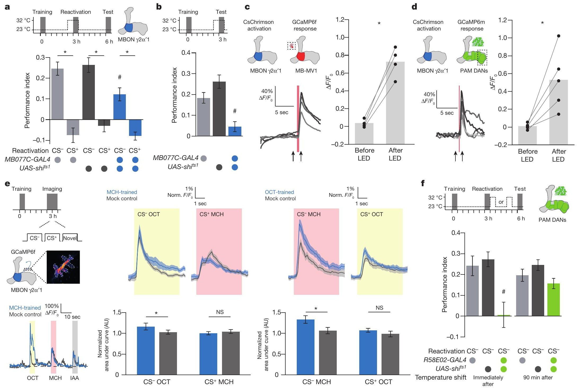

<!-- 本機 PDF：papers/2017-Re-evaluation%20of%20learned%20information%20in%20Drosophila.pdf -->

# Re-evaluation of learned information in *Drosophila*

**果蠅對已學得資訊的重新評估**

| 項目 | 內容 |
|---|---|
| **出處** | Nature 544(7649), 240–244 (2017). doi: 10.1038/nature21716 [全文（PMC 免費閱讀）](https://pmc.ncbi.nlm.nih.gov/articles/PMC5392358/) |
| 日期 | 線上先行 2017-04-05；刊期 2017-04-13（投稿 2016-08-24／修訂：PDF 未印／接受 2017-02-21）。期號 7649 取自 Europe PMC 書目，PDF 頁面只印卷 544 與頁碼 240–244 |
| 通訊作者 | Scott Waddell，scott.waddell@cncb.ox.ac.uk（PDF 只有英文名） |
| 作者 | 共 5 人：Johannes Felsenberg、Oliver Barnstedt、Paola Cognigni、Suewei Lin、Scott Waddell。無共同第一作者標示。分工：Felsenberg 與 Waddell 構思並設計全部實驗；Lin 做最初的消退實驗；Felsenberg 做並分析全部行為實驗（Cognigni 協助）；Barnstedt 做成像（Felsenberg 協助），成像資料由 Barnstedt 與 Cognigni 分析 |
| 機構 | Centre for Neural Circuits and Behaviour, University of Oxford（英國牛津）。Suewei Lin 的現職標為中央研究院分子生物研究所（Institute of Molecular Biology, Academia Sinica，台北） |
| 資料庫 | 無公開資料庫或程式碼。資料「依合理要求向通訊作者索取」（Data availability 一節）；分析用 GraphPad Prism 6、ImageJ 與自寫 MATLAB 程式 |
| 補充資料 | 本 PDF（14 頁）含正文、Methods 與 Extended Data 圖 1–6（以下簡稱「延伸圖」）。正文另說線上有 Supplementary Information 與 Source Data（原始數據），**本庫未取得** |
| 經費 | Deutsche Forschungsgemeinschaft（Felsenberg）；EMBO 長期研究員獎助（Lin）；Medical Research Council 等獎學金（Barnstedt）；Wellcome Trust、Gatsby 基金會、Oxford Martin School、Bettencourt–Schueller 基金會（Waddell） |

> 與本庫有關的作者：無（本庫目前沒有「與本庫有關的作者」名單）。
>
> 付費期刊（版權屬出版社）。本機 PDF 為出版社排版版（頁尾印「© 2017 Macmillan Publishers Limited, part of Springer Nature. All rights reserved.」）；**PDF 內搜尋 Creative Commons／CC BY／open access／distributed under 皆無結果，沒有 CC 授權聲明**。全文請由資料表「出處」列的連結到 PMC 免費閱讀（那是 Europe PMC 收存的作者稿，編號 EMS71650，不是出版社排版版）。**本庫不散布全文 PDF。** 本頁的圖擷取自原文，版權屬原出版社，以教學與評論目的引用，每張圖下方標明出處。

---

## 為什麼重要

**先交代名詞。** 蕈狀體（mushroom body, MB）是果蠅腦中把氣味和好壞連起來的構造。氣味由其中的 Kenyon 細胞（Kenyon cell, KC）代表；KC 經由神經元之間的接點（突觸，synapse）把訊號交給輸出神經元（MB output neuron, MBON），MBON 推動果蠅靠近或走開；多巴胺神經元（dopaminergic neuron, DAN）傳遞懲罰或獎賞，改變 KC→MBON 突觸的強弱，這就是學習（見 [[e-mushroom-body]]、[[c-kc-mbon-plasticity]]）。本頁還會用到兩個實驗室用語：**品系**（fly line）是一群基因組成固定的果蠅，名字像 TH-GAL4、MB504B、R58E02；說某個品系「標到」哪些細胞，意思是這個品系帶的基因工具只在那些細胞裡作用（見 [[e-split-gal4]]）。

**本篇在本庫的位置。** 本庫先前收錄的三篇（[[s-tomchik-2009-camp-dynamics]]、[[s-hige-2015-heterosynaptic-plasticity]]、[[s-handler-2019-dopamine-receptor-timing]]）問的都是「一次訓練怎麼把記憶寫進去」。本篇問下一步：**記憶寫好、而且已經穩定下來之後，再被叫出來時會發生什麼事。** 依論文引言，單次糖獎賞訓練就會形成長期記憶（本篇指訓練後幾小時到一天還在的記憶，最久測到 24 小時），並在訓練後數小時內鞏固（consolidation）。鞏固怎麼看得出來？本篇沿用一個操作型指標（引 Krashes & Waddell 2008）：把果蠅放進預冷的瓶子、置於冰上 2 分鐘（稱為冷休克麻醉），剛學會的記憶會被抹掉，放幾小時之後再冰就抹不掉了。所以「不怕冰」＝「已經存好」。為什麼麻醉會抹掉還沒存好的記憶，本篇沒有解釋。摘要接著說：已鞏固的長期記憶被提取（retrieval，也就是被叫出來）時，若當初學到的預測不準，可以被**消退**（extinction）抵銷（這一句引 Dunsmoor et al. 2015）；另一種情況是記憶被保留，但要先經過一段不穩定的**再鞏固**（reconsolidation）期（這一句引 Nader 2015）。（2026-11-26 更正：本頁先前把兩篇一起掛在再鞏固那一句後面，實際上原文是一句一篇。）論文也說，消退與再鞏固被視為緩解人類問題記憶的機會（引 Kindt et al. 2009、Schiller et al. 2010、Xue et al. 2012），但機制上的了解還很少。

**本篇把這兩種情況在同一套行為裡分開。** 訓練時果蠅聞兩種氣味：先聞不配糖的那一種（CS−），30 秒後聞配糖的那一種（CS+）。訓練後 3 小時再讓果蠅聞氣味、不給糖，論文稱為「再活化」（reactivation）——這是一個操作的名字，目的是讓記憶被提取一次。3 小時這個時間點是挑過的：圖 2a 顯示，不聞氣味、只在 3 小時被冰一下的果蠅記憶不受影響，表示這時記憶已經不怕冰、已經鞏固。再活化用 CS+ 時，6 小時測驗的偏好消失（消退）。再活化用 CS− 時偏好保住，但記憶會有一段時間重新變得怕冷：聞完 CS− 後立刻或 30 分鐘時冰 2 分鐘，6 小時的記憶就不見了；90 分鐘後才冰，與沒被冰的那組就沒有顯著差異了（再鞏固）。

**要讀懂本篇的迴路結果，需要知道蕈狀體的空間分格，以及細胞的名字怎麼讀。** KC 的軸突（往外送訊號的長纖維）成束排成幾條「葉」（lobe），以希臘字母命名：α、α′、β、β′、γ。每條葉沿長度再切成一格一格的區室（compartment）；每格由一型 DAN 支配（軸突末梢伸進這一格），論文說每格裝著「對應的一型」MBON 的樹突（接收訊號的分支）。區室名＝葉名＋格的序號，例如 γ2、α′1（見 [[c-mb-compartment]]）。細胞也以所在的格命名，名稱串起兩格就表示它橫跨兩格（※ 推論，依命名方式）；名字裡還會多出 pedc、sc、p3p、ap、m 這些字尾，本篇沒有解釋它們的意思，讀者只需看前面的「葉名＋序號」。本篇最重要的兩個細胞因此是一對：**MBON-γ2α′1** 的樹突在 γ2 與 α′1 兩格，**PPL1-γ2α′1**（論文多用舊名 MB-MV1）的末梢也伸進同兩格——一個讀這兩格、一個調這兩格。另一個主角是 **V2 群 MBON**，指樹突落在 α、α′ 葉的五型 MBON（α2sc、α′1、α2p3p、α′3ap、α′3m）；「V2」這個群名的來歷論文沒有解釋。**三個容易混的名字先擺在一起：** MB-MV1＝PPL1-γ2α′1（本篇的主角 DAN）；MB-V1＝PPL1-α′2α2（另一型 DAN，只當對照）；V2 群＝一群 MBON，和前兩個都沒有關係。DAN 則分兩群：依延伸圖 1a，PPL1 群傳遞懲罰，支配垂直葉上不連續的幾格；PAM 群傳遞獎賞，各自支配水平葉上的一格。哪幾條葉算垂直、哪幾條算水平，論文只畫在示意圖裡（α、α′ 垂直；β、β′、γ 水平；※ 從圖判讀）。延伸圖 6 的細胞名單可以補上細節：支配蕈狀體的 PPL1 共六型（γ1pedc、γ1、γ2α′1、α′2α2、α3、α′3），分布在 α、α′ 葉與水平 γ 葉靠近根部的 γ1、γ2；R58E02 品系標到的 13 型 PAM 分布在 β、β′ 葉與 γ3、γ4、γ5，另有一型 PAM-α1 落在垂直的 α 葉上。所以「PPL1 在垂直葉、PAM 在水平葉」是延伸圖 1a 的概括說法，論文自己的名單裡兩群各有例外（⚠️ 論文自身不一致）。依延伸圖 1b，PPL1 支配的格裡的 MBON 推動「靠近」，PAM 支配的格裡的 MBON 推動「走開」（為什麼是反過來的，見科普文的收發室比喻）。

**兩條路的結論。** 作者用一個溫度敏感的工具（shibirets1 突變基因：升溫就讓帶著它的神經元送不出訊號，降溫恢復），只在再聞氣味的那段時間關掉特定神經元：**消退需要 V2 群 MBON 與 PPL1 群 DAN；再鞏固需要 MBON-γ2α′1、同一格的 PPL1-γ2α′1，以及聞完 CS− 之後一段時間內的 PAM 群 DAN。** 一般的模型裡，訊號由 KC 流向 MBON、DAN 從旁調整；本篇的核心主張是 **MBON 也會回頭驅動 DAN**，讓記憶能依「學到的預期與實際經驗的差距」被更新（摘要稱為獎賞預測誤差，reward-prediction error；這個說法的證據限度見科普文最後一段）。

**與本庫先前三篇的方法差異。** 在行為實驗裡，本篇操作 DAN 的唯一方式是阻斷，從來沒有活化過任何 DAN；本篇唯一的活化實驗在取出的腦裡做，而且活化的是 MBON（見科普文第 4 套）。本庫先前三篇反過來：依本庫的頁面，Hige 2015 用紅光與 CsChrimson 活化單一型 PPL1-γ1pedc；Handler 2019 在行為實驗用 CsChrimson、在離體腦用 ATP 門控通道 P2X2 活化 DAN；Tomchik 2009 直接把多巴胺浴灌在取出的腦上。活化回答「這群神經元足不足以寫入記憶」，阻斷回答「這個過程少了它行不行」，兩者不能互相代替。

**留給庫內後續的開口。** 本庫兩條主題頁——[[t-timing-rules]]（氣味與多巴胺的先後如何決定學到什麼）與 [[t-dopamine-to-plasticity]]（多巴胺怎麼變成突觸改變）——整理出來的結果多半是「與多巴胺配對的氣味，送到某一格 MBON 的訊號變弱」。本篇的成像卻發現，糖獎賞訓練後，MBON-γ2α′1 對**從未與糖配對過的** CS− 反應**變大**（圖 4e；對照組是照樣聞兩種氣味、但不給糖的假訓練果蠅，不是沒聞過氣味的果蠅）。**這個變大從哪裡來，本篇沒有解釋，現有的規則也涵蓋不到它。**

---

## 論文摘要（原文與中譯）

> 本篇是 *Nature* 的 Letter，摘要為不分段的單段（不是 Background／Results／Conclusion 結構），以下照原文排列。摘要中的「MBON」指蕈狀體輸出神經元；「γ2α′1」是一個區室（compartment）的名稱；「negatively／positively reinforcing dopaminergic neurons」指傳遞懲罰／獎賞的多巴胺神經元。
>
> Animals constantly assess the reliability of learned information to optimize their behaviour. On retrieval, consolidated long-term memory can be neutralized by extinction if the learned prediction was inaccurate. Alternatively, retrieved memory can be maintained, following a period of reconsolidation during which it is labile. Although extinction and reconsolidation provide opportunities to alleviate problematic human memories, we lack a detailed mechanistic understanding of memory updating. Here we identify neural operations underpinning the re-evaluation of memory in *Drosophila*. Reactivation of reward-reinforced olfactory memory can lead to either extinction or reconsolidation, depending on prediction accuracy. Each process recruits activity in specific parts of the mushroom body output network and distinct subsets of reinforcing dopaminergic neurons. Memory extinction requires output neurons with dendrites in the α and α′ lobes of the mushroom body, which drive negatively reinforcing dopaminergic neurons that innervate neighbouring zones. The aversive valence of these new extinction memories neutralizes previously learned odour preference. Memory reconsolidation requires the γ2α′1 mushroom body output neurons. This pathway recruits negatively reinforcing dopaminergic neurons innervating the same compartment and re-engages positively reinforcing dopaminergic neurons to reconsolidate the original reward memory. These data establish that recurrent and hierarchical connectivity between mushroom body output neurons and dopaminergic neurons enables memory re-evaluation driven by reward-prediction error.

**中譯**（本節為忠實翻譯，非自撰內容）：

> 動物不斷評估已學得資訊的可靠性，以使行為最佳化。在提取時，若當初學到的預測不準確，已鞏固的長期記憶可以被消退所抵銷。另一種情況是，被提取的記憶可以被保留，但要先經過一段再鞏固期，期間記憶是不穩定的。雖然消退與再鞏固為緩解人類的問題記憶提供了機會，我們對記憶更新的機制仍缺乏詳細的了解。本研究找出果蠅記憶重新評估背後的神經運作。由獎賞增強的嗅覺記憶被再活化時，可以導向消退或再鞏固，取決於預測的準確度。兩種過程各自動用蕈狀體輸出網路的特定部分，以及不同子集的增強型多巴胺神經元。記憶消退需要樹突位於蕈狀體 α 與 α′ 葉的輸出神經元，它們驅動支配鄰近區域、傳遞負向增強的多巴胺神經元。這些新形成的消退記憶帶有嫌惡價值，抵銷了先前學到的氣味偏好。記憶再鞏固需要 γ2α′1 蕈狀體輸出神經元。這條路徑動用支配同一區室、傳遞負向增強的多巴胺神經元，並重新啟動傳遞正向增強的多巴胺神經元，以再鞏固原本的獎賞記憶。這些資料確立：蕈狀體輸出神經元與多巴胺神經元之間的回返性與階層性連結，使由獎賞預測誤差驅動的記憶重新評估成為可能。

> 中譯用詞說明：「增強」（reinforcement）是懲罰或獎賞的統稱，所以「由獎賞增強的記憶」就是用糖建立的記憶，「負向／正向增強的 DAN」就是傳遞懲罰／獎賞的 DAN。「嫌惡價值」指這筆記憶會讓果蠅想避開該氣味。「支配」指 DAN 的末梢伸進某一格。「鄰近區域」指 V2 MBON 所在的格旁邊的格。「回返性連結」指 MBON 連回同一格的 DAN（論文延伸圖 1c 稱為局部回饋迴路）；「階層性連結」論文沒有定義，※ 推論：指 MBON 連到其他格的 DAN，例如 V2 MBON 連到鄰格的 PPL1 DAN、γ2α′1 MBON 連到水平葉的 PAM DAN。

---

## 科普文

想像你在地圖上記下「這家店有好吃的」。過幾天你經過，進去兩次都空手而回。你不會把那筆記錄擦掉，而是在旁邊加一筆「最近沒有」；下次經過，兩筆互相抵銷，你就不特別想進去了。這是心理學說的**消退**：舊記憶還在，只是被一筆方向相反的新記憶蓋過去。再想像你當初記下的是一組對比：「這家有好吃的，隔壁那家沒有」。這次你進的是**隔壁那家**，果然也沒有——這和整組記錄的預期一致，你不必寫新記錄，只是把地圖翻出來核對一遍、再收好。依本篇引用的文獻，記憶被翻出來時會暫時變得不穩定，要經過一段時間才重新存好，這個過程叫**再鞏固**；在這段不穩定期間出事，記錄可能就收不回去了。本篇在果蠅身上把這兩種情況分開。

**讀這一篇最關鍵的一個限制，先放在前面。** 本篇所有「哪些神經元負責什麼」的結論，都來自同一種行為操作：在某一段時間把某群神經元的輸出關掉（辦法是升溫，見名詞表的 shibirets1），再看果蠅的選擇有沒有變。這種操作能回答「少了它，這件事就做不成」，不能回答「它當時在做什麼」。而且「某一段時間」比想像的長。本篇用到的升溫時段共六種：（一）**期間關**，從再聞氣味前 30 分鐘開始升溫，一直到聞完，總共約 50 分鐘（※ 推論：30 分鐘加上兩次各 2 分鐘的氣味與中間 15 分鐘的間隔）；（二）**聞完立刻關**；（三）**聞完 90 分鐘才關**；（四）**只在測驗時關**（用來檢查這群神經元是不是連「把記憶表現出來」都需要）；（五）**不做再活化，只在原本會升溫的那段時間關**（圖 1d 的對照）；（六）**訓練時關**（延伸圖 3i）。論文說的「在聞的當下需要、聞完之後不需要」，是用（一）和（二）的對比得到的；兩者相差數十分鐘，所以這個時間分工的解析度也只有數十分鐘，不是「聞氣味的那兩分鐘」。至於直接看神經元活動的實驗，本篇只有兩類：一類在取出的腦裡做、完全沒有氣味；另一類在活果蠅身上，但量的是訓練後約 3 小時對氣味的反應，不是果蠅正在做選擇的那一刻。**所以本篇的迴路圖是用「必要性」加上「取出的腦裡的功能連結」拼出來的，不是在行為當下量出來的。**

**白話名詞表。**

| 詞 | 白話說明 |
|---|---|
| 蕈狀體（mushroom body, MB） | 果蠅腦中把氣味和好壞連起來的構造 |
| Kenyon 細胞（KC） | 蕈狀體裡代表氣味的神經元 |
| 輸出神經元（MBON） | 讀取 KC 訊號、推動果蠅靠近或走開的神經元 |
| 多巴胺神經元（DAN） | 傳遞「剛才有好事或壞事」的神經元，會改變 KC→MBON 突觸的強弱。本頁一律寫「報懲罰的 PPL1 群」「報獎賞的 PAM 群」；論文的同義說法有「嫌惡／負向增強 DAN」與「獎賞／正向增強 DAN」 |
| 細胞體 | 神經元的本體，樹突與軸突都從這裡長出來。離體實驗量 PPL1 的鈣螢光時量的就是細胞體 |
| 區室（compartment） | 蕈狀體葉上的一格，每格由一型 DAN 支配。名稱＝葉名＋序號，例如 γ2、α′1。論文說每格裝著「對應的一型」MBON 的樹突；但本篇自己的名單裡，α′1 這一格同時出現在 MBON-α′1 與 MBON-γ2α′1 的名字裡，所以「一格一型」是論文的概括說法，不是嚴格的一對一（※ 推論，依延伸圖 6j、6k 的名單） |
| 訓練氣味 | 3-辛醇（OCT）與 4-甲基環己醇（MCH）兩種，哪一種當 CS+ 在不同組之間輪換。例外：圖 2f 用丁酸乙酯（EB）當 CS−；延伸圖 2（圖說 d）與 3a 用乙酸異戊酯（IAA）與 EB 當訓練氣味 |
| CS+／CS− | 訓練時與糖一起出現的氣味是 CS+；先出現、不配糖的是 CS− |
| 新氣味 | 這群果蠅沒學過的氣味。行為實驗用 IAA 或 EB（圖 2f 例外，那一組拿 OCT 或 MCH 當新氣味，因為它的 CS− 換成了 EB）；成像實驗固定用 IAA |
| T 形迷宮（T-maze） | 一支 T 字形管子，兩條岔路各通一種氣味，讓一群果蠅自己選邊 |
| 表現指數（performance index, PI） | 一群果蠅在 T 形迷宮兩臂間的選擇換算成的一個數。0＝兩邊一樣，正值＝偏向 CS+，負值＝偏向測驗中的另一個氣味（多數圖是 CS−，圖 2f 是新氣味）。換算公式與上下限本篇沒寫，所以本頁只做相對比較 |
| 行為的 n／成像的 n | 行為實驗的 n 是「群」，一群 50–100 隻，所以「n ≥ 23」是至少 23 群果蠅。成像實驗的 n 是「隻」 |
| 再活化（reactivation） | 一個操作的名字：訓練後再讓果蠅聞兩次各 2 分鐘的氣味、不給糖。它會讓記憶被提取一次 |
| 表現記憶 | 果蠅在測驗裡真的做出偏好的選擇。有些神經元關掉就表現不出記憶，有些不影響；這和「記憶還在不在」是兩件事 |
| 冷休克 | 把果蠅移進預冷的瓶子、置於冰上 2 分鐘 |
| 1% 洋菜 | 洋菜（agar）是只有水分、沒有養分的膠。把果蠅放在 1% 洋菜上就是「只給水、不給食物」 |
| Canton-S | 實驗室標準的野生型果蠅品系，本篇用它做出對照組 |
| 品系（fly line） | 一群基因組成固定的果蠅。本篇所有「TH-GAL4」「MB504B-GAL4」「MB052B」「R58E02」這類名字都是品系名 |
| GAL4／UAS | 一套讓外加基因只在特定神經元裡作用的兩件式工具。GAL4 品系決定「在哪些細胞」（這就是「某品系標到哪些細胞」的意思），UAS 品系帶著「要加什麼基因」；兩個品系交配，子代才同時有兩半、功能才成立。所以只帶一半的果蠅就是天然的對照組（見 [[e-split-gal4]]） |
| shibirets1 | UAS 那一半可以帶的基因之一，是個溫度敏感的突變基因。高於 29 °C 時，帶著它的神經元送不出訊號；低於 25 °C 恢復 |
| CsChrimson | UAS（或 lexAop）那一半可以帶的另一個基因，做出一種照紅光就讓神經元放電的蛋白。本篇只在取出的腦裡用它，而且只用在 MBON 上（見 [[e-cschrimson]]） |
| GCaMP6f／GCaMP6m | 遇到鈣就變亮的螢光蛋白。神經元活動時細胞內鈣會升高，所以螢光變亮就代表活動增加。6f 與 6m 是兩個版本，兩者差在哪裡本篇沒有說明（見 [[e-gcamp]]） |
| 製備（preparation） | 實驗用的樣本連同它的處理方式。本篇有兩種：活果蠅固定後打開頭殼（可以給氣味），以及把腦整個取出來泡在通了氧氣的人工體液裡（沒有氣味） |
| AUC（area under the curve） | 把一段時間內的螢光曲線積起來得到的面積，代表整段反應的大小。本篇取氣味給予的那 5 秒 |
| 假訓練（mock） | 成像實驗的對照組：照樣給兩種氣味，但不給糖。**不是**沒聞過氣味的果蠅 |
| V2 群 MBON | 樹突在 α、α′ 葉的五型 MBON（α2sc、α′1、α2p3p、α′3ap、α′3m）；本篇用 MB052B 品系把它們一起關掉。名字裡的 sc、p3p、ap、m 等字尾本篇沒有解釋，看前面的「葉名＋序號」就夠 |
| 三個容易混的名字 | MB-MV1＝PPL1-γ2α′1（本篇主角 DAN）；MB-V1＝PPL1-α′2α2（另一型 DAN，只當對照）；V2 群＝一群 MBON。三者互不相關 |

**本頁把本篇的實驗分成五套（編號是本頁加的，論文沒有這樣編）。** 分套的依據是製備、讀數與刺激方式：

- **第 1 套（活果蠅行為，不動基因）：** 再活化本身會不會造成消退。讀數是 PI。圖 1a、延伸圖 2 的圖說 a–d 四格。
- **第 2 套（活果蠅行為，加冷休克）：** 再活化之後給冷休克，看記憶是否正處於不穩定期。讀數是 PI，多出來的刺激是冰上 2 分鐘。圖 2a、2b，延伸圖 3a、3b。
- **第 3 套（活果蠅行為，升溫阻斷）：** 讓特定神經元帶上 shibirets1，升溫把它們的輸出關掉。讀數是 PI，多出來的變因是溫度。圖 1b–1d、2c–2f、3a、3b、4a、4b、4f，以及延伸圖 2e–2h、3c–3i、4a、4b、5a、5b。
- **第 4 套（取出的腦，光活化）：** 用紅光活化帶著 CsChrimson 的某群 MBON，同時看某群 DAN 的鈣螢光。讀數是 ΔF/F0（螢光相對基線的變化比例）。沒有氣味、沒有行為。圖 3c–3e、4c、4d，延伸圖 4c、4d。
- **第 5 套（活果蠅開頭殼，氣味成像）：** 訓練或假訓練後 2.5–3.5 小時給氣味，量 MBON 或 DAN 的鈣螢光。讀數是標準化 AUC（氣味那 5 秒的 AUC，再除以同一隻果蠅對新氣味 IAA 的 AUC）。圖 4e、延伸圖 4e、4f。

**哪些能比、哪些不能比，有兩個層次。** 第一層是**單位根本不同，完全不能比**：第 1 到第 3 套的讀數是一群果蠅的選擇（PI），第 4 套是螢光變化比例，第 5 套是一個比值；製備從完整活體到取出的腦；刺激從氣味到紅光到冰塊。所以「阻斷讓 PI 掉了多少」和「光活化讓螢光升了多少」放在一起比強弱沒有意義。第二層是**單位相同、但批次與基因型不同，只能在同一張圖內比**：第 1 到第 3 套都是 PI，可是每張圖用的果蠅品系不同、做實驗的批次也不同（圖 1 的圖說寫「x 軸上的斷點表示獨立的實驗」，意思是同一格裡的長條被一個缺口分成左右兩半時，兩半是不同批次做的）。所以本頁引用數字時，一律只把實驗組跟**同一張圖裡的對照柱**相比，不跨圖比絕對高度。另外兩個與層次無關的小提醒：第 4 套的圖 4c 與 4d 之間也不宜比幅度（4d 的光刺激是 200 毫秒、感測器是 GCaMP6m，其他格是 500 毫秒、GCaMP6f）；本頁所有標「※ 從圖判讀」的 PI 目測誤差約 ±0.02，所以 0.255 與 0.26 之類的差別沒有意義，寫到小數第三位只是照本庫的數字登記簿 [[numbers]] 的原值抄。

**還有一個讀圖號的提醒。** 圖 2c、圖 3a、圖 4a 與延伸圖 3c–3e 每一格裡都同時有「聞 CS+」與「聞 CS−」兩組長條（x 軸就寫著 CS− CS+ 交替），所以同一個圖號在下文會被引用兩次：一次談它的 CS+ 那幾柱（消退），一次談它的 CS− 那幾柱（再鞏固）。

**五套共用的條件。** 果蠅 4–9 日齡、雌雄混合（成像實驗為 3–8 日齡）；訓練前在 1% 洋菜上禁食 18–24 小時，整個實驗期間都不給食物（糖是唯一的食物，餓著是訓練有效的前提）。訓練只做一次：一群 50–100 隻果蠅先聞 CS− 2 分鐘，接 30 秒乾淨空氣，再聞 CS+ 2 分鐘並同時給乾蔗糖。再活化在訓練後 3 小時（延伸圖 3b 另有 21 小時的一組），給兩次各 2 分鐘的氣味、間隔 15 分鐘、不給糖。測驗在訓練後 6 小時（另有 3 小時與 24 小時的組），在 T 形迷宮裡給 2 分鐘，選 CS+ 或 CS−；只有圖 2f 改成選 CS+ 或一種新氣味。第 3 套每個實驗都有三組：只帶 GAL4 那一半的、只帶 shibirets1 那一半的（兩者各自與 Canton-S 雜交），以及兩者都帶的實驗組；本頁把前兩組合稱「基因對照組」。另有全程維持 23 °C 的溫度對照（延伸圖 2f、3h、4b、5b）。第 5 套的對照是假訓練。**各圖各組確切的果蠅群數，論文未逐格標明**，圖說只給下限（例如 n ≥ 8），Methods 的概括語是「樣本數沒有事先以統計方法決定」。阻斷用的溫度，論文自己有兩種說法：正文與各圖時間軸寫 32 °C，Methods 寫「restrictive 33 °C」（⚠️ 論文自身不一致）。「聞完之後才升溫」那幾組升溫維持多久，論文沒有寫。

**第 1 套：同樣是「再聞一次氣味、不給糖」，結果可以相反。** 訓練後 3 小時聞兩次 CS+，6 小時測驗時偏好不見了（PI 從同一張圖裡空氣組的約 0.29 掉到約 0.01；※ 從圖判讀），而且到訓練後 24 小時仍然維持在低點，延伸圖 2 的圖說寫「以目前的訓練與消退協定，看不出原記憶的自發恢復」。改聞 CS−、空氣或一種新氣味，偏好照樣表現得出來。把再活化改成一次或三次，結果和兩次一樣。而沒有訓練過的果蠅先聞兩次氣味，3 小時或 21 小時後對那個氣味的偏好不變——所以消退不是「聞過就不喜歡」這麼簡單。

**第 2 套：聞 CS− 之後，記憶有一段時間變得怕冷。** 圖 2b 這一組果蠅全都聞了 CS−，差別只在何時被冰：聞完後立刻或 30 分鐘時冰 2 分鐘，6 小時的記憶就沒了（PI 從未冰組的約 0.42 掉到約 0.08 與 0.05）；90 分鐘後才冰，PI 約 0.26，與未冰組的差異沒有達到顯著（n = 10 群；皆 ※ 從圖判讀）。圖 2a 是另一張獨立的圖，比的是「有沒有聞 CS−」與「有沒有被冰」的四種組合：只被冰、沒聞 CS− 的果蠅不受影響（約 0.18，無處理組約 0.20）；聞了 CS− 又被冰的掉到約 −0.03。（順帶一提，圖 2a 裡只聞 CS−、沒被冰的那組約 0.30，比完全沒處理的那組約 0.20 高，論文沒有檢定也沒有討論這個差距。）**圖 2a 的 0.20 與圖 2b 的 0.42 不能互比**，只能各自在自己那張圖裡看相對高低。（2026-11-26 更正：本頁先前把理由寫成「不同批次、不同基因型」，但那兩格圖面沒有基因型標籤，論文也沒有交代這些非基因操作的實驗用什麼品系——`？待查`。不能互比的理由只剩「不同實驗、各有自己的對照」這一點。）換一對氣味、或把再活化延到訓練後 21 小時，記憶同樣會變得怕冷。論文只測了 0、30、90 分鐘三個時間點，中間沒有測，所以能說的只是「30 分鐘時還不穩定、90 分鐘時已經不怕冷」。**另外，「90 分鐘組與未冰組沒有顯著差異」不等於「完全恢復」**：0.26 只有 0.42 的六成左右。

**第 3 套之前，先看一個比喻。** 本庫其他頁把蕈狀體當成一間收發室：KC 是寫信的員工，MBON 是讀信的主管，主管決定果蠅靠近還是走開；DAN 是督察，每位只管一段信箱（一段信箱＝一格區室），出聲代表「剛才有好事或壞事」，那段信箱裡剛剛有人投信的投遞口（突觸）就會被調窄（見 [[t-dopamine-to-plasticity]]）。乍看違反直覺的是：報獎賞的 PAM 群管的是「推動走開」那幾位主管的信箱，報懲罰的 PPL1 群管的是「推動靠近」那幾位的。道理在於督察的作用是調窄。依本篇引用的 Owald et al. 2015，糖獎賞學習時，報獎賞的督察讓學到的氣味送到「走開」主管的信變少；走開的力量弱了，果蠅就相對偏向靠近這個氣味。懲罰學習反過來，讓氣味送到「靠近」主管的信變少，果蠅就相對偏向走開。以下仍以實際細胞名為主，比喻只當註解。

**第 3 套，消退這條路（圖 1b、1c、1d）。** 在聞 CS+ 的那段時間關掉 PPL1 群 DAN（用兩個品系各做一次：TH-GAL4 標到全腦大範圍的 DAN，含全部六型支配蕈狀體的 PPL1；MB504B-GAL4 只標其中四型——γ1pedc、γ2α′1、α′2α2、α3），消退就被擋住一部分：實驗組聞 CS+ 後的 PI 分別是約 0.17 與 0.13。怎麼判斷？圖上用井號標出實驗組與自己的基因對照組不同，所以消退確實被擋住了；而這兩個值仍明顯低於四個基因對照組聞 CS− 的那四柱（兩個實驗各兩柱，約 0.27 到 0.32，代表記憶完好的水準；皆 ※ 從圖判讀），所以只擋住一部分。**「擋住一部分」有兩種解釋，論文沒有討論：** 消退除了 PPL1 之外還需要別的東西，或者升溫沒有把 PPL1 完全關掉。關掉報獎賞的 PAM 群則完全沒有影響，消退照常（實驗組聞 CS+ 後 PI 約 −0.09）。

作者還問過一個問題：消退是不是只因為「這一次沒有獎賞訊號」？設計是這樣：在 3 小時時重新訓練（CS+ **照樣配糖**），同時關掉 PAM 群。這一組的糖確實出現了、預測沒有落空，唯一被拿掉的是獎賞 DAN 送出的訊號；如果消退只需要「獎賞 DAN 沒出聲」，這一組就該消退。**結果沒有消退**，記憶與基因對照組無法區分（延伸圖 2e），所以答案是「不是」——光是獎賞訊號缺席不足以造成消退。作者引 Schultz et al. 1997 解釋為什麼阻斷在這裡幾乎沒差：記憶已達最大時，獎賞 DAN 對糖的訊號本來就減弱了。

順便指出一件論文沒有處理的事：**好幾組「聞 CS+」的 PI 落在 0 以下**，例如剛才那組阻斷 PAM 的實驗組約 −0.09，圖 3a 的兩個基因對照組約 −0.12 與 −0.02（※ 從圖判讀）。負值表示果蠅偏向測驗中的另一邊（CS−）；這可能是躲 CS+，也可能是變得喜歡 CS−，本篇的測驗分不開這兩種。論文的模型預測的是「新記憶剛好抵銷舊記憶」，應該歸零；這些負值有沒有顯著低於 0，論文沒有檢定也沒有討論。所以本頁描述消退時，一律只說「偏好消失」。

**圖 1c 裡還藏著一個作者沒有預期的結果，而它是整篇第二條主線的起點。** 同一張圖、同樣關掉 PPL1 群，但改看**聞 CS−** 的那幾柱：6 小時的 PI 掉到約 0.065（TH-GAL4）與 0.04（MB504B-GAL4），和消退一樣低（※ 從圖判讀）。正文稱之為「CS− 在記憶重新評估中意想不到的角色」。這不是升溫或阻斷本身造成的：不做再活化、只在同一時段關掉 PPL1，6 小時的偏好不變（圖 1d）；在關掉 PPL1 的同時聞一種新氣味，也不變（延伸圖 2g）；關掉 PPL1 時讓沒訓練過的果蠅聞氣味，那個氣味不會因此帶上好壞（延伸圖 2h）。**所以要讓記憶掉下來，得同時做到兩件事：關掉 PPL1，而且讓果蠅聞 CS−。** 論文接下來去測「聞 CS− 會不會引發再鞏固」，寫出來的理由是另一件事：依哺乳類的研究，增強訊號沒出現時可能驅動消退，訓練情境只有小幅改變時則觸發再鞏固（引 Pedreira et al. 2004、Díaz-Mataix et al. 2013），而聞 CS− 只是重演訓練的一部分，算小幅改變。等第 2 套的冷休克結果出來，作者才回頭說圖 1c 這幾柱與冷休克的效果相似，「顯示再鞏固本來就需要嫌惡 DAN」（嫌惡 DAN＝報懲罰的 PPL1 群）。

回到消退。作者接著逐一關掉單一型 PPL1 DAN，消退都沒有被擋住。逐一測過的有四組操作，涵蓋五型：PPL1-γ1pedc、PPL1-α′2α2、一個同時標到 PPL1-α3 與 PPL1-α′3 的品系（以上三組在延伸圖 3c–3e），以及 PPL1-γ2α′1（在圖 2c）。第六型 PPL1-γ1 沒有被單獨測過（※ 推論：延伸圖 6 的品系名單裡沒有任何一個品系只標 PPL1-γ1）。論文的結論句是「消退不依賴個別的嫌惡 DAN」，沒有再往下指認。

接著往訊號的來源回推——V2 群 MBON 是那些 PPL1 DAN 的輸入來源，所以下面說的「上游」是相對 DAN 而言，不是相對行為。在聞 CS+ 時關掉 V2 群，實驗組的 PI 約 0.12，而同一張圖的兩個基因對照組聞 CS+ 後已經消退到約 −0.12 與 −0.02（※ 從圖判讀），所以 V2 群也是消退所必需。另一組果蠅不做再活化，只在 3 小時測驗時關掉 V2 群，偏好照樣表現得出來，這排除了「關掉 V2 群只是讓果蠅表現不出任何偏好」的解釋。接著是第 4 套（取出的腦）：用紅光活化 V2 群 MBON，同時看 PPL1 DAN 的細胞體。圖說說每隻動物看三顆細胞，其中兩顆有可重複的反應；結果依細胞編號合併呈現——「細胞 1」平均變活躍、「細胞 3」平均變安靜、「細胞 2」沒有達到顯著。**這三顆細胞各是哪一型，論文沒有指認**，編號怎麼決定、不同果蠅的「細胞 1」是否同一型，論文也沒有交代。所以這一套只能說明「活化 V2 群會改變 PPL1 的活動」，方向不一致，也接不到型別。

作者把行為與這一套合起來，提出一個兩步的模型，而這兩步解釋了一個看起來矛盾的地方：V2 群自己是「推動靠近」的 MBON，怎麼會造成果蠅不再靠近 CS+？**第一步：再聞 CS+ 卻沒有糖，整個 MBON 網路的反應偏向 V2 群這一側，V2 群把訊號送給報懲罰的 PPL1 DAN。第二步：那些 DAN 支配的格裡住的也是「推動靠近」的 MBON，而 DAN 的作用是把剛剛有訊號通過的突觸調窄，所以被調窄的是「靠近」那一側的突觸——CS+ 送到靠近側的訊號變少，原本偏向靠近的天平就被拉回來。** 論文把這個「靠近側變弱」稱為一筆新的、與原記憶平行而競爭的嫌惡記憶（延伸圖 1g、1h），寫法是「we propose」，不是斷言。這個模型有兩個地方論文沒有交代：第一，離體實驗一升一降，模型只採用了「升」那一個方向，為什麼可以不理那顆變安靜的細胞，論文沒有說；第二，摘要說 V2 群驅動的是「支配**鄰近**區域」的 DAN，但作者點名的候選之一 PPL1-γ2α′1 支配的 α′1，正好也是 V2 群中 MBON-α′1 所在的那一格，所以到底算同格還是鄰格，論文沒有逐一交代（※ 推論，依延伸圖 6b、6j 的名單）。

**第 3 套，再鞏固這條路（圖 2c–2f、4a、4b、4f）。** 看圖 2c 的 CS− 那幾柱：關掉 PPL1-γ2α′1（品系 MB296B-GAL4），6 小時記憶就沒了（實驗組 PI 約 0.02，同圖兩個基因對照組約 0.21 與 0.30；※ 從圖判讀）。這時偏好消失有兩種可能：果蠅忘了 CS+ 有糖，或是果蠅變得也喜歡 CS−。作者改讓果蠅在 CS+ 與一種新氣味之間選，PI 仍然掉到約 −0.01，兩個基因對照組約 0.20——所以失去的是 CS+ 的記憶本身。時間上，這一型只在聞 CS− 的**當下**需要：改成聞完立刻關，PI 約 0.20、基因對照組約 0.30 與 0.255，差異不顯著，而這一組的 n ≥ 23 群是全篇主圖中最大的（※ 從圖判讀）。它也不是表現記憶所必需——只在 3 小時測驗時關掉它，偏好照樣表現得出來。

PPL1-γ2α′1 的角色還有一個專一性證據，只寫在圖說裡：延伸圖 3c–3e 那三組（PPL1-γ1pedc、PPL1-α′2α2、PPL1-α3 與 α′3）的 **CS− 那幾柱**顯示，在聞 CS− 時關掉它們，6 小時的記憶都不受影響。**所以在被測過的五型 PPL1 之中，只有 PPL1-γ2α′1 單獨關掉就足以擋掉再鞏固**（第六型 PPL1-γ1 沒被單獨測過，所以不能說「六型中只有一型」）。另一個也標 PPL1-γ2α′1 的品系（R73F07-GAL4）重做一次，結果相同。

再往上游（仍是相對 DAN 而言）是同一格的 MBON-γ2α′1：在聞 CS− 時關掉它，實驗組 PI 約 0.12，同圖基因對照組約 0.25 與 0.265（※ 從圖判讀），再鞏固受損；聞完之後才關則不受影響。第 4 套（取出的腦）顯示，用紅光活化 MBON-γ2α′1 時，PPL1-γ2α′1 與報獎賞的 PAM 群都出現很大的鈣上升（ΔF/F0 分別約從 0.03 升到 0.72、從 0.01 升到 0.53；※ 從圖判讀）。PAM 的反應只在水平葉末端的 γ5 那一格量，而用的品系標到 13 型 PAM，所以這一筆只代表 γ5 那一部分。最後回到行為：在聞完 CS− 後**立刻**關掉 PAM 群，記憶就沒了（實驗組 PI 約 0.005）；90 分鐘後才關，PI 約 0.155，與同圖基因對照組的約 0.195、0.245 之間沒有標顯著（※ 從圖判讀）。

**第 5 套是全篇唯一直接看到「訓練留下的痕跡」的實驗。** 糖獎賞訓練後 2.5–3.5 小時，MBON-γ2α′1 對 CS− 的標準化反應比假訓練組大：一組是 1.17 對 1.03，另一組是 1.33 對 1.07（兩組的差別在於訓練時哪一種氣味當 CS+），也就是高出約 14% 與 24%（※ 從圖判讀；百分比為本頁以柱高相除，論文沒有算）。對 CS+ 的反應兩組都在 1.0 上下，沒有顯著差異。這套成像有一個前提要知道：每個值都除以同一隻果蠅對新氣味 IAA 的值（用來扣掉果蠅之間整體反應強弱的差異），所以它假設訓練不會改變對 IAA 的反應；論文沒有報告沒除過的原始值。另外，看不到任何氣味反應的果蠅會被排除，圖 4e 排除了 73 隻中的 15 隻（假訓練 9 隻、訓練 6 隻）；排除的依據是「有沒有反應」而不是結果，但約五分之一的果蠅沒有進入分析。把這一套與上面的行為、離體結果合起來，**作者提出的模型是：訓練讓 MBON-γ2α′1 對 CS− 特別敏感；再聞到 CS− 時，它活化同一格的 PPL1-γ2α′1 與水平葉上的 PAM 群，PAM 群在之後一段時間把原本的獎賞記憶重新寫一次。**

**代價：沒有被解決的幾件事。**

- **MBON-γ2α′1 本身就是表現 3 小時記憶所必需的**（關掉它，3 小時的 PI 約 0.045，同圖基因對照組約 0.18 與 0.26；※ 從圖判讀）。那麼在聞 CS− 時關掉它，果蠅可能根本叫不出記憶，再鞏固也就無從開始——這和「它專門負責啟動再鞏固」是兩種不同的解釋，本篇的資料分不開。相對地，V2 群 MBON 與 PPL1-γ2α′1 都不是表現記憶所必需，那兩條結果沒有這個問題。
- **訓練後 V2 群 MBON 與兩型 PPL1 DAN 對 CS+ 的反應都沒有改變**（第 5 套，延伸圖 4e、4f；量的是 V2 群，以及 PPL1-α′2α2 與 PPL1-γ1pedc）。正文承認「we detected no obvious change」。那為什麼聞 CS+ 會特別引發消退？上面那個模型的第一步（網路偏向 V2 群）靠的是另一篇論文：Owald et al. 2015 報告，獎賞訓練後 CS+ 送到水平葉末端那幾型「走開」MBON 的驅動減少，於是 CS+ 引起的整體反應相對偏向「靠近」那一邊。**這一步本篇沒有直接量到**；而且 V2 群自己對 CS+ 的反應既然沒變，PPL1 要如何「感受到」這個相對的偏斜，論文沒有說明。
- **「消退是一筆嫌惡的新記憶」沒有被直接驗證。** 依據只有「消退需要報懲罰的 PPL1 群、不需要報獎賞的 PAM 群」。「新增一筆相反的記憶把舊的抵銷」與「舊記憶本身被減弱」，在本篇的測驗裡都表現為偏好歸零，本篇沒有設計能把兩者分開的實驗。
- **第 4 套只說明「活化 A 會讓 B 的鈣上升」**，不區分直接或間接相連，也不保證在活果蠅聞氣味時會發生。
- **為什麼「保住一筆獎賞記憶」會需要一型報懲罰的 DAN，論文沒有解釋。** 論文自己的結語是：「我們尚無法確定是什麼造成 PPL1-γ2α′1 與獎賞 DAN 不同的時間需求，也無法確定記憶更新的本質。」
- **MBON-γ2α′1 對 CS− 的反應為什麼變大，本篇沒有查。** 按收發室的規則，一個突觸要被改變，得有那一格的 DAN 在同時或緊接著出聲；可是訓練時 CS− 單獨出現 2 分鐘、結束 30 秒後才給糖，而 γ2α′1 這一格的 DAN 是報懲罰的 PPL1-γ2α′1、不是報獎賞的 PAM，所以「糖把這一格叫起來、順手改了 CS− 的突觸」說不通。而且既有規則造成的是變弱，這裡看到的是變大。本篇也沒有記錄訓練當下這些 DAN 的活動。
- **同一格裡兩型 MBON 走相反的路，怎麼分開的也沒有交代。** α′1 這一格既在 V2 群的 MBON-α′1 名下，也在 MBON-γ2α′1 名下；前者屬於走消退的那一側，後者走再鞏固。論文沒有討論兩者如何不互相干擾。

**最容易被誤讀的一點：本篇沒有證明果蠅在計算「預測誤差」。** 摘要說記憶的重新評估「由獎賞預測誤差驅動」，正文最後一段的說法是「學到的預期與實際經驗之間的差距大或小」。但論文的操作只有兩種：聞 CS+（預期有糖卻沒有，作者解讀為差距大）與聞 CS−（本來就沒有糖，解讀為差距小）。差距的大小沒有被量化，也沒有被逐級改變（例如把糖量減半）。**比較穩妥的讀法是：「聞到哪一種氣味」決定了走哪一條路，而「差距大小」是作者對這個結果的解釋。**

---

## 專業文

### 一、概述

**主要問題。** 已鞏固的糖獎賞嗅覺記憶被再活化（reactivation，即訓練後再讓果蠅聞氣味、不給糖）時，消退與再鞏固分別由蕈狀體的哪些 MBON 與 DAN 執行？兩者如何被分流？

**重要性。** 依本篇的說法，消退與再鞏固在哺乳類與人類研究中被視為改寫問題記憶的機會，但神經迴路層級的機制不明。果蠅的 MB 有已知的區室架構（葉與區室的說明見「為什麼重要」第四段）：Aso et al. 2014a（本篇引文 22；本庫 [[s-aso-2014-mb-architecture]]）把 MB 葉分成 15 個區室，每格由一型 DAN 支配、一型 MBON 讀取，並指出 MBON 的軸突末梢（送出訊號的一端）與 DAN 的樹突（接收訊號的一端）在同一處重疊，所以 MBON 可能把訊號送給 DAN，形成 KC→MBON→DAN→回到蕈狀體的回饋迴路。本篇用行為與成像檢驗這些回饋迴路在記憶更新中的功能。

**發表當時的領域現狀（2017）。** 本篇引用的背景：
- 果蠅的記憶價值以 MBON 網路的「偏斜」（skew）編碼（Aso et al. 2014b〔本庫 [[s-aso-2014-mbon-valence]]〕；Owald & Waddell 2015）。依本篇延伸圖 1d–f：未訓練的果蠅，一個氣味送到「推動靠近」與「推動走開」兩類 MBON 的驅動大致平衡；學習改變其中一類的驅動，天平就往另一邊傾斜。
- 獎賞記憶由支配水平葉的 DAN 寫入（Liu et al. 2012；Burke et al. 2012〔本庫 [[s-burke-2012-octopamine-dopamine-reward]]〕），作法是壓低學到的氣味對「推動走開」的 MBON 的驅動（Owald et al. 2015）；走開的力量變弱，天平就偏向靠近。嫌惡記憶由主要支配垂直葉的 DAN 寫入（Claridge-Chang et al. 2009；Aso et al. 2012），壓低對「推動靠近」的 MBON 的驅動（Aso et al. 2014b；Séjourné et al. 2011）。
- 果蠅的消退早有行為描述：反覆聞條件刺激而不給增強，學到的偏好會減弱（Tempel et al. 1983；Schwaerzel et al. 2002；Lagasse et al. 2009）。
- 糖獎賞訓練一次就形成長期記憶，並在數小時內鞏固，鞏固表現為對冷休克麻醉的抵抗隨時間增加（Krashes & Waddell 2008）。
- 哺乳類的研究：增強訊號沒出現時可能驅動消退學習；訓練情境只有小幅改變時則觸發再鞏固（Pedreira et al. 2004；Díaz-Mataix et al. 2013）。本篇據此推想：聞 CS− 只是重演訓練的一部分（訓練時本來就有 CS−、沒有糖），算是「小幅改變」，所以可能觸發再鞏固。
- 多巴胺神經元編碼獎賞預測誤差（Schultz et al. 1997）。本篇沒有給定義，正文用的說法是「學到的預期與實際經驗之間的差距」；本篇摘要用這個概念解釋聞 CS+ 與聞 CS− 為什麼走向不同的路（見 3.6 第一列）。
- 本篇用以下兩點，作為在 V2 與 PPL1 上找訓練痕跡的理由（V2 群含 α2 格的 MBON，PPL1 群含支配 γ1 的 DAN；既然這兩格的可塑性與嫌惡記憶有關，作者便檢查訓練後 V2 與 PPL1 的氣味反應是否改變，結果見 3.3）：γ1 與 α2 區室的多巴胺可塑性（多巴胺造成的突觸強度改變）與嫌惡記憶有關（引 Séjourné et al. 2011、Hige et al. 2015〔即本庫的 [[s-hige-2015-heterosynaptic-plasticity]]〕、Perisse et al. 2016）；DAN 在嫌惡訓練後對氣味的反應會改變（Riemensperger et al. 2005）。

**體裁：** 原著論文（*Nature* Letter；行為遺傳學 ＋ 離體光遺傳與鈣影像 ＋ 在體鈣影像；這些方法見下表）。

**讀專業文前的術語與標記**（後文首次出現時不再重複解釋）：

| 詞 | 意思 |
|---|---|
| KC、MBON、DAN | KC 是 MB 中表徵氣味的神經元；MBON 讀取 KC 的訊號、推動行為；DAN 傳遞懲罰或獎賞訊號、調整 KC→MBON 突觸。見 [[e-kenyon-cell]]、[[e-mbon]]、[[e-dopaminergic-neuron]] |
| CS+、CS− | CS＝條件刺激（conditioned stimulus），本篇是氣味。訓練時與糖一起出現的是 CS+，先出現、不配糖的是 CS− |
| 再活化（reactivation） | 訓練後 3 小時（部分實驗 21 小時）讓果蠅聞兩次 2 分鐘的氣味（CS+、CS−、新氣味或空氣），間隔 15 分鐘，不給糖 |
| 消退（extinction） | 再聞 CS+ 後偏好消失。本篇把它解讀為「寫下一筆相反的新記憶」，而不是舊記憶被抹除 |
| 再鞏固（reconsolidation） | 被提取的記憶先變得不穩定、一段時間後重新穩定。本篇以「對冷休克麻醉敏感」作為「不穩定」的操作型指標 |
| 冷休克麻醉 | 把果蠅放進預冷的瓶子、置於冰上 2 分鐘 |
| shibirets1（shits1） | 溫度敏感的顯性突變基因。依本篇：高於 29 °C 時，神經元在突觸處無法釋放傳遞物質（論文的說法是阻斷膜回收、因而阻斷突觸小泡釋放），也就送不出訊號；低於 25 °C 時恢復。用 GAL4 讓它只表現在特定神經元，升溫即可暫時關掉這些神經元的輸出 |
| GAL4、LexA、split-GAL4、UAS | GAL4 與 LexA 是兩套互不干擾的系統，各自讓外加基因只在特定細胞表現；兩套並用，就能在一種細胞放 A 基因、在另一種細胞放 B 基因（例如在 MBON 放光敏感通道、在 DAN 放鈣感測器）。split-GAL4 是 GAL4 系統中把表現範圍縮得更小的版本，MB 開頭的品系名（MB504B、MB296B 等）都是它。「UAS-X」與「lexAop-X」是被 GAL4／LexA 開啟的 X 基因；GAL4 品系與 UAS-X 品系雜交，子代就只在該 GAL4 標記的細胞裡有 X。見 [[e-split-gal4]] |
| 對照組 | 每個阻斷實驗有三組：只帶 GAL4、只帶 UAS-shits1（兩者各自與野生型 Canton-S 雜交），以及兩者都帶的實驗組。兩個對照分別排除「GAL4 品系本身」與「shits1 基因本身」造成的效果 |
| 溫度對照 | 同一實驗全程維持 23 °C（shits1 不作用）；若此時實驗組與對照一樣，就表示效果來自升溫阻斷，而不是品系本身 |
| 品系涵蓋（依本篇延伸圖 6） | TH-GAL4：全腦大範圍的 DAN，含全部六型支配 MB 的 PPL1。MB504B：四型 PPL1（γ1pedc、γ2α′1、α′2α2、α3）。R58E02：13 型 PAM。MB296B、R73F07：只有 PPL1-γ2α′1。MB052B：五型 V2 MBON。MB077C、R25D01：MBON-γ2α′1。同一操作用兩個品系，是為了互相印證 |
| 離體、在體 | 離體：把腦取出、泡在充氧緩衝液中做實驗（沒有氣味刺激）。在體：活果蠅固定後打開頭殼，可以給氣味 |
| 光遺傳、CsChrimson | 讓神經元帶上照紅光就會被活化的蛋白（CsChrimson），用光打開特定神經元；它需要視黃醛當輔因子，所以果蠅要先吃含視黃醛的飼料（見 [[e-cschrimson]]） |
| 鈣影像、GCaMP6f／6m | 神經元活動時細胞內鈣升高；GCaMP 是遇鈣變亮的螢光蛋白，螢光變亮即代表活動增加（見 [[e-gcamp]]）。6f、6m 是兩個版本 |
| 假訓練（mock） | 在體成像的對照組：只給氣味、不給糖（Methods：「odour presentation without sugar」） |
| 獎賞記憶、食慾記憶 | 同一件事。論文用 appetitive（食慾）記憶與 reward（獎賞）記憶兩個詞，都指用糖建立的記憶 |
| 自發恢復（spontaneous recovery） | 消退後，不做任何處理、只是隔一段時間，原本的偏好自己回來 |
| PI（performance index） | 測驗時一群 50–100 隻果蠅在 T 迷宮兩臂間選擇，換算成一個數；正值＝偏向 CS+（延伸圖 1i 縱軸標「Approach」向上），0＝沒有偏好。換算公式與上下限本篇沒寫，只說「如文獻 17（Krashes & Waddell 2008）所述」，所以本頁只做相對比較。統計的 n 是「群」，不是「隻」 |
| PPL1、PAM | 兩群 DAN。依本篇延伸圖 1a：PPL1 群傳遞懲罰，支配垂直葉的不連續區域；PAM 群傳遞獎賞，各自支配水平葉上的獨特區域。哪些葉是垂直、哪些是水平，以及 PPL1 也支配水平 γ 葉根部的 γ1、γ2，見「為什麼重要」第四段。支配 MB 的 PPL1 共六型：γ1pedc、γ1、γ2α′1、α′2α2、α3、α′3（延伸圖 6b）。γ1pedc 與 γ1 是兩型不同的 DAN，支配範圍差在哪裡本篇沒有說明（？待查） |
| 舊名 | MB-MP1＝PPL1-γ1pedc；MB-MV1＝PPL1-γ2α′1；MB-V1＝PPL1-α′2α2；MVP2＝MBON-γ1pedc>α/β（本篇的寫法）；V2 群 MBON＝MBON-α2sc、α′1、α2p3p、α′3ap、α′3m（MB052B 所標的五型）。名稱中的 pedc、sc、p3p、ap、m 等字尾，本篇沒有解釋；讀者只需知道前面的「葉名＋序號」標示它在哪一格 |
| 「推動靠近／走開」的 MBON | 依本篇延伸圖 1b：PPL1 群支配的區室裡，MBON 推動靠近；PAM 群支配的區室裡，MBON 推動走開 |
| ΔF/F0、F/F0、AUC | F0 是刺激前的基線螢光。F/F0 是螢光相對基線的倍數（1＝沒變）；ΔF/F0＝F/F0 − 1，即變化的比例（0.1＝亮了 10%）。AUC（area under the curve）是氣味給予的 5 秒內 F/F0 的積分，代表整段反應的大小 |
| `*`、`#` | 本篇圖上的兩種顯著標記（P < 0.05）：`*` 是同一基因型、不同處理之間；`#` 是同一處理、不同基因型之間（即實驗組與兩個對照組比） |
| ※ 推論 | 論文沒有明說、本頁自行推得的內容 |
| ※ 從圖判讀 | 本頁從圖上長條或曲線估讀的數值，論文沒有明列；±0.02 是本頁目測讀數的誤差，不是資料的標準誤 |
| ？待查 | 需要其他來源才能確認、本頁刻意不填 |

### 二、方法

**行為。** 氣味：3-辛醇（OCT，7 µl 溶於 8 ml 礦物油）與 4-甲基環己醇（MCH，7–12 µl）為訓練氣味；乙酸異戊酯（isoamyl acetate, IAA）與丁酸乙酯（ethyl butyrate, EB）為新氣味（各 7 µl）。例外：圖 2f 以 EB 為 CS−、OCT／MCH 為 CS+ 或新氣味；延伸圖 2d 與 3a 以 IAA、EB 為訓練氣味。（延伸圖 2 的圖說字母與圖面格子錯置，見「五」第 8 條；本頁一律依圖說的字母稱呼。）實驗條件、氣味與基因型輪流交錯進行，以平衡順序、時間、設備與環境偏差。

**溫度。** 正文寫「升到 32 °C」，各圖時間軸也標 32 °C；Methods 寫「shifted to restrictive 33 °C」。⚠️ 論文自身不一致（見「五、問題與限制」第 8 條）。

**離體光遺傳與鈣影像。** 果蠅在含 1 mM 視黃醛（retinal）的飼料上養 1–3 天。取出的腦放在充 95% O2／5% CO2 的緩衝液中；雙光子顯微鏡（Scientifica），910 nm 激發，256 × 256 像素、5.92 Hz。先錄 10 s 基線，再給光。PPL1 DAN 在細胞體成像，論文說是為了避免成像雷射誤觸 CsChrimson（※ 推論：帶 CsChrimson 的 MBON 纖維集中在蕈狀體，PPL1 的細胞體離那裡較遠）；PAM DAN 在 γ5 區室成像。量化：F0 為刺激前 9 s 至前 1 s 的平均；比較刺激前 1 s 與刺激開始後 1 s 的 ΔF/F0，用成對 t 檢定。

**在體鈣影像。** 3–8 日齡果蠅，冰上短暫麻醉後固定，打開頭殼。先 40 s 乾淨空氣，再依序給兩種訓練氣味與新氣味 IAA 各 5 s，間隔 15 s；重複三次；Methods 說圖中只呈現第一次，分析是否也只用第一次，原文沒有明說。每個 AUC 再除以同一隻果蠅對 IAA 的 AUC，論文說目的是減少果蠅之間的變異。看不到任何氣味反應的果蠅被排除：圖 4e 排除 73 隻中的 15 隻（假訓練 9、訓練 6）；延伸圖 4e 排除 56 隻中的 9 隻（5、4）；延伸圖 4f 寫「34 隻中排除 3 隻（假訓練 MP1：1，訓練 MP1：3）」，括號內相加為 4。⚠️ 論文自身不一致。

**統計。** GraphPad Prism 6。行為資料先以 D'Agostino–Pearson 檢定常態性；常態者用單因子 ANOVA 加 Tukey HSD 事後檢定，非常態者用 Kruskal–Wallis 加 Dunn 多重比較。氣味反應的標準化 AUC 用多重 t 檢定加 Holm–Sidak 校正。**樣本數沒有事先以統計方法決定**（原文：「No statistical methods were used to predetermine sample size」）。圖說只給 n 的下限（例如 n ≥ 8），各組確切 n 沒有列出。

### 三、結果

#### 3.1 再聞 CS+ 造成消退，需要 PPL1 群而非 PAM 群 DAN（圖 1）

<small>圖片出處：Felsenberg J, Barnstedt O, Cognigni P, Lin S, Waddell S. *Nature* 544(7649):240–244 (2017)，Figure 1。© 2017 Macmillan Publishers Limited, part of Springer Nature. 教學引用；全文見 [PMC](https://pmc.ncbi.nlm.nih.gov/articles/PMC5392358/)。</small>

> **原圖說（Figure 1）：** Extinction of reward memory requires negatively reinforcing dopaminergic neurons. a, Top, schematic of trials. Bottom, only CS+-evoked memory reactivation at 3 h leads to extinction of appetitive memory (n ≥ 8). b, Blocking rewarding DANs in the protocerebral anterior medial (PAM) cluster during 3 h CS− or CS+ re-exposure did not alter extinction or 6 h learned approach (n ≥ 15). c, Blocking aversive DANs in the paired posterior lateral 1 (PPL1) cluster during CS+ reactivation significantly impairs extinction, while block during CS− reactivation leads to loss of memory (n ≥ 10). d, Blocking PPL1 DANs without reactivation does not alter 6 h performance (n ≥ 10). Unless otherwise noted, in all figures data represent the mean ± s.e.m. Asterisks denote significant difference (P < 0.05, ANOVA or t-test) between groups of same genotype treated differently, hash (#) denotes significant difference (P < 0.05, ANOVA) between different genotypes treated identically. A break in the x axis indicates independent experiments.

**圖說中譯：** 獎賞記憶的消退需要傳遞負向增強的多巴胺神經元。a，上：試驗流程示意。下：只有 3 小時時以 CS+ 誘發的記憶再活化會導致食慾記憶消退（n ≥ 8）。b，在 3 小時重新暴露於 CS− 或 CS+ 期間阻斷前大腦前內側（PAM）群的獎賞 DAN，不改變消退，也不改變 6 小時的學得趨近（n ≥ 15）。c，在 CS+ 再活化期間阻斷成對後外側 1（PPL1）群的嫌惡 DAN，顯著損害消退；而在 CS− 再活化期間阻斷，則導致記憶喪失（n ≥ 10）。d，不做再活化而阻斷 PPL1 DAN，不改變 6 小時表現（n ≥ 10）。除非另有說明，所有圖中的資料為平均 ± 標準誤。星號表示同一基因型、不同處理的組間有顯著差異（P < 0.05，ANOVA 或 t 檢定）；井號（#）表示相同處理、不同基因型的組間有顯著差異（P < 0.05，ANOVA）。x 軸上的斷點表示獨立的實驗。

**解讀：**

- **c 格的「顯著損害消退」只救回約一半。** 阻斷 PPL1 後再聞 CS+，PI 是 0.17（TH-GAL4）與 0.13（MB504B-GAL4）。正常消退後 PI 約為 0，沒有消退的記憶則以「對照組再聞 CS−」的 PI 約 0.30 與 0.29 為準（實驗組自己的 CS− 組記憶也沒了，不能當基準）（皆 ※ 從圖判讀）。換算約為 57% 與 45%（※ 推論：本頁以柱高相除，論文沒有算）。所以 PPL1 是消退的必要成分，但不是全部；另一部分可能來自 PPL1 以外，或來自阻斷不完全。論文沒有討論這個部分救回。
- **c 格同時藏著本篇第二個主線的起點。** 阻斷 PPL1 時再聞 **CS−**，PI 掉到 0.065 與 0.04（※ 從圖判讀），和消退一樣低；同一基因型內 CS− 組甚至顯著**低於** CS+ 組（星號在實驗組兩柱之間）。正文稱之為「CS− 在記憶重新評估中意想不到的角色」。作者的推理是：若聞 CS− 會讓記憶進入需要重新存好的不穩定期，而重新存好需要 PPL1，那麼這時阻斷 PPL1，記憶就收不回去。3.2 用冷休克與單一型 DAN 的阻斷檢驗這個推理。
- **d 格是 c 格成立的前提，要一起看。** 不做再活化、只在同一時段升溫阻斷 PPL1，6 小時的 PI 不變（約 0.15–0.23）。延伸圖 2g 再補一組：阻斷時聞新氣味 IAA 或 EB，也不影響。所以 c 格的記憶喪失不是「升溫加阻斷本身」造成的，而是要搭配聞 CS−。
- **b 格：消退不需要 PAM。** 阻斷 PAM 再聞 CS+，PI 仍為 −0.09（※ 從圖判讀），消退照常。
- **延伸圖 2e 檢驗的是：消退是否只因為「獎賞訊號缺席」。** 作者在 3 小時時重新訓練（CS+ 照樣配糖），同時阻斷 PAM，讓糖照給、但獎賞 DAN 送不出訊號。若消退只取決於「獎賞 DAN 有沒有發訊號」，這組應該會消退。結果沒有：記憶與對照組無法區分。作者的解釋（引 Schultz et al. 1997）是：記憶已達最大時，獎賞 DAN 對糖的訊號本來就減弱，所以阻斷與不阻斷差別不大。※ 推論：這組與「再聞 CS+」的差別在於糖確實出現了、預測沒有落空；這與 c 格「消退需要 PPL1 這個另外的訊號」一致，但論文沒有這樣明說。
- **多個 CS+ 組的 PI 落在 0 以下。** 圖 1b 實驗組 −0.09、圖 3a 對照組約 −0.12、延伸圖 3e 對照組約 −0.17、延伸圖 2（依圖說的 b 格，把再活化由兩次改成三次的一組）約 −0.13（皆 ※ 從圖判讀）。負值表示果蠅偏向 CS−。論文的模型（延伸圖 1h）說消退記憶「等於並抵銷」原記憶，預測的是歸零。這些負值有沒有顯著低於 0，論文沒有檢定也沒有討論（全文搜過 negative、below zero、aversion：只出現在 DAN 名稱與示意圖文字中）。※ 推論：若顯著，表示新寫的嫌惡記憶可能比原記憶強；這與模型「剛好抵銷」的說法不完全一致，但本頁無法判斷。
- **檢定的對象要看清楚。** 星號（`*`）比的是「同一基因型、CS− 與 CS+ 兩種處理」，井號（`#`）比的是「同一處理、實驗組與對照組」。判斷「阻斷是否有效」看的是井號，不是星號。

#### 3.2 再聞 CS− 引發再鞏固，需要 MB-MV1（PPL1-γ2α′1）（圖 2）

<small>圖片出處：Felsenberg J, Barnstedt O, Cognigni P, Lin S, Waddell S. *Nature* 544(7649):240–244 (2017)，Figure 2。© 2017 Macmillan Publishers Limited, part of Springer Nature. 教學引用；全文見 [PMC](https://pmc.ncbi.nlm.nih.gov/articles/PMC5392358/)。</small>

> **原圖說（Figure 2）：** Reconsolidation of reward memory is triggered by CS− exposure and requires MB-MV1/PPL1-γ2α′1 dopaminergic neurons. a, Re-exposing trained flies to CS− odour renders reward memory sensitive to cold-shock anaesthesia (n ≥ 7). b, Memory remains sensitive 30 min after CS− reactivation but returns to a cold-shock-resistant state by 90 min (n = 10). Asterisk in b indicates a significant difference (P < 0.05) to the non-cold-shocked group. c, Blocking MB-MV1 DANs during CS− reactivation abolishes 6 h learned approach but blocking during CS+ reactivation leaves extinction intact (n ≥ 12). d, MB-MV1 block after CS− reactivation does not significantly impair 6 h performance (n ≥ 23). e, MB-MV1 output is dispensable during 3 h memory retrieval (n ≥ 14). f, Blocking MB-MV1 DANs during CS− reactivation abolishes 6 h approach towards the CS+ (n ≥ 11). NS, not significant.

**圖說中譯：** 獎賞記憶的再鞏固由暴露於 CS− 觸發，需要 MB-MV1／PPL1-γ2α′1 多巴胺神經元。a，讓訓練過的果蠅重新暴露於 CS− 氣味，使獎賞記憶對冷休克麻醉敏感（n ≥ 7）。b，CS− 再活化後 30 分鐘記憶仍然敏感，但到 90 分鐘時回到抗冷休克的狀態（n = 10）。b 中的星號表示與未冷休克組有顯著差異（P < 0.05）。c，在 CS− 再活化期間阻斷 MB-MV1 DAN，消除 6 小時的學得趨近；但在 CS+ 再活化期間阻斷，消退保持完好（n ≥ 12）。d，在 CS− 再活化之後才阻斷 MB-MV1，不顯著損害 6 小時表現（n ≥ 23）。e，3 小時記憶提取期間，MB-MV1 的輸出並非必要（n ≥ 14）。f，在 CS− 再活化期間阻斷 MB-MV1 DAN，消除 6 小時對 CS+ 的趨近（n ≥ 11）。NS，不顯著。

**解讀：**

- **f 格是本圖最重要的一格，常被略過。** c 格的測驗是 CS+ 對 CS−，PI 掉到 0 有兩種可能：果蠅忘了 CS+ 有糖，或果蠅對 CS− 也產生了偏好。f 格改用 CS+ 對**新氣味**測，PI 仍掉到約 −0.01（※ 從圖判讀）。所以失去的是 CS+ 的獎賞記憶本身。這個設計排除了另一種解釋，但**只用在 MB-MV1 這一個操作上**（全文 grep `novel`：測驗用新氣味的只有圖 2f）。
- **b 格的「回到抗冷休克狀態」是部分恢復。** 未冰組 PI 約 0.42，CS− 後 90 分鐘才冰的組約 0.26（※ 從圖判讀），約為六成。圖上只有 0 與 30 分鐘兩組標星號，表示 90 分鐘組與未冰組的差異沒有達到顯著（n = 10）。「沒有顯著差異」不等於「完全恢復」；※ 推論：90 分鐘時再鞏固可能尚未完全結束。
- **a 格有一個論文沒有談的現象。** 只聞 CS−、不冰的組，PI 約 0.30，比完全沒處理的組（約 0.20）高（※ 從圖判讀）。圖 1a 也有同方向但較小的差距（CS− 約 0.32 vs 空氣約 0.29）。論文沒有檢定也沒有討論「聞 CS− 是否讓記憶變強」。※ 推論：若成立，再鞏固可能不只是「存回原樣」；但這只是柱高的差異，不能當成結果。
- **e 格排除了「MB-MV1 只是讀記憶所需」的解釋。** e 格只在 3 小時測驗時阻斷 MB-MV1，偏好照樣表現（PI 約 0.18，對照約 0.155、0.16；※ 從圖判讀）。所以 c 格的記憶喪失，不是因為阻斷讓果蠅讀不出記憶。
- **d 格：樣本已經很大，仍不顯著，但不等於沒有效果。** 再活化**之後**才阻斷 MB-MV1：PI 約 0.20，兩個對照約 0.30 與 0.255（※ 從圖判讀），下降約兩到三成卻不顯著，而 n ≥ 23 是全篇主圖中最大的。樣本這麼大還不顯著，表示效果即使存在也比「期間阻斷」小得多；但兩到三成的下降仍在圖上。正文據此寫「MB-MV1 在 CS− 再活化**期間**而非之後才需要」。這個區分的證據是「期間阻斷：PI ≈ 0.02、顯著」對「之後阻斷：PI ≈ 0.20、不顯著」，對比清楚；但「之後完全不需要」的說法比資料強。
- **c 格同時是消退的陰性對照。** 阻斷 MB-MV1 再聞 CS+，PI 約 −0.06（※ 從圖判讀），消退照常。延伸圖 3c–e 對 MB-MP1、MB-V1、PPL1-α3／α′3 逐一做同樣測試，消退都不受影響。**同一段圖說還有第二句，本頁先前漏了，而它是「只有 PPL1-γ2α′1 擋得掉再鞏固」這個專一性的唯一依據**：「在 **CS−** 再活化期間阻斷 MB-MP1（n ≥ 10，c）、MB-V1（n ≥ 9，d）或 PPL1-α3 與 PPL1-α′3（n ≥ 6，e），6 小時記憶表現**不受影響**」——也就是這三型在「聞 CS−」那一側也擋不住再鞏固。正文完全沒有這一句（典型的「關鍵結果只在圖說」）。所以作者說「消退不依賴個別的嫌惡 DAN」。

#### 3.3 V2 群 MBON 是消退所需，並能改變 PPL1 DAN 的活動（圖 3）

<small>圖片出處：Felsenberg J, Barnstedt O, Cognigni P, Lin S, Waddell S. *Nature* 544(7649):240–244 (2017)，Figure 3。© 2017 Macmillan Publishers Limited, part of Springer Nature. 教學引用；全文見 [PMC](https://pmc.ncbi.nlm.nih.gov/articles/PMC5392358/)。</small>

> **原圖說（Figure 3）：** Reward memory extinction requires V2 cluster MBONs that drive aversively reinforcing dopaminergic neurons. a, Blocking V2 cluster MBONs significantly impairs CS+-driven extinction but spares CS−-induced reconsolidation (n ≥ 9). b, V2 MBONs are not essential to express 3 h memory performance (n ≥ 9). c–e, Light-triggered activation (red bar) of lexAop-CsChrimson-expressing R71D08-LexA V2 MBONs reproducibly evoked calcium responses in two of three MB504B-GAL4/UAS-GCaMP6f PPL1 DAN cell bodies per animal (region of interest, ROI, indicated on schematic as dashed box). Data points from cells recorded in same individual fly shown in same colour. ΔF/F0, change in fluorescence relative to baseline. One neuron was activated (cell 1), one inhibited (cell 3) and responses in the other (cell 2) did not reach significance. Time points (arrows) quantified before and after light stimulation (LED). Asterisks in c and e denote significant difference (P < 0.05, t-test) between pre- and post-activation responses. NS, not significant.

**圖說中譯：** 獎賞記憶的消退需要驅動嫌惡增強多巴胺神經元的 V2 群 MBON。a，阻斷 V2 群 MBON 顯著損害 CS+ 驅動的消退，但不影響 CS− 誘發的再鞏固（n ≥ 9）。b，表現 3 小時記憶不需要 V2 MBON（n ≥ 9）。c–e，以光（紅條）活化表現 lexAop-CsChrimson 的 R71D08-LexA V2 MBON，可重複地在每隻動物三顆 MB504B-GAL4/UAS-GCaMP6f PPL1 DAN 細胞體中的兩顆誘發鈣反應（感興趣區域 ROI 以示意圖上的虛線框標示）。同一隻果蠅記錄到的細胞以同一顏色表示。ΔF/F0 為螢光相對基線的變化。一顆神經元被活化（細胞 1），一顆被抑制（細胞 3），另一顆（細胞 2）的反應未達顯著。箭頭為光刺激（LED）前後被量化的時間點。c 與 e 的星號表示活化前後的反應有顯著差異（P < 0.05，t 檢定）。NS，不顯著。

**解讀：**

- **a 格：消退被擋住，但只擋住一部分。** 阻斷 V2 後再聞 CS+，PI 約 0.12，也就是消退後仍保留了一些偏好；兩個對照的 CS+ 約 −0.12 與 −0.02，偏好完全消失（皆 ※ 從圖判讀）。井號顯示實驗組與對照不同，所以消退被擋住了。實驗組內 CS− 與 CS+ 沒有顯著差異（NS），也指向同一方向：若消退正常，CS+ 會顯著低於 CS−。但 CS+ 的 0.12 仍比同基因型 CS− 的約 0.21 低；只是 CS− 這一組的誤差棒很大（約 0.11–0.31），兩者差異沒有達到顯著。所以較穩妥的讀法是「部分擋住」。
- **c–e 格的效果量比圖 4 小一個量級，摘要的「drive」說得比資料強。** V2 活化後 PPL1 細胞體的 ΔF/F0 變化約 ±0.05（c 格是細胞 1，從約 −0.015 升到約 0.04；d 格是細胞 2，不顯著；e 格是細胞 3，從約 0.02 降到約 −0.02）；圖 4c 的 γ2α′1 MBON → MB-MV1 是從約 0.03 升到約 0.72（皆 ※ 從圖判讀）。三顆細胞中一升、一降、一不顯著，摘要寫成 V2 MBON「驅動」（drive）嫌惡 DAN，正文寫「robust calcium response」。⚠️ 摘要措辭強於圖（見 3.6 的三方對照表）。
- **被成像的三顆細胞是哪三型，論文沒有指認。** MB504B-GAL4 依延伸圖 6c 標四型 PPL1（γ1pedc、γ2α′1、α′2α2、α3），圖說卻說「每隻三顆」。若每型在每側腦只有一顆細胞體（**逐型的細胞數論文沒有給，？待查**；但延伸圖 3c–e 圖說有一句概括：那幾個品系阻斷的是「小群（每側腦少於 3 顆）或單一類的嫌惡 PPL1 多巴胺神經元」，可作為量級的依據），四型對三顆就表示至少有一型沒被看到或沒被分開辨認。細胞編號（1、2、3）怎麼決定、不同果蠅的「細胞 1」是否同一型，論文都沒有交代（？待查）；所以三顆細胞的結果不能對應到型別。正文接著提出 CS+ 會「優先活化 MB-MP1，或許還有 MB-MV1 與 PPL1-α3」，但這個型別指認在成像資料中找不到依據（全文搜 identif：只出現在摘要的 identify 與方法的 identification of focus）。？待查：細胞 1、2、3 各是哪一型。
- **每顆細胞的果蠅數不同。** 圖上同一隻果蠅的點用同一種顏色。細胞 1 有五種顏色（五隻），細胞 2 與細胞 3 各四隻（※ 從圖判讀），與圖說「每隻三顆」不完全吻合，可能是部分果蠅只記到兩顆。這是本頁從顏色數出來的，論文沒有列每顆細胞的 n。
- **活化用的品系與阻斷用的品系涵蓋不同的 V2 子型。** 阻斷用 MB052B（五型：α2sc、α′1、α2p3p、α′3ap、α′3m），活化用 R71D08-LexA（三型：α2sc、α′3ap、α′3m，依延伸圖 6m）。延伸圖 4c、4d 另用 R65B09-LexA（六型：五型 V2 全部，另加 α′2）與 R24H08-LexA（α′1、α′3ap、α′3m）重做，也看到 PPL1 有反應（依延伸圖 6l、6n）。三個活化品系都不完全等於阻斷用的五型。※ 推論：所以「哪幾型 V2 負責影響 PPL1」無法從本篇確定，只能說 V2 群中的某些型能做到。
- **最需要踩煞車的一點：訓練後 V2 與 PPL1 對 CS+ 的反應沒有改變。** 延伸圖 4e、4f：糖獎賞訓練後 3 小時，V2 MBON（MB052B）與 MB-V1、MB-MP1 對 CS+ 與 CS− 的反應，都與假訓練組沒有差異（NS）。正文承認「we detected no obvious change」。作者的模型因此靠一段推理：(1) V2 的樹突在 α、α′ 葉，那裡由懲罰 DAN（PPL1）支配，依本篇延伸圖 1b 的通則屬於「推動靠近」的 MBON；(2) Owald et al. 2015 報告，獎賞訓練後 CS+ 送到水平葉末端「推動走開」的 MBON 的驅動減少；(3) 所以 CS+ 引起的整體 MBON 反應相對偏向「靠近」那一邊，也就是偏向 V2（延伸圖 1g：「Preferential CS+ drive of approach-directing MBONs」），再由 V2 影響 PPL1。**第 (3) 步本篇沒有直接量到**。這裡還有一個缺口：V2 本身對 CS+ 的反應既然沒變，它送給 PPL1 的訊號在 CS+ 與 CS− 之間也應該沒有差別；「走開」那一邊變弱，要能讓 PPL1 被 CS+ 更強地驅動，需要 PPL1 同時接收「走開」那一側 MBON 的輸入，並對兩側的輸入做比較。論文沒有交代 PPL1 是否接收走開側的輸入（※ 推論）。

#### 3.4 γ2α′1 MBON 主導再鞏固，回頭活化 MB-MV1 與 PAM DAN（圖 4）

<small>圖片出處：Felsenberg J, Barnstedt O, Cognigni P, Lin S, Waddell S. *Nature* 544(7649):240–244 (2017)，Figure 4。© 2017 Macmillan Publishers Limited, part of Springer Nature. 教學引用；全文見 [PMC](https://pmc.ncbi.nlm.nih.gov/articles/PMC5392358/)。</small>

> **原圖說（Figure 4）：** The γ2α′1 MBONs orchestrate CS−-triggered reconsolidation. a, Blocking γ2α′1 MBONs during CS− reactivation significantly impairs reconsolidation of 6 h memory but spares CS+-driven extinction (n ≥ 12). b, γ2α′1 MBON output is required for 3 h memory expression (n ≥ 15). c, d, Light-triggered activation (red bar) of R25D01-LexA or MB077C-GAL4 γ2α′1 MBONs evokes calcium responses in aversive MB296B-GAL4 MB-MV1 DANs (c) and in rewarding R58E02-LexA DANs (d). Arrows, time points quantified before and after light stimulation. For c and d asterisks denote significant difference (P < 0.05, t-test) between pre- and post-activation responses. e, Sugar-reward training specifically enhances CS− odour-evoked calcium responses in γ2α′1 MBONs (n ≥ 13). Responses to CS−, CS+ and novel odour were measured in projections outside the mushroom body (example traces, lower left panel). Calcium transients during CS− and CS+ re-exposure were normalized to responses recorded in the same preparation to novel odour (isoamyl acetate, IAA). Solid lines, mean response; shaded area, s.e.m.; colour background, odour presentation; NS, not significant. Groups trained with 4-methylcyclohexanol (MCH) or 3-octanol (OCT) as the trained odour (see Methods) are shown separately. AU, arbitrary units. f, Blocking rewarding DANs immediately, but not 90 min, after CS− re-exposure abolishes reconsolidation of 6 h memory (n ≥ 9).

**圖說中譯：** γ2α′1 MBON 主導 CS− 觸發的再鞏固。a，在 CS− 再活化期間阻斷 γ2α′1 MBON，顯著損害 6 小時記憶的再鞏固，但不影響 CS+ 驅動的消退（n ≥ 12）。b，表現 3 小時記憶需要 γ2α′1 MBON 的輸出（n ≥ 15）。c、d，以光（紅條）活化 R25D01-LexA 或 MB077C-GAL4 的 γ2α′1 MBON，在嫌惡的 MB296B-GAL4 MB-MV1 DAN（c）與獎賞的 R58E02-LexA DAN（d）中誘發鈣反應。箭頭為光刺激前後被量化的時間點。c 與 d 的星號表示活化前後反應有顯著差異（P < 0.05，t 檢定）。e，糖獎賞訓練專一地提高 γ2α′1 MBON 中 CS− 氣味誘發的鈣反應（n ≥ 13）。CS−、CS+ 與新氣味的反應在蕈狀體外的投射纖維上量測（左下為範例軌跡）。重新暴露於 CS− 與 CS+ 時的鈣暫態，以同一製備中對新氣味（乙酸異戊酯，IAA）的反應標準化。實線為平均反應；陰影為標準誤；色底為氣味給予期間；NS，不顯著。以 4-甲基環己醇（MCH）或 3-辛醇（OCT）為訓練氣味的組分開呈現（見 Methods）。AU，任意單位。f，在重新暴露於 CS− 之後立即（而非 90 分鐘後）阻斷獎賞 DAN，消除 6 小時記憶的再鞏固（n ≥ 9）。

**解讀：**

- **e 格是全篇唯一直接看到「訓練留下的痕跡」的實驗，效果量要讀出來。** 標準化 AUC＝1 表示反應與新氣味 IAA 一樣大。假訓練組的「CS−」「CS+」指的是在真訓練組中分別扮演 CS−、CS+ 的同一個氣味。MCH 為 CS+ 的組，CS−（OCT）訓練組約 1.17、假訓練組約 1.03；OCT 為 CS+ 的組，CS−（MCH）約 1.33 對 1.07（※ 從圖判讀）。也就是 CS− 的反應高出約 14% 與 24%（※ 推論：本頁以柱高相除）。CS+ 兩組都在約 1.0 上下、NS。正文沒有報這兩個百分比。
- **e 格的標準化方式有一個前提。** 每個 AUC 都除以同一隻果蠅對新氣味 IAA 的 AUC（用來扣掉果蠅之間整體反應強弱的差異）。這個作法假設訓練不改變 IAA 的反應；若訓練讓 IAA 的反應也變了，比值就會跟著變。論文沒有報告未標準化的 AUC（※ 推論：搜過 Methods 的 normaliz 段，只描述了除法）。另外，看不到任何氣味反應的果蠅被排除，圖 4e 排除了 73 隻中的 15 隻（約 21%；兩組分別排除 9 與 6 隻，比例相近）。排除是依「有沒有反應」而非依結果，本頁看不出它會讓結果偏向哪一邊，列出只是讓讀者知道約五分之一的果蠅沒有進入分析。
- **這個「CS− 反應變大」與既有頁面的突觸規則放在一起看。** 訓練時 CS− 單獨出現 2 分鐘，結束 30 秒後才是 CS+ 配糖；也就是說，CS− 期間與緊接其後都沒有糖。既有規則要求氣味與該格的 DAN 同時或緊接著活動，突觸才會改變；而 γ2α′1 這一格的 DAN 是報懲罰的 MB-MV1，不是報獎賞的 PAM，所以也很難說「糖叫醒了這一格的 DAN」。本篇沒有記錄訓練當下 MB-MV1 或 PAM 的活動，也沒有解釋反應變大從哪裡來。※ 推論：本庫 [[t-timing-rules]] 與 [[c-kc-mbon-plasticity]] 整理的規則都是「與 DAN 配對的氣味，該格突觸變弱或變強」；本篇的變大發生在**沒有與糖配對**的氣味上，現有規則無法直接解釋它。
- **a 格：阻斷 MBON 的效果比阻斷 DAN 弱。** 阻斷 γ2α′1 MBON 再聞 CS−，PI 約 0.12，對照約 0.25 與 0.265（※ 從圖判讀），約剩一半；圖 2c 阻斷 MB-MV1 DAN 時 PI 約 0.02。※ 推論：MB-MV1 可能還有 γ2α′1 MBON 以外的輸入；論文沒有比較兩者。
- **b 格讓 a 格的解讀變複雜。** γ2α′1 MBON 是表現 3 小時記憶所必需的（阻斷後 PI 約 0.045）。再鞏固要從「記憶被叫出來」開始；在 CS− 再活化時阻斷它，果蠅可能根本叫不出記憶，再鞏固也就無從開始。這和「γ2α′1 MBON 專門負責啟動再鞏固」是兩種不同的解釋（※ 推論）。作者把結果當成這群 MBON 同時「指揮記憶引導的行為」與「重新評估」的證據；但 a 格的結果不能完全區分這兩種角色。
- **c、d 格是在取出的腦裡、沒有氣味時做的。** 反應很強（MB-MV1 從約 0.03 升到約 0.72，圖上 4 條連線；PAM 從約 0.01 升到約 0.53，5 條連線；※ 從圖判讀；每條線是一隻果蠅還是一顆細胞，圖說沒有說明，？待查），但只說明「活化 γ2α′1 MBON 會讓這兩群 DAN 鈣上升」。是不是直接突觸連結、在活的果蠅聞 CS− 時是否也發生，本篇沒有測。PAM 的反應是在 γ5 區室量的（Methods），而 R58E02-LexA 標的是 13 型 PAM（延伸圖 6o），所以 d 格只代表 γ5 那一部分。d 格的光刺激 200 ms，其他實驗 500 ms；d 格的感測器是 GCaMP6m，c 格是 GCaMP6f。刺激長度與感測器都不同，所以 c、d 兩格的反應幅度不宜直接相比。
- **f 格：PAM 只在 CS− 之後的一段時間需要。** 立即阻斷：PI 約 0.005，對照約 0.24 與 0.27；90 分鐘後才阻斷：約 0.155，對照約 0.195 與 0.245，未標井號（皆 ※ 從圖判讀）。與圖 2d 合看，作者得到「MB-MV1 在聞的當下需要、PAM 在聞完之後需要」的時間分工；正文承認「我們尚無法確定是什麼造成 MB-MV1 與獎賞 DAN 不同的時間需求」。

#### 3.5 延伸圖補上的對照與模型（延伸圖 1–6）

本頁沒有放延伸圖的圖片（依本庫命名慣例只收主圖），以下只用文字轉述。

- **延伸圖 1（模型示意）。** a–c：PPL1（懲罰）支配垂直葉、PAM（獎賞）支配水平葉；懲罰 DAN 與推動靠近的 MBON 同格，獎賞 DAN 與推動走開的 MBON 同格；許多 MBON 的末梢與同格 DAN 的樹突重疊，暗示局部回饋迴路。d–i：消退的模型，見 3.3 最後一點。j–l：再鞏固的模型，即科普文「再鞏固這條路」末尾的粗體句（訓練讓 γ2α′1 MBON 對 CS− 更敏感 → 再聞 CS− 時它活化 MB-MV1 與 PAM → PAM 在之後一段時間重寫獎賞記憶）。i 格是一張 PI 長條圖（未訓練約 0、訓練後約 0.29、消退後約 0），圖說稱為「Example of fly behaviour」，沒有說明資料來自哪個實驗或 n。
- **延伸圖 2（消退的對照）。** 換一對氣味（IAA、EB）也能消退；再活化一次或三次都有效；消退到訓練後 24 小時仍維持低（n = 8），圖說寫「以目前的訓練與消退協定，看不出原記憶的自發恢復」（spontaneous recovery，見術語表）；未訓練的果蠅聞兩次氣味不改變 3 或 21 小時後的偏好（n = 7）；23 °C 的溫度對照沒有差異；阻斷 PPL1 時讓未訓練的果蠅聞氣味，不會讓那個氣味帶上價值（n ≥ 9），排除了「阻斷 PPL1 加上聞氣味，本身就會製造偏好或厭惡」的解釋。⚠️ 本圖 a–d 四格的圖說字母與圖面配置不符（見「五」第 8 條）。
- **延伸圖 3（再鞏固的對照）。** 換一對氣味也有冷休克敏感（n = 9）；訓練後 21 小時再活化也有效（n = 10）；（g）再活化後 90 分鐘才阻斷 MB296B，不損害再鞏固（n ≥ 12）；（h）23 °C 溫度對照（n ≥ 8）；逐一阻斷 MB-MP1（c061-GAL4;MBGAL80）、MB-V1（MB058B）、PPL1-α3 與 α′3（MB308B），消退都不受影響；改用另一個 MB-MV1 品系 R73F07-GAL4，結果與圖 2c 的 MB296B 相同：聞 CS− 時阻斷會擋住再鞏固，聞 CS+ 時阻斷不影響消退（n ≥ 14）；訓練時阻斷 MB-MV1，3 小時記憶照樣形成（n ≥ 8；圖 2e 測的則是提取時阻斷，兩者是不同實驗）。
- **延伸圖 4（V2 的補充）。** 阻斷以 GABA（另一種神經傳遞物質）送訊號的 MVP2 MBON（MBON-γ1pedc>α/β）不影響消退與再鞏固；正文說 MVP2 與 V2 相鄰，測它是為了確認消退的需求是 V2 專一的；兩個額外的 V2 LexA 品系也能活化 PPL1；訓練後 V2 MBON 與 MB-V1、MB-MP1 的氣味反應都不變。⚠️ 圖說把 4f 的 DAN 寫成「MB052B-GAL4 DANs」，而 MB052B 依延伸圖 6j 是 V2 MBON 的品系。
- **延伸圖 5。** 再活化之後才阻斷 γ2α′1 MBON（MB077C），不損害再鞏固（n ≥ 10）；23 °C 對照無差異——圖說寫明那是**圖 4b**（3 小時記憶表現）的溫度對照，不是圖 4a 的。
- **延伸圖 6（品系表現圖）。** 列出每個 GAL4 與 LexA 品系標到哪些細胞型（上文已多處引用）。

- **延伸圖 4 圖說裡的兩件事，本頁先前完全沒有收（2026-11-26 驗收輪補）。**
  - **MB-V1 與 MB-MP1 兩套實驗的氣味給予順序是顛倒的。** 圖說原文：`Note that the order of CS+ and CS− odour presentation is reversed for MB-V1 and MB-MP1 experiments.` 兩套實驗的 CS+／CS− 比值因此不是在同一個順序下量到的；順序會影響前一個氣味的殘留與適應，所以**兩套之間的比值不能直接並排**。論文沒有討論這個設計的理由，也沒有做順序對照。
  - **三套在體成像量的部位不同。** 鈣訊號分別取在不同位置（MBON 的軸突投射 vs 區室切面），所以三套的標準化反應只能各自看方向，不能比大小。本頁先前把三套的數值並排討論了。

#### 3.6 摘要、正文、圖三方對照（本頁稽核）

| 摘要的說法 | 正文 | 圖 | 判定 |
|---|---|---|---|
| 「depending on prediction accuracy」；「driven by reward-prediction error」 | 正文最後一段改說「學到的預期與實際經驗的差距大或小」 | 操作只有「聞 CS+」與「聞 CS−」兩種，誤差大小沒有被量化或分級（全文 grep `prediction`：只在摘要、引言與結論句及參考文獻中） | ⚠️ 摘要是詮釋，不是量測結果 |
| 消退需要 α／α′ 葉的 MBON | 「Blocking V2 MBONs impaired CS+-driven memory extinction」 | 圖 3a：實驗組 CS+ PI 約 0.12，對照約 −0.12／−0.02；組內 CS− vs CS+ 為 NS | 成立，但為部分擋住 |
| 這些 MBON「drive」嫌惡 DAN | 「robust calcium response in two of three PPL1 DAN cell bodies…one activated and the other inhibited」 | 圖 3c–e：一升、一降、一不顯著，變化約 ±0.05 ΔF/F0；細胞型未指認 | ⚠️ 摘要措辭強於圖 |
| 消退記憶帶嫌惡價值，抵銷原偏好 | 正文用「we propose」 | 依據是需要 PPL1；沒有能區分「新增嫌惡記憶」與「原記憶減弱」的實驗；延伸圖 1h 也是示意 | ⚠️ 摘要以斷言呈現正文的提議 |
| 再鞏固需要 γ2α′1 MBON | 同 | 圖 4a：部分擋住（PI 約 0.12 vs 0.25） | 成立；但 4b 顯示它也是表現記憶所必需，角色無法完全分開 |
| 動用同區室的嫌惡 DAN | 同 | 圖 2c（阻斷）＋圖 4c（離體活化，4 筆資料） | 成立 |
| 重新啟動獎賞 DAN | 同 | 圖 4f（事後立即阻斷）＋圖 4d（離體活化，5 筆資料，只量 γ5） | 成立；「re-engages」指的是事後需要，不是在活體上量到其活動 |

### 四、討論

**主張一：同一份記憶再活化時可走向消退或再鞏固，取決於聞到的是 CS+ 還是 CS−。** 行為證據強：多對氣味、多個時間點（3 小時與 21 小時再活化）、冷休克與 shits1 兩種方法都重現。論文把 CS− 解讀為「訓練試驗的一部分」，所以與預期差距小；這個詮釋合理，但「差距大小」本身沒有被操作。

**主張二：消退是一筆新的、與原記憶競爭的嫌惡記憶，而不是原記憶被抹除。** 證據中等偏弱。支持的只有一項：消退需要懲罰 DAN（PPL1）而不需要獎賞 DAN（PAM）。消退後 24 小時內沒有自發恢復，這個觀察對「新記憶」說是中性的：新記憶一直蓋著舊記憶、或舊記憶真的被抹掉，都會得到同樣的結果；若看到自發恢復，才會支持「舊記憶還在」。**沒有直接證據的是：**消退後原記憶的突觸改變是否仍在，以及能把「新增嫌惡記憶」與「原記憶減弱」分開的實驗。同一團隊的後續 [[s-felsenberg-2018-memory-extinction]] 在嫌惡記憶上直接量了「消退後原記憶的痕跡是否仍在」，但兩篇消退的記憶種類與年齡不同，不能直接套用（見第六節與 [[t-memory-updating]]）。

**主張三：消退由 V2 MBON → PPL1 DAN 的回饋執行。** 證據中等。阻斷 V2 擋住部分消退、活化 V2 能改變 PPL1 細胞的鈣（方向不一）。但「CS+ 比 CS− 更強地驅動 V2 或 PPL1」在本篇的成像中沒有看到（延伸圖 4e、4f），且個別 PPL1 型的阻斷都不影響消退，所以「哪幾型 DAN 寫下消退記憶」仍未確定。正文提出的 MB-MP1、MB-MV1、PPL1-α3 是推測。

**主張四：再鞏固由 γ2α′1 MBON → MB-MV1（同格）與 PAM（多格）的回饋執行，PAM 在事後重新寫入原記憶。** 證據中等偏強。每一環都有阻斷證據（MBON、MB-MV1、PAM）與時間分工（期間 vs 之後），γ2α′1 MBON 對 CS− 的反應在訓練後專一變大，離體活化也顯示功能連結。弱點是離體連結的 n 小（4、5）、沒有氣味、沒有在活體重現；以及 γ2α′1 MBON 同時是表現記憶所必需（4b）。

**主張五：MBON 與 DAN 之間的回返性與階層性連結，使記憶能依獎賞預測誤差被重新評估。** 這是綜合性的詮釋。「回返性」（同格的 γ2α′1 → MB-MV1）與「階層性」（V2 → 鄰格 PPL1；γ2α′1 → 水平葉 PAM）的連結都有離體證據；「預測誤差」見 3.6 第一列。

### 五、問題與限制

**1. 阻斷實驗只證明「必要」，而且時間解析度粗。** 必要不等於在正常果蠅身上真的被這樣使用（見科普文「代價」）。時間上，shits1 阻斷的是一段約 30 分鐘以上的時間窗（再活化前 30 分鐘開始升溫），不是只有聞氣味的那幾分鐘；所以「期間 vs 之後」的時間解析度約為數十分鐘。

**2. 連結實驗在取出的腦裡做、沒有氣味。** 圖 3c–e、4c–d 與延伸圖 4c–d 只顯示「活化 MBON 會改變 DAN 的鈣」，不區分直接或間接連結，也不保證在活果蠅聞氣味時發生。

**3. 消退的 DAN 身分未定。** 廣泛品系（TH-GAL4、MB504B）的阻斷有效，個別品系無效。被成像的 PPL1 細胞未指認型別。

**4. 「消退記憶是嫌惡的」沒有被直接測。** 見 3.6 與四之主張二。

**5. 「CS+ 偏向驅動 V2／PPL1」在本篇的成像中沒有看到。** V2 MBON 與 MB-V1、MB-MP1 的氣味反應在訓練後不變（延伸圖 4e–f）；模型的這一步依賴 Owald et al. 2015。

**6. 樣本數與統計。** 圖說只給 n 的下限；樣本數未事先決定；PI 的換算公式本篇沒寫（只引 Krashes & Waddell 2008）；許多「不顯著」被讀成「沒有作用」（圖 2b 的 90 分鐘、圖 2d、圖 4f 的 90 分鐘）。Supplementary Information 與 Source Data 本庫未取得。

**7. 多個 CS+ 組的 PI 低於 0，論文沒有檢定也沒有討論**（見 3.1）。若顯著，模型「剛好抵銷」的說法需要修正。

**8.（本頁稽核）論文自身的不一致，共 9 處**（皆不影響主要結論）：
- (a) 溫度：正文與各圖時間軸為 32 °C，Methods 為「restrictive 33 °C」。
- (b) 延伸圖 2 的 a–d 四格，圖說字母與圖面配置不符：圖說 a（換氣味 IAA/EB）在圖面是 c 格；圖說 b（一次或三次再活化）在圖面是 d 格；圖說 c（24 小時）在圖面是 a 格；圖說 d（未訓練果蠅預先聞氣味）在圖面是 b 格。正文引用照圖說的字母。
- (c) 正文說逐一阻斷 MB-MP1 等個別 PPL1 型的結果在「Extended Data Fig. 2c–f」，MB-MV1 在「Extended Data Fig. 2f」；這些資料實際在延伸圖 3c–f。
- (d) MVP2 MBON 的品系：Methods 與延伸圖 4a（圖說與圖面）為 MB112C，延伸圖 6i **的圖說**為 MB122C——而延伸圖 6 第 i 格的**圖面**印的是 MB112C-GAL4，所以是圖說單獨寫錯。同型小誤另有一處：延伸圖 6 第 h 格圖面印「MB308-GAL4」，圖說寫「MB308B-GAL4」。
- (e) 延伸圖 4f 圖說把 MB-V1、MB-MP1 DAN 的品系寫成 MB052B-GAL4，而 MB052B 依延伸圖 6j 標的是 V2 MBON。實際用了哪個品系：？待查。
- (f) 延伸圖 4f 的排除數：「34 隻中排除 3 隻（假訓練 MP1：1，訓練 MP1：3）」，括號內相加為 4。
- (g) 正文把被阻斷的一型寫成「PPL1-α3」，延伸圖 3e 圖說寫「PPL1-α3 and PPL1-α′3」，延伸圖 6h 說 MB308B 標 PPL1-α′3、只在 α3 有弱表現。
- (h) 延伸圖 1a 圖說把獎賞 DAN 概括為「PAM 群各型支配**水平**葉上各自的區域」，但延伸圖 6a、6o 的名單含 **PAM-α1**，而 α 葉是垂直葉。
- (i) Methods 的品系清單列了 **MB083C-GAL4**（「MB052B-, MB058B-, MB077C-, MB083C-, MB112C-, MB296B-, MB308B- and MB504B-GAL4」），但正文、各圖說與延伸圖 6 其他地方都沒有再出現它；而延伸圖 6 自稱呈現「本研究所用**全部** GAL4 與 LexA 品系的表現樣式」，裡面既沒有 MB083C 也沒有 MB112C（只有圖說寫錯的 MB122C）。

### 六、未來

**論文自陳的方向。** (1) 是什麼造成 MB-MV1（期間需要）與獎賞 DAN（之後需要）不同的時間需求，以及記憶更新的本質，尚無法確定；(2) 哺乳類以多巴胺為基礎的誤差預測與記憶重新評估，是否使用類似的網路結構與運作邏輯。

**本庫關注的後續。**
- **消退的機制**：本篇只提出「平行而競爭的嫌惡記憶」，沒有直接測。同一團隊的後續 [[s-felsenberg-2018-memory-extinction]] 在嫌惡記憶上做了鏡像實驗，並直接量了這一點：消退後原本那一格的痕跡仍在，另一格寫下方向相反的新痕跡，兩者在輸出端部分抵消。但它消退的是訓練後 30 分鐘的嫌惡記憶，本篇是訓練後 3 小時的獎賞記憶，條件不對齊，不能直接把那篇的結果套到本篇（見 [[t-memory-updating]]、[[syn-contradictions]] 3.8）。（2026-10-25 整合時改寫）
- **未配對氣味的反應變大**：γ2α′1 MBON 對 CS− 的反應在訓練後變大（圖 4e）。庫內另兩篇看到的改變都發生在與 DAN 配對的氣味上：[[s-hige-2015-heterosynaptic-plasticity]] 只看到變弱；[[s-handler-2019-dopamine-receptor-timing]] 看到的變強，需要多巴胺比氣味早約 1 秒到達。本篇的 CS− 從未與糖配對，所以是不同的情境，[[t-timing-rules]] 與 [[c-kc-mbon-plasticity]] 尚未涵蓋。
- **共用品系的對照**：本篇的延伸圖 6 給出 MB504B、R58E02-LexA、R73F07、R25D01-LexA 等品系標到哪些細胞型，可以補上 [[e-split-gal4]] 與 [[e-dopaminergic-neuron]] 中關於 Handler 2019 品系的 ？待查項目；但其中一個品系的描述兩篇不同：依 [[e-split-gal4]]，Handler 2019 的基因型表把 R58E02-LexA 標為「γ4–5 DANs」；本篇延伸圖 6o 則說它標 13 型 PAM（含 γ4、γ5）。⚠️ 矛盾｜R58E02-LexA 的標記範圍｜未裁決。※ 推論：可能只是 Handler 2019 只寫出與它實驗相關的部分，屬寫法不同而非真矛盾。

**尚未被回答的。** (1) 消退時哪幾型 DAN 寫下新記憶、寫在哪幾格；(2) 活果蠅再聞 CS+ 或 CS− 時，V2、γ2α′1 MBON 與各群 DAN 的實際活動；(3) γ2α′1 MBON 對 CS− 的反應為何變大；(4) 「預測誤差」能否被分級操作（例如部分減少糖量），看結果是否在消退與再鞏固之間連續變化；(5) 再鞏固是否需要蛋白質合成。本篇引用的 Lagasse et al. 2009，標題是「由不受 cycloheximide 影響的已鞏固記憶，轉為受 cycloheximide 影響的再鞏固與消退」。cycloheximide 是阻斷蛋白質合成的藥；依這個標題，已鞏固的記憶不怕這個藥，記憶被叫出來進入再鞏固時才會怕。所以「再活化後給藥，記憶是否受損」是判斷再鞏固的另一種標準（再鞏固為什麼會需要蛋白質合成，本篇沒有討論）；本篇沒有做（全文搜 cycloheximide、protein synthesis，只出現在參考文獻 16、17 的標題）。

---

## 相關

- [[numbers]] — 本篇的數字（待併入）：各圖 PI（※ 從圖判讀）、冷休克時間點（0／30／90 分鐘）、γ2α′1 MBON 的 CS− 反應變大（約 14%／24%）、離體連結的 ΔF/F0 與 n、成像排除數、行為與成像協定參數
- 本庫已有的相關頁：[[e-mushroom-body]]、[[e-kenyon-cell]]、[[e-mbon]]、[[e-dopaminergic-neuron]]、[[e-split-gal4]]、[[e-cschrimson]]、[[e-gcamp]]、[[c-mb-compartment]]、[[c-kc-mbon-plasticity]]、[[c-performance-index]]、[[c-prediction-error]]（本庫以 `c-prediction-error` 取代原待開清單中的 `c-reward-prediction-error`）
- 主題：[[t-timing-rules]]、[[t-dopamine-to-plasticity]]
- 同庫來源：[[s-hige-2015-heterosynaptic-plasticity]]、[[s-handler-2019-dopamine-receptor-timing]]、[[s-tomchik-2009-camp-dynamics]]
- 本批（2026-10-25 第二批）已開頁、與本篇相關：[[c-memory-extinction]]、[[c-memory-consolidation]]、[[t-mbon-dan-feedback]]、[[e-shibire-ts]]、[[e-dopaminergic-neuron]]、[[e-mbon-gamma2alpha1]]、[[e-ppl1-gamma2alpha1]]、[[e-mb504b]]、[[e-r58e02]]、[[e-th-gal4]]、[[e-t-maze]]
- 2026-11-13 第一批整合時補上的連結 — 正文提到、相關節原本漏列的來源：[[s-aso-2014-mb-architecture]]、[[s-aso-2014-mbon-valence]]、[[s-burke-2012-octopamine-dopamine-reward]]
- 待開頁面：`c-cold-shock-anaesthesia`、[[c-valence-coding]]、`e-mbon-v2-cluster`

## 出處

Felsenberg, J., Barnstedt, O., Cognigni, P., Lin, S., & Waddell, S. (2017). Re-evaluation of learned information in *Drosophila*. *Nature*, 544(7649), 240–244. https://doi.org/10.1038/nature21716

圖片擷取自原文，版權屬原出版社（© 2017 Macmillan Publishers Limited, part of Springer Nature），本庫以教學與評論目的引用，不代表出版社授權。全文請至 https://pmc.ncbi.nlm.nih.gov/articles/PMC5392358/ 免費閱讀（Europe PMC 收存的作者稿）。
