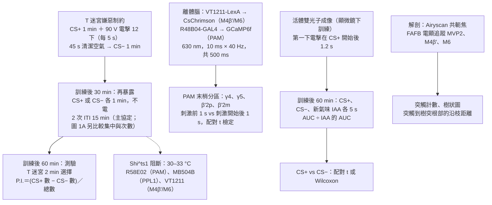
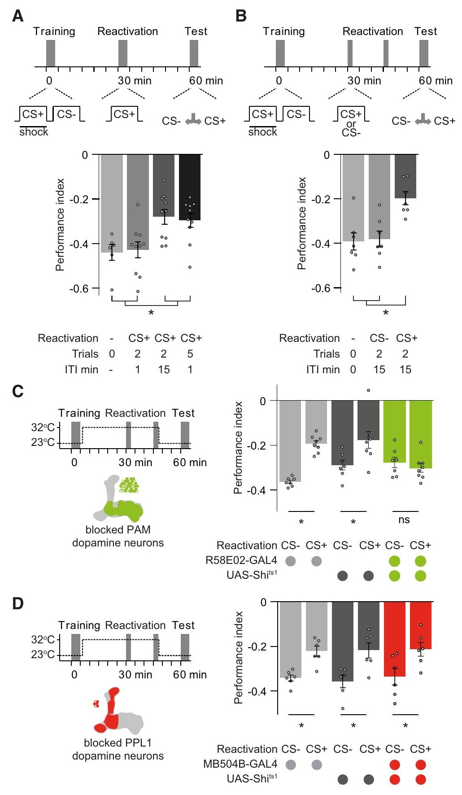
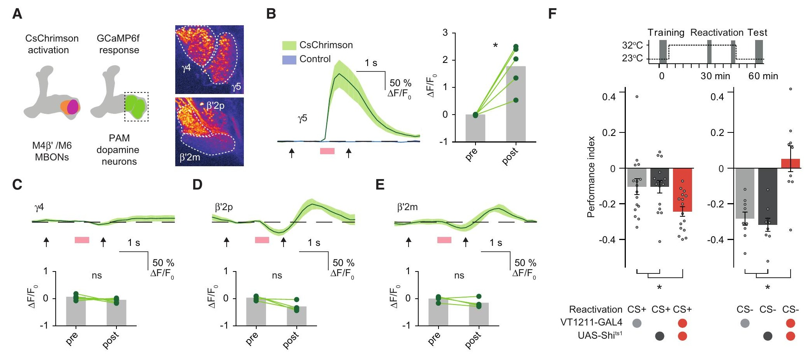
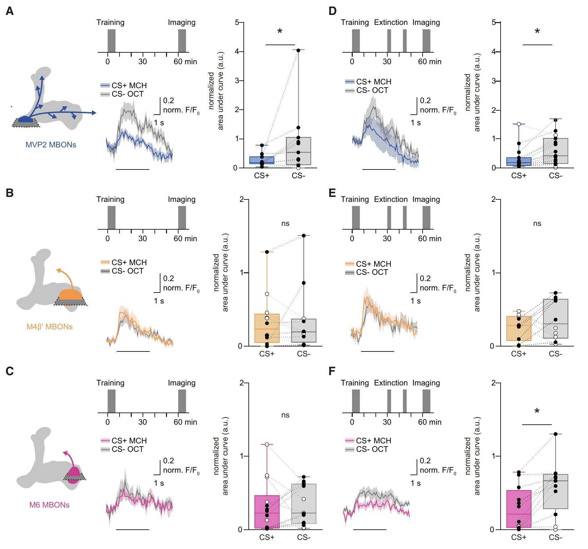
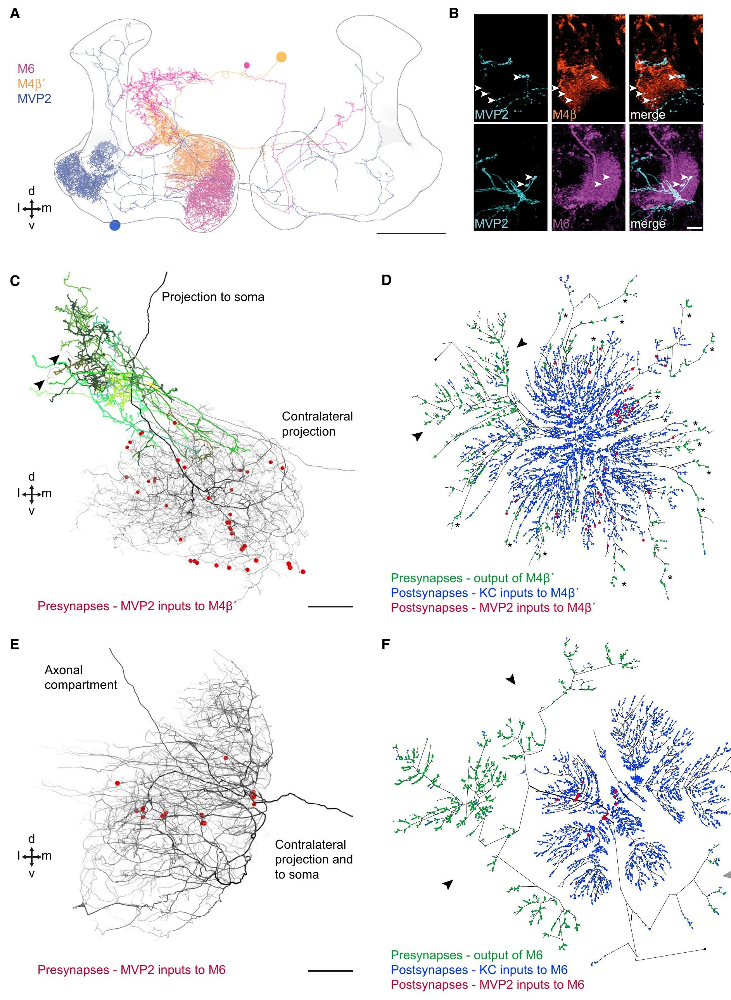
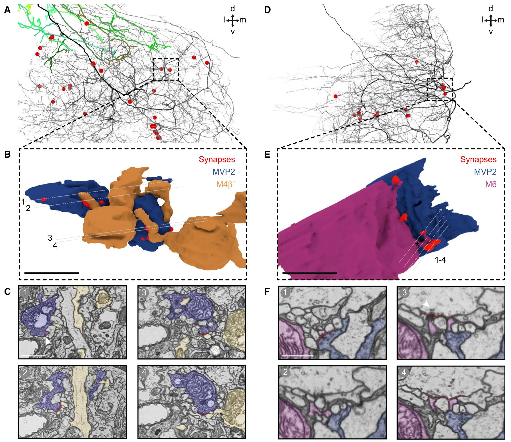
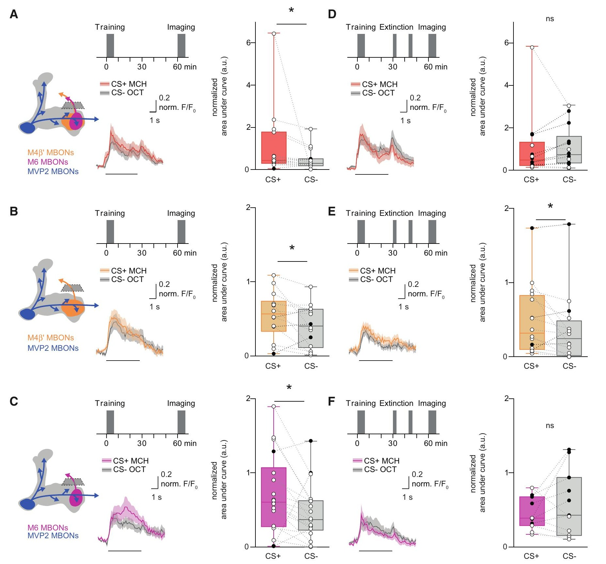
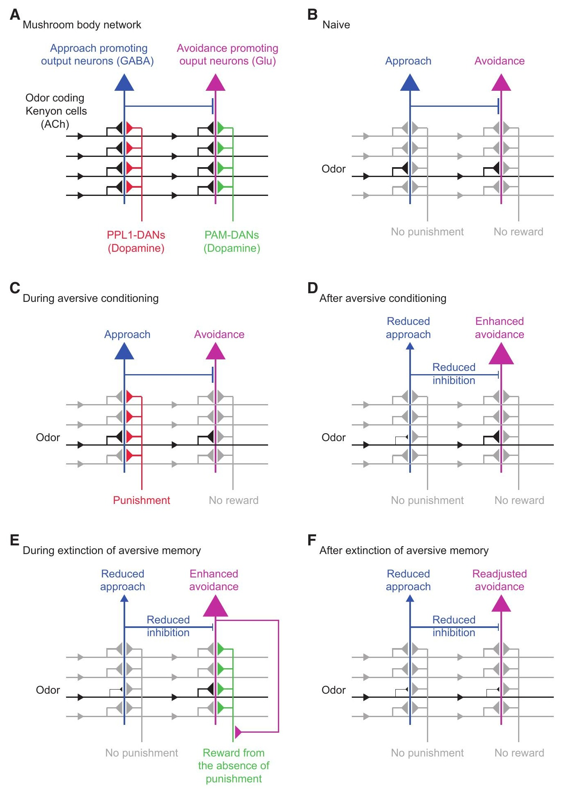

<!-- 本機 PDF：papers/2018-Integration%20of%20parallel%20opposing%20memories%20underlies%20memory%20extinction.pdf -->

# Integration of Parallel Opposing Memories Underlies Memory Extinction

**記憶消退的基礎：兩個並行、方向相反的記憶被整合在一起**

| 項目 | 內容 |
|---|---|
| **出處** | Cell 175(3), 709–722.e5 (2018). doi: 10.1016/j.cell.2018.08.021 [全文（PMC 免費閱讀）](https://pmc.ncbi.nlm.nih.gov/articles/PMC6198041/) |
| 日期 | 線上先行 2018-09-20（PDF 印「Published: September 20, 2018」）；刊期 2018-10-18。投稿 2018-01-24・修訂 2018-08-07・接受 2018-08-13。期號 (3) 未印在 PDF 上，取自 PubMed（PMID 30245010）。頁碼以 PDF 頁尾為準（709–722 加方法頁 e1–e5）；PubMed 記為 709–722.e15，可能把線上補充資料也算進去（※ 推論） |
| 通訊作者 | Scott Waddell，scott.waddell@cncb.ox.ac.uk（PDF 只有英文名；論文標為 Lead Contact） |
| 作者 | 共 16 人：Johannes Felsenberg、Pedro F. Jacob、Thomas Walker、Oliver Barnstedt、Amelia J. Edmondson-Stait、Markus W. Pleijzier、Nils Otto、Philipp Schlegel、Nadiya Sharifi、Emmanuel Perisse、Carlas S. Smith、J. Scott Lauritzen、Marta Costa、Gregory S.X.E. Jefferis、Davi D. Bock、Scott Waddell。無共同第一作者標示。依作者貢獻聲明，構想為 Felsenberg 與 Waddell |
| 機構 | Centre for Neural Circuits and Behaviour, University of Oxford（英國）；Drosophila Connectomics, Department of Zoology, University of Cambridge（英國）；Janelia Research Campus, HHMI（美國）；MRC Laboratory of Molecular Biology（英國） |
| 資料庫 | 無公開資料。自寫的 MATLAB 與 Python 程式「upon request」（索取才給）。電子顯微鏡重建用的是公開的全腦電顯資料 FAFB（Zheng et al. 2018），以 CATMAID（多人協作標註神經元的網頁軟體）標註；樹狀圖程式放在 GitHub（markuspleijzier/AdultEM） |
| 補充資料 | 圖 S1–S7（**含在本 PDF 內**，PDF 第 21–30 頁）；表 S1（**不在 PDF 內**，論文說各實驗的統計檢定、n 與 p 值都在這張表）；影片 S1–S5（不在 PDF 內） |
| 經費 | Wellcome Principal Research Fellowship（Waddell）、Gatsby、Bettencourt-Schueller 基金會、DFG（Felsenberg）、MRC（Jefferis）、HHMI（Bock）、Wellcome Collaborative Award |

> 與本庫有關的作者：無（本庫目前沒有「與本庫有關的作者」名單）。
>
> **本篇為 CC BY 開放取用**（PDF 第 2 頁頁尾：「This is an open access article under the CC BY license」，© 2018 The Author(s)，Elsevier 出版），圖片與 PDF 可自由使用與散布，仍逐圖標明出處與授權。全文請由資料表「出處」列的連結到 PMC 閱讀。

**讀這一頁需要的幾個詞**（每頁可單獨查閱，故重複列出）：

- **蕈狀體（mushroom body, MB）**：果蠅腦中把氣味和好壞經驗連起來的構造。見 [[e-mushroom-body]]。
- **KC、MBON、DAN**：Kenyon 細胞（Kenyon cell, KC）代表氣味，每種氣味只活化其中一小群；蕈狀體輸出神經元（MB output neuron, MBON）接收 KC 的訊號，推動果蠅「靠近」或「走開」；多巴胺神經元（dopaminergic neuron, DAN）送出代表懲罰或獎賞的多巴胺，調整 KC→MBON 突觸（神經元之間傳訊號的接點）的強弱。見 [[e-kenyon-cell]]、[[e-mbon]]、[[e-dopaminergic-neuron]]。
- **區室（compartment）**：KC 的軸突（送出訊號的長纖維）成束排成幾條「葉」（lobe），葉沿長度切成一格一格，每格由一型 DAN 支配、一型 MBON 讀取，名字取自位置，例如 γ5、β′2、γ1pedc。見 [[c-mb-compartment]]。
- **PAM、PPL1**：兩群多巴胺神經元的名字。本篇說 PAM 裡「有許多」能送獎賞訊號，PPL1 裡「有許多」能送懲罰訊號。
- **本篇的三顆 MBON**（論文用舊名，括號內是以區室命名的新名）：
  - **MVP2**（MBON-γ1pedc>α/β）：放出 GABA（一種抑制性傳遞物質），活化時讓果蠅偏向「靠近」。它的樹突（收訊號的分枝）在 γ1pedc 格，軸突（送訊號的分枝）再伸到別的格去抑制其他 MBON。本庫的 [[s-hige-2015-heterosynaptic-plasticity]] 記錄的 MBON-γ1pedc（該頁註為舊名 MB-MVP2）就是它。
  - **M4β′**（MBON-β′2mp）與 **M6**（MBON-γ5β′2a）：放出麩胺酸（glutamate），活化時讓果蠅「走開」。M4β′ 的樹突在 β′2 格，M6 的樹突在 γ5 格。
- **CS+／CS−**：CS 是條件刺激（conditioned stimulus），本篇都是氣味。CS+ 是訓練時配了電擊的氣味，CS− 是沒配電擊、當比較基準的另一個氣味。
- **記憶消退（memory extinction）**：學會「這個氣味預告電擊」之後，再讓動物聞這個氣味卻不電牠，原本學到的躲避就會減弱。本篇的中心問題是：減弱的原因是舊記憶被擦掉，還是另外寫了一個新記憶來抵消它？
- **表現指數（performance index, P.I.）**：行為測驗的分數。**本篇的算法是（選 CS+ 那邊的果蠅數 − 選 CS− 那邊的果蠅數）÷ 總數，所以躲 CS+ 時是負值**，越負越會躲；0 表示沒有偏好。這與本庫另兩篇的正負號相反，見 [[c-performance-index]]。
- **Shi^ts1**：一種溫度敏感的蛋白質。依本篇的說明，在 29 °C 以上它會擋住神經元回收細胞膜與釋放傳遞物質，回到 25 °C 以下又恢復。所以讓某群神經元帶著它，再把溫度調高，就能在選定的時段把這群神經元的輸出「關掉」。
- **MVP2 怎麼管住 M4β′／M6**：MVP2 的軸突接到 M4β′ 與 M6 上，抑制它們。所以 MVP2 越活躍，M4β′／M6 越被壓住；MVP2 變安靜，M4β′／M6 就「鬆了煞車」。這是後文所有推論的骨架。
- **CsChrimson、光遺傳**：CsChrimson 是照紅光就讓神經元放電的蛋白質（見 [[e-cschrimson]]）。依該頁，它要搭配視黃醛（retinal）才能運作，所以果蠅要先吃含視黃醛的食物。用光控制神經元放電的做法叫光遺傳（optogenetics）。
- **GCaMP、鈣成像、鈣痕跡**：GCaMP6f／GCaMP6m 是遇到鈣離子就變亮的螢光蛋白。依 [[e-gcamp]]，神經元被激發時細胞內的鈣會升高，所以螢光變亮代表「這顆細胞在活動」。用它看神經元活動，就叫鈣成像。本篇說的「記憶的鈣痕跡」，指學習之後，某顆 MBON 對 CS+ 與 CS− 的螢光反應出現了差別。讀數寫成 ΔF/F0 或 F/F0，見專業文的術語表。
- **離體、活體、雙光子**：離體（ex vivo）＝把腦取出來泡在養液裡做實驗；活體（in vivo）＝果蠅活著、頭部固定、打開一個小窗看腦。雙光子顯微鏡是能看進組織深處的一種螢光顯微鏡，本篇兩種實驗都用它。
- **驅動品系（GAL4、LexA、UAS）**：R58E02、MB504B、VT1211、MB112C、R39A05、R66C08 等是果蠅品系的代號，作用是「只讓某一群細胞帶上某個外加的蛋白質」。（本篇正文只寫 `PAM DANs with R58E02-GAL4`，**沒有交代這個品系涵蓋 PAM 的多少**；本頁別處說的「涵蓋一大部分／約 90 顆」出自本庫 [[e-r58e02]]（引 Aso 2016），不是本篇的話——2026-11-26 補。）品系名後面的 GAL4 或 LexA 是兩套互不干擾的開關（見 [[e-split-gal4]]）：帶 GAL4 開關的品系，與帶「UAS-某蛋白」的品系交配後，子代只在 GAL4 標到的細胞裡製造那個蛋白；LexA 配「lexAop-某蛋白」也是同樣的道理。所以一隻果蠅可以讓兩群細胞各帶不同的蛋白，例如一群帶 CsChrimson、另一群帶 GCaMP。哪個代號標哪群細胞，見專業文第二節的表。
- **行為實驗的兩種對照組**：每個阻斷實驗都有三組果蠅：只帶 GAL4 品系的（GAL4/+）、只帶 UAS-Shi^ts1 的（Shi/+），以及兩者都帶、真的會被阻斷的實驗組。兩個對照組也經歷同樣的升溫，用來排除「升溫本身」或「單一品系的背景」造成的效果。
- **順向配對**：氣味先出現、多巴胺後到。本庫其他頁的整理是：順向配對讓 KC→MBON 突觸變弱（見 [[c-cs-us-timing]]、[[t-timing-rules]]）。
- **價值（valence）**：指一顆神經元或一個記憶代表「好」還是「壞」。推動靠近的 MBON 帶正價值，推動走開的帶負價值。這裡的「價值」不是「重要性」的意思。
- **標記**：**※ 推論** ＝本頁依據論文內容推出來、論文沒有明說的；**※ 從圖判讀** ＝本頁從圖上的長條或盒子估讀的數值，論文沒有列出；**？待查** ＝要靠其他資料才能確認、本頁刻意不填的；**⚠️** ＝論文自己前後對不上的地方。
- **頁碼**：本頁說「PDF 第 N 頁」指本機 PDF 的頁序，第 1 頁是圖像摘要，第 2 頁才是期刊頁碼 709。

---

## 為什麼重要

本庫已收的來源裡，最接近的幾篇（舉三篇為例：[[s-tomchik-2009-camp-dynamics]]、[[s-hige-2015-heterosynaptic-plasticity]]、[[s-handler-2019-dopamine-receptor-timing]]；2026-11-26 更正：先前寫成「本庫已收的三篇論文」，但 `wiki/sources/` 有 28 篇，本頁自己就引用了 [[s-felsenberg-2017-re-evaluation]]、[[s-aso-2014-mbon-valence]]、[[s-cohn-2015-coordinated-neuromodulation]] 等同樣處理 MBON／DAN 網路層次的頁）問的都是「一次學習怎麼寫進去」：氣味和多巴胺湊在一起時，KC 裡的化學訊號怎麼變、KC→MBON 突觸怎麼變。它們看的都是單一突觸或單一區室內部的變化，不處理不同 MBON 之間怎麼互相影響。**這篇問的是學習寫進去之後的事：學過「這個氣味之後會被電」，後來再聞到這個氣味卻沒被電，腦怎麼修正？** 要回答這個問題，就得同時看好幾個區室、好幾顆 MBON，看它們彼此怎麼牽動。

為了底下好指稱，本頁對這篇的主角固定用這幾個標籤（與科普文、專業文一致）：**MVP2**（放 GABA，一種抑制性的傳遞物質，所以它的作用是壓住別的神經元；活化時推動果蠅往氣味那一邊走）、**M4β′** 與 **M6**（放麩胺酸，活化時推動果蠅離開氣味那一邊）；**PPL1**（一群多巴胺神經元，其中有許多送懲罰訊號）與 **PAM**（另一群，其中有許多送獎賞訊號）；**γ5 PAM**＝PAM 裡把軸突末梢伸進 γ5 這一格的那些。KC、MBON、蕈狀體、區室（葉上一格一格的分區，γ5、γ1pedc 等都是分區編號）等基本名詞見頁首的詞表。MVP2、M4β′、M6 都是左右腦各一顆；論文摘要說的「一對這類神經元」（a pair of these neurons），前一句講的是「指揮迴避的 MBON」，而被抵消的那個增強出現在 M6（圖 6F），所以指的是左右兩顆 M6。

它給的答案有三層。

- **第一，誰在教。** 消退需要 PAM，不需要 PPL1（圖 1C、1D）。作者據此主張，「該來的懲罰沒來」在果蠅腦裡被記成一件好事（原文：omission of punishment is remembered as a positive experience）。論文在介紹 PPL1 那一組時直接稱它是「獲得嫌惡記憶所必需」的那一群（原文：PPL1 DANs that are necessary to acquire aversive memory），不過**本篇沒有測這件事，那一句也沒有附引文**。
- **第二，教學訊號從哪裡來。** 嫌惡學習讓 KC 送到 MVP2 的 CS+ 訊號變弱；而 MVP2 本來會壓住 M4β′ 與 M6（這一點不是本篇測的，是引 Perisse et al. 2016：人工活化 MVP2 會壓低 M4β′ 與 M6 的氣味反應），所以 MVP2 一變弱，CS+ 就相對上更容易驅動推動「走開」的 M4β′ 與 M6（論文的用字是 preferentially，不是「只走這一條」）。在取出來的腦裡用紅光同時活化 M4β′ 與 M6，γ5 PAM 會被活化（圖 2B）。也就是說，照作者的模型，網路自己產生了教學訊號（teaching signal，告訴突觸「該改了」的訊號），不必外界真的給糖或水——但這一步在活的果蠅身上沒有被直接量到（見科普文第 4 套）。
- **第三，新舊記憶在哪裡相抵。** 舊的嫌惡記憶痕跡（MVP2 對 CS+ 的反應比對 CS− 小）在消退之後仍然量得到（圖 3A、3D）。MVP2 變安靜，等於鬆開了 M6 的煞車，所以學習讓 M6 **軸突**對 CS+ 的反應**相對 CS− 變大**（圖 6C；是組內的相對差，不是絕對變化——這是本頁核心限制那一節講的同一件事，2026-11-26 補上保留語；為什麼只在軸突、不在樹突，見科普文第 6 套）。新的「消退記憶」出現在另一處：M6 的**樹突**上，CS+ 的反應相對 CS− 變小（圖 3F）。一邊鬆煞車、一邊收油門，兩件事都作用在左右兩顆 M6 上，消退後 M6 軸突的 CS+／CS− 差別就量不到了（圖 6F）。

**也就是說，照作者的讀法，消退不是擦掉舊記憶，而是寫一個方向相反的新記憶來抵消它；而且只是部分抵消（圖 7F 的圖說自己寫 partially compensates；圖 7 是作者畫的模型示意圖，不是實驗結果，見科普文最後一段）。**

原本的嫌惡學習與後來的消退，在作者的模型裡用的是同一種動作：多巴胺讓某個 KC→MBON 突觸變弱。差別只在被改的是哪一格——每一顆 MBON 的樹突都落在某一格裡，被改的就是那一格裡「KC 接到這顆 MBON」的那些突觸。懲罰（PPL1）改的是推動靠近的 MVP2 所在的 γ1pedc 格，獎賞（γ5 PAM）改的是推動走開的 M6 所在的 γ5 格。

就本庫的研究線而言，這篇留下兩個值得後續追的方向。一是視野變大：本庫其他論文各看一個區室的突觸怎麼變弱（Hige 2015 看 γ1pedc，Handler 2019 看 γ4）；這篇則把「突觸變弱」放進更大的網路裡看，包括 MBON 之間的抑制，以及 MBON 回頭驅動多巴胺神經元（dopaminergic neuron, DAN）的迴路。二是它的教學訊號由氣味本身經 MBON 觸發，所以多巴胺必然在氣味開始之後才出現。※ 推論：若依 [[t-timing-rules]] 整理的規則（Handler 2019 說多巴胺在後讓突觸變弱），這個順序正好會讓 KC→M6 突觸變弱，與本篇看到的方向一致；但本篇沒有量過氣味與 γ5 PAM 活動之間的時間差，這只是並列兩篇得到的推論。

---

## 論文摘要（原文與中譯）

> 本篇的 SUMMARY 是不分段的單段摘要（不是 Background／Results／Conclusion 結構），以下照原文排列。摘要中的「恐懼反應」（fear responses）在果蠅實驗裡指對電擊氣味的躲避；「預測線索」指 CS+ 氣味；「成對的這些神經元」（a pair of these neurons）指左右腦各一顆的 M6。
>
> Accurately predicting an outcome requires that animals learn supporting and conflicting evidence from sequential experience. In mammals and invertebrates, learned fear responses can be suppressed by experiencing predictive cues without punishment, a process called memory extinction. Here, we show that extinction of aversive memories in *Drosophila* requires specific dopaminergic neurons, which indicate that omission of punishment is remembered as a positive experience. Functional imaging revealed co-existence of intracellular calcium traces in different places in the mushroom body output neuron network for both the original aversive memory and a new appetitive extinction memory. Light and ultrastructural anatomy are consistent with parallel competing memories being combined within mushroom body output neurons that direct avoidance. Indeed, extinction-evoked plasticity in a pair of these neurons neutralizes the potentiated odor response imposed in the network by aversive learning. Therefore, flies track the accuracy of learned expectations by accumulating and integrating memories of conflicting events.

**中譯**（本節為忠實翻譯，非自撰內容）：

> 要準確預測一個結果，動物必須從先後發生的經驗中，學到支持的證據與相互矛盾的證據。在哺乳類與無脊椎動物中，學來的恐懼反應可以藉由「經歷預測線索卻沒有懲罰」而被壓制，這個過程稱為記憶消退。我們在此顯示，果蠅嫌惡記憶的消退需要特定的多巴胺神經元，這表示懲罰的缺席被記成一次正向的經驗。功能性成像顯示，原本的嫌惡記憶與一個新的、帶獎賞性質的消退記憶，兩者在細胞內的鈣痕跡同時存在於蕈狀體輸出神經元網路的不同位置。光學與超微結構（電子顯微鏡）的解剖，符合「並行且彼此競爭的記憶在指揮迴避的蕈狀體輸出神經元內被合併」的說法。的確，消退在一對這類神經元中誘發的可塑性，抵消了嫌惡學習在網路中造成的、增強了的氣味反應。因此，果蠅藉由累積並整合相互衝突事件的記憶，來追蹤所學預期的準確度。

**Highlights（原文四點，中譯）：** 預期中的懲罰沒有出現，會讓學來的躲避行為消退；缺少懲罰被學成一次正向的經驗；原本的嫌惡記憶與新的獎賞記憶並存於不同位置；相反的記憶在特定輸出神經元內被整合，以指揮行為。

---

## 科普文

想像你在一家餐廳吃壞了肚子，從此每次經過那家店都繞路。後來朋友硬拉你進去吃了兩次，兩次都沒事。你不會因此忘了那次拉肚子，你只是在心裡多記了一筆「最近去都沒事」。下次經過時，兩筆記錄一起浮上來，你不再那麼想繞路，但也不會毫無顧忌。心理學把「預告壞事的線索一再出現、壞事卻沒來，原本學到的躲避就減弱」稱為**記憶消退**（memory extinction）。這篇論文問的是：果蠅腦裡，這「另記的一筆」寫在哪裡，又怎麼和舊的那筆相抵？

**兩個讀本節的約定。** 第一，本節說「論文」或「本篇」，指的是 Felsenberg 等人這一篇；說「本頁」「本節」，指的是這份知識庫頁面自己做的核對、計算或推論。第二，本節說**記憶痕跡**（memory trace）時，指的只是一個可觀察的現象——「學過之後，某顆神經元對 CS+ 與對 CS− 的反應出現了差別」——而不是說已經找到某個實體的改變。整篇論文能量到的就是這種差別。

### 讀這一篇最關鍵的那一個限制

這篇的核心證據是活體果蠅的兩張螢光成像圖（圖 3 與圖 6，本節的第 5 套），而**這兩張圖的統計全部是同一組果蠅之內、CS+ 的反應對 CS− 的反應**。在這兩張圖裡，論文沒有把「只訓練」那一組的數值，拿去和「訓練後再消退」那一組的數值直接比（方法只列了兩種組內檢定：配對 t 檢定與 Wilcoxon 配對符號秩檢定，兩種都是「同一隻動物的兩個數值配成一對」來比）。

這一條管的是第 5 套的圖 3 與圖 6。行為實驗（第 1 到第 3 套）不受它影響，因為行為本來就是拿不同群果蠅互相比；第 4 套（離體腦）比的是同一顆腦打光前與打光後，第 6 套（解剖）沒有做**推論統計檢定**（有量化：圖 S4E 把 MVP2 輸入到樹突根部的沿枝距離分布描述為 Gaussian／bimodal Gaussian，方法也給了突觸數上下界；2026-11-26 措辭修正），兩者也不在這一條的範圍裡。

為什麼這一條最關鍵：因為這篇所有關於記憶痕跡的說法，底下都只是「組內的差別出現了」或「組內的差別不見了」。

- 「舊痕跡還在」＝消退那一組裡，MVP2 這顆神經元對 CS+ 的反應**仍然**顯著小於對 CS− 的反應。
- 「新痕跡出現」＝消退那一組裡，M6 這顆神經元的樹突**新出現**了「CS+ 小於 CS−」的差別。
- 「增強被抵消」＝消退那一組裡，M6 的軸突**量不到**「CS+ 大於 CS−」的差別。

這三句話都沒有說「消退讓某一個數值降了多少」。第三句尤其容易讀過頭：「量不到差別」不等於「證明兩者相等」——要證明相等得用另一類專門的檢定（等效性檢定，equivalence test），論文沒有做。把這一條記住，後面每一段就不會讀過頭。

另外兩個限制貫穿全篇，先講比較省事。第一，各組果蠅有幾隻、p 值（統計上用來判定「顯著」的那個數字）多少，論文全部放在表 S1，而表 S1 不在本庫取得的 PDF 裡（本頁在全文只找到 5 處「Table S1」的引用，找不到表本身，也搜不到任何 p 值）。所以本節凡是具體數值，不是取自方法與正文，就是本頁拿尺在圖上量的，後者標 ※ 從圖判讀，並註明本頁目測的精度。第二，本篇的圖 7 是作者畫的**模型示意圖**，不是實驗結果，所以它不在下面那六套實驗裡；本節引用圖 7 時只是在引用作者的措辭。

### 本節的固定標籤

同樣的東西，本節一律用同一個名字。頁首的「讀這一頁需要的幾個詞」有更完整的說明，包括 KC、MBON、蕈狀體、區室、Shi^ts1、GCaMP、樹突與軸突、驅動品系等等；這裡只列本節反覆用到的。

| 標籤 | 是什麼 | 補充 |
|---|---|---|
| CS+ | 訓練時配了電擊的那個氣味 | 本篇用的兩個氣味是 MCH（4-甲基環己醇）與 OCT（3-辛醇） |
| CS− | 訓練時沒配電擊、當比較基準的另一個氣味 | 同上 |
| 嫌惡制約（conditioning） | 把氣味和電擊配在一起訓練這件事。本節的「嫌惡學習」指同一件事 | — |
| DAN | 多巴胺神經元（dopaminergic neuron）。送出多巴胺、把「好」或「壞」告訴蕈狀體的那些細胞 | PPL1 與 PAM 都是 DAN 的群 |
| MVP2 | 一顆蕈狀體輸出神經元（MBON），放 GABA（抑制性的傳遞物質，所以 MVP2 的作用是壓住別的神經元），活化時推動果蠅往氣味那一邊走。左右腦各一顆 | — |
| M4β′、M6 | 兩顆 MBON，放麩胺酸，活化時推動果蠅離開氣味那一邊。各自左右腦一顆 | — |
| MVP2 壓住 M4β′ 與 M6 | 本篇所有推論的骨架。不是本篇測的，而是引前人（Perisse et al. 2016）：人工活化 MVP2 會壓低 M4β′ 與 M6 的氣味反應 | — |
| PPL1 | 一群 DAN，其中有許多送懲罰訊號 | 論文原句：many of which can provide punishment teaching signals |
| PAM | 另一群 DAN，其中有許多送獎賞訊號 | 論文原句：many of which can provide reward teaching signals |
| γ5、γ4、γ1pedc、β′2p、β′2m | 蕈狀體葉上一格一格的分區編號（頁首詞表的「區室」）。β′2p 與 β′2m 是 β′2 這一格再細分的兩小塊 | 本節講圖上的小畫面時一律說「小圖」，不說「格」，以免和分區混淆 |
| 「某一群 DAN 支配某一格」 | 指那群 DAN 把軸突末梢伸進那一格 | — |
| γ5 PAM | PAM 裡把末梢伸進 γ5 這一格的那些 | 論文引 Aso et al. 2014a：γ5 有 8 到 21 顆（論文只引這個範圍，沒有說明為什麼這麼寬，也沒有說是單側還是兩側合計） |
| 表現指數（P.I.） | 行為分數 | （選 CS+ 那邊的果蠅數 − 選 CS− 那邊的）÷ 總數。**躲 CS+ 時是負值**，越負越躲；0 表示沒有偏好 |
| ΔF/F0 | 第 4 套（離體腦）的螢光讀數 | （當下螢光 − 刺激前螢光）÷ 刺激前螢光。0＝沒變，1.75＝亮了 175%。螢光變亮代表那顆神經元正在活動（細胞內鈣離子升高，GCaMP 就變亮） |
| 標準化 AUC | 第 5 套（活體果蠅）的螢光讀數 | 見下一段。論文在圖上把它標成「normalized area under curve (a.u.)」，a.u. 是「任意單位」 |

**⚠️ 標準化 AUC 的算法，論文的文字和圖上的數值對不起來。** 方法寫的是：先算 F/F0（當下螢光 ÷ 氣味前 2 秒的平均螢光），把氣味給的那 5 秒的 F/F0 曲線下面積加起來得到 AUC，再除以同一隻果蠅同一輪量測（CS+、CS−、IAA 連著給的那一輪）對新氣味 IAA（乙酸異戊酯）算出來的 AUC。問題是：沒有反應時 F/F0 就等於 1，5 秒的面積至少是 5，要讓這兩個數相除低到 0.2，新氣味 IAA 的 AUC 得是 CS 的五倍，也就是 IAA 的 ΔF/F₀ 要到約 400%；而圖上每一格曲線的尺標寫的是「0.2 norm. F/F₀」，反應幅度只有零點幾，不可能。圖上的中位數大多落在 0.2 到 0.65 之間。（2026-11-26 措辭修正：先前寫「不可能低到 0.2」，嚴格說是可能的，站得住的依據在圖上的尺標。）**※ 推論：實際算的很可能是扣掉基線之後的量（也就是 ΔF/F0 的面積），只是方法沒有寫明**；依據是上面這個算術上的矛盾。附帶一提，第 4 套報的是 ΔF/F0、第 5 套報的是 F/F0，論文沒有說明為什麼兩套的寫法不同。

**所以這個讀數該怎麼用：** 只能當「同一隻果蠅身上，CS+ 與 CS− 哪一個比較高」來用，不要把 1.0 讀成「和 IAA 一樣強」，也不要拿不同組的絕對值互比。整篇的結論靠的就是同一隻果蠅內部的高低，和絕對大小無關；至於訊號普遍偏小會不會讓那個高低差更容易被雜訊左右，沒有辦法判斷，因為 n 與 p 值都在表 S1。

### 六套實驗，各自量什麼

這篇把六套實驗接在一起。下面的「第 N 套」編號是**本頁為了敘述方便加的，論文沒有這樣編**；括號裡的圖號才是論文自己的說法。表裡的「製備」指的是「實驗對象與準備方式」——是一整群活果蠅、是取出來的腦，還是頭上開了窗的活果蠅。

| 本頁編號 | 製備 | 讀數 | 論文的圖 |
|---|---|---|---|
| 第 1 套 | 整群果蠅的 T 迷宮行為 | P.I. | 圖 1A、1B、圖 S1A–S1C |
| 第 2 套 | 同樣的行為實驗，加上用溫度開關關掉 DAN | P.I. | 圖 1C、1D、圖 S1D、S1E |
| 第 3 套 | 同樣的行為實驗，加上用溫度開關關掉 M4β′ 與 M6 | P.I. | 圖 2F、圖 S2B、S2C |
| 第 4 套 | **離體**腦（取出來泡在養液裡）：紅光活化 M4β′ 與 M6，量 PAM 的螢光 | ΔF/F0 | 圖 2A–2E、圖 S2A |
| 第 5 套 | **活體**果蠅（活著、頭上開一個小窗）：在顯微鏡下訓練，量 MBON 的螢光 | 標準化 AUC | 圖 3、圖 6、圖 S3、S5、S6、S7 |
| 第 6 套 | 解剖：光學顯微鏡 ＋ 一顆腦的電子顯微鏡影像 | 突觸（兩顆神經元之間傳訊號的接點）的數量與位置 | 圖 4、圖 5、圖 S4 |

**哪些能比、哪些不能比，要分清楚。** 第 1 到第 3 套是同一種製備（整群果蠅跑 T 迷宮）、同一種讀數（P.I.），第 2、3 套只是在上面加了一個溫度開關。**不能比的是四種讀數之間**：P.I. 是一整群果蠅的選邊比例，一個數字背後是幾十隻果蠅；ΔF/F0 是取出來的腦裡「人工點亮一顆神經元之後另一顆亮多少」，那些果蠅已經不在了、也沒有受過訓練；標準化 AUC 是活著的個別果蠅的螢光，而且每隻還各自除以自己對新氣味的反應，所以連同一套裡的不同組都只能比方向、不能比大小；突觸數則只來自一顆腦，沒有重複、也沒有任何功能量測。**所以 P.I. 和 ΔF/F0、標準化 AUC、突觸數之間，只能說「方向一致」，不能說「幅度相符」。**

**就算讀數相同，也不要跨圖取基準。** 下面會看到，同樣一個「不再暴露」的條件，圖 1A 約 −0.44、圖 1B 約 −0.39；同樣是消退後的基因型對照，圖 1C 約 −0.19、圖 2F 只有約 −0.10。論文沒有討論這些差異，很可能只是批次之間的變異。所以每一張圖都要和自己圖上的對照組比，不要拿別張圖的數字當基準。

本節還會分兩種「對照組」，名字固定：

- **處理對照**：同一種果蠅，只是處理不同（例如「不再暴露」、「重新聞 CS− 而不是 CS+」、「假訓練」）。
- **基因型對照**：處理完全一樣，只是果蠅身上少帶一個基因，所以沒有東西真的被關掉（第 2、3 套的那兩種果蠅）。

論文也沒有逐格標明每一張圖用的是幾日齡的果蠅，只在方法給三個範圍：行為 4–9 日齡（雌雄混合）、離體 6–7 日齡（雌）、活體 3–8 日齡（雌雄）；方法另有一句概括 `2-9 day old adult flies were used`，合起來是四處日齡敘述（2026-11-26 補）。餵食狀態則全篇一致：沒有任何禁食或控制飢餓的步驟，果蠅一直吃標準食物，行為實驗前還在有食物的管子裡待 14–22 小時（本頁在全文搜尋 starve、hungry、thirsty，這三個詞都沒有出現在本篇的實驗描述裡）。這一點本身不影響本篇的結論——本篇用電擊訓練，不需要讓果蠅餓肚子——寫出來是因為用糖當獎賞的論文通常會先禁食，和本篇並排比較時要知道這個差別。

### 第 1 套：果蠅學了什麼，怎麼才會消退（圖 1A、1B；圖 S1A–S1C）

作者把一群果蠅放進管子，讓牠們聞一個氣味一分鐘，同時給 12 下 90 伏特的電擊（每 5 秒一下）；通 45 秒乾淨空氣之後，再讓牠們聞另一個氣味一分鐘，不電。被電的氣味是 CS+，沒被電的是 CS−。訓練後 60 分鐘，讓果蠅在 T 字形迷宮裡花兩分鐘選邊，一邊通 CS+、一邊通 CS−，多數會躲開 CS+。兩個氣味都用礦物油稀釋到一萬分之一（10⁻⁴）或一百萬分之一（10⁻⁶）。

行為實驗還有一個做法要先交代：MCH 與 OCT 會輪流當 CS+，一組果蠅以 MCH 為 CS+、另一組以 OCT 為 CS+，兩組的分數平均起來才算一個樣本（論文的 n）。所以行為圖上的每一點，裡面都已經含了兩種氣味安排。（成像實驗不是這樣做的，見第 5 套。）

**消退的操作**：訓練後 30 分鐘，讓果蠅「重新聞」CS+ 一分鐘、不電，共兩次，兩次之間隔 15 分鐘（論文定義的「間隔」是前一次結束到下一次開始）。測驗時間點不變，仍是訓練後 60 分鐘。

處理對照有兩個，各排掉一種別的解釋：

- **不再暴露**（訓練完就擺著）——排掉「時間過去，記憶自己變淡」。
- **重新聞 CS−**（次數、時長、搬動都一樣，只換成另一個氣味）——排掉「多聞一次氣味、或多被搬動一次就會改變選擇」。

結果（※ 從圖判讀，本頁目測精度約 ±0.02）：圖 1B 裡，不再暴露約 −0.39、重新聞 CS− 兩次約 −0.38、重新聞 CS+ 兩次約 −0.20。圖 1A 另外比了次數與間隔：不再暴露約 −0.44、兩次而間隔只有 1 分鐘約 −0.43（沒有效果）、兩次間隔 15 分鐘約 −0.28、五次間隔 1 分鐘約 −0.29。**所以消退要「重新聞的是 CS+」才會發生；而且只重新聞兩次的話，兩次必須隔開，擠在一起就要五次才有效。**

**消退的幅度。** 公式是「（基準 − 消退組）÷ 基準」，而且基準與消退組**一定取自同一張圖**（本頁計算）：

- 圖 1A：(0.44 − 0.28) ÷ 0.44 ≈ 36%。
- 圖 1B：(0.39 − 0.20) ÷ 0.39 ≈ 49%。
- 圖 1C 的兩種基因型對照：(0.36 − 0.19) ÷ 0.36 ≈ 47%、(0.29 − 0.18) ÷ 0.29 ≈ 38%。
- 圖 1D 的三種果蠅：(0.34 − 0.22) ÷ 0.34 ≈ 35%、(0.36 − 0.22) ÷ 0.36 ≈ 39%、(0.34 − 0.21) ÷ 0.34 ≈ 38%。

**所以躲避被消掉大約三分之一到一半（限圖 1 的各組）。** 圖 2F 的對照組不在這個範圍內：以同圖右半的 CS− 組（約 −0.30）為基準，「再暴露 CS+」那組（約 −0.10）消掉約**三分之二**，明顯超出上面這個範圍，而論文沒有討論（見專業文 3.2 解讀第 4 點；2026-11-26 補）。 這幾個百分比可以並列成一個範圍，是因為每一個都在自己那張圖裡算完了；不能做的是拿 A 圖的基準去配 B 圖的消退組。論文正文只寫「顯著降低」（significantly reduced），引言也只說果蠅的嫌惡記憶「可以被部分消退」（can be partially extinguished）。**是「減弱」，不是「消除」。**

這一套還有兩個配套實驗。圖 S1A 先確認所選的氣味濃度安全：讓沒訓練過的果蠅連續聞同一個氣味幾次，高濃度（千分之一，10⁻³）會讓牠們事後偏向躲那個氣味，低濃度（10⁻⁴ 到 10⁻⁶）不會，所以全篇行為實驗都用低濃度。圖 S1C 做的是「再訓練」：消退之後 30 分鐘，再給一次 1 分鐘 CS+ 配 12 下 90 伏特電擊。三組果蠅分別是「訓練＋消退＋再訓練」、「訓練＋再訓練」（中間沒有消退）、「只有再訓練」（之前沒訓練過，等於只學一次）。再訓練後立刻測，三組落在約 −0.58、−0.60、−0.55；90 分鐘後再測，學過兩次的前兩組仍約 −0.52 與 −0.51，只學一次的那組約 −0.29（全部 ※ 從圖判讀）。圖上的星號只出現在 90 分鐘那一組，而且括號把「學過兩次」的兩組合起來，對比「只學一次」那一組；立刻測的那一組沒有星號，論文正文只說「訓練＋消退＋再訓練」那一組立刻測的表現，與「沒被消退過」那組相當——原文 `Flies retrained 30 min after extinction show memory performance immediately after retraining that is **comparable to flies whose memory has not been extinguished**`，**沒有把「只有再訓練」那組包進來**（2026-11-26 更正：本頁先前寫成三組相當）。。**學過兩次的果蠅記得比較牢，而中間有沒有經過消退不影響這件事。** 論文由此說，果蠅「會跨訓練、消退、再訓練累積資訊」——也就是先後幾次經驗各自留下的東西會疊起來，不是後面的把前面的洗掉。論文對這一句用的動詞是 suggest（提示），不是斷言；而且這個實驗排不掉另一種可能：消退抹掉了一部分，再訓練又補了回來。論文沒有討論這個可能。

### 第 2 套：誰在教「這次沒被電」（圖 1C、1D；圖 S1D、S1E）

**作者為什麼去測獎賞那一邊？** 不是憑直覺，而是因為同一團隊的前一篇（Felsenberg et al. 2017，本庫 [[s-felsenberg-2017-re-evaluation]]）發現：**獎賞**記憶的消退需要 PPL1——也就是「該來的糖沒來」被當成壞事記下來。這暗示消退靠的是一個方向相反的新記憶。鏡像推過來，**嫌惡**記憶的消退就該需要 PAM。本篇就是去測這一句。

做法是溫度開關 Shi^ts1（見頁首詞表）：讓某一群神經元帶著這個溫度敏感的蛋白質，再把溫度升高，這群神經元就暫時送不出訊號，降回來又恢復。全程的基礎溫度是 23 °C，要阻斷時升到 30–33 °C。（論文在三個地方寫了三種數字：方法寫 30–33 °C，正文寫「高於 29 °C」，實驗流程圖上標 32 °C。三者不衝突：30–33 都高於 29，圖上的 32 也落在 30–33 裡，講的是同一件事。）

要讓神經元帶上這個蛋白質，需要兩個基因同時在場（頁首詞表的「驅動品系」講得更細）：一個品系負責指定「哪一群細胞」（名字像 R58E02-GAL4、MB504B-GAL4 這樣的代號，每個代號標到的是一群特定的細胞），另一個品系負責提供「要製造什麼蛋白質」（UAS-Shi^ts1）。只有兩個都帶的果蠅，才會真的在那群細胞裡做出溫度開關。所以每個阻斷實驗都有三種果蠅：只帶 GAL4 那一個的、只帶 UAS-Shi^ts1 那一個的（這兩種是基因型對照，同樣經歷升溫，但沒有東西被關掉），以及兩個都帶、真的被阻斷的那一種。

判斷有沒有消退的方法要看清楚：**是在同一種基因型的果蠅裡，比「訓練後重新聞 CS+」那群與「訓練後重新聞 CS−」那群的分數。** 前者躲得明顯比較少，就算有消退。圖 1C、1D 的星號（代表統計上顯著）標的就是這個比較。

關掉 PAM（R58E02-GAL4 標到的細胞）的結果（※ 從圖判讀，CS− 組／CS+ 組）：

- 只帶 R58E02-GAL4：−0.36 ／ −0.19，有消退。
- 只帶 UAS-Shi^ts1：−0.29 ／ −0.18，有消退。
- 兩個都帶、真的被阻斷：−0.28 ／ −0.30，論文標 ns（沒有顯著差別）。**消退不見了。**

關掉 PPL1（MB504B-GAL4 標到的細胞）的結果：三種果蠅都照樣消退（三組的 CS−／CS+ 分別約 −0.34／−0.22、−0.36／−0.22、−0.34／−0.21）。**消退不需要 PPL1。**

（被阻斷那組的 CS+ −0.30 比 CS− −0.28 其實還更負一點點，但這個 0.02 的差已經在本頁的目測精度之內，而且論文標的是 ns。沒有 p 值可查，因為表 S1 不在 PDF 裡。）

**所以教「這次沒被電」的是獎賞那一邊。** 至於作者更進一步說「『該來的懲罰沒來』在果蠅腦裡被當成一件好事來記」，那不是單靠這一套推出來的；作者在討論裡列了三個依據：消退需要 PAM（這一套）、消退造成的 M6 變化方向和吃糖學習相同（第 5 套，引 Owald et al. 2015）、以及文獻說降低 M6 的氣味驅動就足以把躲避轉成趨近（引 Owald et al. 2015；Barnstedt et al. 2016）。作者自己的措辭是這種可塑性「可以被看成是帶獎賞性質的」（can be considered to be appetitive），不是斷言。**而且 PAM 這一群裡只是「有許多」送獎賞訊號，R58E02 又標到其中一大部分，所以「被關掉的是 PAM 裡送獎賞的那些」並沒有被證明——論文沒有排除這個疑問。**

至於「PPL1 才是當初寫入嫌惡記憶所必需的那一群」，這是論文在介紹 MB504B 時直接寫下的說法（原文：PPL1 DANs that are necessary to acquire aversive memory）；**本篇沒有測這件事，那一句也沒有附引文**（本頁逐句核對過 PDF 第 4 頁該段）。

這一套還有兩個配套的對照小圖。圖 S1E 讓果蠅照常消退，只在最後測驗那段時間關掉 PAM，分數不受影響：**所以 PAM 的作用不在測驗那一刻**，也就是排掉了「PAM 是在測驗時負責把消退後的行為表現出來」這個解釋。圖 S1D 則是「全程都待在 23 °C、溫度開關根本沒啟動」的對照，三種果蠅都正常消退，排掉「帶這些基因本身就有缺陷」——**⚠️ 但這張小圖的圖說寫成「Figure 1D 的允許溫度對照」，而圖上畫的、正文指的都是圖 1C（PAM）那一套；至於圖 1D（PPL1）自己的允許溫度對照，在本庫取得的 PDF 裡找不到。**

**⚠️ 另外，「只在重新聞氣味的那段時間需要 PAM」是比資料強的說法。** 正文寫阻斷「限於 CS+ 或 CS− 再暴露的那段時間」，可是圖 1C、1D 的實驗流程圖上，高溫那條虛線從訓練結束後不久一路延伸到第二次再暴露之後（本頁從圖上量約 40 分鐘；那張圖的時間軸只有 0、30、60 分鐘三個刻度，所以這個目測可能差上幾分鐘）。第 3 套的對照（圖 S2B）則由圖說自己寫明升溫持續「嫌惡制約後 45 分鐘」。兩者指向同一件事：**升溫涵蓋了再暴露之前的那段時間。** 第 3 套有「只升溫、不重新聞氣味」的對照（圖 S2B，記憶不受影響），**但 PAM 這一套在 PDF 裡沒有同樣的對照**（圖 S1 的五張小圖都不是這種設計）。因此不能排除 PAM 在再暴露之前那段時間也有作用。

### 第 3 套：關掉「走開」的那兩顆，消退會怎樣（圖 2F；圖 S2B、S2C）

同樣用溫度開關，這次關掉 M4β′ 與 M6。用的品系是 VT1211，它同時標到這兩顆，所以一關就是兩顆一起關，分不開。

**先注意這張圖的比法和第 2 套不一樣。** 圖 1C、1D 是把同一種基因型果蠅的「重新聞 CS−」與「重新聞 CS+」並排，星號比的是這兩者。圖 2F 則拆成左右兩張小圖，左邊三種果蠅全都重新聞 CS+、右邊三種全都重新聞 CS−；星號比的是**同一張小圖裡「兩種基因型對照」對「被阻斷的那種」**（本頁核對過圖上星號底下那個括號涵蓋哪幾根長條）。兩張圖的判準不同，不要混著讀；論文沒有說明為什麼換一種比法。

結果（數值皆 ※ 從圖判讀）：

- **重新聞 CS+ 那張小圖**：兩種基因型對照都約 −0.10，被阻斷的那種約 −0.24，兩者有顯著差異。被阻斷的果蠅躲得比較多，作者據此說消退被削弱。
- **重新聞 CS− 那張小圖**：兩種基因型對照約 −0.29 與 −0.32，被阻斷的那種約 +0.05——躲避完全消失，也是顯著差異。論文用「出乎意料」（unexpectedly）一詞帶過，討論沒有再處理。

這兩張小圖合起來，已經把「只阻斷、不聞 CS−」和「只聞 CS−、不阻斷」兩種情況都蓋到了：圖 S2B 顯示光是升溫阻斷 45 分鐘、不重新聞氣味，記憶不受影響（約 −0.25、−0.24、−0.19）；右邊小圖的兩種基因型對照同樣聞了 CS−、卻沒有被阻斷，躲避也正常（−0.29、−0.32）。**所以讓躲避消失的，是「阻斷 M4β′ 與 M6」加上「聞 CS−」這個組合。** 圖 S2C 另外顯示，全程留在 23 °C 時三種果蠅都正常。

**本頁把左右兩張小圖放在一起看**（論文沒有做這個比較）：被阻斷的果蠅「重新聞 CS+」是 −0.24，「重新聞 CS−」是 +0.05，也就是重新聞 CS+ 的那一組躲得**更多**，和「重新聞 CS+ 才會消退」的方向正好顛倒。**這一套和第 2 套的差別就在這裡**：第 2 套裡，三種果蠅的 CS− 組分數相近（−0.36、−0.29、−0.28），當基準的那一組沒有壞掉，所以「CS+ 與 CS− 沒有差別」可以乾淨地讀成「消退不見了」；第 3 套裡，被阻斷果蠅的 CS− 組變成 +0.05，基準自己先壞了。**※ 推論：關掉這兩顆顯然還有別的、與消退無關的效果；因此「消退被削弱」這個解讀不能照單全收，而且扣掉那個額外效果之後，削弱的程度是比圖上看到的更大還是更小，也無法判斷。** 依據就是上面這兩張小圖的方向互相矛盾；論文沒有提出任何解釋（專業文 3.2 解讀第 3 點細說）。

### 第 4 套：獎賞訊號從哪裡來（圖 2A–2E；圖 S2A）

沒有糖、沒有水，獎賞訊號要從哪裡冒出來？作者的推理是：既然消退是「再聞到氣味」引發的，那麼負責的那些 DAN 一定是被嗅覺的路徑帶動的。而依本篇引用的解剖資料（Aso et al. 2014a；Owald et al. 2015），M4β′ 與 M6 送訊號的末梢，就貼在 PAM 的樹突旁邊——具體說，是那些把末梢伸進 M4β′ 與 M6 自己所在那兩格（β′2 與 γ5）的 PAM。

於是作者把腦取出來（這是**離體**實驗：果蠅已經不在了，這些果蠅也沒有受過任何訓練），讓 M4β′ 與 M6 帶上 CsChrimson（照紅光就會讓神經元放電、也就是送出訊號的蛋白質；這種用光控制神經元的做法叫**光遺傳**，optogenetics），讓 PAM 帶上 GCaMP（遇鈣就變亮的螢光蛋白），先錄 10 秒的基線，再用 630 奈米的紅光打 500 毫秒（每下亮 10 毫秒、每秒 40 下，所以 500 毫秒裡共 20 下），然後比較「打光前 1 秒」與「打光開始後 1 秒」的螢光。PAM 的末梢按它們支配的格子分成四處各自量：γ4、γ5、β′2p、β′2m。處理對照是「只帶 GCaMP、不帶 CsChrimson」的腦（圖 S2A），照同樣的光完全沒反應，排掉「光本身造成訊號」。

結果：**γ5 那一處的螢光明顯變亮**，平均 ΔF/F0 約 1.75，也就是螢光增加約 175%（圖上只有 5 條線，也就是 5 顆腦；※ 從圖判讀）。γ4 那一處沒有反應。β′2p 與 β′2m 兩處的平均曲線先輕微下凹、過一兩秒再回升，論文稱為「輕微的抑制與反彈」——但 γ4、β′2p、β′2m 這三處的量化檢定全部不顯著。作者也指出，γ5 會被 M4β′／M6 帶動這件事，和另一篇獨立的報告（Zhao et al. 2018）一致。

**為什麼剛好是 γ5 重要：** 依本篇的圖 4B 與圖 S4A，M6 收訊號的樹突就在 γ5 這一格。所以被叫醒的那些 DAN，支配的正是 M6 自己收訊號的那一格——形成一個繞回自己的迴路。至於「同一格裡的多巴胺可以改變那一格裡 KC 接到 MBON 的突觸」，這是本篇沿用的前提，來自前人研究，本篇沒有測多巴胺用什麼方式改變突觸（本庫的 [[c-kc-mbon-plasticity]]、[[t-dopamine-to-plasticity]] 整理了這一塊）。另外要記住：這一套是把 M4β′ 和 M6 **同時**點亮的，所以「γ5 亮了」不能歸給其中哪一顆（論文的限制清單自己也承認這兩顆在操弄上分不開）。

**這一套能證明到哪裡為止：** 它證明的是「在取出的腦裡，人工同時活化 M4β′ 與 M6，γ5 那一處的 PAM 末梢會亮」。它沒有證明「活著的果蠅在消退時真的走這條路」——活體內 γ5 PAM 的氣味反應始終沒有量到（見後面的限制）。**「消退時網路自己產生獎賞教學訊號」這個說法，是把這一套（離體有連結）和第 3 套（行為上關掉 M4β′／M6 會影響消退）拼起來的推論，而第 3 套自己又有上一節那個無解的結果。所以這是本篇證據鏈最弱的一環。**

### 第 5 套：舊記憶被擦掉了嗎（圖 3、圖 6；圖 S3、S5–S7）

這一套是**活體**實驗：果蠅活著、頭部固定、頭殼開一個小窗，訓練與重新聞氣味都在顯微鏡下進行。訓練的內容和行為實驗一樣（CS+ 一分鐘配 12 下 90 伏特電擊、45 秒空氣、CS− 一分鐘），方法另外寫出了行為那一套沒寫的一個細節：第一下電擊落在 CS+ 開始後 1.2 秒，也就是氣味先來、電擊後到。

**顯微鏡下的消退，回合數與時程和行為那一套一致**：訓練後 30 分鐘開始，兩次 1 分鐘的 CS+、兩次之間隔 15 分鐘，都不電——**唯一的差別是成像這一套在消退之前多吹 30 秒空氣，行為的方法節沒有這一步**（2026-11-26 更正：先前把 30 秒空氣寫進「時程一致」那一句裡）（也就是第 1 套裡證明有效的那個協定）。訓練後一小時量螢光：依序給 CS+、CS−、以及一個沒訓練過的新氣味 IAA，各 5 秒，中間隔 30 秒空氣。

和行為實驗不同，成像實驗不在同一組裡輪流交換氣味：圖 3 整組都以 MCH 為 CS+、OCT 為 CS−。所以作者另外做了一整組把兩個氣味角色對調的實驗（OCT 當 CS+、MCH 當 CS−，圖 S3A–S3D），確認結論不是某一個氣味造成的。

果蠅分成「只訓練、不重新聞」與「訓練後重新聞 CS+（消退）」兩組；另有處理對照做「假訓練」（氣味一樣、不給電擊），同樣分成不重新聞與重新聞兩半，用來排掉「光是聞氣味」造成的差別。假訓練組裡 CS+ 與 CS− 之間全部沒有顯著差別，不過它涵蓋的範圍要看清楚：有 MVP2 的樹突（圖 S3K–S3N）、M6 的樹突（圖 S3O–S3R，**用的是 VT1211 品系，不是圖 3 量 M6 時用的 R66C08**）、以及**只有 VT1211 混合軸突**那一種製備的軸突（圖 S5G–S5J，兩種氣味安排各兩格）。

> **2026-11-26 更正（驗收輪）。** 本頁先前寫「M4β′ 與 M6 的軸突（圖 S5E–S5H）」都有假訓練對照，這是錯的，而且錯在比先前以為更關鍵的地方。依圖 S7 的面板標題逐格核對：**只有 I、J 兩格是 Mock，兩格都標 `M4β' and M6 MBONs axons (VT1211-GAL4)`**；單獨量 M4β′ 軸突的 R39A05 四格（C、D、K、L）與單獨量 M6 軸突的 R66C08 四格（E、F、M、N）全部只有 Training／Training and extinction，**沒有一格 Mock**。所以**沒有假訓練對照的是三種製備**：M4β′ 的樹突、M4β′ 的軸突（R39A05）、**M6 的軸突（R66C08）**。最後那一項最要緊——圖 6C／6F 用的就是 R66C08，而那正是本篇「兩種記憶在 M6 整合」這個核心結論的證據來源。
>
> **⚠️（新增，單篇自身不一致）：圖 S5 的圖說、面板標籤、正文引用三方對不上。** 圖說只寫到 (E–H) 並把 E–H 稱作 mock（`(E–H) Mock conditioning with OCT does not change odor responses measured in axonal segments of M4b0 and M6 neurons`）；但面板上 **Mock 標在 G、H、I、J**，E、F 沒有 Mock 標籤；而正文引的是 `(Figures S5A–S5J)`，共十格。圖說**完全沒有描述 E、F 那兩格**。

量的是三顆 MBON，圖 3 與圖 6 各用一個專屬品系：MVP2（MB112C）、M4β′（R39A05）、M6（R66C08）。另有幾張補充小圖用 VT1211 量 M6——VT1211 同時標到 M4β′ 與 M6，之所以還能用它量 M6，是因為顯微鏡的成像平面可以選在 γ5 這一格，而 M4β′ 的樹突不在那裡；※ 推論：所以量到的主要是 M6，不過論文沒有說明怎麼排除 M4β′ 的訊號混進來。（相對地，第 3 套是把整顆神經元的輸出關掉，沒有「選平面」這回事，所以那裡兩顆真的分不開。）

讀圖時要記住：**樹突是神經元收訊號的那一端，軸突是送訊號的那一端，這一套把兩端分開量——這個區分是整篇的關鍵。**

**先看樹突（圖 3）：**

| 看哪一顆的樹突 | 只訓練 | 訓練後再消退 |
|---|---|---|
| MVP2 | CS+ 顯著小於 CS−（中位數約 0.2 對 0.55）；這是嫌惡記憶的痕跡 | CS+ **仍然**顯著小於 CS−（約 0.2 對 0.4）；舊痕跡還在 |
| M4β′ | 沒有顯著差別 | 沒有顯著差別 |
| M6 | 沒有顯著差別（約 0.22 對 0.22） | CS+ **新出現**顯著小於 CS−（約 0.20 對 0.65） |

（中位數皆 ※ 從圖判讀，本頁目測精度約 ±0.05。）

**看 M6 那一列的數字，要特別小心。** 照中位數看，從「只訓練」到「消退後」真正動了的是 CS−（0.22 → 0.65），CS+ 幾乎沒動（0.22 → 0.20）。但那是**跨組**的比較，而這兩組是不同的果蠅、每隻又各自除以自己對 IAA 的反應，所以這個「CS− 變大」不能當結論。論文能說的只有「消退那一組裡，CS+ 顯著小於 CS−」——**究竟是 CS+ 被壓低，還是 CS− 被抬高，本篇的資料分不出來。** 作者的模型取的是前者。要分辨這兩種可能，統計上需要一個同時考慮「組別」與「氣味」兩個因素的檢定（常稱為二因子變異數分析，或說檢驗兩者的「交互作用」）；本頁在全文搜尋這類檢定的名稱（interaction、two-way），沒有找到，而方法只列了兩種組內檢定。

**所以舊的那筆沒被擦掉，新的一筆出現在另一顆神經元的樹突上。** 這一組結論還經過兩次換條件重做（兩個氣味對調、換 VT1211 品系量 M6），結果都一樣；圖 S6、S7 則把每一隻果蠅的原始曲線全部畫出來供讀者檢查。**所以「新舊痕跡並存」這個定性結論，在本篇裡是最站得住的一個。** 要分清楚的是：穩的是方向（某個差別在這組有、在那組沒有），不穩的是幅度（沒有跨組比較）與機制——作者自己就留了一句保留：消退後 MVP2 那個「CS+ 比 CS− 小」看起來和只訓練時一樣，但「我們不能確定它來自同一個、沒有被改動過的突觸或神經機制」（原文：we cannot be sure that it results from the same unaltered synaptic or neural mechanism）。

M6 樹突那個新變化的方向，和吃了糖之後學到「這個氣味很好」時 M6 的變化方向相同（本篇引用 Owald et al. 2015），所以作者把消退記憶當成一種獎賞記憶。但要注意用詞：本篇量到的是螢光反應，**整篇凡是說「KC 送給某顆 MBON 的突觸變弱」，包括 MVP2 那一邊，都是作者模型裡的說法，不是量到的突觸強度。**

**再看軸突（圖 6）：**

| 看哪一顆的軸突 | 只訓練 | 訓練後再消退 |
|---|---|---|
| M4β′ | CS+ 顯著**大於** CS−（中位數約 0.55 對 0.40） | CS+ **仍然**顯著大於 CS−（約 0.32 對 0.23） |
| M6 | CS+ 顯著大於 CS−（約 0.60 對 0.37） | **量不到顯著差別**（約 0.40 對 0.42） |

（中位數皆 ※ 從圖判讀。同一列左右兩格的絕對高低不要拿來讀：例如 M4β′ 那一列，消退組的兩個中位數都比只訓練組低了快一半，但兩組是不同果蠅、又各自除以自己的新氣味反應，這個高低差沒有意義。）

把兩張表擺在一起，有兩件事最該注意。

第一，**就 M6 和 M4β′ 這兩顆來說，訓練造成的那個增強只在軸突上量得到，樹突上量不到。**（MVP2 不是這樣：它的變化本來就出現在樹突上。）

第二，消退之後，M4β′ 軸突的增強還在，只有 M6 軸突的增強不見了；而新的痕跡也只出現在 M6 的樹突，M4β′ 的樹突兩組都沒有差別。**所以「新舊兩筆相抵」這件事只在 M6 身上同時看得到。** 論文的第五個結果小節與圖 6 的標題也因此寫成「嫌惡記憶與消退記憶在 **M6** 神經元整合」（Aversive and Extinction Memories Are Integrated in M6 Neurons）。（提一句免得引用時出錯：論文的**篇名**沒有點名 M6，只講「並行對立記憶的整合」；「在 M6 整合」是小節標題與圖 6 標題的說法。）

### 第 6 套：MVP2 的接點長在哪裡（圖 4、圖 5；圖 S4）

上一節的第一件事——增強只在軸突上量得到——作者是用解剖來解釋的。前提是：MVP2 會壓住 M4β′ 與 M6（根據是 MVP2 放的是抑制性的 GABA，以及 Perisse et al. 2016 人工活化 MVP2 的實驗，不是本篇的解剖圖）。嫌惡學習讓 MVP2 對 CS+ 變安靜，等於鬆開煞車，於是 M4β′ 與 M6 軸突的 CS+ 反應相對變大。

接點長在哪裡？作者用一顆成年雌果蠅全腦的連續切片電子顯微鏡影像（這套影像的代號是 FAFB），把右腦的 MVP2、M4β′、M6 整顆追出來（另外加追左腦的 M6，以及左腦 MVP2 伸過來的分枝），再逐個數突觸。這是單獨一顆腦，沒有重複；論文沒有說明為什麼沒有追左腦的 M4β′。

- MVP2 → M4β′（右腦那顆）：47 個突觸，長在樹突的**遠端、周邊**，形態是末端膨大的小球（bouton）。
- MVP2 → M6：右腦那顆 17 個、左腦那顆 16 個，長在主神經突（連接樹突、軸突與細胞體的那根主幹）沿線、**樹突根部附近**。「樹突根部」在本篇的定義是主神經突分成樹突與軸突兩路的那一點，也就是樹突收集到的訊號要匯流、往軸突送出去的那個關口。形態是軸突路過時沿途形成的（en passant）。

作者強調的是**位置**，不是數量。數量也確實不好比：47 和 17 都只是 MVP2 這一個來源的突觸數，論文沒有給「每顆 MBON 總共收到多少輸入」的分母（本頁查過方法的突觸表與圖 S4，只有 MVP2 這一項的計數，圖 S4E 畫的是這些輸入離樹突根部多遠的分布，不是總數）；而且 M4β′ 只追了右腦一顆、M6 追了左右兩顆。至於形態差別（bouton 對 en passant），論文只把它當成「這是兩種本來就不同型的連接」的旁證，沒有說形態本身造成什麼功能差異。

論文由此寫道，長在這個位置的抑制「**可能**把整條分枝、甚至整棵樹突的活動分流掉」（原文：could shunt activity from entire dendritic branches and/or the complete dendritic tree）。白話說，抑制性的接點會讓電流從那裡漏掉；接在匯流的關口上，漏掉的就是整棵樹突送過來的訊號（這一句是本頁對 shunt 的白話說明）。注意那個「可能」：本篇沒有做電生理，沒有量過這個抑制有多強。

**※ 推論：** 這就可以解釋為什麼「鬆煞車」只在 M6 的軸突上量得到——鬆的那個煞車就長在關口，而樹突在關口的上游，量不到關口之後的變化。依據是上面那個位置加上作者的分流說法。但論文並沒有寫出這一步，只寫「既然 M4β′ 與 M6 樹突在學習後沒有明顯變化，我們就想知道 MVP2 抑制性輸入長在哪裡是否重要」。**而且這個解釋對 M4β′ 不成立**：M4β′ 的樹突同樣沒有變化、軸突同樣有增強，可是 MVP2 接在它的樹突遠端，不是根部。論文沒有處理這個落差。

**※ 推論（另一個落差）：** 第 4 套量的四處裡，β′2p 與 β′2m 正是 M4β′ 收訊號的那一格（M4β′ 的正式名字 MBON-β′2mp 就是這麼來的），而這兩處在活化 M4β′／M6 時沒有被活化。這剛好和作者在討論裡的說法方向一致：消退只改了 KC 接到 M6 的連接，沒有改 KC 接到 M4β′ 的——因為 M4β′ 自己那一格收不到獎賞教學訊號。依據是第 4 套的結果加上討論那句話；但論文沒有把這兩件事連起來講。

### 兩筆記錄在哪裡相抵

把六套接起來，作者的圖像是這樣，分四步（每一步後面的括號是這一步的證據）：

1. 嫌惡學習讓 MVP2 樹突對 CS+ 的反應相對變小（圖 3A）。作者把它讀成「KC 接到 MVP2 的 CS+ 突觸被壓低」，這一步是模型的說法。
2. MVP2 一安靜，壓在 M6 身上的抑制就少了——**這是「煞車鬆了」**——M6 軸突送出去的 CS+ 訊號因此變大（圖 6C）。
3. 之後再聞 CS+ 而沒被電，這個已經「偏向走開」的網路讓 CS+ 相對上更去驅動 M4β′ 與 M6（論文的用字是 preferentially，也就是「比起別條路更容易」，不是「只走這一條」），它們叫醒 γ5 PAM（圖 2B，離體腦）。
4. γ5 PAM 壓低 KC 接到 M6 的 CS+ 連接——**這是「油門收小了」**——量到的現象是 M6 樹突對 CS+ 的反應相對下降（圖 3F）。

**一邊是煞車鬆了（第 2 步），一邊是油門收小了（第 4 步），兩件事都作用在左右兩顆 M6 上，消退之後 M6 軸突的 CS+／CS− 差別就量不到了。** 論文摘要說「消退誘發的可塑性在一對這類神經元中抵消了增強」，那「一對」指的就是左右兩顆 M6：在果蠅文獻裡「一對」指的是同一型神經元在左右腦各一顆，而「消退誘發的可塑性抵消了增強」只發生在 M6——M4β′ 的增強在消退後還在（圖 6E）。

不過「兩件事剛好抵消」只是模型的說法：論文沒有量過這兩件事各自的大小，也沒有做跨組比較，所以「相加之後剛好打平」這一步沒有量級上的驗證。

這四步裡，第 3 步只在離體腦量到。作者原本想在活的果蠅身上看到「學過之後 CS+ 讓 γ5 PAM 的反應變大」，但沒看到：R58E02 標到的 γ5 DAN 自己會一上一下地反覆放電（論文的詞是 oscillatory activity，中文常譯「振盪」，和氣味無關），這種起伏比氣味引起的變化還大，所以氣味的訊號被蓋掉、沒辦法可靠記錄。論文在這裡寫的是「data not shown」——意思是作者說他們觀察到了這個振盪，但沒有把資料放進論文。

### 代價與限制

1. **「是 γ5 在教」沒有被直接測過。** 關掉 PAM 用的 R58E02 涵蓋 PAM 群的一大部分，不只 γ5；論文沒有任何只阻斷 γ5 的實驗。作者自陳缺少「只在 γ5 那一小群細胞裡裝上工具蛋白」的果蠅品系，而 γ5 有 8 到 21 顆 DAN（引 Aso et al. 2014a）。「是 γ5」是把第 2 套（行為上阻斷 PAM）與第 4 套（離體腦裡只有 γ5 有反應）拼起來的。
2. **活體內的教學訊號沒有量到**（上一節末段的振盪問題）。
3. **M4β′ 與 M6 在操弄上分不開。** 第 3 套的行為阻斷與第 4 套的光遺傳都用 VT1211，同時標到兩顆。「M6 是整合點」只來自第 5 套的成像，沒有只操弄 M6 的實驗。
4. **第 3 套右邊那張小圖的結果沒有解釋，而它削弱了左邊那張的解讀**（見第 3 套那一節）。
5. **阻斷的時段比正文說的長，而 PAM 這一套缺少「只升溫、不重新聞氣味」的對照**（見第 2 套末段）。
6. **第 6 套的解剖只有一顆腦，也沒有功能驗證**，「位置重要」是從形態推出來的。
7. **各組有幾隻果蠅、p 值多少，全部在表 S1，而表 S1 不在本庫取得的 PDF 裡。**

至於「為什麼只消掉三分之一到一半」，作者在討論裡提了一個解釋：嫌惡學習改了好幾條能被學習改變的連接（例如 KC 接到 MVP2 的，以及 KC 接到 MBON-V2α 的——那是另一顆推動靠近的 MBON，放的是興奮性的乙醯膽鹼，本篇沒有量它），而消退只改了 KC 接到 M6 的這一處，兩邊能被改的連接數量不對等。這是一個說得通、也可以檢驗的假說，但本篇沒有檢驗——例如沒有量 V2α 在消退後有沒有變化（本頁在全文搜尋這個名字，只在**結果節**與討論各出現一次（2026-11-26 更正：先前寫「引言」；該句在結果節，原文 `Aversive conditioning depresses CS+ odor drive to approach-directing MBONs, such as cholinergic MBON-V2a…`）；論文正文寫 MBON-V2α，從 PDF 抽出的純文字印成 V2a，是同一顆）。

### 最容易被誤讀的一點

**「M6 的增強被抵消」是「量不到顯著差別」，不是「量到兩者相等」。** 這就是開頭那一段說的核心限制。相關的用詞強度，論文自己也不一致，而且分布比本頁先前記的更廣（2026-11-26 更正）：**摘要、引言、結果節的預告都用 neutralize**（最強的說法不只在摘要）；**圖說用 nullify**（圖 6 與圖 S5 的圖說都是）；**討論裡強弱兩種都有**（一處 `appeared nullified by addition of odor-specific depression`，另一處 `can partially neutralize behavioral expression…`）；圖 7F（模型示意圖）的圖說寫 partially compensates（部分補償）。行為上，消退本來就只消掉三分之一到一半的躲避。**所以比較準確的讀法是：新記憶部分抵消了舊記憶在 M6 上的效果，而舊記憶在 MVP2 上的痕跡依然量得到——不過連這一句，作者自己都加了保留：看起來一樣，不保證底下的機制沒有被改動過。**

---

## 專業文

### 一、概述

**主要問題。** 嫌惡記憶在果蠅身上消退時：(1) 需要哪一群 DAN 提供教學訊號？(2) 舊記憶的生理痕跡是否在消退後仍然存在？(3) 若新舊記憶並存，它們在 MBON 網路的哪個節點被合併？

**重要性。** 消退是新學習而非擦除，這個看法在哺乳類文獻已久（本篇引 Bouton 2004；Myers & Davis 2007；Herry et al. 2010），但「消退記憶在哪裡形成、怎樣與原記憶整合」在細胞層級並不清楚（本篇引言語）。果蠅 MB 的區室結構讓研究者可以在已知身分的單一神經元上同時找新舊兩個記憶的痕跡。

**發表當時的領域現狀（2018，依本篇引言與討論）。**

- 果蠅嗅覺記憶可以被部分消退，最早見於 Quinn et al. 1974、Dudai 1977、Tully & Quinn 1985。本庫已收 Tully & Quinn 1985（[[s-tully-1985-classical-conditioning]]）：它的「消退」是訓練後立即、兩個氣味都重複給而不配電擊，20 個循環（約 60 分鐘）才降到約一半，與本篇「30 分鐘後只再聞 CS+ 兩次」的操作不同，見 [[c-memory-extinction]]。
- Schwaerzel et al. 2002 認為嫌惡學習與其消退發生在同一群 KC 內，並提出「細胞內拮抗」：消退在 KC 細胞內部，去對抗形成記憶所需的 cAMP 訊號。cAMP 是細胞內傳遞訊號的一種小分子，本庫的 [[c-camp-signaling]] 有說明。本篇的結論與之不同：記憶確實寫在同一群 KC 上，但兩個記憶寫在這些 KC 於不同區室、接給不同 MBON 的輸出突觸上，兩者是在下游的 MBON 之間互相抵消，屬於「細胞之間的拮抗」。
- 同團隊的 Felsenberg et al. 2017（[[s-felsenberg-2017-re-evaluation]]）已顯示，獎賞記憶的消退需要 PPL1 群的 DAN，也就是「該來的獎賞沒來」被當成壞事記。本篇是它的鏡像實驗。
- 嫌惡學習會壓低 KC 送到推動靠近的 MBON 的訊號，例如 MBON-V2α（另一顆放出乙醯膽鹼、推動靠近的 MBON，本篇沒有量它）與 MVP2，並讓推動走開的 M4β′／M6 對 CS+ 的反應相對增強；獎賞學習則壓低送到 M4β′／M6 的訊號（Séjourné et al. 2011；Owald et al. 2015；Hige et al. 2015；Perisse et al. 2016）。
- MBON 可以回饋到 DAN（Aso et al. 2014b〔本庫 [[s-aso-2014-mbon-valence]]〕；Owald et al. 2015；Cohn et al. 2015，後者即本庫的 [[s-cohn-2015-coordinated-neuromodulation]]）。
- MVP2 是一種前饋抑制（feedforward inhibition）神經元：它從 KC 接收氣味訊號後去抑制 M4β′／M6；人為活化 MVP2 會壓低 M4β′／M6 的氣味反應（Perisse et al. 2016）。

**體裁：** 原著論文（行為遺傳學 ＋ 離體光遺傳 × 鈣成像 ＋ 活體雙光子鈣成像 ＋ 光學與電子顯微鏡解剖）。

**專業文用到的其他術語：**

| 詞 | 意思 |
|---|---|
| 再暴露（re-exposure）／再活化（reactivation） | 訓練後再讓果蠅聞 CS+ 或 CS−、不給電擊的那一段。論文兩種說法混用，圖上多寫 Reactivation |
| 間隔（ITI, inter-trial interval） | 本篇定義為前一次結束到下一次開始的時間 |
| 集中（massed）／分散（spaced） | 集中＝兩次再暴露間隔 1 分鐘；分散＝間隔 15 分鐘 |
| 允許溫度／限制溫度 | 頁首詞表的 29 °C／25 °C 是 Shi^ts1 本身的特性；實驗實際用的是 23 °C（允許，不起作用）與 30–33 °C（限制，阻斷神經傳遞） |
| ΔF/F0、F/F0 | F 是當下的螢光，F0 是刺激前的平均螢光。F/F0 是兩者的比值（1＝沒變）；ΔF/F0 ＝（F − F0）÷ F0，是變化的比例（0＝沒變，1.75＝亮了 175%）。離體實驗報 ΔF/F0，活體實驗先算 F/F0 再求曲線下面積 |
| 曲線下面積（AUC）**⚠️ 論文的文字與圖上數值對不起來** | 方法的字面定義是「氣味給的 5 秒內 F/F0 的積分」，再除以同一隻果蠅對「新氣味」IAA（乙酸異戊酯，沒訓練過的氣味）的 AUC，得到「標準化 AUC」。論文說這是為了消除個別果蠅之間的差異（例如每隻螢光蛋白的亮度不同）。**但照這個字面算不出圖上的數值**：沒有反應時 F/F0 ＝ 1，5 秒的積分至少是 5，兩個這樣的量相除不可能低到圖上的 0.2。所以實際算的很可能是扣掉基線之後的量（※ 推論）。這個讀數只能當「同一隻果蠅、同一輪之內的高低」用 |
| 突觸前、突觸後位點；T 形突起 | 一個突觸有送訊號的一側（突觸前）和收訊號的一側（突觸後）。電顯影像上，突觸前位點有一個 T 字形的蛋白結構（T-bar），周圍聚著裝傳遞物質的小泡 |
| 末梢、β′2p／β′2m | 末梢是軸突上把訊號交出去的部分。β′2p 與 β′2m 是 β′2 區室再細分的兩小區；論文把支配這兩小區的 PAM 神經元當成兩群分開量 |
| 樹突棘狀小枝（spine-like twig） | 樹突上短小的側枝（本篇方法引 Schneider-Mizell et al. 2016，指短於 3 µm 者），突觸後位點可以長在上面 |
| crepine | 一個腦區的名稱（只出現在圖 4C 圖說：M4β′ 有兩條樹突伸進去；論文沒有說明它的位置） |
| 前饋抑制、解除抑制 | 前饋抑制：KC 同時興奮 MVP2 與 M4β′／M6，MVP2 再抑制 M4β′／M6。嫌惡學習讓 KC→MVP2 變弱，MVP2 對 CS+ 抑制就少了，M4β′／M6 的 CS+ 反應因此相對變大，這叫解除抑制（disinhibition） |
| 樹突、軸突、主神經突 | 樹突是收訊號的分枝，軸突是送訊號的分枝；主神經突（primary neurite）是連接兩者與細胞體的主幹 |
| 樹突根部（root of the dendritic field） | 本篇定義為主神經突分成樹突與軸突兩路的那一點（近端、遠端是相對細胞體而言） |
| en passant 突觸、bouton | en passant＝軸突路過時沿途形成的突觸；bouton＝軸突末端膨大的突觸小球 |
| 分流抑制（shunting） | 本篇的用語：在樹突主幹上的抑制性突觸，可以把整條分枝或整棵樹突送來的訊號一起壓掉 |
| FAFB、CATMAID | FAFB 是一顆成年雌果蠅全腦的連續切片穿透式電子顯微鏡影像（Zheng et al. 2018）；CATMAID 是多人協作標註神經元的網頁軟體 |
| 樹狀圖（dendrogram） | 把神經元的分枝攤平成樹狀，只保留分枝關係，不保留長度 |

### 二、方法

**品系與它們標記的細胞。** 下表依本篇正文與關鍵資源表整理。

| 品系 | 標記 | 用在 |
|---|---|---|
| R58E02-GAL4 | PAM 群 DAN（正文寫 PAM DANs，沒有寫涵蓋幾型） | 圖 1C 行為阻斷；討論提到它標的 γ5 DAN 自發起伏 |
| R48B04-GAL4 | PAM DAN（用於成像；論文沒說明它與 R58E02 涵蓋的 PAM 是否相同，兩者都看得到 γ5） | 圖 2 離體成像 PAM 末梢 |
| MB504B-GAL4 | PPL1 群 DAN（正文稱「獲得嫌惡記憶所必需」的那群） | 圖 1D 行為阻斷 |
| VT1211-GAL4／-LexA | M4β′ 與 M6 兩者 | 圖 2 光遺傳（LexA）、圖 2F 行為阻斷、圖 6A、圖 S3E–H |
| MB112C-GAL4 | MVP2 | 成像、解剖 |
| R39A05-GAL4 | M4β′ | 成像 |
| R66C08-GAL4 | M6 | 成像 |

**行為。** 參數取自 STAR 方法（PDF 第 17–18 頁）。

- 果蠅：GAL4 雄蠅 × UAS-Shi^ts1 雌蠅，子代才會在 GAL4 標到的細胞裡帶 Shi^ts1（見頁首「驅動品系」）。子代 4–9 日齡，雌雄混合。每管約 80–100 隻，實驗前先在有食物與濾紙的管中放 14–22 小時（論文沒說明理由）。
- 環境：23 °C、相對濕度 55–65%。只在要阻斷的時段升到 30–33 °C：多數實驗是再暴露那段時間；圖 S1E 一組改在測驗時阻斷，用來排除另一種解釋：PAM 不是在再暴露時負責學習，而只是在測驗時負責讓果蠅把行為表現出來（見 3.1）。
- 氣味：4-甲基環己醇（MCH）與 3-辛醇（OCT），以礦物油稀釋到 10⁻⁴ 或 10⁻⁶。
- 訓練：CS+ 1 分鐘，配 12 下 90 V 電擊，每 5 秒一下；清潔空氣 45 秒；CS− 1 分鐘。測驗：T 迷宮 2 分鐘。
- P.I.：（CS+ 臂數 − CS− 臂數）÷ 總數（引 Tully & Quinn 1985）。該篇（[[s-tully-1985-classical-conditioning]]）原本的定義是「躲 CS+ 的比例 − 躲 CS− 的比例」，躲 CS+ 的果蠅就在 CS− 臂，所以兩式只差正負號；本篇取「偏向 CS+ 為正」。MCH 與 OCT 輪流當 CS+：一組以 MCH 為 CS+、另一組以 OCT 為 CS+，兩組的 P.I. 取平均算一個 n。
- 消退協定：改自 Schwaerzel et al. 2002，選用的氣味濃度須讓「未訓練的果蠅連續聞幾次」不改變牠們的選擇（圖 S1A），以排除「只是多聞幾次就讓偏好改變」。圖 S1A 顯示高濃度（10⁻³）會有這個問題，所以全篇用低濃度。

**離體光遺傳 × 成像。**

- 果蠅：6–7 日齡雌蠅，以含 1 mM 視黃醛的食物餵 1–2 天。取出腦，貼在玻片上，泡在通了 95% O₂／5% CO₂ 的緩衝液中。
- 刺激：630 nm LED，經 632/10 濾鏡；樣本處 0.85 mW/mm²。基線錄 10 秒後，以 10 ms 光脈衝、40 Hz 打 500 ms。
- 成像：雙光子 910 nm；256 × 256 像素，每秒 5.92 張。
- 分析：F0 取前 9 秒平均；比較刺激前 1 秒與刺激開始後 1 秒的 ΔF/F0，用配對 t 檢定。

**活體成像。**

- 果蠅：3–8 日齡雌雄，冰上麻醉後固定、打開頭殼。訓練、再暴露、測量都在顯微鏡下進行。
- 訓練：與行為相同，第一下電擊在 CS+ 開始後 1.2 秒。
- 再暴露：先吹 30 秒空氣，再兩次 1 分鐘 CS+，間隔 15 分鐘。
- 分組：「只訓練、不再暴露」與「訓練後再暴露（消退）」兩組，分別量。另有對照組做「假訓練」（mock，氣味相同但不電），之後同樣分成不再暴露與再暴露兩組，用來排除「光是聞氣味」造成的差別。**但假訓練對照不是每一組都有**（逐格核對圖 S3、S5 的圖說與面板標籤）：MVP2 樹突有（S3K–S3N）、M6 樹突有（S3O–S3R，**用的是 VT1211，不是圖 3 量 M6 用的 R66C08**）、M4β′ 與 M6 的軸突有（S5E–S5H）；**M4β′ 的樹突沒有假訓練對照**。
- 測量：訓練後 1 小時，依序給 CS+、CS−、新氣味乙酸異戊酯（IAA，10⁻⁶），每次 5 秒，中間隔 30 秒空氣。
- 成像位置：M4β′、M6 的樹突（以及用 VT1211 同時標兩者時的樹突），左右兩側腦同時取像後平均；MVP2 的樹突與 M4β′／M6 的軸突段，只取一側腦。
- 器材：40× NA 0.8 水鏡。
- 分析：F0 取氣味前 2 秒；AUC 為 5 秒氣味期間 F/F0 的積分，再除以同一隻果蠅、同一輪的 IAA AUC。盒形圖畫 25–75 百分位、中位數，以及最小與最大值。

**解剖。**

- 光學：Zeiss LSM 880 Airyscan，63×／1.46 油鏡。
- 電顯：在 FAFB 上以 CATMAID 追蹤神經元，至少兩位各有超過 500 小時追蹤經驗的審核者校對。
- 突觸判定：三條件——T 形突起（T-bar）、周圍的突觸小泡雲、突觸間隙（兩側之間的窄縫）。一個突觸前位點可以同時對著好幾個接收的神經元，條件是它們都要接觸得到這道縫。
- MBON 的身分：從已辨認的 KC 輸出突觸出發，看是哪顆神經元在接收，以此找到 MBON；再拿它的外形與光學顯微鏡的資料比對確認。
- 追蹤的完整度：依 Schneider-Mizell et al. 2016 的估計，這套方法約能找到 99.8% 的突觸前位點與 91.7% 的突觸後位點；突觸後位點的偽陽性率 2.2%。

**統計。**

- 行為：非配對 t 檢定，或單因子 ANOVA 加 Tukey 事後檢定。論文說沒有用統計方法預先決定樣本數。
- 成像：只比較 CS+ 與 CS−，資料常態時用配對 t 檢定，否則用 Wilcoxon 配對符號秩檢定。
- n 與 p 值：全部在表 S1，**而表 S1 不在本 PDF 內**（本頁在全文搜尋「Table S1」，只找到 5 處引用、沒有表本身；搜尋「p <」「p =」這類寫法，也找不到任何 p 值）。所以本頁所有 n 都是 ？待查，或「從圖數點」。

### 三、結果

#### 3.1 消退需要 PAM，不需要 PPL1（圖 1、圖 S1）

<small>圖片出處：Felsenberg J, Jacob PF, Walker T, et al. *Cell* 175(3):709–722 (2018)，Figure 1。© 2018 The Author(s)，CC BY 4.0；全文見 [PMC](https://pmc.ncbi.nlm.nih.gov/articles/PMC6198041/)。</small>

> **原圖說（Figure 1）：** Extinction of Aversive Memory Requires PAM Dopamine Neurons. (A) Top: protocol. Bottom: two (15 min ITI) or five (1 min ITI) CS+ re-exposures induces extinction. (B) Top: protocol. Bottom: CS+, but not CS−, re-exposure induces extinction. (C) Left: protocol with temperature shifting (dashed line) and R58E02-GAL4 DANs schematic. Right: blocking R58E02 neurons with UAS-*Shi*^ts1 during CS+ re-exposure abolishes aversive memory extinction. (D) Left: protocol and MB504B-GAL4 DANs schematic. Right: blocking MB504B neurons during CS+ or CS− re-exposure does not alter extinction. Asterisks denote significant differences. Data are represented as the mean ± SEM; individual data points are displayed as dots. See also Figure S1 and Table S1.

**圖說中譯：** 嫌惡記憶的消退需要 PAM 多巴胺神經元。(A) 上：協定。下：兩次（間隔 15 分鐘）或五次（間隔 1 分鐘）CS+ 再暴露引發消退。(B) 上：協定。下：再暴露 CS+ 會引發消退，再暴露 CS− 則不會。(C) 左：含溫度切換（虛線）的協定與 R58E02-GAL4 DAN 示意圖。右：在 CS+ 再暴露期間以 UAS-*Shi*^ts1 阻斷 R58E02 神經元，消除了嫌惡記憶的消退。(D) 左：協定與 MB504B-GAL4 DAN 示意圖。右：在 CS+ 或 CS− 再暴露期間阻斷 MB504B 神經元，不改變消退。星號表示顯著差異。資料為平均 ± 標準誤；個別資料點以圓點顯示。另見圖 S1 與表 S1。

**解讀：**

1. **消退的幅度（正文只寫「顯著減少」）。** 從圖上讀，A 格：不再暴露約 −0.44，集中兩次約 −0.43，分散兩次約 −0.28，集中五次約 −0.29（所以集中兩次沒有效果，分散兩次或集中五次才有效：次數與間隔都有影響）；B 格：不再暴露約 −0.39，CS− 兩次約 −0.38，CS+ 兩次約 −0.20（※ 從圖判讀，誤差約 ±0.02）。以「不再暴露」為基準，分散兩次消掉約 36%（0.16／0.44）的躲避，B 格消掉約 49%（0.19／0.39）。C、D 兩格的對照組，以「再暴露 CS−」為基準（CS− 不會引發消退，所以等於沒消退），「再暴露 CS+」消掉約 35–47%。**消退一致地只消掉三分之一到一半。** 作者在討論中為這個「部分」消退提出一個解釋，要等讀完後面的成像結果才看得懂，見第四節討論第 4 點。
2. **C 格真正該看的是實驗組（圖上的綠柱）。** 判斷有沒有消退的方法，是在同一種果蠅裡比「再暴露 CS+」與「再暴露 CS−」：前者躲得明顯較少，就是有消退。兩個對照組都有這個差別；實驗組（PAM 被阻斷）的 CS− 約 −0.28、CS+ 約 −0.30，沒有差別（ns），所以消退消失了。一個可能的疑慮是：實驗組的 CS− 本身（−0.28）比 GAL4 對照組的 CS−（約 −0.36）淺，若實驗組原本就學得比較少，「CS+ 與 CS− 沒差」也可能只是因為沒什麼可消退的。但它與 Shi^ts1 對照組的 CS−（約 −0.29）相近，而 Shi^ts1 對照組照樣看得到消退。起點一樣淺的組仍能消退，所以「起點淺」不足以讓消退消失，這個疑慮不成立。
3. **⚠️ 阻斷的時段比正文說的長。** 正文寫阻斷「restricted to the period of CS+ or CS− odor re-exposure」（PDF 第 4 頁）。但 C、D 兩格的協定圖上，32 °C 的虛線從訓練結束後不久一直持續到第二次再暴露之後，約 40 分鐘（※ 從圖判讀）。圖 S2B（M4β′／M6 實驗的對照）的圖說也寫「for 45 min after aversive conditioning」。所以阻斷涵蓋了再暴露**之前**的那段時間。對 M4β′／M6，圖 S2B 證明了「只這樣升溫、不再暴露」不影響記憶；**但對 PAM（圖 1C），PDF 裡沒有同樣的「升溫但不再暴露」對照**（圖 S1 的五格都不是這種設計）。所以「只在再暴露期間需要 PAM」是比資料強的說法：PAM 也可能在再暴露之前的那段時間就有作用。
4. **⚠️ 圖 S1D 的圖說寫錯對應的圖。** 正文說「整個實驗都在 23 °C 進行時，所有組都正常消退（圖 S1D）」，指的是 PAM 實驗（圖 1C）。圖 S1D 圖上畫的也是 R58E02（PAM）。但它的圖說寫成「Permissive temperature control experiment for Figure 1D」（1D 是 PPL1 實驗）。另外，**PPL1 實驗（圖 1D）的允許溫度對照，PDF 裡找不到**（圖 S1 共 A–E 五格，沒有一格是 MB504B）。這個缺口影響不大：允許溫度對照是用來排除「品系本身就有缺陷」，而圖 1D 的結論是「阻斷 PPL1 後消退照常」，品系缺陷不會製造出「照常」。
5. **對「PAM 是教學訊號」踩煞車。** R58E02 標的是 PAM 群的一大部分，不只 γ5。圖 S1E 讓果蠅照常消退，只在最後測驗的那段時間阻斷 PAM，消退後的分數不受影響。這排除了另一種解釋：PAM 不是教消退，而是在測驗時負責讓果蠅「表現出」消退後的行為。但圖 1C 加上圖 S1E 只能說「消退需要 R58E02 那群神經元在再暴露那段時間有輸出」；「是哪幾型 PAM」要靠圖 2 拼湊。
6. **圖 S1C 的再訓練實驗**（正文只定性描述）。再訓練＝消退之後再做一次「CS+ 配電擊」的訓練（1 分鐘、12 下電擊；正文說在消退後 30 分鐘做）。三組果蠅：「訓練＋消退＋再訓練」、「訓練＋再訓練」（沒消退）、「只有再訓練」（之前沒訓練過，等於只學一次）。從圖上讀（※ 從圖判讀）：

   | 組別 | 再訓練後立即測 | 再訓練後 90 分鐘測 |
   |---|---|---|
   | 訓練＋消退＋再訓練 | 約 −0.58 | 約 −0.52 |
   | 訓練＋再訓練 | 約 −0.60 | 約 −0.51 |
   | 只有再訓練 | 約 −0.55 | 約 −0.29 |

   **90 分鐘時，學過兩次的兩組（不論中間有沒有消退）都比只學一次的那組記得牢，而且兩組幾乎一樣。** 也就是說，消退沒有抹掉第一次訓練留下的東西，第一次與第二次訓練的效果仍能疊加。這支持作者「資訊在訓練、消退、再訓練之間累積」的說法。

#### 3.2 M4β′／M6 驅動 γ5 的 PAM，且消退需要它們（圖 2、圖 S2）

為什麼剛好是 γ5 重要：M6 的樹突就在 γ5 格。M6 叫醒的 DAN 管的正是 M6 自己收訊號的那一格，形成一個回饋迴路，所以 M6 能改寫「KC→M6」這個突觸。

<small>圖片出處：Felsenberg J, Jacob PF, Walker T, et al. *Cell* 175(3):709–722 (2018)，Figure 2。© 2018 The Author(s)，CC BY 4.0；全文見 [PMC](https://pmc.ncbi.nlm.nih.gov/articles/PMC6198041/)。</small>

> **原圖說（Figure 2）：** M4β′ and M6 MBONs Drive γ5 Dopamine Neurons and Memory Extinction. (A) M4β′ and M6 neurons were activated with CsChrimson and GCaMP6f Ca²⁺ responses measured in presynapses of specific PAM DANs, identified by compartment innervation in the MB lobes. Insets: maximum projections of imaging planes with pseudo-colored GCaMP signals and γ4, γ5, β′2p, and β′2m regions of interest (ROIs). Controls express GCaMP6f, but not CsChrimson. (B) M4β′/M6 activation evoked significant signals in γ5 PAM DANs. (C–E) M4β′/M6 activation did not evoke significant signals in γ4 PAM DANs (C), whereas it produced subtle inhibition and rebound in PAM β′2p (D) and PAM β′2m (E) DANs. Arrows, time points, before and after light stimulation (red box), used for quantification. Paired measurements connected (green lines) and mean response (gray bar). (F) Top: protocol with temperature shifting. Bottom: blocking VT1211-GAL4 M4β′/M6 with UAS-*Shi*^ts1 during CS+ re-exposure (left) reduces extinction. Blocking M4β′/M6 during CS− re-exposure abolishes odor avoidance behavior (right). Asterisk denotes significant difference. ns, no significant difference. Asterisks in (A)–(E) indicate a significant difference between pre- and post-activation responses. Data in (F) mean ± SEM. Dots represent individual data points. See also Figure S2 and Table S1.

**圖說中譯：** M4β′ 與 M6 MBON 驅動 γ5 多巴胺神經元與記憶消退。(A) 以 CsChrimson 活化 M4β′ 與 M6，並在特定 PAM DAN 的突觸前末梢量 GCaMP6f 鈣反應；PAM DAN 依其支配的 MB 葉區室辨認。插圖：成像平面的最大投影，GCaMP 訊號以偽色顯示，並標出 γ4、γ5、β′2p、β′2m 的分析區域（ROI）。對照組表現 GCaMP6f 但不表現 CsChrimson。(B) 活化 M4β′／M6 在 γ5 PAM DAN 引發顯著訊號。(C–E) 活化 M4β′／M6 在 γ4 PAM DAN 沒有引發顯著訊號 (C)，在 PAM β′2p (D) 與 β′2m (E) DAN 則引發輕微的抑制與反彈。箭頭為光刺激（紅框）前後用來量化的時間點。配對的量測以綠線相連，平均反應以灰柱表示。(F) 上：含溫度切換的協定。下：在 CS+ 再暴露期間以 UAS-*Shi*^ts1 阻斷 VT1211-GAL4 的 M4β′／M6（左）使消退減弱；在 CS− 再暴露期間阻斷 M4β′／M6 則消除了對氣味的躲避行為（右）。星號表示顯著差異；ns 表示無顯著差異。(A)–(E) 的星號表示活化前後反應有顯著差異。(F) 的資料為平均 ± 標準誤，圓點為個別資料點。另見圖 S2 與表 S1。

**解讀：**

1. **B 格的反應很大，但樣本小。** 平均 ΔF/F0 約 1.75（即螢光增加約 175%），個別腦約 0.5–2.5；圖上是 5 條線，也就是 5 個腦（※ 從圖判讀）。C–E 格各約 4 條線。圖 S2A 的「只有 GCaMP、沒有 CsChrimson」對照組沒有反應，排除了「光本身造成訊號」。**這是強的定性證據，但只有 5 個離體腦；而且 VT1211 同時標 M4β′ 與 M6，分不出是哪一顆在驅動 γ5。**
2. **D、E 格的「反彈」沒有被量化。** 量化用的「刺激後」時間點是光刺激開始後 1 秒（方法），在 D、E 兩格的曲線上剛好落在下凹處；之後約 1–2 秒才出現的上升，正文稱為反彈（rebound），但沒有統計。所以「β′2 的 DAN 先抑制後反彈」只是對平均曲線的描述，沒有量化支持。
3. **F 格要分兩半讀，而右半讓左半變得難解。**
   - 左半（再暴露 CS+）：兩個對照組（VT1211/+、Shi/+）約 −0.10，阻斷組約 −0.24（※ 從圖判讀）。阻斷組躲得比較多，作者據此說消退被削弱。
   - 右半（再暴露 CS−）：兩個對照組約 −0.29、−0.32，阻斷組約 +0.05，躲避完全消失。
   - 把同一基因型的兩半放在一起看，阻斷組「再暴露 CS+」（−0.24）反而比「再暴露 CS−」（+0.05）躲得更多，與「CS+ 再暴露才引發消退」的邏輯相反。
   - 圖 S2B 顯示，不再暴露、只升溫阻斷 45 分鐘，不影響記憶（VT1211/+ 約 −0.25、Shi/+ 約 −0.24、阻斷組約 −0.19）。所以讓記憶消失的，是「阻斷 M4β′／M6」加上「聞 CS−」這個組合。
   - 正文只用「unexpectedly」帶過，討論沒有再處理這個結果（本頁在全文搜尋 unexpected，**與圖 2F 有關的只有這一句**（討論節另有兩處談 prediction error 與 `unexpected shock`，語境不同；2026-11-26 措辭收緊））。
   - ※ 推論：阻斷這兩顆 MBON 本身，在再暴露時可能有某種與消退無關、會改變 CS+ 躲避的效果；在 CS− 條件下這個效果很明顯（躲避消失）。若這個效果在 CS+ 條件下也存在，左半的 −0.24 就混了兩種效果，「阻斷組躲得較多＝消退被削弱」這個解讀就不能確定成立，也無法判斷：扣掉這個額外效果後，消退真正被削弱的程度，比圖上看到的差距（−0.24 對 −0.10）更大還是更小。這是本頁的推論，論文沒有提出任何解釋。
4. **對照組的消退幅度在不同圖之間不同。** 圖 2F 的對照組，以同圖右半「再暴露 CS−」的對照組（約 −0.29、−0.32，取約 −0.30）為基準，「再暴露 CS+」（約 −0.10）消掉約三分之二的躲避；圖 1 的對照組只消掉約三分之一到一半。正文沒有討論這個差異；可能只是批次之間的變異。
5. **體內的證據缺一角。** 作者說他們想在學習後看到 γ5 DAN 對 CS+ 的反應變大，但沒看到：R58E02 標的 γ5 DAN 有強烈的自發振盪，使氣味引起的事件無法可靠記錄（「data not shown」，PDF 第 8 頁）。**所以「學過之後 CS+ 經 M4β′／M6 活化 γ5 DAN」這條路，在活的果蠅身上沒有被直接量到。** 證據是離體活化（圖 2B）加上行為阻斷（圖 2F）拼起來的。

#### 3.3 消退之後，舊痕跡仍在，新痕跡出現在 M6 樹突（圖 3、圖 S3、圖 S6）

<small>圖片出處：Felsenberg J, Jacob PF, Walker T, et al. *Cell* 175(3):709–722 (2018)，Figure 3。© 2018 The Author(s)，CC BY 4.0；全文見 [PMC](https://pmc.ncbi.nlm.nih.gov/articles/PMC6198041/)。</small>

> **原圖說（Figure 3）：** Parallel Memory Traces Form When Aversive Memory Is Extinguished. (A) Imaging plane in MVP2 dendritic field, training and imaging protocol under the microscope. Aversive conditioning significantly reduces CS+ responses in MVP2. (B and C) No differences evident in M4β′ (B) or M6 (C) dendrites after aversive conditioning. (D) Extinction protocol. Training induced reduction in CS+ response in MVP2 remains after extinction. (E) Odor responses in M4β′ dendrites unchanged following extinction. (F) Extinction induces relative decrease in the CS+ response in M6 dendrites. Odor-evoked activity traces, mean (solid line) and SEM. (shadow). Black line, 5 s odor presentation. Paired measurements from individual flies shown as black (CS+ response < CS− response) or white (CS+ response > CS− response) dots. Asterisks, significant difference between averaged CS+ and the CS− responses. ns, no significant difference. See also Figures S3 and S6 and Table S1.

**圖說中譯：** 嫌惡記憶消退時形成並行的記憶痕跡。(A) MVP2 樹突區的成像平面，以及在顯微鏡下的訓練與成像協定。嫌惡制約顯著降低 MVP2 對 CS+ 的反應。(B、C) 嫌惡制約後，M4β′ (B) 或 M6 (C) 的樹突看不出差異。(D) 消退協定。訓練造成的 MVP2 CS+ 反應降低，在消退後仍然存在。(E) 消退後 M4β′ 樹突的氣味反應不變。(F) 消退使 M6 樹突對 CS+ 的反應相對下降。氣味誘發的活動曲線為平均（實線）與標準誤（陰影）。黑線為 5 秒的氣味。同一隻果蠅的配對量測以黑點（CS+ 反應 < CS− 反應）或白點（CS+ 反應 > CS− 反應）顯示。星號表示 CS+ 與 CS− 平均反應有顯著差異；ns 表示無顯著差異。另見圖 S3、S6 與表 S1。

**解讀：**

1. **這張圖是全篇最核心的證據：A 與 D 一起證明「舊痕跡沒被擦掉」。** 先說明 B、C 兩格：概述提到嫌惡學習會讓 M4β′／M6 對 CS+ 的反應相對增強，但這裡的樹突看不出差別。這不矛盾：增強來自 MVP2 的抑制減少，而抑制作用在樹突匯流之後的關口，所以只在軸突上量得到（3.5）。回到 A 與 D：A 格顯示只訓練時，MVP2 對 CS+ 的反應顯著較小（圖說：「Aversive conditioning significantly reduces CS+ responses in MVP2」）；D 格顯示這個 CS+／CS− 差別在消退後仍顯著，標準化 AUC 中位數 CS+ 約 0.2、CS− 約 0.4（D 格；※ 從圖判讀）。這與 Hige 2015 在同一顆神經元（MBON-γ1pedc）看到的「配對後突觸變弱、至少持續 40 分鐘」方向一致。不過兩篇的條件不同：本篇在訓練後 60 分鐘用鈣成像量，誘發學習的是真的電擊；Hige 2015 用電極量 MBON 的電訊號，誘發的是用光活化單一顆多巴胺神經元（見該來源頁）。
2. **「相對下降」的「相對」要讀清楚。** F 格的統計是「同一組果蠅 CS+ vs CS−」。把 C、F 兩格的中位數放在一起看（※ 從圖判讀）：
   - C 格（只訓練）：CS+ 約 0.22，CS− 約 0.22。
   - F 格（消退後）：CS+ 約 0.20，CS− 約 0.65。

   這組跨組數字只是提醒，不是證據：兩組的 CS+ 中位數幾乎一樣，差別看起來來自 CS− 較高。但由於兩組是不同的果蠅，每隻又各自除以自己的新氣味反應，跨組的絕對值不能直接比。**所以本篇的資料只能說「消退後，CS+ 相對 CS− 變小」，不能區分「CS+ 變小」與「CS− 變大」。** 作者的模型假設前者（KC→M6 對 CS+ 的突觸被壓低）。※ 推論：若是後者，就很難用「只有 CS+ 被再暴露」來解釋；這正是需要「組別 × 氣味」交互作用檢定的地方，而論文沒有做（方法只列配對 t 與 Wilcoxon 兩種組內檢定；本頁在全文搜尋 interaction、two-way，沒有結果）。
3. **縱軸刻度不同。** A、D 格的縱軸到 5，其餘到 2。A 格有一隻果蠅的 CS− 約 4.0，遠高於其他點。標準化 AUC 是「除以新氣味的 AUC」，新氣味反應小的果蠅會被放大成極端值。這不影響 A 格的結論方向（多數果蠅的黑點都是 CS+ < CS−），但盒形圖的上緣會被這種點拉高，看圖時要注意。
4. **互換氣味與換品系都重做過，這是加分。** 圖 S3A–D 用 OCT 當 CS+，結果相同；圖 S3E–H 換 VT1211-GAL4 量 M6，結果也相同（VT1211 同時標 M4β′ 與 M6；※ 推論：成像平面選在 M6 樹突所在的 γ5，所以量到的主要是 M6，論文沒有說明怎麼排除 M4β′）；假訓練（圖 S3K–R）全部不顯著。圖 S6 則把圖 3 與圖 S3 每一隻果蠅的原始反應曲線全部畫出來，供讀者自行檢查。**作為「並存」的證據，這組結果是本篇最穩的。**
5. **⚠️ 正文引錯補充圖。** 正文寫假訓練的結果在「Figures S2K–S2R」（PDF 第 4 頁），但圖 S2 只有 A–C 三格；假訓練在圖 S3K–S3R。

#### 3.4 MVP2 以兩種不同的方式接上 M4β′ 與 M6（圖 4、圖 5、圖 S4）

**先說結論。** 兩種接法並排如下：

| | MVP2 → M4β′ | MVP2 → M6 |
|---|---|---|
| 突觸數 | 47 | 17（右側 M6）、16（左側 M6） |
| 接在哪裡 | 樹突的遠端、周邊 | 主神經突沿線、樹突根部附近 |
| 突觸形態 | bouton（軸突末端膨大的小球） | en passant（MVP2 的軸突路過時沿途形成） |

作者認為重點在**位置**：接在樹突根部，才可能壓住整棵樹突匯流後送出的訊號（見科普文的「關口」）。形態不同，則是「兩種連接不只位置不同、本身就是不同類型的連接」的旁證。

下文的 R、L 指右腦、左腦的那一顆，例如 M6(R)＝右腦的 M6、MVP2(L)＝左腦的 MVP2。M4β′ 只追蹤了右腦的那一顆。

<small>圖片出處：Felsenberg J, Jacob PF, Walker T, et al. *Cell* 175(3):709–722 (2018)，Figure 4。© 2018 The Author(s)，CC BY 4.0；全文見 [PMC](https://pmc.ncbi.nlm.nih.gov/articles/PMC6198041/)。</small>

> **原圖說（Figure 4）：** MVP2 Neurons Connect in Different Ways to M4β′ and M6 Neurons. (A) 3D view of right-brain hemisphere MVP2, M4β′, and M6 neurons from EM tracing. MVP2, M4β′, and M6 neurons have ipsi- and contralateral processes in MB lobes (black outline). Scale bar, 20 µm. Dorsal, ventral, medial, and lateral directions indicated. See also Video S1. (B) Confocal projections of MVP2 (cyan), M4β′ (orange), and M6 (magenta), where they intersect in MB lobes. Top row: MVP2 processes intermingle with M4β′ peripheral dendrites in β′2 (white arrows). Bottom row: large diameter MVP2 axon branches (cyan) overlay M6 dendrites in γ5 (white arrows). Scale bar, 10 µm. See also Videos S2 and S3. (C) EM tracing of MVP2 inputs to M4β′ dendrites. MVP2 presynapses (red dots) opposing M4β′ postsynapses. M4β′ axonlets, presynaptic processes extending from dendritic fields are marked (green shades). Two dendritic branches project into crepine (arrows). Scale bar, 5 µm. (D) Dendrogram of M4β′ neuron showing postsynapses opposing MVP2 inputs (red dots), KC inputs (blue), presynaptic output (green). Neurite length not preserved. Main axon branches, arrows. Asterisks, axonlets. (E) EM tracing of MVP2 input to M6 dendrites. Annotated as in C. MVP2 inputs (red) often cluster along M6 major neurites. Scale bar, 2.5 µm. (F) Dendrogram of M6. MVP2 input (red), KC input (blue), presynaptic output (green). Two primary axon branches (black arrows). Contralateral axon (gray arrow). See also Figure S4.

**圖說中譯：** MVP2 神經元以不同方式連到 M4β′ 與 M6 神經元。(A) 電顯追蹤所得右半腦 MVP2、M4β′、M6 的立體圖。三者在 MB 葉（黑色輪廓）都有同側與對側的分枝。比例尺 20 µm。標示背、腹、內、外方向。另見影片 S1。(B) MVP2（青）、M4β′（橙）、M6（洋紅）在 MB 葉交會處的共軛焦投影。上排：MVP2 的分枝與 M4β′ 在 β′2 的周邊樹突交錯（白箭頭）。下排：MVP2 粗大的軸突分枝（青）覆蓋在 M6 位於 γ5 的樹突上（白箭頭）。比例尺 10 µm。另見影片 S2、S3。(C) MVP2 輸入 M4β′ 樹突的電顯追蹤。MVP2 突觸前位點（紅點）對著 M4β′ 的突觸後位點。M4β′ 的「小軸突」（axonlet，從樹突區伸出、只有突觸前位點的分枝）以綠色系標出。兩條樹突分枝伸入 crepine（箭頭）。比例尺 5 µm。(D) M4β′ 的樹狀圖，標出接收 MVP2 輸入的突觸後位點（紅點）、KC 輸入（藍）與突觸前輸出（綠）。不保留神經突長度。主軸突分枝以箭頭、小軸突以星號標示。(E) MVP2 輸入 M6 樹突的電顯追蹤，標示同 C。MVP2 的輸入（紅）常沿 M6 的主要神經突聚集。比例尺 2.5 µm。(F) M6 的樹狀圖。MVP2 輸入（紅）、KC 輸入（藍）、突觸前輸出（綠）。兩條主軸突分枝（黑箭頭）、對側軸突（灰箭頭）。另見圖 S4。

**解讀：**

1. **數字只在方法與圖 S4，正文沒有。** 方法的表：MVP2 → M6R 17 個突觸、→ M6L 16 個、→ M4β′ 47 個。圖 S4B 再把它們拆成左右兩顆 MVP2 各自的貢獻：
   - M6(R)：左 MVP2 6 個 ＋ 右 MVP2 11 個 ＝ 17。
   - M4β′(R)：左 MVP2 4 個 ＋ 右 MVP2 43 個 ＝ 47。
   - M6(L)：圖上只畫了左 MVP2 → M6(L) 15 個。

   **⚠️ M6(L) 在方法表是 16、在圖 S4B 是 15**，差 1；圖上也沒有畫右 MVP2 → M6(L) 的連線。論文沒有說明。
2. **論文沒算的比例：M6 收的 MVP2 輸入有三分之一來自對側。** M6(R) 的 17 個裡有 6 個（35%）來自左腦的 MVP2；M4β′(R) 的 47 個裡只有 4 個（9%）來自左腦。※ 推論：M6 受兩側 MVP2 共同控制的程度明顯高於 M4β′。論文沒有討論對側輸入。※ 推論：若兩側腦的 M6 各自受兩側 MVP2 影響，那麼一側腦裡的學習變化，也會經由對側 MVP2 傳到另一側的 M6。本篇的成像沒有分開看這件事（M6 樹突是兩側平均），所以無法檢驗。
3. **「位置不同」比「數量不同」重要。** M6 收到的 MVP2 突觸比 M4β′ 少（17 vs 47），卻集中在樹突根部附近（圖 S4E 的距離分布）。作者推論這樣可以「分流」整棵樹突送出的訊號。這是從解剖位置推出的功能，**沒有電生理直接驗證**。
4. **⚠️ 藍點不一定是 KC。** 圖 4D、F 把藍點標為「KC inputs」。但圖 S4D 的圖說寫「likely-KC input」，圖 S4E 寫「Non-MVP2 inputs, assumed to be mostly KCs」。所以藍點其實是「非 MVP2 的輸入，假設大多是 KC」，圖 4 的圖例說得比實際強。
5. **突觸數的誤差範圍，算法有一點偏差。** 追蹤會漏找、也會誤判，所以方法給了「真正的突觸數大概在多少到多少之間」：M6R 16.6–18.4、M6L 15.6–17.3、M4β′ 46–50.8（論文自己附註：真實的突觸數一定是整數，帶小數的只是估計的邊界）。MVP2→M6 的突觸，是在 M6 那一側找到的突觸後位點，所以用的是突觸後的兩個比例（二、方法）：約找到 91.7%（漏找約 8.3%）、偽陽性 2.2%。以 M6R 的 17 個為例：
   - 下界：扣掉可能的偽陽性，17 × 0.978 ＝ 16.6，與論文的值吻合。
   - 上界：補回可能漏找的，應是 17 ÷ 0.917 ＝ 18.5（三組依序 18.5、17.4、51.3）；論文寫的 18.4 卻約等於 17 × 1.083，是「多加 8.3%」而不是「除以 91.7%」。

   兩種算法差不到 1 個突觸，不影響任何結論；記下來只是因為它不等價（※ 本頁計算）。

<small>圖片出處：Felsenberg J, Jacob PF, Walker T, et al. *Cell* 175(3):709–722 (2018)，Figure 5。© 2018 The Author(s)，CC BY 4.0；全文見 [PMC](https://pmc.ncbi.nlm.nih.gov/articles/PMC6198041/)。</small>

> **原圖說（Figure 5）：** Ultrastructure of MVP2 Synapses onto M4β′ and M6 Neurons. (A) 3D view of EM tracing of MVP2 presynapses within M4β′ dendritic field (same as Figure 4C). Most MVP2 presynapses are on bouton-like structures. (B) Inset, area modeled in 3D reconstruction of MVP2 bouton (blue) and corresponding presynapses (red) making inputs to different M4β′ dendrites (orange). Scale bar, 1 µm. Gray lines (1–4), locations of EM data shown in (C). (C) 1, EM image of MVP2 synapse onto unrelated neuron (white arrow). 2–4, MVP2 to M4β′ synapses. This MVP2 bouton also inputs to other neurons. Synaptic cleft (red). Scale bar, 1 µm. (D) 3D view of MVP2 presynapses within M6 dendrite (same as Figure 4E). MVP2 makes *en passant* synapses onto spines in M6 dendritic field. Scale bar, 1 µm. (E) Inset, area modeled in 3D reconstruction of *en passant* MVP2 (blue) presynapses (red) onto spine-like twigs (asterisk) of M6 (magenta). Gray lines (1–4), locations of EM sections in (F). (F) 1, presynapse (red) from MVP2 (R) (blue) onto postsynapse of M6 spine-like twig (magenta). 2, section between synapses. 3, white arrow MVP2(L) presynaptic site (red). 4, synaptic cleft (red) of same presynapse extending into two postsynaptic sites (inputs) onto M6 spine-like twig (magenta). Scale bar, 500 nm. See also Videos S4 (MVP2-M4β′) and S5 (MVP2-M6).

**圖說中譯：** MVP2 突觸在 M4β′ 與 M6 神經元上的超微結構。(A) M4β′ 樹突區內 MVP2 突觸前位點的電顯追蹤立體圖（同圖 4C）。多數 MVP2 突觸前位點位於類似 bouton 的結構上。(B) 插圖：立體重建的區域，顯示一個 MVP2 bouton（藍）及其突觸前位點（紅）輸入到不同的 M4β′ 樹突（橙）。比例尺 1 µm。灰線（1–4）為 (C) 電顯影像的位置。(C) 1：MVP2 與一顆無關神經元之間的突觸（白箭頭）。2–4：MVP2 到 M4β′ 的突觸。這個 MVP2 bouton 也輸入給其他神經元。突觸間隙以紅色標示。比例尺 1 µm。(D) M6 樹突內 MVP2 突觸前位點的立體圖（同圖 4E）。MVP2 在 M6 樹突區以 en passant 突觸接上棘狀突起。比例尺 1 µm。(E) 插圖：立體重建 en passant 的 MVP2（藍）突觸前位點（紅）接上 M6（洋紅）的棘狀小枝（星號）。灰線（1–4）為 (F) 電顯切面位置。(F) 1：來自 MVP2(R)（藍）的突觸前位點（紅）接上 M6 棘狀小枝（洋紅）的突觸後位點。2：兩個突觸之間的切面。3：白箭頭為 MVP2(L) 的突觸前位點（紅）。4：同一個突觸前位點的突觸間隙（紅）延伸到 M6 棘狀小枝上的兩個突觸後位點。比例尺 500 nm。另見影片 S4（MVP2–M4β′）與 S5（MVP2–M6）。

**解讀：**

1. **這張圖是形態學的示範，不是統計。** 每種連接只展示一個代表例（一個 bouton、一段 en passant）。正文說兩種連接的位置與形態「unique」，但圖 4、圖 5 沒有統計各型突觸所占的比例，是否每個 MVP2→M6 突觸都是 en passant，圖上無從判斷。
2. **F 格的第 3 小格值得看。** 它顯示左腦的 MVP2(L) 也在右腦這顆 M6 上形成突觸。這和圖 S4B「M6(R) 有 6 個突觸來自 MVP2(L)」一致（見圖 4 解讀第 2 點）。
3. **電顯看得到接點，看不到正負號。** 「MVP2 抑制 M4β′／M6」來自 MVP2 是 GABA 能、以及 Perisse et al. 2016 的活化實驗，不是這張圖。這張圖說明的是「接在哪裡、怎麼接」，不能說明「抑制多強」。
4. **D 格圖說寫「Scale bar, 1 µm」，但在本頁裁出的圖上，D 格內找不到比例尺**（E 格有）。本頁從 PDF 擷取圖片時有可能漏掉小元件，所以另外看過 PDF 第 9 頁的高解析度整頁影像，D 格同樣沒有比例尺。這只是排版上的小問題。

#### 3.5 新舊記憶在 M6 整合（圖 6、圖 S5、圖 S7）

<small>圖片出處：Felsenberg J, Jacob PF, Walker T, et al. *Cell* 175(3):709–722 (2018)，Figure 6。© 2018 The Author(s)，CC BY 4.0；全文見 [PMC](https://pmc.ncbi.nlm.nih.gov/articles/PMC6198041/)。</small>

> **原圖說（Figure 6）：** Aversive and Extinction Memories Are Integrated in M6 Neurons. (A) Imaging plane and protocol. Aversive conditioning increases CS+ response in the axon of M4β′/M6 MBONs. (B and C) Potentiated response to CS+ evident in M4β′ (B) and M6 (C). (D) Extinction protocol. Extinction nullifies training-induced increase in CS+ response in M4β′/M6 axons. (E) Training-induced potentiation of CS+ response in M4β′ axon survives extinction. (F) Extinction nullifies training-induced increased CS+ response in M6 axon. Odor-evoked activity traces show mean (line) with SEM. (shadow). Black line, 5-s odor during imaging phase of the experiment. Paired measurements are the same as those used in Figure 3. Asterisks, significant difference between CS− and CS+ responses. See also Figures S5 and S7 and Table S1.

**圖說中譯：** 嫌惡記憶與消退記憶在 M6 神經元中整合。(A) 成像平面與協定。嫌惡制約使 M4β′／M6 MBON 軸突對 CS+ 的反應增加。(B、C) 對 CS+ 的增強反應在 M4β′ (B) 與 M6 (C) 都看得到。(D) 消退協定。消退使 M4β′／M6 軸突中、由訓練造成的 CS+ 反應增加歸零。(E) 訓練造成的 M4β′ 軸突 CS+ 反應增強，在消退後仍存在。(F) 消退使 M6 軸突中、由訓練造成的 CS+ 反應增加歸零。氣味誘發的活動曲線為平均（線）與標準誤（陰影）。黑線為實驗成像階段的 5 秒氣味。配對量測與圖 3 所用者相同。星號表示 CS− 與 CS+ 反應有顯著差異。另見圖 S5、S7 與表 S1。

**解讀：**

1. **真正該看的是 C 格與圖 3C 的對照。** 同樣是 R66C08 標的 M6、同樣只訓練：樹突（圖 3C）上 CS+／CS− 沒有差別，軸突（圖 6C）上 CS+ 顯著較大。學習的效果只出現在樹突的「下游」，這正是作者推論「MVP2 在樹突根部附近抑制 M6」的功能依據。若圖說「配對量測與圖 3 相同」意思是同一批果蠅同時量了樹突與軸突，這個對照就是同一批動物內的比較，證據更強。
2. **⚠️ 「配對量測與圖 3 相同」說得不清楚。** 圖 6A、6D（VT1211 標的 M4β′／M6 混合軸突）在圖 3 裡沒有對應的組，圖 3 只有 MB112C、R39A05、R66C08 三組。所以這句話至少對 6A、6D 不成立。對 B、C、E、F 四格，它可能是指「同一批果蠅，先量樹突（圖 3）、再量軸突（圖 6）」；但方法說樹突取兩側平均、軸突只取一側，兩者是不同的成像位置，論文沒說是否在同一隻果蠅上都量了。是否同一批果蠅，？待查（表 S1 不在 PDF 內）。
3. **「歸零」是「不顯著」。** F 格消退後 CS+、CS− 中位數約 0.40 vs 0.42（※ 從圖判讀），看起來確實相近。但判定依據只是配對檢定不顯著。「不顯著」只代表沒有證據顯示兩者不同，不代表證明了兩者相同；要證明「相同」，需要另一類專門的檢定（等效性檢定），論文沒有做。論文也沒有「只訓練 vs 消退」的組間比較（見 3.3 解讀第 2 點）。摘要的 neutralizes、本圖說的 nullifies，比圖 7F 圖說的「partially compensates」與討論的「partially neutralize」強。
4. **D 格的混合軸突也「歸零」，但 E 格的 M4β′ 仍顯著。** 混合訊號裡有一半來源還保留差別，總體卻不顯著。※ 推論：可能是 M6 的變化主導了混合訊號，也可能只是統計檢定力不足；論文沒有討論。
5. **縱軸刻度不同。** A、D 格的縱軸到 6 以上，其餘到 2。A 格最高點約 6.4，同樣受「除以新氣味」放大的影響。

#### 3.6 模型（圖 7）

<small>圖片出處：Felsenberg J, Jacob PF, Walker T, et al. *Cell* 175(3):709–722 (2018)，Figure 7。© 2018 The Author(s)，CC BY 4.0；全文見 [PMC](https://pmc.ncbi.nlm.nih.gov/articles/PMC6198041/)。</small>

> **原圖說（Figure 7）：** Model of Extinction: Aversive Memory Expression Is Limited by Competition with a Parallel Extinction Memory of Opposite Valence. (A) Individual DANs from the PPL1 and PAM clusters innervate distinct mushroom body lobe compartments. PPL1-DANs (red) provide teaching signals during aversive conditioning and PAM-DANs (green) for appetitive conditioning. Each compartment, innervated by a particular DAN also houses dendrites of a corresponding MBON, which are GABAergic (blue), glutamatergic (magenta), or cholinergic (not shown). MBONs receive excitatory acetylcholine from odor coding KCs (black). Terminals of PPL1 DANs overlap dendrites of MBONs promoting approach behavior (blue), whereas PAM DANs overlap MBONs directing avoidance (magenta). MBONs drawn are valence-coding MBONs described to harbor traces of aversive or appetitive memory (Owald et al., 2015; Perisse et al., 2016). (B) When a naive fly detects neutral odor, odor-specific KCs (black) drive an equally weighted network of approach and avoidance promoting MBONs. This balanced network configuration does not promote directed behavior. (C) During aversive conditioning, CS+ induced activity in KCs and downstream MBONs coincides with activity of PPL1 DANs, leading to compartment restricted synaptic depression between odor-activated KCs and respective MBON. (D) Following aversive conditioning, CS+ drive to approach MBONs is reduced (smaller triangle) and as result of reduced odor-specific MVP2-mediated feedforward inhibition, CS+ drive to avoidance promoting M4β′/M6 is also potentiated. (E) During extinction, learned configuration of the MBON network favors CS+ activation of avoidance promoting MBONs, which, in turn, drives appetitively reinforcing γ5 PAM DANs. Coincidence of CS+ during extinction and γ5 DAN activity depresses odor-activated KC synapses onto M6 MBONs. (F) After extinction, reduced CS+ drive to avoidance coding M6 (smaller triangle) partially compensates for the network potentiation of M6 neuron response induced during initial aversive training.

**圖說中譯：** 消退的模型：嫌惡記憶的表現受到一個價值相反的並行消退記憶競爭而受限。(A) 來自 PPL1 與 PAM 群的個別 DAN 支配蕈狀體葉的不同區室。PPL1-DAN（紅）在嫌惡制約時提供教學訊號，PAM-DAN（綠）在獎賞制約時提供。每個區室由一型 DAN 支配，也容納一型對應 MBON 的樹突；MBON 為 GABA 能（藍）、麩胺酸能（洋紅）或膽鹼能（未畫出）。MBON 從編碼氣味的 KC（黑）接收興奮性的乙醯膽鹼。PPL1 DAN 的末梢與推動靠近的 MBON（藍）樹突重疊，PAM DAN 則與指揮迴避的 MBON（洋紅）重疊。圖中畫的是已知帶有嫌惡或獎賞記憶痕跡的價值編碼 MBON（Owald et al. 2015；Perisse et al. 2016）。(B) 未受訓練的果蠅聞到中性氣味時，氣味專一的 KC（黑）驅動一個權重相等的網路，包含推動靠近與推動迴避的 MBON。這個平衡的網路配置不會產生有方向的行為。(C) 嫌惡制約時，CS+ 在 KC 與下游 MBON 引起的活動與 PPL1 DAN 的活動同時發生，造成限於該區室的、被氣味活化的 KC 與相應 MBON 之間的突觸變弱（synaptic depression；不是 MVP2 那種抑制性連接）。(D) 嫌惡制約後，CS+ 對推動靠近的 MBON 的驅動減少（較小的三角形）；而且因為 MVP2 介導的、氣味專一的前饋抑制減少，CS+ 對推動迴避的 M4β′／M6 的驅動也被增強。(E) 消退時，學過的 MBON 網路配置有利於 CS+ 活化推動迴避的 MBON，後者再驅動能送出獎賞教學訊號的 γ5 PAM DAN。消退時 CS+ 與 γ5 DAN 活動同時發生，壓低被氣味活化的 KC 對 M6 MBON 的突觸。(F) 消退後，CS+ 對編碼迴避的 M6 的驅動減少（較小的三角形），部分補償了初始嫌惡訓練在網路中造成的 M6 反應增強。

**解讀：**

（讀圖提示：圖中每個三角形代表一顆 MBON；圖說的「較小的三角形」表示 CS+ 對那顆 MBON 的驅動變小。）

1. **E 格那條洋紅色的回饋線（M4β′／M6 → γ5 PAM）是全篇的關鍵假設，它在活體裡沒有被量到。** 證據是離體活化（圖 2B）與行為阻斷（圖 2F），見 3.2 解讀第 5 點。
2. **模型把 M4β′ 和 M6 畫成同一個三角形，但資料顯示兩者行為不同**（消退後 M4β′ 的增強仍在，M6 的不在）。F 格圖上（不是圖說）把代表迴避 MBON 的那個三角形標成「Readjusted avoidance」（重新調整後的迴避），也沒有表示 M4β′ 那一半仍偏向迴避。
3. **F 格圖說用「partially compensates」**，比摘要的「neutralizes」保守，與行為上只部分消退一致。作者在討論中把部分消退歸因於「嫌惡學習改了多條路（MVP2、V2α 等），消退只改了 KC→M6 一處」。這是一個可檢驗的解釋，但本篇沒有檢驗，例如沒有量 V2α 在消退後的變化（本頁在全文搜尋 V2a，只出現在引言與討論）。
4. **A 格「PPL1 對推動靠近、PAM 對推動走開」乍看反直覺，其實是同一個邏輯。** 送懲罰訊號的 PPL1 所管的區室，裡面是推動靠近的 MBON；懲罰讓這些突觸變弱，「靠近」的力量小了，果蠅就躲開（C、D 格）。PAM 反之。另外，這張圖是示意的簡化： 圖說自己說只畫了「已知帶記憶痕跡的價值編碼 MBON」，膽鹼能的 MBON 沒有畫出。

#### 3.7 結果總表（重製）

| 實驗 | 操弄 | 主要讀數（※ 從圖判讀） | 論文的結論 | 證據強度（本頁的判斷） |
|---|---|---|---|---|
| 圖 1A–B | CS+／CS− 再暴露的次數與間隔 | 不再暴露 −0.44 vs 分散兩次 CS+ −0.28；CS+ 兩次 −0.20 vs CS− 兩次 −0.38 | 消退專屬於 CS+，取決於次數與間隔 | 強（行為；圖 1A、1B 與圖 1C、1D、2F 的對照組都重現了消退） |
| 圖 1C | 再暴露時阻斷 R58E02（PAM） | 阻斷組 CS− −0.28 vs CS+ −0.30（ns） | 消退需要 PAM | 中強；PAM 涵蓋範圍廣，阻斷時段比正文說的長 |
| 圖 1D | 再暴露時阻斷 MB504B（PPL1） | 三組都消退（再暴露 CS− 約 −0.35 vs 再暴露 CS+ 約 −0.21） | 消退不需要 PPL1 | 中；允許溫度對照在 PDF 中找不到 |
| 圖 2B–E | 離體活化 M4β′／M6，量 PAM 末梢 | γ5 ΔF/F0 約 +1.75（5 個腦）；γ4 ns；β′2 輕微下降 | M4β′／M6 驅動 γ5 DAN | 中；離體、n 小、兩種 MBON 分不開 |
| 圖 2F | 再暴露時阻斷 VT1211（M4β′／M6） | CS+：對照 −0.10 vs 阻斷 −0.24；CS−：對照約 −0.30 vs 阻斷 +0.05 | 消退需要 M4β′／M6 | 弱–中；CS− 組的異常無解 |
| 圖 3 | 活體成像 MBON 樹突 | MVP2：訓練與消退後都 CS+ < CS−；M6：只在消退後 CS+ < CS− | 新舊痕跡並存於不同位置 | 強（互換氣味、換品系、假訓練都做了）；但只有組內比較 |
| 圖 4–5 | 光學與電顯解剖 | MVP2→M6R 17、M6L 16、M4β′ 47 個突觸；M6 上的位置近樹突根部 | 兩種連接方式不同 | 強（形態）；功能是推論 |
| 圖 6 | 活體成像 MBON 軸突 | 訓練後 M4β′、M6 軸突 CS+ 較大；消退後 M6 不顯著、M4β′ 仍顯著 | 新舊記憶在 M6 整合 | 中；「歸零」＝不顯著 |

> 讀數依圖 1–3、圖 6 與方法逐項讀出。n 與 p 全部在表 S1，本 PDF 不含，故不列。

### 四、討論

論文在討論中的主張，逐條評價：

1. **「懲罰的缺席被編碼得像正向經驗」**（PDF 第 8 頁）。依據有三：消退需要 PAM（圖 1C）；消退造成的 M6 變化，方向與糖獎賞學習相同（引 Owald et al. 2015）；文獻指出，降低 M6 的氣味驅動就足以把躲避轉成趨近（引 Owald et al. 2015；Barnstedt et al. 2016）。作者因此說消退的可塑性「can be considered to be appetitive」。**評價：** 這是合理的推論，但本篇沒有直接的行為證據。例如沒有測試消退後的果蠅是否會在某種條件下「趨近」CS+，也沒有比較消退與糖獎賞是否用同一批 γ5 DAN（作者自陳不知道，PDF 第 8 頁）。
2. **「學過的網路被設定成會在 CS+ 再出現時驅動獎賞教學訊號」**（同頁）。**評價：** 這是本篇最有原創性的主張，也是證據鏈最長的一條：嫌惡學習讓 MVP2 變弱（圖 3A），使 M4β′／M6 解除抑制（圖 6A–C），再驅動 γ5 DAN（圖 2B，離體），最後讓 KC→M6 變弱（圖 3F）。四個環節只有第三環是離體量的，而活體內 γ5 DAN 的氣味反應沒量到。
3. **「γ5 DAN 可能有輸入與輸出專一性，糖與消退改寫同一條 KC 上不同的 KC→M6 突觸」**（同頁）。意思是：γ5 有 8 到 21 顆 DAN，也許其中有的只被糖叫醒、有的只被 M4β′／M6 叫醒（輸入專一），而且各自只改 γ5 裡一部分的 KC→M6 突觸（輸出專一）；這樣糖學到的與消退學到的，就寫在同一條 KC 上的不同突觸。作者自己標為推測，並說要更高解析度的分析才能判斷。**評價：** 純推測，本篇沒有資料。
4. **「平行記憶並存並競爭」，以及「只有 KC→M6 被消退改寫、嫌惡學習改了多條路（例如 KC→MVP2 與 KC→MBON-V2α），所以消退是部分的」**（PDF 第 10–11 頁）。**評價：** 並存的證據強（圖 3）。部分消退的解釋只是一個說得通的假說，沒有被檢驗。作者也有一句保留：消退後 MVP2 的「CS+ 比 CS− 小」看起來和只訓練時一樣，但作者說不能確定兩者背後是同一個、沒被改動過的機制（原文：「we cannot be sure that it results from the same unaltered synaptic or neural mechanism」）。也就是說，「舊痕跡還在」是從反應的樣子判斷的，底下的突觸可能已經有別的變化。
5. **「保留學過的資訊是記憶網路的基本特性」**（PDF 第 11–12 頁）。依據是 MVP2 痕跡的穩定與再訓練實驗（圖 S1C）。**評價：** 對「短時間內」成立；作者自陳只研究了訓練後不久的消退（「We exclusively studied extinction soon after training」，PDF 第 12 頁），並引 Hirano et al. 2016 說明消退的時機會改變結果：訓練後第 2 天才做消退，躲避之後 4 天都維持在低點；訓練後第 5 天才做消退，4 天後躲避又自己回來了。這種「消退後過一段時間，躲避自己回來」叫自發恢復（spontaneous recovery）。作者另引文獻說，較長期的記憶，比起 γ 類 KC，更依賴 α/β 這一類 KC（KC 依軸突走向分成幾類，見 [[e-kenyon-cell]]）；不同類的 KC 軸突走不同的葉、經過不同的區室，由不同的 MBON 讀取；所以晚一點才做消退時，被 CS+ 驅動的 MBON 組合可能不同，需要的 DAN 與被改寫的 KC→MBON 突觸也可能不同。
6. **「這是細胞之間的拮抗，不是細胞內的拮抗」**（PDF 第 12 頁），對比 Schwaerzel et al. 2002。**評價：** 本篇資料支持「兩個記憶寫在同一群 KC 的不同輸出區室」；但本篇沒有量 KC 內的 cAMP（與本庫 [[s-tomchik-2009-camp-dynamics]]、[[s-handler-2019-dopamine-receptor-timing]] 處理的層次不同），所以不能排除兩種機制並存。
7. **與哺乳類的類比**（基底外側杏仁核、對「預期的嫌惡刺激沒出現」有反應的 DAN 等，PDF 第 12 頁）。**評價：** 全部是引用文獻的類比，本篇沒有資料；本頁不展開。

### 五、問題與限制

**1. 統計資料不在主文 PDF。** 各組 n、檢定方法、p 值都在表 S1，本 PDF 不含；本頁的 n 只能從圖上數點，很不精確。

**2. 「γ5」這個環節是拼出來的。** 行為阻斷用的是 R58E02（PAM 的一大部分），離體成像看到的是 γ5 有反應，但沒有任何實驗只阻斷 γ5 DAN（品系表中沒有 γ5 專屬品系）。作者自陳缺乏把轉殖基因送進有意義的 γ5 子群的遺傳工具，而 γ5 DAN 有 8 到 21 顆（引 Aso et al. 2014a，本庫 [[s-aso-2014-mb-architecture]]）。

**3. 活體內的教學訊號沒被量到。** γ5 DAN 自發振盪，無法量到學習後的氣味反應（data not shown）。

**4. M4β′ 與 M6 在操弄上分不開。** 光遺傳與行為阻斷都用 VT1211，同時標兩者。「M6 是整合點」只來自成像，沒有只操弄 M6 的實驗。

**5. 圖 2F 右半的結果沒有解釋**（見 3.2 解讀第 3 點），而它削弱了左半的解讀。

**6. 成像只做組內比較。** 「消退讓 M6 的 CS+ 反應下降」與「讓 M6 的增強歸零」都是組內 CS+ vs CS− 的結論，沒有組別 × 氣味的交互作用檢定，也就分不清是 CS+ 下降還是 CS− 上升（見 3.3 解讀第 2 點）。

**7. 只研究了訓練後 30–60 分鐘內的消退**（作者自陳），沒有測自發恢復（消退後過一段時間躲避自己回來，見第四節第 5 點；本頁在全文搜尋 spontaneous，只出現在討論引用文獻的段落）。

**8. 本頁稽核出來、論文自己沒處理的問題：**

- ⚠️ 正文把行為阻斷 M4β′／M6 的結果引為「Figure 2C」（PDF 第 4 頁），應為圖 2F；圖 2C 是 γ4 DAN 的成像。
- ⚠️ 正文把假訓練引為「Figures S2K–S2R」，實為圖 S3K–S3R。
- ⚠️ 圖 S3 圖說寫「(C and D) Complementary experiment for **Figures 3A and 3B**」，但 S3C、S3D 兩格量的都是 MVP2（S3C 只訓練、S3D 消退後），而圖 3B 是 M4β′ 只訓練——對應的應為**圖 3A 與 3D**。
- ⚠️ 同一段圖說寫「does not change odor responses measured in **(K and N)** MVP2 or (O–R) M6 dendrites」，但依面板標籤 K、L、M、N 四格都是 MVP2，應為「K–N」。
- ⚠️ 圖 S1D 圖說寫「for Figure 1D」，圖上與正文都是圖 1C（PAM）的對照；圖 1D（PPL1）的允許溫度對照，在 PDF 中找不到。
- ⚠️ 正文說阻斷「限於再暴露期間」，協定圖與圖 S2B 圖說顯示升溫約 40–45 分鐘，從訓練後不久就開始。另外，限制溫度在正文寫 >29 °C、方法寫 30–33 °C、圖上寫 32 °C，三處寫法不同但不衝突。
- ⚠️ MVP2→M6L 突觸數：方法表 16，圖 S4B 15。
- 概述引文補正：引言那句的引文是（Séjourné 2011；Owald 2015；Hige 2015；Perisse 2016），結果節同一主張的引文是（Séjourné 2011；Owald 2015；**Bouzaiane 2015**；Perisse 2016）；本頁概述原先只列了第一串，漏了 Bouzaiane et al. 2015。
- ⚠️ **圖 S7 的標題與圖說寫錯對應的圖（2026-11-26 驗收輪補）。** 圖 S7 畫的是**軸突**的曲線，標題與圖說卻寫 `Related to Figures 6 and S6`、`in the order as they are depicted in Figures 6 and S6`；S6 畫的是樹突（其標題 `Related to Figures 3 and S3` 才正確），所以 S7 對應的應是圖 6 與圖 **S5**。
- ⚠️ **圖 S7 的格數對不上（`？待查`，本頁把握較低）。** S7 只有 A–N 十四格，而圖 6（6 格）＋圖 S5（10 格）共 16 組實驗；依面板標籤推斷少畫了一對假訓練，但本頁不把這一條寫成斷言。
- ⚠️ 突觸數上界的算法約為「× 1.083」而非「÷ 0.917」（差距 < 1 個突觸，見 3.4 圖 4 解讀第 5 點）。
- ⚠️ 用詞強度不一：**摘要、引言、結果節預告**說 neutralize；**圖 6 與圖 S5 的圖說**說 nullify；**討論兩種都有**（appeared nullified／can partially neutralize）；圖 7F 圖說說 partially compensates。資料（不顯著＋行為部分消退）比較接近帶 partially 的那些。（2026-11-26 更正：先前只記了四處，漏了引言、結果節預告、圖 S5 圖說與討論裡的強版。）
- ⚠️ 圖 4 圖例稱藍點為「KC inputs」，圖 S4 圖說稱為「likely-KC」或「assumed to be mostly KCs」。
- ⚠️ 圖 6 圖說說它的「配對量測」（同一隻果蠅對 CS+ 與 CS− 的一對數值）與圖 3 相同；但 6A、6D 用的是 VT1211 品系，圖 3 沒有這個品系的組，所以至少這兩格不可能相同（見 3.5 解讀第 2 點）。

**9. 本頁稽核出來的跨篇問題。** 先說背景：KC→MBON 突觸「變弱」，可能是 KC 那一側（突觸前）送得少，也可能是 MBON 那一側（突觸後）收得少；這在本庫是一個未定的問題。本篇引言寫：多巴胺經 DopR1（KC 上的一種多巴胺受體，見第六節）驅動依賴 cAMP 的可塑性，「最終使特定輸出突觸在突觸前那一側變弱」（ultimately presynaptic depression；這裡的 depression 指突觸變弱，不是 MVP2 那種抑制性連接），並把 Hige et al. 2015 列在這句的引文中（PDF 第 2 頁）。但本庫的 [[s-hige-2015-heterosynaptic-plasticity]] 記錄的是：Hige 2015 自陳改變在突觸前還是突觸後**沒有定論**。這句引言是把幾篇文獻合起來引用，不能說它錯引了 Hige 2015 單篇；但讀者不應把它當成「突觸前」已被證實的出處。這一點不影響本篇自己的結論（本篇只需要「KC→MBON 突觸變弱」，不需要知道變在哪一側），但會影響本庫 [[t-dopamine-to-plasticity]]「突觸前還是突觸後」那一段的引用。

### 六、未來

**論文自陳的方向。** 判斷個別 γ5 DAN 怎麼運作，並以更高解析度分析 KC→M6 樹突的可塑性；檢驗較晚的消退（訓練後數天）是否用到不同的 DAN 與 KC→MBON 接點；找出 Drosophila 獎賞記憶如何被其消退記憶抵消。作者說，目前 MBON 網路的結構比「靠近與走開兩路直接互相抑制、誰贏誰說了算」的簡單模型更複雜。

**本庫關注的後續。**

- **時序。** 本篇的教學訊號由 CS+ 經 MBON 觸發，所以多巴胺必定在氣味開始之後。※ 推論：依 [[t-timing-rules]] 整理的 Handler 2019 規則，這是「順向」配對（氣味先、多巴胺後，見頁首詞表），應讓 KC→M6 變弱；本篇看到的方向一致。但本篇沒量時間差，這只是兩篇並列的推論。
- **受體與細胞內訊號。** 依本庫 [[c-camp-signaling]]，DopR1 是 KC 上的一種多巴胺受體，被活化後讓 KC 內製造 cAMP，Handler 2019 把它歸為推動突觸變弱的一方（另一種受體 DopR2 推動變強）。KC→M6 突觸在消退時的變弱，是否也走 DopR1／cAMP 這條路（[[t-dopamine-to-plasticity]]），本篇沒有測。Handler 2019 量突觸變化主要在 γ4，但它的受體與 cAMP 實驗是在 γ4／γ5 兩格一起量的（依該來源頁），所以至少在 γ5 這一格可以接上。
- **γ1pedc 的痕跡多久。** Hige 2015 量到 MBON-γ1pedc 的突觸變弱至少持續 40 分鐘；本篇在訓練後 60 分鐘、經過消退後，MVP2（同一顆）仍有 CS+ < CS− 的差別。兩篇放在一起，提示這個痕跡可能維持到 60 分鐘以上、而且不受消退影響；但兩篇的誘發方式不同（光活化單顆 DAN vs 真的電擊），這只是定性的並列，不是同一個實驗的量測。
- **與同團隊前作的關係。** 本篇是 Felsenberg et al. 2017（獎賞記憶的消退需要 PPL1）的鏡像實驗。那一篇已收錄為 [[s-felsenberg-2017-re-evaluation]]：獎賞記憶的消退由 PPL1 教、需要 V2 群 MBON；本篇的嫌惡記憶消退由 PAM 教、需要 M4β′／M6。兩篇消退的記憶年齡不同（3 小時 vs 30 分鐘），鏡像不是條件對齊的比較，並列見 [[t-memory-updating]]。（2026-10-25 整合時改寫）

**尚未被回答的。**

- 消退後 M6 的變化是 CS+ 下降還是 CS− 上升？（需要組間比較或同一隻果蠅前後量測）
- 只阻斷 γ5 DAN 能不能消除消退？
- 圖 2F 右半：在 CS− 再暴露時阻斷 M4β′／M6，為什麼會讓 CS+ 的躲避完全消失？
- M6 收到的 MVP2 輸入有約三分之一來自對側（本頁由圖 S4B 計算），這對兩側腦各自的整合有什麼意義？

---

## 相關

- [[numbers]] — 本篇貢獻：各組 P.I.（從圖判讀）、消退幅度 36–49%、γ5 DAN ΔF/F0 約 1.75、MVP2 的突觸數（→M6R 17、→M6L 16、→M4β′ 47，與圖 S4B 的分項）、成像與光遺傳參數。消退幅度見 3.1 解讀第 1 點
- 本庫已有的相關頁：[[e-mushroom-body]]、[[e-kenyon-cell]]、[[e-mbon]]、[[e-dopaminergic-neuron]]、[[e-gcamp]]、[[e-cschrimson]]、[[e-split-gal4]]、[[c-kc-mbon-plasticity]]、[[c-mb-compartment]]、[[c-performance-index]]、[[c-cs-us-timing]]、[[c-coincidence-detection]]、[[e-vt1211]]
- 本庫其他來源：[[s-hige-2015-heterosynaptic-plasticity]]（同一顆 MBON-γ1pedc／MVP2）、[[s-handler-2019-dopamine-receptor-timing]]（R58E02 與 66C08 品系、γ4／γ5 區室）、[[s-tomchik-2009-camp-dynamics]]
- 主題：[[t-timing-rules]]、[[t-dopamine-to-plasticity]]；矛盾與空缺：[[syn-contradictions]]
- 本批（2026-10-25 第二批）已開頁、與本篇相關：[[c-memory-extinction]]、[[t-mbon-dan-feedback]]、[[t-memory-updating]]、[[e-shibire-ts]]、[[e-mbon-gamma5beta2a]]、[[e-mbon-gamma1pedc]]、[[e-dopaminergic-neuron]]、[[e-r58e02]]、[[e-mb504b]]
- 2026-11-13 第一批整合時補上的連結 — 正文提到、相關節原本漏列的來源：[[s-aso-2014-mb-architecture]]、[[s-aso-2014-mbon-valence]]
- 待開頁面：[[c-feedforward-inhibition]]、`e-mbon-beta2mp`（M4β′）、[[e-fafb]]、[[e-catmaid]]

## 出處

Felsenberg, J., Jacob, P. F., Walker, T., Barnstedt, O., Edmondson-Stait, A. J., Pleijzier, M. W., Otto, N., Schlegel, P., Sharifi, N., Perisse, E., Smith, C. S., Lauritzen, J. S., Costa, M., Jefferis, G. S. X. E., Bock, D. D., & Waddell, S. (2018). Integration of parallel opposing memories underlies memory extinction. *Cell*, 175(3), 709–722.e5. https://doi.org/10.1016/j.cell.2018.08.021

本篇為 CC BY 4.0 開放取用（© 2018 The Author(s)，Elsevier 出版），圖片可自由使用與散布，本頁逐圖標明出處與授權。全文請至 https://pmc.ncbi.nlm.nih.gov/articles/PMC6198041/ 閱讀。
