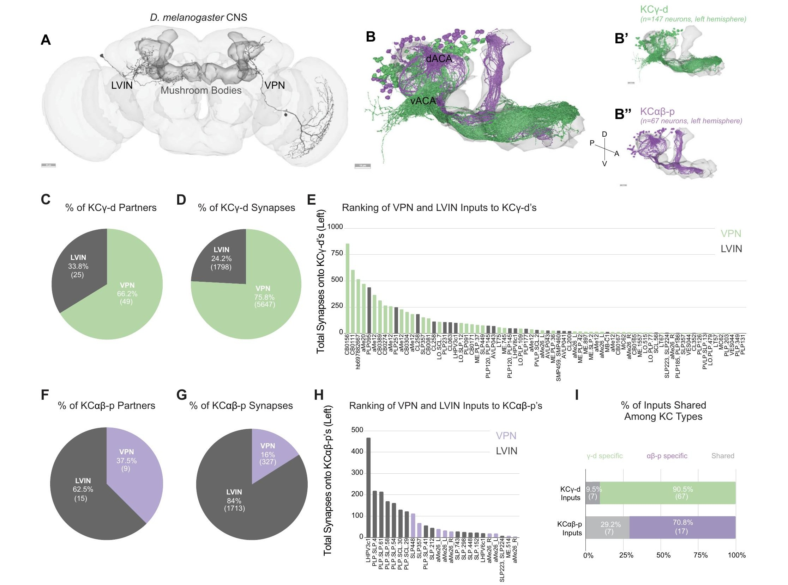
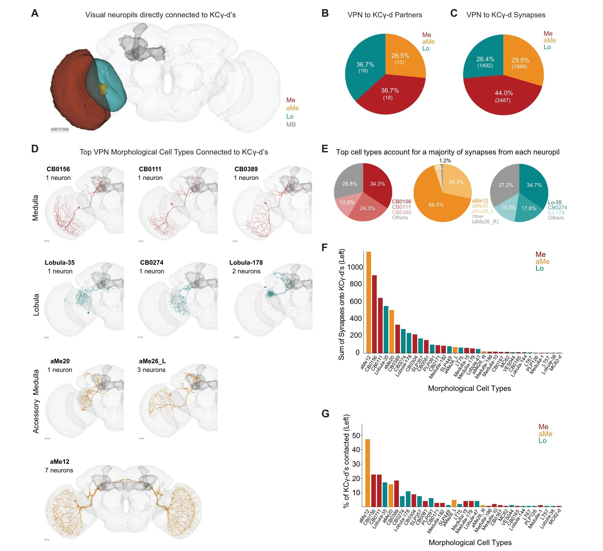
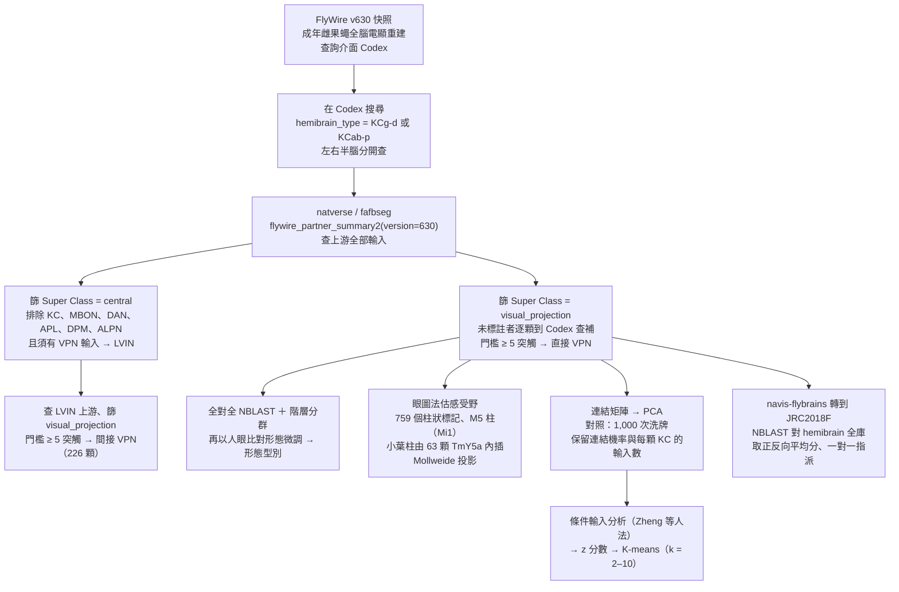
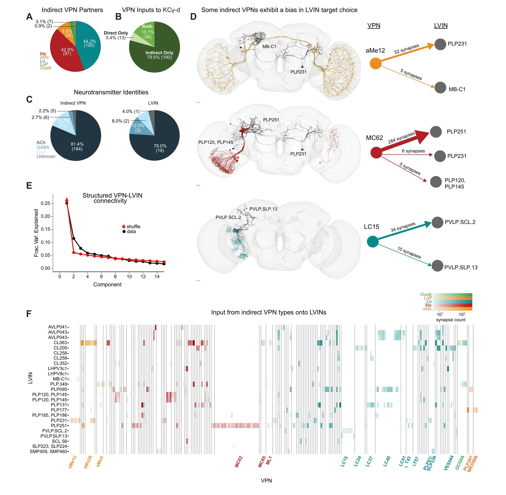
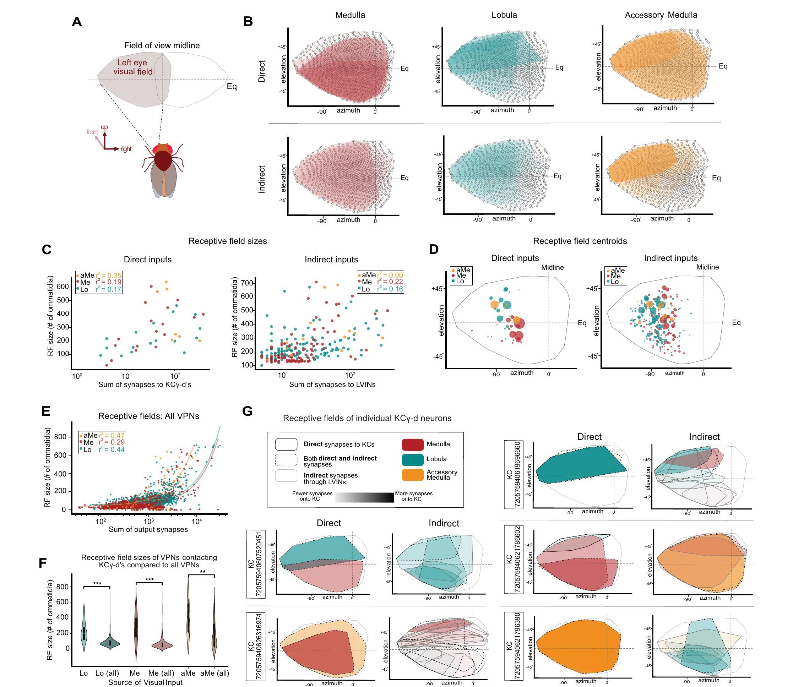
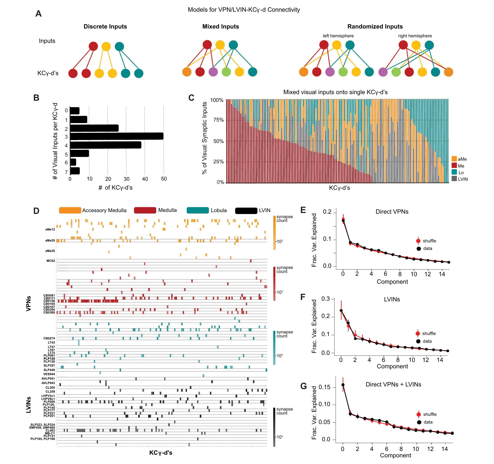
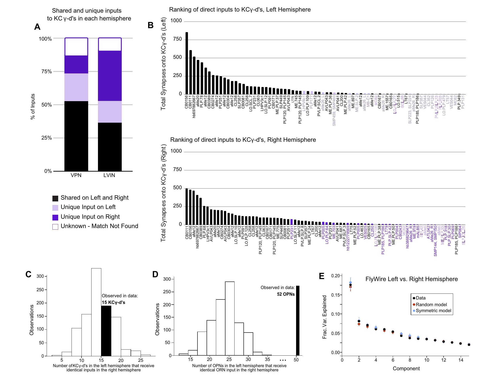
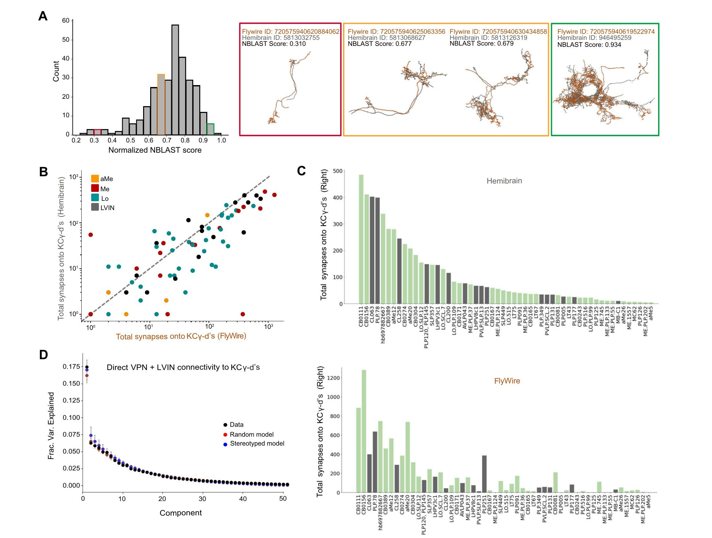

<!-- 本機 PDF：papers/2024-Diversity%20of%20visual%20inputs%20to%20Kenyon%20cells%20of%20the%20Drosophila%20mushroom%20body.pdf -->

# Diversity of visual inputs to Kenyon cells of the *Drosophila* mushroom body

**果蠅蕈狀體 Kenyon 細胞的視覺輸入有多少種**

| 項目 | 內容 |
|---|---|
| **出處** | Nature Communications 15, 5698 (2024)（文章編號制，無期號與起迄頁；PDF 共 18 頁）. doi: 10.1038/s41467-024-49616-z [全文（PMC 免費閱讀）](https://pmc.ncbi.nlm.nih.gov/articles/PMC11228034/) |
| 日期 | 收稿 2024-01-24・接受 2024-06-11（PDF 第 1 頁）。**本機 PDF 沒有印刊出日期**（頁首只有收稿與接受兩個日期）：？待查 |
| 通訊作者 | E. Josephine Clowney（jclowney@umich.edu）、Rudy Behnia（rb3161@columbia.edu）。兩人並列通訊作者、貢獻相等。PDF 只有英文名 |
| 作者 | 共 5 人：Ishani Ganguly、Emily L. Heckman、Ashok Litwin-Kumar、E. Josephine Clowney、Rudy Behnia。**Ganguly 與 Heckman 為共同第一作者**，PDF 的作者貢獻節寫明「順序由擲硬幣決定」。與本庫有關的作者：無。**Litwin-Kumar 另為本庫 [[s-aso-2019-nitric-oxide-cotransmitter]] 與 [[s-yamada-2023-second-order-conditioning]] 的共同作者**（兩篇都由他負責形式分析／迴歸分析）。本篇的作者貢獻節把他列為督導（與 Clowney、Behnia 同），未指派具體分析；全部分析由兩位共同第一作者分工完成 |
| 機構 | 哥倫比亞大學神經科學系、理論神經科學中心、Zuckerman Institute、Kavli Institute for Brain Science（美國紐約）；密西根大學分子細胞發育生物學系、Michigan Neuroscience Institute（美國安娜堡） |
| 資料庫 | 分析程式：<https://github.com/ishanigan/visual-inputs-to-mushroom-body>。原始連結體資料由 FlyWire 的 Codex 查詢介面（<https://codex.flywire.ai/>）與 hemibrain 的 neuPrint（<https://neuprint.janelia.org/>）取得。逐顆神經元清單在 Source Data 檔 |
| 補充資料 | 補充圖 1–7（Supplementary Fig. 1–7）、Source Data 檔、Reporting Summary、同儕審查檔（peer review file）。**沒有補充表**（全文 `grep "Supplementary Table"` 零筆）。**以上全部不在本機 PDF 內，本庫未取得**；凡依賴它們的內容一律標 ？待查 |
| 編輯／審查 | 具名審查人 Martin Giurfa（其餘匿名）。**Giurfa 本人的兩篇論文被本篇引為文獻 98、99**（蜜蜂的數量認知），用在討論節的跨物種比較上 |
| 經費 | NIDCD R01DC018032、Pew Charitable Trusts、McKnight Endowment Fund、Rita Allen Foundation、密西根大學（Clowney）；T32-DC000011 與 HHMI Hanna Gray Fellowship（Heckman）；DOE CSGF DESC0022158、Gatsby Charitable Foundation（Ganguly）；BRAIN R34NS128874、NIH R01EY029311 等（Behnia）；Burroughs Wellcome、Gatsby、McKnight、NIH R01EB029858（Litwin-Kumar） |

> **本篇為 Creative Commons Attribution 4.0（CC BY 4.0）開放取用**，版權屬作者（© The Author(s) 2024）。圖片與全文在標明出處的條件下可自由使用與散布。
>
> **但有一個例外必須注意：** 圖 1A–B″、圖 2A 與 2D、圖 3D 裡的神經元骨架與神經氈（neuropil）立體模型，是在 **CC BY-NC 4.0（禁止商業利用）**下取自 Dorkenwald et al.（2023）與 Schlegel et al.（2023）兩份 bioRxiv 預印本，本篇自己的圖說裡逐條聲明了這件事。本庫是非商業的教學網站，使用這些圖符合 NC 條款；**但引用本篇的圖時不能一律當成 CC BY**。本庫仍依既有規定只給全文連結、不放 PDF，每張圖下方標明出處與授權。

---

## 為什麼重要

> 本節假設讀者已略知蕈狀體的輪廓。**完全不熟的讀者可以先看「科普文」一節**；術語另見「專業文」開頭的「本頁用語」表。

本庫到目前為止寫的蕈狀體，幾乎全是一個嗅覺器官。[[e-kenyon-cell]] 頁寫「KC 的樹突在萼部接收嗅覺輸入」，[[c-sparse-coding]] 頁整頁在談「一種氣味活化多少比例的 KC」，[[t-dopamine-to-plasticity]] 問的是氣味訊號與多巴胺怎麼在 KC 軸突上碰頭。這個偏重不是本庫的疏漏，是領域的事實：九成以上的 KC 收的是氣味。**但另外那不到一成的 KC 收的是影像，而本庫先前沒有任何一頁說得出它們接的是誰。** 本篇把這份名單逐顆列了出來。

它用的工具與本庫既有的連結體頁不同，這一點必須先講清楚。[[e-hemibrain]] 只涵蓋半邊中央腦，而且只有右半邊的連結是完整的；它沒有重建視葉（optic lobe），所以 2020 年用 hemibrain 做的那次分析只能說「有視覺神經元伸進萼部」，卻說不出那些神經元是誰、從視葉的哪一層來。本篇改用 **FlyWire**——一隻成年雌果蠅的**全腦**電子顯微鏡重建，兩邊視葉都在裡面——於是「這條視覺輸入從髓質（medulla）還是小葉（lobula）來、感受野有多大」這一類問題第一次有了答案。本頁因此也是本庫第一份以 FlyWire 為主資料的來源頁。

第三，它問的問題與嗅覺那邊是同一個問題，答案卻只對了一半。嗅覺那邊的共識是「KC 從可用的投射神經元中隨機取樣」，本篇對視覺 KC 做了同一套統計檢定，結論是「也看不出非隨機的結構」——**但同時發現可供取樣的那份名單本身極不平均**：全腦 7,851 顆標為視覺投射神經元的細胞裡，只有 469 顆接到視覺 KC，而其中又有一小撮型別吃掉大半的突觸。**「連法隨機、名單固定」這個組合，是本篇留給本庫的核心主張**，也是本頁第五節要逐條檢驗強度的地方。

---

## 論文摘要（原文與中譯）

> The arthropod mushroom body is well-studied as an expansion layer representing olfactory stimuli and linking them to contingent events. However, 8% of mushroom body Kenyon cells in *Drosophila melanogaster* receive predominantly visual input, and their function remains unclear. Here, we identify inputs to visual Kenyon cells using the FlyWire adult whole-brain connectome. Input repertoires are similar across hemispheres and connectomes with certain inputs highly overrepresented. Many visual neurons presynaptic to Kenyon cells have large receptive fields, while interneuron inputs receive spatially restricted signals that may be tuned to specific visual features. Individual visual Kenyon cells randomly sample sparse inputs from combinations of visual channels, including multiple optic lobe neuropils. These connectivity patterns suggest that visual coding in the mushroom body, like olfactory coding, is sparse, distributed, and combinatorial. However, the specific input repertoire to the smaller population of visual Kenyon cells suggests a constrained encoding of visual stimuli.

（Nature Communications 的摘要不分 Background／Results／Conclusion 段，照原樣一段。）

**中譯**（本節為忠實翻譯，非自撰內容）：

> 節肢動物的蕈狀體，作為一個代表嗅覺刺激、並把這些刺激與伴隨事件連起來的擴張層，已被充分研究。然而，黑腹果蠅蕈狀體中有 8% 的 Kenyon 細胞接收的主要是視覺輸入，而它們的功能仍不清楚。在此，我們使用 FlyWire 成蟲全腦連結體，辨識出視覺 Kenyon 細胞的輸入。各輸入組合在兩側腦半球之間、以及在不同連結體之間都相似，其中某些輸入被高度過度代表。許多與 Kenyon 細胞形成突觸前連結的視覺神經元具有大的感受野，而中間神經元輸入則接收空間上受限、可能對特定視覺特徵調諧的訊號。個別的視覺 Kenyon 細胞，從多個視覺通道的組合（包含多個視葉神經氈）中隨機取樣稀疏的輸入。這些連結樣式顯示，蕈狀體中的視覺編碼如同嗅覺編碼一樣，是稀疏、分散而組合式的。然而，這一群數量較少的視覺 Kenyon 細胞所接收的特定輸入組合，顯示視覺刺激的編碼是受限的。

---

## 科普文

想像一間大型郵件分檢室。進來的信有兩種：一種是氣味信，一種是影像信。分檢員有兩千位，其中一千八百多位只處理氣味信，剩下不到兩百位處理影像信。過去三十年，研究者幾乎只盯著處理氣味信的那一區，因為那一區的流程最清楚：每封氣味信都蓋著來源郵局的戳，一共五十幾個郵局，每位分檢員手上拿到的三到七封信，看起來就像從這五十幾個郵局裡隨便抓來的。**這篇論文做的事，是第一次走進處理影像信的那一區，把每位分檢員桌上的信逐封翻開，看它們是從哪裡寄來的。**

先說這間分檢室是什麼。果蠅腦裡有一對構造叫**蕈狀體**（mushroom body），它是學習與記憶的中心：果蠅能記住「聞到這個氣味會被電」，靠的就是這裡。蕈狀體的主角是約兩千顆**Kenyon 細胞**（Kenyon cell，簡稱 KC），它們的樹突聚在一個叫**萼部**（calyx）的區域收信。九成以上的 KC 收的是從**嗅葉**（antennal lobe）轉來的氣味訊號，但有兩小群 KC 不是：一群叫 KCγ-d，樹突伸進萼部旁邊一個叫「腹側副萼」（ventral accessory calyx）的小隔間；另一群叫 KCαβ-p，伸進「背側副萼」。這兩群收的是從**視葉**（optic lobe，果蠅處理影像的地方）送來的訊號。

**難題在於：過去沒有一份腦圖同時看得到視葉和蕈狀體。** 先前最好的果蠅連結體 hemibrain 只涵蓋半邊中央腦，而且只有右半邊的連結是完整的——更關鍵的是，它根本沒有重建視葉。所以 2020 年的分析能看到「有一些視覺神經元的末梢伸進副萼」，卻追不出它們的本體在視葉的哪一層、眼睛的哪個方向。這就像看得到信進了分檢室，卻查不出寄件地址。

**解法是換一份更大的腦圖。** 本篇改用 **FlyWire**，一隻成年雌果蠅的整顆腦，兩邊視葉都重建進去了。作者把左半腦每一顆 KCγ-d 和 KCαβ-p 的上游全部查了一遍，只要兩顆細胞之間有五個以上的突觸就算一條連結（這個門檻後面會說為什麼重要）。結果是一份點名簿。

名單上有兩類寄件人。第一類叫**視覺投射神經元**（visual projection neuron，VPN）：本體長在視葉裡，軸突直接伸到副萼，**直接送信**。第二類叫**局部視覺中間神經元**（local visual interneuron，LVIN）：本體不在視葉，自己先向 VPN 收信，再轉交給 KC，**轉寄一手**。兩群 KC 的收信習慣正好相反：KCγ-d 的信七成五以上是直接送來的（49 個 VPN 夥伴、5,647 個突觸），KCαβ-p 則是八成四來自轉寄（15 個 LVIN 夥伴、1,713 個突觸）。作者因此把後續分析集中在 KCγ-d——因為直接送來的信比較追得回源頭。

<small>圖片出處：Ganguly I, Heckman EL, Litwin-Kumar A, Clowney EJ, Behnia R. *Nature Communications* 15:5698 (2024)，Figure 1。© 2024 作者，CC BY 4.0；**圖 1A–B″ 的神經元骨架與神經氈模型另依 CC BY-NC 4.0 取自 Dorkenwald et al. 2023 與 Schlegel et al. 2023**。全文見 [PMC](https://pmc.ncbi.nlm.nih.gov/articles/PMC11228034/)。</small>

> **原圖說（Figure 1）：** Direct visual inputs are highly represented in the ventral accessory calyx. **A** Schematic of the *D. melanogaster* CNS with the mushroom bodies highlighted in dark gray. Representative examples of an LVIN (PLP095) and VPN (CB0156). Anterior view. Scale bar, 30 μm. **B** Mushroom body volume with visual Kenyon cell subtypes overlaid. dACA, dorsal accessory calyx, vACA, ventral accessory calyx. (**B′**) KCγ-d, green receives input in the vACA. (**B″**) KCαβ-p, purple, receives input in the dACA. Scale bar, 15 μm. **C** Proportion of KCγ-d visual inputs that are either VPNs (green) or LVINs (gray). **D** Proportion of visual synapses onto KCγ-d that are either from VPNs or LVINs. **E** Ranking all VPN and LVIN inputs to KCγ-d by their total synaptic contribution to KCγ-d's. **F** Proportion of KCαβ-p visual inputs that are either VPNs (purple) or LVINs (gray). **G** Proportion of visual synapses onto KCαβ-p that are either from VPNs or LVINs. **H** Ranking all VPN and LVIN inputs to KCαβ-p by their total synaptic contribution to KCαβ-p's. **I** Proportion of direct visual inputs and LVINs that are either specific to or shared among KCγ-d and KCαβ-p. All data in panels B-I examine connectivity to KCs in the left hemisphere, using a ≥ 5 synapse threshold.

**圖說中譯：** 直接視覺輸入在腹側副萼中佔很高的比例。(A) 果蠅中樞神經系統示意圖，蕈狀體以深灰標出；並附一個 LVIN（PLP095）與一個 VPN（CB0156）的代表例。前視圖。比例尺 30 μm。(B) 蕈狀體體積，疊上視覺 Kenyon 細胞亞型。dACA＝背側副萼，vACA＝腹側副萼。(B′) KCγ-d，綠色，在 vACA 接收輸入。(B″) KCαβ-p，紫色，在 dACA 接收輸入。比例尺 15 μm。(C) KCγ-d 的視覺輸入中，屬於 VPN（綠）或 LVIN（灰）的比例。(D) 送到 KCγ-d 的視覺突觸中，來自 VPN 或 LVIN 的比例。(E) 依對 KCγ-d 的總突觸貢獻，把全部 VPN 與 LVIN 輸入排序。(F)(G)(H) 同 (C)(D)(E)，但對象是 KCαβ-p。(I) 直接視覺輸入與 LVIN 中，專屬於 KCγ-d、專屬於 KCαβ-p、或兩者共用的比例。B–I 全部只看左半腦，連結門檻為 ≥ 5 個突觸。

**解讀：**

**這四個圓餅圖不是「KC 收到的全部輸入」，而是「KC 收到的視覺輸入」，差別很大。** 方法節定義 LVIN 時明文排除了 KC 自己、MBON、DAN、APL、DPM 與嗅覺投射神經元，所以這些細胞的突觸從來沒進過分母。而正文自己寫了：抑制性大神經元 **APL 平均對每顆 KCγ-d 做 16 個（左）與 10 個（右）突觸**。`※ 推論`：若這個平均是對全部 147 顆 KCγ-d 取的，APL 一顆細胞在左半腦就貢獻約 2,352 個突觸，**比整個 LVIN 群的 1,798 個還多，約等於圖 D 全部視覺突觸（5,647 ＋ 1,798 ＝ 7,445）的三分之一**。論文沒有把這個數字放進任何一張圖。但論文未說明該平均的分母是「全部 KCγ-d」還是「被 APL 接到的 KCγ-d」，若是後者則上述乘積會偏高；不確定範圍因此相當寬。**引用圖 C、D 時要說「視覺輸入的組成」，不可說「輸入的組成」。**

**I 圖有一個視覺陷阱。** 圖例三個標籤由左到右是「γ-d specific／αβ-p specific／Shared」，但每條長條**最左邊那一小段灰色是 Shared**，不是 γ-d specific。能確定這件事靠的是算術而不是顏色：兩條長條最左段都是 7，而 7 ＋ 67 ＝ 74（KCγ-d 的夥伴總數）、7 ＋ 17 ＝ 24（KCαβ-p 的夥伴總數）。**所以正確讀法是：兩群 KC 共用的輸入只有 7 個，佔 KCγ-d 夥伴的 9.5%、佔 KCαβ-p 夥伴的 29.2%。** 照圖例順序硬讀會得到完全相反的意思。

**E 圖真正該看的不是排名，是那條曲線掉得多快。** 最高的 CB0156 約 840 個突觸（從圖判讀），第二名約 600，到第十名已經掉到 250 以下，而尾端數十個型別幾乎貼著零。**一個「隨機取樣」的系統，取樣的母體本身卻是這種極不平均的分布**——這正是本篇最後那句「受限的編碼」的來源。這張圖與圖 5E–G 必須一起讀，否則容易把「隨機」誤讀成「均勻」。

**對過度解讀踩煞車：E 圖與 H 圖的橫軸是神經元，不是細胞型別。** aMe12 在 E 圖上出現了七次（七顆細胞各一根長條），所以用肉眼數「有幾種 VPN 排在前面」會把同一型數成好幾種。要看型別層級的排名必須用圖 2F。

接下來的問題是：這些直接送信的 VPN，本體在哪裡？

<small>圖片出處：Ganguly I, Heckman EL, Litwin-Kumar A, Clowney EJ, Behnia R. *Nature Communications* 15:5698 (2024)，Figure 2。© 2024 作者，CC BY 4.0；**圖 2A、2D 的神經元骨架與神經氈模型另依 CC BY-NC 4.0 取自 Dorkenwald et al. 2023 與 Schlegel et al. 2023**。全文見 [PMC](https://pmc.ncbi.nlm.nih.gov/articles/PMC11228034/)。</small>

> **原圖說（Figure 2）：** Direct visual inputs to KCγ-d neurons come from diverse optic lobe neuropils. **A** Schematic of optic lobe neuropils and mushroom body in the left hemisphere. The same neuropils are present in the right hemisphere but are not highlighted here. Me, Medulla; aMe, Accessory Medulla; Lo, Lobula; MB, Mushroom Body. Scale bar, 50 μm. **B** Proportion of KCγ-d VPN partners that originate from one of the 3 optic lobe neuropils in (A). **C** Proportion of VPN synapses onto KCγ-d by optic lobe neuropil origin. **D** Morphologies of the top three VPN classes from each neuropil that provide the most synaptic input to KCγ-d's. Scale bars, 20 μm. **E** Proportion of synapses from each neuropil that come from the top 3 morphological types in (D). **F** Ranking of morphological VPN classes by total synaptic contribution to KCγ-d's. **G** Percentage of KCγ-d's contacted by each morphological VPN class (out of 147 KCγ-d's in the left hemisphere). VPN classes are ordered on the x-axis as in (F) to show that classes making larger numbers of synapses also contact larger percentages of KCγ-d partners. Data in this figure examine connectivity to KCγ-d in the left hemisphere, using a ≥ 5 synapse threshold.

**圖說中譯：** KCγ-d 神經元的直接視覺輸入來自多個不同的視葉神經氈。(A) 左半腦視葉神經氈與蕈狀體示意圖；右半腦有相同的神經氈，此處未標示。Me＝髓質，aMe＝副髓質，Lo＝小葉，MB＝蕈狀體。比例尺 50 μm。(B) KCγ-d 的 VPN 夥伴分別來自 (A) 三個視葉神經氈的比例。(C) 送到 KCγ-d 的 VPN 突觸，依來源神經氈分的比例。(D) 每個神經氈中對 KCγ-d 貢獻最多突觸的前三類 VPN 的形態。比例尺 20 μm。(E) 每個神經氈的突觸中，由 (D) 的前三種形態型別貢獻的比例。(F) 依對 KCγ-d 的總突觸貢獻，把形態型別排序。(G) 每個形態型別接觸到的 KCγ-d 百分比（分母為左半腦的 147 顆 KCγ-d）。橫軸順序同 (F)，用以顯示做較多突觸的型別也接觸到較高比例的 KCγ-d 夥伴。本圖只看左半腦，連結門檻為 ≥ 5 個突觸。

**圖說中譯補充：** 原圖說只定義了 Me、aMe、Lo、MB 四個縮寫。

**解讀：**

**B 圖與 C 圖放在一起才有意思，而論文只做了描述、沒有算比值。** 髓質與小葉各派出 18 顆 VPN（各佔夥伴的 36.7%），但髓質那 18 顆帶來 2,487 個突觸、小葉那 18 顆只帶來 1,492 個。**換算成每顆的平均，髓質 VPN 是 138 個突觸、小葉 VPN 是 83 個、副髓質 VPN 是 128 個（1,668 ÷ 13）**——髓質與副髓質的單顆份量比小葉重約六成。論文全篇沒有出現這個除法。這個差距會直接影響「哪一個視葉區主導 KCγ-d」的判斷：按顆數算是髓質與小葉並列第一，按突觸算是髓質遙遙領先。

**E 圖的中間那個圓餅其實在說一件與標題相反的事。** 標題寫「每個神經氈的突觸大多由前三型貢獻」，三個圓餅看起來是同一類結果。但副髓質那個圓餅的「其他」只有 1.2%，而且括號裡寫明那個「其他」就是 aMe26_R 一型——**也就是說，接到 KCγ-d 的副髓質 VPN 總共只有四型**（aMe12、aMe20、aMe26_L、aMe26_R），「前三型佔 98.8%」是因為總共只有四型，不是因為有少數型別特別突出。相對地，小葉那個圓餅的「其他」佔 37.2%，**比最大的單一型別 Lo-35（34.7%）還大**。三個神經氈的集中程度差很遠，圖的擺法卻讓人以為它們一樣。

**真正該看的是 F 與 G 兩圖的第一根長條：aMe12。** 它是整份名單裡突觸最多的型別（約 1,150 個，從圖判讀；與 C 圖的 1,668 × 66.5% ≈ 1,109 一致），同時接觸到約 47% 的 KCγ-d——接近一半。而正文指出 aMe12 直接從感光細胞收訊號，**只隔兩個突觸就到周邊，與嗅覺投射神經元的深度相同**；其他大多數路徑要隔三個以上。所以「視覺 KC 收的是處理過好幾層的影像」這個直覺，對最大的那條輸入並不成立。

**視覺陷阱：D 圖每個形態型別下方標的「1 neuron」「3 neurons」是該型在圖示中畫出的顆數，不等於該型在腦中的總顆數。** 正文另外寫 aMe12 每側各 4 顆、全腦 8 顆，而 D 圖的 aMe12 標的是「7 neurons」——那是**突觸數達到門檻的那 7 顆**（正文：KCγ-d 接到全部 8 顆，其中 7 顆超過 5 個突觸）。兩個數字都對，但分屬不同定義，`※ 推論`：論文沒有明說 D 圖標的顆數採用的是門檻後的計數，這是本頁依正文「7 with more than 5 synapses」推出的讀法。

**最後一段留給最容易被誤讀的一點。** 本篇的標題與摘要講的是「多樣性」，但它給出的畫面其實有兩層，而且方向相反：**可用的輸入名單極窄**（全腦 7,851 顆視覺投射神經元裡只有 469 顆接到視覺 KC），**名單之內的連法又看不出規律**（每顆 KCγ-d 從 1 到 7 個輸入中隨機抓，中位數 3 個）。所以這不是一篇證明「視覺 KC 像嗅覺 KC」的論文，也不是一篇證明「視覺 KC 不一樣」的論文——**它說的是：取樣方式一樣，但被取樣的母體完全不同。** 把它引成前者或後者，都會丟掉它真正的內容。

---

## 專業文

### 本頁用語

- **連結體（connectome）**：用電子顯微鏡（電顯）逐一追蹤神經元、畫出的接線圖，可數出兩顆細胞之間有幾個突觸。
- **FlyWire**：一隻成年**雌**果蠅的**全腦**電顯重建（含兩側視葉），本篇用的是 v630 快照，查詢介面為 Codex。它與 [[e-hemibrain]] 不同：hemibrain 只涵蓋半邊中央腦、只有右半邊的連結完整，而且**沒有重建視葉**。
- **FAFB**：FlyWire 所依據的那份原始電顯影像體積（Full Adult Fly Brain）。本篇引用的傳遞物質預測模型就是在 FAFB 與 hemibrain 兩份體積上訓練的。
- **神經氈（neuropil）**：腦中由樹突與軸突密集纏繞構成的分區，是果蠅腦的標準解剖單位。
- **視葉（optic lobe）**：果蠅處理影像的區域，由四個主要神經氈組成——**薄層（lamina）、髓質（medulla）、小葉（lobula）、小葉板（lobula plate）**。另有一個較小的**副髓質（accessory medulla, aMe）**，夾在髓質與小葉之間，是 Hofbauer–Buchner eyelet 這組眼外感光細胞的軸突終點，也被時鐘神經元支配。
- **VPN（visual projection neuron，視覺投射神經元）**：本體與樹突在視葉、軸突伸進中央腦的神經元。本篇以 FlyWire 的 `visual_projection` 超類（Super Class）界定。
- **LVIN（local visual interneuron，局部視覺中間神經元）**：在視葉裡沒有分枝、但接收 VPN 輸入並與 KC 形成突觸的中央腦中間神經元。定義承自 Li et al. 2020。
- **直接／間接輸入**：VPN 直接突觸到 KC 者為直接；VPN 先接到 LVIN、再由 LVIN 接到 KC 者為間接。
- **KCγ-d、KCαβ-p**：兩群視覺 Kenyon 細胞。KCγ-d 的樹突在**腹側副萼（ventral accessory calyx, vACA）**，KCαβ-p 在**背側副萼（dorsal accessory calyx, dACA）**。KCγ-m（γ main）則是收嗅覺的那一群，本篇拿它當對照。見 [[e-kenyon-cell]]。
- **LC、MC（lobula columnar / medulla columnar neuron）**：小葉或髓質的柱狀神經元，每顆只看視野中的一小塊，整型鋪滿視野。
- **感受野（receptive field, RF）**：一顆視覺神經元會對視野中哪一塊區域有反應。本篇以「涵蓋幾個小眼（ommatidium）」為單位估計。
- **NBLAST**：比較兩顆神經元形態相似度的演算法，分數介於 0（完全不同）到 1（完全相同）。
- **參與比（participation ratio, PR）**：由共變異矩陣特徵值算出的有效維度，數值越小表示變異集中在越少的方向。
- **標記**：※ 推論＝本庫推得、原文沒明說；？待查＝要靠其他資料確認；「從圖判讀」＝從圖上估讀的值。

### 一、概述

**主要問題。** 果蠅蕈狀體中約有 8% 的 Kenyon 細胞接收的主要是視覺而非嗅覺訊號，但這些細胞接的是哪些視覺神經元、那些神經元看的是視野的哪一塊、以及 KC 挑選輸入的規則是不是跟嗅覺那邊一樣，都沒有答案。本篇要做的是把這份名單逐顆列完，並用統計檢定判斷連法是隨機還是有結構。

**重要性。** 蕈狀體的「擴張層」理論——少數輸入通道擴張成大量稀疏編碼的細胞，藉此提高可區辨的刺激數——幾乎全部建立在嗅覺資料上。視覺與嗅覺的刺激空間在物理上完全不同（顏色、亮度、邊緣、方位、位置 vs 分子種類與濃度），所以「同一套擴張層架構能不能同時服務兩種感覺」是一個可以用解剖資料檢驗的理論問題。本篇是第一次有全腦連結體讓這個檢驗成為可能。

**發表當時的領域現狀（2024）。** 三條線索在本篇之前已經存在。第一，Li et al. 2020（*eLife* 9, e62576）用 hemibrain 描述了「有視覺中間神經元伸進副萼」，**但該資料集沒有重建視葉，所以那些 VPN 的身分無法確定**（本篇引言明說此限制）。第二，實驗工作已知 KCγ-d 經 VPN-MB1、VPN-MB2 收髓質輸入（Vogt et al. 2016，*eLife* 5）、經 aMe12 收副髓質輸入（Kind et al. 2021，*eLife* 10, e71858），而 KCαβ-p 經處理小葉訊號的 LVIN 收間接輸入（Li J. et al. 2020，*Cell Rep* 32, 108138；Tanaka et al. 2008）。第三，行為學上「藍綠顏色學習」（Vogt et al. 2014、2015；Schnaitmann et al. 2010）與「情境類化」（Liu et al. 1999）被證明需要蕈狀體，而位置學習（Ofstad et al. 2011，*Nature* 474）與圖案辨識（Liu et al. 2006；Wang et al. 2008）則被歸到中央複合體（central complex）。本篇把第一條線索的空缺補上，方法是換一份看得到視葉的連結體。

### 二、方法

**資料集與門檻。** FlyWire v630 快照，連結門檻一律為「兩顆細胞之間 ≥ 5 個突觸」，與 Codex 的預設一致，另有聲明者除外。重要的是作者在一處刻意拿掉門檻：檢查 LC 與 MC 這類小視野柱狀神經元時，門檻會讓「只有部分成員接到 LVIN」看起來像隨機的鹽胡椒分布；去掉門檻後 **LC15 有 49/52 顆、LC24 有 53/62 顆**連到投射至 KCγ-d 的 LVIN，覆蓋整個小葉。MC62 則不然——去掉門檻雖然多出一些細胞，但**新增的大多限於髓質腹側半**，背側半的 MC62 仍不在內。

**FlyWire 的左右方向。** 取像時 EM 體積被鏡像翻轉過，作者聲明本篇呈現的左右半腦是**已校正**的版本（依 Codex 的呈現）。這一點在跨資料集比對時有實際後果：把 FlyWire 左半腦的網格轉到 JRC2018F 模板後，對上的是 **hemibrain 的右半腦**。

**傳遞物質預測。** 直接採用 Eckstein et al. 2024 在 Codex 中列出的結果：一個人工神經網路依突觸的超微結構把每個突觸前位點分到六種傳遞物質（乙醯膽鹼、GABA、麩胺酸、多巴胺、血清素、章魚胺）之一；**在 FAFB 體積的準確率為 88%、在 hemibrain 為 79%**。預測為膽鹼性者的信心分數一般最高（> 0.8）。

**突觸型態的自動分類。** 作者要區分「豆莢—爪」（bouton-claw，與嗅覺路徑同型）與「沿途」（en passant）兩種接觸。作法是對每一對突觸前後夥伴算出所有突觸位置的形心與離散度，以人工判定的一組基準神經元定閾值，再用**另一組 30 對**突觸前後神經元做測試，**準確率 86%**。

**感受野估計。** 用 Zhao et al. 新發表的眼圖（eyemap）：**759 個柱狀標記**，髓質取 M5 層（由 Mi1 的突起重建而來，因為本篇多數髓質 VPN 分枝在 M6–M8 層），小葉的柱位置則由 **63 顆重建的 TmY5a 神經元**內插外推而得；每個柱狀標記對應一個小眼的視角。對每顆 VPN，算其樹突在設定距離內接近哪些小眼柱，再取凸包（convex hull）當作感受野；距離閾值由人工標註的基準神經元最大化重疊率而定，髓質與小葉分別設定。全 VPN 分析（圖 4E、F）只納入感受野涵蓋 **> 5 個小眼柱**的神經元。

**隨機模型。** 所有「有沒有結構」的檢定都用同一套洗牌：固定每個輸入的連結機率與每顆輸出神經元收到的輸入數，洗 **1,000 次**，比較真實資料與洗牌資料的 PCA 特徵值譜。跨半腦與跨連結體另加一個「刻板模型」（stereotyped／symmetric model）：連結隨機產生，但兩側（或兩個連結體）完全相同。

**分群。** KCγ-d 的分群用譜分群（spectral clustering），群數由輪廓分數（silhouette score）選出，**最佳為 4 群**。條件輸入分析後的分群用 K-means，群數從 2 掃到 10。

**軟體版本。** R 4.3.1（2023-06-16）／RStudio 2023.06.1+524、natverse 與 fafbseg；NAVis 1.3.1、fafbseg-py 1.13.0、flybrains 0.2.6、neuprint-python 0.4.25、scipy 1.9.1、networkx 3.1、scikit-learn 1.1.2、seaborn 0.11.2、descartes 1.1.0、alphashape 1.3.1、geopandas 0.12.2。部分圖以 Google Sheets 製作。

### 三、結果

#### 3.1 兩群視覺 KC 的規模與輸入組成

FlyWire 中 KCγ-d 左 147 顆、右 148 顆；KCαβ-p 左 67 顆、右 61 顆。左半腦的 KCγ-d 共有 **74 個突觸前夥伴 ＝ 49 個 VPN ＋ 25 個 LVIN**，視覺突觸共 **7,445 個 ＝ 5,647（VPN，75.8%）＋ 1,798（LVIN，24.2%）**。KCαβ-p 則相反：**24 個夥伴 ＝ 9 VPN ＋ 15 LVIN**，突觸 **2,040 ＝ 327（VPN，16%）＋ 1,713（LVIN，84%）**。兩群共用的夥伴只有 7 個。

這個「腹側走直接、背側走間接」的分工與 hemibrain 的結果一致，是本篇少數可以跨資料集直接核對的描述。作者也修正了先前一項說法：Li et al. 2020 報告 KCγ-d 沒有爪狀樹突（⚠️ 2026-11-24 回查原文更正本庫的轉述：[[s-li-2020-mb-connectome]] 兩處說的都是「VPN 與 LVIN 打在 KCγd 樹突上的**突觸**不呈主萼裡那種爪狀構造」，主詞是突觸不是樹突），本篇在補充圖 1 中觀察到 KCγ-d 確實形成豆莢—爪與沿途兩種突觸，且兩類視覺輸入做豆莢—爪的比例大致相同、整體以豆莢—爪居多（補充圖 1D，本庫未取得：？待查）。

#### 3.2 直接輸入來自三個視葉神經氈

左半腦 49 個直接 VPN 的來源：**髓質 18 顆（2,487 突觸，44.0%）、小葉 18 顆（1,492，26.4%）、副髓質 13 顆（1,668，29.5%）**。全部直接 VPN 都被預測為膽鹼性（興奮性），**沒有任何一顆被指派過功能**。

形態分群顯示髓質與小葉的 VPN 多半是「獨行者」：在每側只出現一顆、且不與其他投射到蕈狀體的視覺神經元聚在一起（髓質唯一的例外是 ME.PLP.36／ME.PLP.42／ME.1557 構成的三顆一群；小葉是 LO.SCL.7 與 LO.SLP.12）。副髓質則相反，13 顆只分成四型：aMe12、aMe20、aMe26_L、aMe26_R。腦中共有 8 顆 aMe12（每側 4 顆），**KCγ-d 接到全部 8 顆**（其中 7 顆超過 5 個突觸門檻）；aMe26 全腦 6 顆、KCγ-d 接到 5 顆；aMe20 每側只有 1 顆。

**aMe12 是整份名單的首位**：以型別計的突觸總數最高，接觸到約 47% 的 KCγ-d（從圖 2G 判讀）。它直接接收感光細胞輸入，**距離周邊只有兩個突觸，與嗅覺投射神經元同一深度**；其餘路徑多為三個突觸以上。更具體地說，aMe12 接收的是 R7/R8 感光細胞中的 pale 亞型，其視蛋白對紫外光（R7）與藍光（R8）敏感，因此作者推論多數 KCγ-d 應對紫外／藍光有反應。但先前的實驗（Vogt et al. 2016）顯示 KCγ-d 也對綠光有反應，**本篇的資料裡找不出哪些細胞負責綠光**，作者明白寫出這個空缺。

接到腹側副萼的 VPN 全部是大視野神經元，**完全沒有具視網膜拓撲的柱狀型別**；多數的樹突限於髓質腹側。髓質與小葉的 VPN 全為同側連結，只有 aMe12 與 aMe26_R 兼具同側與對側連結。此外，每一顆進到萼部的 VPN 都還有分枝投到別的腦區（PLP、SLP 等），這與嗅覺投射神經元另有一支到側角（lateral horn）的安排平行。

#### 3.3 LVIN 是一個結構化的中繼層

左半腦有 **25 個 LVIN**（對應 **21 個細胞型別**）與 KCγ-d 形成 ≥ 5 突觸。連結最強的 LVIN 是 **PLP095（FlyWire 名 PLP.78），438 個突觸、分布在 24 顆 KCγ-d 上**；而**中位數的 LVIN 只有 11 個突觸、分布在 2 顆 KCγ-d 上**——這個對比比任何比例圖都更能說明分布的偏斜。傳遞物質預測：**19 個膽鹼性（76.0%）、2 個 GABA（8.0%）、3 個麩胺酸（12.0%）、1 個未知（4.0%）**，即 5 個被預測為抑制性。

LVIN 的上游共有 **226 個間接 VPN**（≥ 5 突觸）。來源分布為**小葉 100（44.2%）、髓質 97（42.9%）、副髓質 20（8.8%）、小葉板 7（3.1%）、單眼（ocelli）2（0.9%）**。傳遞物質：**膽鹼性 184（81.4%）、GABA 31（13.7%）、麩胺酸 6（2.7%）、未知 5（2.2%）**。

把直接與間接兩條路合起來看，共 **239 個 VPN ＝ 兩條路都走 36（15.1%）＋ 只走直接 13（5.4%）＋ 只走間接 190（79.5%）**。換句話說，**49 個直接 VPN 裡有 36 個同時也經由 LVIN 送一份副本**；三型直接的 aMe VPN 全部兼走兩條路，另有 aMe3、aMe5、aMe19a、aMe25 只出現在間接路上。小葉板與單眼的神經元只出現在間接路上。

VPN 到 LVIN 的連結**不是隨機的**。LC15 的每一顆只接到 PVLP.SCL.2 與 PVLP.SLP.13 其中之一或兩者，而這兩個 LVIN 主要也只收 LC15；97% 的 MC62 強連到 PLP251，7% 另外接到 PLP231 或 PLP120（兩組有重疊）。但這種專一性不是雙向的：**PLP251 自己還收另外 19 型 VPN 的輸入**。PCA 檢定顯示部分主成分解釋的變異高於洗牌對照（圖 3E），作者據此判定 VPN–LVIN 這一層有結構。

#### 3.4 感受野：大視野主導直接路，小視野走間接路

以眼圖法估計感受野後，三個結果成立。

其一，**接到 KCγ-d 的那批 VPN，感受野顯著大於同一神經氈的全體 VPN**：小葉 18 顆的中位數 200.5 個小眼 vs 全體 2,849 顆的 73；髓質 18 顆的 260 vs 全體 956 顆的 45；副髓質 7 顆的 251 vs 全體 65 顆的 113。雙尾 Student t 檢定 p ＝ 1.734×10⁻¹⁶（小葉）、1.90×10⁻²³（髓質）、0.007（副髓質）。

其二，**在直接 VPN 裡，感受野越大、接到 KCγ-d 的突觸越多**，但相關相當弱：r² 為副髓質 0.35、髓質 0.19、小葉 0.17。間接 VPN 對 LVIN 的對應關係為副髓質 0.00、髓質 0.22、小葉 0.16。

其三，**感受野形心的位置有方向性**：連結強的直接髓質 VPN 偏向視野腹側，連結強的直接小葉 VPN 偏向背側；間接的髓質與小葉 VPN 沒有這個區分，而間接的副髓質 VPN 偏向背半。作者另外註明小葉 VPN 形心略向前偏，**但明白表示這可能是預測工具的技術限制而非生物現象**。

把每顆 KCγ-d 收到的 VPN 與 LVIN 感受野依突觸數加權線性疊加，得到該 KC 的「有效感受野」：**每顆 KCγ-d 覆蓋視野的大部分**，且不同神經氈的貢獻落在視野的不同區塊；間接路貢獻的區塊明顯較小。

#### 3.5 單顆 KCγ-d 的輸入：稀疏、混合、看不出結構

每顆 KCγ-d 收 **1 到 7 個視覺輸入，中位數 3 個**；147 顆中有 **5 顆完全沒有視覺輸入**，它們收的是嗅覺投射神經元（所以圖 5C 的分母是 142）。中位數 3 低於嗅覺 KC 的 5–6 個，也低於其發育上最近的姊妹細胞 KCγ-m 的 4–8 個。輸入的來源組合**任何比例都存在**：從只收單一神經氈的到各種混合都有。

結構檢定做了三套，結論一致是「與隨機取樣相符」：

- **階層分群**：KCγ-d 不落入明顯的群，知道一顆 KC 的某個輸入，無助於猜它的其他輸入。對照組 KCγ-m 也一樣看不出結構，而嗅覺受體神經元到投射神經元那一層（確定是刻板的）則有清楚結構。
- **PCA 特徵值譜**（圖 5E–G）：直接 VPN、LVIN、兩者合併三種矩陣的特徵值譜都與洗牌譜無差異。
- **條件輸入分析**（沿用 Zheng et al. 的方法）：對每一對輸入算「已知有 A 的條件下有 B 的連結數」，與洗牌零分布比出 z 分數，再做 K-means 分群。KCγ-d 的條件輸入矩陣分不出顯著結構；同一套方法套在嗅覺投射神經元對 KC 的連結上，則能抽出一小塊與腹側投射神經元有關的結構。

但「隨機」不等於「均勻」。作者計算**參與比**來量化偏斜：**視覺輸入 PR ＝ 9.1，嗅覺輸入 PR ＝ 15.4**。視覺的輸入通道種類明明更多，有效維度卻更低——少數幾個輸入方向主導了一切。

#### 3.6 跨半腦與跨連結體：名單一致，連法不一致

左右半腦的直接輸入名單高度重疊：**33 個 VPN 與 16 個 LVIN 在兩側都接到 KCγ-d**；只在左側出現的有 13 VPN ＋ 7 LVIN，只在右側的有 8 VPN ＋ 16 LVIN，另有 8 VPN ＋ 4 LVIN 找不到鏡像對應。排名最前的輸入左右相同，只在單側出現的輸入在其出現的那一側排名都很低。不過方法節指出 **45 顆神經元只屬於單側迴路**，去掉突觸門檻後找回其中 15 顆的對應；而正文的講法是「**154 個細胞型別中有 30 個**在一側供給 vACA ≥ 5 突觸、在另一側即使去掉門檻也完全不供給萼部」。

連法本身則看不出左右的對應：147 顆左側 KCγ-d 中，**只有 15 顆在右側找得到一顆輸入組合完全相同的 KC，與洗牌模型的期望值無異**。作為對照，嗅覺那邊同一個檢定有 **52 個投射神經元**在左右收到完全相同的受體神經元輸入，被判為顯著過度代表。

跨連結體的比較用 NBLAST：把 FlyWire 左半腦的 VPN／LVIN 網格轉到 JRC2018F 模板後與 hemibrain 全庫比對，取正反向分數平均、反覆指派到一對一。作者報告**對 66% 的 VPN／LVIN 找到可信的對應（NBLAST 分數 > 0.5）**。配對成功者在兩份資料中對 KCγ-d 的突觸數高度相關，且合併兩份連結體的 PCA 同樣看不出刻板性。FlyWire 的突觸數整體高於 hemibrain，作者把原因歸於「FlyWire 的 KCγ-d 比較多（右半腦 148 vs 99）」。

### 四、討論

**主張一：視覺 KC 與嗅覺 KC 用同一套取樣規則。** 三套獨立的統計檢定（階層分群、PCA 特徵值譜、條件輸入分析）都無法拒絕隨機模型，而同樣的方法在已知刻板的嗅覺受體神經元→投射神經元那一層能抓到結構。**作為陰性結果，這個證據是相對強的**——作者確實做了陽性對照，這比單純報告「看不出結構」好得多。但它仍然是「無法拒絕虛無假設」，而非「證實隨機」；本頁第五節會指出檢定力的問題。

**主張二：被取樣的母體極窄且高度偏斜。** 這部分是陽性證據，也是本篇最堅實的貢獻。全腦 7,851 顆標為 VPN 的神經元裡只有 469 顆（約 6%）接到視覺 KC；左半腦 3,933 顆 VPN 裡只有 49 顆（約 1.2%）直接接到 KCγ-d。參與比 9.1 vs 15.4 把這個偏斜量化成一個可比較的數字。**這是全篇我認為最可引用的量化結論。**

**主張三：直接路帶全域訊息，間接路帶特定特徵。** 證據有兩層。直接 VPN 的感受野顯著大於同神經氈的全體 VPN（三個神經氈都顯著），這一層成立。「間接路帶特定特徵」則主要靠 LC15 的例子：LC15 已知對細長的移動垂直條紋有專一反應，而它的每一顆只接到 1–2 個 LVIN，於是接到那些 LVIN 的 KCγ-d 應能對該刺激產生與位置無關的反應（平移不變性）。**這是一個漂亮但完全是解剖推論的假說**——本篇沒有任何功能量測，作者也明白寫了「這些解剖資料需要功能驗證」。

**主張四：aMe 通路可能把晝夜訊息送進蕈狀體。** aMe 神經元貢獻 29.5% 的 VPN 突觸，而副髓質是時鐘神經元的支配區。這是一個合理但純屬位置推斷的假說，本篇沒有測試。

**主張五：視覺 KC 主要服務多感覺學習。** 作者列了三種可能（純視覺學習／被嗅覺遮蔽而無用／提供嗅覺學習的情境），並說第三種證據最多：視覺與氣味配對時記憶表現優於單獨呈現，且依賴 KCγ-d 活性；視覺與嗅覺 KC 的軸突收到許多共同的 DAN 增強、也接到許多共同的 MBON。**但作者同時誠實指出純視覺路徑沒有被排除**：MBON19 與非典型的 MBON27、MBON33 收到的輸入以視覺 KC 為主。本庫目前沒有這三型 MBON 的頁面。

### 五、問題與限制

**1. 樣本是一隻腦，而統計檢定把細胞當成獨立樣本。** 圖 4F 的圖說自己寫明「所有樣本為生物學上獨立的細胞，在一次獨立實驗中檢驗」。n ＝ 1 隻果蠅這件事，使「左右半腦差異」與「個體差異」無法分離；作者用 hemibrain 做了第二隻腦的比對，但那份資料只涵蓋半邊中央腦、沒有視葉，所以跨腦比對只能在中央腦這一段做。

**2. 全部結論受 ≥ 5 突觸門檻左右，而論文自己展示了門檻會改變結論。** LC15 在門檻下看起來是隨機的鹽胡椒分布，拿掉門檻後變成 49/52 顆鋪滿小葉——**同一份資料、兩種相反的印象**。作者只在 LC/MC 這一處拿掉門檻；主要分析（圖 1–2、圖 5–6）全部保留門檻。沒有做門檻的敏感度分析：？待查。

**3. 傳遞物質是預測值，不是量測值。** 準確率 88%（FAFB）與 79%（hemibrain）是**單一突觸層級**的數字。「全部直接 VPN 都是膽鹼性」「5 個 LVIN 是抑制性」這些敘述建立在預測之上，作者未說明如何由單突觸準確率推到細胞層級的信心：？待查。

**4. 感受野是由形態推估，不是量測。** 眼圖法把「樹突靠近哪些小眼柱」當成「對哪些方向有反應」。它對大視野神經元應較可靠，對有次結構的神經元則不然；作者自己也把小葉形心的前偏歸因於工具限制。另外髓質的柱標記取自 M5 層，而本篇多數髓質 VPN 分枝在 M6–M8 層，這個層間外推的誤差未評估：？待查。

**5. 跨連結體比對依賴 NBLAST，而本篇自己的例子顯示它的分數不好解釋。** 圖 7A 的四個示例中，NBLAST ＝ 0.310 的那一對在圖上看起來骨架走向確實不同，而 0.677 與 0.679 兩對的相似程度肉眼看差異不小。作者把 0.5 當成「可信」的閾值，但沒有給出這個閾值的驗證依據：？待查。

**6. 功能完全未測。** 49 個直接 VPN 中沒有一顆被指派過功能（作者明說）。整篇關於「KC 看到什麼」的敘述都是從解剖推來的。

**6b. 三項關鍵依賴在本篇發表時還是預印本。** 感受野估計所用的眼圖出自 Zhao et al., *bioRxiv* 2022.12.14.520178（文獻 57）；參與比的定義出自 Gao et al., *bioRxiv* 214262（文獻 62）；連結體本身的描述論文 Dorkenwald et al.（*bioRxiv* 2023.06.27.546656）與 Schlegel et al.（*bioRxiv* 2023.06.27.546055，文獻 47）在本篇的圖說與方法中被引用時也都是預印本。**本頁的 `confidence` 仍維持 high，因為本篇自身已經過同儕審查；但眼圖法（第 4 條）與參與比（3.5 節）這兩個數字的方法學尚未經同行審查這一點，引用時要知道。**

**7.（本頁稽核）隨機與刻板兩個模型在本篇的檢定下幾乎無法區分，而論文只報告了前者。** 圖 6E 同時畫了三條：真實資料（黑）、隨機模型（紅）、雙側對稱的刻板模型（藍）。**真實資料的點落在兩個模型的 95% 信賴區間內——不只與隨機模型相符，也與刻板模型相符。** 圖 7D 更明顯：紅藍兩組點幾乎完全重疊。正文只寫「與洗牌模型無顯著差異」，沒有提「與刻板模型也無顯著差異」。**一個無法分辨兩個對立假說的檢定，不能被當成支持其中一個的證據。** 這一條不是說結論錯，而是說目前的證據強度被高估了；要把它變成陽性證據，需要的是檢定力分析或更大的樣本（更多腦）。

**8.（本頁稽核）「66% 找到可信對應」與圖 7A 的直方圖對不上。** 從圖 7A 各柱高度估讀（300 dpi 整頁渲染），分數 < 0.5 的約 17 筆、≥ 0.5 的約 280 筆，合計約 297 筆，**> 0.5 的比例約 94%，而非正文的 66%**。⚠️ 兩者之一的分母不是「our dataset 的 VPN/LVIN」。可能的解釋是「可信對應」除了分數門檻外還要求一對一指派成功，或直方圖納入了間接 VPN（49 ＋ 25 ＋ 226 ≈ 300，與估讀總數接近），但論文都沒有寫。**引用「66%」時必須連同這個不確定一起引用。** 本條為單一來源自身的不一致，不需裁決。

**9.（本頁稽核）左右半腦「只屬於單側」的細胞數，正文與方法節兜不起來。** 方法節說 **45 顆**神經元只屬於單側；圖 6A 的圖說給的是「只在左側 13 VPN ＋ 7 LVIN、只在右側 8 VPN ＋ 16 LVIN」，**合計 44**。⚠️ 差一。另外正文把這條結果講成「154 個細胞型別中的 30 個」，而方法節的 30 是「45 減 15」得到的**神經元**數——**同一個 30 出現在兩個不同的單位（型別 vs 神經元）上，論文沒有說它們是不是同一批。** 本條同樣是單篇自身的不一致，不需裁決，但引用「30/154」時要知道它無法由其他數字驗算。

**10.（本頁稽核）圖 6B 與圖 7C 對同一顆神經元給出差兩到三倍的突觸數，而論文沒有解釋。** 以 300 dpi 整頁渲染、用格線校準判讀（誤差約 ±20 個突觸）：

| 神經元 | 圖 6B 左半腦 | 圖 6B 右半腦 | 圖 7C「FlyWire」面板 | 圖 7C「Hemibrain」面板 |
|---|---:|---:|---:|---:|
| CB0156 | ≈ 840 | ≈ 480 | **≈ 1,285** | ≈ 410 |
| CB0111 | ≈ 590 | ≈ 495 | **≈ 885** | ≈ 485 |

圖 7C 下方面板的縱軸寫的是 "Total synapses onto KCγ-d's (Right)"，與圖 6B 下方那一格應該是同一個量，數值卻差 1.8 到 2.7 倍。方法節說圖 7 用的是**左半腦**細胞體的 FlyWire 神經元（轉到 JRC2018F 模板後對上的是 hemibrain 右半腦），所以那個 "Right" 很可能是沿用上方 hemibrain 面板的標籤；**但改讀成左半腦仍然對不上**（840 vs 1,285、590 vs 885）。左右相加也只有 CB0156 勉強對得上（838 ＋ 480 ＝ 1,318 vs 1,285），CB0111 差了約 200（590 ＋ 495 ＝ 1,085 vs 885）。**論文沒有說明圖 7C 的數值是怎麼算的**——是否合併兩側、是否取消 ≥ 5 突觸門檻、是否依形態型別加總。⚠️ 單篇自身不一致，不需裁決；但它直接影響下一條，因為「FlyWire 比 hemibrain 多」這個比較的分子究竟是哪一個數，從圖上無法確定。

**10b.（本頁稽核）就算採用圖 7C 自己的數值，「KC 比較多」也解釋不了那個倍數。** 圖 7 的圖說寫「FlyWire 的突觸數普遍較高，可能是因為 FlyWire 腦中的 KCγ-d 比較多（148 vs 99）」——比值 **1.49 倍**。但同一張圖上 CB0156 是 1,285 ÷ 410 ≈ **3.1 倍**、CB0111 是 885 ÷ 485 ≈ **1.8 倍**。最直接的反例在論文自己的圖 6B：**左右半腦的 KCγ-d 數幾乎相同（147 vs 148），CB0156 的突觸總數卻是左 ≈ 840、右 ≈ 480，差約 1.75 倍**——在 KC 數量相同的情況下。`※ 推論`：KC 數量不是突觸數差異的主要原因，重建完整度與突觸偵測門檻的差異至少同等重要。此推論的不確定來源是長條高度的判讀誤差（±20 個突觸），遠小於上述倍數的差距。論文沒有討論左右半腦的量差，也沒有討論這個解釋是否足夠。

**11.（本頁稽核）圖 3E 的標題所宣稱的「頂端主成分解釋的變異高於洗牌」，在第一個主成分上不成立。** 放大圖 3E 後可讀到：成分 1 的洗牌值（紅，約 0.262）**高於**真實資料（黑，約 0.252）；真實資料超過洗牌是從成分 2 開始（0.115 vs 0.060），到成分 8 之後又轉為略低。圖的標題寫的是 "Structured VPN-LVIN connectivity"，圖說寫 "Top PC components account for more structure than shuffled matrices"——**嚴格說應為「成分 2 到 7」。** 結論（VPN–LVIN 這一層有結構）不受影響，因為成分 2 的差距很大；受影響的是「top components」這個說法的精確度。

**12.（本頁稽核）全篇只有三個 p 值，而多處用了統計語言。** `grep` 全文的 `p = / p < / significan`，只找到圖 4F 的三個 t 檢定（1.734×10⁻¹⁶、1.90×10⁻²³、0.007）。但正文寫了「突觸數在兩份資料間**高度相關**」（圖 7B、C）卻沒有給相關係數或 p 值；寫了左右配對「**不多於**洗牌期望」（圖 6C）與嗅覺那邊「**顯著**過度代表」（圖 6D）也都沒有檢定統計量。**最嚴重的一處是圖 7B**：那是支撐「跨腦一致」這個主張的核心圖，而全篇沒有任何數字描述它的離散程度。另外，圖 4F 用的是 Student t 檢定，而圖上畫的是明顯右偏的小提琴圖、圖說報的是中位數與四分位距——**用參數檢定比較兩個偏態分布的位置，並以中位數陳述結果，兩者不是同一個量**；而且被比較的 18 顆就在 2,849 顆之內（子集對全集），樣本不獨立。

### 六、未來

**論文自陳的方向。** 第一，量測這些 VPN 與 KCγ-d 的刺激選擇性——這是全篇反覆強調的缺口。第二，弄清楚為何大多數直接 VPN 同時又走間接路（36/49），兩條路在功能上各自負責什麼。第三，釐清 aMe 通路與晝夜系統的關係。第四，用更多種類的視覺刺激重做純視覺學習實驗——作者的論證是：既然只有非常特定的視覺型別進得了萼部，先前用顏色刺激測不出強學習，可能是刺激選錯了。第五，跨物種的比較連結體學，看蜜蜂那種約百倍的蕈狀體擴張是不是把同樣的大視野優勢放大。

**本庫關注的後續。** 這篇留下的開口，庫內目前只有一半有人接。[[c-sparse-coding]] 可以直接吃下本篇的「稀疏」部分：本篇給的是**解剖層的稀疏**（每顆 KC 只收 1–7 個輸入），而該頁現有的兩筆（Hige 2015、Minnick 2026）給的都是**活動層的稀疏**（有多少比例的 KC 在放電）。兩者是不同的量，放進同一頁時必須在「怎麼算」一節分開。[[e-hemibrain]] 頁要補一列：本篇是庫內第一篇把 hemibrain 當成**對照資料集**而非主資料集的來源，而且它正好印證該頁「只涵蓋半邊中央腦」的說法——本篇引言明寫 hemibrain 無法確定那些 VPN 的身分，原因就是視葉沒有重建。[[e-apl-neuron]] 可以補上「APL 對 KCγ-d 平均 16/10 個突觸、與對 KCγ-m 相當」這個跨 KC 亞型的量。[[e-kenyon-cell]] 現有的七型分類（Aso 2014a 的 γd 約 75 顆）與本篇的 FlyWire 計數（KCγ-d 左 147）差近一倍，**這一條要當成跨來源的候選矛盾處理**，不能逕自合併（見下）。

**尚未被回答的。** 第一，**視覺 KC 到底佔幾成**。摘要與討論都沿用「8%」（出自 hemibrain 的分析），但本篇自己數到左半腦 147 ＋ 67 ＝ 214 顆視覺 KC；若沿用本篇引言的「約 2,000 顆 KC」，比例是 10.7%（`※ 推論`：此推算假設「約 2,000」是每半腦的數、且不含視覺 KC 時比例為 9.7%；本篇沒有報告 FlyWire 的 KC 總數，所以無法確定）。本篇完全沒有用自己的資料重算這個比例。第二，**KCγ-d 對綠光的反應由誰傳**——作者自己點名的空缺。第三，**那 5 顆完全沒有視覺輸入、只收嗅覺投射神經元的 KCγ-d 是什麼**：是重建不完整、是發育上的殘留，還是一個真實的混合亞群？本篇只用一句話帶過。第四，**KCαβ-p 這一半的故事**——本篇明說把它擱下了。

---

## 圖

本節收錄圖 3 至圖 7；圖 1、圖 2 在「科普文」一節。

<small>圖片出處：Ganguly I, Heckman EL, Litwin-Kumar A, Clowney EJ, Behnia R. *Nature Communications* 15:5698 (2024)，Figure 3。© 2024 作者，CC BY 4.0；**圖 3D 的神經元骨架與神經氈模型另依 CC BY-NC 4.0 取自 Dorkenwald et al. 2023 與 Schlegel et al. 2023**。全文見 [PMC](https://pmc.ncbi.nlm.nih.gov/articles/PMC11228034/)。</small>

> **原圖說（Figure 3）：** LVINs relay structured visual inputs to KCγ-d. **A** Proportion of indirect VPNs originating from a given neuropil. Me, Medulla; aMe, Accessory Medulla; Lo, Lobula; LoP, Lobula Plate. **B** Proportion of VPNs in our dataset providing direct, indirect (via LVINs), or both types of input to KCγ-d's. **C** Predicted neurotransmitter identities (Eckstein, Bates, et al., 2023) for indirect VPNs (left) and LVINs (right). ACh, acetylcholine; Glut, glutamate. **D** Indirect VPN examples that demonstrate a bias for certain LVINs. aMe12s (top) synapse with LVIN PLP231, with one aMe12 synapsing with MB-C1. Most MC62s (middle) converge onto the LVIN PLP251. One MC62 from the right hemisphere contacts PLP231, which synapses onto KCγ-d in the left hemisphere. LC15s synapse onto PVLP.SCL.2 and PVLP.SLP.13. Scale bars 15 μm. **E** Principal components analysis of indirect VPN to LVIN connectivity. Red circles and bars represent mean and 95% confidence intervals for the variance explained by the principal components of shuffled connectivity matrices where VPN connection probabilities and number of inputs to each LVIN are preserved (N = 1000 shuffles). Top PC components account for more structure than shuffled matrices. **F** VPN-LVIN connectivity matrix. Individual LVINs and LVIN classes receive structured inputs from specific VPN classes. Indirect VPN classes that correspond to previously named morphological types and contain three or more neurons are labeled.

**圖說中譯：** LVIN 把結構化的視覺輸入轉給 KCγ-d。(A) 間接 VPN 依來源神經氈的比例。Me＝髓質，aMe＝副髓質，Lo＝小葉，LoP＝小葉板。(B) 本資料集中的 VPN，提供直接、間接（經 LVIN）或兩種輸入給 KCγ-d 的比例。(C) 間接 VPN（左）與 LVIN（右）的預測傳遞物質身分（依 Eckstein、Bates 等人 2023）。ACh＝乙醯膽鹼，Glut＝麩胺酸。(D) 顯示對特定 LVIN 有偏好的間接 VPN 範例。上：aMe12 群與 LVIN PLP231 形成突觸，其中一顆 aMe12 接到 MB-C1。中：多數 MC62 匯聚到 LVIN PLP251；一顆來自右半腦的 MC62 接到 PLP231，而 PLP231 接到左半腦的 KCγ-d。下：LC15 群接到 PVLP.SCL.2 與 PVLP.SLP.13。比例尺 15 μm。(E) 間接 VPN 對 LVIN 連結的主成分分析。紅圈與誤差棒代表洗牌連結矩陣（保留 VPN 連結機率與每個 LVIN 的輸入數，N ＝ 1000 次）主成分所解釋變異的平均與 95% 信賴區間。頂端主成分解釋的結構多於洗牌矩陣。(F) VPN–LVIN 連結矩陣。個別 LVIN 與 LVIN 類別從特定 VPN 類別收到結構化的輸入。對應到既有形態命名、且含三顆以上神經元的間接 VPN 類別才加標籤。

**解讀：**

**A 圖的圖例少了一項，而少掉的那一項正是概念上最需要說明的一項。** 圖說只定義了 Me、aMe、Lo、LoP 四個縮寫，但圓餅上有第五個切片「Ocelli」（單眼），佔 0.9%（2 顆）。**單眼不是視葉神經氈**——它是三個位於頭頂的簡單眼，與複眼的四層神經氈是平行的系統。A 圖的標題寫的是「依來源神經氈」，把單眼放進去已經超出標題的定義範圍。這件事本身無害（2 顆而已），但它提醒讀者：**本篇的「VPN」是 FlyWire 標註系統裡的一個超類，不是解剖學上的「從視葉投出來的神經元」。** 引用「226 個間接 VPN」時，這個定義差異要一併帶上。（切片的指派：引線由上而下分別指向深綠色楔形與橘色細條，依楔形面積判讀，3.1%（7）為小葉板、0.9%（2）為單眼。）

**B 圖是全篇最被低估的一張。** 它說的是：**79.5% 的相關 VPN 只走間接路，只有 5.4% 只走直接路，而 15.1% 兩條都走。** 換個講法——**直接接到 KC 的 49 個 VPN 裡，有 36 個（73%）同時把同一份訊號經由 LVIN 再送一次。** 這不是冗餘，因為兩條路的延遲與可能的正負號不同（間接路上有 5 個被預測為抑制性的 LVIN）。論文在討論節提了這個問題但沒有給答案。**任何想把這個迴路寫成模型的人，必須先決定怎麼處理這條平行路徑。**

**C 圖的兩個圓餅不能用同樣的信心讀。** 左邊是 226 顆細胞，右邊只有 25 顆——**右邊每一顆就佔 4%**，所以「12.0%」其實是 3 顆、「8.0%」是 2 顆。在這種樣本數下，傳遞物質預測的個別錯誤會直接改變「有幾個抑制性 LVIN」這個數字。而這個數字有實質後果：**LVIN 是不是抑制性，決定了間接路是加強還是抵消直接路。** 論文沒有討論這個敏感度。

**E 圖與它的圖說不完全相符（詳見問題與限制第 11 條）。** 成分 1 的洗牌值高於資料，資料超過洗牌是從成分 2 開始。

**F 圖的橫軸有 226 欄，但只有十餘個標籤。** 圖說明說「對應到既有形態命名、且含三顆以上神經元的類別才加標籤」，所以**大部分欄位無從辨識**——這是合理的取捨，但讀者無法用這張圖自行驗算任何一列。真正該看的是矩陣的**稀疏結構**：PLP251 那一列有一段連續的紅色格子（MC62 群），PVLP.SCL.2 與 PVLP.SLP.13 兩列幾乎只在 LC15 那一段有顏色——**這兩種樣式的對比，就是「結構化」的全部視覺證據**，PCA 只是把它量化。

<small>圖片出處：Ganguly I, Heckman EL, Litwin-Kumar A, Clowney EJ, Behnia R. *Nature Communications* 15:5698 (2024)，Figure 4。© 2024 作者，CC BY 4.0。全文見 [PMC](https://pmc.ncbi.nlm.nih.gov/articles/PMC11228034/)。</small>

> **原圖說（Figure 4）：** Receptive fields (RFs) of direct and indirect VPNs. **A** Region of visual space sampled by left eye ommatidia. Regions above (elevation > 0°) and below the equator (elevation < 0°) represent the dorsal and ventral visual fields, respectively. **B** Top, estimated RFs of direct VPNs are overlaid. Darker shading, more synapses onto KCγ-d's. Bottom, estimated RFs of indirect VPNs are overlaid. **C** Left, RF sizes of direct VPNs are plotted against the synapse sum onto KCγ-d's. Right, RF sizes of indirect VPNs are plotted against the sum of synapses to LVINs. Pearson correlation coefficients for each neuropil are reported. **D** Left, centroids of direct VPN RFs. Circle size is proportional to total synapses made with KCγ-d's. Right, centroids of indirect VPN RFs. Circle size is proportional to total synapses onto LVINs. **E** Approximate RF sizes of all VPNs from the left optic lobe. RF sizes are plotted against the sum of all output synapses. Correlation coefficients for each input neuropil are reported. **F** RF sizes for VPNs contacting KCγ-d's in the left hemisphere (Lo (N = 18; center = 200.5, lower bound = 128, upper bound = 272.5, lower whisker = 90, upper whisker = 463), Me (N = 18; center = 260, lower bound = 157.5, upper bound = 393.25, lower whisker = 22, upper whisker = 606), aMe (N = 7; center = 251, lower bound = 224.5, upper bound = 577, lower whisker = 202, upper whisker = 639)) and all VPNs in the brain receiving left optic lobe input (Lo (N = 2849; center = 73, …), Me (N = 956; center = 45, …), aMe (N = 65; center = 113, …)). All samples are biologically independent cells examined over one independent experiment. Two-sided Student's t-test: p = 1.734e-16 (Lo), p = 1.90e-23 (Me), p = 0.007 (aMe). **G** Effective RFs of five representative KCγ-d's. Left, direct inputs, Right, indirect inputs.

**圖說中譯：** 直接與間接 VPN 的感受野（RF）。(A) 左眼小眼取樣的視覺空間範圍。赤道以上（仰角 > 0°）與以下（仰角 < 0°）分別代表背側與腹側視野。(B) 上：直接 VPN 的估計感受野疊加圖，顏色越深代表接到 KCγ-d 的突觸越多；下：間接 VPN 的估計感受野疊加圖。(C) 左：直接 VPN 的感受野大小對其接到 KCγ-d 的突觸總數作圖；右：間接 VPN 的感受野大小對其接到 LVIN 的突觸總數作圖。各神經氈分別報告 Pearson 相關係數。(D) 左：直接 VPN 感受野形心的位置，圓圈大小正比於與 KCγ-d 的總突觸數；右：間接 VPN 感受野形心，圓圈大小正比於接到 LVIN 的總突觸數。(E) 左視葉全部 VPN 的概略感受野大小，對其全部輸出突觸總和作圖，各來源神經氈分別報告相關係數。(F) 左半腦接到 KCγ-d 的 VPN 感受野大小（小葉 N ＝ 18，中位數 200.5；髓質 N ＝ 18，中位數 260；副髓質 N ＝ 7，中位數 251），對照腦中全部接收左視葉輸入的 VPN（小葉 N ＝ 2849，中位數 73；髓質 N ＝ 956，中位數 45；副髓質 N ＝ 65，中位數 113）。所有樣本為生物學上獨立的細胞，在一次獨立實驗中檢驗。雙尾 Student t 檢定：p ＝ 1.734×10⁻¹⁶（小葉）、1.90×10⁻²³（髓質）、0.007（副髓質）。(G) 五顆代表性 KCγ-d 的有效感受野。左為直接輸入，右為間接輸入。

**解讀：**

**C 圖與 E 圖必須一起讀，而論文沒有把它們並排比較。** C 圖（只看接到 KCγ-d 的 VPN）的 r² 是 0.35／0.19／0.17；E 圖（全腦 VPN）的 r² 是 0.47／0.29／0.44。**全腦的相關比 KC 專屬子集的相關更強，三個神經氈無一例外。** 正文確實提到「感受野大的 VPN 輸出突觸多是全腦的普遍趨勢」，但接著用 C 圖支持「接到 KCγ-d 的那些，感受野大的連得最強」——**在相關係數上，這個子集的關係其實比全腦基準更弱。** 支撐「KC 專屬」這個主張的是 F 圖（子集 vs 全體的中位數差異），不是 C 圖。引用時要把這兩個論證分開。

**C 圖的橫軸是對數尺度，而這會放大視覺上的關聯感。** 直接輸入那一格的橫軸由 10⁰ 跨到約 3×10²。論文沒有說 Pearson 相關是算在原始值還是對數值上：？待查。在只有 7 到 18 個點、且橫軸跨三個數量級的情況下，r² ＝ 0.17 這種值幾乎完全由少數幾個極端點決定。

**F 圖是全篇證據最硬的一張，但檢定方法與呈現方式不一致（詳見問題與限制第 12 條）。** 畫的是小提琴圖、報的是中位數與四分位距、用的卻是 Student t 檢定；而被比較的 18 顆就包含在 2,849 顆之內。副髓質那一組尤其要小心：**N ＝ 7 vs N ＝ 65，p ＝ 0.007，是三組中唯一只有兩顆星的**。注意這個 N ＝ 7 與圖 2B 的「13 顆 aMe VPN」對不上——⚠️ 論文沒有解釋為何感受野分析只納入 7 顆副髓質 VPN（合理的猜測是另外 6 顆無法估計感受野，但論文沒寫）。這是單篇自身的不一致，不需裁決。

**D 圖真正該看的是左右兩格的散布範圍，不是圓圈的位置。** 左格（直接）只有十幾個圓圈、集中在視野中段偏下；右格（間接）有上百個小圓圈、鋪滿整個視野。**這正是「直接路看大塊、間接路看小塊」這個主張在空間上的樣子**，比 C 圖的相關係數說服力更強，而論文把它當成次要證據。

**G 圖對過度解讀踩煞車。** 五顆代表性 KCγ-d 的「有效感受野」是把各輸入的感受野依突觸數加權**線性疊加**得到的。**這是幾何上的疊加，不是功能上的感受野**——真正的感受野要看這顆 KC 的放電閾值，而 KC 的特性正是「要好幾個輸入同時活躍才放電」。**在一個需要符合的細胞上做線性疊加，會系統性地高估感受野。** 論文用的詞是 "putative" 與 "effective"，但圖上畫的是填滿顏色的實心區域，視覺印象遠比措辭肯定。

<small>圖片出處：Ganguly I, Heckman EL, Litwin-Kumar A, Clowney EJ, Behnia R. *Nature Communications* 15:5698 (2024)，Figure 5。© 2024 作者，CC BY 4.0。全文見 [PMC](https://pmc.ncbi.nlm.nih.gov/articles/PMC11228034/)。</small>

> **原圖說（Figure 5）：** VPNs and LVINs make distributed, combinatorial inputs onto KCγ-d's. **A** Models illustrating potential connectivity patterns between VPNs/LVINs and KCγ-d's. Left, discrete visual channels; Middle, mixtures of visual inputs onto KCγ-d's; Right, random mixtures of visual inputs onto KCγ-d's, examined across hemispheres. The statistical tests used (see "Methods") to ascertain the presence of structured input onto KCγ-d's are sensitive enough to detect multiple types of structure beyond what is illustrated here. **B** Individual KCγ-d's (n = 147) receive 1–7 unique inputs from VPNs/LVINs, median = 3 inputs. The 5 KCγ-d's that receive 0 VPN inputs receive inputs from olfactory projection neurons. **C** KCγ-d's receive mixtures of visual inputs. Columns, synaptic input compositions of individual KCγ-d's (n = 142 KCγ-d's, i.e., the ones which receive visual input). X-axis is ordered by KCγ-d's receiving the highest proportion of Me input left to right and then by KCγ-d's receiving the highest proportion of Lo input right to left. **D** Connectivity from direct VPNs and LVINs onto KCγ-d's. VPNs are sorted by input neuropil and morphological type. LVINs are sorted by neurotransmitter and morphological type. KCγ-d's were sorted using spectral clustering. **E** Principal components analysis of direct VPN to KCγ-d connectivity. … Top PC components do not account for higher proportions of variance than shuffled matrices preserving VPN connection probability and number of inputs to each KC. **F** Principal components analysis of LVIN to KCγ-d connectivity. **G** Principal components analysis of direct VPNs and LVINs to KCγ-d connectivity. (N = 1000 shuffles 於 E、F、G)

**圖說中譯：** VPN 與 LVIN 對 KCγ-d 做出分散而組合式的輸入。(A) 說明 VPN／LVIN 與 KCγ-d 之間可能連結樣式的模型。左：離散的視覺通道；中：視覺輸入混合送到 KCγ-d；右：視覺輸入隨機混合送到 KCγ-d，並跨兩側腦半球檢視。用來判定 KCγ-d 是否收到結構化輸入的統計檢定（見方法），靈敏度足以偵測此處所繪之外的多種結構。(B) 個別 KCγ-d（n ＝ 147）收到 1–7 個不重複的 VPN／LVIN 輸入，中位數為 3 個。收到 0 個 VPN 輸入的 5 顆 KCγ-d，收的是嗅覺投射神經元的輸入。(C) KCγ-d 收到混合的視覺輸入。每一欄是一顆 KCγ-d 的突觸輸入組成（n ＝ 142 顆，即有收到視覺輸入者）。橫軸先依髓質輸入比例由高到低由左往右排，再依小葉輸入比例由高到低由右往左排。(D) 直接 VPN 與 LVIN 到 KCγ-d 的連結。VPN 依輸入神經氈與形態型別排序，LVIN 依傳遞物質與形態型別排序，KCγ-d 以譜分群排序。(E)(F)(G) 直接 VPN、LVIN、兩者合併對 KCγ-d 連結的主成分分析（各 1000 次洗牌）。頂端主成分解釋的變異比例並未高於洗牌矩陣。

**解讀：**

**B 圖的縱軸從 0 開始，而那個 0 是全篇最值得停下來的一格。** 147 顆 KCγ-d 中有 5 顆**完全沒有視覺輸入**，收的是嗅覺投射神經元。論文用一句話帶過，但這直接影響「KCγ-d 是視覺 KC」這個定義本身。**5/147 ＝ 3.4%**；若這不是重建不完整造成的，那麼「視覺 KC」就不是一個純粹的類別。論文沒有檢查這 5 顆的重建品質：？待查。

**C 圖的排序方式會製造一個不存在的梯度。** 圖說寫明橫軸是「先依髓質比例由左到右、再依小葉比例由右到左」排的——**這是一個人為的雙向排序**，所以圖上那條從紅（髓質）漸變到藍綠（小葉）的對角線是排序的產物，不是資料的性質。真正的資料性質是圖說那句「任何混合比例都存在」，以及灰色（LVIN）與橘色（副髓質）在整張圖上**沒有明顯的聚集**。不先讀圖說就看這張圖，很容易把它讀成「KCγ-d 沿著一個髓質—小葉的連續譜排列」。

**E、F、G 三張圖與圖 3E 用的是同一套方法，橫軸的起點卻不同。** 圖 3E 的第一個成分畫在 x ＝ 1，圖 5E–G 與圖 6E、圖 7D 的第一個成分畫在 x ＝ 0。⚠️ 同一篇論文內的座標慣例不一致，比對兩張圖時要先對齊。

**F 圖的第一、二個成分方向相反，而論文沒有提。** LVIN 那一格在成分 1 的資料（約 0.166）**高於**洗牌（約 0.150），在成分 2 則**低於**洗牌（0.080 vs 0.100）；兩處的 95% 信賴區間都涵蓋對方，所以結論「無差異」站得住，但「頂端成分不高於洗牌」這句話對成分 1 並不精確。

**最該看的是這三張圖是陰性結果，而陰性結果的價值完全取決於檢定力。** 圖說自己加了一句辯護：「統計檢定的靈敏度足以偵測 A 圖所繪之外的多種結構」。**這句話沒有任何數字支持**——沒有檢定力分析、沒有在模擬的「部分結構化」矩陣上驗證過能抓到多強的結構。在 147 顆 KC、每顆只有 1–7 個輸入的稀疏矩陣上，能偵測到的最小效果量是多少，是本篇最該報告而沒有報告的量。

<small>圖片出處：Ganguly I, Heckman EL, Litwin-Kumar A, Clowney EJ, Behnia R. *Nature Communications* 15:5698 (2024)，Figure 6。© 2024 作者，CC BY 4.0。全文見 [PMC](https://pmc.ncbi.nlm.nih.gov/articles/PMC11228034/)。</small>

> **原圖說（Figure 6）：** KCγ-d's receive a random set of inputs from VPNs and LVINs. **A** A subset of VPN and LVIN inputs in the left hemisphere (black) have a mirror copy in the opposing hemisphere that synapses with KCγ-d (n = 33 VPNs, 16 LVINs). Some VPNs and LVINs are unique inputs to either the left (light purple; n = 13 VPNs, 7 LVINs) or right hemisphere (dark purple; n = 8 VPNs, 16 LVINs). For a few neurons, no mirror copy could be easily identified (white box, purple outline; n = 8 VPNs, 4 LVINs). **B** Ranking of inputs to KCγ-d in left (top) and right (bottom) hemispheres. Neuron names across the x-axis are colored as in (A). **C** Histogram of KCγ-d's in the left hemisphere that receive identical VPN/LVIN input patterns in the right hemisphere for 1000 randomly shuffled VPN/LVIN to KCγ-d matrices. In the FlyWire dataset, 15 KCγ-d's in the left hemisphere receive identical VPN/LVIN input patterns in the right hemisphere (black bar). **D** Histogram of OPNs in the left hemisphere with a counterpart in the right hemisphere receiving identical ORN input patterns … In the FlyWire dataset, 52 OPNs in the left hemisphere receive identical ORN input patterns in the right hemisphere (black bar). **E** Principal components analysis on the combined left and right hemisphere VPN/LVIN to KCγ-d connectivity matrix (black). Red circles and bars … random model … Blue circles and bars … a bilaterally symmetric model in which the connectivity matrix was random but identical for each hemisphere (N = 1000 shuffles).

**圖說中譯：** KCγ-d 從 VPN 與 LVIN 收到的是一組隨機的輸入。(A) 左半腦的一部分 VPN 與 LVIN 輸入（黑）在對側有鏡像對應、且也與 KCγ-d 形成突觸（33 個 VPN、16 個 LVIN）。有些只是單側的輸入：只在左側（淺紫；13 VPN、7 LVIN）或只在右側（深紫；8 VPN、16 LVIN）。少數神經元找不到容易辨識的鏡像對應（白底紫框；8 VPN、4 LVIN）。(B) 左（上）與右（下）半腦 KCγ-d 輸入的排名，橫軸神經元名稱的顏色同 (A)。(C) 對 1000 次隨機洗牌的 VPN／LVIN–KCγ-d 矩陣，計算左半腦有幾顆 KCγ-d 在右半腦有輸入樣式完全相同的對應細胞，畫成直方圖；FlyWire 實際資料為 15 顆（黑柱）。(D) 同樣的分析用在嗅覺投射神經元與受體神經元上；FlyWire 實際資料為 52 個（黑柱）。(E) 合併左右半腦的 VPN／LVIN–KCγ-d 連結矩陣的主成分分析（黑）。紅圈與誤差棒為隨機模型，藍圈與誤差棒為「連結隨機但兩側完全相同」的雙側對稱模型（各 1000 次）。

**解讀：**

**C 圖與 D 圖並排是本篇最有力的設計，但 D 圖的橫軸有一個斷點。** C 圖的黑柱（15）落在洗牌分布的正中央附近；D 圖的黑柱（52）在橫軸上以「…」斷開後才畫出來，實際的洗牌分布只到約 35。**這個斷點是誠實的做法（否則 52 會擠在邊緣），但它也讓兩張圖的「距離」無法用同一把尺比較。** 要用數字說話的話：C 圖的觀測值幾乎等於分布眾數，D 圖的觀測值離分布上緣還有約 17 的距離。

**A 圖的堆疊比例可以反推出論文沒有寫出來的總數，而這個總數暴露了一處兜不攏。** 黑色段在 VPN 那一條佔約 53%，而 33 ÷ 62 ＝ 53.2%；四段依序為 33、13、8、8，合計 **62 個 VPN**。LVIN 那一條四段為 16、7、16、4，合計 **43 個 LVIN**。論文從未寫出 62 與 43 這兩個數。`※ 推論`：左半腦的 49 個直接 VPN 應等於 33（共用）＋ 13（左專屬）＋ 3（左側的無對應者），右半腦則為 33 ＋ 8 ＋ 5 ＝ 46；同理左半腦 25 個 LVIN ＝ 16 ＋ 7 ＋ 2。這個拆法能自圓，但**論文沒有說那 8 個與 4 個「找不到鏡像」的神經元各有幾個在左、幾個在右**，所以上述分配只是唯一能同時滿足 49 與 25 的解，不是論文的陳述。

**B 圖真正該看的不是名單，是高度。** 論文的結論是「左右排名最前的輸入相同」——名單確實相同。但兩個子圖共用同一個縱軸（0–1000），而以格線校準判讀，**同一顆 CB0156 在左半腦約 840、在右半腦約 480；CB0111 則是 590 vs 495**。左右的 KCγ-d 數幾乎一樣（147 vs 148），突觸總量卻差近一倍。**這個觀察直接削弱了圖 7 那句「FlyWire 比 hemibrain 多是因為 KC 比較多」**（見問題與限制第 10b 條）。論文沒有討論左右的量差。

**E 圖是全篇最關鍵的一張圖，而它說的話比論文引用的更保守。** 黑（資料）、紅（隨機模型）、藍（雙側對稱模型）三組在每一個成分上都互相重疊。正文只寫「與洗牌模型無顯著差異」。**但同一張圖也顯示資料與『兩側完全相同』的刻板模型無顯著差異。** 一個同時相容於兩個對立假說的檢定，不構成支持任何一方的證據。這是本頁對本篇最實質的保留。

<small>圖片出處：Ganguly I, Heckman EL, Litwin-Kumar A, Clowney EJ, Behnia R. *Nature Communications* 15:5698 (2024)，Figure 7。© 2024 作者，CC BY 4.0。全文見 [PMC](https://pmc.ncbi.nlm.nih.gov/articles/PMC11228034/)。</small>

> **原圖說（Figure 7）：** Prominent visual inputs to KCγ-d are shared across brains. **A** Left, distribution of NBLAST scores (normalized) when matching each FlyWire VPN or LVIN in one hemisphere to the full hemibrain dataset. Right, representative examples of matched neurons with scores in three different NBLAST score ranges. Orange, FlyWire neuron skeleton. Gray, Hemibrain neuron skeleton. **B** For each VPN and LVIN in the FlyWire dataset, the sum of synapses onto KCγ-d's in FlyWire (x-axis) is plotted against the sum of synapses its match makes onto hemibrain (y-axis). Neurons that have higher connectivity onto KCγ-d's in hemibrain also tend to have higher connectivity onto KCγ-d's in FlyWire. **C** Top matched neurons in hemibrain are ranked by the sum of synapses made onto the KCγ-d population. Bottom, the sum of synapses onto the KCγ-d population for the FlyWire neuron matches the hemibrain neurons in the top panel; the order is consistent with the top panel to highlight that neurons that have larger weights are largely common between the two brains. In total, FlyWire neurons tend to make more synapses onto KCγ-d's, and this is likely because there are more KCγ-d's in the FlyWire brain than in the hemibrain (148 vs. 99 KCγ-d's, right hemisphere). **D** Principal components analysis on VPN/LVIN connectivity to KCγ-d's (black) aggregated over both connectomes. Red … shuffled connectivity matrices … Blue … bilaterally symmetric connectivity matrices in which VPN/LVIN-KC connectivity is random but identical in both connectomes (N = 1000).

**圖說中譯：** KCγ-d 的主要視覺輸入在不同個體的腦之間共通。(A) 左：把一側半腦中每個 FlyWire VPN 或 LVIN 對 hemibrain 全資料集比對時，所得（正規化）NBLAST 分數的分布。右：三個不同分數區間的配對範例。橘色為 FlyWire 的神經元骨架，灰色為 hemibrain 的骨架。(B) 對 FlyWire 資料集中每個 VPN 與 LVIN，把它在 FlyWire 中接到 KCγ-d 的突觸總數（橫軸）對其配對神經元在 hemibrain 中接到 KCγ-d 的突觸總數（縱軸）作圖。在 hemibrain 中連結較強的神經元，在 FlyWire 中也傾向連結較強。(C) 上：hemibrain 中配對到的主要神經元，依對 KCγ-d 族群的突觸總數排序。下：對應的 FlyWire 神經元對 KCγ-d 族群的突觸總數，順序與上圖一致，用以凸顯權重較大的神經元在兩個腦之間大致共通。整體而言 FlyWire 的神經元做的突觸較多，可能是因為 FlyWire 腦中的 KCγ-d 較多（右半腦 148 vs 99）。(D) 合併兩個連結體的 VPN／LVIN–KCγ-d 連結主成分分析（黑）。紅為洗牌矩陣，藍為「連結隨機但兩個連結體完全相同」的雙側對稱矩陣（各 1000 次）。

**解讀：**

**A 圖的直方圖與正文的 66% 對不上（詳見問題與限制第 8 條）。** 從圖上估讀，分數 ≥ 0.5 的約佔 94%。兩者的分母必有一個不是「本資料集的 VPN／LVIN」，而論文沒有寫是哪一個。

**A 圖右側的四個範例，正好示範了 NBLAST 分數不該被當成門檻用。** 0.310 那一對在圖上是兩段走向不同的細長神經元，0.934 那一對則幾乎完全疊合——這兩端沒有疑義。問題在中間：0.677 與 0.679 幾乎同分，但**兩對的視覺相似程度明顯不同**（0.679 那一對的分枝團塊吻合得多）。**論文選了 0.5 當「可信」的界線，而這個界線剛好落在範例最稀疏的區間，論文也沒有給出校正依據。**

**B 圖是支撐「跨腦一致」這個主張的核心，卻是全篇數字最少的一張圖。** 它給的是一句定性的話（「傾向較高」），沒有相關係數、沒有 p 值、沒有回歸線——圖上只有一條虛線的**等值線**（y ＝ x），不是擬合線。而資料點明顯偏在等值線**下方**（FlyWire 的突觸數較高），且離散度跨兩三個數量級：有在 FlyWire 約 10 個突觸、在 hemibrain 約 70 個的點，也有在 FlyWire 約 400、在 hemibrain 只有 1 個的點。**在這種離散度下，「高度相關」這個措辭需要一個數字，而本篇沒有給。**

**C 圖的兩個子圖用了不同的縱軸尺度，而這會讓「順序一致」看起來比實際更一致。** 上圖（hemibrain）最大值約 485，下圖（FlyWire）最大值約 1,285。上圖的長條單調遞減（因為就是按它排的），下圖則明顯鋸齒：例如 PLP251（灰色）在 hemibrain 排在第二十名上下、約 65 個突觸，在 FlyWire 卻約 390 個。**「權重大的神經元在兩個腦之間大致共通」在型別名單這個層級成立，在權重這個層級並不成立**，而圖說把兩者寫成同一件事。

**更嚴重的是，C 圖下方那格的數值與圖 6B 對不上（見問題與限制第 10 條）。** 兩處的縱軸都寫 "Total synapses onto KCγ-d's (Right)"，CB0156 卻是 480 與 1,285。⚠️ 在論文說明圖 7C 的計算方式之前，**不要把圖 7C 的任何絕對數值引出去**；可以引的是它的**順序**（哪些型別在兩個腦裡都排前面）。

**D 圖與圖 6E 同一個問題：紅（隨機）與藍（刻板）兩組點幾乎完全重疊**，所以這張圖同樣無法在兩個假說之間做出選擇。

---

## 相關

- 主題：[[t-visual-learning-circuits]] — 本篇在這條線上提供的是**供給面**（視覺訊息進得了蕈狀體），功能那一半完全沒有測
- 主題：[[t-stereotypy-to-individualization]]（本篇在該線上有兩個角色：視覺側同樣看不出刻板，以及提供庫內唯一的入口層陽性對照（嗅覺感覺神經元→投射神經元）。但其檢定分不開隨機與刻板兩個模型，見本頁稽核第 7 條）
- ⚠️ **矛盾 1.14｜視覺 Kenyon 細胞有幾顆｜未裁決**：[[s-aso-2014-mb-architecture]] 的 γd 約 75 顆（光學標核計數）對本篇 FlyWire 的 147 顆（連結體逐顆計數），差近一倍；兩者的量法與分型依據都不同，所以先查定義。另見 1.13（視覺記憶需不需要蕈狀體，本篇引用的兩篇正是對立的兩側）。詳見 [[syn-contradictions]]
- 概念：[[c-sparse-coding]]（本篇提供的是解剖層的稀疏——每顆 KC 只收 1–7 個輸入、中位數 3——與該頁現有的活動層稀疏不是同一個量）
- 實體：[[e-kenyon-cell]]、[[e-mushroom-body]]、[[e-hemibrain]]（本篇只拿它當第二隻腦的對照，並說明它因未重建視葉而無法辨識 VPN 身分）、[[e-apl-neuron]]（APL 對每顆 KCγ-d 平均 16／10 個突觸）、[[e-mbon]]（只提及 MBON19、MBON27、MBON33 以視覺 KC 輸入為主）
- 來源：[[s-aso-2014-mb-architecture]]（KC 七型計數，其中 γd 約 75 顆，與本篇 FlyWire 的 147 顆已登記為 [[syn-contradictions]] 1.14）、[[s-minnick-2026-untrained-connectome]]（另一篇以連結體原樣建模的來源，其「待開頁面」亦列有 `e-flywire`）、[[s-pribbenow-2022-postsynaptic-plasticity]]（同樣用連結體數 KC 的突觸後夥伴）
- **本篇直接引用、且同一批一起收錄的兩篇**：[[s-vogt-2014-shared-visual-olfactory-circuits]]（本篇文獻 36，*eLife* 3, e02395，視覺與嗅覺記憶共用蕈狀體迴路——本篇引它來支持「藍綠顏色學習需要蕈狀體」）、[[s-ofstad-2011-visual-place-learning]]（本篇文獻 38，*Nature* 474, 204–207，視覺位置學習——本篇引它來說明**位置學習靠的是中央複合體而不是蕈狀體**，是本篇用來界定蕈狀體視覺功能邊界的對照）
- [[numbers]] — 本篇貢獻 FlyWire 視覺 KC 的細胞與突觸計數、三個視葉神經氈的分配、感受野大小與 t 檢定、參與比 9.1 vs 15.4，以及跨半腦與跨連結體的配對數
- 待開頁面：`e-flywire`（FlyWire 全腦連結體，本篇的主資料集）、`e-codex`（FlyWire 的查詢介面）、[[e-fafb]]（FlyWire 所依據的電顯影像體積）、[[c-neurotransmitter-prediction]]（2026-11-21 已開頁；由電顯影像預測傳遞物質，本篇與 [[s-yamada-2023-second-order-conditioning]]、[[s-minnick-2026-untrained-connectome]] 都用到）、[[e-nblast]]（形態相似度演算法）、`e-natverse`（natverse／fafbseg 工具組）、`c-receptive-field`（感受野與眼圖法）、`e-optic-lobe`（視葉四神經氈）、`e-accessory-medulla`（副髓質與 aMe12）、[[e-visual-projection-neuron]]（VPN）、[[e-lvin]]（LVIN）、[[e-accessory-calyx]]（背側與腹側副萼）、`c-expansion-layer`（擴張層編碼）、`c-participation-ratio`（參與比）、`e-lc-neuron`（小葉柱狀神經元 LC15、LC24 等）、`e-mbon19`、`c-translational-invariance`（平移不變性）

## 出處

Ganguly, I., Heckman, E. L., Litwin-Kumar, A., Clowney, E. J. & Behnia, R. Diversity of visual inputs to Kenyon cells of the *Drosophila* mushroom body. *Nature Communications* **15**, 5698 (2024). <https://doi.org/10.1038/s41467-024-49616-z>

本篇為 CC BY 4.0 開放取用（© The Author(s) 2024），圖片與全文在標明出處的條件下可自由使用與散布。**但圖 1A–B″、圖 2A、圖 2D、圖 3D 中的神經元骨架與神經氈模型，依本篇自己的圖說所載，是在 CC BY-NC 4.0（禁止商業利用）下取自 Dorkenwald et al., *bioRxiv* 2023.06.27.546656 (2023) 與 Schlegel et al., *bioRxiv* 2023.06.27.546055 (2023)。** 本庫為非商業的教學網站，使用上符合該條款；再散布這幾張圖時必須保留 NC 限制。全文請至 <https://pmc.ncbi.nlm.nih.gov/articles/PMC11228034/> 免費閱讀。
