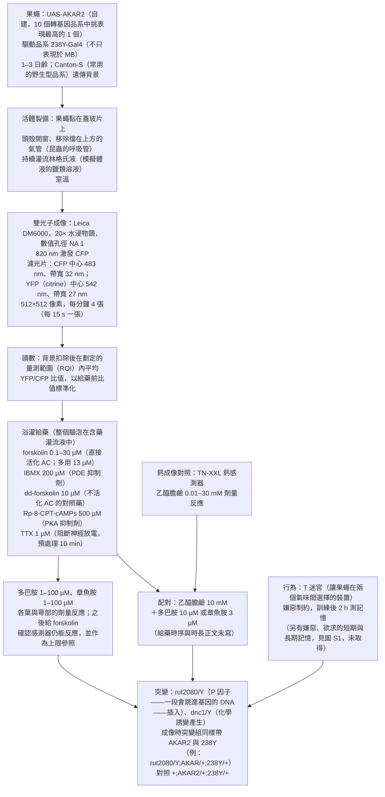
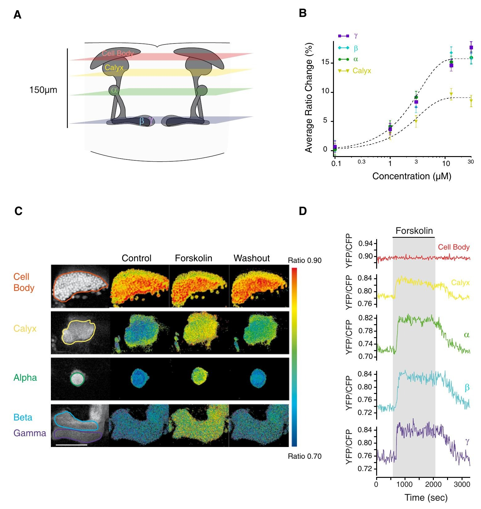
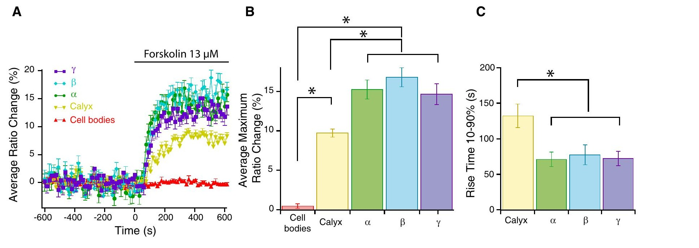
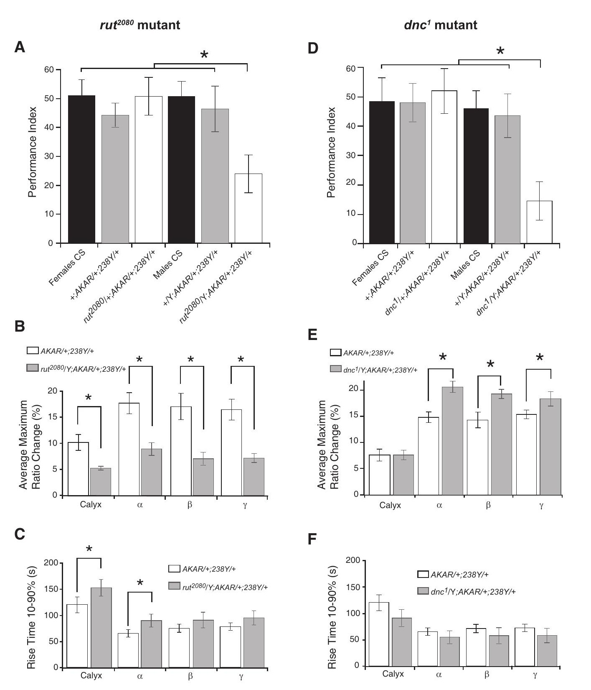
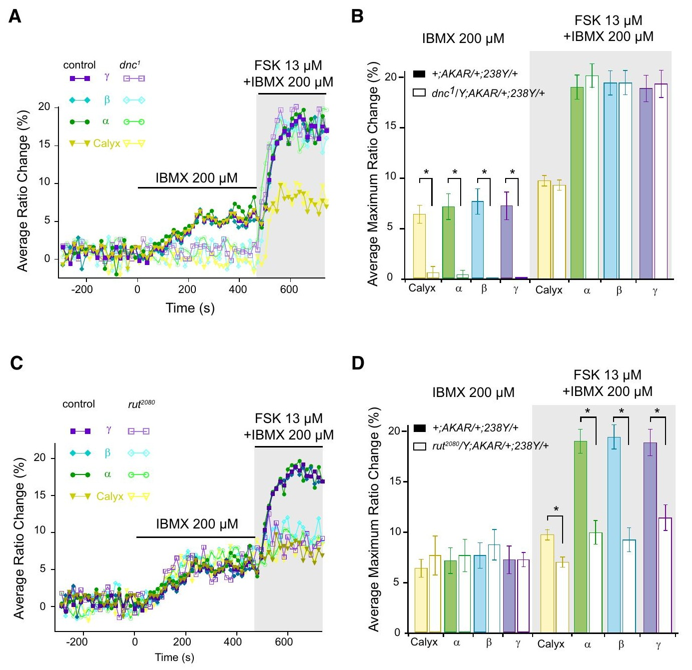
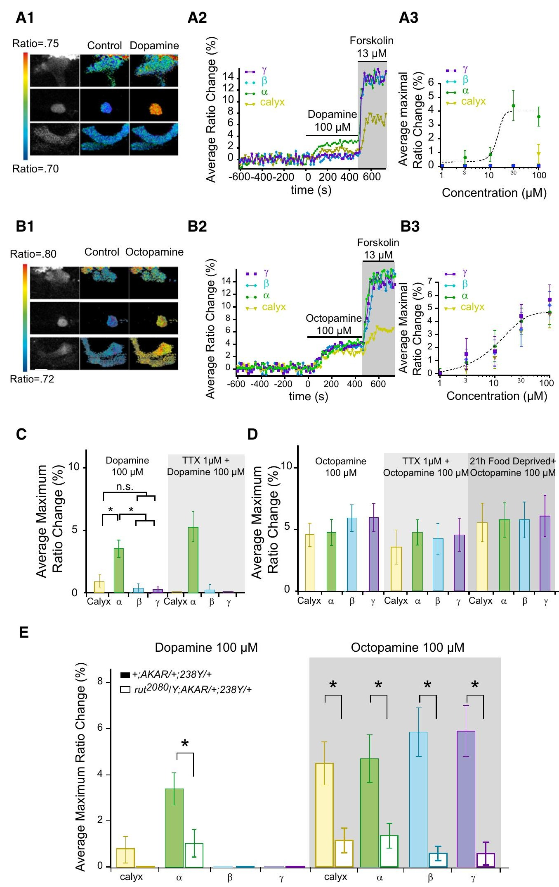
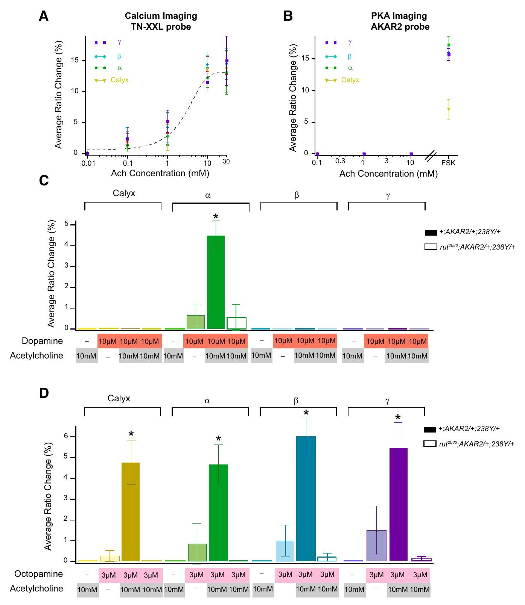
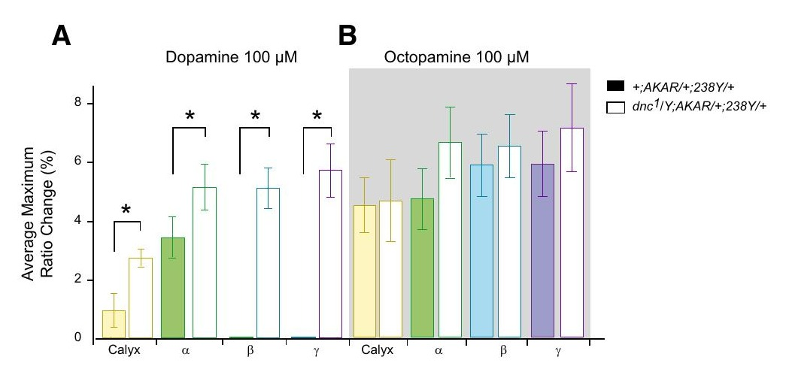
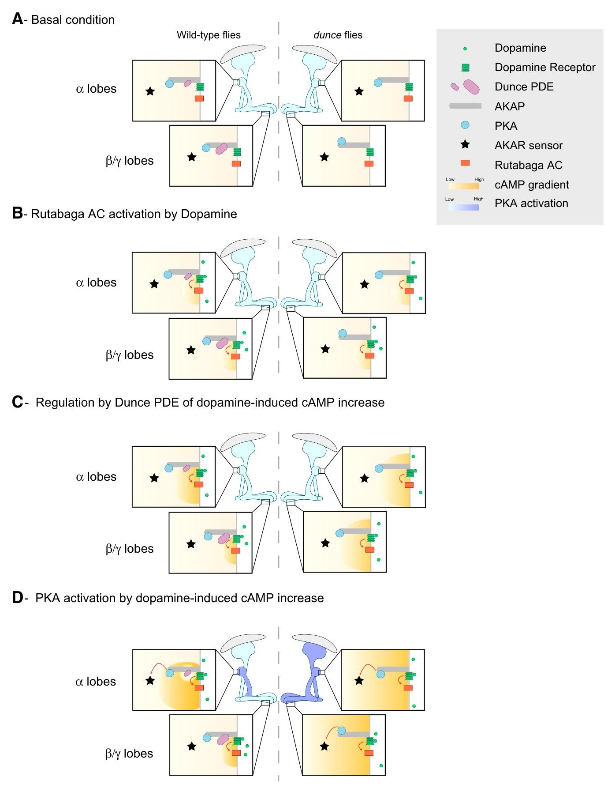

<!-- 本機 PDF：papers/2010-PKA%20Dynamics%20in%20a%20Drosophila%20Learning%20Center.pdf -->

# PKA Dynamics in a *Drosophila* Learning Center: Coincidence Detection by Rutabaga Adenylyl Cyclase and Spatial Regulation by Dunce Phosphodiesterase

**果蠅學習中樞裡的 PKA 動態：Rutabaga 腺苷酸環化酶負責巧合偵測，Dunce 磷酸二酯酶負責空間調控**

| 項目 | 內容 |
|---|---|
| **出處** | Neuron 65, 516–529 (2010；本 PDF 未印期號). doi: 10.1016/j.neuron.2010.01.014 [出版社頁面（DOI）](https://doi.org/10.1016/j.neuron.2010.01.014)；[全文 PDF（作者單位 ESPCI 網站）](https://www.bio.espci.fr/sites/www.bio.espci.fr/IMG/pdf/gervasipreat2010-2.pdf) |
| 日期 | 接受 2010-01-13；線上發表 2010-02-24；刊期 2010-02-25（PDF 第 12 頁與頁尾）。投稿與修訂日期本 PDF 未載：？待查 |
| 通訊作者 | Thomas Preat（thomas.preat@espci.fr） |
| 作者 | 共 3 人：Nicolas Gervasi（第一作者）、Paul Tchénio、Thomas Preat |
| 機構 | 法國巴黎 ESPCI（Ecole Supérieure de Physique et Chimie Industrielle）神經生物學組「Genes and Dynamics of Memory Systems」實驗室，CNRS；Tchénio 另屬巴黎第十一大學（Université Paris-Sud）Nanospectroscopy，CNRS UPR 3321（奧賽） |
| 資料庫 | 無（論文沒有釋出資料或程式） |
| 補充資料 | 正文引用補充圖 S1–S5（PDF 第 12 頁：「Supplemental Information includes five figures」）。**本 PDF 不含補充資料，未取得**；凡引到 S1–S5 的內容，本頁只能轉述正文的說法 |
| 編輯／審查 | *Neuron* 不公開審查人，無 |

> 與本庫有關的作者：無（三位作者都不是本庫成員或合作者）。
>
> 付費期刊（版權屬出版社，PDF 頁尾載「©2010 Elsevier Inc.」）。本庫所存 PDF 為出版社排版版（14 頁）。本篇沒有 PMC 免費版；資料表「出處」列給了 DOI（出版社頁面，是否免費開放本庫未能確認）與作者單位 ESPCI 網站上的全文 PDF 連結（本庫只給連結，不轉載）。**本庫不散布全文 PDF。** 本頁的圖擷取自原文，版權屬原出版社，以教學與評論目的引用，每張圖下方標明出處。

---

## 為什麼重要

果蠅學會「某個氣味＝會被電」，靠的是腦中的蕈狀體（mushroom body, MB）。蕈狀體的主要神經元叫 Kenyon 細胞（Kenyon cell, KC）；每顆 KC 一端的分枝（樹突）在萼部（calyx）接收氣味訊號，另一端的長纖維（軸突）往前延伸，聚成幾束叫做「葉」（lobe）的構造：往上長的 α 葉、往內側長的 β 葉與 γ 葉等。注意同一顆 KC 的軸突會分岔：一類 KC 的軸突同時長進 α 葉與 β 葉，另一類只長進 γ 葉，所以 α 葉與 β 葉是同一群細胞的兩支分枝。懲罰或獎賞則由釋放多巴胺（dopamine）或章魚胺（octopamine，昆蟲腦中類似腎上腺素的物質）的神經元送到蕈狀體。1970–80 年代最早找到的兩個學習突變基因，都落在同一條細胞內訊號路徑上：*rutabaga*（*rut*）製造一種腺苷酸環化酶（adenylyl cyclase, AC；生產訊號分子 cAMP 的酵素），*dunce*（*dnc*）製造一種磷酸二酯酶（phosphodiesterase, PDE；分解 cAMP 的酵素）。cAMP 升高之後，主要透過蛋白質激酶 A（protein kinase A, PKA；一種把磷酸根掛到其他蛋白質上、藉此改變它們功能的酵素）發揮作用。所以 cAMP 是中間的傳令，**PKA 才是真正動手改變細胞的那一步。**

在本篇之前，本知識庫（下稱本庫）已收的 [[s-tomchik-2009-camp-dynamics]]（前一年 2009 年 11 月刊出、在取出的離體腦上做）量的是 cAMP。本篇則在**活的果蠅**身上，用一個會報告 PKA 活性的螢光感測器 AKAR2，直接看 PKA 在 KC 各部位何時、何處被打開。作者報告三件事：(1) 在果蠅頭殼開一個小窗，讓腦表面持續泡在流動的生理鹽溶液中；把多巴胺加進這個溶液時，PKA 只在 α 葉被打開，β、γ 葉與萼部都沒有；章魚胺則打開全部四處（α、β、γ 葉與萼部）。(2) 在 *dnc* 突變果蠅，多巴胺打開了**所有**部位。作者據此主張，是 Dunce 這個分解酵素把多巴胺的作用「圈」在 α 葉。(3) 乙醯膽鹼（acetylcholine，氣味訊號傳給 KC 時用的化學物質，用來模擬「聞到氣味」）單獨給不會打開 PKA，低濃度多巴胺或章魚胺單獨給也只打開一點點，兩者一起給卻大幅打開。這個增強在 *rut* 突變中消失，作者據此支持「Rut 是巧合偵測器」（coincidence detector：只有兩個訊號同時出現才強烈反應的分子）的假說。

對本庫而言，本篇的價值在兩處。其一，它是庫內第一篇讓 *dunce* 從「行為突變」變成「在 KC 裡量得到的分子作用」的來源，補上 [[s-tully-1985-classical-conditioning]] 留下的問題的一角：*dnc*（cAMP 分解不掉）與 *rut*（cAMP 做得少）方向相反，學習缺陷卻相似（見 [[syn-contradictions]] 3.11）。本篇提出的說法是，*dnc* 的問題不只是 cAMP 太多，而是 cAMP 的作用不再被侷限在該在的部位。其二，它和 Tomchik 2009 在兩件事上給出相反的答案：單獨給多巴胺時的反應依不依賴 Rut（本篇：依賴；Tomchik 2009：不依賴），以及章魚胺與乙醯膽鹼一起給時是互相放大還是互相抵銷（本篇：放大；Tomchik 2009：比兩者相加還少）。**本頁把兩處都登記為未裁決的矛盾，不替它們找調和的說法。**

---

## 論文摘要（原文與中譯）

> **Summary:** The dynamics of PKA activity in the olfactory learning and memory center, the mushroom bodies (MBs), are still poorly understood. We addressed this issue in vivo using a PKA FRET probe. Application of dopamine, the main neuromodulator involved in aversive learning, resulted in PKA activation specifically in the vertical lobe, whereas octopamine, involved in appetitive learning, stimulated PKA in all MB lobes. Strikingly, MB lobes were homogeneously activated by dopamine in the learning mutant dunce, showing that Dunce phosphodiesterase plays a major role in the spatial regulation of cAMP dynamics. Furthermore, costimulation with acetylcholine and either dopamine or octopamine led to a synergistic activation of PKA in the MBs that depends on Rutabaga adenylyl cyclase. Our results suggest that Rutabaga acts as a coincidence detector and demonstrate the existence of subcellular domains of PKA activity that could underlie the functional specialization of MB lobes in aversive and appetitive learning.

（*Neuron* 的摘要不分 Background／Results／Conclusion 三段，原文即為一段。）

**中譯**（本節為忠實翻譯，非自撰內容；譯文後附名詞註）：

> **摘要：** 嗅覺學習與記憶中樞蕈狀體（MB）內 PKA 活性的動態，目前仍所知甚少。我們以一個 PKA FRET 探針在活體中探討此問題。施加多巴胺（嫌惡學習所涉及的主要神經調節物質）會專一地在垂直葉活化 PKA，而章魚胺（涉及欲求學習）會在所有 MB 葉刺激 PKA。值得注意的是，在學習突變株 dunce 中，多巴胺均勻地活化 MB 各葉，顯示 Dunce 磷酸二酯酶在 cAMP 動態的空間調控上扮演主要角色。此外，以乙醯膽鹼與多巴胺或章魚胺共同刺激，會在 MB 中引起協同的 PKA 活化，且此協同依賴 Rutabaga 腺苷酸環化酶。我們的結果顯示 Rutabaga 扮演巧合偵測器，並證明存在 PKA 活性的次細胞區域，這些區域可能是 MB 各葉在嫌惡與欲求學習中功能分化的基礎。

名詞註（非譯文）：**FRET 探針**＝由兩種螢光蛋白組成的感測器，被 PKA 磷酸化後兩色亮度的比值改變（原理見專業文第二節）；**神經調節物質**（neuromodulator）＝不直接讓神經元放電、而是改變神經元性質的化學物質；**嫌惡學習**＝氣味配電擊、學會避開；**欲求學習**（appetitive）＝氣味配糖、學會靠近；**垂直葉**＝往上長的 α 與 α′ 葉（α′ 是另一類 KC，α′/β′ KC，的垂直分枝，與 α 葉並排）（本篇實際只量了 α 葉，見第五節第 7 條）；**協同**（synergistic）＝一起給的反應大於各自單獨反應的總和；**巧合偵測器**（coincidence detector）＝只有兩個訊號同時出現才強烈反應的分子；**次細胞區域**＝同一顆細胞的不同部位。

---

## 科普文

想像一座城市下了一場均勻的雨。雨水落在每一條街上，但第二天早上只有一個區有積水。其他區不是沒下雨，而是那裡的排水溝特別通暢，雨一落地就被排走。要是有一天全市的排水溝都塞住，積水就會出現在每一個區。

果蠅的蕈狀體裡就有這樣一座城市。

**難題：同一場雨，為什麼只淹一區？**

蕈狀體是果蠅學習氣味的地方，裡面的主要神經元叫 Kenyon 細胞。每顆 Kenyon 細胞的一端在「萼部」收氣味訊號，另一端的長纖維（軸突）往前延伸，聚成幾束叫做「葉」的構造：往上長的 α 葉，以及往內側長的 β 葉、γ 葉。果蠅被電的時候，多巴胺會被送到蕈狀體；吃到糖的時候，章魚胺會被送來。這些物質讓 Kenyon 細胞裡製造一種叫 cAMP 的小分子，cAMP 再去打開一個叫 PKA 的酵素；PKA 才是真正改變細胞的那一步。

1970–80 年代的遺傳學已經找到兩個學習突變基因，剛好一個管「製造」cAMP（*rutabaga*，蕪菁），一個管「分解」cAMP（*dunce*，笨蛋；果蠅基因常取這種俏皮名字）。兩種突變果蠅都學不好。但在本篇之前，沒有人在活的果蠅腦裡看過：cAMP 與 PKA 在 Kenyon 細胞的哪個部位、什麼時候被打開？

**解法：讓 PKA 自己發光。**

作者把一個叫 AKAR2 的螢光感測器放進 Kenyon 細胞。它由兩個不同顏色的螢光蛋白組成，中間夾著一段 PKA 喜歡加工的胺基酸序列；PKA 一動手，兩個螢光蛋白就靠近，兩種顏色的亮度比例跟著改變。作者在活的果蠅頭上開一個小窗，用雙光子顯微鏡（一種能看進組織深處、比較不傷細胞的雷射顯微鏡）看這個比例的變化，再把藥物加進浸泡腦部的溶液裡（稱為「浴灌」，整個腦同時泡到）。

結果像那場雨。多巴胺浴灌時，PKA 只在 α 葉被打開，β 葉、γ 葉與萼部都沒有反應；換成章魚胺，所有部位都被打開。作者先排除兩個較平凡的解釋。一是多巴胺到不了 β、γ 葉：作者引用他人對果蠅腦中多巴胺擴散與回收速度的測量，論證浴灌幾分鐘應足以到達各葉（這是引文推論，本篇沒有直接量）。二是別的神經元轉手：用河豚毒素（TTX）讓全腦神經元停止放電。邏輯是：如果多巴胺是先刺激別的神經元、再由它們放電把訊號轉給 Kenyon 細胞，TTX 擋住放電後，樣式應該改變或消失；結果樣式依然不變，所以多巴胺應該是直接作用在 Kenyon 細胞上，這是 Kenyon 細胞自己的性質。

接著換成 *dunce* 突變果蠅，也就是「排水溝塞住」的城市：多巴胺在所有葉都打開了 PKA，連萼部也有。**作者據此主張，是 Dunce 這個分解 cAMP 的酵素在 β、γ 葉把多巴胺造成的 cAMP 迅速清掉，讓 PKA 只在 α 葉被打開。** 至於 α 葉的「排水溝」為什麼比較不通，作者也不知道（見專業文 3.7 節）。章魚胺則不受 Dunce 影響：在 *dunce* 突變中，章魚胺的反應與正常果蠅相同，所以它在每一區都能「積水」，原因同樣不明。

最後是巧合偵測。乙醯膽鹼是氣味訊號傳到 Kenyon 細胞時用的化學物質，作者用它模擬「聞到氣味」。單獨給乙醯膽鹼，PKA 不動；單獨給低濃度的多巴胺，PKA 只動一點點；兩者一起給，α 葉的 PKA 大幅打開，比單獨給高十倍濃度的多巴胺還多。在 *rutabaga* 突變果蠅裡，這個放大消失。**這支持一個 1980 年代就有的猜想：Rutabaga 這個製造 cAMP 的酵素，是「氣味」與「懲罰」兩個訊號的會合點。** 它的運作方式被認為是：氣味讓 Kenyon 細胞裡的鈣上升，多巴胺經細胞表面的受體送來另一個訊號，這個酵素兩種訊號都接收，兩者同時到時產量遠大於各自單獨到時。

**代價：給的是藥，拍得慢，量的是一大片。**

第一，刺激是藥物，不是真的氣味或電擊，而且是整個腦一起泡；真實的多巴胺神經元只把多巴胺送到蕈狀體的特定小段（稱為「區室」，compartment）。第二，影像每 15 秒才拍一張，看不到秒級的變化，也沒有測「氣味先、懲罰後」這種先後順序；而行為上，懲罰要在氣味之後到才學得會，先後順序是學習的關鍵條件之一。第三，每個量測範圍平均了數百顆細胞的纖維；作者自己也承認，β、γ 葉可能有感測器看不到的小區域其實有 PKA 被打開。第四，*rutabaga* 突變果蠅連單獨給多巴胺的反應都幾乎沒了，所以「配對後的放大消失」與「多巴胺本身就沒作用了」分不開（見專業文 3.5 節）。

另外，本篇與一年前另一個實驗室的 cAMP 研究（Tomchik 2009）有兩處說法相反：單獨給多巴胺的反應依不依賴 *rutabaga*（本篇說依賴、Tomchik 說不依賴），以及章魚胺與乙醯膽鹼一起給時是互相放大，還是比兩者分開給的總和還少（本篇說放大、Tomchik 說比總和少）。作者提出了解釋，但都是推測，本庫列為未裁決。

**最容易被誤讀的一點：** 「多巴胺只在 α 葉打開 PKA」講的是「把多巴胺均勻泡進整個腦」時、用 AKAR2 這把尺量到的結果，**不是**「β、γ 葉在學習時不用 PKA」。其他研究顯示 γ 葉的 *rutabaga* 對短期記憶是必要的，作者自己也這樣寫；本篇顯示的是 Kenyon 細胞「天生」傾向把多巴胺的 PKA 訊號侷限在 α 葉，至於真實學習時多巴胺從特定神經元送到特定小段的情形，本篇沒有量。

---

## 專業文

### 本頁用語

（每頁可單獨查閱，故與科普文、其他頁重複列出。）

| 詞 | 意思 |
|---|---|
| 蕈狀體（mushroom body, MB） | 果蠅腦中把氣味與好壞經驗連起來的構造。由 Kenyon 細胞組成，見下兩列 |
| Kenyon 細胞（KC） | 蕈狀體的主要神經元，代表氣味。一端的樹突在**萼部**收氣味訊號，另一端的軸突聚成幾束**葉**（見下一列）。細胞體聚在腦的後上方 |
| 萼部、葉（α、β、γ、α′、β′） | 萼部（calyx）是 KC 樹突所在；葉（lobe）是 KC 軸突成束的地方。α 與 α′ 往上長，稱**垂直葉**；β、β′、γ 往內側長，稱**水平葉**或**內側葉**。同一顆 α/β KC 的軸突分岔進 α 與 β 兩葉；γ KC 只進 γ 葉 |
| 區室（compartment） | 每條葉沿長軸再切成的小段，各段由不同的多巴胺神經元支配（見 [[c-mb-compartment]]）。本篇的量測範圍是整條葉，沒有分到區室 |
| cAMP、腺苷酸環化酶（AC）、磷酸二酯酶（PDE） | cAMP 是細胞內傳遞訊號的小分子；AC 製造它，PDE 分解它（見 [[c-camp-signaling]]） |
| 蛋白質激酶 A（PKA） | 被 cAMP 打開的酵素，把磷酸根掛到其他蛋白質上、藉此改變它們的功能。本篇量的是它，不是 cAMP |
| *rutabaga*（*rut*）、*dunce*（*dnc*） | 兩個學習突變基因。*rut* 製造一種 AC，受鈣／攜鈣素與多巴胺受體兩路訊號刺激（見 [[e-rutabaga]]）；*dnc* 製造一種專門分解 cAMP 的 PDE（見 [[e-dunce]]） |
| 等位基因、*rut2080*、*dnc1*、null | 同一基因的不同突變版本叫等位基因。本篇用 *rut2080* 與 *dnc1*；其他來源用 *rut¹*、*rut*^PS511、*dnc*^M11 等。null（無效突變）指完全沒有功能的突變 |
| 攜鈣素（calmodulin） | 與鈣結合後才去活化其他酵素的蛋白，是鈣訊號的中介 |
| 多巴胺、章魚胺 | 兩種調節神經元的化學物質（神經調節物質）。本篇發表時，多巴胺被認為傳遞懲罰、章魚胺傳遞獎賞（見 [[c-octopamine-reward-signal]]） |
| 乙醯膽鹼（ACh） | 氣味訊號傳給 KC 時用的化學物質，本篇用它模擬「聞到氣味」。濃度單位是 **mM**，比多巴胺、章魚胺的 µM 大一千倍 |
| 非條件刺激（US）、增強訊號 | 讓動物學會的懲罰或獎賞本身（電擊、糖）。被學習的氣味則是條件刺激（CS） |
| 協同、次加成 | 兩種刺激一起給時，反應**大於**各自單獨反應的總和叫協同（synergy）；**小於**總和叫次加成（sub-additive） |
| 巧合偵測器（coincidence detector） | 只有兩個訊號同時出現才強烈反應的分子。*rut* 被假設是「氣味（鈣）」與「懲罰（多巴胺）」的巧合偵測器（見 [[c-coincidence-detection]]） |
| AKAR2 | 本篇用的 PKA 螢光感測器，由青色（CFP）與黃色（YFP）兩種螢光蛋白組成；PKA 作用後兩色亮度的比值 YFP/CFP 上升。原理見第二節 |
| FRET | 螢光共振能量轉移：兩個螢光蛋白靠得夠近時，一個把能量轉給另一個。AKAR2 與 TN-XXL、Epac1-camps 都靠它運作 |
| 比值變化 % | 本篇的讀數：YFP/CFP 比值相對於給藥前基線增加了百分之幾。只能在本篇內比大小 |
| 最大比值變化 | 給藥期間比值變化 % 的最大值，各柱狀圖用的主要指標。論文沒有說明是單點峰值還是時間窗平均 |
| Epac1-camps、ΔR/R0 | Tomchik 2009 用的 cAMP 感測器與它的讀數（比值相對變化）。與本篇的 PKA 讀數不能直接比大小（見 [[e-epac-camp-sensor]]） |
| TN-XXL | 另一種 FRET 感測器，報告細胞內**鈣**濃度，不是 PKA |
| forskolin | 直接活化多數 AC 的藥物，繞過受體。本篇用它的反應當作「PKA 最多能被推到多高」的參照 |
| IBMX | 廣效 PDE 抑制劑，同時擋住多數種類的 PDE |
| TTX（河豚毒素） | 讓神經元無法放電的藥。全腦泡 TTX 後，其他神經元無法把訊號轉手給 KC |
| Rp-8-CPT-cAMPs | PKA 抑制劑，與 cAMP 搶同一個結合位 |
| 浴灌（bath application） | 把藥加進浸泡腦部的灌流液，整個腦同時泡到。與「只把多巴胺送到特定區室」的真實情況不同 |
| 雙光子顯微鏡 | 能看進組織深處、比較不傷細胞的雷射顯微鏡。本篇每 15 秒拍一張 |
| 活體、離體 | 活體＝活果蠅固定後在頭殼開窗觀察（本篇）；離體＝把腦取出泡在養液裡（Tomchik 2009，見 [[c-ex-vivo-explant]]） |
| 量測範圍（ROI） | 影像上圈出、用來平均訊號的區域。本篇每個 ROI 是一整條葉或整個萼部，平均了數百顆細胞的纖維 |
| 驅動品系、GAL4/UAS、238Y | 讓外加基因只在選定細胞表現的果蠅品系。GAL4 是只在特定細胞裡做出來的開關蛋白，會打開帶 UAS 序列的基因。238Y 標記三類 KC，但不只表現在蕈狀體（見 [[e-238y-gal4]]） |
| 劑量反應、EC50 | 給不同濃度的藥，看反應怎麼隨濃度變；EC50 是反應達到最大值一半時的濃度，越小代表越敏感 |
| 上升時間（10%–90%） | 反應從最大值的 10% 升到 90% 所花的時間，越短代表越快 |
| AKAP | A 激酶錨定蛋白，一類把 PKA、PDE、AC、受體固定在細胞特定位置的「支架」蛋白（見 3.7 節） |
| D1 型受體、Gs | D1 型是多巴胺受體中經 Gs 蛋白刺激 AC、提高 cAMP 的一類；Gs 是受體活化後在細胞內傳訊的 G 蛋白之一 |
| 表現指數（PI） | 由 T 迷宮中避開被電氣味的果蠅比例換算的記憶分數，0＝沒有記憶。本篇畫成 0–100，其他來源多為 0–1（見 [[c-performance-index]]、[[e-t-maze]]） |
| n、p、SEM | n 是樣本數（本篇多為幾隻果蠅）；p 是統計檢定的機率值，p < 0.05 稱「顯著」；SEM 是平均值的標準誤，即圖上的誤差棒 |
| ANOVA、Tukey-HSD | 比較多組平均值的檢定，與比完之後逐對比較的事後檢定 |
| 交互作用檢定 | 檢驗「A 的效果在 B 的不同條件下是否不同」，例如突變的效果是否因部位而異。只做兩個分開的檢定（一處顯著、一處不顯著）不能代替它 |

**讀前說明。**
(1) **蕈狀體的分區。** KC 分三類：α/β、α′/β′、γ。α/β KC 的軸突分岔成往上的 α 葉（垂直葉）與往內的 β 葉（水平葉），α′/β′ KC 同理分成 α′、β′ 葉，γ KC 只有水平的 γ 葉。萼部是所有 KC 的樹突所在。本篇只量了萼部、α、β、γ 四處（α′、β′ 葉訊號太弱，見第二節），所以「α 葉」量到的是 α/β KC 的軸突，「β 葉」是同一群 KC 的另一分枝。
(2) **讀數。** AKAR2 由黃色（YFP）與青色（CFP）兩種螢光蛋白組成（原理見第二節），讀數是兩色亮度的比值 YFP/CFP。本篇以「比值相對於給藥前基線增加了百分之幾」表示（圖上的「Average Ratio Change (%)」，下文寫作「比值變化 %」）。它是相對值，只能在同一感測器、同一種製備（preparation：實驗用的生物材料形式，例如活的果蠅、取出的整顆腦）內比較大小；與 Tomchik 2009 的 cAMP 讀數（該篇感測器 Epac1-camps 的比值相對變化，記作 ΔR/R0）不能直接比。
(3) **基因型寫法**（分號分隔不同的染色體）。 *rut2080*/Y 表示 X 染色體上帶 *rut2080* 突變的雄蠅（雄蠅只有一條 X，Y 上沒有對應基因，所以等於完全帶突變）；*rut2080*/+ 是只有一條 X 帶突變的雌蠅（另一條正常），學習正常，作為對照。AKAR/+;238Y/+ 表示帶一份感測器基因與一份 238Y 驅動品系，是本篇所有成像實驗的對照組（論文也寫成 +;AKAR2/+;238Y/+，前面的「+;」表示 X 染色體正常，兩者指同一種對照）。驅動品系的意思：果蠅常用 GAL4/UAS 雙元系統，GAL4 是一種只在特定細胞裡做出來的開關蛋白，它會打開帶 UAS 序列的基因；「238Y-Gal4>UAS-AKAR2」就是讓 238Y 標記的那些細胞做出 AKAR2。論文圖說常把它稱為「wild type」（野生型），但它不是未經改造的野生型果蠅。
(4) **標記。** 「⚠️ 單篇不一致」＝同一篇論文的摘要、正文、圖之間對不上；「※ 推論」＝論文沒有明說、由本頁推得；「※ 從圖判讀」＝數值是本頁從 300 dpi 頁面影像以像素量測換算（柱高取柱頂外框線，刻度取座標軸刻度線），一般誤差約 ±0.1–0.3 個百分點（比值變化 % 的讀數一般在 0–20 之間），個別註明者較大；「？待查」＝值得查、尚無來源。
(5) 「PDF 第 N 頁」指本庫所存 14 頁 PDF 的頁碼；期刊頁碼＝515＋N。

### 一、概述

**主要問題。** 論文引言最後一段（PDF 第 2 頁）提出：cAMP/PKA 路徑的各成員在活體中如何動態互動、在 MB 的哪個部位運作，目前不清楚。作者要在活果蠅中即時量 KC 各部位的 PKA 活性，回答四件事：(i) 萼部、軸突、細胞體對直接活化 AC 的反應有無不同；(ii) *rut* 與 *dnc* 突變如何改變這些反應；(iii) 多巴胺與章魚胺各自在哪裡打開 PKA；(iv) 乙醯膽鹼帶來的鈣上升與多巴胺或章魚胺配對時，PKA 是否被協同活化。乙醯膽鹼讓 KC 興奮、鈣離子流入細胞；而 Rut 同時受鈣（經攜鈣素，calmodulin，一種與鈣結合後才去活化其他酵素的蛋白）與多巴胺受體的訊號刺激，所以「鈣＋多巴胺」正是 Rut 被假設要偵測的那一對巧合。章魚胺的受體同樣能提高 cAMP（論文討論引 Han et al. 1998），本篇圖 5E 也顯示章魚胺的反應依賴 Rut，所以作者把「鈣＋章魚胺」當作同一類巧合來測。(i) 見 3.1 節，(ii) 見 3.2–3.3 節，(iii) 見 3.4 節，(iv) 見 3.5 節；3.6 節是 (ii) 與 (iii) 的交會（*dnc* 突變中的多巴胺反應），3.7 節是作者的模型。

**重要性。** *dnc* 與 *rut* 是果蠅學習遺傳學最早的兩個基因（Dudai et al. 1976；Livingstone et al. 1984）。兩者的生化缺陷早已知道：*dnc* 缺一種專一分解 cAMP 的 PDE，全腦 cAMP 偏高（Byers et al. 1981）；*rut* 缺受鈣／攜鈣素（Ca²⁺/calmodulin，鈣訊號的中介蛋白）刺激的 AC 活性。但這些都是磨碎組織後的生化量測，不知道在活的 KC 裡、哪個部位受影響。本篇是庫內第一篇在活體 KC 中量 PKA（而非 cAMP），也是第一篇在 KC 中量 *dnc* 突變效應的來源（「第一篇」僅就本庫已收的來源而言）。

**發表當時的領域現狀（2010）。** 論文所引的座標包括：
- **MB 各葉的分工**（「記憶痕跡」指學習後神經活動留下、可以量到的改變；這一串文獻的意義是：各葉分工不同，所以 PKA 在哪一葉被打開很重要）：*rut* 在 α/β 與 γ 葉對學習與短期記憶是必要的（Zars et al. 2000；Akalal et al. 2006）；*rut* 只在 α/β 神經元表現就足以支撐部分長期記憶（Blum et al. 2009）；早期記憶痕跡在 α′/β′ 神經元（Krashes et al. 2007；Wang et al. 2008）；缺垂直葉的 *ala* 突變沒有嫌惡長期記憶（Pascual & Preat 2001）；長期嫌惡記憶痕跡在 α 分支（Yu et al. 2006）。
- **增強訊號的傳遞者**：增強訊號（reinforcement）指讓動物學會的懲罰或獎賞本身，學術上稱非條件刺激（unconditioned stimulus, US），相對於被學習的氣味（條件刺激）。多巴胺神經元傳遞嫌惡的非條件刺激（Claridge-Chang et al. 2009，以光遺傳活化特定多巴胺神經元即可寫入嫌惡記憶；光遺傳是讓神經元表現對光敏感的通道，再用光直接活化它）；章魚胺神經元傳遞欲求的非條件刺激（Schwaerzel et al. 2003；Schroll et al. 2006）。
- **PKA 感測器**：AKAR2（Zhang et al. 2001、2005）已用於培養細胞、心肌細胞、離體視網膜與小鼠腦切片（Gervasi et al. 2007，即本篇第一作者先前的工作）。先前在果蠅用過的 PKA 感測器 PKA-GFP 會造成發育異常（Lissandron et al. 2007）。
- **平行研究**：Tomchik & Davis 2009（本庫 [[s-tomchik-2009-camp-dynamics]]）在離體腦用 cAMP 感測器 Epac1-camps 做了類似問題，本篇在討論中直接回應它（見第四節第 5、6 點）。

**體裁。** 原著研究論文：活體雙光子 PKA 成像（主體），加兩組行為實驗（確認感測器不影響學習、確認突變株在本實驗室的遺傳背景——同一突變放在不同品系的其他基因組合裡，表現可能不同——下仍有記憶缺陷）。

### 二、方法

**感測器 AKAR2。** AKAR2 由青色螢光蛋白（CFP）、黃色螢光蛋白的變體 citrine（下稱 YFP）、一段 PKA 受質序列（PKA 會在這裡掛上磷酸根）與一段來自酵母、會抓住「被磷酸化的蘇胺酸」的 FHA1 結構組成（PDF 第 2 頁）。PKA 磷酸化受質序列後，受質被 FHA1 抓住，兩個螢光蛋白靠近，能量由 CFP 轉給 YFP（稱為螢光共振能量轉移，FRET），於是 YFP/CFP 比值上升。**它量的是「PKA 磷酸化」與「把磷酸根拿掉的磷酸酶」兩者的淨結果**，不是 cAMP 濃度（作者明言，PDF 第 2 頁）。

**驗證。** (a) 238Y-Gal4>UAS-AKAR2 果蠅的 MB 結構在光學解析度下正常，嫌惡與欲求的短期、長期記憶正常（圖 S1，未取得）。(b) forskolin（直接活化多數 AC 的藥物）有濃度依賴的反應（圖 1B），洗掉後回到基線。(c) 不活化 AC 的類似物 1,9-dideoxyforskolin（10 µM）不引起比值變化（圖 S2A–B，未取得）。(d) PKA 抑制劑 Rp-8-CPT-cAMPs（500 µM）讓 forskolin 反應降到原本大小的約 20%–30%（圖 S2C–D，未取得）；作者說不完全阻斷是預期的，因為它與 cAMP 競爭同一個結合位，cAMP 高時效果變弱。(e) 2 小時錄影中 CFP 與 YFP 都沒有顯著褪色（YFP 以 970 nm 專一激發，在開始與結束各拍一張比較）。

**IBMX。** 廣效 PDE 抑制劑，用於 3.3 節：擋住分解 cAMP 的酵素，看平時有沒有 AC 在持續製造 cAMP，並檢驗 Dunce 是不是主要的 PDE。

**鈣成像。** 另用鈣感測器 TN-XXL 量乙醯膽鹼的劑量反應，用來確認乙醯膽鹼真的讓 KC 的鈣上升，並挑出配對用的濃度（10 mM，鈣反應已達平台）。

**驅動品系的限制。** 238Y-Gal4 不只表現在 MB（作者自己寫明，PDF 第 2 頁，引 Yang et al. 1995、Connolly et al. 1996）。量測範圍（ROI，region of interest）是依解剖位置在灰階影像上圈出的萼部與各葉，所以 ROI 內若有其他表現 AKAR2 的細胞纖維，也會被平均進去。※ 推論：葉部 ROI 以 KC 軸突為主，萼部 ROI 混入其他細胞的機會較大；論文沒有評估。

**量得到與量不到的部位。** α′、β′ 葉有表現，但較暗且活體腦會移動，無法得到可靠的 FRET 量測（PDF 第 2 頁）。KC 細胞體對 forskolin 幾乎沒有反應（0.48% ± 0.3%；同一實驗中萼部約 9.8%、各葉約 15–17%，見 3.1 節），且基線比值與螢光都很高，「彷彿細胞體裡的 AKAR2 一直處於磷酸化狀態」，原因不明，因此之後只量萼部與 α、β、γ 葉（PDF 第 4 頁）。

**統計。** 方法節寫：以單因子變異數分析（one-way ANOVA）加 Tukey-HSD 事後檢定，p < 0.05 為顯著；數據為平均值 ± 平均值的標準誤（SEM）（PDF 第 12 頁）。各圖說只寫「p < 0.05」與 n，**全文沒有報告任何確切的 p 值或檢定統計量**（已 grep `p =`、`p<`、`p <`、`ANOVA`、`Tukey`、`t test`：只有方法節一處與圖說的「p < 0.05」）。

**正文缺的參數。** 多巴胺、章魚胺浴灌的時長（正文沒寫；圖 5A2 代表例中多巴胺的給藥橫條約從 0 到 450 s，※ 從圖判讀）、配對實驗中乙醯膽鹼與多巴胺的給藥先後與間隔、「最大比值變化」（各圖柱狀圖用的主要指標，即給藥期間比值變化 % 的最大值）的取法（單點峰值或時間窗平均）、成像組的性別（突變組是雄蠅，對照組基因型未標性別）、每組行為實驗的果蠅數，正文與圖說都沒有寫（已 grep `simultan|before|interval|duration|female|male|flies per`）。

### 三、結果

#### 3.1 forskolin 在軸突的反應比樹突大、比樹突快

<small>圖片出處：Gervasi N, Tchénio P, Preat T. *Neuron* 65:516–529 (2010)，Figure 1。© 2010 Elsevier Inc. 教學引用；全文見 [DOI](https://doi.org/10.1016/j.neuron.2010.01.014)、[ESPCI 全文 PDF](https://www.bio.espci.fr/sites/www.bio.espci.fr/IMG/pdf/gervasipreat2010-2.pdf)。</small>

> **原圖說（Figure 1）：** In Vivo Expression of AKAR2 in *Drosophila* MB Neurons. (A) Schematic representation of MB neurons in the adult brain and the z position of the FRET images acquired. The Kenyon cell bodies are clustered in the posterior and dorsal parts of the brain. MB neurons extend dendrites into the calyx and one axon through the peduncle toward the anterior and dorsal anterior parts of the brain. Except for γ axons, MB axons branch into vertically and horizontally oriented neuropil regions known as lobes. The α and α′ lobes project vertically and the β, β′, and γ lobes project horizontally. (B) Dose-response curve of the AKAR2 sensor in MB in response to forskolin (n = 5). (C) Images of basal AKAR2 fluorescence and pseudocolor responses of Kenyon cell bodies, calyx, and α, β, and γ lobes to bath application of forskolin. Grayscale images show the basal fluorescence of CFP at 820 nm. Pseudocolor images show the YFP/CFP ratio for each pixel coded using a look-up table. Images correspond to FRET under basal, forskolin-stimulated, and washout conditions. The scale bar represents 50 µm. (D) Representative time course of YFP/CFP ratios in response to a bath application of forskolin (indicated by the gray shade on the graph) in the Kenyon cell bodies (red curve), calyx (yellow), and α (green), β (blue), and γ (purple) branches of the same living fly. The ratio was averaged over the regions outlined with the colored contour drawn in the grayscale image (B). See also Figure S1. Data are expressed as mean ± SEM.

**圖說中譯：** 果蠅 MB 神經元中 AKAR2 的活體表現。(A) 成蟲腦中 MB 神經元的示意圖，以及取得 FRET 影像的深度（z 位置）。Kenyon 細胞體聚集在腦的後側與背側。MB 神經元把樹突伸進萼部，並經由柄部（peduncle）送出一條軸突，朝腦的前方與背前方延伸。除 γ 軸突外，MB 軸突都分岔成垂直與水平方向的神經纖維區，稱為「葉」。α 與 α′ 葉垂直走向，β、β′ 與 γ 葉水平走向。(B) MB 中 AKAR2 感測器對 forskolin 的劑量反應曲線（n ＝ 5）。(C) Kenyon 細胞體、萼部與 α、β、γ 葉的 AKAR2 基礎螢光影像，與對浴灌 forskolin 的偽色反應。灰階影像為 820 nm 下 CFP 的基礎螢光；偽色影像以對照表為每個像素的 YFP/CFP 比值上色，分別對應基礎、forskolin 刺激與洗除時的 FRET。比例尺 50 µm。(D) 同一隻活果蠅的 Kenyon 細胞體（紅）、萼部（黃）與 α（綠）、β（藍）、γ（紫）分支對浴灌 forskolin（灰色區塊）的 YFP/CFP 比值時間進程代表例。比值是在灰階影像 (B) 中以彩色輪廓圈出的區域內平均。另見圖 S1。數據為平均值 ± SEM。

**解讀：**

- **B 格是全篇的參照尺：單獨給 forskolin 時，AKAR2 在軸突可以到約 16%，萼部約 9%。** B 格畫了兩條擬合曲線（三個葉共用一條、萼部一條），上限約為三個葉 15.8%、萼部 9.1%（※ 從圖判讀）；半最大濃度（EC50：反應達到最大值一半時的藥物濃度，越小代表越敏感）約 2–3 µM（※ 從圖判讀）。這是 5 隻果蠅、在不同濃度下量得的劑量反應曲線擬合值；下面圖 2 表格是另一批 12 隻果蠅在單一濃度 13 µM 下的實測值，所以數字略有不同（萼部 9.1 對 9.8、葉 15.8 對 14.7–16.8）。後面多巴胺的最大反應只有約 4%（圖 5A3），**約是 forskolin 上限的四分之一**；所以多巴胺停在 4% 不是感測器到頂，而是多巴胺能動員的 PKA 只有這麼多。（而 forskolin 單獨的這個 16% 上限也還不是感測器本身的極限：3.3 節先給 IBMX 再加 forskolin，各葉可到約 19%。）這與 Tomchik 2009 的 cAMP 結果不同：在那篇，多巴胺的最大 cAMP 反應（11.9%）與 10 µM forskolin（11.2%）相當（見該頁圖 2 解讀）。兩個讀數不同，不能據此說誰對，但要記得兩篇的「多巴胺很強／很弱」是相對於各自的 forskolin 而言。
- **D 格的細胞體曲線是一條平線，但它的基線（約 0.90）比其他部位的最高點（約 0.84）還高**（這裡是 YFP/CFP 原始比值，不是百分比變化）。作者把它解讀成「細胞體裡的 AKAR2 一直是磷酸化的」：若感測器早已全部被磷酸化，比值已在頂端，forskolin 就沒有空間再讓它上升。這只是猜測；另一個可能是細胞體的高螢光或自發螢光（組織本身、而非感測器發出的螢光）改變了比值的基線（※ 推論）。論文說原因不明，於是不再量細胞體。
- **D 格的 forskolin 給了約 25 分鐘**（灰色區塊約 600–2,050 s，※ 從圖判讀），洗掉後約 15 分鐘回到基線。這是浴灌實驗的時間尺度；本庫其他來源的行為訓練是氣味與電擊各約 60 秒（見 [[s-tomchik-2009-camp-dynamics]]、[[s-tully-1985-classical-conditioning]]）。所以浴灌結果反映的是長時間持續刺激下的狀態，不能直接當成一次訓練中的 PKA 時間進程（※ 推論）。
- ⚠️ **單篇不一致：** 圖說 (D) 說輪廓畫在「灰階影像 (B)」上，但灰階影像在 C 格，B 格是劑量反應曲線。正文說細胞體的高比值見「圖 1B 與 1C」（PDF 第 4 頁），但 B 格沒有細胞體的資料，細胞體的基線比值顯示在 C、D 格。都是圖號誤植，不影響結論。

<small>圖片出處：Gervasi N, Tchénio P, Preat T. *Neuron* 65:516–529 (2010)，Figure 2。© 2010 Elsevier Inc. 教學引用；全文見 [DOI](https://doi.org/10.1016/j.neuron.2010.01.014)、[ESPCI 全文 PDF](https://www.bio.espci.fr/sites/www.bio.espci.fr/IMG/pdf/gervasipreat2010-2.pdf)。</small>

> **原圖說（Figure 2）：** The Dynamic Range of PKA Activation in Response to Forskolin Application Is Larger in Axons than in Dendrites. (A) Time course of mean FRET ratios in Kenyon cell bodies (red triangles), calyx (yellow inverted triangles), and α (green circles), β (blue diamonds), and γ (purple squares) branches of MB neurons. Time 0 indicates the beginning of forskolin bath application. Each trace represents an average of 12 different flies. (B) Mean FRET ratio changes in response to forskolin application for each MB neuron compartment. Calyces present a smaller response amplitude compared with axons (p < 0.05, n = 12). (C) Comparison of the rise time (10%–90%) of forskolin-induced FRET ratios. Responses in the calyces are slower than in the lobes (p < 0.05, n = 10). See also Figure S2. Data are expressed as mean ± SEM.

**圖說中譯：** forskolin 引起的 PKA 活化動態範圍在軸突大於樹突。(A) MB 神經元的 Kenyon 細胞體（紅三角）、萼部（黃倒三角）與 α（綠圓）、β（藍菱形）、γ（紫方塊）分支的平均 FRET 比值時間進程；時間 0 為開始浴灌 forskolin；每條曲線為 12 隻果蠅的平均。(B) 各 MB 神經元部位對 forskolin 的平均 FRET 比值變化；萼部的反應幅度小於軸突（p < 0.05，n ＝ 12）。(C) forskolin 引起之 FRET 比值的上升時間（10%–90%）比較；萼部的反應慢於各葉（p < 0.05，n ＝ 10）。另見圖 S2。數據為平均值 ± SEM。

**解讀：**

| 部位 | 最大比值變化（%） | 上升時間 10–90%（s） | 上升時間 ÷ 取樣間隔 15 s |
|---|---:|---:|---:|
| 細胞體 | 0.48 ± 0.3（正文） | — | — |
| 萼部 | ≈ 9.8 | ≈ 133 | ≈ 9 張 |
| α 葉 | ≈ 15.3 | ≈ 71 | ≈ 5 張 |
| β 葉 | ≈ 16.8 | ≈ 78 | ≈ 5 張 |
| γ 葉 | ≈ 14.7 | ≈ 72 | ≈ 5 張 |

> forskolin 13 µM，n ＝ 12（幅度）、10（上升時間）。除細胞體一列取自正文（PDF 第 4 頁），其餘為 ※ 從圖判讀（圖 2B、2C 柱頂，像素量測）。最後一欄為本頁計算：方法節寫每分鐘取 4 張影像（PDF 第 12 頁），即每 15 秒一張。

- **軸突是樹突的約 1.6 倍高、約 1.8 倍快**（圖題的「動態範圍」即指幅度，也就是最大比值變化）。 三個葉之間沒有顯著差異（正文，PDF 第 4 頁）。作者排除兩個較平凡的解釋：(a) 各部位起點（基線比值）不同，所以能上升的空間不同——但基線比值與最大反應沒有相關（圖 S2E–F，未取得）；(b) 藥物擴散到各部位的快慢不同——但依圖 1A 的成像深度示意，從開窗往下依序是細胞體、萼部、α 葉、β/γ 葉（成像的深度方向不等於腦的「上下」），各葉比萼部更深，卻反應更快。
- **上升時間只有 5–9 個取樣點。** 每 15 秒一張的取樣，讓上升時間的解析度約 ±15 秒；萼部與葉的差（約 60 秒，約 4 張）仍大於這個解析度，結論可以成立，但**本篇所有動力學結論都只在數十秒以上的尺度有意義**。這也意味著本篇的設計無法回答秒級的先後順序問題，也就是 Tomchik 2009 與 [[s-handler-2019-dopamine-receptor-timing]]（另一篇在秒級時間差上研究多巴胺與 KC 活動先後的論文）討論的那一類。
- **作者對「軸突較強」的解釋是推測。** 討論提出兩個原因（PDF 第 9–10 頁）：Rut 蛋白偏好分布在軸突（Han et al. 1992），以及細纖維的表面積／體積比讓 cAMP 容易累積（本頁補充說明：製造 cAMP 的 AC 位於細胞膜上，細纖維的膜面積相對於內部體積較大，產生的 cAMP 被稀釋在較小的體積裡，濃度較高；※ 推論）。本篇沒有檢驗任何一個。而且 3.3 節的 IBMX（廣效 PDE 抑制劑）實驗中，先給 IBMX 把 PDE 全部擋住、再加 forskolin，萼部約 9.8%，仍只有軸突（約 19%）的一半（圖 4B）。Dunce 是一種 PDE；所有 PDE 都被擋住了萼部仍較弱，所以萼部較弱至少不是 Dunce 分解 cAMP 造成的（※ 推論，依圖 4B 判讀）。這個 9.8% 來自圖 4 的另一批 5 隻果蠅，與上表圖 2B 的萼部 9.8% 恰好相同，是兩個不同實驗；兩次實驗共同的是萼部都只有葉的約一半到三分之二。

#### 3.2 *rut* 與 *dnc* 突變改變 forskolin 反應

<small>圖片出處：Gervasi N, Tchénio P, Preat T. *Neuron* 65:516–529 (2010)，Figure 3。© 2010 Elsevier Inc. 教學引用；全文見 [DOI](https://doi.org/10.1016/j.neuron.2010.01.014)、[ESPCI 全文 PDF](https://www.bio.espci.fr/sites/www.bio.espci.fr/IMG/pdf/gervasipreat2010-2.pdf)。</small>

> **原圖說（Figure 3）：** Learning and Memory Mutants Show Modifications in Forskolin-Induced PKA Activation. (A) Memory performance of flies 2 hr after a single training session. *rut2080* mutant flies show a 2 hr memory deficit (p < 0.05, n = 12). (B) Mean FRET ratio changes in response to forskolin in *rut2080* and control flies. The FRET ratio change is lower in the *rut2080* mutant compared with wild-type flies (p < 0.05, n = 12). (C) In the *rut2080* mutant, the FRET ratio rise time is significantly increased in the calyces and α lobes (p < 0.05, n = 10). (D) Memory performance of flies 2 hr after a single training session. The *dnc1* mutant shows a 2 hr memory deficit (p < 0.05, n = 8). (E) Mean FRET ratio changes in response to forskolin in *dnc1* and control flies. FRET ratio changes increase in the *dnc1* mutant exclusively in the MB lobes (p < 0.05, n = 8). (F) Mean FRET ratio kinetics in response to forskolin in *dnc1* and control flies. No significant differences were found between the two genotypes (n = 8). See also Figure S3. Data are expressed as mean ± SEM.

**圖說中譯：** 學習與記憶突變株的 forskolin 誘發 PKA 活化改變。(A) 單次訓練後 2 小時的記憶表現；*rut2080* 突變果蠅有 2 小時記憶缺陷（p < 0.05，n ＝ 12）。(B) *rut2080* 與對照果蠅對 forskolin 的平均 FRET 比值變化；*rut2080* 突變的變化低於野生型（p < 0.05，n ＝ 12）。(C) *rut2080* 突變中，萼部與 α 葉的 FRET 比值上升時間顯著延長（p < 0.05，n ＝ 10）。(D) 單次訓練後 2 小時的記憶表現；*dnc1* 突變有 2 小時記憶缺陷（p < 0.05，n ＝ 8）。(E) *dnc1* 與對照果蠅對 forskolin 的平均 FRET 比值變化；*dnc1* 突變的變化只在 MB 各葉增加（p < 0.05，n ＝ 8）。(F) *dnc1* 與對照果蠅對 forskolin 的 FRET 比值動力學；兩種基因型之間無顯著差異（n ＝ 8）。另見圖 S3。數據為平均值 ± SEM。

**解讀：**

| 部位 | 對照（B） | *rut2080*（B） | *rut* ÷ 對照 | 對照（E） | *dnc1*（E） | *dnc* ÷ 對照 |
|---|---:|---:|---:|---:|---:|---:|
| 萼部 | ≈ 10.2 | ≈ 5.2 | ≈ 0.51 | ≈ 7.7 | ≈ 7.7 | ≈ 1.00 |
| α 葉 | ≈ 17.8 | ≈ 8.9 | ≈ 0.50 | ≈ 14.9 | ≈ 20.6 | ≈ 1.39 |
| β 葉 | ≈ 17.0 | ≈ 7.1 | ≈ 0.42 | ≈ 14.3 | ≈ 19.3 | ≈ 1.35 |
| γ 葉 | ≈ 16.5 | ≈ 7.2 | ≈ 0.43 | ≈ 15.4 | ≈ 18.4 | ≈ 1.19 |

> 單位為最大比值變化 %，forskolin 13 µM（圖 3 本身未標濃度，依圖 2 推定，※ 推論）。值為 ※ 從圖判讀（圖 3B、3E 柱頂，像素量測）；比值為本頁計算。

- **行為（A、D 格）：** 表現指數（performance index, PI；由訓練後避開被電氣味的果蠅比例換算，0 表示沒有記憶，越高記憶越好；見 [[c-performance-index]]）在本篇以 0–100 的尺度畫（Tully 1985、Tomchik 2009 用 0–1）。*rut2080*/Y 約 24、同性別對照（+/Y;AKAR/+;238Y/+）約 46；*dnc1*/Y 約 14.5、同性別對照約 43.5（※ 從圖判讀）。**這組實驗的作用是確認突變株在本實驗室的基因型組合下仍有缺陷**，不是新發現。*rut2080* 仍有約一半的記憶分數，這也與下一點「*rut2080* 是否完全失去功能」的疑問有關。
- ***rut2080* 讓四個部位一致降到約一半。** 作者引 Levin et al. 1992 稱 *rut2080* 是無效突變（null，完全沒有功能的突變），所以剩下的一半 PKA 反應來自另一個 AC（PDF 第 5 頁）。這個推論依賴「*rut2080* 真的是 null」，本篇沒有自己驗證（方法節只寫它是插入在 *rut* 開放讀架內的 P 因子，PDF 第 12 頁。開放讀架是基因中實際編碼蛋白質的那一段；P 因子是一段會跳進基因裡的 DNA。插進編碼段常會破壞基因，但不保證完全失去功能，所以這句話本身不足以證明 null）。
- ***dnc1* 的效應只在軸突，萼部完全相同。** 這是本篇第一個空間上的發現：Dunce 的 PDE 活性在軸突有作用，在萼部看不出作用。⚠️ 但「只在軸突」是「軸突顯著、萼部不顯著」兩個檢定的並列，論文沒有做「基因型 × 部位」的交互作用檢定（已 grep `interaction|two-way`，無結果）；從萼部兩柱幾乎完全相同（≈ 7.7 對 ≈ 7.7）看，方向應該是對的。
- **兩組對照的萼部不一樣高**（B 格約 10.2、E 格約 7.7、圖 2B 約 9.8），基因型相同。這提醒讀者：本篇的 n 在 8–12，組間差 2–3 個百分點可能只是批次差異，**跨圖比絕對幅度要小心**。
- ⚠️ **單篇不一致（輕微）：** 正文說 *rut2080* 的上升時間「普遍增加」（general increase，PDF 第 4 頁），圖說說只在萼部與 α 葉顯著；C 格的 β、γ 葉有增加的趨勢但沒有星號。正文與圖說把對照組稱為「wild type」，實際是 AKAR/+;238Y/+。

#### 3.3 IBMX：有一個不是 Rut 的 AC 一直在運作，而 Dunce 是主要的 PDE

<small>圖片出處：Gervasi N, Tchénio P, Preat T. *Neuron* 65:516–529 (2010)，Figure 4。© 2010 Elsevier Inc. 教學引用；全文見 [DOI](https://doi.org/10.1016/j.neuron.2010.01.014)、[ESPCI 全文 PDF](https://www.bio.espci.fr/sites/www.bio.espci.fr/IMG/pdf/gervasipreat2010-2.pdf)。</small>

> **原圖說（Figure 4）：** Rut-Independent Basal AC Activity Is Regulated by Dnc PDE in the MBs. (A) Representative FRET ratio time course in response to 200 µM IBMX observed in *dnc1* and control flies. Responses of a *dnc1* mutant fly in the calyx (yellow open triangles) and α (green open circles), β (blue open diamonds), and γ (purple open squares) branches compared with wild-type calyx (yellow triangles) and α (green circles), β (blue diamonds), and γ (purple squares) branches. IBMX has no effect on *dnc1* flies. Flies were also stimulated by forskolin to verify that FRET ratio changes are similar in *dnc1* and control flies in the presence of IBMX. (B) Mean FRET ratio changes in response to IBMX in *dnc1* and control flies (p < 0.05, n = 5). The FRET response to forskolin was similar in the two groups (n = 5), indicating that Dnc PDE is the main enzyme regulating cAMP concentration in the MBs. (C) Representative FRET ratio time courses in response to 200 µM IBMX in a *rut2080* and a control fly. Responses of the *rut2080* mutant in the calyx (yellow open triangles) and α (green open circles), β (blue open diamonds), and γ (purple open squares) branches compared with those of wild-type calyx (yellow triangles) and α (green circles), β (blue diamonds), and γ (purple squares) branches. IBMX produced the same FRET ratio increase in *rut2080* flies, indicating that Rut AC is not responsible for basal cAMP synthesis in the MBs. (D) Mean FRET ratio changes in response to IBMX show no significant differences between *rut2080* and control flies (n = 5). The FRET response to forskolin is decreased in *rut2080* flies (p < 0.05, n = 5). +;AKAR2/+;238Y/+ control flies are identical in (B) and (D). Data are expressed as mean ± SEM.

**圖說中譯：** MB 中 Rut 以外的基礎 AC 活性受 Dnc PDE 調控。(A) *dnc1* 與對照果蠅對 200 µM IBMX 的 FRET 比值時間進程代表例：*dnc1* 突變果蠅的萼部（黃空心三角）與 α（綠空心圓）、β（藍空心菱形）、γ（紫空心方塊）分支，對比野生型的萼部（黃三角）與 α（綠圓）、β（藍菱形）、γ（紫方塊）分支。IBMX 對 *dnc1* 果蠅無作用。果蠅之後也以 forskolin 刺激，以確認在 IBMX 存在下 *dnc1* 與對照的 FRET 比值變化相近。(B) *dnc1* 與對照果蠅對 IBMX 的平均 FRET 比值變化（p < 0.05，n ＝ 5）；兩組對 forskolin 的 FRET 反應相近（n ＝ 5），顯示 Dnc PDE 是 MB 中調控 cAMP 濃度的主要酵素。(C) 一隻 *rut2080* 與一隻對照果蠅對 200 µM IBMX 的 FRET 比值時間進程代表例（符號同 A）。IBMX 在 *rut2080* 果蠅引起相同的 FRET 比值上升，顯示 MB 中基礎的 cAMP 合成不是 Rut AC 負責。(D) 對 IBMX 的平均 FRET 比值變化，*rut2080* 與對照果蠅無顯著差異（n ＝ 5）；*rut2080* 果蠅對 forskolin 的 FRET 反應降低（p < 0.05，n ＝ 5）。(B) 與 (D) 的 +;AKAR2/+;238Y/+ 對照果蠅為同一組。數據為平均值 ± SEM。

**先說明 IBMX。** IBMX 是一種廣效 PDE 抑制劑，會同時抑制多數種類的 PDE（200 µM，PDF 第 5 頁）。如果細胞裡有某個 AC 在沒有任何刺激時就一直少量製造 cAMP，平時這些 cAMP 被 PDE 清掉；一旦用 IBMX 把 PDE 擋住，cAMP 就會累積，PKA 就會被打開。

**解讀：**

- **三個推論，一環扣一環（依 ※ 從圖判讀的柱高）：**
  1. 對照組單獨給 IBMX，四個部位都上升約 6.4–7.7%；**在 *dnc1* 中幾乎為零**（約 0–0.6%）。*dnc1* 缺 Dunce（它是否完全失去 Dunce 活性，論文只說是化學誘變得到的學習突變株，沒有說明：？待查），IBMX 若還能讓 PKA 上升，必定是擋住了別的 PDE；實際幾乎不升，表示 IBMX 在正常果蠅擋住的主要就是 Dunce。（*dnc1* 平時 cAMP 可能已偏高，但讀數以給藥前歸零，看不到，見下方「視覺陷阱」。）
  2. 兩組都已泡著 IBMX，再加 forskolin，*dnc1* 與對照到達一樣的高度（萼部 *dnc1* 約 9.3、對照約 9.8；三個葉約 19–20；這些是從給藥前基線算起的累計值）。這一步的作用是證明 *dnc1* 的感測器正常、還反應得起來，所以第 1 點的「幾乎為零」不是感測器壞了。

     「Dunce 是唯一的 PDE」的主要證據其實在第 1 點：若除了 Dunce 還有其他重要的 PDE，*dnc1* 單獨給 IBMX 時，那些 PDE 被擋住，PKA 應該還會上升；實際上幾乎不升。第 2 點排除了「感測器壞了」這個替代解釋。兩點合起來，作者說 Dunce 是 α/β 與 γ 神經元中「唯一（或至少是主要）」的 PDE（PDF 第 5 頁）。
  3. *rut2080* 單獨給 IBMX 時與對照相同（約 7.3–8.8 對 6.4–7.7）。表示基礎的 cAMP 不是 Rut 做的，**有一個 Rut 以外、持續活動的 AC**。
- **作者沒說的一點：在 *rut2080* 中，forskolin 加上去之後只再加約 2–3 個百分點（對照組加約 12）。** 數字如下（皆為從給藥前基線算起的累計值；※ 從圖判讀，圖上 *rut2080* 畫成白色空心柱，判讀誤差較大，約 ±0.5）。*rut2080*：萼部 IBMX 單獨約 7.7、加 forskolin 後約 7.0（差在判讀誤差內，可視為沒變）；三個葉 IBMX 單獨約 7.3–8.8、加 forskolin 後約 9.2–11.4。對照組：三個葉由約 7 升到約 19，萼部由約 6.4 升到約 9.8。也就是說，在擋住 PDE 之後，對照組 forskolin 多出來的那一大截，幾乎全靠 Rut。這比圖 3B（未擋 PDE 時 *rut* 剩一半）更強烈地顯示 forskolin 反應主要經由 Rut，論文沒有點出（※ 推論）。兩者怎麼並存，見四、討論第 2 點。
- **萼部的一個矛盾，論文沒有處理。** 在 *dnc1* 中，萼部對 IBMX 也幾乎沒有反應（本節第 1 點），表示萼部平時的基礎 cAMP 也是 Dunce 在清；但 3.2 節顯示，拿掉 Dunce 並不改變萼部對 forskolin 的反應。「平時的基礎量」與「被 forskolin 推高時」兩種情況下，Dunce 在萼部的作用看起來不同，論文沒有解釋（※ 推論）。
- **視覺陷阱：讀數以給藥前為零。** 比值是相對於給藥前標準化的（方法節），所以如果 *dnc1* 果蠅的 KC 平時 PKA 就已偏高（全腦 cAMP 偏高是已知的，Byers et al. 1981），這個偏高在所有圖上都會被歸零而看不到。「IBMX 對 *dnc1* 無作用」可以是「沒有可擋的 PDE」，也可以部分是「起點已經偏高」（※ 推論）。作者沒有比較兩種基因型的基線比值。
- **踩煞車：** n ＝ 5；B、D 兩格共用同一組對照（圖說明言），所以 *dnc1* 與 *rut2080* 兩個比較並不獨立：若這組對照恰好偏高或偏低，兩個比較會一起受影響。「Dunce 是唯一的 PDE」只限於本感測器、本 ROI 量得到的範圍；萼部在 IBMX＋forskolin 下仍只有軸突的一半，萼部的低天花板不是 Dunce 造成的。

#### 3.4 浴灌多巴胺只打開 α 葉的 PKA，章魚胺打開全部；兩者都依賴 Rut

<small>圖片出處：Gervasi N, Tchénio P, Preat T. *Neuron* 65:516–529 (2010)，Figure 5。© 2010 Elsevier Inc. 教學引用；全文見 [DOI](https://doi.org/10.1016/j.neuron.2010.01.014)、[ESPCI 全文 PDF](https://www.bio.espci.fr/sites/www.bio.espci.fr/IMG/pdf/gervasipreat2010-2.pdf)。</small>

> **原圖說（Figure 5）：** Dopamine Application Specifically Activates PKA in the α Lobe in a Rut-Dependent Manner whereas Octopamine Induces a Rut-Dependent Activation of PKA in All MB Lobes and Calyx. (A1) Images of basal AKAR2 fluorescence and pseudocolor responses of the calyx and α, β, and γ lobes to bath application of 100 µM dopamine. Grayscale images show the basal fluorescence of CFP at 820 nm, and pseudocolor images correspond to basal and dopamine-stimulated FRET ratios. (A2) Representative time course of FRET ratios in response to bath application of dopamine (indicated by the black bar) and forskolin (indicated in gray) in the calyx (yellow triangles) and α (green circles), β (blue diamonds), and γ (purple squares) branches, recorded in the same fly. (A3) Dose-response curve for MB responses to bath-applied dopamine (n = 6). Please note that the symbols for the β lobes and calyx are hidden by the symbols for the γ lobes. (B1) Images of basal AKAR2 fluorescence and pseudocolor responses of the calyx and α, β, and γ lobes to bath application of 100 µM octopamine. Grayscale images show the basal fluorescence of CFP at 820 nm, and pseudocolor images correspond to basal and octopamine-stimulated FRET ratios. (B2) Representative time course of FRET ratios in response to octopamine bath application (indicated by the black bar on the graph) and forskolin (indicated by the gray shade on the graph) in the calyx (yellow triangles) and α (green circles), β (blue diamonds), and γ (purple squares) branches recorded in the same fly. (B3) Dose-response curve for MB responses to bath-applied octopamine (n = 6). Please note that the symbols for the α lobes, β lobes, and calyx are hidden by the symbols for the γ lobes. (C) Mean FRET ratio changes in response to dopamine (p < 0.05, n = 9). A 10 min bath application of TTX (1 µM) was used to block action potentials in the entire *Drosophila* brain. Dopamine was then applied. The same pattern of dopamine-induced PKA activation is seen in the presence or absence of TTX (n = 4). (D) Mean FRET ratio changes in response to octopamine (n = 7). Pretreatment with 1 µM TTX has no effect on PKA activation (n = 4). For food-deprivation experiments, flies were kept in plastic bottles with cotton wool pads imbibed with 6.5 ml of mineral water for 21 hr. Octopamine bath application produces a similar level of PKA activation to that in control flies (n = 6). (E) Mean FRET ratio changes in response to dopamine and octopamine in *rut2080* and control flies. Dopamine-induced FRET ratio responses were Rut dependent (n = 9). Octopamine-induced FRET ratio responses were Rut dependent (n = 7). See also Figure S4. Data are expressed as mean ± SEM.

**圖說中譯：** 多巴胺以依賴 Rut 的方式專一活化 α 葉的 PKA，而章魚胺以依賴 Rut 的方式活化所有 MB 葉與萼部的 PKA。(A1) 萼部與 α、β、γ 葉的 AKAR2 基礎螢光影像，及對浴灌 100 µM 多巴胺的偽色反應；灰階為 820 nm 下 CFP 的基礎螢光，偽色為基礎與多巴胺刺激下的 FRET 比值。(A2) 同一隻果蠅的萼部（黃三角）與 α（綠圓）、β（藍菱形）、γ（紫方塊）分支對浴灌多巴胺（黑色橫條）與 forskolin（灰色）的 FRET 比值時間進程代表例。(A3) MB 對浴灌多巴胺的劑量反應曲線（n ＝ 6）；β 葉與萼部的符號被 γ 葉的符號遮住。(B1) 同 A1，100 µM 章魚胺。(B2) 同一隻果蠅各部位對浴灌章魚胺（黑色橫條）與 forskolin（灰色區塊）的 FRET 比值時間進程代表例。(B3) MB 對浴灌章魚胺的劑量反應曲線（n ＝ 6）；α 葉、β 葉與萼部的符號被 γ 葉的符號遮住。(C) 對多巴胺的平均 FRET 比值變化（p < 0.05，n ＝ 9）。以 10 分鐘浴灌 TTX（1 µM）阻斷整個果蠅腦的動作電位後再給多巴胺，有無 TTX 的多巴胺 PKA 活化樣式相同（n ＝ 4）。(D) 對章魚胺的平均 FRET 比值變化（n ＝ 7）；以 1 µM TTX 預處理不影響 PKA 活化（n ＝ 4）。禁食實驗中，果蠅養在放有浸了 6.5 ml 礦泉水的棉花墊的塑膠瓶中 21 小時；浴灌章魚胺引起的 PKA 活化與對照相近（n ＝ 6）。(E) *rut2080* 與對照果蠅對多巴胺與章魚胺的平均 FRET 比值變化；多巴胺誘發的 FRET 反應依賴 Rut（n ＝ 9），章魚胺誘發的反應依賴 Rut（n ＝ 7）。另見圖 S4。數據為平均值 ± SEM。

**藥物先說明：** TTX（河豚毒素）阻斷電壓門控鈉通道，讓神經元無法產生動作電位（放電）。全腦泡 TTX 後，其他神經元無法再把訊號「轉手」傳給 KC，所以若樣式不變，就代表這是 KC 自己對藥物的反應。

**解讀：**

| 條件 | 萼部 | α 葉 | β 葉 | γ 葉 | n | 出處 |
|---|---:|---:|---:|---:|---:|---|
| 多巴胺 100 µM | ≈ 0.9 | ≈ 3.5 | ≈ 0.35 | ≈ 0.2 | 9 | 5C |
| TTX 1 µM 預處理後再給多巴胺 100 µM | ≈ 0.1 | ≈ 5.3 | ≈ 0.2 | ≈ 0 | 4 | 5C |
| 多巴胺 100 µM，對照 | ≈ 0.8 | ≈ 3.4 | ≈ 0 | ≈ 0 | 9 | 5E |
| 多巴胺 100 µM，*rut2080* | ≈ 0 | ≈ 1.0 | ≈ 0 | ≈ 0 | 9 | 5E |
| 章魚胺 100 µM | ≈ 4.7 | ≈ 4.8 | ≈ 6.0 | ≈ 6.0 | 7 | 5D |
| TTX 1 µM 預處理後再給章魚胺 100 µM | ≈ 3.7 | ≈ 4.9 | ≈ 4.3 | ≈ 4.6 | 4 | 5D |
| 禁食 21 h 的果蠅，章魚胺 100 µM | ≈ 5.6 | ≈ 5.9 | ≈ 5.9 | ≈ 6.2 | 6 | 5D |
| 章魚胺 100 µM，對照 | ≈ 4.5 | ≈ 4.7 | ≈ 5.9 | ≈ 5.9 | 7 | 5E |
| 章魚胺 100 µM，*rut2080* | ≈ 1.2 | ≈ 1.4 | ≈ 0.6 | ≈ 0.6 | 7 | 5E |
| **參照：forskolin 13 µM（圖 2B）** | ≈ 9.8 | ≈ 15.3 | ≈ 16.8 | ≈ 14.7 | 12 | 2B |

> 單位為最大比值變化 %，全部 ※ 從圖判讀（像素量測；5C、5D 的刻度間距較大，誤差約 ±0.2）。「多巴胺 100 µM」（5C）與「多巴胺 100 µM，對照」（5E）是同一種處理在兩個圖格中的柱子，數值略有不同，章魚胺亦同，見下方標「※ 推論（論文未說明）」的那一點。最後一列是不同一批果蠅的 forskolin 反應，只作量級參照。

- **α 葉的多巴胺反應約是 forskolin 上限的四分之一，章魚胺約三分之一。** α 葉與 β、γ 葉的對比（約 3.5 對 0–0.35）很鮮明（萼部約 0.9% 略高於 β、γ 葉，但不顯著：正文說萼部沒有顯著上升，圖 5C 在萼部、β、γ 之間標 n.s.），但若和 forskolin 的上限比，α 葉的反應絕對量很小。A2 格同一隻果蠅之後給 forskolin，β、γ 葉衝到約 14%，**證明 β、γ 葉的感測器是好的、只是多巴胺沒有打開它**。這是全圖最有說服力的對照。
- **A3 格的劑量反應曲線很陡，而且 α 葉在 30 µM 已到頂。** α 葉在 3、10、30、100 µM 約 0.6、0.8、4.4、3.6%（※ 從圖判讀，誤差約 ±0.15），擬合曲線的半最大濃度（EC50，定義見 3.1 節）約 15 µM。這一點對 3.5 節很重要：配對實驗用的 10 µM 多巴胺，單獨給時在本圖約 0.8%、在圖 6C 約 0.65%（兩個不同實驗），正落在曲線起跳之前。
- **與 Tomchik 2009 的劑量比較，作者的「感測器靈敏度」解釋只對一半。** 先說作者的解釋（PDF 第 9 頁）。PKA 由調節次單元與催化次單元組成：cAMP 結合到調節次單元後，催化次單元（真正掛磷酸根的部分）才被放出來工作。調節次單元對 cAMP 的 EC50 約 100–500 nM，Tomchik 2009 用的 Epac1-camps 約 2.4 µM，也就是 PKA 對 cAMP 敏感約五到二十倍。AKAR2 量的是 PKA 的磷酸化，所以它的靈敏度沿用 PKA 對 cAMP 的靈敏度。作者據此推論：少量 cAMP 就能被 AKAR2 看到，Epac1-camps 卻需要更多 cAMP、也就是更高濃度的多巴胺或章魚胺（兩者在化學上同屬「胺」類）才看得到反應，所以 Tomchik 2009 的劑量反應曲線「往右移」（往高濃度方向移，看起來較不敏感）。

  本頁的檢驗：比較兩篇劑量反應曲線的半最大濃度（EC50；皆 ※ 從圖判讀），多巴胺在本篇約 15 µM、在 Tomchik 2009 約 100–200 µM，確實右移約十倍；但章魚胺在本篇約 10–20 µM（圖 5B3 擬合曲線）、在 Tomchik 2009 約 5–10 µM（見 [[s-tomchik-2009-camp-dynamics]] 圖 2 解讀），**沒有右移，甚至略偏左**。若右移純粹來自感測器靈敏度，兩種胺應該一起右移（※ 推論；兩篇一為活體、一為離體，濃度到達組織的效率也不同，所以這只是削弱、不是推翻作者的解釋）。
- **TTX 組的 α 葉反而更大（約 5.3 對 3.5），論文沒有評論。** n ＝ 4，誤差棒大（約 ±1.2），可能只是小樣本變異；但若為真，表示神經網路的活動平時在壓低 α 葉的反應（※ 推論）。樣式（只有 α 葉）確實不變，作者的結論「是 KC 自身的性質」在這一點上成立。
- **「依賴 Rut」與「接近雜訊」：** 正文說 *rut2080* 中多巴胺與章魚胺的反應「大幅降低、接近實驗雜訊」（greatly reduced and close to experimental noise，PDF 第 7 頁）。圖上 *rut2080* 剩下的是對照的約 30%（多巴胺 α 葉 1.0/3.4）與約 10–30%（章魚胺各部位）。誤差棒（約 ±0.3–0.6）大致碰到零，「接近雜訊」的說法可以接受，但不是零。
- ※ 推論（論文未說明）：5E 的對照柱與 5C、5D 及圖 7（3.6 節，*dnc1* 實驗）的對照柱高度幾乎相同（章魚胺各部位差 ≤ 0.15 個百分點，以未四捨五入的量測值計算；表中四捨五入後的數字差距看起來可能略大），n 也相同（多巴胺 9、章魚胺 7），可能是同一批對照重複用於 *rut* 與 *dnc* 的比較。但 5C 的 β、γ 葉約 0.35、0.2，5E 與圖 7 約 0，又不完全相同，所以無法確定。論文對圖 4 與圖 7 明言對照共用，對圖 5 則沒有說明。影響：若真的共用，這幾個比較並不獨立；方向性結論不受影響，但讀者不應把 5C、5E、圖 7 當成三次獨立的重複。
- ⚠️ **單篇不一致（輕微）：** A3 的圖說說萼部符號被 γ 葉遮住，但 100 µM 處萼部約 0.9% 清楚可見；B3 的圖說說 α、β 與萼部都被 γ 遮住，但四種符號在 3–100 µM 都分得開。
- **禁食 21 小時不改變章魚胺反應（D 格），** 作者據此說果蠅的動機狀態不影響章魚胺的訊號傳遞（背景：果蠅要餓才學得會糖獎賞，作者把禁食當作改變「想要糖」的動機狀態；章魚胺當時被認為傳遞糖獎賞）。這只測了浴灌 100 µM 一個濃度（B3 劑量曲線在 100 µM 已接近平台），在飽和濃度下看不出差異不代表低濃度時也沒有差異（※ 推論）。

> ⚠️ 矛盾｜單獨給多巴胺時的反應是否依賴 Rutabaga：本篇（活體、PKA 感測器 AKAR2、浴灌 100 µM）*rut2080* 中多巴胺的 PKA 反應「大幅降低、接近雜訊」（圖 5E；α 葉約 3.4 → 1.0%，n ＝ 9）；[[s-tomchik-2009-camp-dynamics]]（離體腦、cAMP 感測器 Epac1-camps、浴灌 10 nM–10 mM）*rut¹* 中單獨多巴胺的 cAMP 劑量反應與對照無差異（該篇圖 2F，重複量數 ANOVA p ＝ 0.59，n ＝ 13）。本篇作者的解釋是感測器靈敏度不同（Epac1-camps 的 EC50 約 2.4 µM，PKA 調節次單元約 100–500 nM），並「提出」Rut 以外的多巴胺／章魚胺活化只在高濃度出現（PDF 第 9 頁）。作者的推理分三步：(1) Tomchik 2009 的感測器較不靈敏，低濃度時根本看不到反應，只在高濃度看得到；(2) 在高濃度時，多巴胺或章魚胺也會經由 Rut 以外的 AC 產生 cAMP；(3) 所以在 Tomchik 2009 看得到反應的濃度範圍裡，*rut* 突變看不出差別。作者沒有說明，為什麼對照組多出的 Rut 那一份在高濃度時會看不出來（例如是否相對太小）；這一環是缺的。這裡的「高濃度」必須高於本篇用的 100 µM（本篇在 100 µM 時反應仍依賴 Rut；Tomchik 2009 最高用到 10 mM），作者沒有點明。這是作者的推測，沒有實驗檢驗。兩篇另有三處不同：讀出（cAMP 對 PKA）、製備（離體對活體）、突變等位基因（*rut¹* 是 Tomchik 2009 用的另一個 *rut* 突變版本，本篇用 *rut2080*；兩者是否同樣完全失去功能：？待查）。｜未裁決。見 [[syn-contradictions]] 1.7。

#### 3.5 乙醯膽鹼與低濃度多巴胺或章魚胺配對：PKA 協同活化，*rut2080* 中消失

<small>圖片出處：Gervasi N, Tchénio P, Preat T. *Neuron* 65:516–529 (2010)，Figure 6。© 2010 Elsevier Inc. 教學引用；全文見 [DOI](https://doi.org/10.1016/j.neuron.2010.01.014)、[ESPCI 全文 PDF](https://www.bio.espci.fr/sites/www.bio.espci.fr/IMG/pdf/gervasipreat2010-2.pdf)。</small>

> **原圖說（Figure 6）：** Pairing of an Acetylcholine-Mediated Intracellular Calcium Increase with Dopamine or Octopamine Induces a Rut-Dependent Synergistic Activation of PKA in MB Neurons. (A) Dose-response of MB neurons expressing TN-XXL probes in the MBs in response to acetylcholine bath application (n = 6). (B) Dose-response of MB neurons expressing the AKAR2 probe in the MBs in response to acetylcholine and forskolin bath application (n = 6). (C) Mean FRET ratio changes in response to 10 mM acetylcholine, 10 µM dopamine, or paired application of acetylcholine and dopamine in control and *rut2080* flies (n = 6). Pairing produces an activation of PKA only in the α lobes of the MBs (p < 0.05). This potentiation of dopaminergic signaling is ablated in the *rut2080* mutant. (D) Mean FRET ratio changes in response to 10 mM acetylcholine, 3 µM octopamine, or paired application of acetylcholine and octopamine in control and *rut2080* flies (n = 6). Pairing produces an activation of PKA in all lobes of the MBs (p < 0.05). This potentiation of octopaminergic signaling is ablated in the *rut2080* mutant. See also Figure S5. Data are expressed as mean ± SEM.

**圖說中譯：** 乙醯膽鹼引起的細胞內鈣上升與多巴胺或章魚胺配對，在 MB 神經元引起依賴 Rut 的協同 PKA 活化。(A) MB 表現 TN-XXL 探針的神經元對浴灌乙醯膽鹼的劑量反應（n ＝ 6）。(B) MB 表現 AKAR2 探針的神經元對浴灌乙醯膽鹼與 forskolin 的劑量反應（n ＝ 6）。(C) 對照與 *rut2080* 果蠅對 10 mM 乙醯膽鹼、10 µM 多巴胺，或兩者配對施加的平均 FRET 比值變化（n ＝ 6）；配對只在 MB 的 α 葉活化 PKA（p < 0.05）；這種對多巴胺訊號的增強在 *rut2080* 突變中被消除。(D) 對照與 *rut2080* 果蠅對 10 mM 乙醯膽鹼、3 µM 章魚胺，或兩者配對的平均 FRET 比值變化（n ＝ 6）；配對在 MB 所有葉活化 PKA（p < 0.05）；這種對章魚胺訊號的增強在 *rut2080* 突變中被消除。另見圖 S5。數據為平均值 ± SEM。

**感測器先說明：** TN-XXL 是另一種 FRET 感測器，報告的是細胞內鈣濃度（不是 PKA）。A 格用它確認乙醯膽鹼真的讓 KC 的鈣上升；作者說 10 mM 時達到平台；再加 30 mM KCl（高濃度鉀會讓神經元去極化，即膜電位上升、神經元被激發，鈣進一步湧入）還能再升，表示感測器還量得到更高的鈣，所以平台不是感測器飽和（數據未示）。量鈣的理由：Rut 被假設同時偵測鈣（代表氣味）與多巴胺受體的訊號，所以要先確認乙醯膽鹼真的提供了鈣這一半。注意乙醯膽鹼的濃度單位是 **mM**（毫莫耳），多巴胺與章魚胺是 µM（微莫耳），差一千倍。

**解讀：**

| 部位 | 乙醯膽鹼單獨 | 胺（多巴胺或章魚胺）單獨 | 配對（對照） | 配對（*rut2080*） | 配對 ÷（兩者單獨相加） |
|---|---:|---:|---:|---:|---:|
| **多巴胺 10 µM（C 格）** | | | | | |
| 萼部 | ≈ 0 | ≈ 0 | ≈ 0 | ≈ 0 | — |
| α 葉 | ≈ 0.07 | ≈ 0.65 | **≈ 4.5** | ≈ 0.56 | **≈ 6** |
| β 葉 | ≈ 0 | ≈ 0 | ≈ 0 | ≈ 0 | — |
| γ 葉 | ≈ 0 | ≈ 0 | ≈ 0 | ≈ 0 | — |
| **章魚胺 3 µM（D 格）** | | | | | |
| 萼部 | ≈ 0 | ≈ 0.3 | **≈ 4.8** | ≈ 0 | **≈ 13** |
| α 葉 | ≈ 0 | ≈ 0.9 | **≈ 4.7** | ≈ 0 | **≈ 5** |
| β 葉 | ≈ 0 | ≈ 1.0 | **≈ 6.0** | ≈ 0.25 | **≈ 6** |
| γ 葉 | ≈ 0 | ≈ 1.5 | **≈ 5.4** | ≈ 0.15 | **≈ 3.6** |

> 單位為比值變化 %，n ＝ 6，全部 ※ 從圖判讀（像素量測，誤差約 ±0.1）。「≈ 0」指柱高在 0.1 以下（圖上畫成貼著橫軸的細條，量得約 0.05–0.09）；α 葉的乙醯膽鹼單獨寫出 ≈ 0.07，是因為要用它算比值。*rut2080* 只有「配對」一欄，因為論文沒有測 *rut2080* 的單獨給藥（見下方第 4 點）。最後一欄為本頁以量測值計算，不是用表中四捨五入後的數字；例如萼部：4.77 ÷（乙醯膽鹼 0.05＋章魚胺 0.31）≈ 13。分母小於 1 時對判讀誤差很敏感，只能看量級。

- **B 格是另一個必要的對照：** 乙醯膽鹼 0.1–10 mM 單獨給時 PKA 都不動，之後給 forskolin 仍有約 16%（葉）與約 7%（萼部）的反應（※ 從圖判讀），代表感測器正常。所以配對時的 PKA 上升不能歸給乙醯膽鹼本身。
- **協同的量級是約 3.6–13 倍，遠大於 Tomchik 2009 的 cAMP 協同（配對 ÷ 相加約 1.25–1.53，見該頁 3.3 節表）。** 兩篇量的東西不同：cAMP 是 PKA 的上游。※ 推論：PKA 對 cAMP 的反應可能有門檻（閾值），cAMP 低於門檻時 PKA 幾乎不動，越過門檻後陡升。若是如此，在門檻附近，cAMP 只要多一點點，PKA 就會多很多；cAMP 的小幅協同就會變成 PKA 的數倍協同。本篇的單獨刺激放在閾值附近（10 µM 多巴胺單獨只有約 0.65%（圖 6C）至 0.8%（圖 5A3）；但論文本身對這是「閾值以下」還是「部分活化」說法不一，見本節第 6 點），正好處在這種放大最強的位置。兩篇的倍數因此不能直接比較。
- **配對 10 µM 多巴胺的 α 葉反應（約 4.5%）大於單獨 100 µM 多巴胺（約 3.4–3.6%，圖 5）。** 這就是作者說的「劑量反應曲線左移」（PDF 第 8 頁）：與乙醯膽鹼配對，相當於讓多巴胺的有效濃度提高。但單獨給藥的曲線在 30 µM 已到頂（約 4.4%），配對值約 4.5% 只是達到這個頂；所以只能說左移至少約三倍（10 µM 配對 ≈ 30 µM 單獨），確切倍數無法從這些資料算出。而且**協同的空間樣式不變**：多巴胺配對仍只有 α 葉（C 格），章魚胺配對仍是全部（D 格）。
- **這張圖最關鍵的缺口：*rut2080* 只做了「配對」一組。**（表中 α 葉 *rut2080* 配對約 0.56，與對照的多巴胺單獨約 0.65 相當，並非零。） 每個部位四根柱子依序是：對照的乙醯膽鹼單獨、對照的胺單獨、對照的配對、*rut2080* 的配對（依柱子的填色與圖例判讀）。*rut2080* 的乙醯膽鹼單獨、胺單獨都沒有測。而 3.4 節已顯示 *rut2080* 中 100 µM 多巴胺的單獨反應就只剩約 30%。所以「*rut2080* 中配對反應消失」有兩種解釋分不開：(a) Rut 負責的是巧合偵測；(b) Rut 負責的是多巴胺（或章魚胺）本身的訊號，在 *rut2080* 中連單獨的反應都沒了，配對自然也沒有東西可以放大。**這與 Tomchik 2009 的設計相反**：該篇在 *rut¹* 中先證明單獨反應正常，再證明協同消失，所以能把協同專一地歸給 Rut（見該頁 3.3 節解讀）。本篇的資料與「Rut 是巧合偵測器」相容，但單靠本篇不足以證明它。
- **配對的時序沒有寫。** 圖說與正文只說「paired application」，方法節沒有交代乙醯膽鹼與多巴胺誰先、間隔多久、各給多長（已 grep `simultan|before|interval|paired|duration`）；引言寫「temporally paired」（PDF 第 2 頁），但沒有對應的操作定義。因為兩者都是浴灌、影像每 15 秒一張，※ 推論：這裡的「配對」應是兩種藥在數十秒到數分鐘的範圍內同時存在。**本篇因此沒有測先後順序**；行為上「先氣味後懲罰」的順序要求，本篇無從回答。
- ⚠️ **單篇不一致：** (a) 結果節的小標題寫「把兩個**閾值以下**的刺激聯結起來」（Associating Two Subthreshold Stimuli），討論也寫低濃度的多巴胺或章魚胺「只有在配對時」才活化 PKA（PDF 第 10 頁）；但同一節正文寫這兩個濃度是「產生**部分** PKA 活化」的濃度（partial PKA activation，PDF 第 8 頁），而圖上章魚胺 3 µM 單獨在 γ 葉約 1.5%，不是零。(b) 正文說乙醯膽鹼讓「包括細胞體在內」的所有部位鈣上升（including the cell bodies，圖 6A，PDF 第 8 頁），但 A 格只畫了萼部與 α、β、γ 葉，沒有細胞體。(c) 圖 6 的 *rut* 基因型寫成 *rut2080*;AKAR2/+;238Y/+，圖 5E 寫 *rut2080*/Y;AKAR/+;238Y/+，論文沒有說明兩者是否相同：少了「/Y」可能只是省略寫法（仍是雄蠅），也可能是兩條 X 都帶突變的雌蠅，對結論的影響無法判斷。
- **100 µM 配對沒有增益（圖 S5，未取得）。** 正文說以「單獨即產生最大 PKA 活化」的濃度（100 µM）配對時，幅度與空間樣式都不變（PDF 第 8 頁）。本頁無法檢視數據。

> ⚠️ 矛盾｜章魚胺與乙醯膽鹼配對是否協同：本篇（活體、PKA、浴灌，章魚胺 3 µM ＋ 乙醯膽鹼 10 mM）四個部位都協同上升（圖 6D，配對 ÷ 相加約 3.6–13，n ＝ 6，p < 0.05）；[[s-tomchik-2009-camp-dynamics]]（離體、cAMP、玻璃管局部噴，管內章魚胺 100 µM ＋ 乙醯膽鹼 30 mM）正常果蠅的 α 葉、α′ 葉，以及 *rut¹* 突變果蠅（Tomchik 2009 用的 *rut* 突變版本）的 α 葉，都是顯著的次加成（配對小於相加，配對 ÷ 相加約 0.76–0.81）；萼部與 γ 葉的配對也略小於相加，但差異不顯著。本篇作者把差異歸因於 Tomchik 2009 用了「飽和濃度」的章魚胺，並說本篇在 100 µM 時同樣看不到增強「可能是因為 PKA 活性已飽和」（PDF 第 10 頁；本篇 100 µM 的配對數據在圖 S5，未取得）。這是作者的推測：Tomchik 2009 的 100 µM 是玻璃管內的濃度，從管尖噴出後會被周圍液體稀釋，到達組織時可能遠低於 100 µM，所以不一定是飽和濃度；而且「沒有增益」（本篇 100 µM）與「次加成」（Tomchik，配對比相加還少）仍是兩種不同的結果。另需注意，本篇所謂「PKA 活性飽和」時的章魚胺反應約 5–6%，同一隻代表例果蠅之後給 forskolin 可到約 14%（圖 5B2），所以飽和的是「章魚胺經其受體與 AC 所能產生的 PKA 活化」，不是 AKAR2 本身（※ 推論）。｜未裁決。見 [[syn-contradictions]] 1.8。

#### 3.6 *dnc1* 中多巴胺打開所有部位；章魚胺不受影響

<small>圖片出處：Gervasi N, Tchénio P, Preat T. *Neuron* 65:516–529 (2010)，Figure 7。© 2010 Elsevier Inc. 教學引用；全文見 [DOI](https://doi.org/10.1016/j.neuron.2010.01.014)、[ESPCI 全文 PDF](https://www.bio.espci.fr/sites/www.bio.espci.fr/IMG/pdf/gervasipreat2010-2.pdf)。</small>

> **原圖說（Figure 7）：** Dnc PDE Is Required for the α Lobe Specificity of Dopamine-Induced PKA Activation. Mean FRET ratio changes in response to dopamine (A) and octopamine (B) in *dnc1* and control flies. Dopamine induced a FRET ratio change in all MB compartments in *dnc1* mutant flies (p < 0.05, n = 9). No differences were observed in octopamine-induced FRET ratio responses between *dnc1* and control flies (n = 7). +;AKAR2/+;238Y/+ control flies are identical in (A) and (B). Data are expressed as mean ± SEM.

**圖說中譯：** 多巴胺誘發之 PKA 活化的 α 葉專一性需要 Dnc PDE。*dnc1* 與對照果蠅對多巴胺 (A) 與章魚胺 (B) 的平均 FRET 比值變化。在 *dnc1* 突變果蠅中，多巴胺在所有 MB 部位引起 FRET 比值變化（p < 0.05，n ＝ 9）。*dnc1* 與對照果蠅對章魚胺的 FRET 反應沒有差異（n ＝ 7）。(A) 與 (B) 的 +;AKAR2/+;238Y/+ 對照果蠅為同一組。數據為平均值 ± SEM。

⚠️ 單篇不一致：圖說說 (A)(B) 的對照是同一組果蠅，但同一圖說給多巴胺 n ＝ 9、章魚胺 n ＝ 7，論文沒有說明同一組為何有兩個 n（可能是部分果蠅只做了其中一種藥，※ 推論）。

**解讀：**

| 部位 | 多巴胺 100 µM 對照 | 多巴胺 *dnc1* | 章魚胺 100 µM 對照 | 章魚胺 *dnc1* |
|---|---:|---:|---:|---:|
| 萼部 | ≈ 1.0 | ≈ 2.75 | ≈ 4.6 | ≈ 4.7 |
| α 葉 | ≈ 3.5 | ≈ 5.15 | ≈ 4.8 | ≈ 6.7 |
| β 葉 | ≈ 0 | ≈ 5.1 | ≈ 5.95 | ≈ 6.6 |
| γ 葉 | ≈ 0 | ≈ 5.7 | ≈ 6.0 | ≈ 7.2 |

> 單位為最大比值變化 %，n ＝ 9（多巴胺）、7（章魚胺），全部 ※ 從圖判讀（像素量測；*dnc1* 的 γ 葉空心柱誤差約 ±0.2）。

- **這是全篇最乾淨、也最重要的一張圖。** 在 *dnc1* 中，β、γ 葉的多巴胺反應從零變成約 5%，**比對照的 α 葉（約 3.5%）還大**；α 葉本身也從約 3.5 升到約 5.2。章魚胺在四個部位都沒有顯著變化。所以 Dunce 的作用對多巴胺有、對章魚胺看不出來，而對多巴胺的作用主要在 β、γ 葉。
- **作者的推論「Dunce 把多巴胺的 PKA 訊號圈在 α 葉」與數據相符，但有一個替代解釋沒有排除。** *dnc1* 是全身、從發育期就缺 Dunce 的突變（論文在 IBMX 實驗的開頭也這樣寫，PDF 第 5 頁）。※ 推論：長期缺少 PDE 的 KC 可能在發育中改變了其他成分（例如受體——細胞表面接收多巴胺的蛋白質——或 AC 的量與分布），β、γ 葉因此對多巴胺變得敏感；這與「成蟲期的 Dunce 即時清掉 cAMP」是兩種機制。本篇沒有在成蟲期急性抑制 Dunce 後再給多巴胺（3.3 節的 IBMX 實驗只單獨給 IBMX 或加 forskolin，沒有與多巴胺併用；已讀遍結果節）。
- ⚠️ **單篇不一致：** 摘要說在 *dnc* 中 MB 各葉被多巴胺「均勻地」（homogeneously）活化。圖上三個葉相近（約 5.1–5.7），但萼部約 2.75，只有葉的一半左右；萼部也不是「葉」。正文的措辭（「α、β、γ 葉與萼部都上升」）比摘要準確。
- **為什麼章魚胺不受 Dunce 影響？** 作者沒有實驗解釋，只在討論中推測：欲求學習（章魚胺）用的 PKA 不受 AKAP（把訊號分子固定在一起的支架蛋白，見 3.7 節）與 Dunce 調控（見四、討論第 8 點；圖 8 的模型只畫了多巴胺）。章魚胺在對照中已經打開全部部位，所以「Dunce 把章魚胺的訊號圈住」本來就無從觀察；但若 Dunce 在 β、γ 葉清除 cAMP 的能力很強，*dnc1* 中章魚胺在 β、γ 葉應該也會再升高，實際只升約 0.6–1.2 個百分點、不顯著（α 葉由約 4.8 升到 6.7，也不顯著）。但 n ＝ 7、誤差棒約 ±1–1.5，即使有中等大小的差異也可能測不出來。結論：資料不足以判斷 Dunce 對章魚胺訊號有沒有作用，這一點既不支持也不反駁作者（※ 推論）。

#### 3.7 作者的分子模型

<small>圖片出處：Gervasi N, Tchénio P, Preat T. *Neuron* 65:516–529 (2010)，Figure 8。© 2010 Elsevier Inc. 教學引用；全文見 [DOI](https://doi.org/10.1016/j.neuron.2010.01.014)、[ESPCI 全文 PDF](https://www.bio.espci.fr/sites/www.bio.espci.fr/IMG/pdf/gervasipreat2010-2.pdf)。</small>

> **原圖說（Figure 8）：** Molecular Model for Dopamine-Induced PKA Activation in the MB α Lobes. A schematic diagram showing a possible model for the restriction of dopamine-induced PKA activity to the α lobes. (A) In the basal state, PKA does not appear to be activated because application of Rp-8-CPT-cAMPs does not change the AKAR2 FRET ratio. (B) Bath application of dopamine activates a D1-type dopamine receptor located in all MB lobes. This receptor is a Gs protein-coupled receptor that activates Rut AC. This activation initiates cAMP production. (C) In the medial lobes, PKA, PDE, AC, and the dopamine receptor are kept in close proximity due to their association with an AKAP protein. Dnc PDE efficiently hydrolyzes the cAMP produced by Rut AC, and the cAMP concentration around PKA does not reach the threshold for its activation. In the vertical lobes, PKA, PDE, AC, and the dopamine receptor are also associated with an AKAP but, for an unknown reason, Dnc PDE is less efficient at hydrolyzing cAMP. As a consequence of this reduced degradation, cAMP molecules start diffusing in the cytosol. (D) In vertical lobes, the cAMP reaches the PKA pool close to Rut AC. PKA is activated and phosphorylates its targets such as the AKAR2 probe. In the *dnc* mutant, dopamine activates Rut AC associated with its receptor. In the absence of the major source of PDE activity in the MBs, cAMP degradation is reduced. The cAMP produced by Rut AC in response to dopamine can therefore diffuse more widely and activate PKA in all MB compartments.

**圖說中譯：** 多巴胺誘發 MB α 葉 PKA 活化的分子模型。示意圖呈現一個可能的模型，說明多巴胺誘發的 PKA 活性如何被限制在 α 葉。(A) 在基礎狀態下，PKA 似乎沒有被活化，因為施加 Rp-8-CPT-cAMPs 不改變 AKAR2 的 FRET 比值。(B) 浴灌多巴胺活化分布於所有 MB 葉的 D1 型多巴胺受體；這個受體與 Gs 蛋白偶聯，會活化 Rut AC，開始製造 cAMP。(C) 在內側葉，PKA、PDE、AC 與多巴胺受體因與一種 AKAP 蛋白結合而彼此靠近；Dnc PDE 有效地水解 Rut AC 製造的 cAMP，PKA 周圍的 cAMP 濃度達不到它的活化閾值。在垂直葉，PKA、PDE、AC 與多巴胺受體同樣與 AKAP 結合，但因為未知的原因，Dnc PDE 水解 cAMP 的效率較低；降解減少的結果，cAMP 分子開始在細胞質中擴散。(D) 在垂直葉，cAMP 到達靠近 Rut AC 的 PKA 群，PKA 被活化並磷酸化其目標，例如 AKAR2 探針。在 *dnc* 突變中，多巴胺活化與其受體相連的 Rut AC；由於缺少 MB 中主要的 PDE 活性來源，cAMP 降解減少，Rut AC 因應多巴胺製造的 cAMP 因此能擴散得更廣，在所有 MB 部位活化 PKA。

**名詞先說明：** AKAP（A-kinase anchoring protein，A 激酶錨定蛋白）是一類「支架」蛋白，把 PKA、PDE、AC、受體等固定在細胞的特定位置，讓訊號只在一個小範圍（微區，microdomain）內傳遞。G 蛋白是受體活化後在細胞內傳遞訊號的中介蛋白；D1 型受體是多巴胺受體中「與 Gs 蛋白偶聯」的一類，意思是受體活化後經 Gs 去刺激 AC、提高 cAMP。圖說的「內側葉」（medial lobes）即水平的 β、γ 葉，「垂直葉」即 α 葉（α′ 未量）。(A) 格的推理：Rp-8-CPT-cAMPs 是 PKA 抑制劑（見第二節），若平時 PKA 有在作用，加抑制劑後比值應下降；比值不變，作者據此說平時 PKA 沒被活化。

**解讀：**

- **整張圖是推測，論文明言「a possible model」。** 本篇沒有任何實驗操作 AKAP、沒有辨認是哪一種多巴胺受體、也沒有量 Dunce 在各葉的分布。模型的核心一句「在垂直葉，Dunce 因為未知的原因效率較低」，正是需要解釋的那件事本身。
- **模型的 (C)(D) 有一處讀起來不一致：** 既說各葉的 PKA 都被 AKAP 綁在 AC 旁邊，又說 α 葉的 cAMP 要「在細胞質中擴散」才能到達「靠近 Rut AC 的 PKA 群」。圖說沒有說明這兩群 PKA 是否相同；本頁照原文翻譯，不替它補解釋。
- **(A) 格的依據沒有出現在任何圖上。** 「施加 Rp-8-CPT-cAMPs 不改變基礎 FRET 比值」在討論中也提到（PDF 第 9 頁），但正文沒有引任何圖號（圖 S2C–D 是 Rp 加 forskolin，S4A 是 Rp 加多巴胺或章魚胺，依正文描述都不是基礎狀態）。本頁無法確認這個數據在哪裡。
- **模型的一個前提與本篇自己的資料有張力。** 作者說以下四者在各葉「平均分布」：兩種多巴胺受體 dDA1 與 DAMB、PKA 的催化次單元（真正掛磷酸根的部分，見 3.4 節；果蠅中的名字是 DCO）、以及 Rut（PDF 第 11 頁，引 Han et al. 1992、1996；Kim et al. 2003），所以只能靠 PDE 解釋差異。但 3.3 節的 IBMX 實驗顯示 Dunce 在 α、β、γ 葉都是主要的 PDE；3.2 節的表（圖 3E）則顯示三個葉在 *dnc1* 中的 forskolin 增幅約為 1.39（α）、1.35（β）、1.19（γ）倍。**如果 α 葉的 Dunce 真的「效率較低」，拿掉 Dunce 對 α 葉的影響應該最小；資料上 α 葉的增幅（約 1.39）並不比 β 葉（約 1.35）小，只有 γ 葉明顯較低。α 與 β 的差在判讀誤差範圍內，所以只能說「看不出 α 葉較小」**（※ 推論）。這只是張力、不是反證：模型說的「α 葉 Dunce 效率較低」可能只發生在受體旁、被 AKAP 綁住的那個小區域；forskolin 直接活化 AC，被活化的 AC 不一定在那個區域裡，所以 forskolin 的結果不一定能檢驗模型。
- **後續已有本庫來源對應這個模型的一部分：** [[s-handler-2019-dopamine-receptor-timing]] 辨認了 KC 上兩種多巴胺受體的分工：DopR1 經 Gαs（刺激 AC 的 G 蛋白）製造 cAMP；DopR2 經 Gαq（另一種 G 蛋白）讓內質網（細胞內儲存鈣的胞器）放出鈣。（Gαs 即上文的 Gs。）依 [[e-dopamine-receptor]]，DopR2 就是本篇所稱的 DAMB；本篇的 dDA1 是否即 DopR1，本庫頁面未載：？待查。兩篇對 DAMB 的描述不同：本篇說 dDA1 與 DAMB 都「正向偶聯到 AC」（PDF 第 11 頁），Handler 2019 則說 DopR2（DAMB）偏好 Gαq、走放鈣的路。本篇模型只有「一個 D1 型受體」，沒有指名是哪一個，也沒有放鈣那條路。

### 四、討論

論文的主要主張與本頁的評價：

1. **「MB 的 PKA 活化有次細胞層級的分區：軸突比樹突動態範圍大、反應快，細胞體不反應。」**（PDF 第 9 頁）軸突與樹突的差異證據穩定（n ＝ 10–12，兩種量都顯著，且在 IBMX 下仍存在）。細胞體「不反應」則可能是量測問題（基線比值異常高），**原因未知**，作者自己也這樣寫。作者把軸突較強歸因於 Rut 偏布在軸突、或纖維的幾何形狀，都沒有檢驗。作者另推測「訊號往細胞體衰減」可作為控制短期記憶轉成長期記憶的過濾機制（PDF 第 9 頁）：長期記憶需要細胞核裡的基因轉錄與新蛋白質合成，而細胞核在細胞體；只有夠強的 PKA 訊號才傳得到細胞體，才會啟動長期記憶。這是純推測。
2. **「有一個 Rut 以外、持續活動的 AC；在 *rut* 中 forskolin 仍能過度刺激它，但它不被多巴胺與章魚胺活化。」**（PDF 第 9 頁）。「過度刺激」指在基礎活性之上再被推高，依據是圖 3B：未擋 PDE 時，*rut2080* 仍有約一半的 forskolin 反應。但 3.3 節顯示，擋住 PDE 後 forskolin 在 *rut2080* 中只再加約 2–3 個百分點。兩者合起來的一種讀法（※ 推論）：*rut2080* 單獨給 IBMX 就已到約 7–9%，接近這個 Rut 以外的 AC 能被推到的上限（約 7–11%），所以 forskolin 已沒有多少空間可加。各數字的出處：圖 3B 只給 forskolin 時 *rut2080* 約 5–9%；圖 4D 擋住 PDE 後 IBMX 單獨約 7–9%、再加 forskolin 約 7–11%。IBMX 實驗支持「存在」（3.3 節）。「不被多巴胺與章魚胺活化」來自圖 5E 的 *rut2080* 殘餘反應很小，屬於中等強度。作者自己指出，因為是活體記錄，「持續活動」可能來自感覺與調節輸入，不一定是 AC 本身的基礎活性。
3. **「Rut 是巧合偵測器：低濃度的多巴胺或章魚胺只有在與乙醯膽鹼引起的鈣上升配對時才活化 PKA，這種增強在 *rut* 中消失。」**（PDF 第 10 頁）協同本身很強（約 3.6–13 倍）；但「依賴 Rut」的證據受限於 *rut2080* 只測了配對組（3.5 節）。**這是全篇標題主張中證據最弱的一環**：數據與假說相容，但不能與「Rut 負責多巴胺訊號本身」區分。另外，配對沒有時序控制，不是「先氣味後懲罰」意義下的巧合。
4. **「Dunce 是 MB 中調控 cAMP 的主要 PDE，並負責多巴胺 PKA 訊號的空間侷限；*dnc* 的行為缺陷可能不只來自 PKA 過高，更重要的是失去了 cAMP/PKA 活化的空間與時間專一性。」**（PDF 第 10–11 頁）前半（主要 PDE）證據強（3.3 節）；空間侷限（圖 7）證據強，但「急性作用」與「發育改變」未區分（3.6 節）。後半（行為缺陷的原因）是推論，本篇沒有把空間專一性與行為連起來。這句話對本庫的意義在於，它給了 [[s-tully-1985-classical-conditioning]] 的疑問（*dnc* 與 *rut* 方向相反卻缺陷相似）一個可檢驗的說法：兩者的共同點可能不是 cAMP 的「量」而是「位置」。但這個說法只直接適用於 *dnc*；*rut* 少了製造 cAMP 的酵素，如何也算「位置」出問題，作者沒有說明。Tully 1985 另有一個謎：同時帶 *dnc* 與 *rut* 兩個突變的「雙突變株」全身 cAMP 接近正常，學得卻比任一單突變都差（見 [[syn-contradictions]] 3.11）；「位置」的說法原則上能解釋這一點（量對了、位置仍錯），但本篇沒有量雙突變株，這是本頁的推論。
5. **「Tomchik 2009 看到不依賴 Rut 的 cAMP 反應，是因為 Epac1-camps 較不靈敏；Rut 以外的多巴胺／章魚胺活化只在高濃度出現。」**（PDF 第 9 頁）這是作者的推測，沒有實驗。本頁的比較（3.4 節）顯示多巴胺的劑量曲線在兩篇間確實差約十倍，章魚胺則沒有。**登記為 ⚠️ 矛盾 A（即 3.4 節末的矛盾框；[[syn-contradictions]] 1.7），未裁決。**
6. **「Tomchik 2009 沒看到章魚胺協同，是因為用了飽和濃度。」**（PDF 第 10 頁）推測；本篇的對應數據在圖 S5（未取得）。**登記為 ⚠️ 矛盾 B（即 3.5 節末的矛盾框；[[syn-contradictions]] 1.8），未裁決。**
7. **「多巴胺在 α 葉的專一活化，與 α 分支在嫌惡記憶中的特殊角色一致。」**（PDF 第 11 頁）作者列舉 *ala* 突變缺垂直葉就沒有嫌惡長期記憶、α 分支的長期記憶痕跡、DPM 神經元（一對支配整個蕈狀體各葉的大型神經元）垂直分支的記憶痕跡等。這是相關性的論證，本篇沒有把 α 葉的 PKA 與行為連起來。作者同時承認，γ 葉的 Rut 對短期記憶必要且足夠，所以提出「AKAR2 偵測不到的 PKA 微區」來調和（PDF 第 11 頁）。這個調和是推測，而且「有感測器看不到的微區」這個假說在原則上無法被反駁：β、γ 葉量不到反應時，永遠可以說是微區太小、看不到，所以這個陰性結果無法用來否定「β、γ 葉也用 PKA」。
8. **「欲求學習用的 PKA 池（pool：位在特定位置、各自受調控的一群 PKA）不受 AKAP 與 Dunce 調控，嫌惡學習用的受 AKAP 調控。」**（PDF 第 11–12 頁）依據有三：Schwaerzel et al. 2007（AKAP 結合的 PKA 只參與嫌惡記憶）、本篇圖 7（Dunce 不影響章魚胺訊號），以及 *dnc* 果蠅在欲求學習（氣味配糖）的實驗中學習正常（Tempel et al. 1983）。三項證據方向一致，但機制完全是推測：*dnc* 基因產生多種長短不同的蛋白版本，稱為異構體。作者推測其中的長型版本靠蛋白質前端（N 端）的一段序列與 AKAP 結合。若是如此，Dunce 只會出現在被 AKAP 綁住的那群 PKA 旁邊，也就是嫌惡學習（多巴胺）用的那一群；欲求學習（章魚胺）用的 PKA 不在這個複合體裡，所以不受 Dunce 調控。

### 五、問題與限制

**1. 刺激是全腦浴灌的藥物。** 多巴胺、章魚胺、乙醯膽鹼都是均勻泡進整個腦，與真實學習時特定多巴胺神經元把多巴胺送到特定區室（compartment：葉沿長軸分成的小段，各段由不同的多巴胺神經元支配，見 [[c-mb-compartment]]）不同。作者在討論中承認這一點（PDF 第 10–11 頁），把結論限定為「KC 的內在傾向」；但論文沒有因此討論浴灌結果能否外推到真實學習。乙醯膽鹼用到 10 mM，這是誘發最大鈣反應的濃度，不是生理濃度。

**2. 時間解析度只有 15 秒，且配對沒有時序。** 每分鐘 4 張影像，動力學只在數十秒以上的尺度可解讀；配對實驗沒有交代先後與間隔（3.5 節）。本篇因此不能回答本庫 [[t-timing-rules]] 關心的「先後順序」問題。

**3. 感測器與量測部位的限制。** AKAR2 報告 PKA 與磷酸酶的淨結果；α′、β′ 葉量不到；細胞體反應異常；238Y 不只表現於 MB；每個 ROI 平均整片葉。作者自己提出「AKAR2 偵測不到的微區」（PDF 第 11 頁）。

**4. 統計：只報 p < 0.05，沒有確切 p 值；沒有交互作用檢定；n 小。** 「*dnc* 效應只在軸突」（突變 × 部位）、「協同依賴 Rut」（突變 × 是否配對）等主張都是交互作用，論文都以分開的兩兩比較代替。n 在 4–12（TTX 組 n ＝ 4）。

**5. 突變是全身、全發育期的。** *rut2080* 與 *dnc1* 都不是 KC 專一或成蟲期專一的操作；作者沒有做 KC 內的救援實驗（rescue：在突變果蠅中只讓 KC 重新表現正常基因，若缺陷恢復，就證明是 KC 內缺這個基因造成的），也沒有在成蟲期急性抑制 Dunce 後給多巴胺（3.6 節）。

**6. 補充資料未取得。** 圖 S1（感測器不影響記憶）、S2（藥理驗證）、S3（異型合子，即只有一條 X 帶突變的 *rut2080*/+、*dnc1*/+ 雌蠅，的 forskolin 反應）、S4（Rp 阻斷多巴胺／章魚胺反應；TTX 不影響 forskolin）、S5（100 µM 配對）都只能轉述正文。

**7. 本頁稽核出來、論文自己沒處理的問題：**
- **「*rut2080* 中協同消失」與「*rut2080* 中多巴胺本身沒反應」分不開**：圖 6 只測了 *rut2080* 的配對組，而圖 5E 顯示 *rut2080* 中 100 µM 多巴胺的單獨反應已剩約 30%（3.5 節）。標題主張「Rut 負責巧合偵測」因此在本篇內沒有被專一地證明。
- **摘要的「垂直葉」比資料寬**：垂直葉包含 α 與 α′，本篇只量了 α（α′ 量不到，PDF 第 2 頁）。⚠️ 單篇不一致。摘要的「在 *dnc* 中各葉被均勻活化」也比圖 7 寬（萼部約為葉的一半）。
- **「閾值以下」與「部分活化」兩種說法並存**（3.5 節）；正文說乙醯膽鹼讓細胞體鈣上升，圖 6A 沒有細胞體。⚠️ 單篇不一致。
- **「感測器靈敏度」解釋與章魚胺的劑量資料不合**：多巴胺的劑量曲線比 Tomchik 2009 左移約十倍，章魚胺沒有（3.4 節，兩篇皆 ※ 從圖判讀）。
- **「PKA 活性飽和」的措辭**：100 µM 章魚胺時的反應約 5–6%，forskolin 可到約 14%，飽和的是章魚胺可動員的部分，不是 AKAR2（3.5 節）。
- **讀數以給藥前為零，看不到基線差異**：*dnc1* 若平時 PKA 偏高，所有圖都看不出（3.3 節）。
- **TTX 下 α 葉的多巴胺反應較大**（約 5.3 對 3.5，n ＝ 4），論文未評論（3.4 節）。
- **對照組重複使用的範圍未完整說明**：圖 4、圖 7 明言共用對照，圖 5E 與圖 7 的對照柱高幾乎相同卻未說明（3.4 節，※ 推論）。
- **小筆誤**：圖 1 圖說 (D) 的「灰階影像 (B)」應為 (C)；正文「圖 1B 與 1C」顯示細胞體高比值，1B 並無細胞體資料；圖 5A3、5B3 圖說所稱「被 γ 葉符號遮住」與圖不符；PDF 轉成文字時，方法節的「20× 水浸物鏡」被轉成「203」、單位 µ 全部遺失（本頁以頁面影像為準，這是轉檔問題，不是論文的錯）。都不影響結論。

### 六、未來

**論文自陳的方向。** (1) 隨著成像的靈敏度與解析度提高，直接檢驗 AKAP 微區的假說：在制約訓練中與訓練後量微區內的 PKA 動態（PDF 第 12 頁）。(2) 隱含的方向：辨認 Rut 以外持續活動的 AC（作者引 Livingstone et al. 1984、Dudai 1985 已在果蠅腦中找到 Rut 以外的 AC 活性），以及它受哪些「非聯結性」訊號調控（作者的用語，指與氣味—懲罰配對無關的一般感覺或調節輸入）。

**本庫關注的後續。**
- **cAMP 與 PKA 兩種讀出的對照**：[[s-tomchik-2009-camp-dynamics]] 與本篇幾乎同時、用不同讀出問同樣的問題，結果有兩處相反（⚠️ 矛盾 A、B，見 3.4、3.5 節），一處相近（多巴胺＋乙醯膽鹼配對都有協同，且都在 *rut* 突變中消失）。兩篇另一個並列的觀察是空間樣式：Tomchik 2009 浴灌多巴胺時，γ 葉（以 1471-GAL4 驅動品系標記）與 α′ 葉的 cAMP 都有上升（該篇圖 4A、4B，n ＝ 5），本篇浴灌多巴胺時 γ 葉的 PKA 為零。※ 推論：兩者讀出不同（cAMP 對 PKA），γ 葉的 cAMP 可能在 Dunce 清除下達不到 PKA 的閾值，這正是本篇模型的說法；但 Tomchik 2009 的 γ 葉反應在本篇用的最高濃度 100 µM 以下時有多大，該頁沒有給數字：？待查。
- **γ 葉的張力（不是矛盾，量的東西不同）**：[[s-handler-2019-dopamine-receptor-timing]] 在離體腦中活化 PAM 多巴胺神經元（PAM 是一群主要傳遞獎賞的多巴胺神經元；活化方法是讓它們表現 ATP 開關的 P2X2 通道，再滴 ATP），同時以乙醯膽鹼刺激 KC。該篇在 KC 軸突的 γ4/γ5 區室（γ 葉從頭到尾分成 γ1–γ5 五段，各段由不同的多巴胺神經元支配）量到顯著的 cAMP 上升。量測用的是 Epac 類 cAMP 感測器；乙醯膽鹼與多巴胺神經元活化之間測了六個時間差（−6 到 +6 秒；負值表示多巴胺神經元先活化），全部顯著（見該頁圖 5E）。本篇浴灌多巴胺時 γ 葉的 PKA 為零，與乙醯膽鹼配對時 γ 葉仍為零（圖 6C）。兩者的讀出（cAMP 對 PKA）、刺激（特定多巴胺神經元在特定區室釋放，對全腦均勻浴灌）、製備（離體對活體）都不同，而且本篇的 ROI 平均了整個 γ 葉，γ4/γ5 只是其中兩段。※ 推論：本篇作者自己提出的「AKAR2 偵測不到的微區」與「局部多巴胺神經元的調控」（PDF 第 11 頁）就是為了這類情形；γ 葉在真實多巴胺神經元活化下 PKA 是否被打開，本庫目前沒有來源：？待查。
- **受體層級**：本篇模型只有「一個 D1 型受體」；Handler 2019 的 DopR1／DopR2 分工見 [[e-dopamine-receptor]]。KC 上 DopR2（本篇稱 DAMB）經 Gαq 讓內質網放鈣（見 3.7 節），這條路徑本篇的 PKA 感測器看不到。
- ***dunce* 與 *rutabaga***：本篇補上 [[syn-contradictions]] 頁第 3.11 條的一部分（在 KC 內量 *dnc* 的效應：Dunce 是主要 PDE，且負責多巴胺 PKA 訊號的空間侷限；*rut* 突變後剩下一個持續活動、但不被多巴胺／章魚胺活化的 AC）。該條的 (a)(b) 兩點（方向相反卻缺陷相似；雙突變株比單突變差，見四、討論第 4 點）本篇只提出「空間專一性喪失」的說法，沒有量雙突變株。另外，三篇用的 *rut* 突變版本都不同。不同等位基因失去功能的程度可能不同，所以三篇的 *rut* 結果不一定能直接比。該條原先記錄了兩個：Tully 1985 用 *rut*^PS511、Tomchik 2009 用 *rut¹*；本篇是第三個（*rut2080*）。
- **章魚胺**：[[syn-contradictions]] 頁第 3.5 條「章魚胺讓 cAMP 少於相加，之後沒有人回頭檢驗」（不是本頁的 3.5 節）——本篇在 PKA 層級回頭檢驗了，結果相反（協同），並提出濃度的解釋。但這是在 KC 上第二篇量章魚胺的研究，與第一篇結果牴觸，所以該條從「沒人檢驗」變成「兩篇不一致」（⚠️ 矛盾 B）。
- 主題頁：[[t-dopamine-to-plasticity]]（多巴胺訊號如何被 KC 讀出）。

**尚未被回答的。** (1) 真實的氣味與電擊（或特定多巴胺神經元的活化）下，KC 各葉、各區室的 PKA 如何變化？(2) 「Rut 是巧合偵測器」在 PKA 層級的專一證據：*rut* 突變中單獨給藥正常、只有配對的協同消失。(3) α 葉的 Dunce 為什麼「效率較低」？是分布、異構體，還是與 AKAP 的結合不同？(4) *dnc* 讓多巴胺打開所有葉，是成蟲期的即時作用還是發育改變？(5) 配對在秒級的先後順序是否影響 PKA 的協同？

---

## 相關

- [[numbers]]（本庫的數字登記簿頁面，列出每個數字的定義與出處）— 本篇的 forskolin 各部位幅度與上升時間、細胞體 0.48%、突變株的 forskolin 與 IBMX 反應、多巴胺與章魚胺的部位反應、配對協同倍數、行為 PI、方法參數（濃度、取樣頻率、物鏡）
- 本庫已有的相關頁：[[e-rutabaga]]、[[e-dunce]]、[[e-238y-gal4]]、[[c-octopamine-reward-signal]]、[[c-camp-signaling]]、[[c-coincidence-detection]]、[[e-dopamine-receptor]]、[[e-kenyon-cell]]、[[e-mushroom-body]]、[[c-mb-compartment]]、[[e-epac-camp-sensor]]、[[c-performance-index]]、[[e-t-maze]]
- 同主題的來源：[[s-tomchik-2009-camp-dynamics]]、[[s-handler-2019-dopamine-receptor-timing]]、[[s-tully-1985-classical-conditioning]]
- 主題：[[t-dopamine-to-plasticity]]；矛盾與空缺：[[syn-contradictions]]
- 待開頁面（本庫尚未建立的頁面名稱；`e-` 開頭為實體頁，如基因、工具、細胞；`c-` 開頭為概念頁）：`e-akar2`、`e-tn-xxl`、`c-pka-microdomain`

## 出處

Gervasi N, Tchénio P, Preat T (2010). PKA dynamics in a *Drosophila* learning center: coincidence detection by Rutabaga adenylyl cyclase and spatial regulation by Dunce phosphodiesterase. *Neuron* **65**, 516–529. DOI: https://doi.org/10.1016/j.neuron.2010.01.014 （作者單位 ESPCI 網站全文 PDF：https://www.bio.espci.fr/sites/www.bio.espci.fr/IMG/pdf/gervasipreat2010-2.pdf）

圖片擷取自原文，版權屬原出版社（© 2010 Elsevier Inc.），本庫以教學與評論目的引用，不代表出版社授權。全文請由上列 DOI 或 ESPCI 連結閱讀；出版社網站是否免費開放，本庫未能確認。
