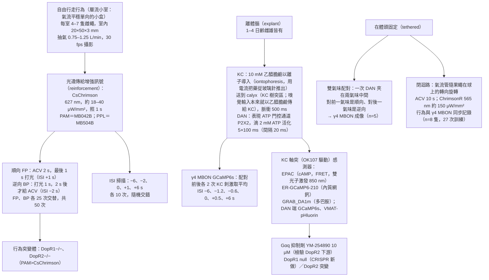
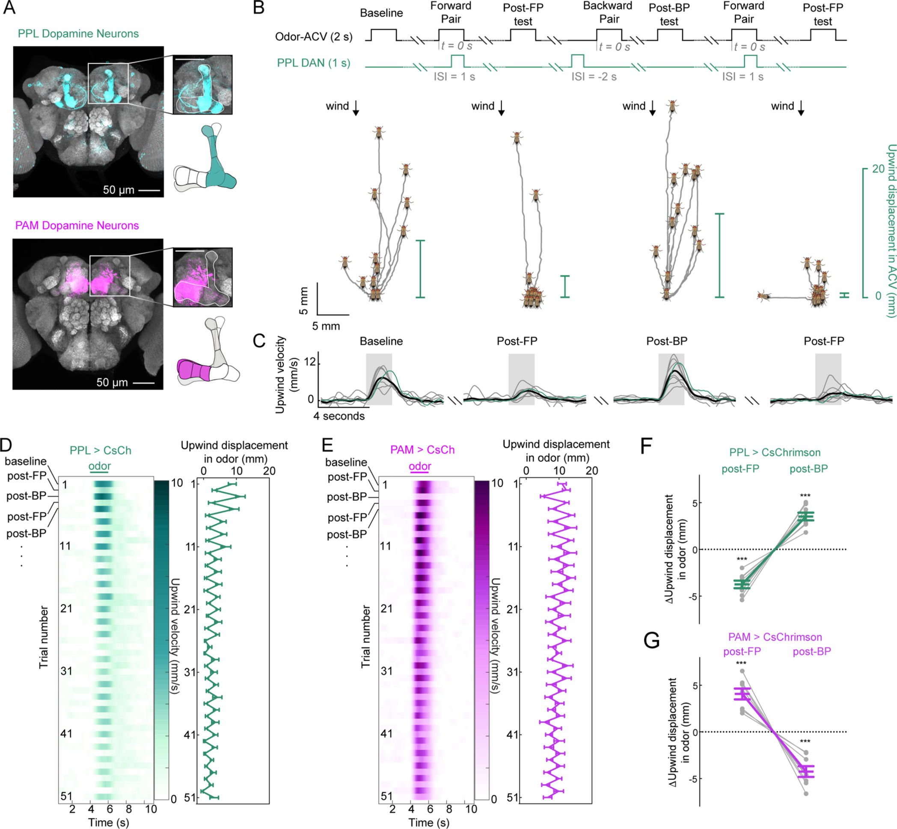
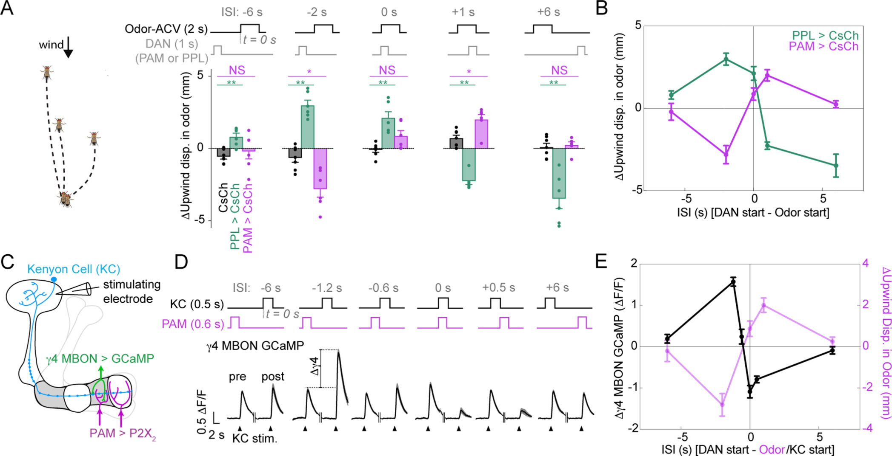
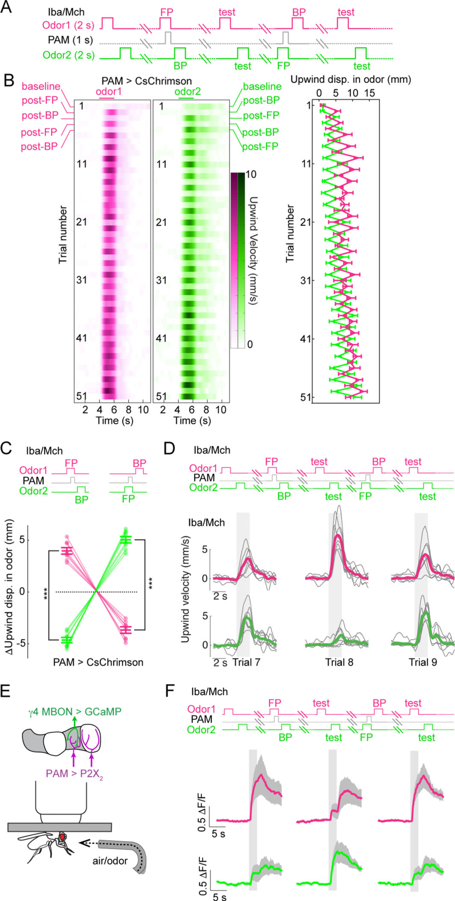
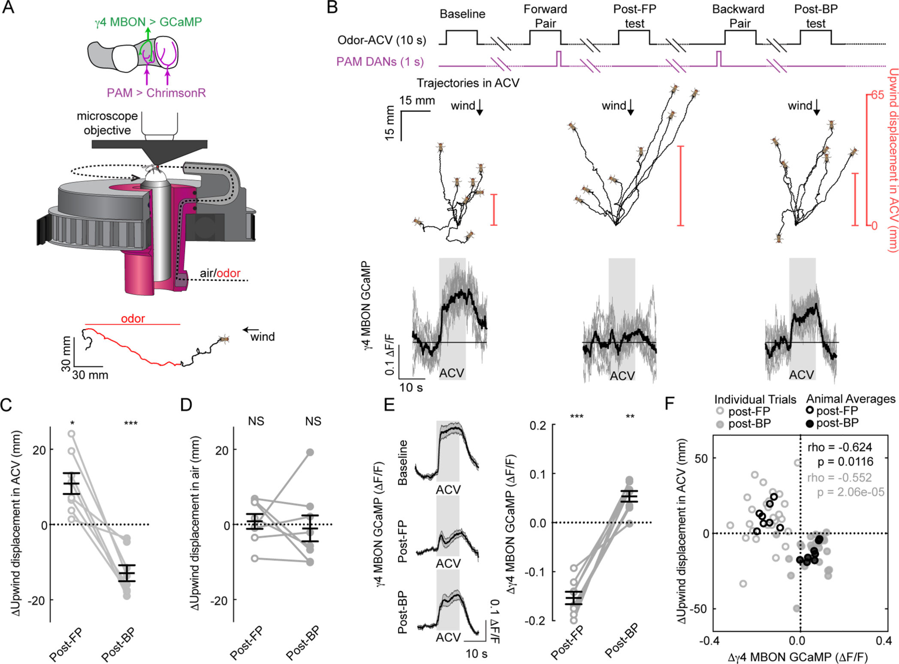
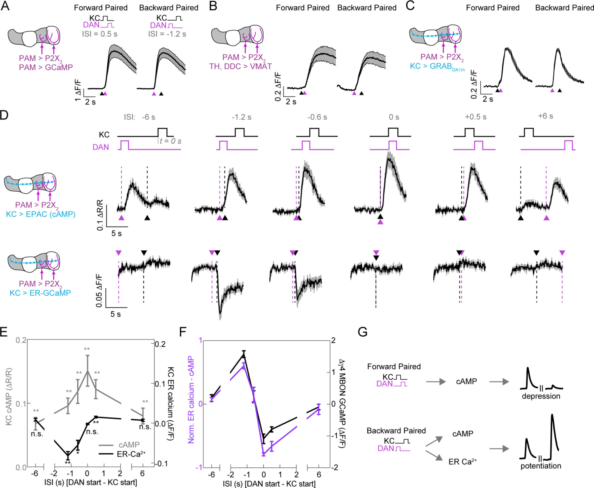
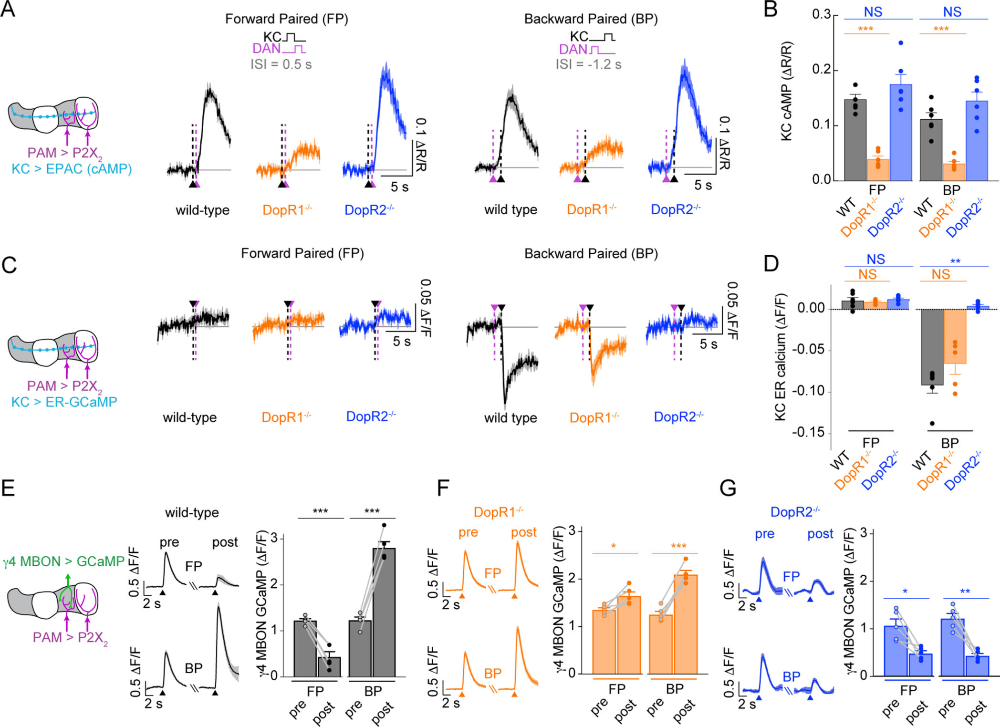
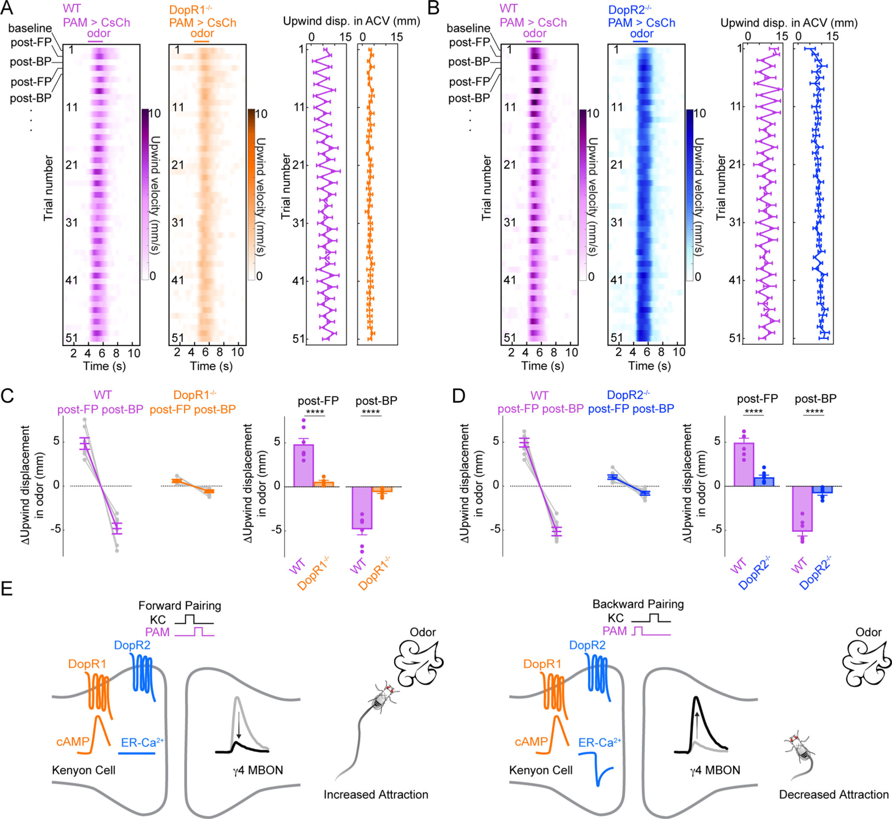

<!-- 本機 PDF：papers/2019-Distinct%20dopamine%20receptor%20pathways%20underlie%20the%20temporal%20sensitivity%20of%20associative%20learning.pdf -->

# Distinct dopamine receptor pathways underlie the temporal sensitivity of associative learning

**不同的多巴胺受體路徑造就聯結學習對時序的敏感度**

| 項目 | 內容 |
|---|---|
| **出處** | Cell 178(1), 60–75.e19 (2019). doi: 10.1016/j.cell.2019.05.040 [全文（PMC 免費閱讀）](https://pmc.ncbi.nlm.nih.gov/articles/PMC9012144/) |
| 日期 | 刊期 2019-06-27；PMC 作者稿公開 2022-04-15。線上先行、投稿、修訂、接受日期：？待查（本 PDF 未載） |
| 通訊作者 | Vanessa Ruta，ruta@rockefeller.edu（亦為 Lead Contact） |
| 作者 | 共 8 人：Annie Handler、Thomas G.W. Graham、Raphael Cohn、Ianessa Morantte、Andrew F. Siliciano、Jianzhi Zeng、Yulong Li、Vanessa Ruta。本 PDF 未標示共同第一作者 |
| 機構 | 洛克斐勒大學神經生理與行為實驗室（紐約）；北京大學生命科學學院膜生物學國家重點實驗室、PKU-IDG/McGovern 腦科學研究所、北大—清華生命科學聯合中心（北京） |
| 資料庫 | 無公開資料庫。程式（MATLAB、Python、C）、CAD 檔與資料「向 Lead Contact 索取」 |
| 補充資料 | 圖 S1–S8、影片 1–3（本 PDF **不含**；正文引用到的補充內容本頁一律標 ？待查）。PDF 內含 STAR Methods 與 Key Resources Table |
| 編輯／審查 | 非具名審查制，PDF 未列 |

> 與本庫有關的作者：無。
>
> 付費期刊（版權屬出版社）。本 PDF 為 PMC 公開的 HHS 作者稿（Author Manuscript），PDF 內無 Creative Commons 授權聲明。全文請由資料表「出處」列的連結到 PMC 免費閱讀（HHS PMC 公開的作者稿）。**本庫不散布全文 PDF。** 本頁的圖擷取自原文，版權屬原出版社，以教學與評論目的引用，每張圖下方標明出處。

---

## 為什麼重要

古典制約（classical conditioning）的教科書版本是「氣味要先出現，獎賞或懲罰後到，動物才會學到氣味預告了什麼」。這裡的獎賞或懲罰統稱為「增強訊號」（reinforcement），在果蠅腦中由多巴胺（dopamine）神經元負責傳達。但果蠅的行為實驗早就發現反過來也會學：懲罰**之後**才出現的氣味，果蠅反而會喜歡（論文引 Tanimoto et al. 2004、Aso & Rubin 2016、König et al. 2018）。同一對刺激，只差先後，學到的方向相反。這表示蘑菇體（mushroom body，果蠅腦中負責把「氣味」和「好壞」連起來的構造）裡有某種東西能分辨「氣味在前」還是「增強訊號在前」。本篇要回答的就是：**這個分辨先後的機制在哪裡、是什麼分子**。

先交代三個角色。Kenyon 細胞（Kenyon cell, KC）是蘑菇體的主要神經元，每個氣味會活化其中一小群；KC 把訊號沿著長長的輸出纖維（軸突，axon）送出去，交給蘑菇體輸出神經元（mushroom body output neuron, MBON），MBON 再告訴身體「靠近」或「走開」。學習改變的，就是 KC 與 MBON 之間的接點（突觸，synapse）的強弱。本篇的答案落在 KC 的軸突上，由兩種多巴胺受體（receptor，細胞表面接收多巴胺的蛋白質）分工：DopR1 啟動細胞內一條製造 cAMP（一種把外界訊號帶進細胞內部的小分子，稱為「第二傳訊者」）的路徑，讓 KC→MBON 的突觸**變弱**；DopR2 啟動另一條讓內質網（細胞內儲存鈣離子的小倉庫）放出鈣的路徑，讓同一個突觸**變強**。關鍵在於：cAMP 那條路徑不論先後都會被啟動，放鈣那條路徑卻只在「多巴胺先到、KC 後活動（也就是氣味後到）」時才被啟動。兩條都開的時候，放鈣帶來的「變強」勝過 cAMP 帶來的「變弱」，突觸淨結果是變強；只有 cAMP 開的時候，突觸變弱。**所以是先後次序決定了放鈣路徑開或不開，進而決定突觸往哪個方向改、行為往哪個方向變。** 在本篇之前，「突觸變弱」那一半已有不少證據（論文引 Cohn et al. 2015、Hige et al. 2015、Owald et al. 2015、Séjourné et al. 2011），「變強」那一半與兩種受體的分工則還不清楚。

對這個知識庫（以下稱本庫），它同時回答兩個問題：「氣味與增強訊號的先後如何決定學到什麼」（時序規則），以及「多巴胺送到 KC 之後，是由哪些受體、哪些細胞內訊號解讀的」。它用同一套時間差（橫軸是「多巴胺比氣味早或晚幾秒」），分別量了行為改變多少、單一突觸改變多少、細胞內 cAMP 與鈣改變多少，把三條曲線並排比較。本庫另外收錄的兩篇，正好可以和它對照著讀：Tomchik & Davis 2009（*Neuron*）也量 KC 軸突裡的 cAMP，本篇對 cAMP 角色的結論（「只偵測同時，不偵測先後」）可以拿那篇的資料檢驗；Hige et al. 2015（*Neuron*）研究的是同一類 KC→MBON 突觸如何被多巴胺減弱，本篇補上了「變強」的那一半。

---

## 論文摘要（原文與中譯）

> Animals rely on the relative timing of events in their environment to form and update predictive associations, but the molecular and circuit mechanisms for this temporal sensitivity remain incompletely understood. Here we show that olfactory associations in Drosophila can be written and reversed on a trial-by-trial basis depending on the temporal relationship between an odor cue and dopaminergic reinforcement. Through the synchronous recording of neural activity and behavior, we show that reversals in learned odor attraction correlate with bidirectional neural plasticity in the mushroom body, the associative olfactory center of the fly. Two dopamine receptors, DopR1 and DopR2, contribute to this temporal sensitivity by coupling to distinct second-messengers and directing either synaptic depression or potentiation. Our results reveal how dopamine receptor signaling pathways can detect the order of events to instruct opposing forms of synaptic and behavioral plasticity, allowing animals to flexibly update their associations in a dynamic environment.

（*Cell* 的摘要不分 Background／Results／Conclusion 小節，照原樣保留為一段。）

**中譯**（本節為忠實翻譯，非自撰內容）：

> 動物依賴環境中事件的相對時序來形成並更新預測性的聯結，但這種時間敏感度背後的分子與迴路機制仍未被完整理解。我們在此顯示，果蠅的嗅覺聯結可以依照氣味線索與多巴胺增強訊號之間的時間關係，逐次（trial-by-trial）寫入與反轉。透過同步記錄神經活動與行為，我們顯示習得的氣味吸引力的反轉，與蘑菇體（果蠅的聯結式嗅覺中樞）中的雙向神經可塑性相關。兩種多巴胺受體 DopR1 與 DopR2 藉由耦合到不同的第二傳訊者、分別指揮突觸的減弱或增強，促成這種時間敏感度。我們的結果揭示多巴胺受體訊號路徑如何偵測事件的次序，以指揮方向相反的突觸與行為可塑性，使動物能在動態環境中彈性地更新其聯結。

（譯文用語說明，非原文：「可塑性」＝突觸強度可以被經驗改變；「雙向」＝可以變強也可以變弱；「聯結式嗅覺中樞」＝負責把氣味和好壞連在一起的腦區；「耦合到第二傳訊者」＝受體被多巴胺啟動後，接著啟動細胞內某一種小分子訊號；「寫入」一個聯結＝形成一個新的「這個氣味代表好或壞」的記憶；「一次（trial）」＝給一次氣味與多巴胺的組合。）

---

## 科普文

想像你小時候去看牙醫。鑽牙的聲音很可怕，而每次鑽完、終於結束時，診間牆上的一盞綠燈會亮起。幾次之後，你一看到綠燈亮就鬆一口氣，甚至有點喜歡它——因為它代表「壞事結束了」。但如果綠燈總是在鑽牙**之前**亮，你看到它只會緊張，因為它預告「壞事要來了」。**同樣一盞燈、同樣的鑽牙聲，只差誰先誰後，意義完全相反。**

果蠅也是這樣學氣味的。牠腦中的蘑菇體負責把「聞到什麼」和「好事或壞事」連起來。聞到氣味時，蘑菇體裡一小群叫 Kenyon 細胞的神經元會發訊號；「好事或壞事」則由多巴胺神經元（dopaminergic neuron, DAN）廣播。有一群多巴胺神經元報告懲罰（論文用的是 PPL 這一群），另一群報告獎賞（PAM 這一群）。Kenyon 細胞再把訊號交給蘑菇體輸出神經元（MBON），由輸出神經元告訴身體「靠近」或「走開」。

這裡有一個理解全篇的關鍵：**輸出神經元有兩種，一種推動「靠近」，一種推動「走開」；報告獎賞與報告懲罰的多巴胺神經元，各自管不同的輸出神經元。** 學習的方式，是把 Kenyon 細胞與輸出神經元之間的接點（突觸）變強或變弱。蘑菇體被切成一格一格，γ2、γ4 這類名字就是格子的編號，「γ4 輸出神經元」即住在第 4 格的那一個。本篇只要記住一件事：

- **γ4 輸出神經元推動「走開」，由獎賞（PAM）多巴胺調整。** 它的接點變弱 → 果蠅更愛追氣味；變強 → 比較不想追。
- 懲罰（PPL）那一邊，論文的說法是懲罰會讓推動「靠近」的輸出神經元（例如 γ2）變弱，所以結果是不想追。

全篇的實驗與分子機制，幾乎都在 γ4 這一格上做。

**難題**是：氣味在前、多巴胺在後，突觸要變弱；多巴胺在前、氣味在後，突觸要變強。同一個突觸、同一種多巴胺，怎麼知道誰先誰後？

作者先證明這件事在行為上真的存在，而且一次配對就夠。他們把四到七隻果蠅放進一個有穩定氣流的小盒子，放一口蘋果醋的氣味，量牠們往上風處走了多遠（果蠅喜歡蘋果醋，會逆風去找）。多巴胺神經元則用光遺傳學（optogenetics）直接打開：讓這群神經元帶上一種照紅光就會被活化的蛋白質 CsChrimson，紅燈一亮，牠們就放出多巴胺，不必真的電擊或餵糖。結果是：氣味先、「懲罰」多巴胺後，只要一次，果蠅就不太追蘋果醋了；接著來一次「懲罰」在前、氣味在後，果蠅立刻又熱烈追起來。這樣交替五十次，每一次都翻得過來。換成「獎賞」多巴胺，方向剛好倒過來。

**解法**的第一步，是把這個時間規則搬到一個可以看清楚的地方：把果蠅的腦取出來放在培養液裡（稱為離體製備），用細玻璃針在 Kenyon 細胞接收訊號的那一端滴一下乙醯膽鹼——真實的氣味訊號送到 Kenyon 細胞時，用的正是這種化學物質，所以滴它就等於「假裝聞到氣味」。再滴一下 ATP 去活化事先裝了 ATP 開關（P2X2 通道）的多巴胺神經元，假裝來了獎賞。輸出神經元裡則裝了會隨活動發亮的螢光蛋白（GCaMP）。做法是：先單獨刺激 Kenyon 細胞，看 γ4 輸出神經元亮多少；接著做一次「配對」——依某個時間差，各給一次假氣味和假獎賞；然後再單獨刺激 Kenyon 細胞，看亮多少。亮得比之前多，表示接點變強；亮得比之前少，表示變弱。結果很乾淨：多巴胺比「假氣味」早約 1.2 秒，接點變強；兩者同時或多巴胺晚 0.5 秒，接點變弱；隔 6 秒，幾乎沒變化。**正負號在一秒之內翻轉。**

第二步，作者排除了最直覺的解釋——「是不是兩種順序放出的多巴胺量不同？」他們用三種不同的感測器看多巴胺神經元的活動、看多巴胺的釋放、看 Kenyon 細胞軸突上收到的多巴胺，兩種順序都一樣多。所以差別不在「送來多少」，而在「怎麼被讀」。

第三步就是讀法。Kenyon 細胞上有兩種多巴胺受體：DopR1 接到一條會製造 cAMP（環腺苷酸，負責把外面的訊號傳進細胞裡的小分子）的路徑；DopR2 接到另一條會讓內質網（細胞內儲存鈣離子的小倉庫）放出鈣的路徑。作者在 Kenyon 細胞軸突裡分別裝上 cAMP 感測器和放在內質網裡的鈣感測器，發現：**cAMP 不管順序都會產生，只是兩者同時發生時最多；內質網放鈣卻只在「多巴胺先、Kenyon 細胞後」時出現。** 於是有了一個簡單的模型：cAMP 推動接點變弱，內質網放鈣推動接點變強。把「放鈣量」減去「cAMP 量」，對不同時間差畫成一條曲線，形狀剛好和「接點變化量對時間差」那條曲線相似。

最後，作者把兩種受體分別剔除。少了 DopR1，cAMP 大幅下降，原本該變弱的接點不但沒變弱，反而微微變強（為什麼會變強，論文沒有解釋：這時放鈣路徑照理沒有開）；少了 DopR2，內質網不再放鈣，原本該變強的接點反而變弱。也就是說，**每一種突變都讓接點只能往單一方向改。** 行為上，兩種突變果蠅都失去了「一次配對就翻轉」的能力。少了 DopR1 的果蠅，γ4（推動走開）的接點只能變強，於是一直不太追蘋果醋；少了 DopR2 的果蠅，γ4 的接點只能變弱，於是一直很追。

**代價**有三個。其一，最乾淨的時間曲線來自取出來的腦，刺激是人工滴藥，時間長度和真的氣味不同。論文正文寫「時間差只改幾百毫秒就能讓行為翻轉」，但行為實驗只測了五個時間差，最近的兩個也差一整秒，這句話在行為上其實沒有被直接量到。其二，突變是全身的，不是只拿掉 Kenyon 細胞上的受體，行為缺陷不一定全部來自蘑菇體——作者自己也承認這一點。其三，「放鈣減 cAMP」的模型只比對了六個時間差。cAMP 與鈣的量測單位不同，不能直接相減，所以作者把兩條曲線各自拉伸到 0 到 1 之間再相減；而要拿相減的結果去和突觸變化比，又得再選一次縱軸比例。比例是研究者選的，選得好就容易看起來像，所以兩條曲線長得像只能算定性的吻合，不算模型被證實。

**最容易被誤讀的一點：cAMP 確實參與決定突觸往哪邊改（它推動變弱），但它分不出誰先誰後。** cAMP 在兩種順序下都會出現，它只對「兩件事是否幾乎同時」敏感；真正讀出「誰先誰後」的，是只在多巴胺先到時才啟動的放鈣路徑。若把本篇讀成「cAMP 本身偵測先後」，就正好讀反了。

---

## 專業文

> **讀本節之前：標記、縮寫與正負號。**
>
> - **標記**：`※ 推論`＝論文沒有明說、由本頁推得；`※ 從圖判讀`＝本頁從圖上目測讀出的數值，誤差約為最小刻度的一半；`？待查`＝內容只在本 PDF 沒有收錄的補充圖（S1–S8）裡，本頁沒看到、不猜；`⚠️`＝論文自身前後不一致。「text.txt 第 N 行」指本庫抽取的論文純文字檔（`.cache/` 目錄下，由 PDF 轉出），方便回查原句。STAR Methods 是 *Cell* 期刊的方法章節格式，Key Resources Table 是其中列出全部品系、試劑的表。
> - **縮寫**：KC＝Kenyon 細胞；DAN＝多巴胺神經元；MBON＝蘑菇體輸出神經元；PAM、PPL＝兩群多巴胺神經元（PAM 多報告獎賞，PPL 多報告懲罰）；區室（compartment）＝蘑菇體葉上的一格，由特定 DAN 的軸突與特定 MBON 的樹突共同占據；γ1–γ5＝γ 葉上的五個區室，γ4 MBON 即樹突在 γ4 區室的輸出神經元；ACV＝蘋果醋（apple cider vinegar）；FP／BP＝順向／逆向配對（forward／backward pairing）；ISI＝刺激間隔。MB042B、MB504B、R58E02、VT026001、OK107 等是果蠅的基因驅動品系代號（split-GAL4、LexA、GAL4 系統），作用是「只讓某一群細胞表現某個外加基因」。
> - **「增強」兩義**：本頁的「增強訊號／增強刺激」指制約中的獎賞或懲罰（reinforcement）；單獨說「突觸增強」或「增強」指突觸變強（potentiation）。
> - **正負號（全篇最容易卡住的地方）**：論文引 Aso et al. 2014b 說明，γ4、γ5 MBON 推動「走開」，γ2 MBON 推動「靠近」（text.txt 第 372–377 行）。因此 **γ4 突觸變弱 → 果蠅更愛追氣味；γ4 突觸變強 → 更不愛追**。PAM 順向配對減弱 γ4 → 吸引；PAM 逆向配對增強 γ4 → 厭惡。PPL 順向配對則減弱推動「靠近」的 MBON → 厭惡（這一句是論文的一般性說法，本篇沒有量 PPL 驅動株支配的 MBON）。行為的「逆風位移」**正值＝往氣味源（上風）走＝吸引**。

### 一、概述

**主要問題。** 果蠅能依氣味與增強訊號的先後學到相反的價性（valence，「好」或「壞」）。這種對時間次序的敏感，是在迴路的哪一層、由哪些分子實現的？作者提出兩個候選：(i) 不同區室分別記錄「順向」與「逆向」記憶（類似 Felsenberg et al. 2018 對記憶消退提出的平行對立記憶）；(ii) 同一個區室裡的同一組 KC→MBON 突觸可以雙向改變。本篇支持 (ii)，並把次序偵測歸到 KC 軸突中兩種多巴胺受體的下游訊號。

**重要性。** 蘑菇體的葉（lobe）被切成一格一格的區室（compartment）：每一格由一小群多巴胺神經元的軸突和一到兩個 MBON 的樹突共同定義（論文引 Aso et al. 2014a、Tanaka et al. 2008），每一格可以獨立調整 KC→MBON 突觸。本篇第一次在**同一個區室、同一套 ISI（inter-stimulus interval，刺激間隔）**上，把行為、突觸可塑性、第二傳訊者三條時間曲線並排，並在同一隻果蠅身上同步記錄神經與行為。

**發表當時的領域現狀（2019）。**
- 行為層：時序相依的價性反轉已在果蠅（Tanimoto et al. 2004；Aso & Rubin 2016；König et al. 2018）與多物種（Gerber et al. 2014）被描述，但機制不明。
- 突觸層：順向配對造成 KC→MBON 突觸減弱已有多篇（Séjourné et al. 2011；Cohn et al. 2015；Hige et al. 2015；Owald et al. 2015）；**沒有氣味時的強烈多巴胺釋放**造成增強，見於 Cohn et al. 2015、Berry et al. 2018。（2026-10-25 加註：「強烈」是本篇對 Cohn 2015 的描述；[[s-cohn-2015-coordinated-neuromodulation]] 主文沒有給 DAN 刺激的強度或時長，它的「不配對」是指 DAN 與 KC 刺激相隔 > 45 s。也就是說，Cohn 2015 在兩者相隔 45 秒以上時看到突觸變強，本篇卻在只相隔 ±6 s 時就幾乎看不到可塑性：間隔更長的反而有變化。兩者因此並列為 ⚠️ 矛盾，見 [[syn-contradictions]] 1.3。）
- 分子層：DopR1 被認為是寫入記憶所必需（Kim et al. 2007；Qin et al. 2012），DopR2（論文引用的 Han et al. 1996、Himmelreich et al. 2017 與所用抗體稱之為 DAMB）被認為參與遺忘（Berry et al. 2012；Himmelreich et al. 2017）；體外實驗顯示 DopR1 偏好接 Gαs（刺激 cAMP 生成，Sugamori et al. 1995），DopR2 偏好接 Gαq（增加胞內鈣，Feng et al. 1996；Han et al. 1996；Himmelreich et al. 2017）。鈣敏感的腺苷酸環化酶（adenylate cyclase，製造 cAMP 的酵素）被視為分子層的「同時性偵測器」（Livingstone et al. 1984；Tomchik & Davis 2009；Gervasi et al. 2010）。兩種受體在突觸層各扮演什麼角色，在本篇之前不清楚。
- 同類的時序規則在突觸生理學裡叫「放電時序相依可塑性」（spike-timing dependent plasticity, STDP，前後兩個神經元誰先放電決定突觸變強或變弱），但它的時間窗是毫秒級，比聯結學習所需的秒級短得多（論文 Discussion，text.txt 第 733–744 行）。

**體裁：** 原著論文（行為 ＋ 離體與在體雙光子鈣影像 ＋ 遺傳突變）。

### 二、方法

**幾個決定解讀的設計，先記下：**

- **兩個受體、兩條路徑**：DopR1（基因名 Dop1R）偏好接 Gαs 蛋白，刺激 cAMP 生成；DopR2 偏好接 Gαq 蛋白，產生 IP3、讓內質網放鈣（text.txt 第 476–478、548–550 行）。所以本篇量 cAMP 是在看 DopR1 那條路、量內質網鈣是在看 DopR2 那條路；Gαq 抑制劑 YM-254890 用來確認內質網鈣確實走 Gαq。DopR2 突變株記作 DopR2attP（attP 是基因工程留下的插入位點標記，這裡等同剔除），來自 Keleman et al. 2012。
- **CsChrimson 與 ChrimsonR** 都是紅光活化的光敏通道，前者用在行為小室（627 nm LED），後者用在顯微鏡下的閉迴路（565 nm，經物鏡照射）。

- **ISI 的定義是「DAN 開始時間減去 KC／氣味開始時間」**（text.txt 第 1116–1124 行）。負值＝多巴胺在前（逆向），正值＝多巴胺在後（順向）。**它只看起點，不看持續時間**，而三種製備的持續時間差很多：行為的氣味 2 s、DAN 1 s；離體的 KC 刺激 0.5 s、DAN 約 0.6 s；閉迴路的氣味 10 s、DAN 1 s。同一個 ISI 數字在不同製備裡代表的「重疊或間隔」不同，見下表。
- **行為的讀出是「群體重心的逆風位移」**：一盒果蠅的重心在 2 s 氣味期間往上風（氣味源）方向移動多少 mm，正值＝往氣味源走（text.txt 第 1574–1577 行）。盒子是長條形，氣流可以從上端或下端吹入；每次測試讓氣味分別從兩端各來一次、取平均，以抵銷兩端氣流的差異。**「變化量」是相對於前一次測試算的**——**交替設計的順序是：基線測試 → FP → 測試（post-FP）→ BP → 測試（post-BP）→ FP → ……，所以 post-BP 的變化是「post-BP 減 post-FP」，下一次 post-FP 的變化是「post-FP 減前一次 post-BP」。**
- **三種感測器先簡述**（詳見 3.5 節的表）：VMAT-pHluorin 量 DAN 釋放多巴胺；GRAB_DA1m 量 KC 收到的多巴胺；ER-GCaMP6-210 放在內質網裡，**變暗代表內質網放出鈣**。
- **離體實驗的突觸強度讀法**：KC 刺激後 2 s 內 γ4 MBON 的鈣反應峰值（ΔF/F，螢光相對於基線的變化比例），配對前兩次、配對後兩次各取平均，相減得到變化量。
- **統計**：Prism 與 MATLAB；先以 Shapiro-Wilk 檢定常態性，常態用 t 檢定、不常態用 Wilcoxon 或 Mann-Whitney；多重比較一律 Bonferroni 校正；全部雙尾。**實驗者未對基因型盲化；未事先計算樣本數**（text.txt 第 1929–1937 行）。
- **DopR1 突變是本篇新做的**：既有突變不是用大段染色體倒位做的、帶有會干擾雙光子成像的轉位子，就是只減弱不剔除（hypomorph）。作者用兩條 gRNA 把 Dop1R 基因從 5′ UTR 到 3′ UTR 切掉，以免疫染色與 qRT-PCR 確認蛋白與 mRNA 消失（驗證圖在 S7A–B，？待查）。

**表 1：各製備的刺激時序（由 STAR Methods 逐項整理；最後兩欄是本頁補上的）**

| 製備 | 氣味／KC 長度 | DAN 長度 | FP 的 ISI | BP 的 ISI | FP 時 DAN 是否與氣味／KC 重疊 | BP 時 DAN 結束到氣味／KC 開始的空檔 |
|---|---|---|---|---|---|---|
| 行為小室（圖 1、7） | 2 s | 1 s | +1 s | −2 s | 是（氣味最後 1 s） | 1 s |
| 離體腦（圖 2D–E、5、6） | 0.5 s | 約 0.6 s | +0.5 s | −1.2 s | 否（KC 結束時 DAN 才開始） | 約 0.6 s |
| 在體雙氣味（圖 3F） | 各 2 s | 4×100 ms | 氣味 1：+1.5 s | 氣味 2：−1.7 s | 是 | 約 1.24 s |
| 閉迴路（圖 4） | 10 s | 1 s | **+9 s** | −2 s | 是（氣味最後 1 s） | 1 s |
| 電擊（圖 S3E；增強刺激是真電擊，不直接活化 DAN） | ACV 長度？待查 | 電擊 2×1 s | +0.5 s | −3 s | ？待查 | ？待查 |

> 依 STAR Methods（text.txt 第 1441–1452、1166–1199、1705–1708、1846–1856、1750–1755 行）整理。離體 DAN 長度＝5 個 100 ms 脈衝＋4 個 20 ms 間隔＝580 ms，圖 2D 標為「0.6 s」。雙氣味在體實驗：氣味 1 開始後 1.5 s 給 DAN，氣味 2 在 DAN 開始後 1.7 s 出現，兩氣味間隔 1.2 s。驗算：氣味 2 的開始時間＝1.5＋1.7＝3.2 s，也等於氣味 1 的長度 2 s 加上間隔 1.2 s ✓。逆向空檔＝1.7 s 減去 DAN 自身長度（4×100 ms＋3×20 ms＝0.46 s）≈ 1.24 s。
>
> **本頁補的一點：** 閉迴路的 FP 是 ISI +9 s，比離體實驗中「幾乎沒有可塑性」的 +6 s 還長，但它照樣造成強烈的突觸減弱（圖 4E）。這不矛盾——因為閉迴路的氣味持續 10 s，DAN 來時氣味仍在。**這提示真正決定方向的可能不是「起點差」，而是 DAN 來時 KC 的活動（或它留下的、會持續數秒的細胞內訊號）是否還在**：離體 +0.5 s 時 KC 刺激剛結束、殘留訊號應還在，仍造成減弱；+6 s 時已過了 5.5 s，不再有作用；閉迴路 +9 s 時氣味本身還在。這個「殘留」的時間長度本篇沒有量；論文以起點差作為唯一的橫軸，把不同持續時間的製備畫在同一條軸上（圖 2E），這個前提論文沒有討論。※ 推論。

### 三、結果

#### 3.1 一次配對就能寫入、反轉，連續 50 次

<small>圖片出處：Handler A, Graham TGW, Cohn R, Morantte I, Siliciano AF, Zeng J, Li Y, Ruta V. *Cell* 178(1):60–75.e19 (2019)，Figure 1。© 2019 Elsevier Inc. 教學引用；全文見 [PMC](https://pmc.ncbi.nlm.nih.gov/articles/PMC9012144/)。</small>

> **原圖說（Figure 1）：** Forward and Backward Conditioning Drives the Formation of Opposing Olfactory Associations. (A) Anatomy of PPL (teal) and PAM (magenta) dopamine neuron (DAN) drivers that selectively innervate the mushroom body. (B) Top: Behavioral protocol to compare tracking of apple cider vinegar (ACV) odor after forward pairing (FP) and backward pairing (BP) with optogenetic activation of PPL>CsChrimson flies. Bottom: Trajectories of individual flies from a representative experiment, aligned to common origin and wind direction. Flies that did not move in response to the odor were positioned at origin. The odor-evoked upwind displacement of all flies in odor is measured as a change in their center of mass (teal bar). (C) Upwind velocity of PPL>CsChrimson flies in baseline, post-FP, and post-BP trials (odor indicated by gray box) measured as a change in the center of mass in the upwind direction of flies over the course of a trial. Gray lines: individual experiments; teal line: representative example from (B); black line: mean upwind velocity (n=8 experiments). (D) Left: Raster plot of mean upwind velocity of PPL>CsChrimson flies across trials. The first row corresponds to the baseline response of naïve flies. Subsequent rows show behavioral response to odor after alternating FP and BP trials. Right: Mean odor-evoked upwind displacement for the corresponding row in the raster plot. (E) Same as (D) using PAM>CsChrimson flies. (F-G) Change in upwind displacement in odor after FP and BP for PPL conditioned (F) and PAM conditioned (G) animals measured relative to the preceding odor trial. n=8 experiments. One-sample t-test against zero with Bonferroni correction: \*\*\*p≤0.001. For (D-G) data presented as mean±SEM.

**圖說中譯：** 順向與逆向制約造成相反的嗅覺聯結。(A) 選擇性支配蘑菇體的 PPL（藍綠）與 PAM（洋紅）多巴胺神經元驅動株的解剖。(B) 上：比較 PPL>CsChrimson 果蠅在順向配對（FP）與逆向配對（BP）光遺傳活化後追蹤蘋果醋（ACV）氣味的行為流程。下：一次代表性實驗中各果蠅的軌跡，對齊到共同起點與風向；對氣味沒有移動的果蠅放在原點。所有果蠅在氣味中的逆風位移以其重心的變化量測（藍綠色條）。(C) PPL>CsChrimson 果蠅在基線、FP 後、BP 後測試中的逆風速度（灰框為氣味期間），以果蠅重心在逆風方向上的變化量測。灰線：各次實驗；藍綠線：(B) 的代表例；黑線：平均逆風速度（n＝8 次實驗）。(D) 左：PPL>CsChrimson 果蠅各次測試平均逆風速度的點陣圖，第一列是未訓練果蠅的基線，之後各列為 FP、BP 交替後的反應。右：對應列的平均氣味誘發逆風位移。(E) 同 (D)，但為 PAM>CsChrimson 果蠅。(F–G) PPL (F) 與 PAM (G) 制約後，氣味中逆風位移相對於前一次測試的變化。n＝8 次實驗；對零的單樣本 t 檢定並做 Bonferroni 校正：\*\*\*p≤0.001。(D)–(G) 為平均 ± 標準誤。

**解讀：**

- **F、G 的變化量約 ±4 mm，而且 PPL 與 PAM 幾乎鏡像**（※ 從圖判讀）：PPL 的 FP 後約 −3.7 mm、BP 後約 +3.5 mm；PAM 的 FP 後約 +4.2 mm、BP 後約 −4.2 mm。每組 n＝8 盒、每盒 6 隻（共 48 隻，見 STAR Methods 表）。**單位是「盒」不是「隻」**——統計檢定的 n 是 8。
- **正文說 PAM 順向配對只「稍微」（modestly）增強追蹤，圖 G 卻是 +4.2 mm，與 BP 的幅度相當。** 兩者不矛盾：「稍微」指的是未經訓練的果蠅第一次 FP（圖 E 第一、二列），而 G 的 +4.2 mm 是相對於「前一次 BP 後已被壓低」的狀態算的。**G 裡 FP 的效果，大部分是把前一次 BP 造成的壓抑翻回來，不是在天生偏好上再加分。** 讀 F、G 的鏡像時要記得：在交替設計裡，「寫入」與「反轉」被混在同一個數字裡。
- **D 圖右欄值得看的是整體趨勢**（※ 從圖判讀）：PPL 組的位移在前十次左右在 5–12 mm 間擺盪，後段大致落在 2–5 mm，整體往下漂；PAM 組（E）則維持在 5–15 mm。也就是說，**PPL 的「懲罰」雖然每次都被 BP 翻回，但淨效果累積成較低的整體追蹤**。論文沒有討論這個漂移；可能是累積的厭惡記憶，也可能是 50 次紅光與氣味造成的疲勞（光照單獨的對照在 S1D–E，？待查）。※ 推論。
- **A 圖只給了兩個驅動株的解剖圖，正文說 PPL 驅動株支配六個區室，卻沒有列出是哪六個，PAM 驅動株涵蓋哪些區室也沒列出**（我 grep 過 `MB042B`、`six compartments`）。後面所有「γ4 的突觸變化代表行為」的論證，都依賴這兩個驅動株在 γ4 以外還打開了哪些區室（作者在 3.4 節自己承認行為很可能是多區室合成的）。

#### 3.2 時間窗：行為與單一突觸

<small>圖片出處：Handler A, Graham TGW, Cohn R, Morantte I, Siliciano AF, Zeng J, Li Y, Ruta V. *Cell* 178(1):60–75.e19 (2019)，Figure 2。© 2019 Elsevier Inc. 教學引用；全文見 [PMC](https://pmc.ncbi.nlm.nih.gov/articles/PMC9012144/)。</small>

> **原圖說（Figure 2）：** Relating Behavioral and Neural Modulation. (A) Top: Protocol varying inter-stimulus interval (ISI) between ACV odor and optogenetic activation of DANs during behavioral conditioning. Bottom: Change in upwind displacement after conditioning, measured relative to the preceding odor trial. PPL>CsChrimson (teal), PAM>CsChrimson (magenta), and CsChrimson only controls (black). n=6–7 experiments. Mann-Whitney test with Bonferroni correction: \*\*p≤0.01, \*<0.05, NS≥0.05. (B) Overlay of data from (A) to compare temporal dependence of conditioning using PPL and PAM DANs. (C) Schematic of mushroom body preparation used to measure KC-MBON plasticity. (D) Top: Protocol varying inter-stimulus interval (ISI) between KC stimulation and chemogenetic activation of DANs during conditioning. Bottom: Average KC-evoked responses in the γ4 MBON pre and post conditioning with different ISIs. Arrowhead denotes time of KC stimulation. (E) Black: Change in mean peak γ4 MBON response plotted as a function of ISI. n=5–6 flies for each ISI tested. Magenta: Behavioral data for PAM>CsChrimson animals re-plotted from (B). Significant change in γ4 MBON response after pairing was detected for the following ISI: −1.2 s p≤0.001, 0 s p<0.05, and 0.5 s p≤0.01; one-sample t-test against zero with Bonferroni correction. All data shown are presented as mean±SEM.

**圖說中譯：** 行為與神經調節的對應。(A) 上：行為制約中改變 ACV 氣味與光遺傳活化 DAN 之間刺激間隔（ISI）的流程。下：制約後逆風位移相對於前一次測試的變化。PPL>CsChrimson（藍綠）、PAM>CsChrimson（洋紅）、只帶 CsChrimson 的對照（黑）。n＝6–7 次實驗；Mann-Whitney 檢定並做 Bonferroni 校正：\*\*p≤0.01、\*<0.05、NS≥0.05。(B) 將 (A) 的資料疊圖，比較 PPL 與 PAM 制約的時間相依性。(C) 用來量測 KC→MBON 可塑性的蘑菇體製備示意。(D) 上：制約時改變 KC 刺激與化學遺傳活化 DAN 之間 ISI 的流程。下：不同 ISI 制約前後 γ4 MBON 對 KC 刺激的平均反應；箭頭為 KC 刺激時間。(E) 黑：γ4 MBON 平均峰值反應的變化對 ISI 作圖，每個 ISI n＝5–6 隻。洋紅：由 (B) 重繪的 PAM>CsChrimson 行為資料。配對後 γ4 MBON 反應有顯著變化的 ISI：−1.2 s p≤0.001、0 s p<0.05、0.5 s p≤0.01；對零的單樣本 t 檢定並做 Bonferroni 校正。全部為平均 ± 標準誤。

**表 2：圖 2 逐點讀值（※ 從圖判讀，單位見欄名）**

| ISI | PPL 行為 Δ位移 (mm) | PAM 行為 Δ位移 (mm) | 只帶 CsChrimson 對照 (mm) | ISI（離體） | γ4 MBON Δ峰值 (ΔF/F) |
|---|---:|---:|---:|---|---:|
| −6 s | +0.8 (\*\*) | −0.2 (NS) | −0.5 | −6 s | +0.2 (NS) |
| −2 s | **+3.0** (\*\*) | **−2.8** (\*) | −0.6 | −1.2 s | **+1.55** (p≤0.001) |
| — | — | — | — | −0.6 s | +0.25 (NS) |
| 0 s | **+2.1** (\*\*) | +0.8 (NS) | −0.1 | 0 s | **−1.1** (p<0.05) |
| +1 s | **−2.2** (\*\*) | **+2.0** (\*) | +0.7 | +0.5 s | **−0.8** (p≤0.01) |
| +6 s | **−3.4** (\*\*) | +0.2 (NS) | +0.2 | +6 s | −0.08 (NS) |
| **變號的位置** | **0 與 +1 s 之間（內插約 +0.49 s）** | **−2 與 0 s 之間（內插約 −0.44 s）** | — | — | **−0.6 與 0 s 之間** |

> 左右兩組的 ISI 不同（行為測 −6、−2、0、+1、+6 s；離體測 −6、−1.2、−0.6、0、+0.5、+6 s），表中按「大致對應的順序」並排：行為的 −2 s 與離體的 −1.2 s 都是「逆向、效果最大」的點，+1 s 與 +0.5 s 都是「順向」；離體多測的 −0.6 s 行為沒有對應，以「—」表示。
>
> 讀正負號：PAM 的行為 −2.8（厭惡）對應離體 γ4 的 +1.55（增強）——γ4 推動「走開」，增強即厭惡，兩者方向一致；PPL 的符號與 PAM 相反，因為 PPL 是懲罰訊號；論文的一般性說法是懲罰減弱推動「靠近」的 MBON（例如 γ2，text.txt 第 372–374 行），但沒有說明本篇的 PPL 驅動株 MB504B 具體支配哪些區室，所以 PPL 這一側的機制是論文的概括、不是本篇量到的。
>
> 行為的星號是「與只帶 CsChrimson 的對照比」（Mann-Whitney），離體的顯著性是「對零」（單樣本 t）。兩者檢定的東西不同。最後一列「變號的位置」是本頁加的：**PPL 與 PAM 在行為上的翻轉點不在同一處**。

**解讀：**

- **ISI ＝ 0 s 是 PPL 與 PAM 分道揚鑣的地方，論文沒提。** 先記住：PPL 順向（+1 s）→ 厭惡、逆向（−2 s）→ 吸引；PAM 順向 → 吸引、逆向 → 厭惡。同樣是氣味與 DAN 同時開始（0 s），PPL 給的是吸引（+2.1 mm，\*\*）——也就是 PPL 的「逆向」結果；PAM 給的是微弱、不顯著的吸引（+0.8 mm）——也就是 PAM 的「順向」結果。**同一個時序，在 PPL 被當成逆向、在 PAM 被當成順向。** 如果兩群 DAN 用的是同一套先後規則，0 s 應該落在同一側。※ 推論：PPL 的變號點在 0 與 +1 s 之間，PAM 的在 −2 與 0 s 之間（線性內插約 −0.44 s），兩個區間不重疊；兩者都以線性內插估計：PPL 由 0 s 的 +2.1 與 +1 s 的 −2.2 內插，變號約在 +0.49 s；PAM 約在 −0.44 s；兩者相差約 0.9 s，即 PPL 的翻轉點比 PAM 晚約 1 s；可能的原因包括不同區室的受體組成或動力學不同，論文的分子實驗只做了 PAM→γ4，無法回答。
- **ISI ＝ +6 s 也不對稱：PPL 仍有強烈的厭惡（−3.4 mm，\*\*），PAM 已無作用（+0.2 mm，NS），離體 γ4 也無作用（−0.08）。** 這時氣味已結束 4 s，DAN 才來——等於「痕跡制約」（trace conditioning，刺激之間隔著一段空白）。正文說「突觸可塑性的時間相依性與用同一種 PAM 增強誘發的行為相符」（text.txt 第 347–351 行），**這句話限定在 PAM 是對的；PPL 的行為曲線在 −6 s（+0.8，\*\*，離體 NS）、0 s（見上一點）與 +6 s 三處都與 γ4 離體曲線不符**，而 PPL 驅動株活化的多巴胺神經元支配的是另一組區室（論文只說支配六個區室，未列出是哪六個）。
- **「只差幾百毫秒就能翻轉」在行為上沒有被直接量到。** 正文說「把氣味與 PPL 或 PAM 活化的相對時序只移動幾百毫秒，就足以讓制約從迴避轉成吸引（Figures 2A–B）」（text.txt 第 283–291 行），但行為只測了 −6、−2、0、+1、+6 s 五點，相鄰兩點最近也差 1 s。次秒級的翻轉只有離體曲線支持（−0.6 → 0 s）。Discussion 改寫成「<1 sec」（第 671 行），與離體資料相符，但被引用的是行為圖。⚠️ 正文引用的圖撐不起正文的措辭。
- **E 圖把兩條曲線畫在同一條橫軸上，左右兩條縱軸各自縮放**（左 ±2 ΔF/F、右 ±4 mm）。兩條線「看起來吻合」有一部分是縱軸比例造成的視覺效果；論文沒有計算兩者的相關。真正可比的是變號點：離體在 −0.6 與 0 s 之間，行為（PAM）以線性內插約在 −0.4 s（−2 s 為 −2.8、0 s 為 +0.8 → 約 −0.44 s）。**變號點落在同一區間，是這張圖最站得住的對應。** ※ 內插是本頁算的。
- **離體的增強只在一個 ISI 顯著**（−1.2 s）。−0.6 s（DAN 剛結束 KC 就開始）只有 +0.25、不顯著，−6 s 也不顯著。所以「DAN 在前就增強」實際上是「DAN 在前約 1 s 左右才增強」，增強窗只有一個取樣點撐著。
- **控制組在 +1 s 是 +0.7 mm**——只帶 CsChrimson、沒有 DAN 驅動的果蠅，在這個時序下也有小幅的正變化。PAM 在 +1 s 的 +2.0 mm 是跟這個 +0.7 比出 \* 的。

#### 3.3 同一次增強，可以同時寫入兩個相反的聯結

<small>圖片出處：Handler A, Graham TGW, Cohn R, Morantte I, Siliciano AF, Zeng J, Li Y, Ruta V. *Cell* 178(1):60–75.e19 (2019)，Figure 3。© 2019 Elsevier Inc. 教學引用；全文見 [PMC](https://pmc.ncbi.nlm.nih.gov/articles/PMC9012144/)。</small>

> **原圖說（Figure 3）：** A Single Reinforcement Instructs Multiple Olfactory Associations. (A) Behavioral paradigm to examine how a single dopaminergic reinforcement modulates behavior to two odors that were simultaneously forward paired (FP) or backward paired (BP) with optogenetic activation of PAM>CsChrimson. Odor1: isobutyl acetate (Iba) and Odor2: 4-methylcyclohexanol (Mch). (B) Raster plot of mean upwind velocity of flies for Odor1 (pink) and Odor2 (green). Right: mean odor-evoked upwind displacement for the corresponding rows in the raster plot. (C) Change in upwind displacement after conditioning, measured relative to the preceding odor trial. (D) Upwind velocity of flies during odor presentation using conditioning paradigm shown in (A), trials 7– 9 in (B)). Time of odor marked by gray box. Gray lines: individual experiments; pink and green lines average (n=8 experiments). Paired t-test with Bonferroni correction: \*\*\*p≤0.001. (E) Schematic of in vivo preparation to examine modulation of γ4 MBON odor responses. (F) Top: Conditioning paradigm with two odors, same odors and conditioning (A). Bottom: γ4 MBON responses after conditioning. n=5 flies. Data shown in (B-C) and (F) are mean±SEM.

**圖說中譯：** 單一增強指導多個嗅覺聯結。(A) 檢驗單次多巴胺增強如何調節對兩種氣味行為的流程：兩種氣味在同一次訓練中分別與 PAM>CsChrimson 光遺傳活化順向配對（FP）或逆向配對（BP）。氣味 1：乙酸異丁酯（Iba）；氣味 2：4-甲基環己醇（Mch）。(B) 果蠅對氣味 1（粉紅）與氣味 2（綠）平均逆風速度的點陣圖；右：對應列的平均氣味誘發逆風位移。(C) 制約後逆風位移相對於前一次測試的變化。(D) 以 (A) 流程制約時，果蠅在氣味期間的逆風速度（(B) 的第 7–9 次測試），灰框為氣味時間；灰線為各次實驗，粉紅與綠線為平均（n＝8 次實驗）；配對 t 檢定並做 Bonferroni 校正：\*\*\*p≤0.001。(E) 檢驗 γ4 MBON 氣味反應調節的在體製備示意。(F) 上：雙氣味制約流程，氣味與制約同 (A)。下：制約後的 γ4 MBON 反應，n＝5 隻。(B)–(C) 與 (F) 為平均 ± 標準誤。

**解讀：**

- **C 的四個值**（※ 從圖判讀）：氣味 1 順向 +3.9 mm、氣味 2 逆向 −4.7 mm；對調後氣味 2 順向 +5.0 mm、氣味 1 逆向 −3.7 mm。與圖 1G 的單氣味（約 ±4.2 mm）同一量級——**夾在兩個氣味中間的同一道光，沒有讓兩邊的效果互相稀釋。**
- **時序對應表 2 的最佳點：** PAM 在氣味 1 開始後 1 s 打光（對氣味 1 是 ISI +1 s），2 s 後才出現氣味 2（對氣味 2 是 ISI −2 s）——正好是圖 2A 中 PAM 兩個方向效果最大的兩個 ISI。這是刻意挑的設計，**結果強，但不能拿來說明「任意時序的兩個氣味都能同時寫入」**。
- **F 圖沒有統計檢定，n＝5。** 圖說沒有 p 值，正文引 S4E–F 作為量化（？待查）。而且 STAR Methods 說：**F 與 S4E 畫出的動物，之前已經歷過一次「氣味 1 逆向、氣味 2 順向」的制約**（text.txt 第 1720–1721 行）。所以 F 的第一欄「基線」並不是未訓練的狀態——這解釋了為什麼基線時氣味 1（先前被增強）反應大、氣味 2（先前被減弱）反應小。**讀 F 時要把第一欄當成「上一輪的結果」，不是起點。**
- ⚠️ **F 的時序與 A 不同，圖說卻寫「同 (A)」。** 圖 3F 圖說寫「same odors and conditioning (A)」，但 STAR Methods 給的在體參數是：DAN 以 P2X2 活化（4 × 100 ms，不是 1 s 光照），在氣味 1 開始後 1.5 s、氣味 2 開始前 1.7 s（text.txt 第 1705–1708 行），即 ISI +1.5 s／−1.7 s（表 1），而行為 (A) 是 +1 s／−2 s。本頁以方法的數字為準；兩者都在圖 2 順向、逆向有效的範圍內，不影響結論。
- 換一對氣味（苯甲醛與 1-己醇）也得到相同結果，在 S4D（？待查）。

#### 3.4 在同一隻果蠅上，同時看行為與突觸

<small>圖片出處：Handler A, Graham TGW, Cohn R, Morantte I, Siliciano AF, Zeng J, Li Y, Ruta V. *Cell* 178(1):60–75.e19 (2019)，Figure 4。© 2019 Elsevier Inc. 教學引用；全文見 [PMC](https://pmc.ncbi.nlm.nih.gov/articles/PMC9012144/)。</small>

> **原圖說（Figure 4）：** Synchronous Recordings of Neural and Behavioral Plasticity in Individual Flies. (A) Top: Strategy to record odor-evoked activity in γ4 MBON and optogenetically activate PAM DANs. Middle: Schematic of closed-loop system to synchronously measure MBON and odor tracking. Bottom: Representative 2D trajectory of a fly presented with apple cider vinegar (ACV) odor (red). (B) Top: Protocol to compare odor-evoked tracking and γ4 MBON responses after forward pairing (post-FP) and backward pairing (post-BP). Middle: Fictive 2D trajectories of a single representative fly in baseline, post-FP, and post-BP trials, aligned to a common origin. Average upwind displacement for all trials shown to right (red). Bottom: Odor-evoked γ4 MBON responses synchronously recorded in the same animal (odor marked by gray box). Gray lines: odor responses from individual trials; black line mean odor response for that fly. (C,D) Mean change in upwind displacement in post-FP and post-BP trials during odor presentation (C) or in clean air (D). (E) Left: Mean γ4 MBON traces for all animals. Right: Change in odor-evoked response in γ4 MBON post-FP and post-BP. Data in (C-E) represents the mean change in upwind displacement or neural responses measured relative to preceding trial across 3–4 FP and BP conditioning protocols for each animal, n=8 flies. One-sample t-test from zero with Bonferroni correction: \*\*\*p≤0.001, \*\*≤0.01, \*<0.05, NS≥0.05. (F) Change in odor-evoked upwind displacement as a function of change in γ4 MBON responses for individual training trials (gray dots) and animal averages (black dots); n=27 individual training trials across n=8 flies; post-FP trials (open circles) and post-BP trials (closed circles). All data represent mean±SEM.

**圖說中譯：** 在個別果蠅上同步記錄神經與行為可塑性。(A) 上：記錄 γ4 MBON 氣味誘發活動並光遺傳活化 PAM DAN 的策略。中：同步量測 MBON 與氣味追蹤的閉迴路系統示意。下：一隻果蠅面對 ACV 氣味（紅）時的代表性二維軌跡。(B) 上：比較順向配對後（post-FP）與逆向配對後（post-BP）氣味追蹤與 γ4 MBON 反應的流程。中：一隻代表性果蠅在基線、post-FP、post-BP 的虛擬二維軌跡，對齊到共同起點；右側（紅）為所有測試的平均逆風位移。下：在同一隻動物同步記錄的 γ4 MBON 氣味反應（灰框為氣味）；灰線為各次反應，黑線為該果蠅的平均。(C、D) post-FP 與 post-BP 在氣味期間 (C) 或在乾淨空氣中 (D) 逆風位移的平均變化。(E) 左：所有動物的平均 γ4 MBON 波形。右：post-FP 與 post-BP 的 γ4 MBON 氣味反應變化。(C)–(E) 為每隻動物 3–4 輪 FP 與 BP 制約、相對於前一次測試的平均變化，n＝8 隻；對零的單樣本 t 檢定並做 Bonferroni 校正。(F) 氣味誘發逆風位移的變化對 γ4 MBON 反應變化作圖：個別訓練（灰點）與動物平均（黑點）；n＝27 次個別訓練、共 8 隻；空心為 post-FP，實心為 post-BP。全部為平均 ± 標準誤。

**解讀：**

- **閉迴路系統本身是本篇的方法貢獻**：果蠅頭部固定在雙光子顯微鏡下，腳踩在氣浮的泡沫球上；球的轉動由 FicTrac 軟體即時換算成「果蠅想轉向的角度」，馬達再把送氣管轉到對應位置。果蠅因此能在虛擬氣流中「轉身逆風」，同時讓人看到牠腦中的 MBON。D 格（乾淨空氣中的位移不變）排除了「配對只是讓果蠅整體變得愛走或不愛走」。
- **F 的相關係數主要來自「FP 與 BP 兩群」的分開，而不是群內的逐次對應。** 圖上 FP（空心）全在左上、BP（實心）全在右下，論文把兩群合併算 Spearman 相關（逐次 rho＝−0.552，p＝2.06×10⁻⁵；動物平均 rho＝−0.624，p＝0.0116）。目視兩群各自內部看不出明顯斜率（※ 從圖判讀）。**合併兩個條件算出來的相關，主要反映「FP 與 BP 造成相反的平均變化」——這在 C 與 E 已經顯示過——而不是「這次突觸變越多、行為就變越多」。** 正文說兩者「逐次顯著相關」（text.txt 第 455–456 行），這個措辭比資料能支持的強。要支持逐次對應，應分別在 FP 群與 BP 群內計算相關，論文沒有報告。※ 推論。
- **驗算 F 的點數：** 相關係數的 p 值取決於點數，所以可以反過來用 p 值檢查點數。圖說寫 n＝27 次個別訓練，但若只有 27 個點，rho＝−0.552 對應的 p 約為 0.003；若為 54 點（27 次 FP ＋ 27 次 BP），p 約為 1.5×10⁻⁵，與報告的 2.06×10⁻⁵ 接近。動物平均 16 點（8 隻 × 2 條件）時 rho＝−0.624 對應 p 約 0.01，與報告的 0.0116 相符。**所以「27」應是「27 輪訓練，每輪各有 FP 與 BP 兩點」，圖上灰點約 54 個。** ※ 推論（非論文所述）。算法：把相關係數 r 換成 t＝r×√((n−2)/(1−r²))，查自由度 n−2 的雙尾 t 分布得 p；代入 n＝27、54、16 即得上列數值。
- **神經的變化不對稱，行為的變化卻對稱。**（提醒：γ4 推動「走開」，所以 γ4 反應下降對應追得更多，正負號相反是預期的。）E 右：FP 後 γ4 反應約 −0.15 ΔF/F，BP 後約 +0.055 ΔF/F（※ 從圖判讀）；C：行為 FP 後約 +11 mm、BP 後約 −13 mm。BP 的變化是相對於 post-FP 算的，所以**BP 後的 γ4 反應淨值大約仍比 FP 之前低 0.1 ΔF/F**（每輪順序是基線 → FP → post-FP → BP → post-BP：FP 讓反應從基線降 0.15，BP 再從 post-FP 回升 0.055，合計 −0.15 ＋ 0.055 ≈ −0.1），E 左的平均波形也顯示 post-BP 低於基線（※ 從圖判讀）。也就是說，在體實驗中「增強」實際上是**部分恢復被壓低的突觸**，而行為卻幾乎完全翻轉（FP 後 +11、BP 後 −13，兩者相加淨約 −2 mm，幾乎回到原點）。※ 推論：這支持作者自己的但書——行為由多個區室合成（text.txt 第 459–461 行），γ4 只是其中一個。

#### 3.5 多巴胺的量一樣，第二傳訊者不一樣

<small>圖片出處：Handler A, Graham TGW, Cohn R, Morantte I, Siliciano AF, Zeng J, Li Y, Ruta V. *Cell* 178(1):60–75.e19 (2019)，Figure 5。© 2019 Elsevier Inc. 教學引用；全文見 [PMC](https://pmc.ncbi.nlm.nih.gov/articles/PMC9012144/)。</small>

> **原圖說（Figure 5）：** Second Messenger Pathways are Sensitive to the Order of KC and DAN Input. (A) GCaMP6s responses in the γ4/γ5 DANs during forward (FP) and backward pairing (BP), n=5 flies. (B) VMAT-pHluorin signals from γ4/γ5 DANs during FP and BP, n=5 flies. (C) Dopamine sensor (GRABDA1m) expressed in KC axons and measured in the γ4/γ5 compartments during FP and BP, n=7 flies. (D) cAMP and ER calcium signals in KC axons measured in the γ4/γ5 compartments during conditioning with different inter-stimulus intervals (ISIs) of DAN and KC activation. Top: cAMP production measured as change in FRET ratio. Bottom: ER calcium flux. Black arrowheads mark time of KC stimulation. Magenta arrowheads mark time of DAN stimulation. (E) Average cAMP (gray) and ER calcium (black) in γ4/γ5 compartments of KC axons as a function of ISIs tested in (D). n=6 flies for EPAC; n=7 flies for ER-GCaMP. One-sample t-test against zero with Bonferroni correction: \*\*\*p≤0.001, \*\*≤0.01, \*<0.05, NS≥0.05. (F) Left axis (purple): Linear difference of normalized cAMP and ER calcium responses from data shown in (E) compared to the time scale of KC-MBON plasticity (right axis, black) (data re-plotted from Figure 2E). (G) Schematic showing second messenger production during forward and backward pairing and the resulting plasticity in KC-MBON signaling. All data represent mean±SEM.

**圖說中譯：** 第二傳訊者路徑對 KC 與 DAN 輸入的次序敏感。(A) 順向（FP）與逆向配對（BP）時 γ4/γ5 DAN 的 GCaMP6s 反應，n＝5 隻。(B) FP 與 BP 時 γ4/γ5 DAN 的 VMAT-pHluorin 訊號，n＝5 隻。(C) 表現在 KC 軸突、在 γ4/γ5 區室量測的多巴胺感測器（GRAB_DA1m）在 FP 與 BP 時的訊號，n＝7 隻。(D) 以不同 DAN 與 KC 活化間隔（ISI）制約時，在 γ4/γ5 區室量到的 KC 軸突 cAMP 與內質網鈣訊號。上：cAMP 生成，以 FRET 比值變化量測；下：內質網鈣通量。黑色箭頭為 KC 刺激時間，洋紅箭頭為 DAN 刺激時間。(E) KC 軸突 γ4/γ5 區室的平均 cAMP（灰）與內質網鈣（黑）對 (D) 中各 ISI 作圖；EPAC n＝6 隻、ER-GCaMP n＝7 隻；對零的單樣本 t 檢定並做 Bonferroni 校正。(F) 左軸（紫）：(E) 中標準化 cAMP 與內質網鈣反應的線性差，與 KC→MBON 可塑性的時間尺度（右軸，黑；由圖 2E 重繪）比較。(G) 示意 FP 與 BP 時第二傳訊者的生成與其造成的 KC→MBON 訊號可塑性。全部為平均 ± 標準誤。

**為什麼量這兩種訊號：** cAMP 是 DopR1 路徑的產物，內質網放鈣是 DopR2 路徑的產物（見二、方法）；作者要看的是，兩條路徑在哪些時間差下被啟動，是否分別對應突觸的減弱與增強。

**先說明五種感測器在量什麼**（理解這張圖的前提）。FRET 感測器帶兩種螢光蛋白（CFP 與 YFP），cAMP 結合時兩者距離改變、兩色亮度比值跟著變；ΔR/R 即此比值相對於基線的變化比例：

| 感測器 | 放在哪 | 量什麼 | 訊號方向 |
|---|---|---|---|
| GCaMP6s | DAN | DAN 的鈣（≈ 放電活動） | 變亮＝活動增加 |
| VMAT-pHluorin | DAN | 多巴胺囊泡與細胞膜融合（≈ 釋放） | 變亮＝釋放 |
| GRAB_DA1m | KC 軸突 | KC 收到的多巴胺 | 變亮＝多巴胺增加 |
| EPAC（FRET） | KC 軸突 | cAMP | CFP/YFP 比值上升＝cAMP 增加 |
| ER-GCaMP6-210 | KC 軸突的內質網腔內 | 內質網內的鈣 | **變暗＝內質網放出鈣**（低親和力版本，適合內質網內的高鈣濃度） |

> 感測器的定位與方向依 STAR Methods（text.txt 第 1242–1276 行）。

**解讀：**

- **E 圖逐點**（※ 從圖判讀）：cAMP（ΔR/R）在 −6、−1.2、−0.6、0、+0.5、+6 s 約為 0.067、0.095、0.118、0.15、0.122、0.08，**六個 ISI 全部顯著大於零（\*\*）**；內質網鈣（ΔF/F）約為 0.00、−0.08、−0.06、0.00、+0.01、0.00，只有 −1.2 s（\*\*）與 −0.6 s（\*）是釋放。
- **+0.5 s（順向）的內質網鈣是「顯著上升」（約 +0.01，標 \*\*），不是零。** 正文只說順向配對時「看不到外流」（text.txt 第 552–554 行），沒有提這個顯著的反方向訊號（我 grep 過 `uptake`、`refill`、`increase in ER`）。它可能代表內質網在順向配對時回收鈣，也可能是感測器的假象。※ 推論，論文未處理。
- **「cAMP 在順向與逆向配對時相當」沒有直接檢定，而且兩次量測都是順向較高。** 圖 5E：FP（+0.5 s）約 0.122、BP（−1.2 s）約 0.095；圖 6B 的野生型：FP 約 0.15、BP 約 0.11（※ 從圖判讀）。兩組獨立資料都是 FP 比 BP 高約 28–36%。STAR Methods 的統計段只為 S6A–C（DAN 活動、VMAT、GRAB）列了 FP、BP、單獨 DAN 三者的重複量數 ANOVA，**沒有列出 cAMP 的 FP 對 BP 檢定**（text.txt 第 1963–1970 行）。正文用 "comparable"（相當）描述，對這個一致的差距是輕描淡寫。這不推翻結論（BP 時 cAMP 確實存在、量也不小），但「cAMP 完全不帶次序資訊」說得比資料強。
- **F 圖的「線性相加就重現雙相曲線」有三個本頁要補的但書**。先說清楚算法：論文稱之為「線性加總」（linear summation）。實際計算是：把內質網鈣的「釋放」記為正值，兩者各自縮放到 0–1，然後算 **「內質網鈣釋放 − cAMP」**。這等於把「推動增強的量」記為正、「推動減弱的量」記為負，再加起來，所以叫加總。**紫線往上＝預測突觸增強，往下＝預測減弱**，與右軸的實測突觸變化同向：
  1. **兩條曲線各自用最小值與最大值標準化到 0–1 再相減**（text.txt 第 1299–1311 行）。標準化本身就把 cAMP 在 −6 s（約 0.067，顯著大於零）設成 0。**所以模型在 ±6 s「預測沒有可塑性」，是標準化吃掉了一個顯著的 cAMP 基礎量**——在原始尺度上，±6 s 的 cAMP（0.067、0.08）與 −1.2 s（0.095）相去不遠；−1.2 s 處的 cAMP 被同時出現的內質網放鈣蓋過，可以解釋為何不減弱，但 ±6 s 處沒有放鈣，cAMP 也不少，突觸卻同樣不變。這等於模型裡藏了一個「cAMP 要超過某個門檻才造成減弱」的假設，論文沒寫出來。※ 推論。
  2. **比對的是 6 個點，用了兩個獨立的縮放（左右軸），沒有報告吻合度。** 本頁用 E 的讀值重算（按上述算法）：cAMP 標準化後 −6～+6 s 為 0、0.34、0.61、1、0.66、0.16；內質網鈣（釋放取正值）標準化後為 0.11、1、0.78、0.11、0、0.11；相減得 0.11、0.66、0.17、−0.89、−0.66、−0.05，與 F 圖紫線的形狀一致（※ 由判讀值重算）。**重算吻合說明 F 圖忠實反映了 E，但「吻合可塑性曲線」只是一個定性的形狀對照，不是模型檢驗。**
  3. 方法原文只寫「把標準化的 cAMP 從標準化的內質網鈣中減去」，沒有寫「先把釋放記為正值」這一步；但量到的釋放是 ΔF/F 的**負值**，不先翻號，算出來的曲線方向會與 F 圖相反。上面的算法是本頁依 F 圖反推的。※ 推論（不影響結論，只是方法描述不完整）。
- **A–C 的「三種感測器都說多巴胺量一樣」是本節最強的證據。** 統計（重複量數 ANOVA）在 S6A–C，p 值？待查。C 的 n＝7、A 與 B 的 n＝5。
- **空間分布：** cAMP 與內質網鈣在 DAN 被活化的區室較強（S6D–F，？待查）。⚠️ 方法對區室位置的描述自相矛盾：同一段先說「近端的 γ2/γ3 區室與 PAM 支配的 γ4/γ5 區室」，三行後又說「遠端（γ2/γ3）與近端（γ4/γ5）」（text.txt 第 1279 與 1289 行）。兩句不可能同時成立；哪一組在近端，本頁不依記憶補。

#### 3.6 剔除受體：第二傳訊者與突觸

<small>圖片出處：Handler A, Graham TGW, Cohn R, Morantte I, Siliciano AF, Zeng J, Li Y, Ruta V. *Cell* 178(1):60–75.e19 (2019)，Figure 6。© 2019 Elsevier Inc. 教學引用；全文見 [PMC](https://pmc.ncbi.nlm.nih.gov/articles/PMC9012144/)。</small>

> **原圖說（Figure 6）：** Distinct Roles of DopR1 and DopR2 in Second Messenger Production and Plasticity. (A-D) cAMP responses (A) and ER calcium responses (C) in KC axons measured in the γ4/γ5 compartments in wild type (WT), DopR1−/−, and DopR2−/− animals during forward (FP) and backward (BP) pairing. Mean cAMP (B) and ER calcium (D) produced in FP and BP. n=5–6 flies for all genotypes. Unpaired t-test with Bonferroni correction (cAMP) or Mann-Whitney test with Bonferroni correction (ER calcium): \*\*\*p≤0.001, \*\*≤0.01, NS≥0.05. (E) Left: Mean γ4 MBON responses to KC stimulation (black arrowhead) pre and post FP or BP in wild type (WT) animals. Right: Mean peak response of γ4 MBON to KC stimulation pre and post pairing. (F,G) Same as (E) except in DopR1−/− (F), and DopR2−/− (G) animals. WT data in (E) are re-plotted from ISI = −1.2 s and +0.5s from Figure 2D. n=5 flies for all genotypes. Paired t-test: \*\*\*p≤0.001, \*\*≤0.01, \*<0.05. All data represent mean±SEM.

**圖說中譯：** DopR1 與 DopR2 在第二傳訊者生成與可塑性中的不同角色。(A–D) 野生型（WT）、DopR1−/−、DopR2−/− 動物在順向（FP）與逆向（BP）配對時，KC 軸突 γ4/γ5 區室的 cAMP 反應 (A) 與內質網鈣反應 (C)；FP 與 BP 時的平均 cAMP (B) 與內質網鈣 (D)。各基因型 n＝5–6 隻；cAMP 用非配對 t 檢定、內質網鈣用 Mann-Whitney 檢定，皆做 Bonferroni 校正。(E) 左：野生型在 FP 或 BP 前後 γ4 MBON 對 KC 刺激（黑箭頭）的平均反應。右：配對前後 γ4 MBON 對 KC 刺激的平均峰值反應。(F、G) 同 (E)，但為 DopR1−/− (F) 與 DopR2−/− (G)。(E) 的野生型資料由圖 2D 的 ISI＝−1.2 s 與 +0.5 s 重繪。各基因型 n＝5 隻；配對 t 檢定。全部為平均 ± 標準誤。

**表 3：受體突變的整體結果（※ 從圖判讀；粗體為論文文字強調的缺陷）**

| 基因型 | cAMP FP／BP (ΔR/R) | 內質網鈣 FP／BP (ΔF/F) | γ4 突觸 FP 前→後 (ΔF/F) | γ4 突觸 BP 前→後 (ΔF/F) | 行為 Δ位移 FP／BP (mm，圖 7) |
|---|---|---|---|---|---|
| 野生型 | 0.15／0.11 | 約 +0.01／−0.092 | 1.22 → 0.42（\*\*\*，減弱） | 1.22 → 2.8（\*\*\*，增強） | +4.8／−4.8（DopR1 對照）；+4.9／−5.1（DopR2 對照） |
| DopR1−/− | **0.04／0.03**（\*\*\* vs WT） | 約 +0.01（NS）／−0.065（NS vs WT） | 1.35 → 1.65（\*，**反成增強**） | 1.25 → 2.1（\*\*\*，增強） | +0.6／−0.6 |
| DopR2−/− | 0.175／0.145（NS vs WT） | 約 +0.01（NS）／**+0.004**（\*\* vs WT） | 1.05 → 0.47（\*，減弱） | 1.2 → 0.42（\*\*，**反成減弱**） | +1.0／−0.8 |
| **參照：突變後殘留比例** | DopR1−/− 約為 WT 的 27%（0.04 ÷ 0.15） | BP：DopR1−/− 約為 WT 的 70%（0.065 ÷ 0.092） | — | DopR1−/− 增強幅度約 +0.85，WT 約 +1.6，約一半 | 兩種突變都只剩 WT 的 12–21% |

> 本頁補的最後一列是「殘留比例」——論文只做了「突變 vs 野生型」或「配對前 vs 後」的二元檢定，沒有報告效果剩下多少。

**解讀：**

- **第二傳訊者的分工乾淨**：DopR1 剔除讓 cAMP 掉到約四分之一，內質網鈣不顯著改變；DopR2 剔除讓內質網鈣完全消失，cAMP 不變。這是全篇分子證據最強的一張圖。**但 DopR1 剔除後仍有約 27% 的 cAMP**，論文沒有討論它從哪來（可能是其他受體，也可能是 KC 自身鈣活化的腺苷酸環化酶）。※ 推論。
- **突觸的結果正如模型：每種突變只剩一個方向。** DopR1−/− 的 FP 從減弱變成弱增強，BP 仍增強；DopR2−/− 的 BP 從增強變成減弱，FP 仍減弱。Gαq 抑制劑 YM-254890 也阻斷增強（S7D，？待查），與 DopR2 剔除一致。
- **DopR1−/− 在順向配對後「反成增強」，模型解釋不了。** 依模型，增強要靠內質網放鈣；但圖 6D 顯示 DopR1−/− 在 FP 時內質網鈣約 +0.01、與野生型無差異（NS），沒有放鈣。cAMP 雖然降到四分之一，模型只能預測「減弱消失」，不能預測「變成增強」（1.35 → 1.65，\*）。論文正文只寫「instead leading to weak potentiation」（text.txt 第 608–609 行），沒有說明來源。※ 推論：可能有第三條不經內質網的增強路徑，或 cAMP 平時就在抵銷某種基礎增強。
- **沒有交互作用檢定。** 每格都是「配對前 vs 後」的配對 t 檢定，沒有檢驗「基因型 × 配對方向」的交互作用，也沒有直接比較突變與野生型的可塑性幅度。例如 DopR1−/− 的 BP 增強（+0.85）約是野生型（+1.6）的一半，這個減半在突變的內質網鈣只少三成的情況下要怎麼解釋，論文沒有處理。
- ⚠️ **圖說說野生型資料「由圖 2D 重繪」，方法說「野生型與受體突變的製備交錯進行」**（text.txt 第 1236–1237 行）。「重繪」表示野生型資料取自圖 2 那批實驗，「交錯進行」卻表示野生型與突變是同期穿插做的；兩者要同時成立，只能是圖 2D 那批資料本來就與突變實驗同期收集，論文沒有明說。但圖 2E 說每個 ISI n＝5–6，圖 6 說 n＝5，兩者是否完全同一批？論文未說明。
- 方法另記一個實驗上的但書：**DopR2 突變的 γ4 MBON GCaMP 訊號波動比野生型大**，作者說平均後不影響基線（text.txt 第 1237–1240 行）。

#### 3.7 剔除受體：行為

<small>圖片出處：Handler A, Graham TGW, Cohn R, Morantte I, Siliciano AF, Zeng J, Li Y, Ruta V. *Cell* 178(1):60–75.e19 (2019)，Figure 7。© 2019 Elsevier Inc. 教學引用；全文見 [PMC](https://pmc.ncbi.nlm.nih.gov/articles/PMC9012144/)。</small>

> **原圖說（Figure 7）：** DopR1 and DopR2 are Required for Behavioral Flexibility. (A) Left: Raster plot of average upwind velocity in wild type (WT, magenta) or DopR1−/− (orange) animals trained by alternating forward pairing (FP) and backward pairing (BP) of PAM>CsChrimson activation with apple cider vinegar (ACV) odor. Right: Upwind displacement in odor corresponding to trials shown in raster. Behavioral paradigm and data representation same as in Figure 1. (B) Same as (A) except comparing WT (magenta) and DopR2−/− animals (blue). (C) Change in upwind displacement in odor post-FP and post-BP pairing in WT (magenta) and DopR1−/− (orange) animals measured relative to the preceding odor trial. (D) Same as (C) except comparing WT and DopR2−/− (blue) animals. n=7 experiments for all genotypes. Unpaired t-test: \*\*\*\*p≤0.0001. (E) Model of how the selective engagement of DopR1 and DopR2 and their downstream signaling pathways during forward and backward conditioning lead to opposing KC-MBON synaptic plasticity and odor tracking behavior. All data represent mean±SEM.

**圖說中譯：** DopR1 與 DopR2 是行為彈性所必需。(A) 左：以 PAM>CsChrimson 活化與蘋果醋（ACV）交替順向（FP）與逆向（BP）配對訓練的野生型（WT，洋紅）或 DopR1−/−（橘）動物，其平均逆風速度的點陣圖。右：對應各測試的氣味中逆風位移。流程與資料呈現同圖 1。(B) 同 (A)，但比較野生型（洋紅）與 DopR2−/−（藍）。(C) 野生型（洋紅）與 DopR1−/−（橘）在 FP 後與 BP 後氣味中逆風位移相對於前一次測試的變化。(D) 同 (C)，但比較野生型與 DopR2−/−（藍）。各基因型 n＝7 次實驗；非配對 t 檢定：\*\*\*\*p≤0.0001。(E) 模型：FP 與 BP 時 DopR1 與 DopR2 及其下游路徑被選擇性啟動，如何造成相反的 KC→MBON 突觸可塑性與氣味追蹤行為。全部為平均 ± 標準誤。

**解讀：**

- **正文說每種突變只缺一個方向，圖 7C–D 的指標卻顯示兩種突變都兩個方向皆缺。** 正文說：DopR1 突變在 FP 後「無法積極追蹤」，DopR2 突變在 FP 與 BP 後「都強烈追蹤」、能形成正向聯結但無法覆寫（text.txt 第 627–638 行）。但 C、D 顯示**兩種突變在 FP 與 BP 兩個方向的變化量都顯著小於野生型**（\*\*\*\*）：DopR1−/− 約 +0.6／−0.6 mm，DopR2−/− 約 +1.0／−0.8 mm，對照組約 ±5 mm（※ 從圖判讀）。「DopR2 突變能形成正向聯結」在 Δ 指標上看不出來（+1.0 vs +4.9）。
- **作者的讀法靠的是「絕對位移」，不是「變化量」。** A、B 右欄顯示：DopR1−/− 的位移整場平平地停在約 2–4 mm（低），DopR2−/− 停在約 8–12 mm（高）（※ 從圖判讀）。這與 3.6 節表 3 的突觸結果一致（DopR1 突變的 γ4 突觸在兩種配對後都變強，DopR2 突變都變弱）：DopR1−/− 只能增強 γ4（γ4 驅動迴避）→ 追蹤低；DopR2−/− 只能減弱 γ4 → 追蹤高。**在交替訓練下，只能單向改變的突觸很快飽和，於是每一次的變化量都趨近零。** 這個讀法合理，但它需要的「絕對位移的突變 vs 野生型比較」在 S8C–D（？待查），正文主圖只給了變化量。
- **DopR1−/− 的第一列看起來已經比野生型低**（指 A 右側位移圖最上面的第 1 個點，即訓練前的基線測試；A 右欄：野生型第 1 列約 8 mm、DopR1−/− 約 3 mm，※ 從圖判讀）。正文說兩種突變「未訓練時的追蹤與野生型無法區分」，引的是 S8E–S（另一批專做基線比較的實驗：每基因型 4 盒、合計 20 隻，即每盒約 5 隻，9 次氣味測試，見 STAR Methods 表；？待查）。兩者可以並存（S8 的實驗沒有打光、沒有配對），但讀者若只看主圖，會以為 DopR1 突變在訓練前就不愛追蘋果醋。
- **突變是全身性的**：Key Resources Table 中 DopR1 null 與 DopR2 attP 都是基因體突變，不是只在 KC 剔除。作者在討論中承認受體可能在蘑菇體以外的位置也影響時間敏感度（text.txt 第 781–797 行）。行為缺陷因此不能全歸給 KC 軸突上的受體。

### 四、討論

1. **「果蠅能逐次寫入與反轉嗅覺聯結，方向由氣味與多巴胺的先後決定。」** 證據強：PPL 與 PAM 兩群、單氣味與雙氣味、自由行走與閉迴路都重現。限制：行為的時間解析只有 1 s 以上（表 2），且 PPL 與 PAM 的翻轉點不同（本頁 3.2）。
2. **「行為的雙向改變與同一區室 KC→MBON 突觸的雙向改變對應。」** 在 γ4 上證據中等偏強：變號點落在同一區間（3.2），閉迴路中兩者同步改變（3.4）。但逐次相關主要來自兩條件的分群（3.4），在體的增強只是部分恢復，行為由多區室合成（作者自承）。
3. **「多巴胺的量不能解釋方向，次序由受體下游讀出。」** 證據強：三種感測器一致（3.5）。
4. **「DopR1–Gαs–cAMP 是同時性偵測器，DopR2–Gαq–內質網鈣是次序偵測器。」** 分子層的分工證據強（圖 6A–D）；「cAMP 不帶次序資訊」略強於資料（FP 一致高約 28–36%，未檢定，3.5）。
5. **「兩條路徑線性相減即可解釋可塑性的時間曲線。」** 弱：6 點、兩個自由縮放、標準化吸收了 cAMP 的基礎量，無吻合度指標（3.5）。作者自己也寫了「儘管第二傳訊者或螢光感測器可能有非線性」（text.txt 第 582–585 行）。
6. **「DopR1 與 DopR2 對突觸的方向相反。」** 強（圖 6E–G），但缺交互作用檢定。
7. **「兩種受體是行為彈性所必需。」** 「必需」成立；「DopR1 只缺順向、DopR2 只缺逆向」的分工要靠 S8 的絕對位移，主圖的變化量指標顯示兩者兩向皆缺（3.7）。另外，行為實驗用的是全身突變的果蠅，所以無法判定是哪個部位（例如是不是 KC）的受體造成行為缺陷（見五、問題與限制第 3 條）。
8. **討論中的推測：內質網上的 IP3 受體（IP3 receptor，內質網的鈣釋放通道，要先有 IP3 才會被鈣打開、單獨高鈣反而抑制它）可能就是次序偵測的元件。** 推理是：DopR2 經 Gαq 產生 IP3（見二、方法）；多巴胺先到時 IP3 已就位，KC 隨後活動帶進的鈣才能打開這個通道；作者並以「內質網放鈣與 KC 刺激在時間上鎖定」支持「放鈣要靠 IP3 生成之後才進來的鈣」。作者也把它與小腦平行纖維—浦金氏細胞突觸的雙向可塑性類比（text.txt 第 815–833 行）。這是假說，本篇沒有直接操作 IP3 受體。

### 五、問題與限制

**1. 離體製備的刺激是人工的。** KC 由乙醯膽鹼離子導入活化（0.5 s，不是氣味），DAN 由 P2X2＋ATP 活化（不是光、不是真實獎賞）。電擊作為天然增強的版本只在 γ2 做了（S3E，？待查）。

**2. 只看了 γ 葉的 γ2、γ4、γ5 三個區室，分子實驗只在 γ4/γ5。** 作者自陳：不同葉的受體組成或耦合不同，可能決定記憶能保存多久（text.txt 第 875–889 行）；本篇只處理短期聯結。

**3. 受體突變為全身性**，行為缺陷的部位不定（作者自陳）。

**4. 感測器的靈敏度與動態範圍有限**（作者自陳，text.txt 第 801–802 行），線性相減模型因此只是定性的。

**5. 未盲化、未事先計算樣本數**（STAR Methods）。行為的統計單位是盒（每盒 4–7 隻），n＝6–8 盒。

**6. 補充圖 S1–S8 未取得。** 正文有多個關鍵論點只在補充圖：光照單獨的對照（S1D–E）、只給氣味或只給 DAN 不足以反轉（S1G–J）、多巴胺量相同的統計（S6A–C）、DopR1 突變的驗證（S7A–B）、Gαq 抑制劑（S7C–D）、突變的絕對位移與未訓練行為（S8）。本頁對這些一律標 ？待查。

**7. 本頁稽核出來、論文自己沒有處理的問題：**
- **(a) PPL 與 PAM 的時間窗不同**：ISI＝0 s 時 PPL 造成吸引（像逆向配對），PAM 則是不顯著的吸引（像順向配對）——同一個時序，兩群 DAN 落在規則的不同側；ISI＝+6 s 時 PPL 仍強烈厭惡、PAM 與離體 γ4 皆無作用（表 2）。論文只聲稱 PAM 的行為曲線與 γ4 突觸曲線相符，沒有討論 PPL 的不同。
- **(b) 「幾百毫秒」的措辭引用的是取樣間距 ≥ 1 s 的行為圖**（3.2）。
- **(c) ISI 只以起點定義**，不同製備的持續時間不同；閉迴路 FP 的 ISI 是 +9 s 仍然有效（表 1）。
- **(d) 圖 4F 的逐次相關**主要來自 FP 與 BP 的分群，群內相關未報告（3.4）。
- **(e) 「cAMP 相當」未經檢定**，兩批資料都是 FP 高約 28–36%（3.5）；**順向配對時內質網鈣顯著上升**（+0.5 s，\*\*）未被提及（3.5）。
- **(f) 線性相減模型的標準化**吸收了 ±6 s 處顯著的 cAMP 基礎量（3.5）。
- **(g) 正文說每種突變只缺一個方向，主圖 Δ 指標顯示兩個方向都缺**（3.7）。
- **(g2) DopR1−/− 在順向配對後的弱增強**沒有內質網放鈣可依，與線性相減模型不符（3.6）。
- **(h) 文中引用的補充圖編號不一致** ⚠️：正文說電擊實驗在 S3E（text.txt 第 367–369 行），基因型清單也把 γ2 MBON 的電擊實驗列在 S3E（第 996–998 行），但方法小節標題寫「Conditioning with electric shock in tethered flies—(Figure S3D)」（第 1725 行），而 S3D 在基因型清單中是 γ2 DAN 的離體 P2X2 實驗（第 988–994 行）。飼養條件一段又把「離體」與「在體」的 S3D、3F、S4E–F 混在一起（第 904–906 行）。區室的近端／遠端標示也自相矛盾（3.5）。這些是單篇內部不一致，不影響主要結論。

### 六、未來

**論文自陳的方向。** 在不同的葉與 KC 類型上解剖這兩條訊號路徑，以理解記憶形成與遺忘的不同時間尺度；DopR2 路徑中哪個元件對次序敏感（候選：IP3 受體）；行為本身（行走）也會活化 DAN，在氣味羽流中行為可能自己就是增強訊號（text.txt 第 852–868 行）。

**本庫關注的後續。** 本庫另兩篇與本篇的對照如下：
- **cAMP 的角色**：[[s-tomchik-2009-camp-dynamics]] 也量 KC 軸突的 cAMP，但量的是「協同」，即配對時的上升是否超過兩者分開給的總和；它發現協同只在順向出現（乙醯膽鹼先、多巴胺晚 1 或 15 秒），多巴胺先 15 秒則沒有。本篇量的是 cAMP 的上升量，主張 cAMP 只偵測「同時」、不偵測「先後」。兩者的量法與時間尺度都不同，本庫列為待裁決，見 [[syn-contradictions]] 1.2。本篇自己的資料中，順向配對的 cAMP 比逆向高約 28–36%，但沒有檢定（「五、問題與限制」）。
- **突觸變弱與逆向配對**：[[s-hige-2015-heterosynaptic-plasticity]] 在活的果蠅上量 γ1pedc 格，順向配對讓輸出神經元對該氣味的放電少了約八成，逆向配對（光比氣味早 2.0 到 0.5 秒）則完全無效。本篇在 γ4 格看到逆向配對讓突觸變強。兩篇的格、多巴胺神經元群、製備與讀出都不同，本庫列為待裁決，見 [[syn-contradictions]] 1.1。
- **區室**：Hige 2015 顯示效果不外溢到鄰格，而且各格門檻不同（α2 格需要的刺激遠多於 γ1pedc 格）；本篇的受體與第二傳訊者實驗只在 γ4/γ5，其他格是否也有相同的受體分工，見 [[syn-contradictions]] 3.4。
- 兩條主題頁把三篇並排：[[t-timing-rules]]、[[t-dopamine-to-plasticity]]。

**尚未被回答的。**
- 為什麼 PPL 與 PAM 的時間窗不同（本頁 3.2）？是區室的受體組成不同，還是 DAN 的放電動力學不同？
- 真實氣味（持續數秒、濃度起伏）下，「DAN 到達時 KC 是否仍在活動」是不是比「起點差」更好的預測量（本頁表 1）？
- DopR1 剔除後殘留約 27% 的 cAMP 從哪來？順向配對時內質網鈣為何上升？
- 只在 KC 剔除兩種受體，行為表型是否與全身突變相同？

---

## 相關

- [[numbers]] — 本篇的行為與離體 ISI 曲線、閉迴路相關係數、第二傳訊者與受體突變讀值、刺激參數（併入登記簿的草稿在 `.cache/2019-distinct-dopamine-receptor-pathways-underlie-the-tempor/numbers-section.md`）
- 本庫已有的相關頁：[[c-cs-us-timing]]、[[c-kc-mbon-plasticity]]、[[c-coincidence-detection]]、[[c-mb-compartment]]、[[c-camp-signaling]]、[[e-dopaminergic-neuron]]、[[e-kenyon-cell]]、[[e-epac-camp-sensor]]、[[e-gcamp]]、[[e-cschrimson]]、[[e-mbon]]、[[e-mushroom-body]]、[[e-split-gal4]]
- 主題：[[t-timing-rules]]、[[t-dopamine-to-plasticity]]；矛盾與空缺：[[syn-contradictions]]
- 本批（2026-10-25 第二批）已開頁、與本篇相關：[[e-dopamine-receptor]]、[[e-mbon-gamma4]]、[[e-p2x2]]、[[e-r58e02]]
- 待開頁面：`e-grab-da`、`e-closed-loop-olfactory-ball`、`e-ok107-gal4`

## 出處

Handler A, Graham TGW, Cohn R, Morantte I, Siliciano AF, Zeng J, Li Y, Ruta V (2019).
Distinct dopamine receptor pathways underlie the temporal sensitivity of associative learning.
*Cell* **178**(1), 60–75.e19. DOI: https://doi.org/10.1016/j.cell.2019.05.040
（刊期 2019-06-27；PMC 作者稿 PMC9012144，2022-04-15 公開。）

圖片擷取自原文，版權屬原出版社（© 2019 Elsevier Inc.），本庫以教學與評論目的引用，不代表出版社授權。全文請至 https://pmc.ncbi.nlm.nih.gov/articles/PMC9012144/ 免費閱讀。
