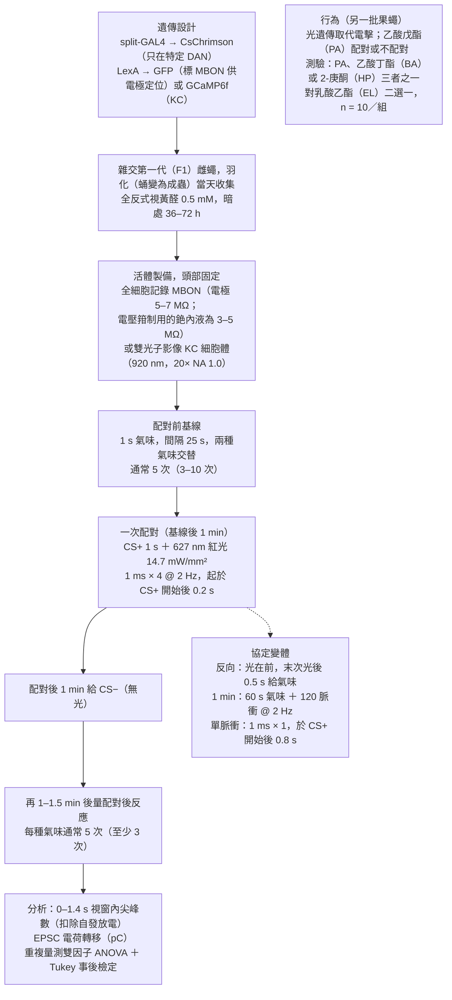
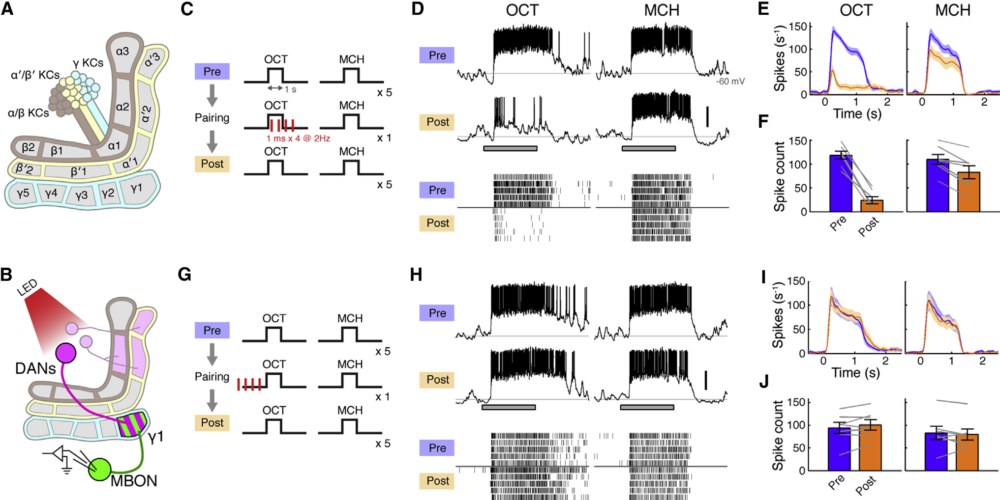
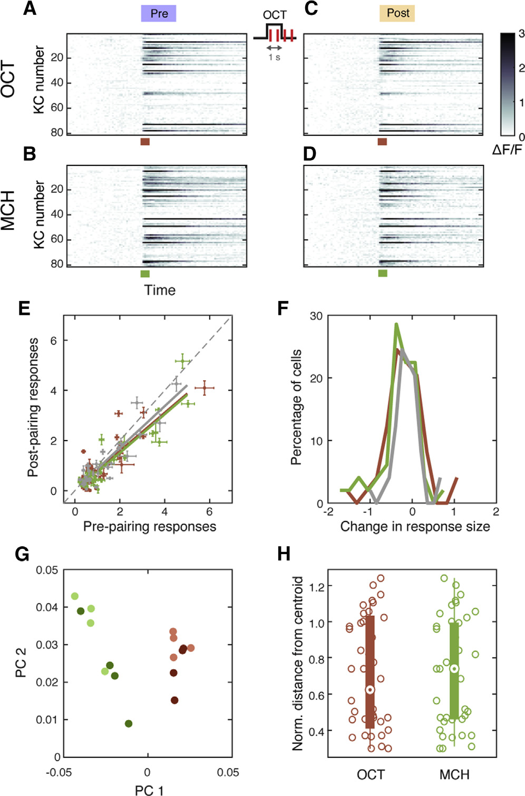
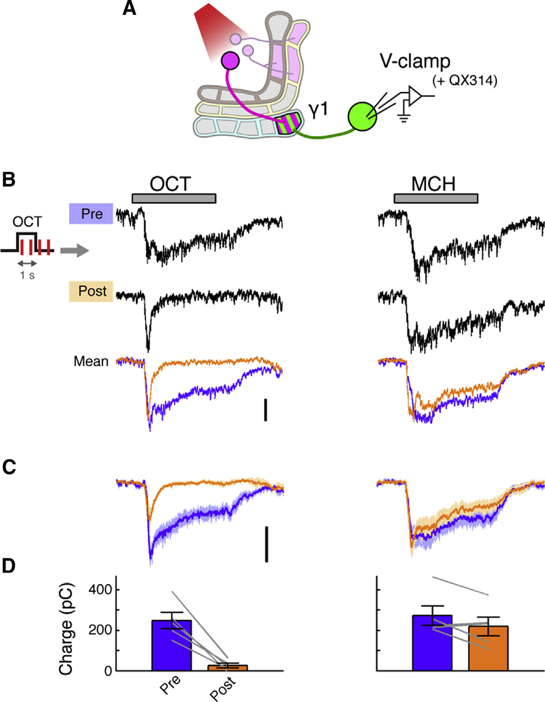
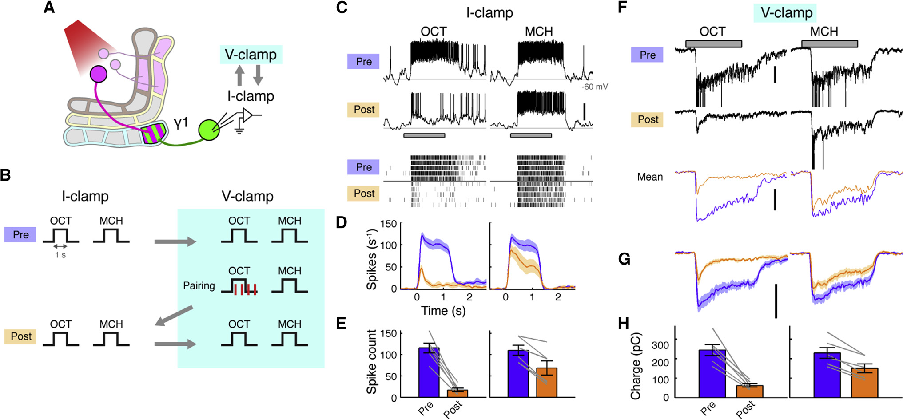
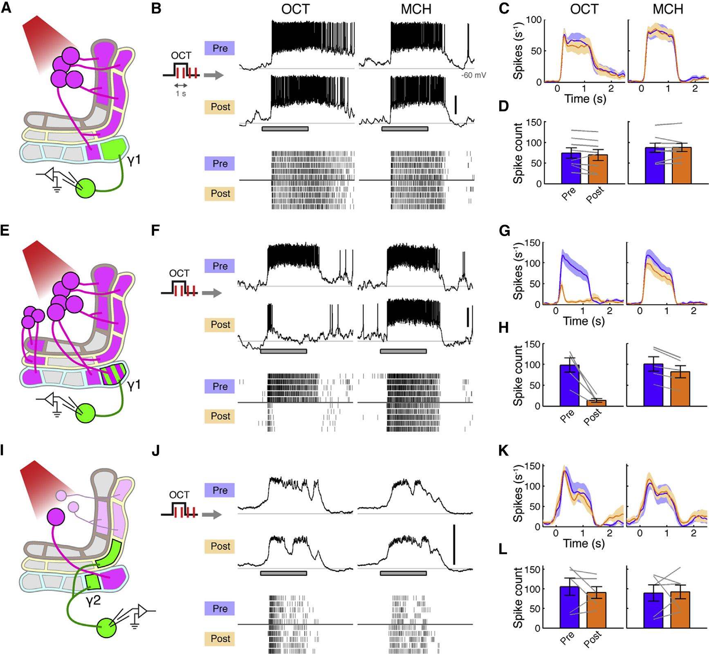
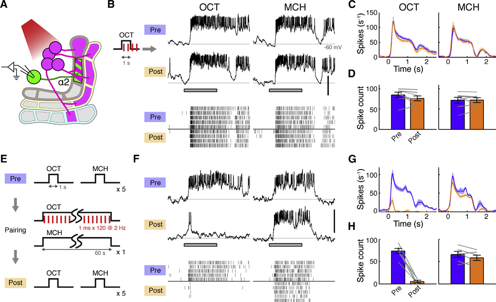
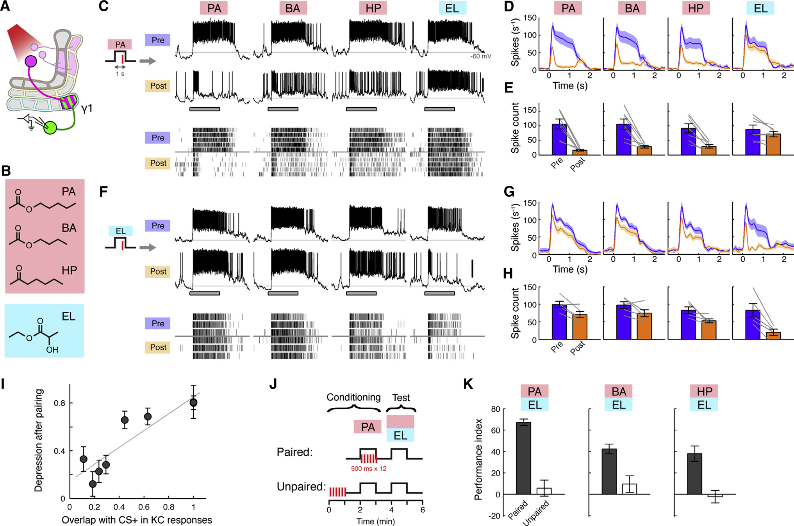

<!-- 本機 PDF：papers/2015-Heterosynaptic%20Plasticity%20Underlies%20Aversive%20Olfactory%20Learning%20in%20Drosophila.pdf -->

# Heterosynaptic Plasticity Underlies Aversive Olfactory Learning in *Drosophila*

**異突觸可塑性是果蠅嫌惡嗅覺學習的基礎**

| 項目 | 內容 |
|---|---|
| **出處** | Neuron 88(5), 985–998 (2015). doi: 10.1016/j.neuron.2015.11.003 [全文（PMC 免費閱讀）](https://pmc.ncbi.nlm.nih.gov/articles/PMC4674068/) |
| 日期 | 刊期 2015-12-02（PDF 印「Published: December 2, 2015」）；線上先行日 ？待查（PDF 未印）。投稿 2015-05-04・修訂 2015-09-11・接受 2015-10-14 |
| 通訊作者 | Toshihide Hige，higet@janelia.hhmi.org；Glenn C. Turner，turnerg@janelia.hhmi.org（PDF 只有英文名） |
| 作者 | 共 5 人：Toshihide Hige、Yoshinori Aso、Mehrab N. Modi、Gerald M. Rubin、Glenn C. Turner。無共同第一作者標示。分工：Hige 做電生理、Aso 做行為、Modi 做鈣影像 |
| 機構 | Cold Spring Harbor Laboratory（美國紐約州）；Janelia Research Campus, Howard Hughes Medical Institute（美國維吉尼亞州） |
| 資料庫 | 無公開資料庫或程式碼連結（分析以 MATLAB R2014a 自寫程式完成） |
| 補充資料 | Supplemental Experimental Procedures（含行為實驗方法）＋ 圖 S1–S7。**本庫未取得**，本頁凡依賴補充資料的內容一律標 `？待查（補充資料未取得）` |
| 經費 | NIH R01 DC010403-01A1（Turner）；HHMI（Rubin、Aso）；日本學術振興會海外研究員獎助、上原記念生命科學財團（Hige） |

> 與本庫有關的作者：無（本庫目前沒有「與本庫有關的作者」名單）。
>
> 付費期刊（版權屬出版社）。本 PDF 為出版社排版版（Cell Press 版面，頁尾印「©2015 Elsevier Inc.」）；**PDF 內搜尋 Creative Commons／open access／license 皆無結果，沒有 CC 授權聲明**。交辦書目附有 PMC 編號 PMC4674068，該編號未印在 PDF 上。全文請由資料表「出處」列的連結到 PMC 免費閱讀（PMC 公開的作者稿；本庫在本機另存的是出版社排版版）。**本庫不散布全文 PDF。** 本頁的圖擷取自原文，版權屬原出版社，以教學與評論目的引用，每張圖下方標明出處。

---

## 為什麼重要

果蠅的嗅覺學習有一個存在已久的標準模型：氣味由蘑菇體（mushroom body, MB）裡的 Kenyon 細胞（Kenyon cell, KC）表徵，懲罰或獎賞由多巴胺神經元（dopaminergic neuron, DAN）帶進來，KC 把訊號經由突觸（神經元之間傳訊號的接點）送給輸出神經元（MB output neuron, MBON），而 DAN 的末梢就伸到這些突觸旁邊。於是**多巴胺應該會改變「KC → MBON」這個突觸的強度**，也就是同樣多的 KC 訊號能讓 MBON 收到多少電流（Heisenberg 2003 等）。這個模型有解剖學支持：KC 的軸突（送出訊號的長纖維）成束排成幾條「葉」（lobe），Aso et al. 2014a 把這些葉沿長度切成 15 個互不重疊的區室（compartment），每個區室各配一型 DAN 與一型 MBON；一條 KC 軸突會依序穿過好幾個區室。這個模型也有行為遺傳學支持，但依本篇的說法，在它之前**果蠅身上還沒有人直接量到這個突觸變弱或變強**。先前的證據是鈣影像（用會隨細胞內鈣濃度發光的螢光蛋白，間接看神經元的活動）：KC 軸突的氣味反應在學習後變大（Tomchik & Davis 2009 等，本篇引用），MBON 的反應有的變小、有的變大，方向並不一致。

本篇用全細胞膜片鉗記錄 MBON 的突觸電流，並用光遺傳只活化一顆 DAN，直接量到了這個突觸的改變：**氣味與多巴胺配對一次，該氣味送到 MBON-γ1pedc（γ1pedc 是區室名稱，以圖 1A 中 γ 葉的第 1 區 γ1 為主，字尾 pedc 本篇未解釋；MBON 與 DAN 都以它所在的區室命名）的突觸電流總量（整段反應期間累積的電流，即電荷）就比配對前少了約九成，而且持續至少 40 分鐘**（但電流剛開始的最高點大致還在，少掉的是之後持續的那一段，所以「九成」指的是總量，不是最高點，見專業文 3.3）。它同時檢驗了三個長期只有間接證據的假說：先後順序是否重要（先給多巴胺再給氣味就不行）、區室是否各自獨立（鄰近區室不受影響）、稀疏編碼能否減少記憶互相干擾。稀疏編碼（sparse coding）指每種氣味只活化一小群 KC；不同氣味用到的 KC 越不重疊，改動一種氣味的突觸就越不會波及另一種。本篇發現兩種氣味的 KC 重疊越多，可塑性就越會波及另一種氣味，行為上也越會「類化」（generalization：學會躲一種氣味後，也會躲相似的氣味）。

本庫目前收錄三篇論文，另兩篇是 Tomchik & Davis 2009（*Neuron*）與 Handler et al. 2019（*Cell*）。三篇看的是同一個突觸的不同面向：Tomchik & Davis 2009 量的是突觸**前**端 KC 裡的 cAMP（環腺苷酸，一種細胞內的「第二傳訊者」分子，多巴胺受器被活化後會讓它升高），本篇量的是突觸**後**端 MBON 收到的電流，Handler et al. 2019 處理的是多巴胺受體與時序規則。一個突觸有兩側：突觸前是 KC 軸突的末梢（送出訊號），突觸後是 MBON（接收訊號）。突觸變弱，可能是末梢送得少，也可能是 MBON 收得少。本篇自己在討論中點出一個未解的落差：另一個實驗室（Boto et al. 2014）用同一個基因品系活化多巴胺神經元，在 γ1 區的 KC 末梢上看不到鈣訊號的改變；本篇卻在同一個區室量到 MBON 收到的電流少了九成。若是末梢送得少，末梢的活動照理會跟著變，所以兩者放在一起時對不上。**突觸前與突觸後的變化對不上，是這條研究線上的一個關鍵開口。**

---

## 論文摘要（原文與中譯）

> 本篇的 SUMMARY 是不分段的單段摘要（不是 Background／Results／Conclusion 結構），以下照原文排列。摘要中的「輸出位點」指 KC → MBON 突觸；「突觸抑制」（synaptic depression）指突觸變弱；「長期」在本篇的實測範圍是至少 40 分鐘；「時間先後的邏輯必要條件」指預告用的氣味必須出現在懲罰之前。
>
> Although associative learning has been localized to specific brain areas in many animals, identifying the underlying synaptic processes in vivo has been difficult. Here, we provide the first demonstration of long-term synaptic plasticity at the output site of the *Drosophila* mushroom body. Pairing an odor with activation of specific dopamine neurons induces both learning and odor-specific synaptic depression. The plasticity induction strictly depends on the temporal order of the two stimuli, replicating the logical requirement for associative learning. Furthermore, we reveal that dopamine action is confined to and distinct across different anatomical compartments of the mushroom body lobes. Finally, we find that overlap between sparse representations of different odors defines both stimulus specificity of the plasticity and generalizability of associative memories across odors. Thus, the plasticity we find here not only manifests important features of associative learning but also provides general insights into how a sparse sensory code is read out.

**中譯**（本節為忠實翻譯，非自撰內容）：

> 雖然在許多動物中，聯想學習已被定位到特定腦區，但要在活體內辨識其背後的突觸過程一直很困難。本研究首次證明果蠅蘑菇體的輸出位點存在長期突觸可塑性。將氣味與特定多巴胺神經元的活化配對，會同時引發學習與氣味專一的突觸抑制。可塑性的誘發嚴格取決於兩個刺激的時間先後，重現了聯想學習在邏輯上的必要條件。此外，我們揭示多巴胺的作用侷限於蘑菇體葉的各個解剖區室之內，且在不同區室間有所差異。最後，我們發現不同氣味的稀疏表徵之間的重疊，同時決定了可塑性的刺激專一性，以及聯想記憶在不同氣味之間的可類化程度。因此，我們在此發現的可塑性不僅展現了聯想學習的重要特徵，也為稀疏感覺編碼如何被讀出提供了普遍性的見解。

---

## 科普文

這篇研究的是「嫌惡學習」：果蠅聞到某個氣味時被懲罰，之後就會躲開那個氣味。這是聯想學習（associative learning）的一種：把原本無關的氣味和懲罰聯想在一起。

想像一間大公司的收發室。每天有一大群員工（Kenyon 細胞）把信丟進一排信箱，信箱後面坐著少數幾位主管（輸出神經元，MBON），主管讀完信決定公司要「靠近」還是「逃開」。每封信只由少數員工寫，不同的事由不同的一小群員工負責，這叫**稀疏編碼**（sparse coding）。收發室旁邊還站著幾位督察（多巴胺神經元，DAN），每位督察只管一段信箱。督察一出聲（代表「剛才發生了壞事」），他那段信箱裡「剛剛有人投信」的那些投遞口就會被調窄，下次同一批員工投的信，主管就收得比較少。比喻的對應是：員工＝Kenyon 細胞，信＝神經訊號，投遞口＝突觸，主管＝輸出神經元，督察＝多巴胺神經元。

這就是果蠅蘑菇體的樣子。果蠅聞到一個氣味，一小群 Kenyon 細胞會發出訊號，經由突觸（神經元之間傳訊號的接點）送到輸出神經元。如果這個氣味出現的同時果蠅被電了一下，負責懲罰訊號的多巴胺神經元就會放電。下次再聞到同一個氣味，果蠅就會躲開。長期以來，研究者推測學習發生在「Kenyon 細胞 → 輸出神經元」這個突觸上：多巴胺讓剛剛活躍的突觸改變強度。**過去的證據都是間接的（例如用螢光看細胞活動的明暗），這個突觸太小、太深，一直沒有人用電極直接量到它真的改變了。**

**難題**有兩個。第一，要在活的果蠅腦裡把電極接上一顆特定的輸出神經元，同時精準控制一顆特定的多巴胺神經元何時放電。第二，就算看到輸出神經元的反應變小，也要排除另一種解釋：訊號是從 Kenyon 細胞流向輸出神經元的，如果 Kenyon 細胞本身對氣味的反應變弱了，輸出神經元收到的也會變少，這時改變的就不是兩者之間的突觸。

**解法**是幾項當時新做的工具。作者做了一個只在一顆多巴胺神經元（名為 PPL1-γ1pedc）表現光敏感通道 CsChrimson 的果蠅品系。CsChrimson 是一種紅光一照就讓神經元放電的蛋白質，所以作者可以用紅光代替電擊，時間精確到毫秒。另一套獨立的基因工具讓輸出神經元 MBON-γ1pedc 發綠色螢光。兩者名字裡的「γ1pedc」是同一個區室的名稱：這顆多巴胺神經元正好管這顆輸出神經元所在的那段信箱。螢光是為了方便把玻璃電極接上去，記錄它的電訊號。實驗流程是：先記錄兩種氣味（3-辛醇與 4-甲基環己醇）各自讓這顆神經元放多少電，再讓其中一種氣味出現 1 秒，同時打四下 1 毫秒的紅光（這一步叫「配對」，紅光讓多巴胺神經元放電，等於告訴果蠅「這個氣味伴隨懲罰」），最後再量一次。和光配對的氣味記作 CS+，沒配對、當作比較基準的另一種氣味記作 CS−。

結果非常清楚（以下是 7 顆輸出神經元、每隻果蠅記錄一顆的平均）。配對過的氣味，輸出神經元在氣味出現後 1.4 秒內的放電，從平均 118 次掉到 24 次；沒配對的氣味只從 110 次降到 83 次。放電次數是輸出神經元的「產出」，它還受神經元自身狀態影響；為了直接看突觸，作者用藥物把輸出神經元自己的放電關掉，只量從突觸流進來的電流。以整段反應累積的電流總量（電荷）計算，配對氣味少了約九成；不過電流剛開始的峰值大致還在，少掉的主要是之後持續的部分。這個變化至少維持 40 分鐘。另一組實驗用鈣影像（讓細胞活動時發出較亮螢光的技術）看 Kenyon 細胞的細胞體，配對前後的反應沒有差別。細胞體反應沒變，表示 Kenyon 細胞仍然照常被氣味激發、照常放電；作者另外直接測過，Kenyon 細胞本身也沒有變得比較難放電。所以 Kenyon 細胞「這一端的工作」沒變，作者據此推論：**改變發生在訊號從 Kenyon 細胞交到輸出神經元的那一步，也就是兩者之間的突觸**。一個突觸有兩側：送訊號的 Kenyon 細胞末梢（突觸前）和收訊號的輸出神經元（突觸後）。細胞體離末梢很遠，所以這個推論排除的是「Kenyon 細胞整體變了」，不能排除「末梢局部少送了訊號」；改變在突觸前還是突觸後，仍是開放的問題（見最後一段）。這種「由第三顆神經元（多巴胺神經元）調整另外兩顆之間的突觸」的機制，叫做異突觸可塑性（heterosynaptic plasticity）；相對地，只由突觸兩端自己的活動決定的改變，叫做同突觸（homosynaptic）可塑性。突觸變弱並持續，叫做長期抑制（long-term depression, LTD）。

作者接著問了三個問題。**順序重要嗎？** 先打光、0.5 秒後才給氣味，突觸完全不變。這符合學習的邏輯：預告懲罰的線索要出現在懲罰之前。**各區室是獨立的嗎？** 只活化鄰近區室的多巴胺神經元，γ1 區的輸出神經元不受影響。反過來，在 γ1 區誘發抑制時，鄰近 γ2 區的輸出神經元也不受影響。這一點並不理所當然：一條 Kenyon 細胞軸突會依序穿過 γ1、γ2 等好幾個區室，兩個輸出神經元收的大概是同一批軸突的訊號，但只有督察管的那一段被調整。**所有區室的規則一樣嗎？** 不一樣。在 α2 區，1 秒的配對無效，要 1 分鐘、120 下光才誘發同樣強的抑制。也就是說，不同區室對多巴胺的敏感度不同。

最後一個實驗回到稀疏編碼。四種氣味中，乙酸戊酯、乙酸丁酯、2-庚酮三者活化的 Kenyon 細胞高度重疊，乳酸乙酯則很不一樣。拿乙酸戊酯配對，另兩種重疊高的氣味也一起被抑制，乳酸乙酯不受影響。作者把「某種氣味與配對氣味共用的 Kenyon 細胞比例」（重疊程度，資料取自同團隊 2013 年的研究）對「那種氣味被抑制的比例」畫圖，八個資料點（兩次配對實驗各量四種氣味：一次以乙酸戊酯配對、一次以乳酸乙酯配對）的相關係數為 0.90。行為實驗也一樣：學會躲乙酸戊酯的果蠅，也會躲另外兩種相似的氣味。**作者的結論是：記憶會「類化」（generalization，學到一個東西後對相似的東西也有同樣反應）到別的氣味，是因為它們共用了同一批被改變的突觸。**

回到收發室的比喻。督察調整的是「剛剛有人投信」的投遞口。如果兩件事由完全不同的員工負責，調整一件事的投遞口不會影響另一件。如果兩件事有三成員工重疊，調整其中一件時，那三成共用的投遞口也被調窄了，另一件就會跟著受影響。可以粗略估算：配對氣味的放電少了約八成；沒配對的氣味只有三成的信經過這些被調窄的投遞口，所以它應該少掉約 0.3 × 0.8 ≈ 四分之一。本篇最早的兩種氣味（3-辛醇與 4-甲基環己醇）正是如此：兩者約有三成的 Kenyon 細胞重疊，沒配對的 4-甲基環己醇實測從 110 次降到 83 次，正好約四分之一（※ 推論：這個估算是本頁拿論文的數字算的，論文沒有這樣算，而且假設每顆 Kenyon 細胞的份量相同）。稀疏編碼的好處，就是讓這種「誤傷」降到最低；但只要有重疊，誤傷就不會是零；而行為上的類化，正是這種誤傷的另一面。

**代價與限制**也要說清楚。這是在頭部被固定、腦部打開的活果蠅身上做的，一次只配對一回，量的時間是幾十分鐘；它不是在量果蠅隔天還記不記得。行為實驗（用紅光代替電擊訓練果蠅，再讓牠在兩種氣味間選擇）與電極記錄是兩批不同的果蠅，所以「突觸抑制造成行為改變」是兩組結果的對應，不是在同一隻果蠅上證明的因果。順序的實驗只測了一種「先氣味後光」與一種「先光後氣味」，沒有測不同的間隔。

**最容易被誤讀的一點：這篇說的是「多巴胺讓輸出端的突觸變弱」，而不是「記憶就存在 Kenyon 細胞裡」。** 作者看的是 Kenyon 細胞的細胞體（細胞的本體，離突觸很遠），排除的是「Kenyon 細胞整體反應變了」；軸突末梢（突觸前，緊貼著輸出神經元的那一端）有沒有局部改變，本篇沒有直接量，作者自己也承認另一篇研究在 γ1 區的末梢上看不到鈣訊號的變化。所以「記憶痕跡在 Kenyon 細胞與輸出神經元之間的突觸」這個結論是強的；但突觸前（Kenyon 細胞末梢送得少）還是突觸後（輸出神經元收得少），仍然是開放的問題。

---

## 專業文

### 一、概述

**主要問題。** 果蠅 MB 的 KC → MBON 突觸，是否真的會因為氣味（CS，條件刺激，conditioned stimulus）與多巴胺（US，非條件刺激，unconditioned stimulus 的替代）配對而改變強度？若會，它的誘發規則是否具備聯想學習所需的性質：時間先後、區室專一、刺激專一？

**重要性。** 這是 MB 學習模型的核心假設。Heisenberg 2003 提出「DAN 在各區室異突觸地調節 KC 輸出突觸」的模型；Aso et al. 2014a 的解剖圖譜顯示 15 個區室各有對應的 DAN 與 MBON；Aso et al. 2014b 與 Owald et al. 2015 顯示活化不同 MBON 會引發趨近或迴避，也就是 MBON 帶有「正負價值」（valence）。這些都是間接證據。**作者在摘要中自稱「首次證明」（first demonstration）MB 輸出端的長期突觸可塑性**；本庫只收三篇，無從獨立驗證這個優先權宣稱。

**發表當時的領域現狀（2015）。** 蝗蟲（Cassenaer & Laurent 2007、2012）與蜜蜂（Oleskevich et al. 1997）已在 MB 輸出端以電刺激誘發可塑性，蝗蟲的形式是依賴突觸後放電的 Hebbian 尖峰時序依賴可塑性（spike-timing-dependent plasticity, STDP）。果蠅方面只有鈣影像：KC 軸突在學習後反應增加（Akalal et al. 2010、2011；Boto et al. 2014〔該篇在部分區室看到 KC 軸突鈣反應改變，但在 γ1 區沒有，見 3.5〕；Tomchik & Davis 2009；Wang et al. 2008；Yu et al. 2006；但 Zhang & Roman 2013 不同），MBON 有的減少（Owald et al. 2015；Séjourné et al. 2011）、有的增加（Bouzaiane et al. 2015；Owald et al. 2015；Pai et al. 2013；Plaçais et al. 2013）。DAN 受器方面，Kim et al. 2007 與 Qin et al. 2012 顯示 KC 上的多巴胺受器是學習所必需。同一團隊在本篇之前（Hige et al. 2015, *Nature*）已報告 MBON 的氣味反應在個體之間差異很大，推測是經驗塑造的結果。

**體裁：** 原著論文（活體電生理 ＋ 雙光子鈣影像 ＋ 行為）。

**讀專業文前的術語與標記**（後文首次出現時不再重複解釋）：

| 詞 | 意思 |
|---|---|
| KC、MBON、DAN | Kenyon 細胞（KC）是 MB 的主體神經元，負責表徵氣味；MB 輸出神經元（MBON）接收 KC 的訊號、影響行為；多巴胺神經元（DAN）傳遞懲罰或獎賞訊號。訊號方向是 KC → MBON，DAN 在旁邊調節這個突觸 |
| 異突觸可塑性、LTD | 由第三個神經元（此處為 DAN）改變另外兩者（KC → MBON）之間突觸強度的現象，稱異突觸（heterosynaptic）可塑性；只由突觸兩端自身活動決定的，稱同突觸可塑性。突觸變弱並持續一段時間，稱長期抑制（long-term depression, LTD） |
| 稀疏編碼 | 每種氣味只活化一小部分 KC；不同氣味用到的 KC 重疊越少，改動一種氣味的突觸越不會波及另一種（這種波及稱「突觸干擾」） |
| OCT、MCH 等氣味 | OCT＝3-辛醇、MCH＝4-甲基環己醇（圖 1–6 用的一對氣味）；PA＝乙酸戊酯、BA＝乙酸丁酯、HP＝2-庚酮、EL＝乳酸乙酯（圖 7） |
| 驅動品系（driver） | 決定某個基因（例如光敏感通道）只在哪些神經元表現的果蠅品系，例如 MB320C、MB099C、TH-GAL4；原理見「二、方法」的遺傳工具段 |
| 光遺傳、熱遺傳 | 光遺傳：讓神經元表現光敏感通道，以光照使其放電（本篇用紅光與 CsChrimson）。熱遺傳：讓神經元表現溫度敏感通道，以升溫使其放電（只出現在引用的 Boto 2014） |
| CS+／CS− | CS＝條件刺激（conditioned stimulus），本篇是氣味。CS+ 是與多巴胺活化配對的氣味，CS− 是不配對、當作對照的另一種氣味 |
| US | 非條件刺激（unconditioned stimulus），原本是電擊；本篇以光活化 DAN 取代，稱「US 替代」 |
| 葉、區室 | KC 軸突成束形成 α、β、α′、β′、γ 等「葉」；葉沿長度分成 15 個區室，每區室有一型 DAN 與一型 MBON。一條 KC 軸突依序穿過多個區室，沿途與各區室的 MBON 形成突觸 |
| PPL1、PAM | 兩群多巴胺神經元的名稱。本篇只說 PPL1-γ1pedc 的活化可取代嫌惡的電擊；PAM 只在 TH-GAL4 的圖說中出現，本篇未說明其功能 |
| 價值（valence） | MBON 被活化時引發的是趨近（正價值）或迴避（負價值） |
| 尖峰（spike） | 神經元的動作電位，即「放電」；本篇以氣味開始後 0–1.4 s 內的尖峰數當作 MBON 的反應量 |
| EPSC、電荷轉移 | EPSC 是興奮性突觸後電流（從突觸流進 MBON 的電流）；電荷轉移是 EPSC 在 0–1.4 s 內的時間積分，單位 pC（皮庫侖），代表整段反應收到的突觸輸入總量，不同於電流的峰值 |
| QX-314 | 放進記錄電極內液、從細胞內部阻斷鈉通道的藥物，使被記錄的 MBON 無法放電 |
| 第二傳訊者 | 受器被活化後在細胞內傳遞訊號的小分子，cAMP 是其一；它能在細胞內擴散，所以有可能沿 KC 軸突跑到鄰近區室 |
| Hebbian STDP | 尖峰時序依賴可塑性（spike-timing-dependent plasticity）：突觸強度的改變取決於突觸前、後兩個神經元放電的先後，需要突觸後神經元放電；「Hebbian」指這種由兩端共同活動決定的規則 |
| DPM 神經元 | 廣泛支配 MB 各葉的一種神經元（dorsal paired medial），也可能把訊號送到 MBON 附近 |
| 電流箝制、電壓箝制 | 全細胞記錄的兩種模式。電流箝制讓膜電位自由變化，可看到尖峰；電壓箝制由儀器把膜電位固定在設定值，細胞無法升到放電所需的電位，所以尖峰大多被壓掉，此時量到的是流入細胞的電流 |
| PSTH | 刺激前後的平均放電率時間曲線（peristimulus time histogram） |
| ΔF/F、GCaMP6f | GCaMP6f 是鈣指示蛋白，神經元活動時細胞內鈣升高、螢光變亮；ΔF/F 是螢光相對基線的變化比例，作為活動量 |
| 類化（generalization） | 學會對一種氣味的反應後，對相似氣味也出現同樣反應 |
| 重複量測雙因子 ANOVA | 本篇的兩個因子是「配對前／後」與「氣味（CS+／CS−）」，同一隻果蠅前後都量；「配對效果在兩種氣味間顯著不同」指兩因子的交互作用顯著 |
| ※ 推論 | 論文沒有明說、本頁自行推得的內容 |
| ※ 從圖判讀 | 本頁從圖上的長條或曲線估讀的數值，論文沒有明列 |
| ？待查 | 需要補充資料或其他來源才能確認、本頁刻意不填的內容。本篇的補充資料（圖 S1–S7）未取得，所以凡是只寫在補充資料裡的細節都標此記號 |
| 本頁、本庫 | 本頁＝這份閱讀筆記；本庫＝收錄這份筆記的果蠅蘑菇體文獻知識庫（目前收錄三篇論文） |

### 二、方法

**遺傳工具。** 這篇的核心是精準度。GAL4 是一種能開啟目標基因的蛋白（轉錄因子），在哪些細胞裡製造它，取決於接在它前面的調控序列（啟動子）。split-GAL4 把 GAL4 拆成兩半，各由一段不同的啟動子控制；只有在兩段啟動子都開啟的細胞裡，兩半才會湊成完整的 GAL4。這樣能把表現範圍縮到少數幾型、甚至一顆神經元。作者新做了兩個品系：**MB320C** 只標一顆 PPL1-γ1pedc（PPL1 是多巴胺神經元的一個細胞群名稱，γ1pedc 指它投射的區室；舊名 MB-MP1）；**MB099C** 標四型 PPL1 DAN（PPL1-γ2α′1、α′2α2、α′3、α3），但從不標 PPL1-γ1pedc。GAL4 已經用來在 DAN 裡放光敏感通道，所以要標記被記錄的 MBON 時，需要另一套互不干擾的表現系統，即 LexA。它用來把 GFP（綠色螢光蛋白，讓電極能對準目標細胞）放在要記錄的 MBON 上，或把鈣指示劑 GCaMP6f 放在全部 KC 上（R13F02-LexA）。MBON 的 LexA 品系：R12G04（MBON-γ1pedc，舊名 MB-MVP2）、R25D01（MBON-γ2α′1）、R34B02（MBON-α2sc）、R14H06（γ KC）。

**一個值得記下的設計選擇。** 先前文獻中 PPL1-γ1pedc 的專一品系是 MB438B，作者不用它，因為它的插入位點 attP40 與這裡用的 LexA 品系相同，可能發生 transvection（同源染色體上相同位點的調控元件互相影響），讓 LexA 與 GAL4 在同一批細胞表現（Mellert & Truman 2012）。後果會是光敏感通道也出現在被記錄的 MBON 上，光照就會直接讓 MBON 本身受影響。這是一個實作上的細節，但說明作者在意「光到底活化了誰」。

**光遺傳。** CsChrimson 是紅光活化的陽離子通道，需要飼料中加視黃醛（retinal）作為輔因子。光源為 627 nm LED，強度 14.7 mW/mm²。作者在補充圖 S2 確認光脈衝能在 PPL1-γ1pedc 與 PPL1-α′2α2 引發可靠的尖峰；各品系的表現圖在圖 S1。**兩者細節皆 ？待查（補充資料未取得）**；本頁因此只能依正文的轉述，相信光脈衝確實讓目標 DAN 放電。

**電生理。** 全細胞膜片鉗（whole-cell patch clamp）：把玻璃電極貼上細胞膜後打穿，直接量細胞內電位（電流箝制，current clamp，看尖峰）或流入的電流（電壓箝制，voltage clamp，看興奮性突觸後電流 EPSC）。電流箝制時以 < 50 pA 超極化電流把細胞維持在約 −60 mV。電壓箝制用含銫的內液並加 **QX-314**（10 mM），這是從細胞內阻斷鈉通道的藥物，可完全消除 MBON 自己的尖峰；電極 3–5 MΩ，串聯電阻 < 15 MΩ、補償至多 80%，維持於 −70 或 −60 mV，有未箝住尖峰的細胞剔除；訊號 5 kHz 低通、10 kHz 取樣。部分實驗以 cell-attached 記錄（不打穿細胞膜，只量尖峰）代替；作者說兩種記錄方式量到的尖峰效果無法區分，因此合併呈現。各圖所含例數：圖 1E–F、1I–J、7D–E 各 1 例，7G–H 2 例，S3 1 例。MBON-γ2α′1 的細胞體在觸角葉腹側，記錄時需把頭在頸部轉 180°。

**氣味。** 40 ml 瓶裝 5 ml 純氣味，頂空蒸氣經兩段空氣稀釋至 2%（類化實驗為 1%），總流量 1 l/min，以光離子化偵測器（PID）監測穩定性。氣味：3-辛醇（OCT）、4-甲基環己醇（MCH）、乙酸戊酯（PA）、乙酸丁酯（BA）、2-庚酮（HP）、乳酸乙酯（EL）。

**鈣影像。** 雙光子顯微鏡，920 nm，樣本處 8–14 mW，20× NA 1.0 物鏡；影像 255 × 256 像素，像素停留時間 1.6 µs，平均 4.8 Hz。每種氣味配對前後各 4 次（每次 21 s），間隔約 40 s；配對方式同電生理，CS+ 一律為 OCT、CS− 為 MCH（電生理則有一組實驗把兩者對調，見圖 S3）。KC 細胞體逐顆手動圈選（每隻 82 ± 9 顆，mean ± SD，n = 7 隻）。某顆細胞在某次試驗「有反應」的定義：反應視窗（刺激後 0.5–4.5 s）經五格移動平均後的 ΔF/F 峰值超過基線（刺激前 5 s）的 2.33 個標準差；至少半數試驗過閾值才算該氣味的反應細胞。族群分析把一次試驗視為「每顆細胞一個維度」空間中的一點，問的是「配對後的族群反應樣式，有沒有離開配對前的位置」：先求配對前各次試驗的平均點（重心），再算配對後每次試驗到這個重心的歐氏距離；為了讓不同果蠅可比，距離除以重心到原點的距離。若 CS+ 的距離明顯大於 CS−，就表示配對專門改變了 CS+ 的 KC 反應樣式；主成分分析的前兩個成分分別解釋 54% 與 22% 變異。

**資料分析。** MATLAB R2014a。尖峰以高通濾波後依振幅自動偵測並目視確認；PSTH（peristimulus time histogram，刺激前後放電率時間圖）以 SD 50 ms 的高斯核平滑。KC 興奮性測試（圖 S7，目的是排除「配對讓 KC 本身變得較不容易放電」）：以 20 pA/s 斜坡電流找尖峰閾值（膜電位變化率首次超過 3 V/s 處），以 15 pA、1 s 方波（約平均閾值電流的 1.5 倍）量持續放電率。

**行為。** 光遺傳取代電擊作為 US，在嗅覺競技場中訓練（圖 S1C–H），方法在補充實驗程序中。**行為實驗的光強、詳細流程與學習表現指數（performance index, PI；正值表示迴避受測氣味）的計算公式 ？待查（補充資料未取得）。** 從圖 7J 可讀出的部分：配對組在約 2–3 min 給 PA 並同時打 500 ms × 12 的光脈衝，不配對組在 0–1 min 給光、2–3 min 才給 PA（光與氣味錯開，學不到兩者的關聯，作為對照），兩組都在約 4–5 min 測試。行為組飼育條件：22 °C、相對濕度 60%、全暗；視黃醛羽化前 0.2 mM、羽化後 0.4 mM。

### 三、結果

#### 3.1 一次配對引發長效、氣味專一的抑制（圖 1）

<small>圖片出處：Hige T, Aso Y, Modi MN, Rubin GM, Turner GC. *Neuron* 88(5):985–998 (2015)，Figure 1。© 2015 Elsevier Inc. 教學引用；全文見 [PMC](https://pmc.ncbi.nlm.nih.gov/articles/PMC4674068/)。</small>

> **原圖說（Figure 1）：** Forward Pairing of Odor and DAN Activation Induces Long-Lasting Suppression in the γ1 Compartment. (A) Schematic of MB lobes showing DAN-MBON compartments. (B) Expression of CsChrimson and GFP was driven by MB320C and R12G04-LexA, respectively. Recordings were made from MBON-γ1pedc. (C) Forward pairing protocol. Four light pulses (1 ms in duration) were delivered at 2 Hz, starting 0.2 s after CS+ onset. (D) Representative single-cell data, showing odor responses before (Pre) and after (Post) pairing. Gray bar, 1 s odor presentation. Scale bar, 20 mV. Raster plots (bottom) show spikes. (E) Mean spike rates over several experiments displayed as peristimulus time histogram (PSTH; ±SEM, shaded area; n = 7). (F) Mean odor-evoked spike count (±SEM). Gray lines indicate data from individual flies. Spike counts decreased in both CS+ (OCT, p < 10⁻⁴, Tukey's post hoc test) and CS− (MCH, p < 0.01), but the effect of pairing was significantly different between odors (p < 0.001, repeated-measures two-way ANOVA). (G) Backward pairing protocol. Odor was delivered 0.5 s after the last pulse of light. (H) Representative single-cell data. (I) Mean PSTH (n = 7). (J) Mean odor-evoked spike count. Backward pairing showed no effect (p > 0.05, repeated-measures two-way ANOVA).

**圖說中譯：** 正向配對氣味與 DAN 活化，在 γ1 區室引發長效抑制。(A) MB 葉的示意圖，標出 DAN–MBON 區室。(B) 以 MB320C 驅動 CsChrimson、R12G04-LexA 驅動 GFP；記錄 MBON-γ1pedc。(C) 正向配對協定：四個 1 ms 光脈衝，2 Hz，於 CS+ 開始後 0.2 s 起始。(D) 單一細胞代表資料，配對前（Pre）與配對後（Post）的氣味反應；灰條為 1 s 氣味；比例尺 20 mV；下方光柵圖為尖峰。(E) 多次實驗的平均放電率 PSTH（±SEM，陰影；n = 7）。(F) 平均氣味誘發尖峰數（±SEM）；灰線為個別果蠅。CS+（OCT，p < 10⁻⁴，Tukey 事後檢定）與 CS−（MCH，p < 0.01）的尖峰數都下降，但配對的效果在兩種氣味間顯著不同（p < 0.001，重複量測雙因子 ANOVA）。(G) 反向配對協定：最後一個光脈衝後 0.5 s 才給氣味。(H) 單一細胞代表資料。(I) 平均 PSTH（n = 7）。(J) 平均氣味誘發尖峰數；反向配對無效果（p > 0.05，重複量測雙因子 ANOVA）。

**解讀：**

- **CS− 也顯著下降，正文前後說法不一。** 正文在描述本圖時說 MCH「minimally affected」（110 ± 11 → 83 ± 14），圖說卻寫 p < 0.01；以平均值算是 −25%，後文（第 990 頁）引為 27% ± 7.1%，並改口「slightly, but significantly」。⚠️ 論文自身不一致（措辭層級，不涉及數值）。**真正的結論應寫成「CS+ 降約八成、CS− 降約四分之一，兩者差異顯著」，而不是「只有 CS+ 下降」。**（八成：正文明列 CS+ 由 118 ± 8.3 降到 24 ± 7.4，個別果蠅降幅平均 80% ± 5.7%。）
- **拿論文的數字算它沒算的量：CS− 的抑制幅度約等於「重疊比例 × CS+ 抑制幅度」。** 論文在第 990 頁給出 OCT 與 MCH 的 KC 重疊：MCH 反應細胞中 33%、OCT 反應細胞中 30% 對兩者都反應。邏輯是：配對只削弱「CS+ 活化的那批 KC」通往 MBON 的突觸；CS− 若有一部分 KC 與 CS+ 共用，這部分的輸入也會被一起削弱。若 MBON 對某氣味的輸入大致與活化的 KC 數成正比，而重疊的那批 KC 突觸被抑制了約 80–90%，則 CS− 預期下降 0.30–0.33 × 0.80–0.90 ≈ 24–30%，與實測 27% 吻合。※ 推論：這個算式假設每顆 KC 對 MBON 的權重相同、抑制是線性的，論文沒有做這個計算；作者的定性說法（「may reflect a small degree of overlap」）與它方向一致。
- **正向協定有一半的光落在氣味結束之後。** 四個脈衝在 CS+ 開始後 0.2、0.7、1.2、1.7 s，而氣味只有 1 s，所以後兩個脈衝在氣味關掉後 0.2 與 0.7 s。C 格的示意圖畫得出來（兩條紅線在方波外），正文沒有提。這表示「正向」其實包含部分「痕跡配對」（trace pairing，CS 結束後才給 US）。不過 KC 的反應會持續到氣味結束後一段時間（圖 2A–D 的鈣訊號持續數秒），所以後兩下光到達時，CS+ 活化的 KC 很可能仍在活動，「KC 活動與多巴胺同時出現」的條件仍成立，這不推翻結論。※ 推論。
- **時間規則只有兩個點。** 正向（第一下光在氣味開始後 0.2 s）有效、反向（四下光在 2 Hz 下跨 1.5 s，最後一下之後 0.5 s 才給氣味，所以第一下光在氣味開始前 2.0 s）無效。這足以說明「順序有關」，**不足以支持摘要的「strictly depends」與討論的「sub-second precision」**：沒有測任何中間間隔，也沒有測氣味與光同時開始。反向組的尖峰數略升（OCT 約 95 → 100，※ 從圖判讀），但不顯著，論文沒有主張反向會引發增強。
- **要看 E 格配對後 OCT 曲線的起頭。** 配對後仍有一個約 50 spikes/s 的起始暫態，之後才幾乎歸零（※ 從圖判讀）。抑制作用在持續段，不在開頭。這一點在圖 3、6、7 重複出現，論文全文沒有討論（搜過 transient、peak、initial、early）。它重要的原因見 3.3 與「五、問題與限制」第 8 條。

#### 3.2 KC 的反應沒有改變（圖 2）

<small>圖片出處：Hige T, Aso Y, Modi MN, Rubin GM, Turner GC. *Neuron* 88(5):985–998 (2015)，Figure 2。© 2015 Elsevier Inc. 教學引用；全文見 [PMC](https://pmc.ncbi.nlm.nih.gov/articles/PMC4674068/)。</small>

> **原圖說（Figure 2）：** Odor-Dopamine Pairing Does Not Change KC Odor Responses. (A–D) Trial-averaged time courses (4 trials) of odor responses (ΔF/F, grayscale) in KC somata before (A and C) and after (B and D) 1 s odor-light pairing. Data from a single representative fly. Each row corresponds to a single KC. Colored bars, 1 s odor presentation. (E) Median response amplitude for each significantly responding cell before and after pairing. Red and green points indicate CS+ (OCT; n = 53 cells from 5 flies) and CS− (MCH; n = 49), respectively. Gray points are from control experiments where no light pulses were delivered (OCT and MCH; n = 32 from 2 flies). Error bar, median absolute deviation. Solid lines, linear regressions. Dashed line, unity. All three datasets showed a small but significant decrease after pairing (p < 0.05, paired t test). (F) Histograms of the change in response magnitude (ΔF/F) after pairing (pre subtracted from post). Only cells that significantly responded to the odor in either pre- or post-pairing recordings were included. There was no difference between any combination of the distributions of CS+ responses (red), CS− (green), and control (gray; Kolmogorov Smirnov test, p > 0.1). (G) Single-trial responses projected onto the space of the first two principal components. Data from a single representative fly. Responses from pre- (lighter colors) and post-pairing trials (darker colors) are intermingled, while CS+ (red) and CS− (green) are well separated. (H) Comparing population response patterns pre- and post-training. Euclidean distances between each post-pairing trial and the centroid of pre-pairing trials calculated in the full n-dimensional neuronal representation space are plotted, where n corresponds to the number of neurons imaged in each fly. Distances were normalized to the distance from the origin to the centroid of the pre-pairing trials. There was no significant difference between CS+ (red) and CS− (green; p = 0.58, unpaired t test). See also Experimental Procedures.

**圖說中譯：** 氣味–多巴胺配對不改變 KC 的氣味反應。(A–D) KC 細胞體氣味反應（ΔF/F，灰階）的試驗平均時間過程（4 次），配對前（A、C）與 1 s 氣味–光配對後（B、D）；單一代表果蠅；每列一顆 KC；色條為 1 s 氣味。(E) 每顆顯著反應細胞配對前後的反應振幅中位數。紅點為 CS+（OCT；5 隻果蠅共 53 顆細胞），綠點為 CS−（MCH；n = 49）；灰點為不給光的對照（OCT 與 MCH；2 隻共 32 顆）。誤差棒為中位數絕對差；實線為線性回歸；虛線為對角線。三組在配對後都有小而顯著的下降（p < 0.05，成對 t 檢定）。(F) 配對後反應幅度變化（後減前）的直方圖，只納入配對前或後顯著反應的細胞；CS+（紅）、CS−（綠）、對照（灰）任兩者的分布都無差異（Kolmogorov–Smirnov 檢定，p > 0.1）。(G) 單次試驗反應投影到前兩個主成分的空間；單一代表果蠅；配對前（淺色）與配對後（深色）混在一起，而 CS+（紅）與 CS−（綠）分得很開。(H) 比較訓練前後的族群反應樣式：在完整的 n 維神經元表徵空間（n 為該果蠅成像的細胞數）中，計算每次配對後試驗到配對前試驗重心的歐氏距離，並以原點到重心的距離標準化；CS+ 與 CS− 無顯著差異（p = 0.58，非成對 t 檢定）。

> 註：原圖說 (A–D) 寫「before (A and C) and after (B and D)」，但圖面上 A／C 是 Pre／Post 的 OCT，B／D 是 Pre／Post 的 MCH，配對前應為 A 與 B、配對後為 C 與 D。⚠️ 論文自身不一致（圖說字母與圖面配置對不上；不影響結論）。

**解讀：**

- **本圖在全文論證中的角色**：MBON 的反應變小，可能是 KC 與 MBON 之間的突觸變弱，也可能只是 KC 本身對氣味的反應變弱了。本圖用三種方式檢查後者：E、F 看每顆 KC 的反應大小（F 的三組分布沒有差異，表示配對沒有在一般性的小幅下降之外，額外改變 KC 的反應）；G、H 看整群 KC 的反應樣式（H 問的是 CS+ 的樣式在配對後是否比 CS− 移動得更多，結果沒有）。三者都沒有找到 CS+ 專屬的改變，於是作者把改變定位在 KC 與 MBON 之間，再由圖 3 直接量突觸電流。
- **反應比例可以算出來：約 12–13%。** E 格的 53 顆（OCT）與 49 顆（MCH）來自 5 隻果蠅，平均每隻約 10–11 顆；方法說每隻圈出 82 ± 9 顆（n = 7 隻，含 2 隻對照）。53 ÷ (5 × 82) ≈ 13%、49 ÷ 410 ≈ 12%。這與「稀疏」的說法一致，也是 3.1 那個重疊估算所用的細胞數。※ 推論：用 82 當作 5 隻配對果蠅的平均是近似值。
- **第 990 頁的 30%／33% 重疊與本圖的細胞數互相吻合。** 0.30 × 53 ≈ 15.9、0.33 × 49 ≈ 16.2，即約 16 顆細胞同時對兩種氣味反應。論文沒有說 30%／33% 是從哪批資料算的（圖 7I 的重疊值則明說來自 Campbell et al. 2013）；數字對得上，暗示它來自本圖的資料。※ 推論。
- **對照組（不給光）同樣下降，這是本圖最重要的設計。** 三條回歸線都在對角線下方，且三者幾乎重疊；作者歸因於光漂白與光損傷（成像時雷射反覆照射，螢光蛋白逐漸變暗，與是否給紅光無關）。沒有灰色組，紅色組的下降就會被誤讀為「KC 也有可塑性」。
- **踩煞車：本圖量的是細胞體，不是 γ1 區的軸突末梢。** 細胞體的鈣訊號反映整顆細胞的放電，不反映某一個區室裡突觸前末梢的釋放。所以本圖排除的是「KC 整體的反應或興奮性改變」，**沒有排除「突觸前末梢在 γ1 局部改變了釋放」**。作者在討論中提到 Boto et al. 2014 在 γ1 末梢看不到鈣變化，並列出三種可能的解釋，沒有裁定（見「五、問題與限制」第 3 條）。
- **樣本小**：配對組 5 隻、對照組 2 隻，CS+ 只用 OCT。KC 興奮性的直接測試（γ KC 全細胞記錄，圖 S7）的 n 與數值 ？待查（補充資料未取得）。

#### 3.3 突觸電荷少了九成（圖 3）

本節的「九成」指的是電荷轉移（0–1.4 s 內電流的時間積分）下降約九成，不是電流峰值下降九成；兩者的差別是本節解讀的重點。

<small>圖片出處：Hige T, Aso Y, Modi MN, Rubin GM, Turner GC. *Neuron* 88(5):985–998 (2015)，Figure 3。© 2015 Elsevier Inc. 教學引用；全文見 [PMC](https://pmc.ncbi.nlm.nih.gov/articles/PMC4674068/)。</small>

> **原圖說（Figure 3）：** Pairing of Odor and DAN Activation Induces Synaptic LTD. (A) Expression of CsChrimson and GFP was driven by MB320C and R12G04-LexA, respectively. Whole-cell voltage-clamp recordings were made from MBON-γ1pedc. Action potentials were completely suppressed by QX-314 in the pipette solution. (B) Representative voltage-clamp data from a single cell, showing odor-evoked EPSCs before (Pre) and after (Post) pairing. Gray bar, 1 s odor presentation. Overlaid traces (bottom) show mean EPSCs pre- and post-pairing in this cell (n = 5–7 trials). Scale bar, 200 pA. (C) Mean EPSCs (±SEM, shaded area; n = 5 cells). (D) Mean charge transfer of EPSC (±SEM). Gray lines indicate data from individual flies. Excitatory synaptic input decreased for CS+ (p < 0.005, Tukey's post hoc test following repeated-measures two-way ANOVA), but not for CS− (p > 0.1).

**圖說中譯：** 氣味與 DAN 活化配對引發突觸長期抑制（LTD）。(A) 以 MB320C 驅動 CsChrimson、R12G04-LexA 驅動 GFP；對 MBON-γ1pedc 做全細胞電壓箝制記錄；電極內液中的 QX-314 完全抑制了動作電位。(B) 單一細胞的電壓箝制代表資料，配對前後的氣味誘發 EPSC；灰條為 1 s 氣味；下方疊圖為該細胞配對前後的平均 EPSC（5–7 次試驗）；比例尺 200 pA。(C) 平均 EPSC（±SEM，陰影；n = 5 顆細胞）。(D) EPSC 的平均電荷轉移（±SEM）；灰線為個別果蠅。CS+ 的興奮性突觸輸入下降（p < 0.005，重複量測雙因子 ANOVA 後的 Tukey 事後檢定），CS− 則否（p > 0.1）。

**解讀：**

- **正文與圖的描述方向不同。** 正文說配對後 EPSC「dramatically reduced early in the response」，並且後段幾乎沒有持續電流。但 B、C 兩格的平均軌跡顯示，**起始的峰值大致保留（配對後峰值約為配對前的八、九成，※ 從圖判讀），被拿掉的是峰值之後的持續成分**。電荷轉移（時間積分）下降約九成，主要就是持續段消失所致。這與圖 1E 尖峰的起始暫態仍在是同一件事。⚠️ 論文自身不一致（正文措辭與圖；也可能 "early" 指峰值後衰減得早，原文有歧義）。
- **起始峰為什麼不受影響，是本篇留下的開口。** ※ 推論，三種可能，論文都沒有討論：(1) 起始峰來自不經過 γ1 區 KC–MBON 突觸的其他輸入；(2) 依作者的模型，只有「多巴胺到達時正在活動」的 KC 突觸會被削弱；若氣味一開始只短暫放電的 KC，在第一下光（0.2 s）到達前已經停止活動，它們的突觸就不會被削弱，而它們貢獻的正是起始峰；(3) 抑制只作用於持續釋放的機制。
- **CS+ 約 250 → 25 pC，CS− 約 275 → 220 pC**（※ 從圖判讀）。CS− 下降約 20%，在 n = 5 下不顯著。這與圖 1 中 CS− 尖峰數下降 25%（n = 7，顯著）幅度相近，**差別可能只是統計檢定力不同**，不宜解讀為「突觸電流層級完全專一、尖峰層級不專一」。※ 推論。
- **對過度解讀踩煞車**：作者自己在正文與討論都保留了「MBON 上游的其他元件（例如 DPM 神經元）也可能貢獻」的可能性。九成的降幅只說明「主要輸入」被改變了，而 KC 是預期的主要輸入。

#### 3.4 不需要突觸後放電（圖 4）

<small>圖片出處：Hige T, Aso Y, Modi MN, Rubin GM, Turner GC. *Neuron* 88(5):985–998 (2015)，Figure 4。© 2015 Elsevier Inc. 教學引用；全文見 [PMC](https://pmc.ncbi.nlm.nih.gov/articles/PMC4674068/)。</small>

> **原圖說（Figure 4）：** Postsynaptic Spikes Are Dispensable for LTD Induction. (A) Expression of CsChrimson and GFP was driven by MB320C and R12G04-LexA, respectively. Whole-cell recordings were made from MBON-γ1pedc. (B) After recording baseline odor responses in current-clamp mode, recording mode was switched to voltage clamp to record EPSCs. Odor-light pairing (1 s odor with 1 ms light pulses × 4) was performed under voltage-clamp mode, which suppressed 83% ± 4.5% of odor-evoked spikes (mean ± SEM, n = 6). After pairing, spikes and EPSCs were recorded by flipping the mode between current-clamp and voltage-clamp. (C) Representative current-clamp data from a single cell, showing odor responses before (Pre) and after (Post) pairing. Gray bar, 1 s odor presentation. Scale bar, 20 mV. Raster plots (bottom) show spikes. (D) Mean PSTH (±SEM, shaded area; n = 6). (E) Mean odor-evoked spike count (±SEM). Gray lines indicate data from individual flies. Spike counts decreased in both CS+ (p < 0.001, Tukey's post hoc test) and CS− (p < 0.01), but the effect of pairing was significantly different between the two odors (p < 0.005, repeated-measures two-way ANOVA). (F) Representative voltage-clamp data from the same cell shown in (C). Currents evoked by unclamped spikes were truncated for display. Mean EPSCs (3 trials) after filtering out unclamped spikes are also shown (bottom). Scale bar, 200 pA. (G) Mean filtered EPSCs (±SEM, shaded area; n = 6). (H) Mean charge transfer (±SEM). Gray lines indicate data from individual flies. Charge transfer decreased in CS+ (p < 0.001, Tukey's post hoc test) and CS− (p < 0.001), but the effect of pairing was significantly different between the two odors (p < 0.005, repeated-measures two-way ANOVA).

**圖說中譯：** LTD 的誘發不需要突觸後尖峰。(A) 以 MB320C 驅動 CsChrimson、R12G04-LexA 驅動 GFP；對 MBON-γ1pedc 做全細胞記錄。(B) 先以電流箝制記錄基線氣味反應，再切換到電壓箝制記錄 EPSC。氣味–光配對（1 s 氣味配 1 ms 光脈衝 × 4）在電壓箝制下進行，抑制了 83% ± 4.5% 的氣味誘發尖峰（mean ± SEM，n = 6）。配對後在電流箝制與電壓箝制間切換，分別記錄尖峰與 EPSC。(C) 單一細胞的電流箝制代表資料；灰條為 1 s 氣味；比例尺 20 mV；下方光柵圖為尖峰。(D) 平均 PSTH（±SEM，陰影；n = 6）。(E) 平均氣味誘發尖峰數（±SEM）；灰線為個別果蠅。CS+（p < 0.001，Tukey）與 CS−（p < 0.01）都下降，但配對效果在兩種氣味間顯著不同（p < 0.005，重複量測雙因子 ANOVA）。(F) 與 (C) 同一細胞的電壓箝制資料；未箝住的尖峰所引起的電流在顯示時截斷；下方為濾除未箝住尖峰後的平均 EPSC（3 次）；比例尺 200 pA。(G) 濾波後的平均 EPSC（±SEM，陰影；n = 6）。(H) 平均電荷轉移（±SEM）；灰線為個別果蠅。CS+（p < 0.001，Tukey）與 CS−（p < 0.001）都下降，但配對效果在兩種氣味間顯著不同（p < 0.005，重複量測雙因子 ANOVA）。

**解讀：**

- **為什麼要做這個實驗。** 蝗蟲的 KC–MBON 可塑性是 Hebbian STDP，需要 MBON 放電。果蠅行為研究則顯示，訓練時阻斷 KC 的輸出（KC 照常活動，只是不把訊號送給 MBON，所以 MBON 在訓練中幾乎不會被 KC 驅動放電）仍能學習（Dubnau et al. 2001 等），暗示誘發不需要 MBON 放電。圖 3 已用 QX-314 消除 MBON 尖峰並看到突觸電荷的 LTD，這支持「誘發不需要尖峰」。但作者指出圖 3 留下一個缺口：圖 1 看到的是**尖峰數**下降，而 QX-314 下量不到尖峰，所以無法排除「MBON 尖峰有部分參與了圖 1 那種尖峰數的下降」（正文第 989 頁）。本圖改用不加 QX-314 的內液，配對時以電壓箝制把尖峰壓低，事後在同一顆細胞上切換模式，既量尖峰也量 EPSC。
- **CS− 在本圖的突觸電流層級也顯著下降，與圖 3 不同。** 圖 3D 的 CS− 不顯著（p > 0.1），本圖 H 的 CS− p < 0.001；從圖判讀，CS− 電荷由約 240 降到 155 pC（約 −35%），尖峰由約 108 降到 68（約 −37%），都比圖 1 的 −25% 大。正文說本圖的 EPSC LTD「與圖 3 相似」，只就 CS+ 而言成立。就專一性而言：CS+ 的降幅仍顯著大於 CS−（兩因子交互作用 p < 0.005），所以「CS+ 受影響較大」成立，「只有 CS+ 受影響」不成立。⚠️ 論文自身不一致（CS− 在兩個 EPSC 實驗中顯著性相反，正文未說明）。
- **CS+ 的電荷轉移在本圖約 255 → 60 pC（約 −76%）**，比圖 3 的 −90% 小（※ 從圖判讀）。兩圖的量法不同：本圖不用 QX-314，記錄中仍有未被箝住的尖峰造成的電流突波，作者以 100 Hz 低通濾波去除後才算電荷；圖 3 則用 QX-314 與銫內液。※ 推論：降幅差異可能來自量法，也可能只是不同批細胞的差異，論文沒有比較兩者。
- **踩煞車**：配對期間仍有 17% 的尖峰沒被抑制（100% − 83%）。所以本圖嚴格說明的是「把尖峰壓到兩成以下仍誘發同樣的 LTD」，完全不需尖峰的證據來自圖 3（QX-314）。兩者合起來才構成作者的結論。

#### 3.5 區室各自獨立（圖 5）

<small>圖片出處：Hige T, Aso Y, Modi MN, Rubin GM, Turner GC. *Neuron* 88(5):985–998 (2015)，Figure 5。© 2015 Elsevier Inc. 教學引用；全文見 [PMC](https://pmc.ncbi.nlm.nih.gov/articles/PMC4674068/)。</small>

> **原圖說（Figure 5）：** DAN-Induced Plasticity Is Compartment Specific. (A) Expression of CsChrimson and GFP was driven by MB099C and R12G04-LexA, respectively. Recordings were made from MBON-γ1pedc. (B) Representative single-cell data, showing odor responses before (Pre) and after (Post) pairing. Gray bar, 1 s odor presentation. Scale bar, 20 mV. Raster plots (bottom) show spikes. (C) Mean PSTH (±SEM, shaded area; n = 8). (D) Mean odor-evoked spike count (±SEM). Gray lines indicate data from individual flies. Pairing had no significant effect (p > 0.05, repeated-measures two-way ANOVA). (E) Expression of CsChrimson was driven by TH-GAL4, which labels a broad subset of PPL1 DANs, including PPL1-γ1pedc, and a few PAM DANs as well as many other DANs outside the MB (not shown). Recordings were made from MBON-γ1pedc. (F) Representative single-cell data. (G) Mean PSTH (n = 5). (H) Mean odor-evoked spike count. Spike counts decreased in both CS+ (p < 0.01, Tukey's post hoc test) and CS− (p < 0.01), but the effect of pairing was significantly different between the two odors (p < 0.05, repeated-measures two-way ANOVA). (I) Expression of CsChrimson and GFP was driven by MB320C and R25D01-LexA, respectively. Recordings were made from MBON-γ2α′1. (J) Representative single-cell data. (K) Mean PSTH (n = 6). (L) Mean odor-evoked spike count. Pairing showed no effect (p > 0.1, repeated-measures two-way ANOVA).

**圖說中譯：** DAN 誘發的可塑性有區室專一性。(A) 以 MB099C 驅動 CsChrimson、R12G04-LexA 驅動 GFP；記錄 MBON-γ1pedc。(B) 單一細胞代表資料；灰條為 1 s 氣味；比例尺 20 mV；下方光柵圖為尖峰。(C) 平均 PSTH（±SEM，陰影；n = 8）。(D) 平均氣味誘發尖峰數（±SEM）；灰線為個別果蠅；配對無顯著效果（p > 0.05，重複量測雙因子 ANOVA）。(E) 以 TH-GAL4 驅動 CsChrimson；TH-GAL4 標記多數 PPL1 DAN（含 PPL1-γ1pedc）、少數 PAM DAN，以及 MB 以外的許多 DAN（未示）；記錄 MBON-γ1pedc。(F) 單一細胞代表資料。(G) 平均 PSTH（n = 5）。(H) 平均氣味誘發尖峰數；CS+（p < 0.01，Tukey）與 CS−（p < 0.01）都下降，但配對效果在兩種氣味間顯著不同（p < 0.05，重複量測雙因子 ANOVA）。(I) 以 MB320C 驅動 CsChrimson、R25D01-LexA 驅動 GFP；記錄 MBON-γ2α′1。(J) 單一細胞代表資料。(K) 平均 PSTH（n = 6）。(L) 平均氣味誘發尖峰數；配對無效果（p > 0.1，重複量測雙因子 ANOVA）。

**解讀：**

- **這張圖有兩個方向的實驗，邏輯不同。** A–D 是「活化鄰區 DAN，本區 MBON 不變」（多巴胺不外溢到鄰區）。這裡用的 MB099C 標記四型 PPL1 DAN（PPL1-γ2α′1、α′2α2、α′3、α3），依論文所述從不標記 PPL1-γ1pedc；四型中與 γ1 相鄰的是投射到 γ2 的那一型。E–H 是正對照（TH-GAL4 以 TH 基因〔酪胺酸羥化酶，tyrosine hydroxylase，合成多巴胺的酵素〕的調控序列驅動表現，依圖說標記多數 PPL1 DAN、少數 PAM DAN 及 MB 以外的許多 DAN；只要包含 PPL1-γ1pedc 就有效），I–L 是「本區誘發 LTD，鄰區 MBON 不變」（同一條 KC 軸突上的訊號不沿軸突擴散到下一個區室）。兩者檢驗的是兩種不同的「外溢」。A–D 問的是細胞**外**：DAN 在 γ2 區釋放的多巴胺，會不會擴散到隔壁的 γ1 區。I–L 問的是細胞**內**：γ1 區的多巴胺活化 KC 軸突上的受器後，軸突內的第二傳訊者會不會沿著同一條軸突擴散到 γ2 區，連帶改變 KC 通往 MBON-γ2α′1 的突觸。後者較難預測，因為兩個區室共用同一批 KC 軸突，所以這個陰性結果更有份量。
- **I–L 的陰性結果有一個論文沒處理的替代解釋。** 本篇第 3.6 節自己證明了不同區室的誘發門檻不同（α2 要 1 分鐘）。所以「γ1 誘發 LTD 時 γ2α′1 不變」有兩種讀法：多巴胺的作用真的沒有擴散；或者有微量擴散，但不足以跨過 γ2 區的誘發門檻。γ2 區的門檻不一定與 γ1 相同（α2 區的門檻就比 γ1 高），本篇沒有測 γ2 區自己的門檻，無法區分。※ 推論。
- **檢定力**：L 格 n = 6，個別果蠅的線方向分散，CS+（OCT）尖峰數平均約 105 → 91（約 −13%，※ 從圖判讀）。這個 n 能排除「像 γ1 那樣八成的下降」，排除不了一、二成的小變化。
- **基線差異**：A–D（MB099C）的 MBON-γ1pedc 基線約 75 spikes（OCT），明顯低於圖 1 的 118（※ 從圖判讀）。基因型不同，論文沒有評論。這不推翻 A–D 的陰性結論，但表示不同品系的 MBON 起點不同，跨圖比較絕對尖峰數時要小心。
- **TH-GAL4 與另一篇研究的對照**：E–H 這組正對照用的 TH-GAL4，恰好也是另一篇研究用的品系。作者在討論中指出，Boto et al. 2014 用同一個 TH-GAL4 在 γ1 的 KC 軸突上看不到鈣反應變化，而本篇看到強烈 LTD。推理是：若 LTD 來自 KC 末梢少送了訊號，預期末梢的鈣反應也會變小；Boto 沒看到變小，所以兩者對不上，作者也承認這一點（三種可能的解釋見「五、問題與限制」第 3 條）。這是本篇唯一一處把自己的突觸結果與突觸前的成像結果正面並列。

#### 3.6 區室之間規則不同（圖 6）

<small>圖片出處：Hige T, Aso Y, Modi MN, Rubin GM, Turner GC. *Neuron* 88(5):985–998 (2015)，Figure 6。© 2015 Elsevier Inc. 教學引用；全文見 [PMC](https://pmc.ncbi.nlm.nih.gov/articles/PMC4674068/)。</small>

> **原圖說（Figure 6）：** Plasticity Rule Is Different across Compartments. (A) Expression of CsChrimson and GFP was driven by MB099C and R34B02-LexA, respectively. Recordings were made from MBON-α2sc. (B) Representative single-cell data, showing odor responses before (Pre) and after (Post) 1 s pairing. Gray bar, 1 s odor presentation. Scale bar, 20 mV. Raster plots (bottom) show spikes. (C) Mean PSTH (±SEM, shaded area; n = 7). (D) Mean odor-evoked spike count (±SEM). Gray lines indicate data from individual flies. Pairing showed no effect (p > 0.1, Tukey's post hoc test following repeated-measures two-way ANOVA). (E) 1 min pairing protocol. (F) Representative single-cell data. (G) Mean PSTH (n = 6). (H) Mean odor-evoked spike count. Spike counts decreased in CS+ (p < 10⁻⁵, Tukey's post hoc test), but not in CS− (p > 0.1), and the effect of pairing was significantly different between the two odors (p < 0.001, repeated-measures two-way ANOVA).

**圖說中譯：** 不同區室的可塑性規則不同。(A) 以 MB099C 驅動 CsChrimson、R34B02-LexA 驅動 GFP；記錄 MBON-α2sc。(B) 1 s 配對前後的單一細胞代表資料；灰條為 1 s 氣味；比例尺 20 mV；下方光柵圖為尖峰。(C) 平均 PSTH（±SEM，陰影；n = 7）。(D) 平均氣味誘發尖峰數（±SEM）；灰線為個別果蠅；配對無效果（p > 0.1，重複量測雙因子 ANOVA 後的 Tukey 事後檢定）。(E) 1 分鐘配對協定。(F) 單一細胞代表資料。(G) 平均 PSTH（n = 6）。(H) 平均氣味誘發尖峰數；CS+ 下降（p < 10⁻⁵，Tukey），CS− 則否（p > 0.1），配對效果在兩種氣味間顯著不同（p < 0.001，重複量測雙因子 ANOVA）。

**解讀：**

- **兩個協定同時改了兩件事。** 1 s 協定：1 s 氣味 ＋ 4 個光脈衝；1 min 協定：60 s 氣味 ＋ 120 個光脈衝。氣味時間長了 60 倍、光脈衝多了 30 倍。所以「α2 需要更長的配對」可能是需要更多多巴胺、更長的 KC 活動，或兩者都要，本篇分不開。E 格也顯示，1 min 協定中 CS−（MCH）在配對後同樣單獨給了 60 s（不配光），讓兩種氣味的曝露時間相同；所以 CS− 的曝露也變長了。
- **門檻差距只能給下界。** γ1pedc 用單一 1 ms 脈衝就能誘發強 LTD（圖 7 與圖 S6F），α2 用 4 個脈衝不行、120 個可以。所以 α2 的門檻落在「多於 4 個、至多 120 個脈衝」之間，而 γ1 只要 1 個就夠（它真正的門檻沒有測到更低）。兩者相差**超過 4 倍，上限未知**。標題的「Plasticity Rule Is Different」實際量到的是誘發門檻（需要多少配對才會發生）的差異，不是規則形式（例如時序要求或改變方向）的差異。
- **驅動品系不同是一個混淆因子。** α2 用的是 MB099C（同時活化四型 PPL1 DAN），γ1 用的是 MB320C（只有一顆）。兩者的 CsChrimson 表現量、每顆 DAN 每個脈衝釋放的多巴胺量都可能不同。作者以圖 S2B 確認光脈衝能讓 PPL1-α′2α2 放電，但放電的可靠度能否與 γ1 相比 ？待查（補充資料未取得）。若 α2 的 DAN 每個光脈衝放電較少，「α2 門檻較高」就可能只是「α2 的 DAN 被光活化得較弱」。作者自己也承認「PPL1-α′2α2 可能在不同刺激條件下誘發可塑性」，並引行為資料（圖 S1F：以 MB099C 的光活化取代電擊來訓練果蠅，效果遠低於 MB320C）支持門檻差異是真的。
- **1 min 協定在 α2 的抑制非常乾淨**：CS+ 約 74 → 5，CS− 約 66 → 58（※ 從圖判讀），比 γ1 的 1 s 協定更專一。

#### 3.7 KC 重疊決定干擾與類化（圖 7）

本節檢驗的邏輯：配對只削弱「CS+ 活化的那批 KC」通往 MBON 的突觸。另一種氣味若與 CS+ 共用一部分 KC（重疊），它的訊號也有一部分走被削弱的突觸，於是被連帶抑制（突觸干擾）。重疊越多，波及越大；行為上的對應就是類化。

<small>圖片出處：Hige T, Aso Y, Modi MN, Rubin GM, Turner GC. *Neuron* 88(5):985–998 (2015)，Figure 7。© 2015 Elsevier Inc. 教學引用；全文見 [PMC](https://pmc.ncbi.nlm.nih.gov/articles/PMC4674068/)。</small>

> **原圖說（Figure 7）：** Synaptic Interference and Olfactory Generalization. (A) Expression of CsChrimson and GFP was driven by MB320C and R12G04-LexA, respectively. Recordings were made from MBON-γ1pedc. (B) Chemical structures of the test odors. PA, pentyl acetate; BA, butyl acetate; HP, 2-heptanone; EL, ethyl lactate. (C) Representative single-cell data, showing odor responses before (Pre) and after (Post) pairing with PA. Gray bar, 1 s odor presentation. Gray line, −60 mV. Scale bar, 20 mV. Raster plots (bottom) show spikes. (D) Mean PSTH (±SEM, shaded area; n = 7). (E) Mean odor-evoked spike count (±SEM). Gray lines indicate data from individual flies. Depression was significant for PA, BA, and HP (p < 0.005, Tukey's post hoc test following repeated-measures two-way ANOVA), but not for EL (p > 0.1). Depression of PA was slightly stronger than BA and HP (p < 0.05, paired t test). (F) Representative single-cell data for pairing with EL. (G) Mean PSTH (n = 5). (H) Mean odor-evoked spike count. Depression was significant for EL (p < 0.01, Tukey's post hoc test following repeated-measures two-way ANOVA) and HP (p < 0.05), but not for the others (p > 0.05). Depression of EL was stronger than HP (p < 0.05, paired t test). (I) Magnitude of depression correlates with extent of overlap in KC response patterns (p < 0.005, Pearson's r = 0.90). Each point shows the response depression for a different odor with the indicated degree of overlap with the CS+ KC response pattern (overlap calculated from data in Campbell et al., 2013). Error bars, SEM. Gray line, linear regression. (J) Behavioral test for odor generalization. Flies were presented with PA and light in a paired or unpaired manner (see Figure S1) and subsequently tested for aversive learning with one of the three different combinations of odors. (K) Performance index (PI). Positive PI indicates relative avoidance of PA, BA, or HP when flies are given the choice between those odors and EL. Flies generalized their avoidance of PA to the other odors (n = 10 for each; p < 0.01, Tukey's post hoc test following two-way ANOVA).

**圖說中譯：** 突觸干擾與嗅覺類化。(A) 以 MB320C 驅動 CsChrimson、R12G04-LexA 驅動 GFP；記錄 MBON-γ1pedc。(B) 測試氣味的化學結構：PA 乙酸戊酯、BA 乙酸丁酯、HP 2-庚酮、EL 乳酸乙酯。(C) 以 PA 配對前後的單一細胞代表資料；灰條為 1 s 氣味；灰線為 −60 mV；比例尺 20 mV；下方光柵圖為尖峰。(D) 平均 PSTH（±SEM，陰影；n = 7）。(E) 平均氣味誘發尖峰數（±SEM）；灰線為個別果蠅。PA、BA、HP 的抑制顯著（p < 0.005，重複量測雙因子 ANOVA 後的 Tukey），EL 則否（p > 0.1）；PA 的抑制略強於 BA 與 HP（p < 0.05，成對 t 檢定）。(F) 以 EL 配對的單一細胞代表資料。(G) 平均 PSTH（n = 5）。(H) 平均氣味誘發尖峰數；EL（p < 0.01）與 HP（p < 0.05）的抑制顯著，其餘不顯著（p > 0.05）；EL 的抑制強於 HP（p < 0.05，成對 t 檢定）。(I) 抑制幅度與 KC 反應樣式的重疊程度相關（p < 0.005，Pearson r = 0.90）。每點為一種氣味的反應抑制，橫軸為它與 CS+ 的 KC 反應樣式的重疊程度（重疊由 Campbell et al. 2013 的資料計算）；誤差棒為 SEM；灰線為線性回歸。(J) 嗅覺類化的行為測試：果蠅接受 PA 與光的配對或不配對呈現（見圖 S1），之後以三種氣味組合之一測試嫌惡學習。(K) 學習表現指數（performance index, PI）。PI 為正表示在 PA、BA 或 HP 與 EL 之間選擇時，相對迴避前者；果蠅把對 PA 的迴避類化到其他氣味（每組 n = 10；p < 0.01，雙因子 ANOVA 後的 Tukey 事後檢定）。

**解讀：**

- **I 格的軸**：橫軸是某種氣味與 CS+ 的 KC 反應重疊程度（0 到 1；1 表示完全相同），縱軸是該氣味配對後被抑制的比例（0 到 1；0.8 表示尖峰數少了八成）。
- **r = 0.90 有兩個點是定義上必然落在右上角的。** I 格共 8 個點：PA 配對時的 BA、HP、EL，EL 配對時的 PA、BA、HP，加上兩個 CS+ 自己（PA 配 PA、EL 配 EL）。CS+ 與自己的重疊必然是 1，而 CS+ 正是被配對、抑制最強的氣味，所以這兩點必然落在右上角；它們在 x = 1 處疊在一起（※ 從圖判讀）。依圖讀出的 8 點座標重算，r ≈ 0.90（p ≈ 0.003），與論文一致；**去掉兩個自身點後，6 點的 r ≈ 0.85（p ≈ 0.03）**。相關仍在，但證據強度降了一個等級，而且 6 點分成兩群（重疊 0.1–0.3 的四點、0.44 與 0.63 的兩點），中間沒有資料。這比較像「高重疊組 vs 低重疊組」的兩組比較，而不是一條連續的劑量反應曲線。※ 推論；座標為從圖判讀，可能有 ±0.02 的誤差。
- **H 格與論文正文的措辭有落差。** 論文正文（第 992 頁）說 EL 配對後「其他三種氣味變化很小」（changed very little），但 HP 顯著下降（p < 0.05），PA 與 BA 從圖讀約下降 23–28%（PA 約 100 → 72、BA 約 98 → 75；※ 從圖判讀），**與圖 1 中 MCH 被稱為「slightly, but significantly」的 27% 同一量級**。差別在 n（5 vs 7）。同樣的效果量，一處叫「顯著」、一處叫「很小」。
- **單脈衝協定**：本圖改用較溫和的 1 ms × 1 脈衝（於 CS+ 開始後 0.8 s）。作者以 OCT／MCH 測過：多巴胺刺激變少後，CS+ 仍有強烈 LTD，而 CS− 被連帶抑制的幅度從 27% ± 7.1% 降為 20% ± 6.3%（圖 S6G–I）。選這個協定，是為了讓「被波及」的部分更能反映 KC 重疊，而不是刺激過強。所以本圖與圖 1 的協定不同，不能直接並排比較抑制幅度。
- **行為與生理的類化比例不同。** 兩者單位不同，所以各自換算成「相對於 PA 的比例」再比。生理：I 格縱軸（抑制比例）上，BA、HP 的點約 0.66 與 0.69，PA 自身約 0.80，所以 BA、HP 被抑制的程度約為 PA 的 83–86%。（若改用 E 格長條的平均值換算，BA 約 0.73、HP 約 0.67、PA 約 0.84，略有出入；I 格應是逐隻果蠅比例的平均，長條換算的是平均值的比例，兩者本來就不必相等。※ 推論。兩種算法下 BA、HP 都約為 PA 的八成上下。）行為：BA 的 PI 約 42、HP 約 38，PA 約 67（※ 從圖判讀），即 BA、HP 的迴避約為 PA 的 55–65%。**行為上的類化比 γ1 突觸層級的波及弱。** ※ 推論：行為由多個區室的 MBON 共同決定，本篇只量了 γ1pedc 一個區室；若其他區室的 MBON 對相似氣味的區分較好，總和起來的類化就會比 γ1 單獨看到的弱。
- **行為設計只測了一個方向。** 測試時永遠是「PA／BA／HP 對 EL」，沒有測「PA 對 BA」這種相似氣味之間的辨別，也沒有做以 EL 為 CS+ 的反向訓練。行為的光刺激（500 ms × 12，從 J 格讀出）與生理（1 ms × 1）完全不同。
- **最重要的一點**：圖 7 的生理與行為是不同的果蠅、不同的協定。「類化是由突觸干擾所介導」（論文本節最後一句：「was indeed mediated by synaptic interference」）是兩組相關的對應，**沒有做「阻斷 γ1 的 LTD 就消除類化」這種因果實驗**。

#### 3.8 各實驗總表（重製）

| 實驗（圖） | DAN 驅動品系 | 記錄的 MBON | 協定 | n | CS+（配對氣味）前 → 後 | 未配對氣味 前 → 後 | 結果 |
|---|---|---|---|---:|---|---|---|
| 正向配對（1F） | MB320C | γ1pedc | 1 s，1 ms × 4 | 7 | 118 ± 8.3 → 24 ± 7.4 spikes | 110 ± 11 → 83 ± 14 | CS+ −80% ± 5.7%；CS− −27% ± 7.1%（皆顯著） |
| 反向配對（1J） | MB320C | γ1pedc | 光先、末次光後 0.5 s 給氣味 | 7 | 約 95 → 100* | 約 82 → 80* | 無效果 |
| EPSC，QX-314（3D） | MB320C | γ1pedc | 1 s，1 ms × 4 | 5 | 約 250 → 25 pC*（−90% ± 3.7%） | 約 275 → 220 pC* | CS− 不顯著 |
| 電壓箝制下配對（4E、4H） | MB320C | γ1pedc | 同上，尖峰被抑 83% ± 4.5% | 6 | 約 115 → 17 spikes*；約 255 → 60 pC* | 約 108 → 68*；約 240 → 155 pC* | CS− 兩項皆顯著 |
| 鄰區 DAN（5D） | MB099C | γ1pedc | 1 s，1 ms × 4 | 8 | 約 75 → 70* | 約 87 → 88* | 無效果 |
| 正對照（5H） | TH-GAL4 | γ1pedc | 1 s，1 ms × 4 | 5 | 約 98 → 14* | 約 100 → 82* | CS+、CS− 皆顯著 |
| 鄰區 MBON（5L） | MB320C | γ2α′1 | 1 s，1 ms × 4 | 6 | 約 105 → 91* | 約 89 → 92* | 無效果 |
| α2，短協定（6D） | MB099C | α2sc | 1 s，1 ms × 4 | 7 | 約 84 → 76* | 約 72 → 72* | 無效果 |
| α2，長協定（6H） | MB099C | α2sc | 60 s，1 ms × 120 | 6 | 約 74 → 5* | 約 66 → 58* | 只有 CS+ 顯著 |
| 以 PA 配對（7E） | MB320C | γ1pedc | 1 s，1 ms × 1 | 7 | PA 約 105 → 17* | BA 約 105 → 28；HP 約 92 → 30；EL 約 88 → 72* | PA、BA、HP 顯著 |
| 以 EL 配對（7H） | MB320C | γ1pedc | 1 s，1 ms × 1 | 5 | EL 約 83 → 20* | PA 約 100 → 72；BA 約 98 → 75；HP 約 83 → 53* | EL、HP 顯著 |
| **參照列：KC 層級（2E）** | MB320C | —（以鈣影像量 KC 細胞體） | 1 s，1 ms × 4 | 5 隻果蠅，有反應的 KC 細胞 OCT 53 顆、MCH 49 顆；不給光對照 2 隻果蠅 32 顆 | 小幅下降（ΔF/F，論文未給數值） | 小幅下降 | 三組（含不給光的對照）同樣下降 → 與配對無關 |

> 單位：未註明者為尖峰數（氣味開始後 0–1.4 s），pC 為 EPSC 電荷轉移。正向協定的 1 ms × 4 指四個 1 ms 光脈衝；「電壓箝制下配對」一列的 83% 是配對期間被壓掉的尖峰比例（用來檢驗 LTD 是否需要 MBON 放電，見 3.4）。圖 7 兩列的「未配對氣味」有三種，分別列出。標 * 者為本頁從圖上長條判讀的近似值，誤差約 ±5 spikes 或 ±20 pC；未標者為論文正文或圖說明列的數值。**最後一列是本頁補上的參照**：論文把 KC 的結果放在另一張圖（3.2）。並列之後可以看到，MBON 層級 CS+ 下降 80–90% 的同時，KC 細胞體只有小幅下降，而且不給光的對照組也同樣下降，表示那是成像本身造成的，不是配對造成的。KC 沒有配對專屬的改變、MBON 卻大幅下降，這是「改變發生在 KC 與 MBON 之間」這個推論的依據。另一個並列後才看得出的事實：**同一對氣味（OCT 為 CS+、MCH 為 CS−）在 γ1pedc 做了四次，CS− 有三次顯著下降（1F、4E／4H、5H）、一次不顯著（3D）**；四氣味實驗中，CS− 是否顯著也隨氣味而異（7E：BA、HP 顯著，EL 不顯著；7H：HP 顯著，PA、BA 不顯著）。CS− 的部分下降是常態，顯著與否與各實驗的 n 和協定有關，不是一個穩定的「專一／不專一」二分。

### 四、討論

**主張一：MB 輸出端存在由多巴胺誘發的異突觸 LTD，且它實現了聯想學習的最低邏輯要求。** 證據強。γ1pedc 的 CS+ 抑制在七張圖中反覆出現、幅度大（80–90%）、個別果蠅方向一致，且有不帶驅動子的對照（圖 S5，？待查）與 KC 層級的對照。**但「時間先後」只有兩個點**（見 3.1），「sub-second precision」是超出資料的措辭。「長期」在此指至少 40 分鐘（圖 S4，？待查），本篇沒有測更長的時間點，不能直接等同於行為上持續數小時以上的記憶。

**主張二：MBON 的價值編碼與 LTD 的方向相符。** MBON-γ1pedc 被光遺傳活化時引發趨近（Aso et al. 2014b），也就是它的活動推動果蠅「靠近」。學會躲避某個氣味後，這個推動靠近的訊號對該氣味就應該變弱，果蠅才會不再靠近——本篇看到的正是 CS+ 反應下降。這是一個簡潔的統一解釋，**論證的強度取決於 Aso 2014b 的價值分類**，本篇沒有自己檢驗 MBON-γ1pedc 的行為效果。

**主張三：區室各自獨立，多巴胺及其下游訊號不越界。** 證據中等。兩個方向的陰性結果都成立，但都是「n = 6–8、只測一種協定」的陰性結果，且有 3.5 節提到的替代解釋（鄰區門檻可能不同）。作者引用 Boto et al. 2014 的兩項觀察：(1) 熱遺傳活化 DAN 時，KC 軸突的 cAMP 只在該 DAN 支配的區室升高，這與本篇的區室專一一致；(2) 同一篇的鈣反應變化，在空間上與 cAMP 升高的區室並不吻合（有的區室 cAMP 升高但鈣反應不變，有的反過來）。作者承認第 (2) 點尚待解釋。

**主張四：不同區室的誘發規則不同。** 證據中等偏弱，理由見 3.6：協定同時改變兩個變數，驅動品系不同。作者的解釋是：行為文獻顯示 γ1pedc 在嫌惡記憶的「獲得」（形成記憶）中特別重要，一次短暫的懲罰就該留下記錄，所以它對多巴胺高度敏感；α2 則被認為較多參與記憶的「提取」（日後讀出記憶；Séjourné et al. 2011；Bouzaiane et al. 2015），不需要對單次刺激那麼敏感。這是引文獻的解釋，本篇沒有檢驗。

**主張五：稀疏編碼下的重疊決定可塑性的專一性與記憶的類化。** 證據中等。生理上的相關成立，但 r = 0.90 部分來自兩個定義上的自身點（見 3.7）；行為上的類化成立，但與生理是不同果蠅、不同協定。**「類化是由突觸干擾所介導」是對應關係，不是因果證明**。

**主張六：可塑性不需要 MBON 放電，只取決於 KC 與 DAN 的共同活動。** 證據強：圖 3 用 QX-314 讓 MBON 完全不能放電，圖 4 在配對時把尖峰壓掉 83%，兩者都仍出現同樣的 LTD。這與蝗蟲的 Hebbian STDP（Cassenaer & Laurent 2007）形成對比：在蝗蟲，突觸是否改變取決於 MBON 自己有沒有、何時放電；在果蠅，MBON 放不放電都不影響，決定因素是 KC 活動時有沒有多巴胺。作者由此提出一個簡單模型：多巴胺到達時（或稍早）活躍的 KC–MBON 突觸會被改變。**「稍早」的時間窗有多寬，本篇沒有量。**

### 五、問題與限制

**1. 時間規則只有兩個取樣點。** 一個正向（第一下光在氣味開始後 0.2 s）、一個反向（最後一下光在氣味開始前 0.5 s）。摘要的「strictly depends on the temporal order」與討論的「sub-second precision」都超出這兩點能支持的範圍。反向協定只看到「無變化」，沒有看到「增強」。（反向配對是否會產生與正向相反方向的改變，是時序規則的關鍵問題之一；本篇的資料不能回答。）

**2. 電生理與行為在不同果蠅上做。** 圖 7 的類化、圖 S1 的光遺傳學習都是另一批果蠅、不同的光協定。論文首頁的「In Brief」摘要框說作者「prove the long-standing hypothesis」，但沒有「阻斷這個 LTD 就阻斷學習」的實驗。

**3. 突觸前 vs 突觸後未定。** 作者排除了 KC 整體反應與興奮性的改變，沒有直接量 γ1 區的突觸前釋放或突觸後受器。討論中承認 Boto et al. 2014 在 γ1 軸突看不到鈣變化，並列出三種可能，未裁定：(a) 可塑性的分子機制位於鈣進入末梢之後的步驟，所以鈣訊號照常、釋放卻變少；(b) 鈣的變化太小、太局部，用散布在整個細胞質中的鈣指示劑偵測不到；(c) 改變主要發生在突觸後的 MBON 那一側，KC 末梢本來就沒有變。

**4. 其他突觸前元件。** 作者自陳：除了 KC 之外，其他把訊號送到 MBON 的神經元（例如 DPM 神經元）可能也有貢獻。

**5. 區室比較的混淆因子。** α2 vs γ1 用不同驅動品系（MB099C 四型 DAN vs MB320C 一型），協定同時改變氣味時長與光脈衝數。

**6. 只測一個方向的突觸改變。** 全篇只看到抑制，從未看到增強；但活化的都是 PPL1 群 DAN（TH-GAL4 那組另含少數 PAM 群 DAN），以 PPL1-γ1pedc 為主，也就是本篇引用的嫌惡學習路徑。論文引言提到，負責獎賞記憶與嫌惡記憶的 DAN 投射到 MB 葉的不同部位（Perisse et al. 2013）；獎賞那一類 DAN 誘發的可塑性方向，本篇沒有測。

**7. 依賴未取得的補充資料。** 「至少持續 40 分鐘」（圖 S4）、無驅動子對照（圖 S5）、KC 興奮性（圖 S7）、光遺傳行為（圖 S1）、DAN 放電可靠度（圖 S2）、反轉 CS+／CS−（圖 S3）、γ1 的 1 分鐘協定與單脈衝協定（圖 S6）皆在補充資料中。本頁對這些的轉述只限於正文所說，細節 ？待查（補充資料未取得）。

**8.（本頁稽核）抑制只作用在持續段，起始暫態被保留，而論文沒有提到。**

- **現象**：圖 1E、3B–C、6G、7D 的配對後 CS+ 曲線，開頭都還有一個尖峰（放電約 50 spikes/s；EPSC 峰值約為配對前的八、九成；※ 從圖判讀），之後的持續反應才幾乎消失。論文描述圖 3 時卻寫電流「dramatically reduced early in the response」（反應早期就大幅降低）；圖上最開頭約 0.1–0.2 秒內的峰值仍在，大幅降低是從峰值之後開始（※ 從圖判讀）。原文的「early」也可能指峰值之後不久，有歧義。全文搜尋 transient／peak／initial／early 均未見對起始峰的討論。
- **為什麼重要之一**：「EPSC 降約九成」是電荷（整段時間的積分）的降幅，主要來自持續段消失。若下游神經元讀的主要是起始峰，MBON 輸出實際被削弱的程度遠小於九成。
- **為什麼重要之二**：作者的模型是「多巴胺到達時正在活動的突觸才會被削弱」。起始峰被保留，可能正是因為氣味剛開始時只短暫放電的 KC，在第一下光（0.2 s）之前就停了（見 3.3 的三種可能）。若是如此，起始峰就是這個模型「時間窗有多寬」的直接線索，而本篇沒有分析。
- 這不推翻 LTD 的存在。

**本頁另發現三處論文自身的不一致**（皆不影響主要結論）：CS− 的突觸電荷在圖 3 不顯著、在圖 4 顯著（3.4）；圖 2 圖說的 A–D 字母與圖面配置不符（3.2）；圖 7I 的 r = 0.90 含兩個定義上的自身點，去掉後約 0.85、p ≈ 0.03（3.7）。

### 六、未來

**論文自陳的方向。** (1) 突觸可塑性與 KC 軸突鈣訊號之間的落差「需要進一步研究」；(2) α2 的 PPL1-α′2α2 在其他刺激條件下可能誘發不同形式的可塑性；(3) 稀疏編碼（每種刺激只活化少數細胞）被下游讀出的方式，「可能廣泛適用於其他與記憶有關的腦區」。

**本庫關注的後續。** 本庫另兩篇與本篇的對照如下：
- **時間窗**：[[s-handler-2019-dopamine-receptor-timing]] 補上了本篇只有兩個取樣點的時間規則（「五、問題與限制」第 1 條），但是在另一格（γ4）、取出的腦、另一群多巴胺神經元（PAM）上做的：多巴胺早 1.2 秒，突觸變強；同時或晚 0.5 秒，變弱；相差 6 秒，幾乎不變。本篇的逆向配對（光比氣味早 2.0 到 0.5 秒）則完全無效。兩篇對「逆向配對是無效還是反向」說法不同，本庫列為待裁決，見 [[syn-contradictions]] 1.1。
- **受體與第二傳訊者**：Handler 2019 指出 DopR1 製造的 cAMP 推動突觸變弱，回答了本篇「由哪種受器介導」的一半（「尚未被回答的」第 2 項），但它量的也是輸出神經元的反應，**突觸前還是突觸後**仍沒有人直接量。該篇引用本篇，作為「順向配對造成減弱」與「同一條 KC 軸突上不同格的突觸可以各自調整」的依據。
- **突觸前端**：[[s-tomchik-2009-camp-dynamics]] 在取出的腦裡看到，乙醯膽鹼（模擬氣味）與多巴胺順向配對時，KC 軸突的 cAMP 上升超過兩者分開給的總和，與本篇「KC 與 DAN 共同活動決定可塑性」的模型相容。但該篇也發現用藥物拉高 cAMP 會讓 KC 內的鈣反應**增強**，與本篇的輸出**減弱**看似方向相反，見 [[syn-contradictions]] 3.2。
- **區室門檻**：本篇 α2 與 γ1 的門檻差異，在另兩篇都沒有對應資料；Handler 2019 的受體實驗只在 γ4/γ5（[[syn-contradictions]] 3.4）。
- 兩條主題頁把三篇並排：[[t-timing-rules]]、[[t-dopamine-to-plasticity]]。

**尚未被回答的。** (1) 正向與反向之間的完整時間窗形狀；(2) LTD 在突觸前還是突觸後表現，由哪種受器與第二傳訊者介導（本篇沒有操作任何受器或第二傳訊者）；(3) 負責獎賞學習的 DAN 在其區室誘發的可塑性方向；(4) 起始暫態為何不受抑制；(5) 阻斷 γ1pedc 的 LTD 是否足以阻斷嫌惡學習或類化；(6) 「長期」能否延伸到小時或天。

---

## 相關

- [[numbers]] — 本篇貢獻 MBON-γ1pedc 的 LTD 幅度（尖峰 −80%、電荷 −90%）、CS− 的部分抑制（27% vs 20%）、KC 重疊（30%／33%）、類化相關 r = 0.90、各實驗 n 與協定參數
- 本庫已有的相關頁：[[e-mushroom-body]]、[[e-kenyon-cell]]、[[e-split-gal4]]、[[e-cschrimson]]、[[e-gcamp]]、[[c-kc-mbon-plasticity]]、[[c-mb-compartment]]、[[c-cs-us-timing]]、[[c-us-substitution]]、[[c-performance-index]]、[[e-dopaminergic-neuron]]、[[e-mbon]]
- 主題：[[t-timing-rules]]、[[t-dopamine-to-plasticity]]；矛盾與空缺：[[syn-contradictions]]
- 待開頁面：`e-mbon-gamma1pedc`、`e-ppl1-gamma1pedc`、`e-mbon-alpha2sc`、`e-mbon-gamma2alpha1`、`e-mb320c`、`e-mb099c`、`e-th-gal4`、`e-campbell-2013-odor-set`、`c-sparse-coding`、`c-synaptic-interference`、`c-odor-generalization`、`c-valence-coding`、`c-whole-cell-patch-clamp`

## 出處

Hige, T., Aso, Y., Modi, M. N., Rubin, G. M., & Turner, G. C. (2015). Heterosynaptic plasticity underlies aversive olfactory learning in *Drosophila*. *Neuron*, 88(5), 985–998. https://doi.org/10.1016/j.neuron.2015.11.003

圖片擷取自原文，版權屬原出版社（© 2015 Elsevier Inc.），本庫以教學與評論目的引用，不代表出版社授權。全文請至 https://pmc.ncbi.nlm.nih.gov/articles/PMC4674068/ 免費閱讀。
