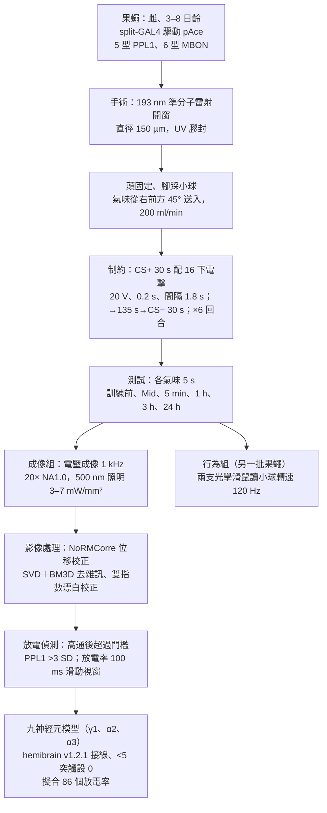
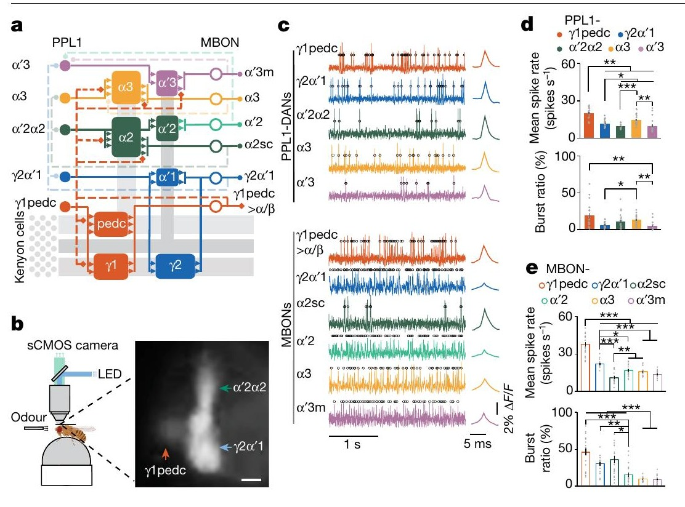
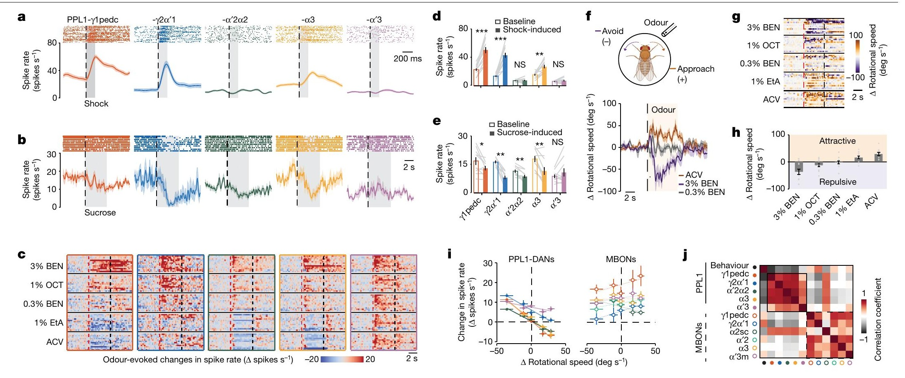
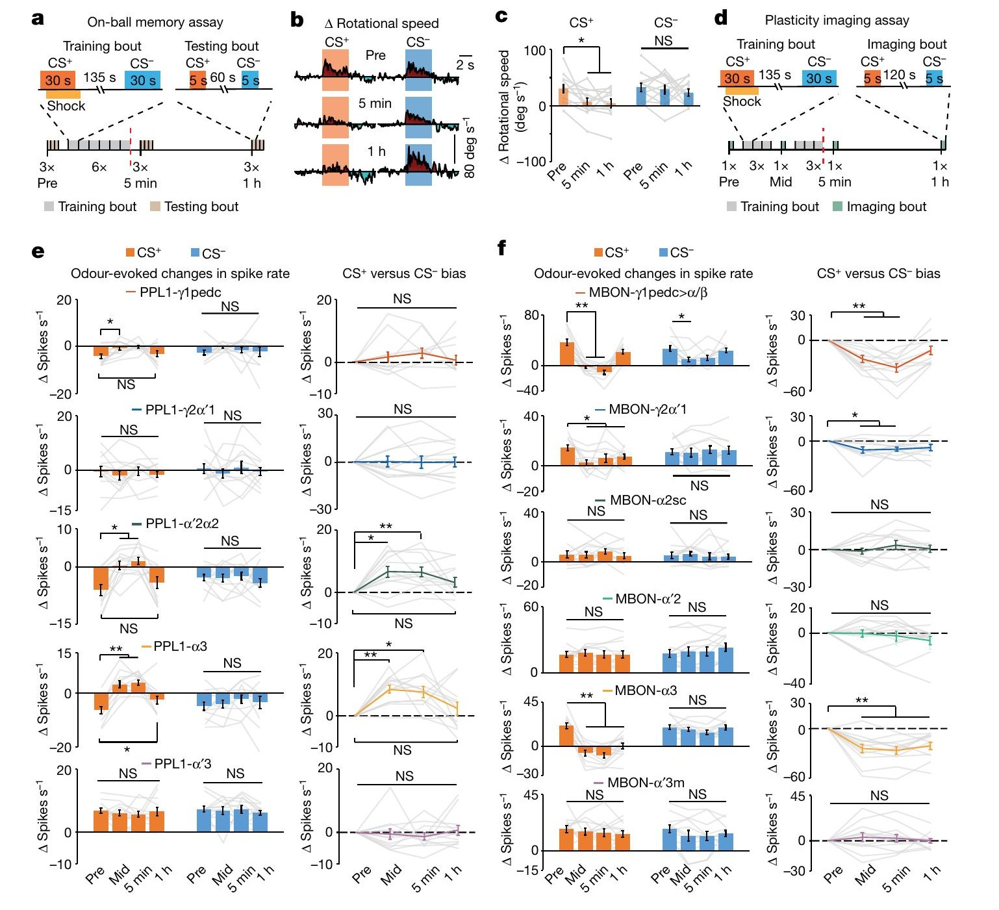
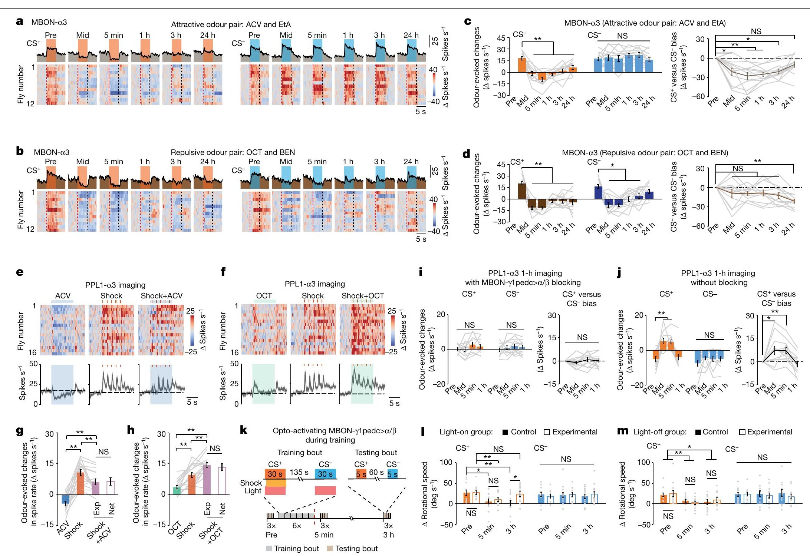
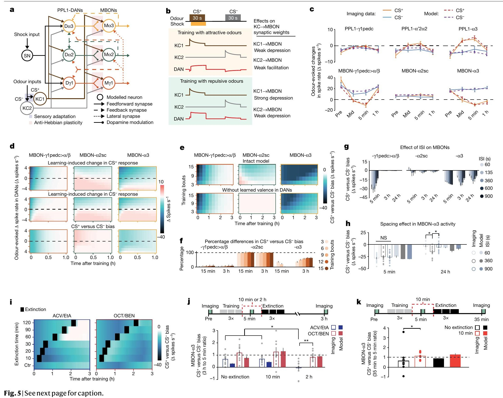
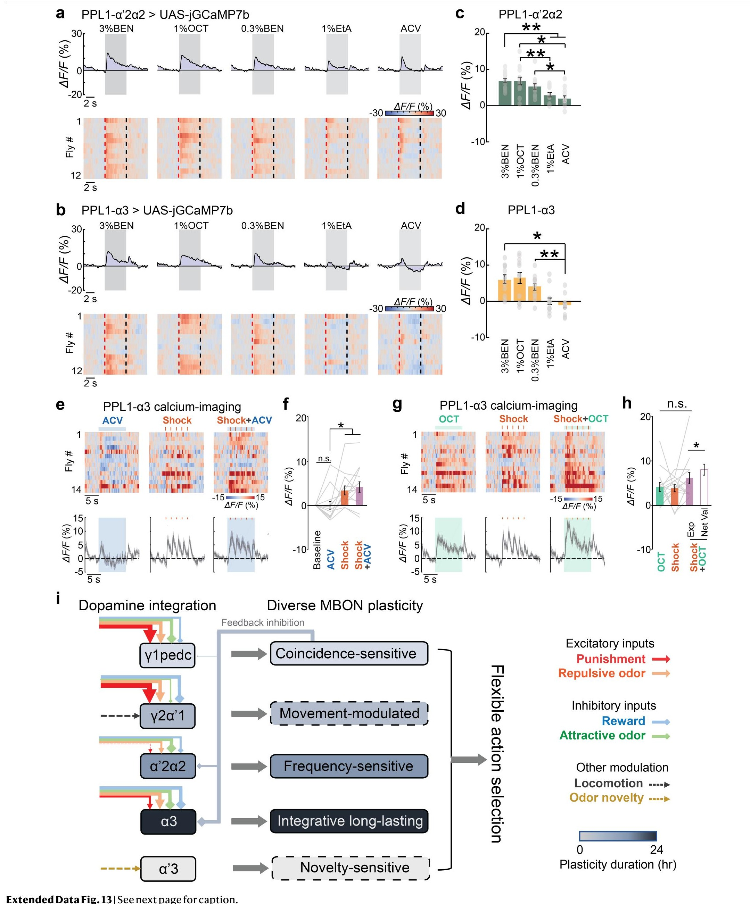

<!-- 本機 PDF：papers/2024-Dopamine-mediated%20interactions%20between%20short-%20and%20long-term%20memory%20dynamics.pdf -->

# Dopamine-mediated interactions between short- and long-term memory dynamics

**多巴胺居中調節短期與長期記憶的交互作用**

| 項目 | 內容 |
|---|---|
| **出處** | Nature 634(8036), 1141–1149 (2024). doi: 10.1038/s41586-024-07819-w [全文（PMC 免費閱讀）](https://pmc.ncbi.nlm.nih.gov/articles/PMC11525173/) |
| 日期 | 線上先行 2024-07-22；刊期 2024-10-31。投稿 2022-07-31・接受 2024-07-11（修訂日期 PDF 未印）。本機 PDF 取自 Schnitzer 實驗室網站，首頁「Published online」欄仍是「xx xx xxxx」，但頁尾已印卷期與頁碼 |
| 通訊作者 | Cheng Huang（huang.cheng@wustl.edu）、Madhuvanthi Kannan（mkannan@umn.edu）、Ganesh Vasan（gvasan@umn.edu）、Mark J. Schnitzer（mschnitz@stanford.edu）。PDF 只有英文名 |
| 作者 | 共 9 人：Cheng Huang、Junjie Luo（兩人為共同第一作者）、Seung Je Woo、Lucas A. Roitman、Jizhou Li、Vincent A. Pieribone、Madhuvanthi Kannan、Ganesh Vasan、Mark J. Schnitzer。分工：Huang 做實驗與分析；Luo 做轉殖果蠅與計算模型；Woo 做氣味分類；Li 設計去雜訊演算法；Pieribone、Kannan、Vasan 提供電壓指示劑；Schnitzer 督導 |
| 機構 | James Clark Center、生物系、應用物理系與 CNC 學程（Stanford University）；Howard Hughes Medical Institute（Stanford）；John B. Pierce Laboratory（New Haven）；Department of Cellular & Molecular Physiology（Yale University）。現職：Washington University School of Medicine（Huang）、香港中文大學電子工程系（Li）、University of Minnesota（Kannan、Vasan） |
| 資料庫 | 神經電壓軌跡：Zenodo https://doi.org/10.5281/zenodo.10998457 ；模型程式：https://github.com/schnitzer-lab/Luo_Huang_2024_MB_model 。原始影像向通訊作者索取 |
| 補充資料 | 延伸圖 1–13、延伸表 1 在 PDF 內（延伸表 1 只有表題，內容未印出）。**Supplementary Information（模型方程式第 2–7 節、補充表 1 與 3、補充圖 1）、Supplementary Discussion、兩段影片與 Source Data（xlsx）都不在 PDF 內，本庫未取得**。模型的參數值因此全部是 ？待查 |
| 編輯／審查 | *Nature* 具名致謝審查人 Barbara Webb（另有匿名審查人）。Webb 的實驗室也做蕈狀體模型，本篇引用的模型文獻中至少有 Gkanias 2022、Wessnitzer 2012、Smith 2008 出自該實驗室 |

> 與本庫有關的作者：無。本篇引用了本庫的 Hige 2015、Cohn 2015、Aso 2016、Felsenberg 2017、Handler 2019、Tully 1985。
>
> **本篇為 CC BY 4.0 開放取用**（PDF 第 1149 頁頁尾），圖片可在標明出處的條件下自由使用與散布。本庫仍依規定只給全文連結、不放 PDF；每張圖下方標明出處與授權。

---

## 為什麼重要

> 本節假設讀者已略知果蠅嗅覺學習的輪廓。**完全不熟的讀者可以先看「科普文」一節**；術語另見「專業文」開頭的「本頁用語」表。

本庫先前對多巴胺神經元（DAN）的了解，幾乎都來自兩種量法。一是鈣成像（看細胞內鈣離子濃度的螢光，Cohn 2015、Felsenberg 2018）。二是光遺傳活化（讓 DAN 帶上照光就打開的通道蛋白，再用光讓它放電，Hige 2015、Aso 2016）。前者只能看到「變亮」，很難看到「變暗」；後者是實驗者決定 DAN 放多少電，不是果蠅自己決定。所以「DAN 在自然情況下對氣味、電擊、糖各放多少電」一直沒有直接的數字。這篇用電壓成像在活果蠅上逐一量到 PPL1 群（五型傳懲罰訊號的 DAN）的單次放電，給了每秒幾次的數字。它也看到了放電「往下掉」：喜歡的氣味與糖讓這些懲罰型 DAN 安靜下來。

第二個貢獻是把本庫兩條原本分開的線接起來。一條是「各區室的 DAN 規則不同」（區室＝蕈狀體分成的一格一格，見科普文；Aso 2016：γ1pedc 這格學得快忘得快、α3 這格學得慢記得久）；另一條是「MBON（蕈狀體輸出神經元）回頭影響 DAN」（Felsenberg 2017／2018、Ichinose 2015 的回饋迴路）。本篇主張：短期記憶區 γ1pedc 的 MBON 原本抑制長期記憶區 α3 的 DAN；訓練讓這條抑制變弱，α3 的 DAN 才開始對被罰過的氣味放電，長期記憶才寫得進去。也就是說，短期記憶不是被「轉存」成長期記憶，而是**打開了長期記憶的寫入閘門**。

第三，它是本庫第一篇以「連結體定接線、放電率定參數」的模型做出可檢驗預測、再回頭用實驗驗證的論文（連結體：用電子顯微鏡逐一追蹤神經元畫出的全腦接線圖，本篇用 hemibrain 這一份）。但有兩個弱點。其一，模型的參數表在未取得的補充資料裡。其二，模型讓 KC→MBON 突觸變強的兩種條件是「DAN 低於平常，或 DAN 比 KC 先到」，後一種和本庫 Hige 2015 在 γ1pedc 直接量到的結果牴觸。詳見專業文第五節，以及本庫「矛盾清單」頁 [[syn-contradictions]] 的第 1.9 條。

---

## 論文摘要（原文與中譯）

> In dynamic environments, animals make behavioural decisions on the basis of the innate valences of sensory cues and information learnt about these cues across multiple timescales. However, it remains unclear how the innate valence of a sensory stimulus affects the acquisition of learnt valence information and subsequent memory dynamics. Here we show that in the *Drosophila* brain, interconnected short- and long-term memory units of the mushroom body jointly regulate memory through dopamine signals that encode innate and learnt sensory valences. By performing time-lapse in vivo voltage-imaging studies of neural spiking in more than 500 flies undergoing olfactory associative conditioning, we found that protocerebral posterior lateral 1 dopamine neurons (PPL1-DANs) heterogeneously and bidirectionally encode innate and learnt valences of punishment, reward and odour cues. During learning, these valence signals regulate memory storage and extinction in mushroom body output neurons (MBONs). During initial conditioning bouts, PPL1-γ1pedc and PPL1-γ2α′1 neurons control short-term memory formation, which weakens inhibitory feedback from MBON-γ1pedc>α/β to PPL1-α′2α2 and PPL1-α3. During further conditioning, this diminished feedback allows these two PPL1-DANs to encode the net innate plus learnt valence of the conditioned odour cue, which gates long-term memory formation. A computational model constrained by the fly connectome and our spiking data explains how dopamine signals mediate the circuit interactions between short- and long-term memory traces, yielding predictions that our experiments confirmed. Overall, the mushroom body achieves flexible learning through the integration of innate and learnt valences in parallel learning units sharing feedback interconnections. This hybrid physiological–anatomical mechanism may be a general means by which dopamine regulates memory dynamics in other species and brain structures, including the vertebrate basal ganglia.

（*Nature* 的摘要不分 Background／Results／Conclusion 段，照原樣一段。）

**中譯**（本節為忠實翻譯，非自撰內容）：

> 在變動的環境中，動物依據感覺線索的先天價值，以及在多個時間尺度上對這些線索習得的資訊，做出行為決策。然而，感覺刺激的先天價值如何影響習得價值資訊的獲取與之後的記憶動態，仍不清楚。本文顯示，在果蠅腦中，蕈狀體裡彼此相連的短期與長期記憶單元，透過編碼先天與習得感覺價值的多巴胺訊號，共同調控記憶。我們在超過 500 隻接受嗅覺聯結制約的果蠅上，以活體縮時電壓成像研究神經放電，發現後側腦外側第 1 群多巴胺神經元（PPL1-DAN）以異質且雙向的方式，編碼懲罰、獎賞與氣味線索的先天與習得價值。學習期間，這些價值訊號調控蕈狀體輸出神經元（MBON）中記憶的儲存與消退。在最初幾個制約回合中，PPL1-γ1pedc 與 PPL1-γ2α′1 神經元控制短期記憶的形成，而短期記憶的形成削弱了 MBON-γ1pedc>α/β 對 PPL1-α′2α2 與 PPL1-α3 的抑制性回饋。在進一步的制約中，減弱的回饋使這兩型 PPL1-DAN 得以編碼條件氣味線索的淨價值（先天加習得），進而閘控長期記憶的形成。一個以果蠅連結體與我們的放電資料為約束的計算模型，解釋了多巴胺訊號如何居中調節短期與長期記憶痕跡之間的迴路交互作用，並做出經我們實驗證實的預測。總之，蕈狀體透過在共享回饋連結的平行學習單元中整合先天與習得價值，達成彈性的學習。這種生理與解剖混合的機制，可能是多巴胺在其他物種與腦結構（包括脊椎動物的基底核）中調控記憶動態的一般方式。

---

## 科普文

想像一間公司有兩個部門：一個是「便條紙部」，什麼事都先記在便條上，記得快，但一小時後就丟；另一個是「檔案室」，只收重要的事，收進去的可以保存一天以上。檔案室怎麼知道哪件事重要？一個辦法是：**便條紙部的主管平常會壓著檔案室，叫它別亂收東西；等便條紙部對同一件事記了好幾次，主管就鬆手，檔案室才開始歸檔。**這篇論文說，果蠅的蕈狀體（mushroom body）裡就有這樣一對部門。

**先交代果蠅怎麼學。** 果蠅聞到氣味時，蕈狀體裡一小群 Kenyon 細胞（KC）會放電，哪一群放電就代表哪個氣味。KC 把訊號傳給蕈狀體輸出神經元（MBON），MBON 的活動推動果蠅靠近或走開。第三種角色是多巴胺神經元（DAN），它傳來「這是好事還是壞事」的訊號。氣味和電擊一起出現時，DAN 放電，被這個氣味活化的 KC 與 MBON 之間的連接點（突觸）就變弱。蕈狀體沿著 KC 的長軸分成一格一格的區室，每格由一型 DAN 管、一型 MBON 讀。本篇關心的 γ1pedc 與 α3 兩格，MBON 都推動果蠅「靠近」；所以突觸變弱後再聞到同一氣味，MBON 反應變小，果蠅就比較不靠近這個氣味。γ1pedc 這一格學得快、忘得快；α3 這一格學得慢、記得久——這是本庫 Aso 2016 在行為上看到的。

本篇量的 DAN 是 PPL1 群：五型都傳「懲罰」訊號，分別管 γ1pedc、γ2α′1、α′2α2、α3、α′3 這幾格（α′2α2 表示一顆 DAN 橫跨兩格）。所以這群 DAN 放電增加代表「壞事」，安靜下來就代表「沒那麼壞」甚至是好事。

**難題一：DAN 到底怎麼放電，以前看不清楚。** 過去量 DAN 多半用鈣成像：細胞放電時鈣離子湧入，螢光變亮。但鈣訊號反應慢，而且放電「減少」時螢光幾乎不會變暗，所以以前的報告幾乎只看到 DAN 對各種氣味「都有一點反應」。作者改用電壓成像：在 DAN 上表現一種會隨細胞膜電壓變亮變暗的螢光蛋白（pAce），用每秒 1,000 張的攝影機拍，每一次放電都看得到。他們在頭固定、腳踩小球的活果蠅上量了 PPL1 群的五型 DAN 和六型 MBON。

**看到的第一件事：DAN 的放電是雙向的。** 電擊讓 γ1pedc、γ2α′1、α3 三型 DAN 放電大增（γ1pedc 從每秒約 22 次升到約 50 次）。吃糖讓多數型別安靜下來。氣味也一樣分兩邊：果蠅不喜歡的氣味（例如濃的苯甲醛）讓 DAN 放電增加，喜歡的氣味（蘋果醋）讓它減少。減少的程度和果蠅在小球上轉向靠近的程度成正比。氣味和電擊同時給時，DAN 的放電大約等於兩者分別給時的相加。所以喜歡的氣味會「抵掉」一部分電擊訊號：以 α3 的 DAN 為例，5 下電擊單獨給時放電約增加每秒 11 次，配上蘋果醋只剩約 6 次（蘋果醋單獨給時約減少 4 次）。

**看到的第二件事：訓練時，長期記憶區的 DAN 改變了。** 作者讓果蠅聞兩種都喜歡的氣味，其中一種（CS+）配電擊。訓練幾回合後，γ1pedc 的 MBON 對 CS+ 的反應大幅下降，一小時後恢復——這是短期記憶。α3 的 MBON 對 CS+ 的反應也下降，但一天後仍在——這是長期記憶（本篇的「長期」指訓練後 3 到 24 小時仍量得到的放電改變）。關鍵在 α3 的 DAN：訓練前，CS+（喜歡的氣味）讓它安靜；訓練三回合後，同一個氣味反而讓它放電增加，一小時後又回到安靜。也就是說，**α3 的 DAN 「學會」了這個氣味是壞的，開始自己對它發出懲罰訊號。**DAN 只需在訓練期間發出懲罰訊號，寫進 α3 MBON 的改變就能留下，所以 DAN 一小時後恢復，MBON 的改變仍維持一天。

這為什麼重要？電擊本來就會讓 α3 DAN 放電，但訓練初期 CS+ 是喜歡的氣味，會抵掉一部分電擊訊號，α3 收到的教學訊號（讓突觸改變的那陣 DAN 放電）因此偏弱。等 CS+ 本身也讓 α3 DAN 放電，兩者不再互抵，教學訊號才變強。※ 推論：這是本頁的整理，說明為什麼 α3 DAN 要對氣味本身放電，長期記憶才寫得進去。

**解法：找出是誰鬆了手。** 連結體（用電子顯微鏡逐一追蹤神經元、畫出的全腦接線圖；本篇用 hemibrain 這一份）顯示，γ1pedc 的 MBON 有一條抑制性的連線接到 α3 的 DAN。作者推論：訓練讓 γ1pedc 的 MBON 對 CS+ 的反應變弱，它對 α3 DAN 的抑制跟著變弱，α3 DAN 對 CS+ 的放電就上升。他們做了三件事來檢驗：

- （一）把 γ1pedc MBON 的輸出阻斷。α3 DAN 從訓練前起，對喜歡的氣味就沒有那個被抑制的「下降」，訓練前後都只有輕微上升，不再出現「由降轉升」的變化。這也表示它對喜歡氣味的安靜大半來自這條抑制（※ 推論）。
- （二）用光遺傳（讓神經元帶上照光就打開的通道蛋白，用光讓它放電）在訓練期間一直活化 γ1pedc MBON，讓它的抑制一直存在。結果果蠅 5 分鐘的記憶正常，3 小時的記憶卻消失了。
- （三）建一個只有九個神經元的模型（2 個 KC；γ1pedc、α2、α3 三格各 1 個 DAN 與 1 個 MBON；1 個感受電擊的神經元），接線照連結體，參數用放電資料擬合。拿掉這條回饋後，α3 的長期改變（MBON-α3 對 CS+ 的反應下降，下同）在 3 小時時少了 36–63%：訓練 3 回合時約少 36%，15 回合時約少 63%，回合越多、拿掉回饋造成的減少越大（※ 從圖判讀趨勢）。

**模型還做了兩個預測，作者回頭驗證。** 第一，一個訓練回合內 CS+ 與 CS− 之間的間隔（ISI；因為回合一個接一個，它也決定相鄰兩次 CS+ 相隔多久）太短或太長都不好，約 6 分鐘最好（太短時感覺適應讓氣味訊號變弱，太長時短期記憶已經消退、閘門又關上）；實驗上 6 回合、ISI 360 秒時，24 小時後 α3 的改變最大。

第二，訓練後讓果蠅再聞 CS+ 而不給電擊，叫消退訓練，一般會削弱記憶。訓練完 10 分鐘就做消退的那組，35 分鐘時 α3 的改變反而比不做消退的那組保留得多，和「消退削弱記憶」的一般預期相反；到 3 小時，兩組已相近。原因是剛訓練完時 α3 DAN 還記得「這氣味是壞的」，氣味本身就成了自己的懲罰訊號。若 2 小時後才做，α3 DAN 已恢復對這個喜歡的氣味安靜，再聞 CS+ 就沒有懲罰訊號，才是真正的消退，記憶被抹掉。

**代價與需要小心的地方。** 這套實驗的電擊只有 20 伏、每下 0.2 秒。T 迷宮是果蠅的標準學習測驗：訓練後讓一群果蠅在 T 形管裡選邊，兩臂各有一種氣味；它慣用的電擊是 60–90 伏、1.25 秒，比本篇強很多。所以本篇結論在標準強度下是否一樣成立，尚未驗證（※ 推論）。行為只在小球上測，每組 12 隻；模型的參數表放在補充資料裡，本庫沒有取得。

另外，模型裡 DAN 放電高於平常時突觸變弱；讓突觸變強的條件有兩種：DAN 低於平常，或 DAN 比 KC 先到（本篇固定氣味先、電擊後，這種情形不會發生）。後一種和本庫 Hige 2015 牴觸：它在 γ1pedc 這一格直接量過，多巴胺比氣味早給，連結完全沒變。受動搖的是模型的學習規則，不是電壓成像量到的放電資料。

**最容易被誤讀的一點：這篇沒有證明「記憶從短期區轉移到長期區」。** 作者明白反對這個說法——記憶並沒有被搬過去，短期區只是控制長期區什麼時候可以開始寫。而「控制」的證據主要來自 α3 這一格與 γ1pedc 這一條回饋。模型裡 α2 這一格對 α3 的長期改變沒有作用，拿掉它預測幾乎相同。α2 自己的可塑性（突觸強弱的改變）只在另一組用兩種討厭氣味（3-辛醇 OCT、苯甲醛 BEN）訓練的實驗看到，前人報告也不一致；作者認為要直接量多巴胺釋放（不只是 DAN 放電次數）才能釐清。

---
## 專業文

### 本頁用語

本頁各節可單獨查閱，故把反覆出現的詞集中在這裡。

| 詞 | 意思 |
|---|---|
| 蕈狀體（mushroom body, MB） | 果蠅腦中負責嗅覺學習與記憶的結構，左右各一 |
| KC（Kenyon cell） | 蕈狀體的主要神經元。每個氣味活化一小群 KC，哪一群活化就代表哪個氣味 |
| MBON（mushroom body output neuron） | 蕈狀體輸出神經元，讀出 KC 的訊號，推動果蠅靠近或走開。學習改變的是 KC→MBON 的突觸 |
| DAN（dopaminergic neuron） | 多巴胺神經元，送來「好事或壞事」的訊號。**PPL1 群多半報告懲罰，PAM 群多半報告獎賞**。本篇只量 PPL1 群 |
| 葉（lobe） | KC 的軸突成束，分成 α/β、α′/β′、γ 等幾束，各稱一個「葉」。pedc（peduncle）是各葉根部共同的柄；柄上也劃出一格，同樣叫 pedc |
| 區室（compartment） | 每個葉沿長度再分成一格一格：γ1 是「γ 葉第 1 格」，α3 是「α 葉第 3 格」。每格由一型 DAN 支配、一型 MBON 讀取。※ 推論（依區室編號由根部往末端遞增的命名方式，本篇未明寫）：γ1pedc 靠近蕈狀體根部，α3 在 α 葉末端。見 [[c-mb-compartment]] |
| 細胞型別的名字 | 以區室命名。名稱連寫兩格表示一顆細胞橫跨兩格：PPL1-γ1pedc 支配 γ1 與 pedc 兩格，α′2α2 也是兩格。論文說五型 PPL1 共支配八格（γ1pedc、γ2α′1、α′2α2 各兩格，α3、α′3 各一格；※ 推論的拆法）。MBON-γ1pedc>α/β 是樹突在 γ1pedc、「>α/β」表示軸突伸向 α/β 葉的 MBON。本篇的 MBON-α3、PPL1-α3 都在 α3 這一格 |
| 學習單元、模組 | 一格裡的 DAN、MBON 與 KC 合成的一組。模型裡的「模組」同義 |
| 連結體、hemibrain | 連結體是用電子顯微鏡逐一追蹤神經元、畫出的全腦接線圖。hemibrain 是其中一份（果蠅半腦），本篇模型的接線取自它 |
| 價值（valence） | 一個刺激對動物是好是壞、程度多大。**先天價值**是天生的（例如蘋果醋天生被喜歡）；**習得價值**是學來的（配過電擊的氣味變成「壞的」）；**淨價值**是相加的結果：先天加習得，或同時出現的兩個刺激（如氣味＋電擊）各自的價值相加 |
| 放電、放電率 | 神經元送出一次訊號叫一次放電（spike）；放電率是每秒幾次 |
| 叢發比例（burst ratio） | 距前一次放電不到 20 毫秒的放電，占全部放電的比例 |
| 可塑性 | 突觸強弱的改變。本篇多半用 MBON 對氣味的放電反應變化來代表 |
| 增強訊號 | 懲罰或獎賞的統稱；本篇談的是懲罰。CS+「成為自己的增強訊號」＝CS+ 本身就讓 PPL1-α3 發出懲罰訊號 |
| 教學訊號 | 讓突觸改變的那陣 DAN 放電 |
| 感覺適應 | 同一氣味重複出現，神經反應自然變小，與學習無關 |
| 聯結式（associative） | 只有配過電擊的氣味反應改變，才算聯結式學習；沒配電擊的氣味也一起變，就不是 |
| 電壓成像（voltage imaging） | 在神經元表現一種會隨膜電壓改變亮度的螢光蛋白，用高速攝影機拍，可以看到每一次放電。本篇用 pAce 這種指示劑、每秒 1,000 張 |
| 鈣成像（calcium imaging） | 用會隨鈣離子濃度變亮的螢光蛋白（如 GCaMP）看細胞活動。反應較慢，放電減少時不容易看出來，訊號強時會飽和 |
| CS+、CS−、US | CS+ 是配過懲罰的氣味；CS− 是對照氣味，同樣聞但不配懲罰；US 是懲罰本身（本篇為電擊） |
| 逆向配對 | 多巴胺比氣味先到。時間差寫負號，例如 −1.2 s 表示多巴胺早 1.2 秒 |
| Mid | 訓練中途的那次成像：第 3 個訓練回合結束後 5 分鐘做，之後再訓練 3 回合 |
| 訓練回合（bout） | 本篇的一次「CS+ 30 秒配電擊 → 間隔 135 秒 → CS− 30 秒」。一般共 6 回合 |
| T 迷宮、PI | T 迷宮是果蠅的標準學習測驗：訓練後讓一群果蠅在 T 形管裡選邊，兩臂各有一種氣味。PI（performance index，表現指數）＝選對邊的比例減選錯邊的比例，範圍 −1 到 +1 |
| CS+ 與 CS− 的偏差（bias） | (CS+ 引起的放電改變 − CS− 引起的放電改變) − 訓練前同一隻果蠅的同一個差值，再跨果蠅平均。「放電改變」是氣味期間的放電率減去氣味前 5 秒的放電率。訓練前定義為 0。負值表示 CS+ 的反應相對變小。作者說是仿 T 迷宮的 PI 設計的，但單位是每秒放電次數，不能和 PI 並排 |
| bias 比值 | 某時間點的 bias ÷ 訓練後 5 分鐘的 bias。1 表示維持原水準，0 表示痕跡消失 |
| 短期記憶（STM）、長期記憶（LTM） | 本篇用語偏寬：STM 指持續不到約 1 小時的改變（γ1pedc），LTM 指持續 3 小時以上到 24 小時的改變（α3）。**和果蠅文獻中需要蛋白質合成、持續數天的「長期記憶」不是同一個定義** |
| 離線鞏固 | 一種觀點：訓練結束後，腦在休息或睡眠時自己把記憶從短期區轉存到長期區 |
| 回饋（feedback） | MBON 回頭連到 DAN。本篇的主角是 MBON-γ1pedc>α/β → PPL1-α3（與 PPL1-α′2α2）的抑制性回饋，見 [[t-mbon-dan-feedback]] |
| 預測誤差 | 預期與實際結果的差距。本篇模型有 MBON-α2sc 與 MBON-α3 到 PPL1-α3 的興奮性回饋，論文說這條回饋「原則上可能支援」預測誤差的計算；但擬合後它的權重近乎 0，作者據此說在本篇的訓練協定下，預測誤差可能不是可塑性的主要驅動 |
| anti-Hebbian 規則 | 本篇模型學習規則的第一個成分：KC 放電時，同區室的 DAN 放電高於平常，KC→MBON 變弱；低於平常，則變強。「Hebbian」原指「一起活化就變強」，這裡反過來，所以叫 anti-Hebbian。第二個成分是 CS–US 時間差曲線（見方法「模型」）。讓突觸變強的兩種條件：DAN 低於平常，或 DAN 比 KC 先到 |
| 可塑性時間常數 | 模型裡突觸改變衰退的速度，數值越大衰退越慢 |
| 間隔（ISI） | 本篇的 ISI 指一個訓練回合內 CS+ 與 CS− 的間隔（延伸圖 10e 圖說）。因為回合是連續排的，它也決定相鄰兩次 CS+ 的距離：標準協定下為 30＋135＋30＋135＝330 秒；ISI 改成 x 秒時為 2×(30＋x) 秒（※ 推論：依方法「相鄰兩次氣味之間都隔 135 秒新鮮空氣」，並假設回合之間也用同一個 x）。見 [[c-spaced-training]] |
| 消退（extinction） | 訓練後再讓果蠅聞 CS+ 與 CS−，但不給電擊，原本學到的反應減弱。見 [[c-memory-extinction]] |
| 驅動品系、split-GAL4、LexA | 驅動品系決定外加基因在哪些細胞表現。split-GAL4 是只在一兩型神經元裡打開外加基因的驅動品系，本篇用它們在指定的 DAN 或 MBON 上表現 pAce。見 [[e-split-gal4]]。LexA 是與 GAL4 並行的另一套驅動品系開關，兩套可在同一隻果蠅分別控制不同細胞 |
| 基因型字串 | 圖說中「A > B」或「A/B」這類字串：GAL4、LexA 是驅動品系（決定哪些細胞），UAS、LexAop 是對應的「被開啟的基因」端；13×、20× 是開關元件的重複數；tdT（tdTomato）是紅色螢光標籤。可略過這串字，以旁邊的「阻斷組／對照組」為準 |
| w1118 | 實驗室常用的野生型對照品系 |
| TnT、CsChrimson、RNAi | 三種操作工具。TnT（破傷風毒素輕鏈）讓神經元無法釋放神經傳遞物；它**從發育期起一直作用**，所以阻斷不只發生在訓練時，也可能影響發育或訓練前的狀態。CsChrimson 照紅光就讓神經元放電。RNAi 降低指定基因的表現量；本篇降 GABA-A 受體 RDL 與麩胺酸門控氯離子通道 GluCl-α，這兩者分別接收 GABA 與麩胺酸這兩種抑制性傳遞物，降低它們＝讓 PPL1-α3 收不到 MBON 的抑制 |
| 統計記號 | `*` P < 0.05、`**` P < 0.01、`***` P < 0.001；NS 為不顯著。本篇用無母數檢定（Kruskal–Wallis、Friedman、U 檢定、符號等級檢定），並以 Holm–Bonferroni 校正多重比較 |
| ※ 推論 | 論文沒有明說、本頁自行推得的內容，並寫出依據 |
| ？待查 | 值得查證但本頁刻意不填的內容 |

### 一、概述

**主要問題。** 刺激的先天價值如何影響學習？短期與長期記憶單元之間如何交互？作者的假說是：DAN 同時整合「來自感覺系統的先天價值」與「MBON 送回來的習得價值」，而這個整合讓短期記憶得以調控長期記憶的形成。

**重要性。** 若成立，它把「各區室的學習規則不同」（Aso 2016）與「MBON→DAN 回饋」（Felsenberg 2017／2018、Ichinose 2015）合成一個機制，並給出一個可測的預測：阻斷短期區的 MBON，長期記憶就寫不進去。它也是本庫第一篇有 PPL1 各型 DAN 自然放電率數字的論文。

**發表當時的領域現狀（2022 投稿、2024 刊出）。**

- DAN 對氣味的反應以鈣成像為主。Cohn et al. 2015 看到 DAN 活動反映行為狀態。Siju et al. 2020 報告 DAN 族群以價值與狀態依賴的方式編碼。
- Mao & Davis 2009（[[s-mao-2009-dopaminergic-neuron-types]]） 看到 PPL1 對電擊的反應在 α 葉尖端強、α′ 葉尖端弱。這是鈣成像時代少數關於 PPL1 電擊反應的前人結果；本篇改用電壓成像逐型量。
- 區室規則：Aso & Rubin 2016 以光遺傳逐型比較學習速度與保留時間。
- 回饋：Li et al. 2020 的蕈狀體連結體（見本頁用語）列出大量 MBON→DAN 連線。Eschbach et al. 2020 在幼蟲上做了回饋架構的模型。
- 模型：已有十餘個蕈狀體模型（作者列了 refs 15、30–37）。差別在處理獎賞或懲罰、是否計算預測誤差（見本頁用語）、單一或多個區室。

作者自稱獨到之處是同時具備五點：用連結體決定接線；用放電資料全域擬合參數（所有參數同時對全部 86 個放電量測一起擬合）；雙向可塑性；KC→DAN 輸入產生先天氣味價值；短期到長期模組（見本頁用語）的 MBON→DAN 回饋。第四點是指模型裡 KC 除了接 MBON，也直接輸入 DAN，所以 DAN 對氣味本身有天生的反應。

### 二、方法

流程圖由上而下是：準備果蠅 → 同一套制約與測試協定 → 分成成像組與行為組兩批果蠅各自量測 → 成像資料經影像處理與放電偵測後，用來擬合模型。模型的三個模組 γ1、α2、α3 即 γ1pedc、α′2α2、α3 三格（模型只取這三格）。影像處理步驟白話說是三件事：校正腦在畫面中的位移、去除雜訊、補償螢光隨時間變暗（漂白）。放電的判定門檻是訊號超過雜訊的若干個標準差（SD）：PPL1 為 3 個；MBON 依型別為 2–3 個（γ1pedc>α/β、γ2α′1 為 2；α′2、α3、α′3m 為 2.5；α2sc 為 3）。

**果蠅與指示劑。**

- 全部用雌蠅（3–8 日齡）。
- pAce 是作者以藻類 *Acetabularia* 的視蛋白做成的 FRET–視蛋白電壓指示劑（視蛋白是感光蛋白；FRET 是兩個螢光分子之間的能量轉移，用來把電壓變化轉成亮度變化）。它是正極性的，意思是膜電位上升時變亮。
- 驅動品系（見本頁用語）來自 Janelia 的 split-GAL4（MB504B、MB502B、MB065B、MB304B、MB085C、MB093C、MB080C、MB077B、MB542B）。另有兩個 LexA 品系（LexA 見本頁用語）：TH-LexA 用在需要兩套表現系統同時操作的實驗（例如一套表現指示劑、一套表現 TnT）；R82C10-LexA 用在鈣成像。
- 所有品系與 w1118（見本頁用語）回交五代，目的是讓各品系的遺傳背景相近。
- 五型 PPL1 與六型 MBON 各自的品系對照在延伸表 1，**該表的內容沒有印在 PDF 中**（？待查）。
- 多數果蠅一次只量一型細胞，少數同時量兩三型，所以總隻數小於各圖 n 的合計。

**成像與行為分開做。** 作者發現成像用的藍光會干擾果蠅對氣味的行為。所以行為（小球轉向）與成像在不同的果蠅上做。**成像組的果蠅沒有行為讀數，行為組的果蠅沒有神經讀數**；兩者的對應是靠用同樣的訓練協定。

**刺激。**

- 氣味：苯甲醛（BEN，0.3%、3%）、3-辛醇（OCT，1%、10%）、乙酸乙酯（EtA，1%、10%）、1-辛烯-3-醇、乙酸異戊酯，以礦物油稀釋；以及蘋果醋（ACV）。
- 測驗與成像用的每次試驗長 15 秒，氣味在第 5–10 秒（不含訓練回合，訓練回合的長度見下段）。不同氣味間至少隔 2 分鐘。
- 電擊：胸部兩側以導電膠黏導線（兩線間電阻 10–30 MΩ），**20 V、每下 0.2 秒、相鄰兩下間隔 1.8 秒**。
- 糖：用微量注射器在口器下方送約 1 µl 飽和蔗糖溶液。

**制約協定。**

- 一個訓練回合：CS+ 30 秒，同時從第 3 秒起給 16 下電擊；間隔 135 秒；CS− 30 秒。原文寫「相鄰兩次氣味之間都隔 135 秒新鮮空氣」。
- 「間隔 1.8 秒」原文寫 delivered 1.8 s apart，沒說是哪一種間隔。若是兩下之間的空檔，週期為 2 秒，最後一下在第 33.2 秒結束，超過 30 秒的 CS+；若是兩下起點相隔 1.8 秒，最後一下在第 30.2 秒結束（※ 推論，⚠️ 原文不清楚）。
- 作者說選 30 秒配對，是因為常見的 1 秒或 5 秒配對在頭固定的果蠅上「無法可靠地誘發持續數小時的行為改變」。
- 球上行為：訓練前測 3 次、訓練 6 回合、5 分鐘與 1 小時（或 3 小時）各測 3 次。
- 成像：訓練前 1 次、訓練 3 回合、Mid 1 次、訓練 3 回合、5 分鐘與 1 小時各 1 次（24 小時實驗另加 3 小時與 24 小時）。
- 固定方式：果蠅胸部背面以紫外線膠黏在一根直徑 125 µm 的光纖上，光纖當作固定架。24 小時實驗期間果蠅一直黏在光纖上，在固定時刻餵糖水。

**偏差（bias）的定義。** 每隻果蠅在每個時間點算「CS+ 引起的放電改變 − CS− 引起的放電改變」。放電改變是氣味期間的放電率減去氣味前 5 秒的放電率。再減去訓練前的同一值，最後跨果蠅平均。

**模型。**

- 結構：三個模組（γ1、α2、α3），九個神經元：KC1（代表 CS+）、KC2（代表 CS−）、三個 DAN、三個 MBON、一個電擊感覺神經元。
- 接線：依 hemibrain v1.2.1（見本頁用語）；兩神經元間少於 5 個突觸就設為 0。**非零的權重值全部由擬合決定，不參考突觸數**。
- 學習規則有兩個成分。第一，雙向 anti-Hebbian（見本頁用語）：DAN 放電高於平常則突觸變弱、低於平常則變強。第二，一條 CS–US 時間差的曲線（延伸圖 10b）：DAN 比 KC 先活化則變強、晚活化則變弱；曲線依據是 Aso & Rubin 2016 與 Handler 2019。所有實驗與模擬都固定 CS–US 間隔 3 秒（氣味先），所以第二個成分在本篇只用到一個值，「DAN 比 KC 先到」的情況不會發生。兩個成分在完整模型中怎麼合成，見補充資料（？待查）；在固定 3 秒的遞迴式中，作者說一個訓練回合造成的權重改變，化簡成「氣味引起的 DAN 放電改變」的一次函數（延伸圖 10a）；而這個 DAN 放電改變本身就是先天價值與習得價值相加的結果，所以作者說規則等於「先天與習得價值的線性相加」。
- 計算：完整模型以常微分方程描述，每組參數要算約 14 秒。作者再以四個近似簡化：KC 與 DAN 的活化函數（輸入多少就放多少電的對應關係）近似成直線；膜時間常數約 10 ms，遠短於刺激，所以直接取穩態；訓練、測驗之間與相鄰訓練回合之間的休息，遠長於每次刺激本身（標準協定：每次氣味 30 秒，之間休息 135 秒），所以每個回合可當成一個離散時間點，只看回合結束時的權重；以時間平均的放電率算權重變化。簡化後成為遞迴式，也就是一步算一個訓練或測驗回合，由上一回合的權重推下一回合，速度快約 700 倍。
- 擬合：參數以 86 個放電率量測做全域擬合（所有參數同時對這 86 個量測一起擬合）。這 86 個是各型細胞、各氣味、各時間點的平均放電改變值，不是 86 隻果蠅，分三類、互不重疊：吸引氣味 40 個（圖 3e、f 中相關的 DAN 與 MBON，不含 MBON-α3）、MBON-α3 24 個（圖 4c、d，吸引與嫌惡兩組氣味對）、嫌惡氣味 22 個（圖 2i 的 DAN 6 個＋延伸圖 8b、c 的 16 個）。擬合假設量測服從獨立常態分布，以估信賴區間。
- 模擬：每個條件跑 10,000 次模擬，誤差棒為 16–84% 區間，即模擬結果中間 68% 的範圍（相當於常態分布的 ±1 個標準差）。論文沒寫每次模擬之間差在哪；可能是從擬合參數的信賴分布中抽樣，誤差棒代表參數的不確定性（※ 推論；？待查補充資料第 7 節）。
- **方程式與參數值在 Supplementary Information，本庫未取得。**

**統計。** 無母數 ANOVA（Kruskal–Wallis、Friedman）加雙尾 U 檢定或符號等級檢定，Holm–Bonferroni 校正。實驗者對基因型不盲，分析以同一套程式自動完成。
### 三、結果

#### 3.1 規模與偵測品質（圖 1、延伸圖 1–2）

五型 PPL1（γ1pedc、γ2α′1、α′2α2、α3、α′3）與六型 MBON（γ1pedc>α/β、γ2α′1、α2sc、α′2、α3、α′3m）都量到了自發放電。每型 20 隻果蠅的平均自發放電率如下（數值見 [[numbers]]，※ 從圖判讀）：

- PPL1：約每秒 9–20 次，γ1pedc 最高。
- MBON：約每秒 11–38 次，γ1pedc>α/β 最高。

偵測品質用訊號偵測理論算出的偵測保真度 d′ 來衡量（數值越大，放電與雜訊越分得開；本頁不再用到）。圖中另列「偵測錯誤率」：PPL1 每秒 0.05–0.16 次，MBON 每秒 0.06–1.7 次。這個錯誤率指的是把雜訊誤判成放電、還是漏掉真的放電，圖說沒寫（？待查）。MBON-γ2α′1、α′2、α′3m 的放電訊號最小，錯誤率也最高。

**評價：** 對 PPL1 來說，錯誤率最多約佔放電率的 2%（最壞情況：最高錯誤率每秒 0.16 次 ÷ 最低自發放電約每秒 9 次），可以放心。MBON 的錯誤率上限是每秒 1.7 次；MBON-α′2、α′3m 的自發放電只有每秒十幾次，這個比例已不可忽略。作者對不同型別用了不同的偵測門檻（2–3 個標準差），所以跨型別比較放電率時，門檻差異本身會造成一部分差別。另外，MBON 的放電會從軸突反向傳進樹突（延伸圖 2）。因此在樹突區量到的確實是整顆細胞的放電，這支持「在區室裡拍 MBON 樹突」這個做法。

#### 3.2 PPL1 雙向編碼懲罰、獎賞與氣味的先天價值（圖 2、延伸圖 3–4）

- **電擊**（單下 0.2 s）：γ1pedc、γ2α′1、α3 顯著上升，α′2α2、α′3 不變。以 γ1pedc 為例：電擊前約每秒 22 次；0.2 秒電擊期間的平均約每秒 50 次；平均曲線的最高點約每秒 60 次，出現在電擊開始後約 100 ms，之後數百毫秒內回落。
- **吃糖**（5 s）：γ1pedc、γ2α′1、α′2α2、α3 顯著下降，α′3 不變。
- **氣味**：五種氣味在小球上引起的轉向，從強烈躲避（3% BEN）到強烈靠近（ACV）。PPL1（α′3 除外）的放電改變和轉向呈負相關：越被討厭的氣味，DAN 放越多。MBON 對五種氣味都是上升，幅度和價值無關（延伸圖 4g，Friedman 檢定 P > 0.05）。
- **分類**：用 5 型 PPL1 的反應組合猜是哪種氣味，比用 6 型 MBON 猜得準（延伸圖 4h）。作者的邏輯是：如果 DAN 的氣味反應只是從 MBON 傳過來的，DAN 帶的氣味資訊不該比 MBON 多；實際上用 DAN 猜更準。作者據此說，DAN 的氣味反應「不只是從 MBON 回饋繼承來的」。

**評價：** 「DAN 對喜歡的氣味會安靜下來」是本篇最站得住的發現之一：α′3 以外的四型都有（α′3 主要是上升）、每型 12 隻、方向一致。延伸圖 13 還直接示範了同一型細胞在鈣成像下看不到這個下降。但有兩點要小心。

第一，樣本範圍窄。氣味只有五種。果蠅品系只有 w1118（實驗室常用的野生型品系），所以氣味的行為價值只來自單一品系。「價值」是用另一批果蠅的轉向定義的，相關係數只建立在五個點上。

第二，「不只是繼承」這句和本篇自己的圖 4i 有張力：阻斷 MBON-γ1pedc>α/β 的輸出後，PPL1-α3 對喜歡氣味的下降就消失了（詳見 3.5 與第五節）。

#### 3.3 訓練在 DAN 與 MBON 上留下雙向、分區的改變（圖 3、延伸圖 5–6）

用兩種都被喜歡的氣味（ACV 與 1% EtA）訓練：一半果蠅用 ACV 當 CS+、EtA 當 CS−，另一半反過來。

- **行為**：5 分鐘與 1 小時後，果蠅對 CS+ 的靠近顯著減少，對 CS− 不變（n ＝ 12）。
- **DAN**：
  - CS− 引起的反應在所有 PPL1 都不變。
  - PPL1-α′2α2 與 α3 對 CS+ 的反應，從「下降」變成「上升」，1 小時後回到下降；兩者的 bias 在 Mid（第 3 個訓練回合後 5 分鐘的成像，見本頁用語）與 5 分鐘顯著。
  - PPL1-γ1pedc 對 CS+ 的下降變小（Mid），bias 不顯著。
  - γ2α′1、α′3 不變；所有 DAN 的自發放電也不變。
- **MBON**：
  - γ1pedc>α/β 與 γ2α′1 對 CS+ 的反應下降，1 小時後接近恢復。
  - α3 對 CS+ 的下降持續超過 1 小時。
  - MBON-α3 的自發放電在訓練後上升；論文只報告這一點，未解讀它的意義。

**評價：** 這組資料是全篇論證的骨架，品質整齊（每型 12 隻、同一協定）。值得注意的是圖 3f：**MBON-γ1pedc>α/β 對 CS− 的反應在 Mid 也顯著下降**（\*），正文只寫 CS+ 下降。模型把這歸因於感覺適應（見本頁用語；延伸圖 11c）。這一點會影響模型學習規則的解讀（見 3.6 與第五節第 3 條）。模型中讓突觸變強的兩種條件是：DAN 低於平常，或 DAN 比 KC 先到。吸引氣味的 CS− 讓 DAN 低於平常（上面說的「CS− 引起的反應不變」是指和訓練前一樣，仍是下降），照第一種條件，KC→MBON 對 CS− 的連結應該略為變強；但重複聞同一個氣味的感覺適應讓 KC 的輸入變小，模型裡適應的效果較大，淨效果是下降。所以資料和模型沒有直接矛盾，但這筆資料也無法單獨證明「變強」真的發生——它被適應蓋住了，分不出來。

#### 3.4 α3 的改變持續數小時；用一對討厭的氣味訓練時，到 24 小時仍顯著（圖 4a–d、延伸圖 7–8）

- **持續時間**：MBON-γ1pedc>α/β 對 CS+ 的下降不到 1 小時就消失。MBON-α3 的下降超過 24 小時，但兩種氣味對不同：
  - 吸引氣味對：bias 在 24 小時仍為負，但已不顯著。
  - 嫌惡氣味對：24 小時仍顯著。
  - 48 小時只量了 2 隻，未納入統計。
- **阻斷輸出**：用 TnT 阻斷 MBON-α3 的輸出（品系 MB093C），5 分鐘記憶正常、3 小時記憶消失（延伸圖 7d–e，每組 10 隻）。
- **嫌惡氣味對**：換成兩種都被討厭的氣味（OCT 與 0.3% BEN）。訓練三回合後，MBON-α3 對 CS+ **與 CS−** 都大幅下降；吸引氣味對則只有 CS+ 下降（延伸圖 8a）。之後兩種氣味的走向分開（圖 4d，※ 從圖判讀）：
  - Mid 到 5 分鐘：CS+ 與 CS− 一起掉，所以 bias 不顯著。
  - 24 小時：CS− 的反應已回升（約 +9），CS+ 仍為負（約 −4），所以 bias 到 24 小時才顯著。數值單位是每秒放電次數的改變（氣味期間減氣味前）。

**評價：** 「MBON-α3 是長期記憶的讀出」有兩條獨立證據：電生理改變的持續時間，以及阻斷後 3 小時記憶消失。證據中等偏強。但嫌惡氣味對時 CS− 也掉，等於連沒罰過的氣味也一起改變了。這會讓「bias」（CS+ 減 CS−）低估 CS+ 本身的改變。這也意味著，嫌惡氣味對早期的「記憶」有相當成分不是聯結式的（見本頁用語：只有配過電擊的氣味改變才算）。這和「α3 確實學到了 CS+」並不矛盾：24 小時時 CS− 回升、CS+ 仍低，兩者可以同時成立。見 [[c-odor-generalization]]。

#### 3.5 MBON-γ1pedc>α/β 的回饋塑造 α3 的教學訊號（圖 4e–m、延伸圖 8–9）

- **相加**：5 下電擊配 ACV 時，PPL1-α3 的放電小於只給電擊；配 OCT 時大於只給電擊。兩種情況都和「分別給、再相加」無顯著差（圖 4g–h，16 隻）。PPL1-γ1pedc 也一樣（延伸圖 8d–g，14 隻）。這和回饋的關係是：喜歡的氣味會抵掉一部分電擊的懲罰訊號，所以 α3 要學好，需要 PPL1-α3 對 CS+ 本身也放電，而這要靠回饋的抑制放鬆（下兩條；※ 推論）。
- **回饋的受體**：RDL 與 GluCl-α 分別是 GABA 與麩胺酸這兩種抑制性傳遞物的受體；本庫 Aso 2016 來源頁記錄 MBON-γ1pedc 用 GABA。作者在 PPL1-α3 上以 RNAi 降低 GABA-A 受體（RDL）或麩胺酸門控氯通道（GluCl-α），也就是讓 PPL1-α3 收不到 MBON 的抑制。結果它對五種氣味的雙向編碼都被破壞（延伸圖 9）。作者據此說這個編碼依賴多個 MBON 的回饋：MBON-γ1pedc 用 GABA，所以 GluCl-α 這一路應來自其他用麩胺酸的 MBON（論文的推論）。
- **阻斷回饋**：用 TnT 阻斷 MBON-γ1pedc>α/β（品系 MB085C）。PPL1-α3 對兩種吸引氣味都只有輕微上升（正文用語；從圖判讀約 0 到 +2，下文的「約為 0」指同一組小的正值），訓練前後不變，bias 不顯著（圖 4i）。對照組重現了圖 3e 中「PPL1-α3 對 CS+ 由降轉升」的結果（圖 4j）。
- **讓抑制一直存在**：訓練時用 CsChrimson 持續活化 MBON-γ1pedc>α/β（30 下 0.5 s 紅光），讓它的抑制一直存在、閘門打不開。設計是 2 × 2：基因型（帶 CsChrimson 的實驗組 vs 只帶驅動品系的對照組）× 照光與否。結果：照光的實驗組 5 分鐘記憶正常、3 小時記憶消失；其餘三組（照光的對照組、不照光的實驗組與對照組）3 小時記憶都正常（圖 4k–m，每組 12 隻）。

**評價：** 光遺傳那組設計完整（2 × 2，四組），是本篇最乾淨的因果證據。證據強度中等：n ＝ 12、只測一個時間點（3 小時）、行為只在小球上測。

阻斷那組有兩個限制。第一，TnT 從發育期就開始作用，不是只在訓練時。第二，**阻斷後 PPL1-α3 在訓練「前」對吸引氣味的下降就不見了**：圖 4i 的 Pre（訓練前）約為 0，對照組約 −5（單位是每秒放電次數的改變）。所以阻斷組「訓練後沒有上升」，部分是因為起點就沒有被抑制。

※ 推論：這表示 PPL1-α3 對吸引氣味的「下降」本身大半來自 MBON-γ1pedc>α/β 的抑制。這和第 3.2 節「DAN 的氣味反應不只是繼承自 MBON」的說法有張力；延伸圖 9 的 RNAi 結果也指向同一方向。作者在正文中確實寫了「這個編碼依賴來自多個 MBON 的回饋」，但沒有回頭修正第 3.2 節的措辭。

#### 3.6 模型：雙向規則、回饋閘控與兩個預測（圖 5、延伸圖 10–12）

- **擬合**：三模組模型擬合 86 個放電率量測。可塑性時間常數（見本頁用語；即突觸改變衰退的速度）在 γ 區室約 30 分鐘、α 區室約 100 分鐘，3 小時後另有更慢的成分。
- **兩模組版**：只保留 γ1 與 α3、拿掉 α2 的兩模組版，對 α3 的長期改變與消退給出幾乎相同的預測，共同參數也與三模組版無統計差異。意思是：模型裡 α2 對 α3 的長期改變沒有作用。這和 MBON-α2sc 自己有可塑性（圖 5d）是兩件事。
- **拿掉回饋**：
  - 拿掉的是 MBON-γ1pedc>α/β 到 PPL1-α′2α2 與 PPL1-α3 的兩條回饋。
  - MBON-γ1pedc>α/β 的可塑性降 2–8%（原因論文沒有解釋）。
  - MBON-α2sc 的可塑性消失（它所在的 α2 由 PPL1-α′2α2 管）。
  - MBON-α3 在 15 分鐘降 0–36%、3 小時降 36–63%；3 小時時訓練回合越多降得越多（※ 從圖判讀趨勢）。
  - 這些百分比是 CS+ 對 CS− bias 的變化（圖 5f）；範圍是 3 到 15 個訓練回合之間的差異，不是信賴區間。
- **預測一（間隔）**：模型預測 ISI（一個訓練回合內 CS+ 與 CS− 之間的間隔，見本頁用語）約 360 s 時，α3 的長期改變最大；科普文的「約 6 分鐘」就是 ISI 360 秒。實驗：6 回合，ISI 分別為 60、360、900 s。24 小時時 360 s 組的 bias 約 −15，另兩組約 −4、−5（\*）；5 分鐘時三組無差異（圖 5h）。
- **預測二（消退時機）**：模型預測，吸引氣味訓練後，消退在 ≥60 分鐘才做會抹掉 α3 的改變，≤30 分鐘做則不會。量的是 bias 比值（某時間點的 bias ÷ 訓練後 5 分鐘的 bias；見本頁用語）。兩組實驗是不同的果蠅、不同的量測時間：
  - 圖 5j（3 小時量，每組 10 隻）：2 小時做消退，比值降到約 0；10 分鐘做消退約 0.7；不消退約 0.65。10 分鐘消退與不消退相近。
  - 圖 5k（35 分鐘量，每組 10 隻）：10 分鐘做消退，比值約 1.1；不消退約 0.65（\*）。
  - 兩組裡的「不消退約 0.65」是巧合，不是同一組數據。「早做消退讓痕跡保留較多」只在 35 分鐘那組（5k）看到；到 3 小時（5j）兩者已相近。
- **其他回饋**：模型裡除了 MBON-γ1pedc>α/β 對 PPL1-α3 的抑制，還放了 MBON-α2sc、MBON-α3 到 PPL1-α3 的興奮性連線（連結體上有這些連線）。這兩條擬合出來都近乎為 0，所以本篇關於回饋的結論只靠那條抑制性連線。

**評價：** 「先做預測、再做實驗」的順序值得肯定，但兩個驗證都比正文的語氣弱。

- 間隔效應只在 24 小時這一個時間點顯著，5 分鐘時看不出差別。
- 圖 5k 的「消退訓練增加了 α3 的可塑性」，實際是消退組維持在 5 分鐘的水準（比值約 1.1），而不消退組自然衰減到約 0.65。不消退組 10 隻的數值很分散（約 −0.9 到 3.6，※ 從圖判讀）。其中約 3.6 那一點把不消退組的平均往上拉，反而讓兩組看起來更接近，所以顯著差異不是離群點造成的；需要保守看待的地方是每組只有 10 隻、組內分散大。
- 模型的參數數目與參數值在未取得的補充資料裡，無法判斷 86 個量測是否足以約束它（？待查）。
### 四、討論

**主張一：PPL1 整合先天與習得價值，而且是雙向的。** 證據強。電壓成像看到的下降在鈣成像下消失（延伸圖 13），這也解釋了為何過去的鈣成像研究普遍報告 DAN「對各種氣味都略上升」。限制是只量了 PPL1，PAM 群是否也這樣，本篇沒有資料。

**主張二：短期記憶透過 MBON-γ1pedc>α/β 的回饋閘控長期記憶的形成。** 證據中等。光遺傳活化實驗是直接的因果證據，模型與阻斷實驗指向同一方向。但有三點不足：行為只有一個 3 小時的時間點；阻斷是發育期起的長期阻斷；「閘門」只有前一半被直接操作過：MBON-γ1pedc>α/β 對 PPL1-α3 的抑制放鬆，這一步已用光遺傳活化與毒素阻斷檢驗；後一半是 PPL1-α3 對 CS+ 的放電上升造成 α3 的突觸變弱，論文沒有在訓練時單獨阻斷這個上升來驗證。

**主張三：雙向 anti-Hebbian 規則。** 證據弱，這是模型假設而非量測。作者以「雙向的價值編碼」「吸引與嫌惡氣味訓練結果不同」「吸引氣味的消退」三點作為依據，都是間接的。模型裡那條 CS–US 時間差曲線（延伸圖 10b）是引自 Aso 2016 與 Handler 2019 在 γ1pedc 以外區室（例如 Handler 2019 的 γ4 格）的量測。本庫 Hige 2015 在 γ1pedc 直接量過逆向配對（多巴胺比氣味先到，見本頁用語），突觸不變，見第五節第 3 條與 [[syn-contradictions]] 1.9。作者自己在討論中也承認「應該在 PPL1-DAN 上做類似 PAM-γ3 的研究」。所指的研究（Yamagata 2016）發現：PAM-γ3 平常會被獎賞抑制；人工讓它安靜會寫入「喜好」記憶，人工活化它會寫入「嫌惡」記憶。也就是說，DAN 被壓低本身就是一種教學訊號。

**主張四：記憶不是從短期區「轉移」到長期區。** 這是一個定義清楚、可以被反駁的立場，和「離線鞏固」的觀點對立（離線鞏固：訓練結束後，腦在休息或睡眠時自己把記憶從短期區轉存到長期區；見本頁用語）。本篇的資料支持「訓練期間的閘控」，但沒有排除訓練後也有這類離線過程。

**主張五：可推廣到哺乳類基底核，解釋「習慣為什麼難改」。** 基底核是哺乳類腦中與習慣、動作選擇相關的構造，同樣受多巴胺調控。本篇發現訓練後早期再聞 CS+（早期消退）反而延長 α3 的改變痕跡，因為 CS+ 本身就讓 PPL1-α3 發出懲罰訊號（「增強訊號」是懲罰或獎賞的統稱）。作者把這類比為：習慣一旦形成，提示線索本身就會不斷強化它，所以難改。這是延伸推測，本篇沒有任何哺乳類資料。

### 五、問題與限制

**1. 電擊強度與協定與庫內其他行為研究差很多。** 本篇是 20 V、0.2 s、每回合 16 下、共 6 回合。T 迷宮（見本頁用語）是庫內多數行為研究的標準協定，所以拿它當比較基準；它的慣例是 60–90 V、1.25 s、12 下、1 回合（Tully 1985、Felsenberg 2018）。因此，本篇電擊時 DAN 的放電率不能直接當成 T 迷宮條件下的數字。PPL1 的放電是否隨電擊電壓增加、增加多少：？待查（本篇引用的 Villar et al. 2022 研究不同強度的懲罰，本庫未收錄）。

**2. 成像與行為是不同的果蠅。** 藍光干擾行為，所以兩者分開做。「α3 的放電改變造成 3 小時記憶」是靠協定相同來連結的，不是在同一隻果蠅上看到。

**3. 模型的雙向規則與 Hige 2015 牴觸。** ⚠️ 矛盾｜γ1pedc 在「多巴胺比氣味先到」時突觸變不變｜未裁決。（本庫固定標記：兩篇研究對同一問題結論相反，尚未判定誰對。）

- 模型的規則：在 γ1 模組也套用讓突觸變強的兩種條件——DAN 低於平常，或 DAN 比 KC 先到——時 KC→MBON 變強（延伸圖 10b，依據 Aso 2016 與 Handler 2019）。
- Hige 2015 的量測：在活體 γ1pedc 以光活化 PPL1-γ1pedc，第一下光比氣味早 2.0 s，MBON 反應完全不變（n ＝ 7）。這測的是第二種變強條件「DAN 比 KC 先到」。
- 本篇協定用不到這個條件：所有實驗固定 CS–US 間隔 3 s，氣味永遠比電擊早 3 秒，「多巴胺先到」不會發生。模型的「變強」在訓練中只剩第一種條件「DAN 低於平常」可用，也就是吸引氣味讓 DAN 安靜。
- 第一種條件的效果在本篇也沒看到：照規則，吸引氣味的 CS− 應讓 MBON-γ1pedc>α/β 的反應變強；本篇圖 3f 實測卻是變弱（模型歸於感覺適應）。
- 結論：讓突觸變強的兩種條件（DAN 低於平常，或 DAN 比 KC 先到），在 γ1pedc 都沒有直接證據支持。這個牴觸影響的是模型規則與模型預測的解讀，不影響電壓成像的觀察本身。見 [[syn-contradictions]] 1.9。

**4. 「DAN 的氣味編碼不只繼承自 MBON」與圖 4i、延伸圖 9 有張力。** 見 3.5。⚠️ 單篇自身不一致：論文沒有收回或修正 3.2 那句話；「回饋影響 α3」的結論本身不受影響，但「DAN 的氣味反應是否主要來自回饋」那句話低估了回饋占的比重。

**5. 型別名稱前後不一。** 正文寫 PPL1-α′3m，圖 1–3 寫 PPL1-α′3；MBON 在圖 1e 寫 α′3m、在正文第 1142 頁寫 α′3。⚠️ 單篇自身不一致，不影響結論。

**6. 「間隔效應」的間隔定義。** 延伸圖 10e 的圖說寫 ISI 是「一回合內 CS+ 與 CS− 的間隔」；文獻中的間隔訓練（Tully et al. 1994）指相鄰訓練回合之間的休息。本篇回合是連續排列的。改 ISI 同時改了相鄰兩次 CS+ 的距離，也改了 CS+ 到 CS− 的距離，兩者混在一起。※ 推論：因此本篇的結果不能直接當成「間隔訓練」的證據，只能說「這個協定下的 ISI」有最適值。見 [[c-spaced-training]]。

**7. 長期記憶的定義寬。** 本篇的「長期」是 3 到 24 小時的電生理改變。果蠅文獻中需要蛋白質合成、持續數天的長期記憶（LTM）沒有被測（沒有蛋白質合成抑制劑、沒有 4 天測驗）。見 [[c-memory-consolidation]]。

**8. 模型參數在未取得的補充資料裡。** 參數數目、各權重值與信賴區間都 ？待查，所以「86 個量測約束了模型」這句無法驗證。

**9. 本庫稽核：圖 5k 的「增加」是相對於自然衰減的對照組，不是超過訓練後的水準。** 正文寫「extinction training increased MBON-α3 plasticity」。圖上的 bias 比值（某時間點的 bias ÷ 訓練後 5 分鐘的 bias，見本頁用語）在 35 分鐘時：消退組約 1.1，等於維持在 5 分鐘時的水準；不消退組約 0.65。兩組差異顯著。不消退組 10 隻的數值很分散（約 −0.9 到 3.6，※ 從圖判讀）。其中約 3.6 那一點把不消退組的平均往上拉，反而讓兩組看起來更接近，所以顯著差異不是離群點造成的；需要保守看待的地方是每組只有 10 隻、組內分散大。 ※ 推論：較保守的說法是「早期消退延緩了 α3 改變的自然衰減」，而不是「增強了可塑性」。

### 六、未來

**論文自陳的方向。**
- 用電壓成像量整個蕈狀體（包括 PAM 群與獎賞學習）。
- 檢查獎賞學習是否也有價值整合。
- 直接量 DAN 放電與多巴胺釋放的關係，可能澄清 α2 的結果。背景是：前人對 α2 可塑性的報告不一致；本篇 PPL1-α′2α2 在兩種氣味對訓練後都編碼了習得價值，但 MBON-α2sc 只在嫌惡氣味對時出現可塑性（延伸圖 8c）。
- 把「沒有 KC 活動時 DAN 單獨誘發的可塑性」（Cohn 2015、Berry 2015）納入模型。這指沒有氣味時單獨活化 DAN，γ4 的 KC→MBON 突觸也會變強（DAN 活化與前後兩次用來量突觸的 KC 刺激都相隔 45 秒以上，彼此不湊在一起），見 [[s-cohn-2015-coordinated-neuromodulation]] 與 [[syn-contradictions]] 1.3。
- 在 PPL1 上做類似 PAM-γ3 的抑制或活化實驗（見主張三），檢驗「DAN 被抑制時突觸變強」。

**本庫關注的後續。** γ1pedc 的逆向配對問題（[[syn-contradictions]] 1.1：多巴胺比氣味先到時，突觸與行為是「不變」還是「往反方向改」；1.9：γ1pedc 的突觸在這種情況下會不會變強。兩條的差別：1.1 比的是各篇「實驗結果」之間的不一致——Hige 2015 在 γ1pedc 量到不變、Handler 2019 在 γ4 量到變強、行為實驗又各有結果；1.9 比的是 Huang 2024「模型的假設」和 Hige 2015「實測」在同一格的牴觸）需要兩類實驗之一：一是在 γ1pedc 以約 −1.2 s 的時間差量突觸。這個數字來自 Handler 2019：在 γ4 格，多巴胺比 KC 刺激早 1.2 秒時突觸變強最多（負號＝多巴胺先）。二是在 PPL1 上做「抑制 DAN」的配對實驗。

回饋迴路的方向：本篇的 MBON-γ1pedc>α/β → PPL1-α3 是抑制性回饋閘控長期記憶，[[s-felsenberg-2018-memory-extinction]] 與 [[s-ichinose-2015-reward-recurrent-circuit]] 是另一些區室的回饋，三者並排見 [[t-mbon-dan-feedback]]。

消退時機的預測可以和兩篇 Felsenberg 研究並列：[[s-felsenberg-2017-re-evaluation]] 是獎賞（糖）記憶，訓練後 3 小時只再聞 CS+ 會消退；Felsenberg 2018 是電擊記憶，訓練後 30 分鐘消退，教學訊號來自獎賞型 PAM（Felsenberg 2018 作者提出的解釋，不是計算模型：「預期的電擊沒來」被當成相對的好事）。和本篇的差別：Felsenberg 2017 是糖記憶，價值不同；Felsenberg 2018 同為電擊記憶，但看的是 γ5 格與獎賞型 PAM，本篇看的是 α3 格與懲罰型 PPL1，而且本篇的 CS+ 是果蠅先天喜歡的氣味。因此只能並列，不能直接比。見 [[c-memory-extinction]]。

**尚未被回答的。** 電擊強度到 T 迷宮的 60–90 V 時，PPL1 放多少電？PAM 群對氣味是否也雙向？在同一隻果蠅上同時量 α3 的放電改變與行為記憶？「短期記憶閘控長期記憶」在需要蛋白質合成的真正長期記憶（間隔訓練後 24 小時以上）中是否成立？

---
## 圖

> 本篇主圖 5 張全部收錄，另收延伸圖 13（鈣成像與電壓成像的對照），因為它決定了本庫如何解讀其他鈣成像來源。延伸圖 1–12 只在專業文中引用。所有圖都從 300 dpi 整頁渲染裁切。

<small>圖片出處：Huang C, Luo J, Woo SJ et al. *Nature* 634(8036):1141–1149 (2024)，Figure 1。CC BY 4.0；全文見 [PMC](https://pmc.ncbi.nlm.nih.gov/articles/PMC11525173/)。</small>

> **原圖說（Figure 1）：** Voltage imaging of PPL1-DANs and MBONs. a, PPL1-DAN and MBON connectivity. Five PPL1-DANs innervate eight compartments of the mushroom body and modulate six downstream MBONs. Kenyon cells and their axons are shown in grey. Solid and dashed lines indicate feedforward and feedback connections, respectively. b, Left, the voltage-imaging set-up. Flies could walk or run on a trackball, which recorded their locomotor responses to odour presentations. Fluorescence voltage imaging of neural activity was performed using an sCMOS camera. Created with BioRender.com. Right, fluorescence image of pAce voltage-indicator expression in PPL1-γ1pedc, -γ2α′1 and -α′2α2 (fly line MB504B-GAL4). Scale bar, 10 μm. c, Left, optical voltage traces showing spontaneous spikes in PPL1-DANs and MBONs. Black circles indicate identified spikes. Right, mean optical spike waveforms. ΔF/F indicates the change in relative fluorescence intensity. d,e, Spike rates (top) and spontaneous burst ratios (bottom) from PPL1-DANs (d) and MBONs (e). Grey dots denote data from 20 individual flies per cell type. \*P < 0.05, \*\*P < 0.01, \*\*\*P < 0.001; Kruskal–Wallis analysis of variance (ANOVA) and post-hoc U-tests with Holm–Bonferroni correction. Data in d,e are mean ± s.e.m.

**圖說中譯：** PPL1-DAN 與 MBON 的電壓成像。(a) PPL1-DAN 與 MBON 的連結。五型 PPL1-DAN 支配蕈狀體的八個區室，調節下游六型 MBON。灰色為 Kenyon 細胞及其軸突。實線與虛線分別表示前饋（往下游送的連結，例如 KC→MBON）與回饋（從下游送回上游，例如 MBON→DAN）連結。(b) 左：電壓成像裝置。果蠅可在小球上走或跑，小球記錄牠對氣味的運動反應；以 sCMOS 攝影機做神經活動的螢光電壓成像。以 BioRender.com 繪製。右：pAce 電壓指示劑在 PPL1-γ1pedc、-γ2α′1、-α′2α2 中表現的螢光影像（品系 MB504B-GAL4）。比例尺 10 μm。(c) 左：PPL1-DAN 與 MBON 自發放電的光學電壓軌跡，黑圈為辨識出的放電。右：平均光學放電波形。ΔF/F 表示相對螢光強度的變化。(d、e) PPL1-DAN（d）與 MBON（e）的放電率（上）與自發叢發比例（下；叢發比例＝緊接前一次放電、不到 20 毫秒就出現的放電所占比例，見本頁用語）。灰點為每型 20 隻果蠅的個別資料。\*P < 0.05、\*\*P < 0.01、\*\*\*P < 0.001；Kruskal–Wallis 變異數分析與事後 U 檢定，Holm–Bonferroni 校正。d、e 的資料為平均 ± 標準誤。

**解讀：**
- **a 圖是全篇論證的地圖，該看的是虛線。** 橘色虛線從 MBON-γ1pedc>α/β 出發，接到 α′2α2 與 α3 的 DAN，這就是第 3.5 節的「回饋閘門」。圖上也畫了其他 MBON 的回饋（例如 α3 的 MBON 回到 α3 的 DAN），模型擬合後這些興奮性回饋近乎為 0（第 3.6 節）——**圖上畫出來的連線，不等於模型裡有作用的連線**。
- **d 圖給了本庫第一組 PPL1 自然放電率的數字**：γ1pedc 約每秒 20 次，其餘四型約 9–14 次（※ 從圖判讀，[[numbers]]）。這些是頭固定、腳踩小球、可以走動的果蠅。Cohn 2015 指出，在取出的腦中 DAN 的自發活動大幅減少。所以要拿這組放電率去比較或建模的人，不能直接套到離體製備（把腦從果蠅體內取出後做的實驗）。
- **b 圖用的品系 MB504B，影像中標出三型 PPL1**（γ1pedc、γ2α′1、α′2α2）；三團分得開，是因為它們位在不同區室。[[e-mb504b]] 記錄 Handler 2019 說它「支配六個區室」；這三型合起來正好是 γ1、pedc、γ2、α′1、α′2、α2 六格，兩者一致（※ 推論）。真正不同的是 Felsenberg 2017 說它標四型 PPL1、含 α3。本圖只指出三型，沒有說它不標 α3，所以不能拿來判斷這個分歧。

<small>圖片出處：Huang C, Luo J, Woo SJ et al. *Nature* 634(8036):1141–1149 (2024)，Figure 2。CC BY 4.0；全文見 [PMC](https://pmc.ncbi.nlm.nih.gov/articles/PMC11525173/)。</small>

> **原圖說（Figure 2）：** PPL1-DANs heterogeneously and bidirectionally encode punishment, reward and odour valence. a,b, Top, raster plots of PPL1-DAN spiking on trials when flies received either an individual 200-ms electric-shock pulse (a; 36 trials; 12 flies per cell type, 3 trials per fly, spaced 1.8 s apart) or sucrose for 5 s (b; 10 flies per cell-type, 1 trial per fly). Dashed lines indicate the onset of shock or sucrose availability; grey shading shows periods of shock or feeding. Bottom, trial-averaged mean spike rates (colour shading, s.e.m.). c, Odour-evoked changes in PPL1-DAN spiking relative to the rate in the 5 s before odour delivery (12 flies, 1 trial per odour per fly). Red and black dashed lines indicate odour onset and offset, respectively. Extended Data Fig. 4 has analogous MBON data. BEN, benzaldehyde in mineral oil; OCT, 3-octanol in mineral oil; EtA, ethyl acetate in mineral oil; ACV, apple cider vinegar. d,e, PPL1-DAN spike rates before (baseline, unfilled bars) and during (filled bars) the shock (d; 12 flies per cell type) or sucrose (e; 10 flies per cell type). \*P < 0.05; \*\*P < 0.01; \*\*\*P < 0.001; NS, not significant; signed-rank test. f, Top, odour-evoked behavioural responses of flies were measured on a trackball. Created with BioRender.com. Bottom, mean changes in rotational speed of wild-type flies (w1118) in response to a 5-s presentation (shaded interval) of ACV or either 0.3% or 3% BEN. Shading on time traces denotes s.e.m. over 36 total trials in 12 flies. g, Odour-evoked rotational responses. Each row shows one fly's change in rotational speed, averaged over 3 trials per odour for 5 different odours (n = 12 flies). Red and black dashed lines indicate odour onset and offset, respectively. h, Evoked changes in rotational speed, averaged over 5-s odour presentations and 36 trials per odour (12 flies, 3 trials per fly), plotted left to right from the most repulsive to the most attractive odour. Grey dots represent data from individual flies. i, Odour-evoked changes in PPL1-DAN and MBON spike rates plotted against changes in fly turning speed induced by the same odorants. Coloured lines show linear regressions (12 flies per cell type). Source data has R-values and P-values for the regressions. j, A 12 × 12 matrix of correlation coefficients, computed for the 11 neuron types using their mean responses to the 5 odorants in i, and the flies' mean rotational responses to each odour in h (12 flies per cell type). Data in d,e,h,i are mean ± s.e.m.

**圖說中譯：** PPL1-DAN 以異質（不同型 DAN 對同一刺激反應不同）且雙向的方式編碼懲罰、獎賞與氣味價值。(a、b) 上：果蠅接受單下 200 毫秒電擊（a；共 36 次試驗；每型 12 隻、每隻 3 次、相隔 1.8 秒）或 5 秒蔗糖（b；每型 10 隻、每隻 1 次）時，PPL1-DAN 放電的點陣圖（每列一次試驗，每一點一次放電）。虛線為電擊或蔗糖開始，灰底為電擊或進食期間。下：試驗平均的放電率（色帶為標準誤）。(c) 氣味引起的 PPL1-DAN 放電改變，相對於給氣味前 5 秒的放電率（12 隻，每種氣味每隻 1 次）。紅、黑虛線分別為氣味開始與結束。延伸圖 4 有對應的 MBON 資料。BEN：苯甲醛（礦物油稀釋）；OCT：3-辛醇；EtA：乙酸乙酯；ACV：蘋果醋。(d、e) 電擊（d；每型 12 隻）或蔗糖（e；每型 10 隻）之前（基線，空心柱）與期間（實心柱）的 PPL1-DAN 放電率。符號等級檢定。(f) 上：在小球上量氣味引起的行為反應。下：野生型（w1118）果蠅對 5 秒 ACV、0.3% 或 3% BEN 的平均轉速改變（轉速＝由小球轉動換算的轉向速度，正負見解讀）；12 隻共 36 次試驗的標準誤。(g) 氣味引起的轉向反應；每列一隻果蠅，每種氣味平均 3 次，共 5 種氣味（n ＝ 12）。(h) 5 秒氣味期間的轉速平均改變（12 隻、每隻 3 次），由最排斥到最吸引排列；灰點為個別果蠅。(i) 同樣氣味引起的 PPL1-DAN 與 MBON 放電改變，對果蠅轉速改變作圖；彩色線為線性迴歸（每型 12 隻）；R 值與 P 值在原始數據檔。(j) 11 型神經元以 i 中對 5 種氣味的平均反應、加上 h 中果蠅對各氣味的平均轉向，計算的 12 × 12 相關係數矩陣。d、e、h、i 的資料為平均 ± 標準誤。

**解讀：**
- **a 圖的試驗怎麼算**：方法原文是「圖 2a、2d 每次試驗給 3 下電擊，每下 0.2 秒、相隔 1.8 秒」；圖說把每一下算成一次試驗，所以每隻 3 次、12 隻共 36 次（36 列）。「相隔 1.8 秒」可能指兩下起點之間，也可能指前一下結束到下一下開始，原文沒寫；不論哪種，相鄰兩下至少隔 1.6 秒。放電高峰在數百毫秒內回落，所以下一下來時，放電大致已回到基線（※ 從圖判讀）。
- **a 圖該看的是時間形狀，不只是高度。** γ1pedc 與 γ2α′1 在電擊開始後約 100 毫秒衝到最高點（約 60、50 次／秒），在 200 毫秒的電擊結束後數百毫秒內回落。d 圖的柱子則是 0.2 秒電擊期間的平均（約 50、43）。**任何模型若把電擊當成「整段電擊期間都維持最高點的放電率」來模擬，會高估總放電量**；實測是約 100 毫秒到最高點、接著回落。
- **d 與 e 的基線不同**：γ1pedc 在 d 約 22、在 e 約 17；α′2α2 在 d 約 7、在圖 1d 約 10。三者是不同批果蠅、不同的基線時間窗（電擊前、進食前、整段自發），不是矛盾，但任何「PPL1 的基線是每秒幾次」都要註明取自哪一格。
- **i 圖是「價值編碼」的核心證據，但每條迴歸線只有五個點**（五種氣味）。x 軸是同一氣味引起的轉向速度改變（方法：兩支光學滑鼠讀小球轉動，換算成果蠅的轉向速度）：正值＝轉向送氣味的那一側（靠近），負值＝轉離（躲避）。x 軸的行為值來自另一批果蠅。五點的線性迴歸對任一點都很敏感；R 值與 P 值只放在原始數據檔，本庫未取得（？待查）。
- **j 圖的排法**：12 列（欄同）依序是行為、5 型 PPL1、6 型 MBON；每格是兩者對 5 種氣味平均反應的相關係數。色階：+1 端為紅（正相關），−1 端為深灰到黑（負相關）。
- **j 圖的關鍵是 DAN 與 MBON 交會的兩塊偏灰到負**，也就是 PPL1 列 × MBON 欄（右上），與它對稱的一塊（左下）。意思是 DAN 與 MBON 對氣味的反應彼此負相關。例外是 MBON-α2sc：論文說它的氣味反應和 PPL1-DAN 相似，所以它那一列和 DAN 正相關、和其他 MBON 不同。
- MBON 對各氣味的差異雖不顯著（延伸圖 4g），5 個平均值仍可排出高低順序，所以仍算得出負相關。
- 這和「MBON 抑制 DAN」的回饋方向一致（※ 推論），但相關矩陣本身不能區分因果方向。

<small>圖片出處：Huang C, Luo J, Woo SJ et al. *Nature* 634(8036):1141–1149 (2024)，Figure 3。CC BY 4.0；全文見 [PMC](https://pmc.ncbi.nlm.nih.gov/articles/PMC11525173/)。</small>

> **原圖說（Figure 3）：** Learning induces distributed bidirectional plasticity in PPL1-DANs and MBONs. a, On-ball memory assay. Bottom, timeline of associative learning and memory assay for flies on a trackball. Each fly had three bouts of odour testing before conditioning (Pre), characterizing its initial responses to the CS+ and CS− odours. Next, there were six training bouts, each with a paired presentation of the CS+ and the unconditioned stimulus (US, electric shock pulses) plus an unpaired CS− presentation. Finally, each fly had three testing bouts at both 5 min and 1 h after conditioning. Red line indicates the end of training. Top, timelines for individual training and testing bouts. A pair of innately attractive odours (ACV and 1% ethyl acetate) were counterbalanced as CS+ and CS− across flies for b–f. b, Mean time-dependent behavioural responses on the trackball to the CS+ and CS− in odour-testing bouts before training (top) and 5 min (middle) and 1 h (bottom) after conditioning. Each trace is an average over 12 flies and the 3 test bouts in each period. c, Rotational speed changes induced by CS+ and CS− odours before and 5 min and 1 h after training sessions (n = 12 flies). d, Bottom, timeline for voltage-imaging assay of learning and memory. Each fly had one imaging bout before conditioning, characterizing spiking responses to the two innately attractive odours. Next, there were three training bouts, each with a paired CS+ and electric-shock US, plus an unpaired CS−. Then, 5 min after the third training bout, we imaged odour-evoked spiking (mid-training, Mid). Next, 5 min after this mid-training imaging bout, there were three more training bouts. There were additional imaging bouts 5 min and 1 h after conditioning. The red dashed line indicates the end of training. Top, timelines for individual training and imaging bouts. e,f, Left, changes in spike rates of PPL1-DANs (e), or MBONs (f), induced by CS+ and CS− odours in the four different imaging periods. Right, CS+ versus CS− bias in evoked responses, relative to pre-training responses (Methods); n = 12 flies per cell-type. In c,e,f, data are mean ± s.e.m. and grey lines show data from individual flies. \*P < 0.05, \*\*P < 0.01; Friedman ANOVA and post-hoc signed-rank tests with Holm–Bonferroni correction.

**圖說中譯：** 學習在 PPL1-DAN 與 MBON 中誘發分散的雙向可塑性（可塑性見本頁用語；分散＝分布在多個區室；雙向＝有升有降）。(a) 小球上的記憶測驗。下：小球上聯結學習與記憶測驗的時間軸。每隻果蠅在制約前先做 3 次氣味測驗（Pre），記錄牠對 CS+ 與 CS− 的初始反應；接著 6 個訓練回合，每回合 CS+ 與非條件刺激（US，電擊脈衝）配對呈現，再加一次不配對的 CS−；最後在制約後 5 分鐘與 1 小時各做 3 次測驗。紅線為訓練結束。上：單一訓練回合與測驗回合的時間軸。b–f 用一對天生被喜歡的氣味（ACV 與 1% 乙酸乙酯），在果蠅間互換當 CS+ 與 CS−。(b) 訓練前（上）、制約後 5 分鐘（中）與 1 小時（下）的測驗中，對 CS+ 與 CS− 的平均行為反應時間曲線；每條為 12 隻、各時段 3 次測驗的平均。(c) 訓練前、訓練後 5 分鐘與 1 小時，CS+ 與 CS− 引起的轉速改變（n ＝ 12）。(d) 下：學習與記憶的電壓成像時間軸。每隻果蠅在制約前成像一次，記錄對兩種天生被喜歡的氣味的放電反應；接著 3 個訓練回合（每回合 CS+ 配電擊、再加一次不配對的 CS−）；第 3 回合後 5 分鐘成像（訓練中，Mid）；再隔 5 分鐘做 3 個訓練回合；制約後 5 分鐘與 1 小時各再成像一次。紅虛線為訓練結束。上：單一訓練回合與成像回合的時間軸。(e、f) 左：四個成像時段中 CS+ 與 CS− 引起的 PPL1-DAN（e）或 MBON（f）放電改變。右：相對於訓練前的 CS+ 與 CS− 反應偏差（見方法）；每型 12 隻。c、e、f 為平均 ± 標準誤，灰線為個別果蠅。Friedman 變異數分析與事後符號等級檢定，Holm–Bonferroni 校正。

**解讀：**
- **e 圖第三、四列是全篇論證的轉折點**：PPL1-α′2α2 與 α3 對 CS+ 的反應從負變正（Mid、5 min），1 小時回到負；CS− 不變。這是「DAN 學會了 CS+ 是壞的」的直接證據。但第一列 PPL1-γ1pedc 的 bias 全程不顯著——**負責短期記憶的那一型 DAN，自己沒有學到東西**，這正是作者說「γ1 的教學訊號在學習中不變、靠 CS+ 與 US 同時出現」的依據。白話說：γ1pedc 的 DAN 對氣味的反應沒有學到東西，它的教學訊號（見本頁用語）就是電擊當下的放電；短期記憶靠 CS+ 和電擊同時出現時的那陣放電寫入。
- **f 圖第一列（MBON-γ1pedc>α/β）的 CS−（藍柱）在 Mid 也顯著下降**（\*）。正文只說 CS+ 下降。
- 模型把 CS− 的下降歸於感覺適應（見本頁用語；此處指 KC 對重複氣味的輸入變小）。
- 這一格是第五節第 3 條的關鍵。吸引氣味當 CS− 時，DAN 應該是安靜的（低於平常）。若「DAN 低於平常時 KC→MBON 連結變強」（讓突觸變強的兩種條件之一）成立，MBON 對 CS− 的放電反應應該變大，這裡應該上升而不是下降。
- 模型的說法是：感覺適應讓輸入變小，抵消了連結變強，淨效果是下降（※ 依論文延伸圖 11c 的說法）。
- **a 與 d 的協定不同**：行為版連做 6 回合；成像版 3 回合、成像、再 3 回合，中間多一次 5 秒的氣味呈現。成像與行為是不同的果蠅（第五節第 2 條），這個協定差異讓兩者更難直接對應。
- **c 圖的行為效果只有 CS+ 一側顯著**，這正是聯結式學習預期的結果（見本頁用語），不是缺點。限制在於 n ＝ 12，且灰線顯示個體差異很大。

<small>圖片出處：Huang C, Luo J, Woo SJ et al. *Nature* 634(8036):1141–1149 (2024)，Figure 4。CC BY 4.0；全文見 [PMC](https://pmc.ncbi.nlm.nih.gov/articles/PMC11525173/)。</small>

> **原圖說（Figure 4）：** Both innate and learnt valences influence long-lasting plasticity and behaviour. a,b, Voltage imaging reveals plasticity in MBON-α3 lasting ≥24 h after conditioning with an attractive (a; ACV and 1% ethyl acetate) or repulsive (b; OCT and 0.3% BEN) odour pair. The protocol was that of Fig. 3d but with additional imaging bouts at 3 h and 24 h after training. Top, time-dependent mean spike rates before, during and after 5-s exposures to CS+ (orange) or CS− (blue) odours during the six different imaging sessions. Bottom, odour-evoked changes in MBON-α3 spike rates in 12 flies. Each row shows a single trial of data. c,d, Left, changes in MBON-α3 spike rates induced by CS+ and CS− odours in the six imaging sessions in flies trained with attractive (c), or repulsive (d) odours. Right, CS+ versus CS− bias in evoked spiking, relative to pre-training responses. \*P < 0.05, \*\*P < 0.01; n = 12 flies. e,f, Attractive odour attenuates (e) but repulsive odour enhances (f) punishment-induced spiking by PPL1-α3. Top, spiking changes relative to baseline rates in 16 flies before, during and after 10-s exposures to odours (left; ACV in e, blue shading; 1% OCT in f, green shading), five electric-shock pulses (red tick marks, middle) or paired odour–shock presentations (right) (one trial per fly for each of the three conditions). Bottom, time-dependent mean spiking responses to each stimulus (shading, s.e.m.). Black dashed lines indicate mean baseline spike rates in the first 5 s of recording. g,h, Changes (n = 16 flies) in PPL1-α3 spiking relative to baseline rates during 10-s exposures to odour (ACV in g; 1% OCT in h), five shock pulses or paired odour–shock presentations (Exp, purple filled bars). Spiking changes during odour–shock presentations were indistinguishable from the sum of changes induced by the two individual stimuli (Net, purple empty bars). i,j, Left, changes in PPL1-α3 spike rates in the blocking (i; TH-LexA/13×LexAop-pAce;MB085C/UAS-TnT) or control (j; TH-LexA/13×LexAop-pAce) groups, evoked by attractive CS+ and CS− odours in four different imaging sessions. Right, CS+ versus CS− bias of evoked spiking relative to pre-training responses (Methods; 12 flies per group). k, Bottom, timeline for 3-h assay of memory with optogenetic activation for four groups of flies on a trackball. Experimental (MB085C/UAS-CsChrimson-tdT) but not control (MB085C/+) flies expressed the CsChrimson opsin in MBON-γ1pedc>α/β. Each genotype was split into groups that did (light-on) or did not (light-off) receive optogenetic illumination (30 pulses of 0.5-s red light; red shading) during odour presentation. The protocol is that of Fig. 3a but with memory testing 5 min and 3 h after conditioning. Top, timelines for individual training and testing bouts. Odours (ACV and ethyl acetate) were initially attractive and counterbalanced as CS+ and CS− across 12 flies. The results are shown in l and m. l,m, At 3 h after conditioning (see k), the light-on experimental group had poorer memory performance than the light-on control group (l). Flies in both light-off groups (m) had normal 3-h memory performance. Plots show rotational speed changes induced by CS+ and CS− odours. Empty and filled bars represent experimental and control groups, respectively (12 flies per group). Grey lines (in c,d,g,h,i,j) and grey dots (in l,m) show data from individual flies, and data are mean ± s.e.m. For these panels, \*P < 0.05, \*\*P < 0.01; Friedman ANOVA followed by post-hoc signed-rank tests with Holm–Bonferroni correction for within-group comparisons. In l and m, across-group comparisons are U-tests.

**圖說中譯：** 先天與習得價值都影響長效可塑性與行為。(a、b) 電壓成像顯示，以一對吸引氣味（a；ACV 與 1% 乙酸乙酯）或排斥氣味（b；OCT 與 0.3% BEN）制約後，MBON-α3 的可塑性持續 ≥ 24 小時。協定同圖 3d，另在訓練後 3 小時與 24 小時加做成像。上：六個成像時段中，5 秒 CS+（橘）或 CS−（藍）呈現前、中、後的平均放電率時間曲線。下：12 隻果蠅的 MBON-α3 氣味誘發放電改變，每列為一次試驗。(c、d) 左：以吸引（c）或排斥（d）氣味訓練的果蠅，六個時段中 CS+ 與 CS− 引起的 MBON-α3 放電改變。右：相對於訓練前的 CS+ 與 CS− 放電偏差。n ＝ 12。(e、f) 吸引氣味減弱（e）、排斥氣味增強（f）PPL1-α3 對懲罰的放電反應。上：16 隻果蠅在 10 秒氣味（左；e 為 ACV、藍底；f 為 1% OCT、綠底）、5 下電擊（中，紅色刻度）或氣味與電擊同時（右）之前、期間、之後，相對基線的放電改變（三種條件每隻各 1 次）。下：各刺激的平均放電時間曲線（色帶為標準誤）。黑虛線為記錄前 5 秒的平均基線。(g、h) 10 秒氣味（g 為 ACV；h 為 1% OCT）、5 下電擊、或氣味與電擊同時（Exp，紫色實心）期間，PPL1-α3 相對基線的放電改變（n ＝ 16）。氣味與電擊同時的改變，和兩者分別給的改變相加（Net，紫色空心）無法區分。(i、j) 左：阻斷組（i；TH-LexA/13×LexAop-pAce;MB085C/UAS-TnT）或對照組（j；TH-LexA/13×LexAop-pAce）在四個成像時段中，吸引的 CS+ 與 CS− 引起的 PPL1-α3 放電改變。右：相對於訓練前的 CS+ 與 CS− 放電偏差（見方法；每組 12 隻）。(k) 下：小球上搭配光遺傳活化的 3 小時記憶測驗時間軸，共四組。實驗組（MB085C/UAS-CsChrimson-tdT）在 MBON-γ1pedc>α/β 表現 CsChrimson，對照組（MB085C/+）沒有。每種基因型再分為氣味期間照光（30 下 0.5 秒紅光，紅底）與不照光兩組。協定同圖 3a，但在制約後 5 分鐘與 3 小時測記憶。上：單一訓練與測驗回合的時間軸。氣味（ACV 與乙酸乙酯）原本都被喜歡，在 12 隻間互換當 CS+ 與 CS−。結果見 l 與 m。(l、m) 制約後 3 小時（見 k），照光的實驗組記憶表現比照光的對照組差（l）；兩個不照光組（m）的 3 小時記憶正常。圖為 CS+ 與 CS− 引起的轉速改變。空心與實心柱分別為實驗組與對照組（每組 12 隻）。c、d、g、h、i、j 的灰線與 l、m 的灰點為個別果蠅，資料為平均 ± 標準誤。組內比較為 Friedman 變異數分析與事後符號等級檢定（Holm–Bonferroni 校正）；l、m 的組間比較為 U 檢定。

**解讀：**
- **圖說的「≥ 24 小時」要分兩組看。** c 圖（吸引氣味對）到 24 小時，CS+ 的反應仍低於訓練前，但 bias 已和訓練前無顯著差異；d 圖（嫌惡氣味對）到 24 小時 bias 仍顯著（見 3.4，※ 從圖判讀）。
- **d 圖（嫌惡氣味對）的 CS−（深藍）和 CS+ 一樣，在 Mid 與 5 min 掉到負值**（\*）。也就是說，訓練後 MBON-α3 對沒配過電擊的氣味也大幅下降。
  - 兩種氣味一起掉，兩者相減的 bias（見本頁用語）就小，所以 d 圖右側 bias 在 Mid、5 分鐘、1 小時、3 小時都不顯著，只有 24 小時顯著（※ 從圖判讀）。
  - 到 24 小時，CS− 的反應已回升到約 +9，CS+ 仍約 −4（每秒放電次數的改變），兩者才拉開（※ 從圖判讀）。
  - 所以兩件事同時成立：**α3 確實學到了 CS+**（CS+ 的下降維持最久）；**但早期的變化有相當成分不是只針對 CS+**。只看 bias 會漏掉後者。
- **i 圖該看 Pre（訓練前）那一格。** 阻斷 MBON-γ1pedc>α/β 的果蠅，PPL1-α3 在訓練前對吸引氣味就沒有下降（約 0；論文正文說是「輕微上升」，兩者指同一組小的正值，※ 從圖判讀約 0 到 +2），訓練後也不變。對照組（j）訓練前約 −5（單位是每秒放電次數的改變），訓練後 PPL1-α3 對 CS+ 由降轉升。
  - 所以阻斷組「訓練後沒有由降轉升」，部分是因為起點就沒有被壓低：阻斷改變的不只是訓練後的變化，也改變了「先天的下降」。
  - ※ 推論：PPL1-α3 對喜歡氣味的先天下降，大半來自這條回饋。這和第 3.2 節作者說「DAN 的氣味反應不只繼承自 MBON」有張力（第五節第 4 條）。
- **e、f 的平均曲線上，五下電擊各自形成一個尖峰**：每峰約 40 次／秒，基線約 15 次／秒。
  - 圖 4g 的「電擊 +11」是另一種量法：整段 10 秒的平均放電率，比記錄前 5 秒的基線每秒多約 11 次。
  - 尖峰高、10 秒平均低，是因為放電一陣一陣出現。和圖 2a 及圖 2 解讀的提醒相同：**電擊引起的 DAN 放電是一陣一陣的，不是平穩上升**。
  - 建模或跨實驗比較時，不能把它當成平穩的放電率；若以尖峰的放電率持續整段電擊來模擬，會高估強度與持續時間。
- **l 圖是全篇最乾淨的行為因果證據。** 共四組：照光／不照光 × 實驗組／對照組（實驗組的 MBON-γ1pedc>α/β 帶光敏通道，照光就被迫放電；對照組沒有）。
  - y 軸是 CS+ 引起的轉向速度改變（果蠅在小球上）；正值＝靠近該氣味。x 軸是訓練前、5 分鐘、3 小時。
  - 5 分鐘時，實驗組與對照組都比訓練前少靠近 CS+，表示兩組都學到了。
  - 3 小時時，只有照光的實驗組回到訓練前的水準，也就是又像訓練前一樣靠近 CS+，記憶消失。它和照光的對照組相比差異顯著（\*）。
  - 為什麼照光會抹掉 3 小時記憶：訓練讓 MBON-γ1pedc>α/β 對 CS+ 放電變少 → 它對 PPL1-α3 的抑制減少 → PPL1-α3 才能對 CS+ 放電增加 → α3 的長期改變寫得進去。照光強迫 MBON-γ1pedc>α/β 放電，抑制一直在，這條鏈在第一步就斷了；5 分鐘記憶（γ1pedc 自己的短期記憶）不受影響。
  - 限制：每組 12 隻，只有一個長時間點。
- **圖說中的基因型字串可略過**，以旁邊的「阻斷組／對照組」「實驗組／對照組」為準。讀法：「A > B」或「A/B」中，GAL4、LexA 是驅動品系（決定哪些細胞），UAS、LexAop 是對應的被開啟的基因端；13×、20× 是開關元件的重複數；tdT（tdTomato）是紅色螢光標籤。

<small>圖片出處：Huang C, Luo J, Woo SJ et al. *Nature* 634(8036):1141–1149 (2024)，Figure 5。CC BY 4.0；全文見 [PMC](https://pmc.ncbi.nlm.nih.gov/articles/PMC11525173/)。</small>

> **原圖說（Figure 5）：** A computational model that captures the interactions between mushroom-body learning units and yields testable predictions. a, Connectivity of the model's three modules (γ1, α2 and α3) and nine neuron types. Kenyon cells (KC1 and KC2) convey olfactory signals to DANs and MBONs (Dγ1, PPL1-γ1pedc; Dα2, PPL1-α′2α2; Dα3, PPL1-α3; Mγ1, MBON-γ1pedc>α/β; Mα2, MBON-α2sc; Mα3, MBON-α3). DANs integrate input from a shock-sensing neuron (SN), olfactory input from KCs and feedback signals from MBONs. Co-activation of a KC and its postsynaptic DAN modifies the weight of the KC→MBON connection through anti-Hebbian plasticity (b and Methods). The Supplementary Information lists all model parameter values, obtained by global fits to 86 spike-rate measurements across learning (40 measurements for attractive odours and the relevant DANs and MBONs in Fig. 3e,f except for MBON-α3; 24 measurements for MBON-α3 in Fig. 4c,d; and 22 measurements for aversive odours, comprising 6 in Fig. 2i for DANs and 16 in Extended Data Fig. 8b,c). b, Bi-directional anti-Hebbian plasticity rule for KC→MBON connections. In our standard training bout, a 30-s CS+ presentation was paired with an unconditioned stimulus (shock) starting 3 s after CS+ onset, followed by a 30-s CS− presentation. With either attractive or repulsive odours, KC1 is activated by the CS+ and KC2 by the CS−, but DAN responses depend on the odour valence. During training with attractive odours, DANs integrate the inhibitory effects of the CS+ and excitatory effects of the shock, yielding weak depression of the KC1→MBON synapse. The unpaired CS− presentation suppresses DAN firing, facilitating the KC2→MBON connection. With repulsive odours, joint CS+–US presentations strongly activate the DAN, greatly depressing the KC1→MBON synapse. A repulsive CS− mildly depresses the KC2→MBON weight. c, Odour-evoked spiking changes (mean ± s.e.m.), from voltage-imaging data (solid lines) and median predictions of the parameter-fitted model (dashed lines) at four time-points in the conditioning protocol of Fig. 3d. Simulated CS+ and CS− odours had equal valences, matched to those of ACV and ethyl acetate using odour-evoked changes in DAN spiking before conditioning. For the modelling data in c,f–h,j,k, n = 10,000 simulations per condition, and error bars span 16–84% confidence intervals. d, Plots showing how innate valences shape learning in the three MBONs of the model. In each plot, each row has data for one of nine simulated odours, the innate valences of which were specified by evoked changes in DAN spiking (y axis). We simulated one training bout (using the protocol of Fig. 3d) with each odour as the CS+ (top) or CS− (middle); these six plots show, as a function of time after training, changes in odour-evoked MBON spiking relative to pre-training rates, with time zero denoting immediately after training. The bottom row shows biases between CS+- and CS−-evoked spiking changes. After one training bout, MBON-γ1pedc>α/β exhibits short-lived depression, MBON-α2sc undergoes a longer-lived plasticity, the sign of which depends on the innate valence of the odour, and MBON-α3 exhibits the longest-lasting plasticity. Extended Data Fig. 10 shows more results. e, Simulated biases between CS+- and CS−-evoked MBON spiking as a function of time after training (x axis), given different numbers of training bouts (y axis) and with feedback from MBON-γ1pedc>α/β either active (top) or inactivated (bottom). f, Changes in CS+ versus CS− spiking biases when feedback from MBON-γ1pedc>α/β is removed from the simulations of e, for 3–15 training bouts, at 15 min and 3 h after training. g, CS+ versus CS− spiking biases in the three MBONs of the model, at 5 min, 3 h or 24 h after ten training bouts with simulated CS+ and CS− odours of no innate valence, for five different ISI values. h, Plasticity is ISI dependent. Plotted are predicted (filled bars, median) and empirically measured (empty bars, mean ± s.e.m.) values of CS+ versus CS− spiking bias in MBON-α3 at 5 min and 24 h after six training bouts, using an ISI of 60 s, 360 s or 900 s. Grey dots show data from 14 individual flies. i, Simulated MBON-α3 plasticity after extinction training (three bouts of unpaired CS+ and CS− presentations). Plots show CS+ versus CS− spiking biases over 3 h after three associative conditioning bouts. The top six rows show results for extinction sessions (black squares) occurring at different times after the last conditioning bout, and the bottom row shows results for no extinction. Conditioning used innately attractive odours (left; valences matched to ACV and 1% ethyl acetate) or repulsive ones (right; valences matched to 1% OCT and 0.3% BEN). With attractive odours, extinction training has the greatest effect when it occurs a long time after conditioning. With aversive odours, extinction training is less dependent on timing. j, Bottom, simulated (filled bars, median) and measured (open bars, mean ± s.e.m.) values of the CS+ versus CS− spiking bias in MBON-α3 at 3 h after conditioning, with either no extinction training or with extinction training (3 bouts) at either 10 min or 2 h after associative conditioning (three bouts). Bias values in j and k are normalized by their values 5 min after conditioning. Training and extinction used innately attractive (ACV and ethyl acetate) or repulsive (OCT and BEN) odours. Grey dots show data from ten individual flies per group. Top, timeline of training, extinction and imaging. k, Bottom, simulated (filled bars, median) and measured (empty bars, mean ± s.e.m.) values of CS+ versus CS– spiking biases in MBON-α3 at 35 min after three conditioning bouts with attractive odours, with no extinction training (black) or with three bouts of extinction training at 10 min after conditioning (red bars). Dots show data from ten individual flies per group. Top, timeline of training, extinction and imaging. \*P < 0.05, \*\*P < 0.01; Kruskal-Wallis ANOVA followed by post-hoc U-tests with Holm–Bonferroni correction for h and j; U-tests for k.

**圖說中譯：** 捕捉蕈狀體學習單元間交互作用並產生可檢驗預測的計算模型。(a) 模型三個模組（γ1、α2、α3）與九型神經元的連結。Kenyon 細胞（KC1、KC2）把嗅覺訊號送到 DAN 與 MBON（Dγ1：PPL1-γ1pedc；Dα2：PPL1-α′2α2；Dα3：PPL1-α3；Mγ1：MBON-γ1pedc>α/β；Mα2：MBON-α2sc；Mα3：MBON-α3）。DAN 整合來自電擊感覺神經元（SN）的輸入、來自 KC 的嗅覺輸入與 MBON 的回饋訊號。KC 與其突觸後 DAN 同時活化時，以 anti-Hebbian 可塑性改變 KC→MBON 連結的權重（見 b 與方法）。所有模型參數值列於補充資料，由對學習過程中 86 個放電率量測的全域擬合求得（吸引氣味 40 個：圖 3e、f 中相關的 DAN 與 MBON，不含 MBON-α3；MBON-α3 在圖 4c、d 的 24 個；嫌惡氣味 22 個：圖 2i 中 DAN 的 6 個與延伸圖 8b、c 的 16 個）。(b) KC→MBON 連結的雙向 anti-Hebbian 可塑性規則。標準訓練回合中，30 秒 CS+ 與 CS+ 開始後 3 秒起的非條件刺激（電擊）配對，接著 30 秒 CS−。無論吸引或排斥氣味，KC1 由 CS+ 活化、KC2 由 CS− 活化，但 DAN 的反應依氣味價值而定。以吸引氣味訓練時，DAN 整合 CS+ 的抑制效應與電擊的興奮效應，使 KC1→MBON 突觸輕度變弱；不配對的 CS− 抑制 DAN 放電，促進 KC2→MBON 連結。以排斥氣味訓練時，CS+ 與 US 同時呈現強烈活化 DAN，使 KC1→MBON 突觸大幅變弱；排斥的 CS− 讓 KC2→MBON 權重輕度變弱。(c) 圖 3d 協定中四個時間點的氣味誘發放電改變（平均 ± 標準誤），電壓成像資料為實線，參數擬合後模型的中位數預測為虛線。模擬的 CS+ 與 CS− 氣味價值相等，並以制約前 DAN 對氣味的放電改變，比照 ACV 與乙酸乙酯的價值設定。c、f–h、j、k 的模擬每個條件 10,000 次，誤差棒為 16–84% 信賴區間。(d) 先天價值如何塑造模型中三型 MBON 的學習。每張圖每列為九種模擬氣味之一，先天價值以 DAN 的誘發放電改變表示（y 軸）。以每種氣味當 CS+（上）或 CS−（中）模擬一個訓練回合（圖 3d 協定）；這六張圖（三型 MBON × 當 CS+ 或 CS− 兩種）顯示訓練後 MBON 氣味誘發放電相對於訓練前的改變隨時間的變化，時間 0 為剛訓練完。下列（最下面一列）為 CS+ 與 CS− 放電改變的偏差。一個訓練回合後，MBON-γ1pedc>α/β 出現短暫的變弱，MBON-α2sc 出現較持久、正負號依氣味先天價值而定的可塑性，MBON-α3 的可塑性最持久。更多結果見延伸圖 10。(e) 模擬的 CS+ 與 CS− MBON 放電偏差，隨訓練後時間（x 軸）與訓練回合數（y 軸）變化，MBON-γ1pedc>α/β 的回饋保留（上）或移除（下）。(f) 在 e 的模擬中移除 MBON-γ1pedc>α/β 回饋時，3–15 個訓練回合、訓練後 15 分鐘與 3 小時的偏差改變。(g) 以無先天價值的模擬 CS+ 與 CS− 訓練十個回合後 5 分鐘、3 小時或 24 小時，模型中三型 MBON 的偏差，五種 ISI。(h) 可塑性依 ISI 而定。以 ISI 60、360 或 900 秒訓練六個回合後 5 分鐘與 24 小時，MBON-α3 偏差的預測值（實心柱，中位數）與實測值（空心柱，平均 ± 標準誤）。灰點為 14 隻果蠅的個別資料。(i) 消退訓練（三個回合、CS+ 與 CS− 都不配對）後模擬的 MBON-α3 可塑性。圖為三個制約回合後 3 小時內的偏差。上方六列為在最後一個制約回合後不同時間做消退（黑方塊），最下列為不做消退。制約用天生被喜歡（左；價值對應 ACV 與 1% 乙酸乙酯）或排斥（右；對應 1% OCT 與 0.3% BEN）的氣味。吸引氣味時，消退訓練在制約很久之後做效果最大；嫌惡氣味時，消退訓練較不依賴時機。(j) 下：制約（三回合）後 3 小時 MBON-α3 偏差的模擬值（實心柱，中位數）與實測值（空心柱，平均 ± 標準誤），不做消退、或在制約後 10 分鐘或 2 小時做消退（三回合）。j、k 的偏差值以制約後 5 分鐘的值歸一化。訓練與消退用天生被喜歡（ACV 與乙酸乙酯）或排斥（OCT 與 BEN）的氣味。灰點為每組 10 隻的個別資料。上：訓練、消退與成像的時間軸。(k) 下：以吸引氣味制約三回合後 35 分鐘，不做消退（黑）或在制約後 10 分鐘做三回合消退（紅）時，MBON-α3 偏差的模擬值（實心柱，中位數）與實測值（空心柱，平均 ± 標準誤）。點為每組 10 隻的個別資料。上：訓練、消退與成像的時間軸。h、j 為 Kruskal–Wallis 變異數分析與事後 U 檢定（Holm–Bonferroni 校正）；k 為 U 檢定。

**解讀：**
- **b 圖是模型最關鍵的假設，也是全篇證據最弱的一環。** 這條規則說：「不配對的 CS− 抑制 DAN 放電，促進 KC2→MBON 連結」。
  - 照規則推：吸引氣味的 CS− 讓 DAN 放電低於平常 → KC2→MBON 突觸變強 → MBON 對 CS− 的反應應該上升。
  - 但圖 3f 實測的 MBON-γ1pedc>α/β 對 CS− 是下降。
  - 模型的解法是感覺適應（見本頁用語；KC 對重複出現的氣味輸入變小）抵消了突觸變強，淨效果成為下降（※ 依論文延伸圖 11c 的說法）。
  - 模型中讓突觸變強的條件有兩種：DAN 低於平常（上述情形），或 DAN 比 KC 先到（逆向配對）。本庫 Hige 2015 在 γ1pedc 測的是第二種條件，也沒有看到變強（[[syn-contradictions]] 1.9）；本篇協定固定氣味先、電擊後 3 秒，第二種條件不會發生。
  - 兩者合起來：這兩種變強條件在 γ1pedc 都沒有直接證據支持。
- **c 圖的擬合很好，但這是擬合，不是預測。** 這些點就是 86 個擬合量測（用來求模型參數的平均放電改變值，見圖說 a）的一部分。真正的檢驗在 h、j、k。
- c 圖模擬的 CS+、CS− 先天價值設成相同，數值依制約前 DAN 的放電改變比照 ACV 與乙酸乙酯（兩者都是吸引氣味）。兩種實際氣味怎麼取成同一個值，圖說沒寫（？待查）。
- **h 圖的 ISI＝一個訓練回合內 CS+ 與 CS− 之間的間隔**（標準協定 135 秒）。相鄰兩次氣味之間都隔這段新鮮空氣，所以 ISI 也決定相鄰兩次 CS+ 的距離（ISI＝x 秒時為 2×(30＋x) 秒，※ 推論）。科普文說的「約 6 分鐘最好」就是 ISI 360 秒。
- **h 圖的間隔效應只在 24 小時顯著**，5 分鐘三組無差異；模型對 360 s 的預測（約 −13）與實測（約 −15）接近；對 60 s 與 900 s 的預測（約 −6、−8）比實測（約 −4、−5）略負（※ 從圖判讀）。圖說寫「14 隻果蠅」，沒有說明是每組或合計（？待查）。
- **k 圖的「增加」要看參照組。** y 值是 bias 比值（見本頁用語；制約後 5 分鐘的值＝1）。
  - 消退組比值約 1.1，等於維持在 5 分鐘的水準；不消退組約 0.65。
  - 不消退組 10 隻的數值很分散（約 −0.9 到 3.6，※ 從圖判讀）。其中約 3.6 那一點把不消退組的平均往上拉，反而讓兩組看起來更接近，所以顯著差異不是離群點造成的；需要保守看待的地方是每組只有 10 隻、組內分散大。
  - 顯著差異主要來自不消退組自然衰減，而不是消退組超過原水準（第五節第 9 條）。
- **e 圖三欄依序是 MBON-γ1pedc>α/β、MBON-α2sc、MBON-α3；白色＝bias 約 0。** 下面兩點合起來顯示：在這個模型中，α2 對 α3 的長期改變沒有作用；這是擬合的結果，不是實驗排除的（※ 推論）。
  - 下排（移除 MBON-γ1pedc>α/β 的回饋）中間格（MBON-α2sc）一片白：沒有這條回饋，模型中 α2 的 bias 在各回合數、各時間點都約為 0，也就是完全依賴這條回饋。
  - 另一件事：論文另做一個拿掉 α2、只留兩個模組的版本，對 α3 的長期改變與消退給出「幾乎相同的預測」，共同參數也沒有統計差異（延伸圖 10i–m 與方法）。
  - ※ 推論：這和 MBON-α2sc 自己有可塑性（圖 5d）是兩件事，要分開看。

<small>圖片出處：Huang C, Luo J, Woo SJ et al. *Nature* 634(8036):1141–1149 (2024)，Extended Data Figure 13。CC BY 4.0；全文見 [PMC](https://pmc.ncbi.nlm.nih.gov/articles/PMC11525173/)。</small>

> **原圖說（Extended Data Figure 13）：** Unlike voltage imaging, Ca2+ imaging does not accurately report decreases in spiking and thereby fails to capture the integration of valences encoded by the spiking of PPL1 dopamine neurons. a, b) Top plots, Time-dependent mean fluorescence Ca2+ signals (ΔF/F) evoked in the PPL1-α'2α2 (R82C10-LexA > 13×LexAop-jGCaMP7b), a, and PPL1-α3 neurons (MB065B > 20×UAS-jGCaMP7b), b, by 5 different odours (3% BEN, 1% OCT, 0.3% BEN, 1% EtA, and ACV). Gray shading marks the duration of odour presentation. Bottom plots, Odour-evoked changes in Ca2+ activity in 12 individual flies. Each row shows data from a single fly. Vertical dashed lines mark the onset (red) and offset (black) of odour presentation. Comparison to Extended Data Fig. 3f,g shows that Ca2+ imaging poorly captures the bidirectional encoding of innate odour valences. c, d) Mean changes in odour-evoked Ca2+ activity relative to baseline levels in PPL1-α'2α2, c, and PPL1-α3, d, averaged across the 5 s of odour presentation. Error bars: s.e.m. across 12 flies per neuron-type. (\*P < 0.05; n = 12 flies; Friedman ANOVA followed by post-hoc Wilcoxon signed-rank tests with Holm-Bonferroni correction). Gray dots indicate data from individual flies. e) Top, Changes in Ca2+ activity (ΔF/F) in the PPL1-α3 neuron immediately before, during and after 10-s-exposures to apple cider vinegar (ACV; horizontal blue line; left), 5 electric-shock pulses (each 0.2 s in duration with 1.8 s interval between pulses; red ticks mark the times of the individual shock pulses; middle), or the paired presentation of ACV and shocks (right) to n = 14 female flies (MB065B > 20×UAS-jGCaMP7b; 1 trial per fly for each of the 3 stimulation conditions). Bottom, Traces showing the time-dependent, mean Ca2+ activity, averaged over all 14 trials for each stimulus. Horizontal dashed lines: Mean baselines, averaged over the first 5 s of recording. Blue shading covers the periods of odour presentation. Shading on time traces: s.e.m over 14 flies. f) Mean ± s.e.m. odour-evoked changes in the Ca2+ activity of the PPL1-α3 neuron, as measured during 10-s-exposures to ACV (blue bar), 5 electric shocks (red bar), or the paired presentation of ACV and shocks (purple bar). (\*P < 0.05; n = 14 flies; Friedman ANOVA followed by post-hoc Wilcoxon signed-rank tests with Holm-Bonferroni correction). Gray lines: Data from individual flies. Changes in the Ca2+ activity in response to ACV was statistically indistinguishable from the baseline activity before ACV exposure. Changes in the Ca2+ activity in response to shocks alone and joint presentations of ACV and shocks have no significant difference from each other (n = 14 flies; Wilcoxon signed-rank test). Comparison to the data of Fig. 4e, g shows that Ca2+ imaging poorly captures the ACV-evoked suppression of spiking and the encoding of the net valence of shocks paired with ACV presentation. g) Plots analogous to those of e, except the odour used (1% OCT) was innately repulsive. h) Mean ± s.e.m. odour-evoked changes in the Ca2+ activity of the PPL1-α3 neuron, as measured during 10-s-exposures to 1% OCT (green bar), 5 electric shocks (red bar), or the paired presentation of OCT and shocks (purple solid bar). (n = 14 flies; Friedman ANOVA followed by post-hoc Wilcoxon signed-rank tests with Holm-Bonferroni correction). Gray lines: Data from individual flies. Changes in Ca2+ activity in response to the joint presentation of OCT and shocks were significantly different from the sum of the changes induced by the two stimulus-types, when each was presented independently (purple hollow bar) (\*P < 0.05; n = 14 flies; Wilcoxon signed-rank test). Comparison to the data of Fig. 4f,h shows that Ca2+ imaging fails to report the encoding of the net valence of shocks paired with OCT presentation, due to saturation of the Ca2+ indicator response during strong neuronal excitation. i) Schematic showing how the parallel-recurrent circuitry of the mushroom body (MB) may allow the integration of innate and learnt valence signals in a heterogeneous manner across the different learning units. PPL1-DANs innervate different compartmentalized regions on Kenyon cells (KC) axons and form parallel learning units together with their corresponding downstream mushroom body output neurons (MBONs). Sensory stimuli with innate negative valences, such as punishments (red) and repulsive odours (orange), heterogeneously excite PPL1-γ1pedc, PPL1-γ2α’1, PPL1-α’2α2, and PPL1-α3. Whereas sensory stimuli with positive valences, such as rewards (blue) and attractive odours (green), inhibit the 4 PPL1-DANs. During associative conditioning with an aversive US, each individual PPL1-DAN may integrate the valences of stimuli presented concurrently and provide a distinctive teaching signal that drives a depression of KC → MBON synapses. Plasticity in MBON-γ1pedc > α/β lasts for ~1 h and reduces the strength of the inhibitory feedback from MBON-γ1pedc > α/β to PPL1-α’2α2 and PPL1-α3, which in turn facilitates the formation of long-lasting plasticity in those learning units. In addition, the PPL1-γ2α’1 neuron is modulated by the fly’s movement13,29, whereas PPL1-α’3 seems to encode odour novelty21. Owing to the integration of the innate and learnt valences encoded by PPL1-DAN spiking and to the varying durations of MBON plasticity, the MB’s parallel-recurrent circuitry can enact diverse plasticity patterns that shape fly behavior in a flexible manner.

**圖說中譯：** 與電壓成像不同，鈣成像無法準確報告放電的減少，因而抓不到 PPL1 多巴胺神經元放電所編碼的價值整合（同時出現的刺激價值相加，見本頁用語「淨價值」）。(a、b) 上：五種氣味（3% BEN、1% OCT、0.3% BEN、1% EtA、ACV）在 PPL1-α′2α2（a；R82C10-LexA > 13×LexAop-jGCaMP7b）與 PPL1-α3（b；MB065B > 20×UAS-jGCaMP7b）引起的鈣訊號（ΔF/F）平均時間曲線；灰底為氣味期間。下：12 隻果蠅的氣味誘發鈣活動改變，每列一隻；紅、黑虛線為氣味開始與結束。與延伸圖 3f、g 比較可見，鈣成像難以捕捉先天氣味價值的雙向編碼。(c、d) PPL1-α′2α2（c）與 PPL1-α3（d）在 5 秒氣味期間相對基線的平均鈣活動改變；誤差棒為每型 12 隻的標準誤。灰點為個別果蠅。(e) 上：14 隻雌蠅在 10 秒 ACV（左）、5 下電擊（每下 0.2 秒、間隔 1.8 秒；中）或兩者同時（右）之前、期間、之後，PPL1-α3 的鈣活動改變（MB065B > 20×UAS-jGCaMP7b；每種條件每隻 1 次）。下：每種刺激 14 次的平均時間曲線；水平虛線為記錄前 5 秒的平均基線。(f) 10 秒 ACV、5 下電擊或兩者同時期間，PPL1-α3 的鈣活動改變（平均 ± 標準誤；n ＝ 14）。ACV 引起的鈣改變與基線無統計差異；電擊單獨與電擊加 ACV 無顯著差異。與圖 4e、g 比較可見，鈣成像抓不到 ACV 引起的放電抑制，也抓不到電擊配 ACV 時的淨價值（兩者價值相加，見本頁用語）編碼。(g) 同 e，但氣味為天生被排斥的 1% OCT。(h) 10 秒 1% OCT、5 下電擊或兩者同時期間的鈣活動改變。OCT 配電擊的鈣改變顯著不同於兩者分別給的相加（\*P < 0.05；n ＝ 14）。與圖 4f、h 比較可見，因強烈興奮時鈣指示劑的反應飽和，鈣成像抓不到 OCT 配電擊時的淨價值（兩者價值相加，見本頁用語）編碼。(i) 示意圖：蕈狀體的平行—回饋迴路（平行＝各格各自學；回饋＝MBON 再連回 DAN）如何讓不同學習單元（一格的 DAN 與 MBON，見本頁用語）以異質的方式整合先天與習得價值。懲罰與排斥氣味興奮 PPL1-γ1pedc、γ2α′1、α′2α2、α3，獎賞與吸引氣味抑制它們；MBON-γ1pedc>α/β 的可塑性持續約 1 小時，並減弱它對 PPL1-α′2α2 與 PPL1-α3 的抑制性回饋，進而促成那兩個學習單元的長效可塑性；PPL1-γ2α′1 受運動調節，PPL1-α′3 似乎編碼氣味新奇度。

**解讀：**
- **這張圖決定了本庫其他鈣成像來源怎麼讀。** b、d 中 PPL1-α3 對 ACV 的鈣訊號只有一點點下降、對 1% EtA 幾乎是 0；同一型細胞的電壓成像（延伸圖 3g、圖 4e）是明顯的放電下降。延伸圖 3f、g 是同兩型 PPL1 對同組氣味的電壓成像，本頁未收錄。所以 [[s-cohn-2015-coordinated-neuromodulation]]、[[s-felsenberg-2018-memory-extinction]] 等用鈣成像量 DAN 的結果，「看不到下降」不能解讀為「沒有下降」。
- **h 圖指向與第 1 點相反的問題：飽和。** 第 1 點是弱的一端（放電下降）被漏掉；這點是強的一端被截頂。OCT 與電擊同時給時的鈣訊號，小於兩者分開給的鈣訊號相加。作者把這歸因於指示劑飽和，並說被壓低的是「同時給」那一欄（延伸圖 13h 圖說）；單獨給電擊時是否也已部分飽和，論文沒討論（？待查）。※ 推論：跨研究比較電擊反應大小時，需要注意指示劑種類與刺激強度。
- **兩種成像用的品系是否相同，兩型細胞情況不同。** 「A > B」的讀法是：由驅動品系 A（見本頁用語）讓細胞表現 B。jGCaMP7b 是 GCaMP 鈣指示劑的一個版本；13×、20× 是基因元件的重複數，影響表現量。PPL1-α3：鈣成像用 MB065B；延伸圖 9 的電壓成像對照組也用 MB065B，圖 4i–j 則用 TH-LexA。但本圖拿來對照的電壓成像（延伸圖 3g、圖 4e）用哪個品系，圖說沒寫、延伸表 1 也沒印出（？待查），所以不能確定兩邊是同一品系；只能說作者至少有一部分 α3 的電壓成像用的是和鈣成像相同的 MB065B。PPL1-α′2α2：鈣成像用 R82C10-LexA，電壓成像用哪個品系同樣未印出（？待查）。※ 推論（兩型都適用，因為品系都無法確認）：若鈣成像組的指示劑表現量較低，訊號會偏弱，「看不到下降」可能有一部分來自表現量，而不全是鈣成像本身的限制。
- **e 圖說寫 14 隻雌蠅**，同型細胞的電壓成像（圖 4e）是 16 隻；不是同一批果蠅，所以「鈣與電壓的差別」是跨果蠅比較，不是同一隻果蠅同時量兩種訊號。

---

## 相關

- [[numbers]] — 本篇貢獻了 PPL1 五型與 MBON 六型的自發放電率、PPL1 對電擊與糖的放電率、模型的可塑性時間常數、回饋移除效應、間隔與消退實驗的數值
- 主題：[[t-mbon-dan-feedback]]（MBON-γ1pedc>α/β → PPL1-α3 的抑制性回饋閘控長期記憶）、[[t-timing-rules]]（模型的雙向規則與 Hige 2015 的牴觸）、[[t-dopamine-to-plasticity]]（DAN 被抑制時是否讓突觸變強）、[[t-memory-updating]]（消退的時機依先天價值而定）
- 概念：[[c-memory-extinction]]、[[c-spaced-training]]、[[c-memory-consolidation]]、[[c-kc-mbon-plasticity]]、[[c-mb-compartment]]、[[c-odor-generalization]]、[[c-us-substitution]]
- 實體：[[e-dopaminergic-neuron]]、[[e-ppl1-gamma1pedc]]、[[e-ppl1-gamma2alpha1]]、[[e-mbon-gamma1pedc]]、[[e-mbon-gamma2alpha1]]、[[e-mbon]]、[[e-mb504b]]、[[e-split-gal4]]、[[e-th-gal4]]、[[e-cschrimson]]、[[e-gcamp]]、[[e-mushroom-body]]、[[e-ppl1-alpha3]]、[[e-ppl1-alpha2alpha2]]、[[e-mbon-alpha2sc]]
- 矛盾：[[syn-contradictions]] 1.9（γ1pedc 在多巴胺先到時突觸變不變）；與 1.1 相關
- 待開頁面：[[e-mbon-alpha3]]、`c-voltage-imaging`（電壓成像）、`e-pace`（電壓指示劑）、`e-trackball-assay`（頭固定的小球行為裝置）、`c-anti-hebbian-plasticity`

## 出處

Huang, C., Luo, J., Woo, S. J., Roitman, L. A., Li, J., Pieribone, V. A., Kannan, M., Vasan, G., and Schnitzer, M. J. (2024). Dopamine-mediated interactions between short- and long-term memory dynamics. *Nature* 634(8036), 1141–1149. https://doi.org/10.1038/s41586-024-07819-w

本篇為 CC BY 4.0 開放取用，版權屬作者。圖片擷取自原文，依該授權在標明出處的條件下重製，本庫以教學與評論目的引用。全文請至 https://pmc.ncbi.nlm.nih.gov/articles/PMC11525173/ 免費閱讀。
