<!-- 本機 PDF：papers/2015-Reward%20signal%20in%20a%20recurrent%20circuit%20drives%20appetitive%20long-term%20memory%20formation.pdf -->

# Reward signal in a recurrent circuit drives appetitive long-term memory formation

**迴圈迴路中的獎賞訊號驅動獎賞型長期記憶的形成**

| 項目 | 內容 |
|---|---|
| **出處** | eLife 4, e10719 (2015). doi: 10.7554/eLife.10719 [全文（PMC 免費閱讀）](https://pmc.ncbi.nlm.nih.gov/articles/PMC4643015/) |
| 日期 | 刊出 2015-11-17（PDF 印「Published: 17 November 2015」）；投稿 2015-08-10・接受 2015-10-05；修訂日 PDF 未印（？待查）。eLife 以文章編號 e10719 代替頁碼 |
| 通訊作者 | Hiromu Tanimoto，hiromut@m.tohoku.ac.jp（PDF 只有英文名） |
| 作者 | 共 6 人：Toshiharu Ichinose、Yoshinori Aso、Nobuhiro Yamagata、Ayako Abe、Gerald M Rubin、Hiromu Tanimoto。無共同第一作者標示 |
| 機構 | 東北大學生命科學研究科（日本仙台）；Max Planck Institute of Neurobiology（德國 Martinsried）；Janelia Research Campus, Howard Hughes Medical Institute（美國 Ashburn） |
| 資料庫 | 無公開資料庫或程式碼連結（統計用 StatPlus 與 Prism5；計數果蠅用自寫的 ImageJ 巨集） |
| 補充資料 | Figure 1／2／3／6／7／10 各有一張 figure supplement，另有 Video 1（PAM-α1 與 MBON-α1 神經突的立體影片）。**本機 PDF 只印出各 supplement 的標題，圖本身不在 PDF 內**，凡依賴 supplement 的內容本頁標 `？待查（figure supplement 未取得）`，可至 eLife 線上全文查看 |
| 編輯 | Reviewing editor：Leslie C Griffith（Brandeis University） |
| 經費 | DFG TA 552/5-1、日本 MEXT/JSPS 科研費多項、內藤記念科學振興財團、倉田記念日立科學技術財團、上原記念生命科學財團、HHMI、腦科學研究戰略推進計畫（PDF 第 14–15 頁） |

> 與本庫有關的作者：Yoshinori Aso 與 Gerald M Rubin 也是本庫 [[s-hige-2015-heterosynaptic-plasticity]] 的共同作者。
>
> **本篇為 CC BY 開放取用**（PDF 首頁：「distributed under the terms of the Creative Commons Attribution License, which permits unrestricted use and redistribution provided that the original author and source are credited」；PDF 未印授權版本號），圖片與 PDF 可自由使用與散布，但須標明作者與出處。本頁每張圖下方仍逐一標明出處與授權。

---

## 為什麼重要

蘑菇體（mushroom body, MB）是果蠅腦中把氣味和好壞連起來的構造。本庫先前三篇都在問「氣味與多巴胺**配對的那一刻**，蘑菇體裡神經元之間的接點（突觸）怎麼改變」，時間尺度是秒到數十分鐘。本篇問的是下一步：**一次配對留下的痕跡，怎麼變成隔天還在的長期記憶（long-term memory, LTM）？** 依本篇引言，果蠅只要一次把氣味和有營養的糖配在一起，就會同時形成短期記憶（short-term memory, STM）與長期記憶；沒有營養的糖只形成短期記憶。這表示「要不要形成長期記憶」是有條件的，背後有一道閘門。作者先前的研究（Yamagata et al. 2015，本篇引用）已把負責獎賞的多巴胺神經元群 PAM（protocerebral anterior medial）拆成「誘發短期記憶」與「誘發長期記憶」的不同型，其中 PAM-α1 屬於後者。本篇要找的是：PAM-α1 的獎賞訊號是受誰調控的。

本篇的答案是一個**迴圈**。先交代地點：MB 裡代表氣味的 Kenyon 細胞（Kenyon cell, KC）把軸突排成幾條「葉」，葉再分成一格一格的「區室」，α1 是 α 葉最底部的那一格（詳見科普文）。PAM-α1 把多巴胺送到 α1；α1 裡的 KC 軸突把訊號交給同一格的輸出神經元 MBON-α1；MBON-α1 再把軸突末梢送回 PAM-α1 的樹突（接收訊號的分枝）旁邊。訊號因此繞了一圈：PAM-α1 → KC → MBON-α1 → PAM-α1，KC 也是迴圈的一環。換句話說，**輸出神經元不只把記憶讀出去，還回頭調控多巴胺神經元**。行為遺傳學實驗顯示，迴圈上的三種細胞（α/β KC，即軸突經過 α1 的那一類 KC；MBON-α1；PAM-α1）在訓練時與訓練後 1 小時內都不可缺，而且只影響 24 小時記憶、不影響 5 分鐘記憶。這把本庫的主題從「突觸在配對當下怎麼改」延伸到「配對之後的一小時裡發生什麼」。

它也直接挑戰本庫主題頁 [[t-dopamine-to-plasticity]] 的一個預設：多巴胺神經元只是被動地把懲罰或獎賞「轉播」進來。本篇在討論中明說這個「普遍接受的迴路模型」需要被質疑（PDF 第 7 頁）。**但本篇的證據幾乎全是「阻斷某細胞、看行為」與光學顯微解剖；迴圈的訊號方向、強弱，以及作者模型的核心推論「迴圈讓多巴胺在糖拿走後繼續釋放」，都沒有直接量過**（見專業文第五節）。讀這篇時要把「行為上需要」與「迴路上怎麼運作」分開。

---

## 論文摘要（原文與中譯）

> 本篇摘要為不分段的單段摘要，以下照原文排列。摘要中的「STM／LTM」在本篇的操作定義是訓練後 5 分鐘／24 小時測得的記憶；「PAM-α1」是一型多巴胺神經元，「MBON-α1」是一型 MB 輸出神經元，兩者名稱裡的 α1 指它們共用的區室；「α/β neurons」指軸突走 α 葉與 β 葉的那一類 KC。「獲得、鞏固、提取」是記憶的三個階段，在本篇分別對應訓練當下、訓練後（實驗上是訓練後 1 小時內）、測試當下；「專一性」指記憶只針對訓練過的那個氣味、不擴及其他氣味的程度。
>
> Dopamine signals reward in animal brains. A single presentation of a sugar reward to *Drosophila* activates distinct subsets of dopamine neurons that independently induce short- and long-term olfactory memories (STM and LTM, respectively). In this study, we show that a recurrent reward circuit underlies the formation and consolidation of LTM. This feedback circuit is composed of a single class of reward-signaling dopamine neurons (PAM-α1) projecting to a restricted region of the mushroom body (MB), and a specific MB output cell type, MBON-α1, whose dendrites arborize that same MB compartment. Both MBON-α1 and PAM-α1 neurons are required during the acquisition and consolidation of appetitive LTM. MBON-α1 additionally mediates the retrieval of LTM, which is dependent on the dopamine receptor signaling in the MB α/β neurons. Our results suggest that a reward signal transforms a nascent memory trace into a stable LTM using a feedback circuit at the cost of memory specificity.

**中譯**（本節為忠實翻譯，非自撰內容）：

> 多巴胺在動物腦中傳遞獎賞訊號。給果蠅一次糖的獎賞，會活化不同的多巴胺神經元子群，分別獨立地誘發短期與長期嗅覺記憶（分別為 STM 與 LTM）。本研究顯示，一個迴圈式的獎賞迴路是 LTM 形成與鞏固的基礎。這個回饋迴路由兩者組成：單一類別、傳遞獎賞訊號的多巴胺神經元（PAM-α1），投射到蘑菇體（MB）的一個局限區域；以及一型特定的 MB 輸出細胞 MBON-α1，其樹突分布在同一個 MB 區室。MBON-α1 與 PAM-α1 在獎賞型 LTM 的獲得與鞏固期間都是必需的。MBON-α1 另外還介導 LTM 的提取，而這依賴 MB α/β 神經元中的多巴胺受體訊號。我們的結果提示，獎賞訊號利用一個回饋迴路，把新生的記憶痕跡轉變為穩定的 LTM，代價是記憶的專一性。

---

## 科普文

想像一間辦公室。每天有很多便條在桌上傳來傳去（氣味），大部分看完就丟。只有被主任蓋上「重要」章的便條，才會被歸檔，留到隔天以後還找得到。歸檔就是長期記憶；桌上那張還沒丟的便條，就是短期記憶。

果蠅的「主任」是一群多巴胺神經元。果蠅吃到糖時，一群叫 PAM 的多巴胺神經元會把多巴胺送進蘑菇體，替當下聞到的氣味「蓋章」。本篇作者先前發現，PAM 裡有些負責短期記憶、有些負責長期記憶；其中一型叫 PAM-α1，專管長期記憶。名字裡的 α1 是蘑菇體上的一個位置，要先從 Kenyon 細胞說起。蘑菇體裡負責代表氣味的是 Kenyon 細胞，每種氣味只活化其中一小群，就像每張便條由一小群人經手。Kenyon 細胞把長長的軸突（往外送訊號的纖維）排成幾條「葉」，葉再分成一格一格的區室（compartment），α1 是 α 葉最底部那一格。每一格由一型多巴胺神經元負責蓋章，由一型輸出神經元（MB output neuron, MBON）負責讀取。α1 這一格的讀者叫 MBON-α1。

**難題**是：章只蓋一下（一次吃糖），為什麼足以讓記憶歸檔到隔天？而且依本篇引言，長期記憶在訓練剛結束時其實量不到，要過一段時間才慢慢出現（引 Das et al. 2014 等三篇）。訓練結束、糖拿走之後，是什麼在繼續推動這件事？

**作者的線索來自解剖。** 他們在一個收錄大量果蠅品系腦部影像的資料庫裡（每個品系標記了一群特定的神經元），搜尋「哪些神經元的末梢會碰到 PAM-α1 的樹突（接收訊號的分枝）」，結果找到的候選之一，正是同一格的讀者 MBON-α1。在顯微鏡下，MBON-α1 的末梢與 PAM-α1 的樹突纏在一起，末梢上還有像小球的突起貼在 PAM-α1 的樹突上；末梢帶有運送麩胺酸（glutamate，一種神經傳遞物質）的蛋白質。也就是說，讀者 MBON-α1 讀完 α1 格的訊息，有一部分回頭送給了蓋章的主任 PAM-α1。訊號從 PAM-α1 出發，經過 α1 格的 Kenyon 細胞、MBON-α1，再回到 PAM-α1，**繞成一圈**。

**解法是一個一個把迴圈上的環節關掉，看果蠅還記不記得。** 作者用一種會在高溫下失效的蛋白質（Shibire^ts1，簡稱 shi），讓特定神經元在 32°C 時無法把訊號送出去，回到 24°C 又恢復。果蠅在訓練時聞一種氣味配上糖，另一種氣味不配；之後在 T 字形迷宮裡讓果蠅選擇，算出一個「學習指數」（learning index, LI，0 代表沒學到，越大代表越多果蠅選了配過糖的氣味）。結果如下：

- 只在訓練時關掉 PAM-α1、MBON-α1，或 α/β 這一類 Kenyon 細胞，5 分鐘後測的記憶在統計上沒有顯著變差，但 24 小時後的記憶明顯變差。
- 訓練一結束就關掉這三者中任何一個 1 小時，24 小時記憶也變差；但若等到訓練後 22 小時才關 1 小時，就沒有影響。
- MBON-α1 用麩胺酸傳訊，所以若它是靠麩胺酸刺激 PAM-α1，拿掉 PAM-α1 接收麩胺酸的受體，效果應該和關掉 MBON-α1 一樣。作者讓 PAM-α1 少掉一種麩胺酸受體（NMDA 受體），結果正是如此：24 小時記憶變差、5 分鐘記憶不受影響。
- 反過來，作者換用另一種工具 dTrpA1：它是一種遇熱（30°C）就讓神經元放電的通道，作用與 shi 相反（shi 遇熱是關掉神經元）。不給糖，只在聞氣味的那 1 分鐘加熱活化 MBON-α1，果蠅隔天也會偏好那個氣味。也就是說，MBON-α1 的活動本身就足以觸發長期記憶；作者認為它是經由迴圈帶動 PAM-α1 才做到的。

作者據此提出的模型（圖 11）是：吃糖時 PAM-α1 放出多巴胺，在 α1 格的 Kenyon 細胞上留下新的記憶痕跡；MBON-α1 讀到這個痕跡，用麩胺酸回頭刺激 PAM-α1，讓多巴胺在糖拿走之後**繼續放一段時間**，把新痕跡鞏固（consolidation）成長期記憶。用辦公室的比喻：讀者看到剛蓋章的便條，跑回去請主任「再蓋幾下」。

**代價**是精確度。作者推想：糖拿走之後繼續放出的多巴胺，這時氣味已經不在了，章可能蓋到旁邊不相干的便條上。要檢驗記憶「挑不挑氣味」，作者訓練果蠅記住 4-甲基環己醇，測試時改用它與一種結構相近、果蠅沒被訓練過的氣味（2-甲基環己醇）按不同比例混合，T 迷宮的另一邊是乾淨的空氣。記憶越挑剔，混入別的氣味時分數就掉得越快。結果：5 分鐘記憶隨混入比例增加而明顯下降，完全換成 2-甲基環己醇時只剩原分數的約 27%；24 小時記憶卻幾乎不降，完全換掉時仍剩約 74%（兩個比例都是本頁由圖讀出後計算）。**長期記憶比短期記憶更不挑氣味**，作者稱之為「以專一性換取鞏固」。「這個代價來自迴圈」也是推論：作者沒有測過關掉迴圈之後，長期記憶的專一性會不會回來。

**最容易被誤讀的一點：本篇證明的是「這三種細胞在訓練時與訓練後一小時內都不可缺」，而「MBON-α1 用麩胺酸刺激 PAM-α1、讓多巴胺延長釋放」是解釋這些結果的模型，不是量到的事實。** 作者沒有記錄任何一顆神經元的活動，也沒有量多巴胺；MBON-α1 與 PAM-α1 之間的連結只在光學顯微鏡下看到「貼得很近」，作者自己在討論中寫：這個突觸連結「仍待生理學證明」。關掉 MBON-α1 時，被關掉的是它送往所有目標的輸出，不只是送回 PAM-α1 的那一支；而本篇自己的圖 8 顯示 MBON-α1 還有別的下游，負責讓果蠅在測試時走向氣味。

---

## 專業文

### 一、概述

**主要問題。** 單次糖獎賞如何觸發獎賞型（appetitive）嗅覺 LTM？已知 PAM-α1 傳遞 LTM 所需的獎賞訊號（Yamagata et al. 2015），本篇問：PAM-α1 的上游是誰、這個上游在 LTM 的哪個階段被需要。

**重要性。** 依本篇引言，LTM 形成在能量上代價高（引 Mery & Kawecki 2005；Plaçais & Preat 2013），所以動物應該只在特定條件下形成 LTM；有營養的糖一次就能誘發 LTM，沒營養的糖只誘發 STM（引 Krashes & Waddell 2008；Colomb et al. 2009；Burke & Waddell 2011）。找出控制 LTM 獎賞訊號的迴路，就是找出這個「要不要歸檔」的閘門。作者在討論中把本篇定位為一個新的迴路模式：多巴胺神經元要提供增強訊號，需要一個回饋迴路（PDF 第 7 頁）。

**發表當時的領域現狀（2015）。** 依本篇的引言與討論，分兩類列出（術語見本節末的術語表）。

本篇問題的直接前提：

- PAM 群傳遞糖獎賞（Burke et al. 2012；Liu et al. 2012），並可再分為誘發 STM 與誘發 LTM 的型（Huetteroth et al. 2015；Yamagata et al. 2015）。
- 誘發出的 LTM 在訓練剛結束時量不到、隨時間逐漸出現（Das et al. 2014；Huetteroth et al. 2015；Yamagata et al. 2015）。這是「訓練後還有東西在推動」的線索。
- 先前關於 MBON 在學習中的研究集中在記憶**提取**（Séjourné et al. 2011；Pai et al. 2013；Plaçais et al. 2013；Aso et al. 2014b）；MBON-α3（樹突在 α 葉尖端的區室 α3）參與獎賞型 LTM 的提取、但不參與獲得（Plaçais et al. 2013）。本篇要問 MBON 是否也參與獲得。

背景：

- KC→MBON 突觸「被推測」由傳遞增強訊號（獎賞或懲罰）的多巴胺神經元修改（引本庫的 [[s-tomchik-2009-camp-dynamics]] 等六篇）。
- α/β KC 在鞏固期的輸出對 LTM 必要（Huang et al. 2012）；*rutabaga* 基因製造的腺苷酸環化酶（製造 cAMP 的酵素；本篇稱它是「巧合偵測者」，被認為作用在多巴胺受體下游）在 α/β KC 中作用於 LTM（Trannoy et al. 2011）。既然多巴胺受體的下游酵素在 α/β KC 裡被需要，受體本身也應在那裡被需要；本篇在 3.6 節用這一點支持自己的 DopR1 結果。
- 蜜蜂 MB 有抑制性的迴圈迴路參與獎賞學習（Grünewald 1999a, b）。作者引它作為「MB 有迴圈」的先例；但蜜蜂的是抑制性迴圈，本篇作者設想的是興奮性回饋。

**體裁：** 原著論文（光學顯微解剖 ＋ 行為遺傳學；無電生理、無成像量測神經活動）。

**讀專業文前的術語與標記**（後文首次出現時不再重複解釋）：

| 詞 | 意思 |
|---|---|
| KC、MBON、DAN | Kenyon 細胞（KC）是 MB 的主體神經元，表徵氣味；MB 輸出神經元（MBON）讀取 KC 的訊號；多巴胺神經元（dopaminergic neuron, DAN）傳遞獎賞或懲罰。見 [[e-kenyon-cell]]、[[e-mbon]]、[[e-dopaminergic-neuron]] |
| α/β KC | 軸突沿 α 葉與 β 葉延伸的那一類 KC；α1 是 α 葉最靠近基部的區室。區室的定義見 [[c-mb-compartment]] |
| PAM、PAM-α1 | PAM（protocerebral anterior medial）是一群 DAN 的名稱，本篇稱其傳遞糖獎賞；PAM-α1 是其中投射到 α1 的那一型 |
| MBON-α1 | 樹突在 α1 的那一型 MBON。本篇以多色隨機標記顯示它由兩顆形態很相似的細胞組成（圖 1G） |
| 突觸前、突觸後、神經突 | 突觸前＝送出訊號的一側（末梢），突觸後＝接收訊號的一側（樹突）；神經突是軸突與樹突的統稱 |
| SMP、SIP、SLP | 上內側、上中間、上外側前大腦（superior medial／intermediate／lateral protocerebrum），MB 外的三個腦區。PAM-α1 的樹突橫跨這三區；MBON-α1 的末梢集中在 SIP 與 SLP |
| STM、LTM | 本篇的操作定義：訓練後 5 分鐘測得的記憶（STM）、訓練後 24 小時測得的記憶（LTM） |
| 獲得、鞏固、提取 | 獲得（acquisition）＝訓練當下；鞏固（consolidation）＝訓練後把新生痕跡轉成穩定記憶的過程，本篇以「訓練後立刻的 1 小時」操作；提取（retrieval）＝測試當下讀出記憶 |
| GAL4、split-GAL4、LexA | 決定外加基因在哪些細胞表現的表現系統。split-GAL4 把 GAL4 拆成兩半，各由一段調控序列控制，兩半同時表現的細胞才有完整 GAL4，可把範圍縮到單一細胞型（見 [[e-split-gal4]]）。LexA 是另一套互不干擾的系統，用來同時標記第二種細胞 |
| MB299B、MB310C、MB323B、MB008B | 本篇用的 split-GAL4 品系：MB299B 標 PAM-α1；MB310C 與 MB323B 標 MBON-α1；MB008B 標 α/β KC（品系來源 Aso et al. 2014a） |
| c739、MB247、R72D01-LexA | c739-GAL4：以「增強子陷阱」（enhancer trap，一種製作驅動品系的方法）得到的品系，本篇用來標 α/β KC（與 MB008B 並用的第二個 α/β KC 品系）；MB247-GAL4：本篇用來在 KC 中表現 DopR1（正文寫「in KCs」）；R72D01-LexA：本篇用來標 PAM-α1 |
| Shibire^ts1（shi） | 論文描述為「溫度敏感的顯性負向 dynamin」（dynamin 是一種蛋白質；本頁只用到它的效果）。本篇在 32°C（限制溫度）下用它阻斷所選神經元的突觸輸出，24°C（容許溫度）時正常 |
| dTrpA1 | 溫度敏感的陽離子通道，本篇在 30°C 下用它活化所選神經元（熱遺傳活化）。作用與 shi 相反：shi 遇熱關掉神經元，dTrpA1 遇熱讓神經元放電 |
| RNAi | 讓細胞降低特定基因表現的方法（本篇用的是 shRNA 型的品系）；本篇用來在 PAM-α1 降低 NMDA 受體次單元、在 α/β KC 或 MBON-α1 降低 DopR1 |
| NMDA 受體（NMDAR）、dNR-1、dNR-2 | 一種麩胺酸受體；本篇稱 dNR-1 與 dNR-2 兩個次單元共同組成有功能的 NMDA 受體（引 Xia et al. 2005） |
| DopR1、*dumb²* | DopR1 是 KC 上的一種多巴胺受體（論文稱「D1 類」）；*dumb²* 是一段 DNA（piggyBac 轉位子）插進 DopR1 基因、使它失效的突變品系 |
| dVGluT、GAD、ChAT | 分別是麩胺酸、GABA、乙醯膽鹼神經元的標記蛋白（囊泡麩胺酸轉運蛋白、麩胺酸脫羧酶、膽鹼乙醯轉移酶） |
| GRASP | 「跨突觸夥伴的 GFP 重組」（GFP reconstitution across synaptic partners）。兩種細胞各帶 GFP 的一部分（本篇試劑 CD4::spGFP1-10 與 CD4::spGFP11），膜貼得夠近時才拼出會發光的 GFP（※ 推論：機制依名稱與試劑名推得，論文只說它支持「緊密相鄰」） |
| MCFO | 多色隨機標記（multicolor flip-out）：讓同一品系標到的細胞隨機帶上不同顏色，用來分辨個別細胞 |
| 學習指數（LI） | 本篇的行為分數，上限論文未說明；0 代表沒學到，正值越大代表越多果蠅選了配過糖的氣味，負值代表選未配糖的氣味較多。圖 10 的圖說稱它「performance index」，與 LI 是同一個量。訓練後讓約 50 隻果蠅在 T 迷宮兩臂間選 2 分鐘，取最後 60 秒算偏好指數（preference index）；兩組互為對照的訓練（一組氣味甲配糖、另一組氣味乙配糖）的偏好指數取平均，即 LI。偏好指數的換算公式論文未寫（見 [[c-performance-index]]） |
| UAS | 被 GAL4 開啟的那一段「效應基因」，例如 UAS-shi、UAS-RNAi、UAS-DopR1。GAL4 決定在哪些細胞表現，UAS 決定表現什麼；兩者在同一隻果蠅裡才起作用 |
| GAL4/+、UAS/+ | 只帶驅動品系、或只帶效應基因的對照果蠅；實驗組（GAL4/UAS）要同時與兩者比 |
| 野生型、Canton-S | 沒有改造的果蠅；本篇用的野生型品系是 Canton-S（論文簡寫 CS，與下列的 CS＝條件刺激無關） |
| 雜合子、同型合子 | 一個基因有兩份。兩份都是突變版本稱同型合子（例如 *dumb²*），一份突變一份正常稱雜合子（*dumb²*/+） |
| 救援（rescue） | 在某基因壞掉的突變果蠅裡，只在選定的細胞把正常版本補回去，看缺陷會不會消失；若消失，就表示該基因在那些細胞裡的作用足以支持行為 |
| CS、US、CS+ | 古典制約的用語：CS＝條件刺激（conditioned stimulus），本篇是氣味；US＝非條件刺激（unconditioned stimulus），本篇是糖。CS+ 是配過糖的氣味。「US 替代」指用活化某些神經元代替真的糖（見 [[c-us-substitution]]） |
| 順向配對 | 氣味（CS）先、增強訊號（US）後的配對；本庫其他來源也測過反過來的逆向配對 |
| 增強訊號（reinforcement） | 獎賞或懲罰的統稱；在果蠅 MB 由多巴胺傳達 |
| 聯想性改變 | 只發生在「與增強訊號配對過的刺激」上的改變；若某個改變不論有沒有配對都會發生，稱非聯想性 |
| 巧合偵測（coincidence detection） | 只有兩個訊號同時（或在很短時間內先後）出現時，才產生大於各自單獨出現的反應。本庫用它指「KC 正在活動」與「多巴胺到達」兩者都要有，突觸才改（見 [[c-coincidence-detection]]） |
| cAMP | 多巴胺作用在 KC 上之後，KC 細胞內產生的一種訊號小分子 |
| 單突觸、多突觸 | 單突觸＝甲神經元直接接到乙；多突觸＝中間還隔著一或多顆神經元 |
| *w*、分號 | *w* 是論文雜交時用的背景品系代號；基因型裡的分號分隔不同染色體上的基因（※ 果蠅基因型的書寫慣例，論文未說明） |
| 圖 3—S1B 等 | eLife 的 figure supplement 編號：「圖 3—S1B」＝圖 3 的第 1 張 figure supplement 的 B 格 |
| n.s.、*、**、*** | 不顯著（p > 0.05）、p < 0.05、p < 0.01、p < 0.001 |
| ※ 推論 | 論文沒有明說、本頁自行推得的內容 |
| ※ 從圖判讀 | 本頁從長條圖估讀的值（誤差約 ±0.02–0.03 LI），論文沒有列出數值 |
| ？待查 | 需要其他來源或未取得的資料才能確認、本頁刻意不填的內容 |
| 本頁、本庫 | 本頁＝這份閱讀筆記；本庫＝收錄它的果蠅蘑菇體文獻知識庫 |

### 二、方法

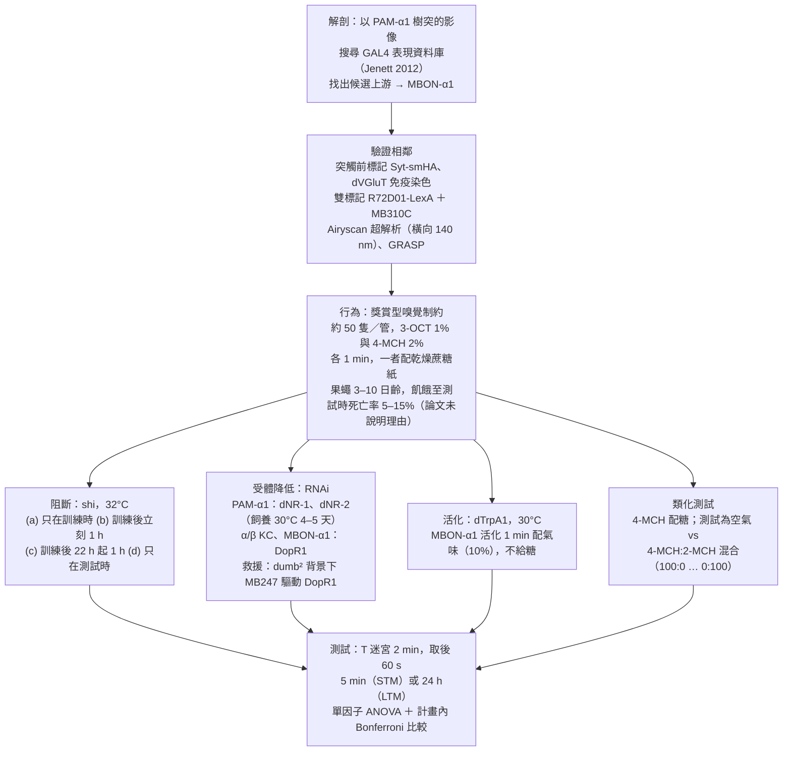

**解剖。** 依序五步，每步驗證一件事：

1. **找候選**：在共軛焦顯微鏡（可取得逐層光學切片的螢光顯微鏡）影像中把 PAM-α1 的樹突圈出來，拿去比對 Jenett et al. 2012 的 GAL4 表現模式資料庫，以計算方式找出樹突附近有末梢的候選上游神經元（PDF 第 2 頁）。
2. **末梢在哪**：用 MB310C 在 MBON-α1 表現膜標記與突觸前標記（pJFRC51-3xUAS-Syt-smHA）。
3. **傳遞物質**：以抗 dVGluT、GAD1、ChAT 抗體染色。
4. **幾顆細胞**：以 MCFO 把個別細胞標成不同顏色。
5. **貼多近**：以 R72D01-LexA（PAM-α1）與 MB310C（MBON-α1）雙標記，在 Zeiss LSM880 Airyscan 超解析顯微鏡下看 SIP、SLP（論文寫它的解析度為橫向 140 nm、軸向 400 nm，波長 488 nm；這仍是光學影像，看得到貼合，看不到突觸結構）；再用 GRASP（UAS-CD4::spGFP1-10 ＋ LexAop-CD4::spGFP11）檢驗兩者的膜是否緊貼。

共軛焦影像用 LSM710（Zeiss）與 FV1200（Olympus，僅 GRASP）。

**行為。** 方法依 Liu et al. 2012、Aso et al. 2014b、Yamagata et al. 2015 稍加修改。約 50 隻果蠅一管，在持續氣流中交替聞 3-辛醇（3-OCT，石蠟油稀釋 1%）與 4-甲基環己醇（4-MCH，稀釋 2%）各 1 分鐘，其中一種同時給乾燥的蔗糖紙；一半的組在第一個氣味給糖、一半在第二個，以抵消順序效應。測試在透明壓克力 T 迷宮中進行，紅外線照明、攝影機拍攝，ImageJ 巨集計數。訓練在暗紅光下、測試在全暗中。訓練與測試之間不給食物。飼養 24°C、相對濕度 60%。**兩個氣味之間的間隔、受試果蠅的性別、偏好指數的換算公式，論文都沒寫**（搜過 interval、female、male、sex、formula、divided；female／male 只出現在雜交方式的描述）。

**飢餓。** 果蠅在訓練前被餓到測試時死亡率 5–15%，論文沒說明為什麼用這個標準。

**溫度操作。** shi 的限制溫度 32°C、容許溫度 24°C。shi 實驗用 *w;;UAS-shi^ts1*（單一拷貝）或 *w* 的雌蠅與各 GAL4 雄蠅雜交的第一代。dTrpA1 實驗：果蠅從 24°C 移到預熱至 30°C 的管中，同時給氣味 1 分鐘；此實驗氣味改為 10%，裝氣味的杯子（一般實驗為直徑 14 mm 的杯）杯徑寫作「3 mm and 5」（⚠️ 原文第二個值缺單位，見第五節；為什麼改用不同的杯子與濃度、對結果有無影響，論文沒有討論）。

**RNAi 與救援。** NMDAR：*UAS-Nmdar1-RNAi*（TRiP.HMS02200，attP40，Bloomington #41667）、*UAS-Nmdar2-RNAi*（TRiP.HMS02012，attP2，#40846）；DopR1：*UAS-DopR1-RNAi*（TRiP.HMC02344，attP2，#55239）。NMDAR 降低實驗的果蠅在實驗前於 30°C 飼養 4–5 天以提高 GAL4 活性。救援實驗的目的是：在 DopR1 失效的 *dumb²* 突變果蠅裡，只在 KC 補回 DopR1，看 LTM 會不會恢復。親本是 *UAS-DopR1;;dumb²* 或 Canton-S 雌蠅，與 *MB247-GAL4;dumb²* 或 *dumb²* 雄蠅交配；子代的四種基因型見 3.6 節。**RNAi 降低的程度（例如 PAM-α1 的 NMDA 受體實際少了多少）論文沒有驗證**（搜過 efficien、qPCR、validat：唯一一處 efficient 指的是選用 shRNA 品系的理由）。

**類化實驗（圖 10）。** 類化（generalization）指學會對一種氣味的反應之後，對相似氣味也出現同樣反應；類化越強，記憶越不專一。一組以 4-MCH 配糖；另一組當對照，同樣吃到糖、也同樣聞到 4-MCH，只是兩者錯開（先給糖配空氣、再單獨給 4-MCH），所以學不到兩者的關聯。測試時讓果蠅在「空氣」與「4-MCH 與 2-甲基環己醇（2-MCH）的混合」之間選擇，混合比 100:0、80:20、60:40、40:60、20:80、0:100。**這個設計下學習指數怎麼算，論文沒寫清楚**（見 3.10）。方法另列了 1-辛烯-3-醇（1%），用於類化實驗的第二套氣味組合（正文說「another set of odorants」）；它與哪個氣味配對、哪個當混入氣味，只在 figure supplement（？待查）。

**統計。** StatPlus 與 Prism5。作者以 Shapiro–Wilk 檢定常態、Bartlett 檢定變異數同質，皆未違反，故用單樣本 t 檢定或單因子 ANOVA 後接計畫內成對比較（Bonferroni），顯著水準 0.05。兩種檢定各用在哪裡，論文沒說明（※ 推論：單樣本 t 檢定通常用來檢驗學習指數是否不等於 0）。**n 的單位論文也沒明說**；※ 推論：依學習指數的定義，每個 n 是一個學習指數，即兩組互為對照的訓練（各約 50 隻），約 100 隻果蠅。**圖上的星號代表實驗組與哪一個對照組的比較，論文沒有說明**（只有圖 10 的圖說寫「每組與不含混入氣味的組比較」）；※ 推論：常見作法是標示與兩個對照中較不顯著的那一個比較，但本篇未明說。

### 三、結果

#### 3.1 MBON-α1 的末梢與 PAM-α1 的樹突落在同一區（圖 1）

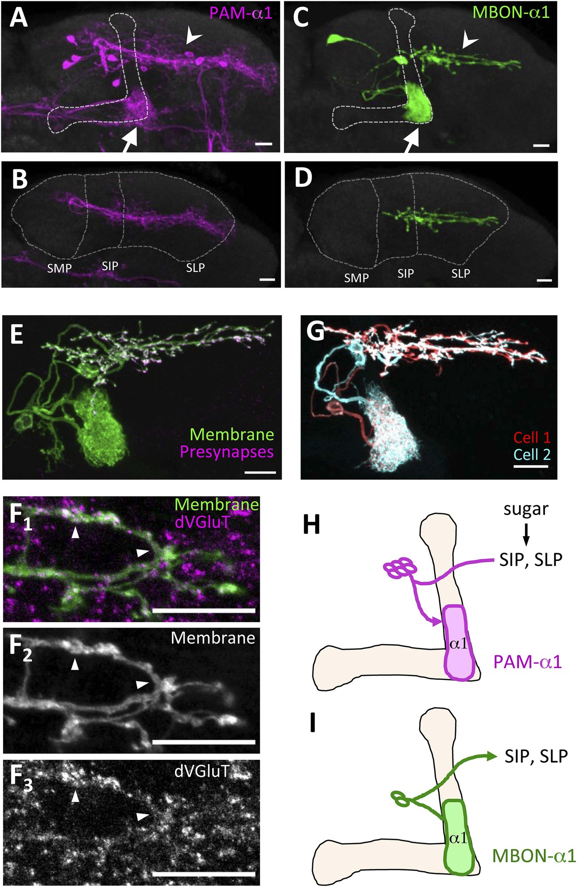

<small>圖片出處：Ichinose T, Aso Y, Yamagata N, Abe A, Rubin GM, Tanimoto H. *eLife* 4:e10719 (2015)，Figure 1。© 2015 Ichinose et al.，以 Creative Commons Attribution License（CC BY）釋出，可自由使用與散布；全文見 [PMC](https://pmc.ncbi.nlm.nih.gov/articles/PMC4643015/)。</small>

> **原圖說（Figure 1）：** MBON-α1 receives inputs from MB-α1 and projects to the dendrites of PAM-α1. (A–D) Anatomy of PAM-α1 (A, B) and MBON-α1 (C, D). Dotted line indicates α/β lobes in the mushroom body (MB) (A, C) or SMP, SIP, and SLP (superior medial, intermediate, and lateral protocerebra, respectively) (B, D). Arrows indicate α1 and arrowheads the SIP and SLP (A, C). PAM-α1 and MBON-α1 are visualized by pJFRC2-10xUAS-mCD8GFP in VK00005 and MB299B-GAL4 (A, B) or MB310C-GAL4 (C, D), respectively. (E) Presynaptic terminals of MBON-α1 are highly localized in SIP and SLP. MB310C-GAL4 is used to drive a general membrane marker (green) and a presynaptic marker (magenta) in MBON-α1. (F) Double labeling of the membrane of MBON-α1 (green) and anti-vesicular glutamate transporter (dVGluT, magenta) (F1), membrane staining (F2), and anti-dVGluT staining (F3). Arrowheads highlight the overlap. (G) Two individual MBON-α1 neurons visualized by multi-color flip-out with different colors (red and cyan). (H, I) Schematics of PAM-α1 and MBON-α1, respectively. The α/β lobe of the MB is outlined with light orange. Scale bars, 10 μm.

**圖說中譯：** MBON-α1 從 MB-α1 接收輸入，並投射到 PAM-α1 的樹突。(A–D) PAM-α1（A、B）與 MBON-α1（C、D）的形態。虛線標出 MB 的 α/β 葉（A、C），或 SMP、SIP、SLP（上內側、上中間、上外側前大腦）（B、D）。箭頭指 α1，箭頭尖指 SIP 與 SLP（A、C）。PAM-α1 與 MBON-α1 分別以 MB299B-GAL4（A、B）或 MB310C-GAL4（C、D）驅動 VK00005 位點上的 pJFRC2-10xUAS-mCD8GFP 顯示。(E) MBON-α1 的突觸前末梢高度集中在 SIP 與 SLP；以 MB310C-GAL4 在 MBON-α1 中驅動一般膜標記（綠）與突觸前標記（洋紅）。(F) MBON-α1 膜（綠）與抗囊泡麩胺酸轉運蛋白（dVGluT，洋紅）雙標記（F1）、膜染色（F2）、抗 dVGluT 染色（F3）；箭頭尖標出重疊處。(G) 以多色隨機標記把兩顆 MBON-α1 標成不同顏色（紅與青）。(H、I) PAM-α1 與 MBON-α1 的示意圖；MB 的 α/β 葉以淺橘色勾勒。比例尺 10 μm。

**解讀：**

- **本圖該看的是 B 與 D 的並排**：PAM-α1 的樹突橫跨 SMP、SIP、SLP 三區，MBON-α1 的末梢只在 SIP 與 SLP。兩者在 SIP、SLP 重疊，但 PAM-α1 在 SMP 還有一大段樹突是 MBON-α1 碰不到的。所以 MBON-α1 至多是 PAM-α1 輸入的**一部分**；H 格示意圖把「sugar」箭頭也畫進 SIP、SLP，暗示糖訊號與 MBON-α1 的回饋在同一區匯合，但糖訊號從哪條路進來，本篇沒有做實驗。
- **E 格說明末梢有突觸前標記、F 格說明末梢含 dVGluT**，兩者合起來支持「MBON-α1 是麩胺酸性、在 SIP／SLP 釋放」。這與 Aso et al. 2014a 的分類一致（本篇正文如此引用）。不是 GABA 也不是乙醯膽鹼的證據在 figure supplement 1（？待查）。
- **G 格回答了「一型」有幾顆**：MBON-α1 是兩顆形態相似的細胞，兩者的末梢都伸到 SIP、SLP。PAM-α1 有幾顆，本篇沒有寫（搜過 comprises、number、cell bod）；A 格可見數顆細胞體（※ 從圖判讀）。A、B 格的 PAM-α1 以洋紅色顯示，但圖說寫標記用的是 mCD8GFP（綠色螢光蛋白），顏色是影像呈現時指定的。本頁不數確切數目，因為 MB299B 也可能標到少量其他細胞：正文只說它「strong expression in PAM-α1」。
- **踩煞車：這張圖只顯示「兩群神經突在同一區」**，光學顯微鏡的解析度不足以判定有沒有突觸。下一張圖才往這個方向推進。

#### 3.2 兩者的神經突在 SIP、SLP 與 α1 交纏（圖 2）

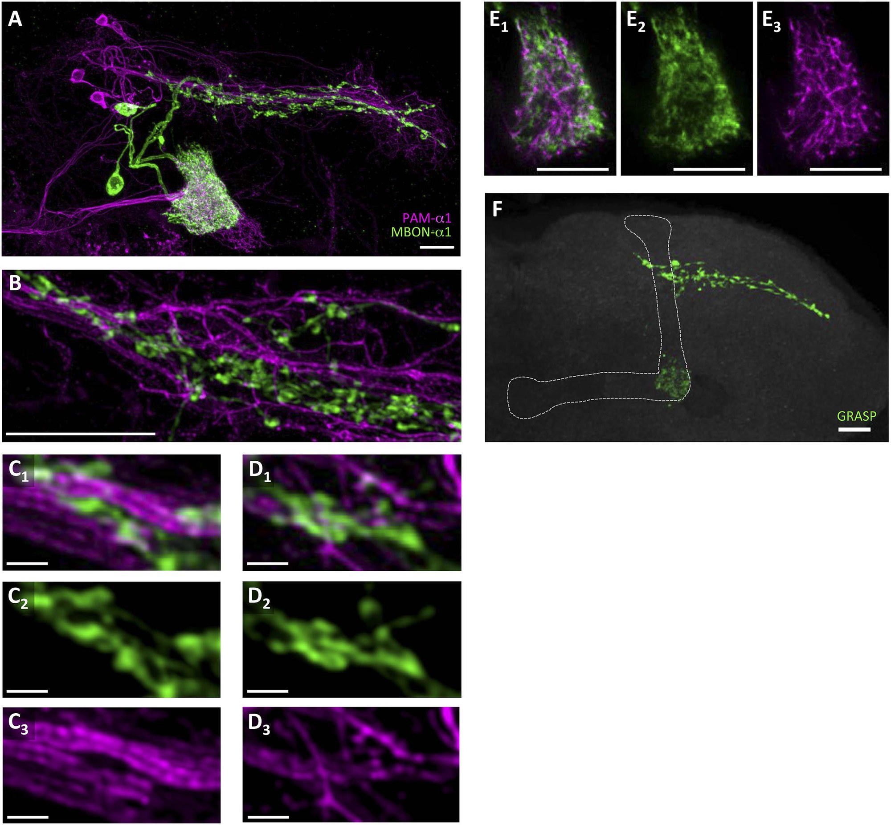

<small>圖片出處：Ichinose T, Aso Y, Yamagata N, Abe A, Rubin GM, Tanimoto H. *eLife* 4:e10719 (2015)，Figure 2。© 2015 Ichinose et al.，以 Creative Commons Attribution License（CC BY）釋出，可自由使用與散布；全文見 [PMC](https://pmc.ncbi.nlm.nih.gov/articles/PMC4643015/)。</small>

> **原圖說（Figure 2）：** Processes of PAM-α1 and MBON-α1 intermingle each other. (A) Double labeling of PAM-α1 and MBON-α1. PAM-α1 (magenta) and MBON-α1 (green) are visualized using R72D01-LexA and MB310C-GAL4, respectively. (B–D) Magnified substack images in SIP and SLP, obtained by a super-resolution detection system. (E) Magnified substack image in the α1 compartment in the MB. (F) GFP reconstitution across synaptic partner (GRASP) signals in SIP, SLP, and MB α1 support the contacts between PAM-α1 and MBON-α1. Scale bars, 10 μm (A, B, E, F), 1 μm (C, D).

**圖說中譯：** PAM-α1 與 MBON-α1 的神經突彼此交纏。(A) PAM-α1 與 MBON-α1 雙標記：PAM-α1（洋紅）以 R72D01-LexA、MBON-α1（綠）以 MB310C-GAL4 顯示。(B–D) 以超解析偵測系統取得的 SIP、SLP 局部放大子疊影像（只取部分深度的切片疊成的影像）。(E) MB α1 區室的局部放大子疊影像。(F) GRASP 訊號出現在 SIP、SLP 與 MB α1，支持 PAM-α1 與 MBON-α1 之間有接觸。比例尺 10 μm（A、B、E、F）、1 μm（C、D）。

**解讀：**

- **F 格的 GRASP 訊號有兩處，意義不同。** GRASP 本身只表示兩者的膜貼得很近，分不出訊號方向；方向要從「哪一方在該處是末梢（送出）、哪一方是樹突（接收）」另外推。SIP／SLP 的 GRASP 訊號（圖上的一長條），是 MBON-α1 的末梢碰 PAM-α1 的樹突，也就是回饋的候選位置，支持迴圈。α1 區室內的 GRASP 訊號（圖上的一團）情況不同：在 α1，PAM-α1 的是末梢（送出多巴胺），MBON-α1 的是樹突（接收 KC）。
  - ※ 推論（本頁依圖 1H、I 的示意推得，論文對 α1 的 GRASP 未解釋方向）：若這裡是突觸，方向會是 PAM-α1 → MBON-α1，與回饋相反，所以不能當作「MBON-α1 回饋到 PAM-α1」的證據。
  - 它若成立，是 PAM-α1 不經 KC、直接到 MBON-α1 的另一條路徑，本篇沒有討論。
  - 正文只說 GRASP「further supports the close juxtaposition」，措辭是「緊密相鄰」，不是「突觸」，這是準確的。
- **C、D 的 1 μm 尺度下**，綠色的球狀突起（正文稱「bouton-like structures」）貼在洋紅的細枝上，這是本篇最接近「突觸」的影像證據。但貼合不等於有傳遞；作者在討論中明說這個突觸連結「awaits physiological demonstration」（PDF 第 8 頁）。
- **R72D01-LexA 在 A 格標到的洋紅細胞，數目與 MB299B 是否完全相同**，論文沒比對；它被當作 PAM-α1 的標記使用（正文：「R72D01-LexA, which labels PAM-α1」）。※ 推論：若 R72D01 另標其他 PAM 型，SIP／SLP 的交纏與 GRASP 有一部分可能來自非 α1 的 PAM。

#### 3.3 訓練時阻斷 PAM-α1 或 MBON-α1，只傷 LTM（圖 3）

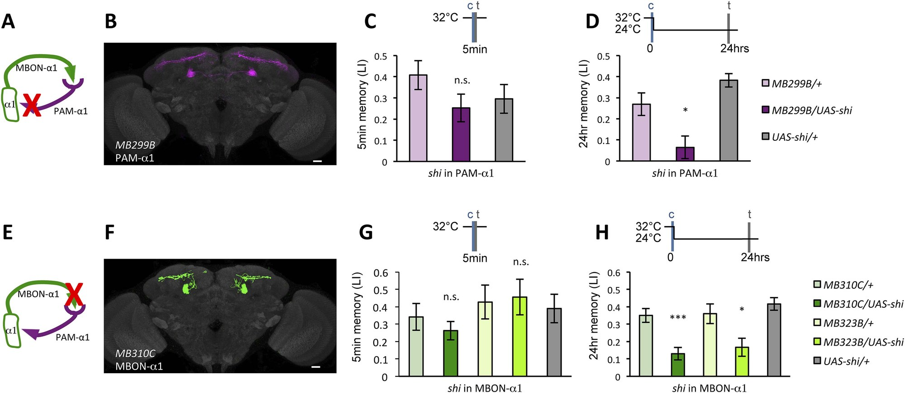

<small>圖片出處：Ichinose T, Aso Y, Yamagata N, Abe A, Rubin GM, Tanimoto H. *eLife* 4:e10719 (2015)，Figure 3。© 2015 Ichinose et al.，以 Creative Commons Attribution License（CC BY）釋出，可自由使用與散布；全文見 [PMC](https://pmc.ncbi.nlm.nih.gov/articles/PMC4643015/)。</small>

> **原圖說（Figure 3）：** Feedback from MBON-α1 is required for appetitive LTM formation. (A) Diagram of the experiment. (B) Expression pattern of MB299B-GAL4. (C) Blockade of PAM-α1 does not impair STM significantly. 5-min appetitive memory was measured (n = 10, 10, 12). c: conditioning, t: test. (D) Blockade of PAM-α1 during conditioning impairs LTM. 24-hr appetitive LTM was measured (n = 9, 12, 12). (E) Diagram of experiment. (F) Expression pattern of MB310C-GAL4. (G) Blockade of MBON-α1 does not impair STM significantly (n = 6, 7, 10, 6, 10). (H) Blockade of MBON-α1 during conditioning impairs LTM. MB323B-GAL4 is a second driver line that expresses in MBON-α1 (see figure supplement; n = 23, 24, 13, 14, 24). Bar graphs are mean ± s.e.m. *: p < 0.05, ***: p < 0.001, n.s.: p > 0.05. Scale bars, 20 μm.

**圖說中譯：** MBON-α1 的回饋是獎賞型 LTM 形成所必需。(A) 實驗示意。(B) MB299B-GAL4 的表現模式。(C) 阻斷 PAM-α1 不顯著損害 STM；量 5 分鐘獎賞記憶（n = 10、10、12）。c：訓練；t：測試。(D) 訓練時阻斷 PAM-α1 損害 LTM；量 24 小時獎賞 LTM（n = 9、12、12）。(E) 實驗示意。(F) MB310C-GAL4 的表現模式。(G) 阻斷 MBON-α1 不顯著損害 STM（n = 6、7、10、6、10）。(H) 訓練時阻斷 MBON-α1 損害 LTM；MB323B-GAL4 是第二個表現於 MBON-α1 的驅動品系（見 figure supplement；n = 23、24、13、14、24）。長條為平均 ± 標準誤。*：p < 0.05；***：p < 0.001；n.s.：p > 0.05。比例尺 20 μm。

**解讀：**

- **圖題寫「Feedback from MBON-α1」，但實驗阻斷的是 MBON-α1 的全部輸出。** shi 讓 MBON-α1 送往所有目標的傳遞都停擺，包括 SIP／SLP 裡 PAM-α1 以外的下游（本篇圖 8、圖 11 自己主張 MBON-α1 還有別的下游）。所以本圖證明的是「訓練時需要 MBON-α1 的輸出」，「需要的是送回 PAM-α1 的那一支」是推論。圖 4 的 NMDAR 實驗才把證據拉向 PAM-α1 這一端。
- **C 格的「STM 不受影響」要打折扣。** 實驗組約 0.25，兩個對照約 0.41 與 0.30（※ 從圖判讀）；實驗組比分數較高的那個對照低約四成，只是不顯著（n = 10、10、12）。正文據此寫「unimpaired performance in appetitive STM demonstrates that flies of these genotypes have normal sugar and odor perception」（PDF 第 4 頁），把「不顯著」寫成「未受損」，又進一步推到「感知正常」。G 格 MB310C 也有同樣情形（約 0.26 vs 0.34／0.43）。**較穩的讀法是：LTM 的損害遠比 STM 明顯**，而不是「STM 完全正常」。
- **升溫時段**：D、H 格只在訓練時升到 32°C；C、G 格的時間軸顯示訓練與 5 分鐘後的測試都在 32°C，所以 STM 組在訓練與測試時都被阻斷。這使「STM 不受影響」更值得注意：連測試時都關掉 PAM-α1 或 MBON-α1，5 分鐘記憶仍沒有顯著變差，符合「STM 不走這個迴路」的說法；但也表示 STM 組與 LTM 組的阻斷條件不完全相同。
- **各柱的組別**：C、D 格三柱依序為 MB299B/+、MB299B/shi（實驗組）、UAS-shi/+；G、H 格五柱依序為 MB310C/+、MB310C/shi、MB323B/+、MB323B/shi、UAS-shi/+（兩個 MBON-α1 品系的實驗組各配自己的驅動品系對照，共用一個 UAS 對照）。
- **拿論文的數字算一個論文沒算的比例**（實驗組 LI ÷ 對照組 LI 的平均，代表記憶剩下多少）：D 格實驗組約 0.06，對照平均約 0.33，剩約 18%；H 格 MB310C 約 0.13 vs 其對照（MB310C/+ 與 UAS-shi/+）平均約 0.39，剩約 34%；MB323B 約 0.17 vs 其對照（MB323B/+ 與 UAS-shi/+）平均也約 0.39，剩約 44%（※ 從圖判讀後計算）。兩個 MBON-α1 品系方向一致，但損害程度不同；兩個品系在 MBON-α1 裡驅動 shi 的量（基因表現強度）是否不同，論文沒有比較（figure supplement，？待查）。
- **兩個對照組本身的差異也值得一看**：D 格 MB299B/+ 約 0.27、UAS-shi/+ 約 0.38。同一個 24 小時 LTM，單是遺傳背景就差了約 0.1，這是判讀後面所有「損害」幅度時的背景雜訊。

#### 3.4 PAM-α1 需要 NMDA 受體（圖 4）

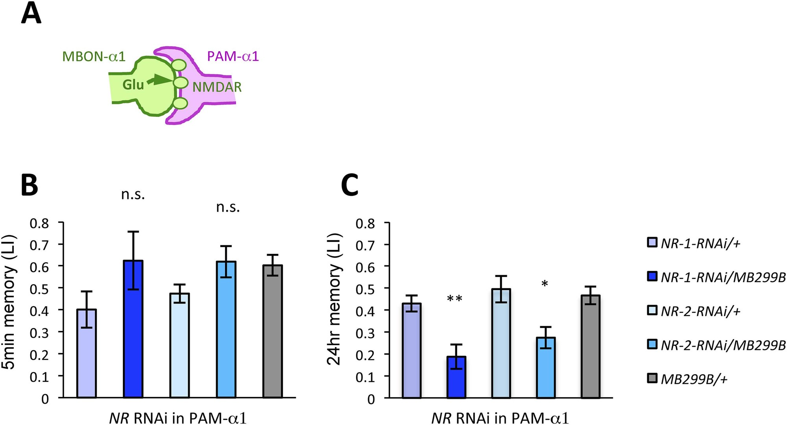

<small>圖片出處：Ichinose T, Aso Y, Yamagata N, Abe A, Rubin GM, Tanimoto H. *eLife* 4:e10719 (2015)，Figure 4。© 2015 Ichinose et al.，以 Creative Commons Attribution License（CC BY）釋出，可自由使用與散布；全文見 [PMC](https://pmc.ncbi.nlm.nih.gov/articles/PMC4643015/)。</small>

> **原圖說（Figure 4）：** NMDA receptors in PAM-α1 are required for appetitive LTM. (A) The subunits of NMDA receptor are down-regulated in PAM-α1. (B, C) Knocking down NMDA receptor subunits does not impair 5-min memory (B: n = 16, 8, 13, 12, 13) but impairs 24-hr memory significantly (C: n = 18, 8, 22, 20, 29). Bar graphs are mean ± s.e.m. *: p < 0.05, **: p < 0.01, n.s.: p > 0.05. Scale bars, 20 μm.

**圖說中譯：** PAM-α1 的 NMDA 受體是獎賞型 LTM 所必需。(A) 在 PAM-α1 降低 NMDA 受體次單元（示意）。(B、C) 降低 NMDA 受體次單元不損害 5 分鐘記憶（B：n = 16、8、13、12、13），但顯著損害 24 小時記憶（C：n = 18、8、22、20、29）。長條為平均 ± 標準誤。*：p < 0.05；**：p < 0.01；n.s.：p > 0.05。比例尺 20 μm。

**解讀：**

- **這是全篇把證據從「MBON-α1 的輸出」拉到「PAM-α1 的麩胺酸輸入」的關鍵一張。** C 格中，降低 NR-1 那組的 LTM 學習指數約 0.19、降低 NR-2 那組約 0.27，三個對照約 0.43–0.49（※ 從圖判讀）；B 格的 STM，兩個降低組（約 0.62）甚至比部分對照（0.40–0.60）高。五柱依序為 NR-1-RNAi/+、NR-1-RNAi/MB299B、NR-2-RNAi/+、NR-2-RNAi/MB299B、MB299B/+。方向與圖 3 一致，正文因此稱之為「suggesting the direct glutamatergic feedback」。不過 NR-1 實驗組 n = 8（B、C 皆然），是全篇最小的組之一。
- **但它沒有說明 NMDA 受體在 PAM-α1 上接收的是誰的麩胺酸。** PAM-α1 的樹突也伸到 MBON-α1 碰不到的 SMP（圖 1B），任何麩胺酸性輸入都可能經由這些受體作用。「麩胺酸來自 MBON-α1」這個結論，是把圖 3（需要 MBON-α1）與圖 4（PAM-α1 需要 NMDAR）兩個各自成立的結果拼在一起得到的。若要直接證明，需要在同一隻果蠅裡把兩者連起來，例如活化 MBON-α1 時同時降低 PAM-α1 的 NMDAR，看誘發的記憶是否消失；本篇沒有做。
- **A 格是示意圖，不是資料。** 圖說寫「are down-regulated」，但本篇沒有驗證 RNAi 在 PAM-α1 實際降低了多少（見二、方法）。圖說末尾的「Scale bars, 20 μm」在這張沒有顯微影像的圖上找不到對應（⚠️ 圖說殘留，見第五節）。
- **RNAi 沒有時間開關。** 只要 GAL4 在 PAM-α1 中表現，RNAi 就持續作用；論文沒有用任何方法限制它只在成蟲或只在訓練時作用，所以 ※ 推論它從發育期就開始（論文未說明 MB299B 何時開始表現）。果蠅在實驗前還被放在 30°C 4–5 天（論文說是為了提高 GAL4 活性，即讓 RNAi 作用更強），PAM-α1 缺少受體的時間因此更長。所以本圖無法區分「訓練時需要 NMDAR」與「PAM-α1 長期少了 NMDAR、本身發育或功能已改變」。圖 3、圖 9 的 shi 實驗有時間解析度，這張沒有。
- **NMDAR 降低的對照（MB299B/+）LTM 約 0.47，比圖 3D 的同一對照（約 0.27）高不少。** 兩者飼養溫度不同（30°C 4–5 天 vs 24°C），論文沒討論。這提醒讀者：本篇各圖的 LI 絕對值不宜跨圖比較。

#### 3.5 活化 MBON-α1 就能代替糖（圖 5）

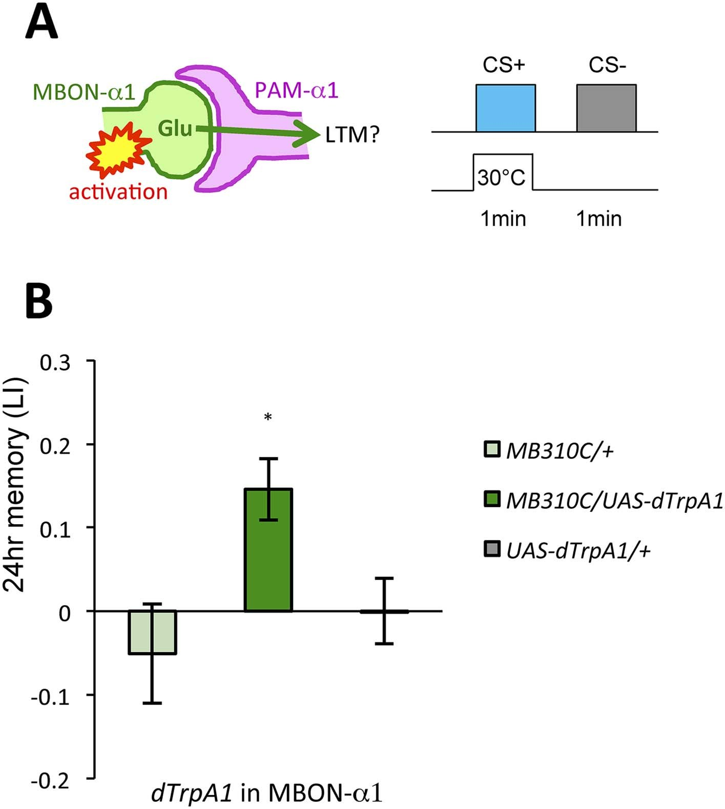

<small>圖片出處：Ichinose T, Aso Y, Yamagata N, Abe A, Rubin GM, Tanimoto H. *eLife* 4:e10719 (2015)，Figure 5。© 2015 Ichinose et al.，以 Creative Commons Attribution License（CC BY）釋出，可自由使用與散布；全文見 [PMC](https://pmc.ncbi.nlm.nih.gov/articles/PMC4643015/)。</small>

> **原圖說（Figure 5）：** MBON-α1 signals reward for appetitive LTM. (A) Activation of MBON-α1 was paired with odor presentations and 24-hr memory was measured. (B) Activation of MBON-α1 induces appetitive LTM formation (n = 16, 24, 24). Bar graphs are mean ± s.e.m. *: p < 0.05, n.s.: p > 0.05. Scale bars, 20 μm.

**圖說中譯：** MBON-α1 傳遞獎賞型 LTM 的獎賞訊號。(A) 將 MBON-α1 的活化與氣味配對，量 24 小時記憶。(B) 活化 MBON-α1 誘發獎賞型 LTM（n = 16、24、24）。長條為平均 ± 標準誤。*：p < 0.05；n.s.：p > 0.05。比例尺 20 μm。

**解讀：**

- **這是一個 US 替代實驗**（見 [[c-us-substitution]]），但被活化的是**輸出神經元**，不是多巴胺神經元。本庫其他來源的 US 替代，是活化 DAN（Hige 2015、Handler 2019）或直接給多巴胺（Tomchik 2009 的離體實驗）。活化 MBON-α1 能當獎賞，是「MBON-α1 → PAM-α1」這條路有功能的最直接行為證據。
- **各柱的組別**：MB310C/+、MB310C/UAS-dTrpA1（實驗組）、UAS-dTrpA1/+；只用 MB310C 一個品系。三組都經同樣的升溫流程（※ 依方法推得，論文未逐組說明）。
- **效果量偏小**：實驗組約 0.15，兩個對照約 −0.05 與 0.00（※ 從圖判讀；兩個對照的誤差棒都跨過 0，負值在誤差範圍內，等於沒學到）。同篇以真糖訓練的 24 小時 LTM 對照多在 0.3–0.45（圖 3H、7B、9C），活化 MBON-α1 的效果約為其三分之一到一半。但此實驗氣味濃度是 10%（真糖實驗為 1–2%）、溫度 30°C，條件不同，不能嚴格比（※ 推論）。
- **少了一個關鍵對照：活化 MBON-α1 同時阻斷 PAM-α1。** 若沒有 PAM-α1 就誘發不了這個記憶，才能說效果經由 PAM-α1；本篇沒有做（正文只用「most easily explained」來連結）。也沒有量活化 MBON-α1 後的 5 分鐘記憶，所以不知道它是否只誘發 LTM。
- 圖說的「n.s.」與「Scale bars, 20 μm」在圖上都找不到（⚠️ 圖說殘留，同圖 4）。

#### 3.6 需要 DopR1 的是 α/β KC，不是 MBON-α1（圖 6）

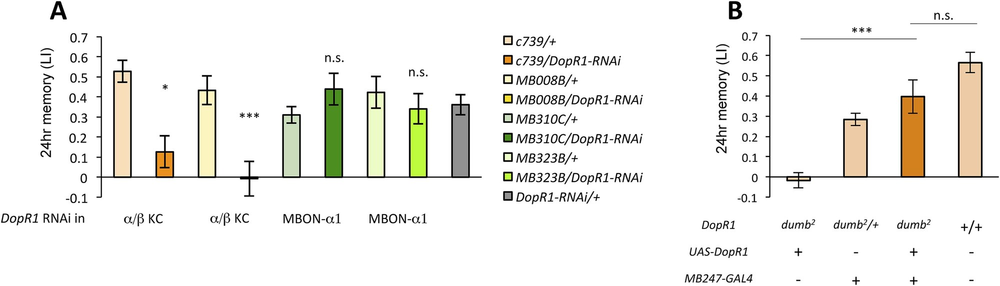

<small>圖片出處：Ichinose T, Aso Y, Yamagata N, Abe A, Rubin GM, Tanimoto H. *eLife* 4:e10719 (2015)，Figure 6。© 2015 Ichinose et al.，以 Creative Commons Attribution License（CC BY）釋出，可自由使用與散布；全文見 [PMC](https://pmc.ncbi.nlm.nih.gov/articles/PMC4643015/)。</small>

> **原圖說（Figure 6）：** α/β KCs receive dopamine signals through DopR1 for LTM formation. (A) Knocking down DopR1 in α/β Kenyon cells (KCs) but not in MBON-α1 impairs appetitive LTM (n = 17, 10, 11, 11, 18, 12, 7, 12, 27). (B) KC expression of DopR1 in the dumb2 mutant background fully rescues the LTM impairment (n = 12, 10, 7, 13). Bar graphs are mean ± s.e.m. *: p < 0.05, ***: p < 0.001.

**圖說中譯：** α/β KC 經由 DopR1 接收多巴胺訊號以形成 LTM。(A) 在 α/β KC、而非 MBON-α1 中降低 DopR1，會損害獎賞型 LTM（n = 17、10、11、11、18、12、7、12、27）。(B) 在 *dumb²* 突變背景下於 KC 表現 DopR1，完全救回 LTM 的缺陷（n = 12、10、7、13）。長條為平均 ± 標準誤。*：p < 0.05；***：p < 0.001。

**解讀：**

- **各柱的組別**：A 格九柱依序為 c739/+、c739/DopR1-RNAi、MB008B/+、MB008B/DopR1-RNAi（以上為 α/β KC）、MB310C/+、MB310C/DopR1-RNAi、MB323B/+、MB323B/DopR1-RNAi（以上為 MBON-α1）、DopR1-RNAi/+。B 格四柱依序為（先列組別，各組的意義在下一點說明）：(1) *dumb²* 同型合子、帶 UAS-DopR1 但沒有 GAL4（DopR1 補不回去，等於純突變）；(2) *dumb²*/+ 雜合子、帶 MB247-GAL4；(3) *dumb²* 同型合子、帶 MB247-GAL4 與 UAS-DopR1（救援組）；(4) 野生型 +/+。
- **A 格的對比清楚**：兩個 α/β KC 品系降低 DopR1 後，LTM 約 0.13（c739）與約 0（MB008B），對照約 0.43–0.53；兩個 MBON-α1 品系降低 DopR1 後約 0.44 與 0.34，與各自的驅動品系對照（約 0.31 與 0.42）相比，圖上標 n.s.（※ 從圖判讀）。這支持「多巴胺作用在 KC 上，不在 MBON 上」，與本庫 [[s-handler-2019-dopamine-receptor-timing]] 把 DopR1 放在 KC 上的模型方向一致。作者也保留了「MBON-α1 上可能有其他多巴胺受體」的空間（PDF 第 6 頁）。
- **B 格的「fully rescues」要看柱高**：純突變約 −0.02，救援組約 0.40，野生型約 0.57（※ 從圖判讀）；救援組約為野生型的七成；兩者「n.s.」，但救援組 n = 7，是全篇最小的組之一。**「完全救回」是「統計上與野生型無顯著差異」的意思，不是「回到野生型的水準」。** 
- **B 格其餘兩組怎麼讀（※ 推論，論文未說明各組用途）。** 第 (4) 組野生型是直接使用 Canton-S（方法：「CS flies were used as wild type (Figures 6B, 10)」）。第 (2) 組是 *dumb²*/+ 雜合子、帶 MB247-GAL4，約 0.29，比救援組還低。它**不是**突變果蠅，所以不能當救援組的「只帶 GAL4」對照；它告訴我們的是：在「帶 MB247、有一份 *dumb²*」的背景下，記憶已經低於野生型。這對救援的解讀有兩個方向相反的影響，本篇資料無法判定哪個較大：
  1. **可能低估救援**：若 MB247 插入本身就壓低記憶，救援組（也帶 MB247）只到野生型的七成，未必代表 DopR1 救得不完全。
  2. **可能高估救援**：真正該有的對照是「*dumb²* 同型合子、只帶 MB247-GAL4、不帶 UAS-DopR1」，本篇沒有。少了它，就無法排除 MB247 插入本身讓突變果蠅的記憶變好，救回的效果未必全來自補回的 DopR1。
- **救援用的是 MB247**，正文寫它在「KCs」表現，沒說只限 α/β。所以救援實驗定位到 KC，「α/β」的專一性來自 A 格的 RNAi（c739、MB008B）。摘要寫「dopamine receptor signaling in the MB α/β neurons」，靠的是 A 格。
- **RNAi 是持續性的**（不限於訓練、鞏固或提取），所以本圖無法區分 DopR1 在哪個階段被需要。
- **摘要與正文的說法對不上**：摘要寫「MBON-α1 additionally mediates the retrieval of LTM, which is dependent on the dopamine receptor signaling」，其中的「which」讓人讀成「提取依賴 DopR1」；正文小節標題卻是「DopR1-mediated appetitive LTM trace is formed in α/β KCs」，講的是形成。⚠️ 摘要與正文的指涉不一致（見第五節）。
- DopR1 降低對 STM 的影響在 figure supplement 1B（？待查）。

#### 3.7 訓練時也需要 α/β KC 的輸出（圖 7）

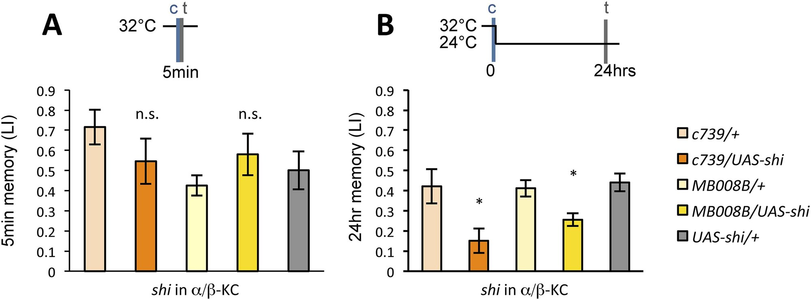

<small>圖片出處：Ichinose T, Aso Y, Yamagata N, Abe A, Rubin GM, Tanimoto H. *eLife* 4:e10719 (2015)，Figure 7。© 2015 Ichinose et al.，以 Creative Commons Attribution License（CC BY）釋出，可自由使用與散布；全文見 [PMC](https://pmc.ncbi.nlm.nih.gov/articles/PMC4643015/)。</small>

> **原圖說（Figure 7）：** Output of α/β KCs has an essential role in the acquisition of appetitive LTM. (A) Blockade of α/β KCs does not impair STM significantly (n = 8, 7, 7, 8, 9). (B) Blockade of α/β KCs during conditioning impairs LTM (n = 7, 7, 18, 19, 20). Bar graphs are mean ± s.e.m. *: p < 0.05, n.s.: p > 0.05.

**圖說中譯：** α/β KC 的輸出在獎賞型 LTM 的獲得中不可或缺。(A) 阻斷 α/β KC 不顯著損害 STM（n = 8、7、7、8、9）。(B) 訓練時阻斷 α/β KC 損害 LTM（n = 7、7、18、19、20）。長條為平均 ± 標準誤。*：p < 0.05；n.s.：p > 0.05。

**解讀：**

- **這張圖的意義來自它和既有知識的反差。** 依本篇引言、本節正文與討論，先前研究已知 α/β KC 的輸出在**提取**時需要（Krashes et al. 2007 等），也在**鞏固**期需要（Huang et al. 2012）；本圖新增的是**訓練（獲得）時**也需要，而且只影響 LTM。作者用它支持「MBON-α1 把 α/β KC 裡的新痕跡傳給 PAM-α1」的模型；「新痕跡」（作者稱 nascent memory trace）指訓練時糖與氣味在 α/β KC 留下的改變，MBON-α1 要讀到它，KC 就必須能送出訊號。
- **但「訓練時阻斷 KC 輸出」在任何模型下都會讓 MBON-α1 收不到氣味訊號**，也會讓其他 α/β 區室的 MBON 收不到。本圖不能區分「回饋需要 KC 輸出」與「其他依賴 KC 輸出的訓練期過程」。
- **A 格的情形與圖 3C 相同**（實驗組明顯偏低、但不顯著）：c739/shi 約 0.55 vs c739/+ 約 0.72（低約四分之一），不顯著。n 只有 7–9。
- **B 格的 n 不平衡**：c739 兩組 n = 7，MB008B 兩組 n = 18–19。c739 實驗組約 0.15（對照約 0.42 與 0.44），MB008B 實驗組約 0.26（對照約 0.41 與 0.44）。c739 的損害較大、星號卻同為 *，※ 推論：原因是它的 n 只有 7，檢定力較低，同樣的星號背後效果大小不同。

#### 3.8 提取需要 MBON-α1，但不需要 PAM-α1（圖 8）

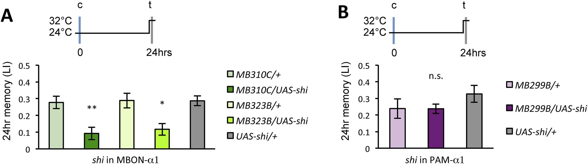

<small>圖片出處：Ichinose T, Aso Y, Yamagata N, Abe A, Rubin GM, Tanimoto H. *eLife* 4:e10719 (2015)，Figure 8。© 2015 Ichinose et al.，以 Creative Commons Attribution License（CC BY）釋出，可自由使用與散布；全文見 [PMC](https://pmc.ncbi.nlm.nih.gov/articles/PMC4643015/)。</small>

> **原圖說（Figure 8）：** Appetitive LTM is read out through MBON-α1. (A) Blocking MBON-α1 during test impairs appetitive LTM retrieval (n = 20, 21, 11, 13, 20). (B) Blocking PAM-α1 during test does not significantly impair LTM retrieval (n = 7, 7, 10). Bar graphs are mean ± s.e.m. *: p < 0.05, **: p < 0.01, n.s.: p > 0.05.

**圖說中譯：** 獎賞型 LTM 經由 MBON-α1 讀出。(A) 測試時阻斷 MBON-α1 損害獎賞型 LTM 的提取（n = 20、21、11、13、20）。(B) 測試時阻斷 PAM-α1 不顯著損害 LTM 提取（n = 7、7、10）。長條為平均 ± 標準誤。*：p < 0.05；**：p < 0.01；n.s.：p > 0.05。

**解讀：**

- **本圖是「迴圈只在形成時有用」這個主張的依據**：提取時 MBON-α1 需要、PAM-α1 不需要，所以作者推論 MBON-α1 在提取時用的是**另一批下游**（正文：「different postsynaptic targets of MBON-α1 would be used in these two roles」）。這個推論合理，但「另一批下游」是誰，本篇沒有找。
- **提取並未被完全阻斷**：MB310C 約 0.09、MB323B 約 0.12，對照約 0.28–0.29（※ 從圖判讀），剩約三到四成。作者在討論中引 Plaçais et al. 2013，說 MBON-α3 也參與提取，兩者的末梢在 SIP 交會；剩下的記憶可能由 MBON-α3 等讀出（※ 推論）。
- **B 格是陰性結果，n 只有 7、7、10**，而且連對照組的 LI 都只有約 0.24 與 0.33，低於同篇其他 LTM 實驗的對照（多在 0.3–0.45）。對照分數低，實驗組可以往下掉的空間就小，即使真有損害也較難達到顯著。「提取不需要 PAM-α1」是在低檢定力下的不顯著，不是正面證明。
- **本圖與本庫既有的 MBON 模型相容（※ 推論，論文未討論）。** 分三步說：
  1. 本庫 [[e-mbon]] 頁記載一條一般規則（Hige 2015 引 Aso et al. 2014b）：每型 MBON 被活化時會推動果蠅靠近或走開；同一區室的 DAN 若傳遞獎賞，那格的 MBON 通常推動「走開」。學習時，多巴胺把該 MBON 對 CS+ 的反應**壓低**，於是 CS+ 引起的「走開」變弱，而另一個氣味仍引起正常的「走開」；果蠅偏向 CS+，靠的就是這個差距。
  2. 照這條規則，測試時把 MBON-α1 整個關掉，兩個氣味經由 MBON-α1 的「走開」訊號都歸零，這個差距跟著消失，學習指數應該下降。
  3. 本圖正是如此。所以圖 8 有兩種讀法：作者的讀法（圖 11）是 MBON-α1 在提取時經其他下游推動「趨近」；本頁補上的讀法是 MBON-α1 推動「走開」、學習壓低它對 CS+ 的反應。兩種讀法都能解釋圖 8，本篇的資料無法區分。後一種讀法要求學習讓 MBON-α1 對 CS+ 的反應**變弱**；3.11 會說明，作者的迴圈模型隱含的卻是「維持或變強」，兩者方向相反。

  本篇沒有量 MBON-α1 被活化時引發靠近或走開，也沒有量學習後 MBON-α1 對氣味的反應變大或變小（搜過 depress、potentiat、valence、avoid），所以這只是相容，不是證實。若後一種讀法成立，學習後 CS+ 對 MBON-α1 的驅動是被壓低的；而迴圈模型需要 MBON-α1 去興奮 PAM-α1，兩者如何並存，見 3.11 與第五節第 8 條。

#### 3.9 訓練後 1 小時內是關鍵期（圖 9）

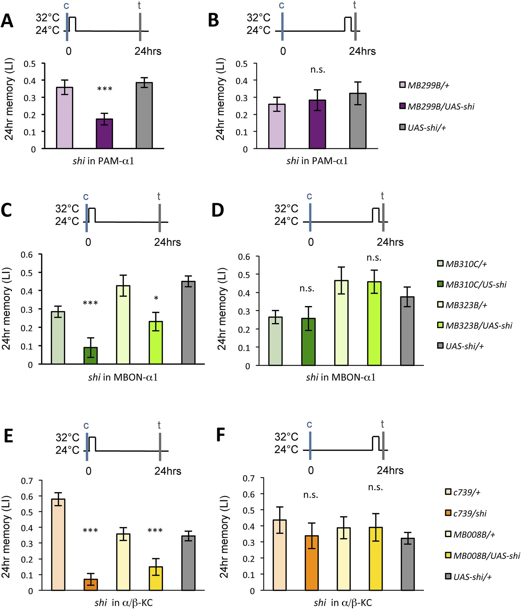

<small>圖片出處：Ichinose T, Aso Y, Yamagata N, Abe A, Rubin GM, Tanimoto H. *eLife* 4:e10719 (2015)，Figure 9。© 2015 Ichinose et al.，以 Creative Commons Attribution License（CC BY）釋出，可自由使用與散布；全文見 [PMC](https://pmc.ncbi.nlm.nih.gov/articles/PMC4643015/)。</small>

> **原圖說（Figure 9）：** Dopamine release from PAM-α1 is required for appetitive LTM consolidation. (A, C, E) Blocking PAM-α1 (A), MBON-α1 (C), or α/β−KC (E) for 1 hr immediately after conditioning impairs appetitive LTM (n = 16, 15, 22 (A); n = 15, 16, 14, 20, 34 (C); n = 9, 8, 10, 7, 15 (E)). (B, D, F) Blocking PAM-α1 (B), MBON-α1 (D), or α/β−KC (F) for 1 hr, 22 hr after conditioning does not impair appetitive LTM (n = 15, 15, 14 (B); n = 16, 15, 13, 13, 23 (D); n = 12, 12, 15, 12, 15 (F)). Bar graphs are mean ± s.e.m. *: p < 0.05, ***: p < 0.001, n.s.: p > 0.05.

**圖說中譯：** PAM-α1 的多巴胺釋放是獎賞型 LTM 鞏固所必需。(A、C、E) 訓練後立刻阻斷 PAM-α1（A）、MBON-α1（C）或 α/β KC（E）1 小時，損害獎賞型 LTM（n = 16、15、22（A）；n = 15、16、14、20、34（C）；n = 9、8、10、7、15（E））。(B、D、F) 訓練後 22 小時起阻斷 PAM-α1（B）、MBON-α1（D）或 α/β KC（F）1 小時，不損害獎賞型 LTM（n = 15、15、14（B）；n = 16、15、13、13、23（D）；n = 12、12、15、12、15（F））。長條為平均 ± 標準誤。*：p < 0.05；***：p < 0.001；n.s.：p > 0.05。

**解讀：**

- **這是全篇設計最乾淨的一張**：同一種阻斷、同樣 1 小時，只差時間點（訓練後 0–1 h vs 22–23 h），三種細胞都給出同樣的「前有效、後無效」型態。22–23 小時那組排除了兩種替代解釋：(1)「升溫 1 小時本身就傷害記憶」——同樣升溫，晚做就沒事；(2)「回到 24°C 後 shi 仍殘留阻斷效果、一路影響到測試」——若真如此，離測試只有約 1 小時的晚期阻斷應該更傷，結果卻不傷。
- **圖題寫「Dopamine release from PAM-α1」，但沒有量多巴胺。** shi 阻斷的是 PAM-α1 的突觸輸出（全部囊泡釋放），本篇沒有用任何感測器或成像量多巴胺（搜過 GCaMP、calcium、imaging：imaging 只出現在共軛焦解剖與果蠅計數）。「多巴胺在訓練後持續釋放」是模型，不是資料。
- **拿論文的數字比一個比例（※ 從圖判讀後計算）。** 以「實驗組 ÷ 兩個對照的平均」計算記憶剩下多少：

  | 阻斷的細胞 | 訓練時阻斷 | 訓練後 0–1 h 阻斷 |
  |---|---|---|
  | PAM-α1 | 約 18%（圖 3D） | 約 45%（本圖 A） |
  | MBON-α1（MB310C） | 約 34%（圖 3H） | 約 24%（本圖 C） |
  | α/β KC（c739） | 約 35%（圖 7B） | 約 15%（本圖 E） |

  **對 MBON-α1 與 α/β KC，訓練後 1 小時的阻斷與訓練時阻斷一樣傷，甚至更傷；對 PAM-α1，訓練時阻斷更傷。** 論文沒有並列這兩組比較。
- ※ 推論：PAM-α1 在訓練時阻斷更傷，可以這樣理解：訓練時 PAM-α1 直接由糖驅動，關掉它就連最初的獎賞訊號都沒了；訓練後糖已拿走，PAM-α1 只剩迴圈在推動。在訓練與鞏固期間，MBON-α1 與 KC 對 LTM 的貢獻主要經由迴圈（KC 在訓練時另外還傳遞氣味），所以訓練後關掉它們的傷害不比訓練時小。這與作者的模型方向一致。
- 但這個比較只能當線索：它跨了不同的圖與不同批次的果蠅，所以兩欄不能嚴格比；而且兩種阻斷的時長不同：訓練後的阻斷長達 1 小時，訓練時的阻斷較短。對 PAM-α1 那一列，較短的阻斷卻更傷，結論不受影響；對 MBON-α1 與 α/β KC 兩列，「訓練後一樣傷甚至更傷」可能部分只是因為阻斷得較久，這兩列的結論較弱。訓練時的阻斷要在 32°C 維持多久、訓練前是否先預熱，論文沒寫（搜過 prior、incubat、minutes）；從圖 3 的時間軸看，它只涵蓋訓練前後一小段，應短於 1 小時。
- **對照組的變異大**：c739/+ 在 E 格約 0.58、在 F 格約 0.44；MB323B/+ 在 C 格約 0.43、MB310C/+ 約 0.29。C 格五柱依序為 MB310C/+、MB310C/shi、MB323B/+、MB323B/shi、UAS-shi/+。其中 MB323B/shi 約 0.23，比另一個品系的對照 MB310C/+（約 0.29）只低一點；它之所以顯著，是因為它是和自己的對照 MB323B/+（約 0.43）比。換句話說，「損害」的大小取決於拿哪個對照當基準，而各對照之間本身就差很多。
- **一個小筆誤**：C、D 格圖例寫「MB310C/US-shi」（應為 UAS-shi）。

#### 3.10 LTM 比 STM 更不挑氣味（圖 10）

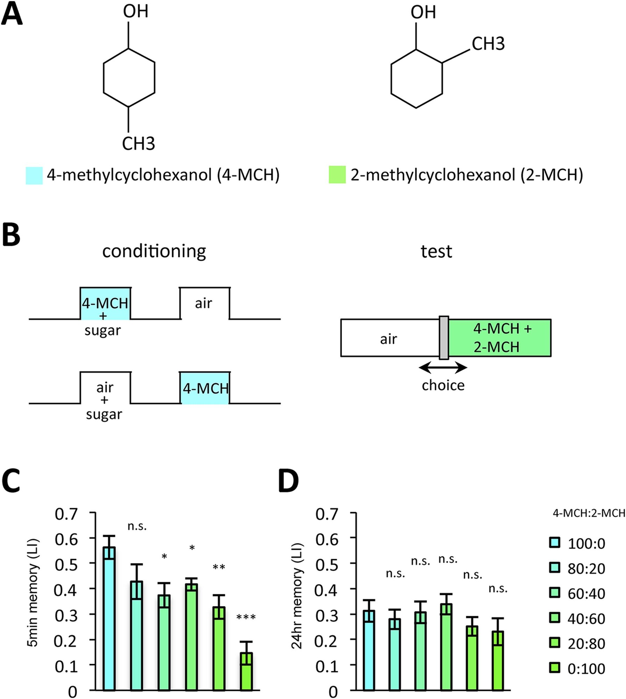

<small>圖片出處：Ichinose T, Aso Y, Yamagata N, Abe A, Rubin GM, Tanimoto H. *eLife* 4:e10719 (2015)，Figure 10。© 2015 Ichinose et al.，以 Creative Commons Attribution License（CC BY）釋出，可自由使用與散布；全文見 [PMC](https://pmc.ncbi.nlm.nih.gov/articles/PMC4643015/)。</small>

> **原圖說（Figure 10）：** LTM specificity is compromised. (A) Chemical structures of odorants. (B) Design of the experiment. For one group, presentation of 4-methylcyclohexanol was paired with sugar reward. The reciprocal group received sugar without odor. In the test situation, flies of each group were allowed to choose between the air and the mixture of the trained odor and the 'contaminant' (2-methylcyclohexanol). (C, D) The performance index declined more sharply with the increasing contamination ratio in STM (C; n = 16 for each) than in LTM (D; n = 24 for each). Each group was compared to the group that was tested without the contaminant (left most bar). Bar graphs are mean ± s.e.m. *: p < 0.05, **: p < 0.01, ***: p < 0.001, n.s.: p > 0.05.

**圖說中譯：** LTM 的專一性降低。(A) 氣味的化學結構。(B) 實驗設計：一組讓 4-甲基環己醇與糖獎賞配對；互為對照的另一組接受不帶氣味的糖。測試時，各組果蠅在空氣與「訓練氣味加『混入氣味』（2-甲基環己醇）的混合」之間選擇。(C、D) 隨混入比例增加，表現指數在 STM（C；每組 n = 16）下降得比 LTM（D；每組 n = 24）更陡。每組都與不含混入氣味的組（最左一柱）比較。長條為平均 ± 標準誤。*：p < 0.05；**：p < 0.01；***：p < 0.001；n.s.：p > 0.05。

**解讀：**

- **看 0:100 那一柱**：測試時完全沒有訓練氣味、只有從沒聞過的 2-MCH。STM 約 0.15，LTM 約 0.23（※ 從圖判讀）。換算成「佔各自 100:0 的比例」：STM 約 0.15 ÷ 0.56 ≈ 27%，LTM 約 0.23 ÷ 0.31 ≈ 74%。**24 小時後，果蠅對一個從沒和糖配過的氣味，表現出約四分之三的「記憶」。** 論文只寫「decline is shallower」，沒算這個比例；換算後結論仍然成立，而且比「較平緩」更強烈。
- **論文的統計不直接支持「LTM 下降較平緩」這個比較句。** 圖說的檢定是「每柱與最左柱比」，STM 從 60:40 起顯著、LTM 全部不顯著；但「STM 顯著、LTM 不顯著」不等於「兩者下降速度顯著不同」，論文沒有做檢定兩條曲線斜率差異的交互作用分析（統計方法只有單因子 ANOVA；搜過 interaction、two-way）。再加上 LTM 的起點本來就低（約 0.31 vs 0.56），同樣比例的下降在 LTM 上的絕對值較小、較難達到顯著。上一點的比例換算部分回應了這個顧慮。
- **本實驗的對照設計與其他圖不同**：互為對照的組是「糖配空氣、再單獨給 4-MCH」，測試是「空氣 vs 氣味」，不是兩種氣味二選一。論文沒說明這個設計下的 LI 怎麼算，本頁無法重算。可以確定的只是：它比較的是「配過糖的組」與「糖與氣味錯開的組」對同一混合氣味的趨近程度。因此圖 10 的 LI 不宜與其他圖的 LI 直接比大小。
- **作者把「專一性下降」歸因於訓練後延長的多巴胺釋放**（PDF 第 6 頁：「possibly due to the prolonged dopamine release」）。作者的設想寫在同頁：「Prolonged dopamine release in the absence of odor may also modulate KCs that do not respond to the rewarded odor」，即糖拿走、氣味也不在時繼續釋放的多巴胺，可能也修改了沒對 CS+ 反應的 KC，於是別的氣味也帶上一點獎賞記憶。但本篇沒有做「阻斷迴圈後 LTM 是否恢復專一」的實驗。這是解釋，不是證明。正文說 STM 組與 LTM 組之間「唯一的差別是保留時間」（訓練完全相同，只差 5 分鐘後測或 24 小時後測），這句本身是準確的：它排除了「兩組訓練方式不同」造成差異的可能，但並不告訴我們差異是迴圈造成的。
- **與本庫 Hige 2015 的類化機制並列（※ 推論）**：[[s-hige-2015-heterosynaptic-plasticity]] 把類化解釋為不同氣味活化的 KC 有重疊、重疊的突觸被一起改變，與本篇「延長的多巴胺作用在沒對該氣味反應的 KC 上」是兩種不同的機制；前者有生理資料，後者是假說。兩者不衝突，但後者若成立，需要多巴胺在沒有 KC 活動時也能改變突觸；而巧合偵測（[[c-coincidence-detection]]）的前提是「KC 正在活動」與「多巴胺到達」兩者都要有，突觸才會改。兩者有張力，見第五節第 7 條。

#### 3.11 作者的模型（圖 11）

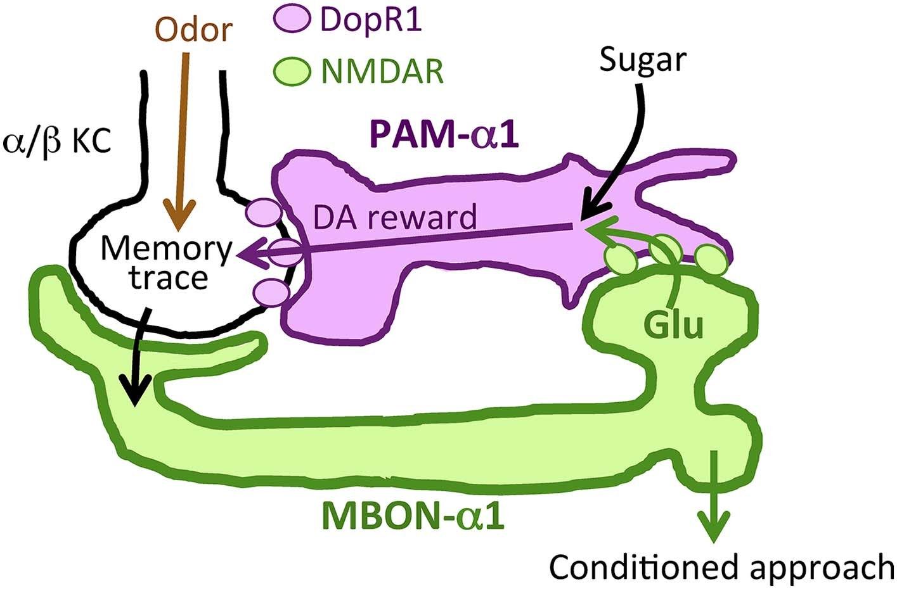

<small>圖片出處：Ichinose T, Aso Y, Yamagata N, Abe A, Rubin GM, Tanimoto H. *eLife* 4:e10719 (2015)，Figure 11。© 2015 Ichinose et al.，以 Creative Commons Attribution License（CC BY）釋出，可自由使用與散布；全文見 [PMC](https://pmc.ncbi.nlm.nih.gov/articles/PMC4643015/)。</small>

> **原圖說（Figure 11）：** Recurrent reward circuit drives appetitive LTM formation. Feedback circuit model of appetitive LTM formation. Neuronal signal of a sugar reward mediated by PAM-α1 converges with olfactory information in the α/β KCs. The coincidental signal is read out through MBON-α1 to give glutamatergic feedback onto PAM-α1 for the gain control of the dopamine release. Appetitive LTM is read out through MBON-α1 to activate other downstream targets.

**圖說中譯：** 迴圈獎賞迴路驅動獎賞型 LTM 形成。獎賞型 LTM 形成的回饋迴路模型：PAM-α1 傳遞的糖獎賞神經訊號，與嗅覺資訊在 α/β KC 中匯合。這個同時發生的訊號經由 MBON-α1 讀出，以麩胺酸回饋到 PAM-α1，對多巴胺的釋放進行增益控制。獎賞型 LTM 經由 MBON-α1 讀出，活化其他下游目標。

**解讀：**

- **逐一對照模型的每個箭頭與證據：**

| 模型的箭頭 | 本篇的證據 | 強度 |
|---|---|---|
| 糖 → PAM-α1 | 引 Yamagata et al. 2015；本篇圖 3 只顯示 PAM-α1 必要 | 引用 |
| PAM-α1 → α/β KC（DopR1） | 圖 6：KC 中降低 DopR1 傷 LTM，MBON-α1 中不傷 | 中（持續性 RNAi，無時間解析度） |
| 氣味 → α/β KC → MBON-α1 | 圖 7：訓練時需要 α/β KC 輸出 | 中（間接） |
| MBON-α1 → PAM-α1（麩胺酸、NMDAR） | 圖 1–2 光學相鄰與 GRASP；圖 3 需要 MBON-α1 輸出；圖 4 PAM-α1 需要 NMDAR；圖 5 活化 MBON-α1 足以誘發 LTM | 中：四項彼此一致，但沒有一項直接量到這條連結 |
| 回饋「放大並延長」多巴胺釋放 | 圖 9：訓練後 1 h 阻斷任一環皆傷 LTM | 弱：沒有量多巴胺或 PAM-α1 活動 |
| MBON-α1 → 其他下游 → 趨近（作者圖中標「Conditioned approach」） | 圖 8：提取需要 MBON-α1、不需要 PAM-α1 | 中（下游未辨認；3.8 指出圖 8 也可用「MBON-α1 推動走開、學習壓低它」解釋） |

- **模型的「增益控制」（gain control）一詞在本篇沒有被量化。** 增益是「同樣的糖帶來多少多巴胺」，本篇沒有量任何一端。
- **模型隱含「突觸改變往哪個方向」的假設。** 回饋要靠 KC→MBON-α1 送出的訊號去興奮 PAM-α1（作者認為經 NMDA 受體的麩胺酸輸入是興奮性的），而作者說這個訊號是「同時發生的訊號」，即糖與氣味在 KC 中匯合後的結果，與 CS+ 的痕跡有關。若 α1 區的 KC→MBON-α1 突觸在配對後像本庫 Hige 2015、Handler 2019 量到的其他區室那樣**變弱**，MBON-α1 對 CS+ 的放電會變少，回饋也跟著減少。模型要靠回饋「放大並延長」獎賞訊號，靠的是配對後多出來的訊號；若配對反而讓這個訊號變少，回饋就是在縮小、不是放大。本篇沒有量 MBON-α1 的反應怎麼變（※ 推論；見第五節第 8 條）。
- **模型沒交代訓練後是什麼在驅動迴圈。** 訓練後 0–1 小時氣味已經不在，KC 不會被 CS+ 活化；作者說迴圈有「ongoing activity」（持續活動），但這個活動從哪裡來、與 CS+ 的痕跡有什麼關係，論文沒有說明。本頁 3.10 引述的作者說法，是用「氣味不在時延長的多巴胺會作用在其他 KC 上」解釋類化。照這個說法，訓練後的多巴胺不挑 KC；但模型又說回饋由 CS+ 留下的痕跡驅動。兩種說法對「訓練後是什麼讓迴圈持續運作」描述不同，需要調和（※ 推論）。

### 四、討論

**主張一：MBON-α1 與 PAM-α1 構成一個迴圈。** 解剖證據中等：光學共定位、Airyscan 下的球狀突起、GRASP 在 SIP／SLP 有訊號。缺電子顯微鏡層級的突觸證據與生理記錄；作者在討論中自承突觸連結「awaits physiological demonstration」，並指出果蠅中麩胺酸也可能是抑制性的（引 Liu & Wilson 2013）。**但同一節後面又寫「In this circuit, MBON-α1 mediates monosynaptic feedback to the dopamine neurons」**（PDF 第 10 頁），把待證的連結寫成確定的單突觸回饋（⚠️ 論文自身不一致）。

**主張二：迴圈的三個環節在 LTM 的獲得與早期鞏固中都必要，而不影響 STM。** 行為證據強：每個環節都至少用兩個驅動品系（PAM-α1 除外，只有 MB299B）、有容許溫度對照（同樣基因型在 24°C 訓練與測試，確認不升溫時帶 shi 本身不傷記憶；figure supplement，？待查）、有訓練後 22 小時的時間對照。弱點是「不影響 STM」多半是低 n 下的不顯著（3.3、3.7）。

**主張三：MBON-α1 的麩胺酸經由 PAM-α1 的 NMDA 受體提供興奮性回饋。** 證據中等偏弱：四個獨立結果（相鄰、MBON-α1 必要、NMDAR 必要、MBON-α1 活化足以誘發）彼此一致，但沒有把它們接在同一個實驗裡，也沒有電生理或成像。作者用的動詞是「most easily explained」「suggesting」，措辭與證據相稱；圖題與 eLife 摘要框（digest）則較強（第五節）。

**主張四：多巴胺神經元不只是轉播獎賞，而是整合糖與新生記憶痕跡，對 LTM 形成做增益控制。** 這是全篇最重要也最推論性的主張（「our results call into question this prevailing circuit model」，PDF 第 7 頁）。它解釋了為什麼一次訓練就能形成 LTM、為什麼 LTM 要時間慢慢出現（引 Das et al. 2014 等三篇），以及先前研究發現 LTM 鞏固需要訓練後的多巴胺輸入（引 Plaçais et al. 2012；Musso et al. 2015）。但「整合」與「增益」都沒有被量。作者另提出：PAM-α1 可能同時整合「吃到糖」與「新生記憶痕跡」兩個輸入；痕跡要靠氣味活化 KC 才會產生，所以只有糖與氣味同時出現時，回饋才會放大獎賞訊號。這樣 LTM 只會在「有其他感覺刺激（例如氣味）同時出現」的情況下形成，以節省能量；這是生態學層次的推測。

**主張五：LTM 的形成以犧牲氣味專一性為代價。** 現象（LTM 比 STM 更類化）證據中等（3.10），原因（延長的多巴胺）是推測。作者引小鼠與蜜蜂的研究說長期記憶較為類化（Stach & Giurfa 2005；Wiltgen & Silva 2007），並從生態學角度解釋：即使聞到的氣味與學到的不完全相同，為了生存仍值得去試一試（論文原文「it is worth taking a chance for survival even if the smell is not exactly the same as learned」）。

**主張六：STM 與 LTM 由不同 DAN、不同 MB 葉獨立處理，可能是跨物種保守的策略。** 「不同葉」是作者引用文獻的說法，不是本篇的資料。本篇引 Trannoy et al. 2011、Huetteroth et al. 2015、Yamagata et al. 2015 與哺乳類文獻；本篇只指出 LTM 在 α/β KC，STM 在哪一葉本篇沒有說明。本篇自己的資料只覆蓋 LTM 這一側。討論另提到：章魚胺（octopamine，昆蟲腦中另一種調節物質）在昆蟲中被廣泛視為獎賞訊號，在果蠅中被認為是把獎賞輸入給誘發 STM 的那些 DAN（引 Burke et al. 2012 等）；這是說 STM 的獎賞來源與本篇 LTM 的迴圈不同。

**主張七：哺乳類的同類回饋是多突觸的，果蠅的是單突觸。** 依本篇討論：哺乳類解剖研究顯示回饋到 DAN 的路徑是多突觸的（引 Lisman & Grace 2005；Watabe-Uchida et al. 2012），本篇則稱果蠅為單突觸。如主張一所述，「單突觸」本身在本篇尚待生理證明。

### 五、問題與限制

**1. 沒有任何神經活動的量測。** 全篇沒有電生理、沒有鈣成像、沒有多巴胺感測（搜過 GCaMP、calcium、electrophysiolog、patch、record：皆 0 筆）。迴圈的方向、正負號（MBON-α1 是興奮還是抑制 PAM-α1）、持續時間（回饋在訓練後維持多久），以及「多巴胺在訓練後被延長釋放」都沒有直接證據。

**2. 阻斷 MBON-α1 ≠ 阻斷回饋。** shi 阻斷 MBON-α1 送往所有目標的輸出；本篇自己的圖 8、圖 11 說 MBON-α1 另有負責提取的下游。圖 3、圖 9 的 MBON-α1 結果因此不能專一歸給「送回 PAM-α1 的那一支」。

**3. NMDAR 與 DopR1 的 RNAi 無時間解析度、未驗證降低程度。** 兩者沒有時間開關（※ 推論從發育期就作用，見 3.4）；NMDAR 實驗還在 30°C 飼養 4–5 天。

**4. 缺少「上下游接在一起」的上位性（epistasis）實驗。** 例如活化 MBON-α1 同時阻斷 PAM-α1 或降低 PAM-α1 的 NMDAR，看誘發的 LTM 是否消失。沒有這一步，「MBON-α1 經由 PAM-α1 起作用」仍是由四個分開的結果拼起來的。

**5.「不影響 STM」多是低 n 下的不顯著。** 圖 3C、3G、7A 的實驗組平均都比至少一個對照低 20–40%，n 為 6–10。

**6. 依賴未取得的 figure supplement。** 容許溫度對照（圖 3—S1B、圖 7—S1）、MBON-α1 非 GABA／非膽鹼（圖 1—S1）、兩種細胞的投射在不同個體間是否一致（圖 2—S1，supplement 標題為「Stereotyped projections」）、DopR1 降低對 STM 的影響（圖 6—S1B）、第二組氣味的類化結果（圖 10—S1）都只在 supplement。本頁對這些的轉述只限於正文所說，細節 ？待查。

**7.（本頁稽核）「延長的多巴胺作用在沒有對氣味反應的 KC 上」與庫內的巧合偵測前提有張力。** 本篇寫「Prolonged dopamine release in the absence of odor may also modulate KCs that do not respond to the rewarded odor」（PDF 第 6 頁），用以解釋 LTM 的類化。本庫 [[s-hige-2015-heterosynaptic-plasticity]] 的模型是「多巴胺到達時（或稍早）活躍的 KC→MBON 突觸才會被改變」；[[s-tomchik-2009-camp-dynamics]] 量到 KC 內的 cAMP 在「KC 活動與多巴胺同時出現」時上升得比兩者分開給的總和更多（這個多出來的部分稱協同），也就是需要兩者同時（[[c-coincidence-detection]]）。若訓練後的多巴胺能改變**不活躍** KC 的突觸，那是非聯想性的改變，與兩篇的前提不同。本篇用的是「may」，屬假說，所以本頁不列為矛盾；但若日後有資料支持此假說，就需要回頭檢查巧合偵測的適用範圍（※ 推論）。

**8.（本頁稽核）迴圈模型隱含的突觸改變方向，論文沒有交代，而且與庫內兩篇的觀察方向不易相容。** 依序列出前提：

0. 本條的前提（※ 推論）：作者說回饋讀出的是「同時發生的訊號」（圖 11），即糖與 CS+ 在 KC 中匯合後留下的痕跡；本條假設訓練後一小時的回饋，仍由帶著 CS+ 痕跡的那群 KC 的活動驅動。訓練後氣味已不在，這群 KC 為何仍有活動，論文沒說（見 3.11）。若回饋其實由別的來源驅動，下面的方向問題就不存在，但模型仍須交代那個來源。
1. 圖 11 的模型：配對後，KC→MBON-α1 送出的訊號要能（在訓練後一小時內）持續興奮 PAM-α1。作者認為經 NMDA 受體的麩胺酸輸入是興奮性的（PDF 第 6、8 頁）。
2. 在第 0 點的前提下，回饋的強弱取決於「帶 CS+ 痕跡的 KC 驅動 MBON-α1 的能力」。回饋的作用是放大獎賞，靠的是配對後多出來的訊號，所以模型較自然地對應這個能力在配對後維持或變強。
3. 本庫兩篇在其他區室量到的順向配對（氣味先、多巴胺後）效果都是 KC→MBON **變弱**：[[s-hige-2015-heterosynaptic-plasticity]] 在 γ1pedc 區（懲罰型 DAN），[[s-handler-2019-dopamine-receptor-timing]] 在 γ4 區（獎賞型 PAM）。
4. Handler 2019 把「變弱」歸給 KC 上的 DopR1（經 DopR1 產生的 cAMP 推動順向配對後的突觸變弱）；本篇圖 6 也顯示 LTM 需要 KC 上的 DopR1。
5. （旁證，不增加支持力）本篇圖 8 的提取結果與「學習壓低 MBON-α1 對 CS+ 的反應」不衝突，但也能用作者的讀法解釋（見 3.8）。
6. 所以若 α1 也遵循「順向配對、經 DopR1、突觸變弱」，回饋對 CS+ 應該**減少**，與第 1、2 點方向相反。

可能的解讀（皆為 ※ 推論）：

- (a) α1 的規則與 γ1pedc、γ4 不同。
- (b) 回饋只在訓練當下、突觸還沒變弱的那段時間起作用。但（在第 0 點的前提下）圖 9 顯示訓練後整整 1 小時都需要迴圈；Hige 2015 在配對後 1–1.5 分鐘就量到變弱，若 α1 的變化也這麼快，(b) 就難以涵蓋這 1 小時。
- (c) 麩胺酸對 PAM-α1 其實是抑制性的（作者自己提到這種可能，引 Liu & Wilson 2013）。若是如此，KC→MBON-α1 變弱會減少對 PAM-α1 的抑制，PAM-α1 反而更活躍。但 (c) 與本篇圖 5 衝突：活化 MBON-α1 能代替糖，表示 MBON-α1 的淨效果是讓獎賞訊號增加，不是減少。

本篇沒有量 MBON-α1 的反應變化（搜過 depress、potentiat、strength、valence），所以這不是兩篇之間的直接矛盾，而是庫內一個需要另一篇在 α1 做生理記錄的論文才能回答的開口。

**本頁另記錄的論文自身不一致（⚠️，皆不影響行為資料本身）：**

| # | 位置 | 不一致 |
|---|---|---|
| 1 | 討論 PDF 第 8 頁 vs 第 10 頁 | 「突觸連結仍待生理證明」vs「MBON-α1 介導單突觸回饋」 |
| 2 | eLife digest（PDF 第 2 頁）vs 方法 | digest 寫「Blocking feedback from the MBON-α1 onto the PAM-α1 neurons」，實際阻斷的是 MBON-α1 的全部輸出 |
| 3 | 小節標題、圖 9 圖題 vs 資料 | 「Post-training dopamine release consolidates…」「Dopamine release from PAM-α1 is required」，但沒有量多巴胺釋放，只阻斷了 PAM-α1 的輸出 |
| 4 | 正文 PDF 第 4 頁 vs 圖 3C | 「unimpaired performance in appetitive STM」，圖上實驗組比一個對照低約四成，只是不顯著 |
| 5 | 正文 PDF 第 6 頁、圖 10 圖說 vs 統計方法 | 「decline is shallower in LTM」是兩條曲線的比較，但只做了各柱對最左柱的檢定，沒有檢定斜率差異 |
| 6 | 摘要 vs 正文小節標題 | 摘要把 DopR1 依賴接在「retrieval」後面；正文標題說 DopR1 痕跡在 α/β KC 中「formed」；RNAi 無法區分階段 |
| 7 | 圖 4、圖 5 圖說 | 「Scale bars, 20 μm」在兩張沒有顯微影像的圖上無對應；圖 5 圖說的「n.s.」在圖上沒有出現 |
| 8 | 圖 9 圖例 | 「MB310C/US-shi」應為 UAS-shi |
| 9 | 方法 PDF 第 14 頁 | dTrpA1 實驗的杯徑寫作「3 mm and 5」，第二個值缺單位 |

### 六、未來

**論文自陳的方向。** (1) MBON-α1 與 PAM-α1 之間的突觸連結需要生理學證明（PDF 第 8 頁）；(2) Aso et al. 2014a 的 MB 連結圖顯示 MB 外還有許多潛在的回饋連結，「學到的資訊與增強訊號之間的迴圈計算」可能是記憶處理的基本原則（PDF 第 10 頁）；(3) 需要跨物種比較，看增強訊號的迴圈模式在不同動物腦中如何實作。

**本庫關注的後續。**
- **突觸改變的方向**：本頁第五節第 8 條的開口，需要一篇在 α1 區量 KC→MBON-α1 突觸或 MBON-α1 氣味反應在獎賞配對後怎麼變的論文。本庫既有的 [[s-hige-2015-heterosynaptic-plasticity]] 與 [[s-handler-2019-dopamine-receptor-timing]] 都不在 α1。
- **受體**：本篇的 DopR1 結果（KC 上、LTM 需要）可並入主題頁 [[t-dopamine-to-plasticity]] 中討論受體與細胞內傳訊的那一節（該頁稱為「第二環」）。Handler 2019 的結果是「經 DopR1 產生的 cAMP 推動順向配對後的 KC→MBON 突觸變弱」，與本篇模型隱含的方向需要並列（第五節第 8 條）。
- **時間尺度**：主題頁 [[t-timing-rules]] 已有兩類時間尺度：約一秒（突觸層級，氣味與多巴胺誰先誰後）與數十秒（行為層級，氣味與懲罰之間能隔多久）。本篇加上另一個尺度：訓練後 0–1 小時的鞏固期（22–23 小時則已不需要）。這不是氣味與糖誰先誰後的問題，而是「配對之後多久之內迴路還要在線」。
- **類化**：[[s-hige-2015-heterosynaptic-plasticity]] 的 KC 重疊機制與本篇的「延長多巴胺」假說是兩種不同的類化來源，庫內目前沒有一篇同時檢驗兩者。

**尚未被回答的。** (1) MBON-α1 → PAM-α1 是否為功能性突觸、興奮或抑制；(2) 訓練後 PAM-α1 是否真的持續活動、持續多久；(3) 活化 MBON-α1 誘發的 LTM 是否需要 PAM-α1；(4) 阻斷迴圈能否讓 LTM 恢復專一性；(5) MBON-α1 在提取時用的下游是誰；(6) 學習後 MBON-α1 對 CS+ 的反應變大還是變小。

---

## 相關

- [[numbers]]（本庫的數字登記簿，所有引用的數字都先登記在那裡）— 本篇登記各圖的 n、STM／LTM 學習指數（從圖判讀）、行為協定參數（溫度、氣味濃度、時長）、Airyscan 解析度、MBON-α1 的細胞數（2）
- 本庫已有的相關頁：[[e-mushroom-body]]、[[e-kenyon-cell]]、[[e-mbon]]、[[e-dopaminergic-neuron]]、[[e-split-gal4]]、[[c-mb-compartment]]、[[c-us-substitution]]、[[c-performance-index]]、[[c-coincidence-detection]]、[[c-kc-mbon-plasticity]]、[[c-camp-signaling]]
- 本庫其他來源：[[s-tomchik-2009-camp-dynamics]]、[[s-hige-2015-heterosynaptic-plasticity]]、[[s-handler-2019-dopamine-receptor-timing]]
- 主題：[[t-mbon-dan-feedback]]（MBON-α1 → PAM-α1 迴圈）、[[t-memory-updating]]（訓練後第一小時的鞏固窗）、[[t-dopamine-to-plasticity]]、[[t-timing-rules]]
- 本批（2026-10-25 第二批）已開頁、與本篇相關：[[e-pam-alpha1]]、[[e-c739-gal4]]、[[e-shibire-ts]]、[[e-dopamine-receptor]]、[[c-memory-consolidation]]、[[t-mbon-dan-feedback]]、[[c-odor-generalization]]
- 待開頁面（本庫尚未建立的頁面名稱；`e-` 開頭為實體頁，如細胞、基因、工具，`c-` 開頭為概念頁）：`e-mbon-alpha1`、`e-mb310c`、`e-mb323b`、`e-mb008b`、`e-mb247-gal4`、`e-dtrpa1`、`e-nmda-receptor`、`e-grasp`、`e-mcfo`、`c-appetitive-memory`

## 出處

Ichinose, T., Aso, Y., Yamagata, N., Abe, A., Rubin, G. M., & Tanimoto, H. (2015). Reward signal in a recurrent circuit drives appetitive long-term memory formation. *eLife*, 4, e10719. https://doi.org/10.7554/eLife.10719

本篇以 Creative Commons Attribution License（CC BY）釋出（© 2015 Ichinose et al.），圖片與全文在標明原作者與出處的條件下可自由使用與散布。全文可至 https://pmc.ncbi.nlm.nih.gov/articles/PMC4643015/ 或 https://doi.org/10.7554/eLife.10719 閱讀；figure supplement 與 Video 1 只在線上版。
