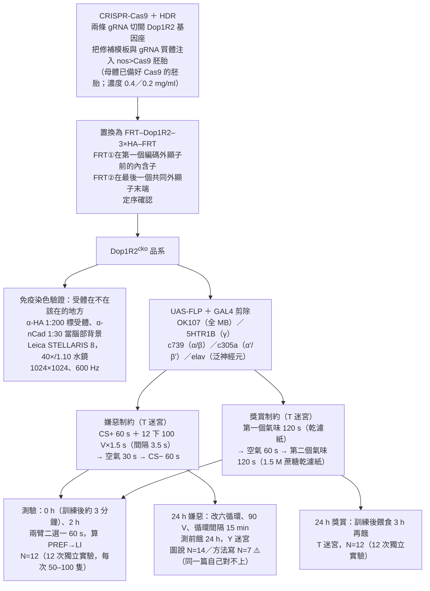
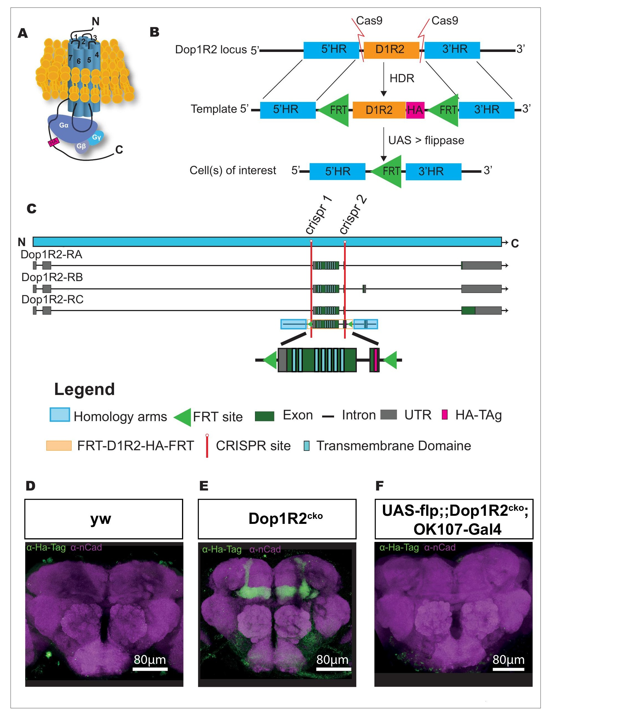
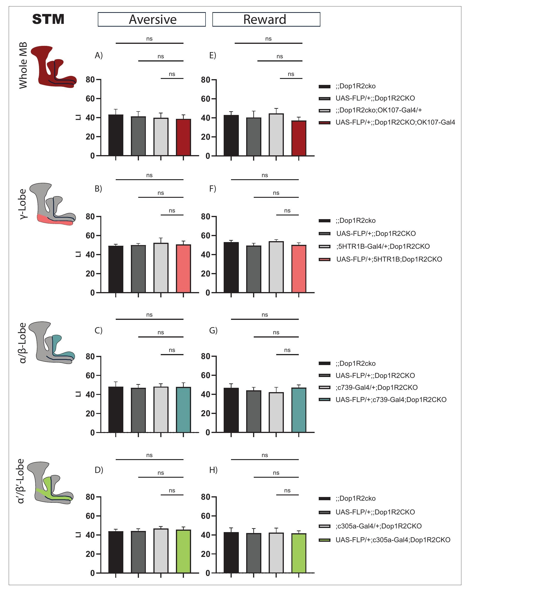
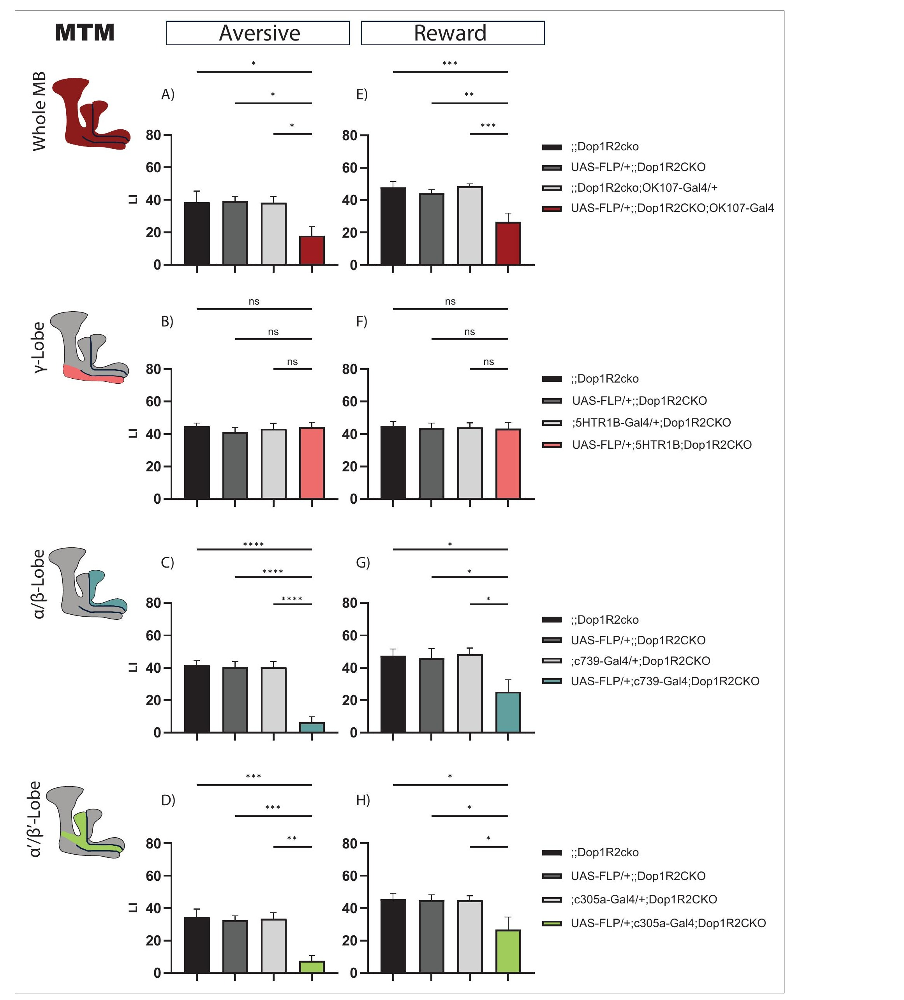
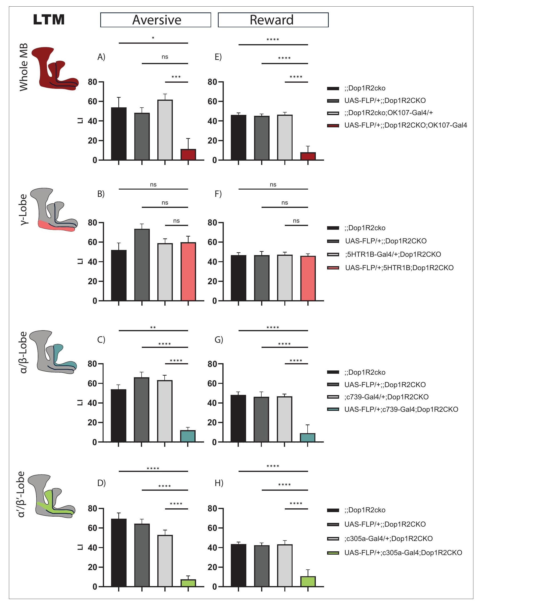

<!-- 本機 PDF：papers/2025-A%20temporally%20restricted%20function%20of%20the%20dopamine%20receptor%20Dop1R2%20during%20memory%20formation.pdf -->

# A temporally restricted function of the dopamine receptor Dop1R2 during memory formation

**多巴胺受體 Dop1R2 在記憶形成期間有一段受時間限制的功能**

| 項目 | 內容 |
|---|---|
| **出處** | eLife 13:RP99368 (2025；PDF 頁尾自引寫 2024). doi: 10.7554/eLife.99368 [全文（PMC 免費閱讀）](https://pmc.ncbi.nlm.nih.gov/articles/PMC12240586/) |
| 日期 | 送審 2024-05-20；預印本 2024-06-02；審查後預印本 2024-07-30；審查後預印本修訂 2025-06-20；正式版（Version of Record）2025-07-09。PDF 頁尾的自引寫「eLife 2024;13:RP99368」，與正式版年份 2025 不同（eLife 的新制：卷號與編號在預印本階段就固定） |
| 通訊作者 | Simon G Sprecher（simon.sprecher@unifr.ch）。PDF 只有英文名 |
| 作者 | 共 6 人：Jenifer C Kaldun†、Emanuele Calia†、Ganesh Chinmai Bangalore Mukunda†、Cornelia Fritsch、Nikita Komarov、Simon G Sprecher。†為三位共同第一作者。與本庫有關的作者：無 |
| 機構 | 全員同一單位：Department of Biology, University of Fribourg, Fribourg, Switzerland |
| 資料庫 | 資料存放於 Zenodo：https://doi.org/10.5281/zenodo.15772120 （Kaldun et al. 2025）。本庫未下載查核 |
| 補充資料 | 圖補充共 5 份：Figure 1—figure supplement 1（蕈狀體神經元的 Dop1R2 與各 G 蛋白單細胞轉錄組）、Figure 2—figure supplement 1（感覺測試 A–K）、Figure 4—figure supplement 1（泛神經元剔除後單次電擊的 6 小時與 24 小時記憶）、Figure 4—figure supplement 2（γ 葉發育，FasII 染色）、Figure 4—figure supplement 3（Gal80ts 限時剔除）。**這 5 份補充圖與 MDAR 檢核表都不在本機 PDF 內，本庫未取得**；PDF 內只有 Table 1（引子與 gRNA 序列）。凡只在補充圖裡的結果，本頁一律標 ？待查 |
| 編輯／審查 | 審查編輯 Mani Ramaswami（Trinity College Dublin, Dublin, Ireland）。三位審查人的公開評論與作者回覆各有獨立 DOI（10.7554/eLife.99368.3.sa1–sa4），審查人姓名未印在 PDF 上。首頁有 eLife 評語（eLife Assessment）：發現「important（重要）」、證據「convincing（有說服力）」 |

> 與本庫有關的作者：無。本篇引用了本庫已收錄的 Handler 2019（KC 上兩種多巴胺受體的時序分工）、Ichinose 2015（PAM-α1／MBON-α1 迴圈與獎賞長期記憶）、Aso 2014a/b（蕈狀體的解剖與 MBON 的價值編碼）、Li 2020 與 Takemura 2017（蕈狀體連結體）、Tully 1994（六循環間隔訓練）。
>
> **本篇為 Creative Commons Attribution（CC BY）開放取用**（PDF 第 1 頁版權欄：distributed under the terms of the Creative Commons Attribution License, which permits unrestricted use and redistribution provided that the original author and source are credited），圖片可在標明出處的條件下自由使用與散布。本庫仍依規定只給全文連結、不放 PDF；每張圖下方標明出處與授權。

---

## 為什麼重要

> 本節假設讀者已略知果蠅嗅覺學習的輪廓。**完全不熟的讀者可以先看「科普文」一節**；術語另見「專業文」開頭的「本頁用語」表。

本庫先前談多巴胺受體時，手上只有兩種工具。一是**全身突變**（整隻果蠅都沒有這個受體，Cohn 2015、Handler 2019），二是**RNA 干擾**（只在選定的細胞降低表現量，但降不到零，也驗證不了降了多少，Cohn 2015、Ichinose 2015）。[[e-dopamine-receptor]] 的「已知的問題」把這件事寫得很清楚：突變是全身性的，不能把需求定位到某一群細胞；RNA 干擾則不知道減了多少。本篇做的是第三種：用 CRISPR-Cas9 把 Dop1R2 的編碼區兩側插進兩個 FRT 位點，再用 GAL4 驅動的翻轉酶（flippase）把中間那段**切掉**。想在哪一群神經元拿掉受體，就在那一群神經元表現翻轉酶。這是本庫第一篇有「細胞類別專一、而且是真正剔除」的多巴胺受體資料。

第二，它把本庫兩條平行的線接在一起。

一條是**受體的分工**。Handler 2019 量的是 γ4／γ5 區室——區室是葉上再切出來的一小格，比葉小一級（γ 葉分成 γ1–γ5 五格）。那篇的結論是：DopR1 走 cAMP 這條路、推動突觸變弱，DopR2 走內質網放鈣這條路、推動突觸變強。兩條路讀的東西不同：cAMP 只要氣味與多巴胺幾乎同時發生就會產生，分不出誰先誰後；放鈣只在多巴胺先到、氣味後到時才啟動。所以 DopR1 那條路報的是「兩件事是不是同時」，DopR2 那條路報的是「兩件事的先後順序」。

另一條是**葉的分工**。葉是蕈狀體裡由 Kenyon 細胞的軸突成束構成的分支，分成 α/β、α′/β′、γ 三種。前人（Blum 2009、Trannoy 2011、Heisenberg 2000）把 γ 葉和記憶的取得綁在一起，把 α/β 葉和長期記憶綁在一起。

本篇的結論同時落在這兩條線上：它用同一組實驗既指定了時間，也指定了葉。拿掉 Dop1R2 之後，**訓練完就測的記憶一點事都沒有，2 小時與 24 小時的記憶才垮**；而且垮的是 α/β 葉與 α′/β′ 葉，γ 葉拿掉完全沒影響。嫌惡（電擊）與獎賞（糖）兩種訓練都是這個樣子。

第三，名稱。同一個受體在不同論文有不同寫法，不先對清楚，兩篇的結果就接不起來。

| 本篇的寫法 | 本篇寫的別名 | 本篇引的文獻 | 其他寫法 |
|---|---|---|---|
| **Dop1R2**（本篇主角） | Damb | Feng et al. 1996、Han et al. 1996 | 本庫的 [[s-handler-2019-dopamine-receptor-timing]] 寫 **DopR2**，用 anti-DAMB 抗體，引同一組文獻外加 Himmelreich et al. 2017 |
| **Dop1R1** | Dumb | Kim et al. 2003 | Kim et al. 2003 的標題把它稱作 **dDA1／DmDOP1** |

兩篇的 Dop1R2 與 DopR2 應指同一個受體（※ 推論，依據是別名與被引文獻完全重疊；兩篇都沒有並列對方的寫法）。表的第二列則可以回答 [[e-dopamine-receptor]] 上「dDA1 是否即 DopR1」的 ？待查（本頁只提出證據，是否改寫該頁由維護者決定）。

（本頁的兩個標記：像 [[e-dopamine-receptor]] 這樣的雙中括號是指向本庫另一頁的內部連結；「？待查」是本庫用來標「值得查證、但目前沒有來源可以回答」的記號，標了就先不填答案。）

**本篇的弱點也要先說**：四張主圖量的全是行為分數——把一群果蠅放進迷宮，數牠們各往哪一邊走，換算成一個學習指數（算法見「本頁用語」表，科普文一節也會說明怎麼讀）。這種讀數只看得出記憶在哪個時間點垮掉，看不出受體在細胞裡做了什麼，而本篇沒有任何生理、成像或分子讀數可以補上。此外，受體剔除的驗證只有全蕈狀體那一組有染色，三個分葉品系沒有；而說明工具是否干擾正常功能的那些對照，全在未取得的補充圖裡。

---

## 論文摘要（原文與中譯）

> Dopamine is a crucial neuromodulator involved in many brain processes, including learning and the formation of memories. Dopamine acts through multiple receptors and controls an intricate signaling network to regulate different tasks. While the diverse functions of dopamine are intensely studied, the interplay and role of the distinct dopamine receptors to regulate different processes is less well understood. An interesting candidate is the dopamine receptor Dop1R2 (also known as Damb), as it could connect to different downstream pathways. Dop1R2 is reported to be involved in forgetting and memory maintenance; however, the circuits requiring the receptors are unknown. To study Dop1R2 and its role in specific spatial and temporal contexts, we generated a conditional knockout line using the CRISPR-Cas9 technique. Two FRT sites were inserted, allowing flippase-mediated excision of the dopamine receptor in neurons of interest. To study the function of Dop1R2, we knocked it out conditionally in the mushroom body of *Drosophila melanogaster*, a well-studied brain region for memory formation. We show that Dop1R2 is required for later memory forms but not for short-term aversive or appetitive memories. Moreover, Dop1R2 is specifically required in the α/β-lobe and the α'/β'-lobe but not in the γ-lobe of the mushroom body. Our findings show a spatially and temporally restricted role of Dop1R2 in the process of memory formation, highlighting the differential requirement of receptors during distinct phases of learning.

（*eLife* 的摘要不分 Background／Results／Conclusion 段，照原樣一段。）

**中譯**（本節為忠實翻譯，非自撰內容）：

> 多巴胺是一種關鍵的神經調節物質，參與許多腦內歷程，包括學習與記憶的形成。多巴胺透過多種受體作用，並控制一個複雜的訊號網路來調控不同的工作。儘管多巴胺的各種功能已被密集研究，不同的多巴胺受體彼此如何互動、各自在調控不同歷程中扮演什麼角色，仍較不清楚。多巴胺受體 Dop1R2（又稱 Damb）是一個值得注意的候選者，因為它可以連上不同的下游路徑。Dop1R2 據報告與遺忘及記憶維持有關；然而，需要這些受體的迴路為何，並不清楚。為了研究 Dop1R2 在特定空間與時間脈絡下的角色，我們用 CRISPR-Cas9 技術製作了一個條件式剔除品系。我們插入兩個 FRT 位點，使翻轉酶（flippase）得以在感興趣的神經元中切除這個多巴胺受體。為研究 Dop1R2 的功能，我們在*黑腹果蠅*的蕈狀體——一個記憶形成的充分研究腦區——中條件式地剔除它。我們顯示，Dop1R2 為較晚期的記憶形式所必需，但短期的嫌惡或獎賞記憶不需要它。此外，Dop1R2 專一地在蕈狀體的 α/β 葉與 α′/β′ 葉被需要，而在 γ 葉則否。我們的發現顯示 Dop1R2 在記憶形成歷程中有一個受空間與時間限制的角色，凸顯了不同受體在學習的不同階段有不同的需求。

---

## 科普文

想像一間辦公室處理一件剛發生的事：先有人用便條紙記下來，過一兩個小時，如果這件事還重要，就要有人把它謄進檔案櫃，隔天才查得到。便條紙和檔案櫃是兩套不同的設備，壞掉任何一套，症狀出現的時間都不一樣：便條紙壞了，當場就記不住；檔案櫃壞了，當場沒事，幾小時後才發現東西不見了。這篇論文做的，就是去拆掉果蠅腦裡的一個零件，然後看症狀什麼時候出現、出現在哪個部門。

**先交代果蠅怎麼學。** 果蠅聞到氣味時，蕈狀體（mushroom body）裡一小群 Kenyon 細胞（KC）會活動，哪一群活動就代表哪個氣味。KC 把訊號送給蕈狀體輸出神經元（MBON），MBON 的活動推動果蠅靠近或走開。第三種角色是多巴胺神經元（DAN），它送來「這是好事還是壞事」。氣味和電擊一起出現時，多巴胺會改寫被活化的那群 KC 和 MBON 之間的連接點（突觸），下次再聞到這個氣味，果蠅就躲開。

多巴胺要起作用，得先被 KC 表面的**受體**接住。果蠅有四種多巴胺受體，本篇的主角叫 **Dop1R2**（舊名 Damb，本庫的 [[s-handler-2019-dopamine-receptor-timing]] 寫作 DopR2，是同一個）。另一個主角是 **Dop1R1**（舊名 Dumb、dDA1），前人已經確定它是當場學會所必需的。Dop1R2 的角色一直很亂：有一篇說拿掉它會讓果蠅忘得比較慢（也就是它幫忙遺忘），另一篇用 RNA 干擾說它是維持記憶所必需。兩篇用的測驗不同、方法不同，所以說不清楚。

**KC 不只一種。** KC 的軸突（送訊號的那條長線）成束排成幾條「葉」：α/β 葉、α′/β′ 葉、γ 葉。它們的工作時程不一樣——前人認為 γ 葉管當場學會，α/β 葉管隔天還記得。所以要問清楚 Dop1R2 的角色，得同時回答「哪條葉」和「哪個時間點」。

**難題：以前的工具問不出這兩件事。** 把整隻果蠅的 Dop1R2 弄壞，答案會被腦的其他部位污染；用 RNA 干擾只減少受體的量，減了多少沒人知道，而且昆蟲的 RNA 干擾常常只減一半。作者的解法是**條件式剔除**。第一步是改造 Dop1R2 這個基因。基因的編碼區被切成好幾段（外顯子），其中有兩段是這個基因的三種版本共用的，受體的主體（全部七個跨膜段）就由這兩段做出來。作者用 CRISPR-Cas9 這組基因剪刀，在這兩段的頭尾各插一個叫 FRT 的「剪刀標記」。第二步是在想拆掉受體的那群神經元裡，表現一種叫翻轉酶的酵素；它認得 FRT，就把兩個標記之間的整段剪掉。沒有表現翻轉酶的細胞，受體完好。作者同時把一小段叫 HA 的標籤接在受體上，用抗體染色就看得到受體在哪裡：果然整個蕈狀體都亮；用蕈狀體的驅動品系剪掉之後，訊號消失。

**每張圖的對照組是什麼。** 每一格都有三組對照果蠅。三組都帶同一個改造過的 Dop1R2 基因（兩側插了 FRT 的那一版），差別在各自少了把它剪掉所需的零件：一組兩樣零件都沒有，一組有翻轉酶的基因、但沒有啟動它的開關（驅動品系），一組有開關、但沒有翻轉酶的基因。三組因此受體都完好，可以當成「受體沒被剪掉」的比較基準。

**結果一：當場測，什麼事都沒有。** 不論是電擊訓練還是糖訓練，不論把 Dop1R2 從整個蕈狀體、γ 葉、α/β 葉還是 α′/β′ 葉拿掉，訓練完立刻測，分數都和上述三組對照一樣（四種情況、兩種訓練，共八張圖全部不顯著）。

**結果二：等 2 小時再測，分數垮了——但只在兩條葉。** 先說分數怎麼讀：這裡的分數是學習指數，刻度從 −100 到 +100，0 代表果蠅對兩種氣味完全沒有偏好、也就是什麼都沒學到，數字越大代表學得越好。整個蕈狀體剔除後，電擊記憶的分數從約 39 掉到約 18（前一個數字是三組對照的平均，後一個是剔除組，以下同）；只在 α/β 葉剔除掉得更兇，從約 41 掉到約 6；α′/β′ 葉從約 34 掉到約 7。γ 葉剔除完全沒事。糖訓練的方向一樣，但掉得比較輕：三種剔除範圍的對照平均約 45–47，剔除組約 25–27，也就是只剩下對照的五到六成（這個比例是本庫用「剔除組 ÷ 三組對照的平均」算出來的，論文沒有報告）。

**結果三：等 24 小時再測，一樣垮，兩種訓練都掉到只剩對照平均的一到二成。** γ 葉依然沒事。

**作者還補了兩個對照。** 一是擔心從發育期就沒有受體會把腦弄壞：他們改用一個會隨溫度開關的版本——低溫時有一個抑制蛋白壓住驅動開關，翻轉酶做不出來；等果蠅羽化（從蛹裡爬出來）之後把溫度調高，抑制解除，這時才開始剪（這個工具叫 Gal80ts，見「本頁用語」表）。結果一樣——當場正常、24 小時垮掉。二是前人報告過，Dop1R2 壞掉的突變果蠅在「只電一次」的訓練後**記得更久**，和本篇的方向相反；作者把受體從全腦的神經元拿掉再測一次，沒有看到記得更久。要注意，這兩個對照的圖都在本庫沒有取得的補充資料裡，本頁只能轉述作者的說法。

**代價與需要小心的地方。** 第一，整篇只有行為分數，沒有量過任何一顆神經元的活動，也沒有量剔除後受體少了多少；三個分葉的驅動品系，剪除效率一次都沒有用染色驗證過，只有全蕈狀體那一組驗證過。第二，24 小時的電擊記憶改用另一台裝置（Y 形迷宮），分數的算法也和前兩個時間點不同：0 與 2 小時用 T 迷宮，一次實驗做兩回互換制約（兩種氣味輪流當被電的那一個），分數取兩回的平均；24 小時的電擊記憶用 Y 形迷宮，只做一回，公式直接數走向兩種氣味的果蠅差多少（兩個公式見「本頁用語」表）。而且測驗前讓果蠅餓了 24 小時好讓牠肯爬，所以 24 小時的對照分數（約 48–74）反而比 2 小時（約 32–45）還高。**這不表示記憶隨時間變強，只表示兩個時間點的數字不能並排著看。** 第三，24 小時電擊、整個蕈狀體那一張圖裡，剔除組與三組對照中的一組**沒有顯著差異**（對另外兩組是顯著的），正文沒有提這件事。這不表示整篇結論站不住：α/β 葉與 α′/β′ 葉的結論各有自己的圖，不靠這一格。它表示的是，「全蕈狀體、24 小時、電擊」這一格只勝過三組對照中的兩組，證據比正文的寫法弱一些。

**最容易被誤讀的一點：這篇沒有說 Dop1R2 在 α/β 葉「做了什麼」。** 它說的是「少了它，兩小時以後的分數掉下來」。至於受體被接住之後細胞裡發生什麼、突觸怎麼變、為什麼是 2 小時而不是 20 分鐘，本篇沒有量，全部是討論裡引用別人的推測。同樣地，「γ 葉不需要它」只對這兩種訓練、三個時間點共六格測驗成立；作者自己也寫，Dop1R2 確實表現在 γ 葉，可能用在別的行為上。本庫的 Handler 2019 正是在 γ 葉的 γ4／γ5 區室裡量到 DopR2 的作用，兩者並不衝突：Handler 2019 量的是單一突觸在一次配對後幾秒之內的強弱變化，本篇量的是整群果蠅在 0、2、24 小時的行為分數。同一條葉上的同一個受體，可以在秒的尺度有作用，而在本篇這種小時尺度的行為測驗裡看不出需求。

---

## 專業文

### 本頁用語

本頁各節可單獨查閱，故把反覆出現的詞集中在這裡。

| 詞 | 意思 |
|---|---|
| 蕈狀體（mushroom body, MB） | 果蠅腦中負責嗅覺學習與記憶的結構，左右各一。見 [[e-mushroom-body]] |
| KC（Kenyon cell） | 蕈狀體的主要神經元。每個氣味活化一小群 KC。見 [[e-kenyon-cell]] |
| 葉（lobe） | KC 的軸突成束，分成 α/β、α′/β′、γ 三大類；一類 KC 的軸突走哪幾條葉，就叫哪一類 KC。本篇的空間解析度到「葉」為止，沒有到區室 |
| 區室（compartment） | 每條葉沿長度再分成一格一格（γ1、α3 等），每格由一型 DAN 支配、一型 MBON 讀取。見 [[c-mb-compartment]]。**本篇沒有做區室層級的操作** |
| MBON、DAN | 蕈狀體輸出神經元（讀出 KC 的訊號、推動靠近或走開）與多巴胺神經元（送來好壞訊號）。見 [[e-mbon]]、[[e-dopaminergic-neuron]] |
| Dop1R2（Damb） | 本篇的主角受體。本庫 Handler 2019 寫作 **DopR2**，並用 anti-DAMB 抗體；兩者應為同一受體（※ 推論：別名與被引文獻 Feng 1996、Han 1996 重疊）。見 [[e-dopamine-receptor]] |
| Dop1R1（Dumb） | 另一型第 1 類多巴胺受體，本庫寫作 **DopR1**。本篇引 Kim et al. 2003 作為它的來源文獻，而該篇稱之為 dDA1／DmDOP1 |
| 第 1 類／第 2 類受體 | 第 1 類經 Gαs 提高 cAMP 與 PKA 活性；第 2 類經 Gαi/o 壓低 cAMP。Dop1R1、Dop1R2、DopEcR 是第 1 類，Dop2R 是第 2 類 |
| G 蛋白（Gαs、Gαq、Gαo） | 受體與細胞內酵素之間的傳話蛋白。Gαs 走 cAMP，Gαq 走磷脂酶 C 與鈣，Gαo 是另一型。**Dop1R2 兩條都能接**（Gαs 與 Gαq）。多數受體只接一條，接兩條表示同一個受體可能在同一顆細胞裡做兩件不同的事；這既讓它的角色不容易從單一實驗判定，也可能解釋為什麼前人對它的結論互相矛盾。這是本篇認為它值得研究的理由 |
| cAMP、PKA | 細胞內的訊號分子與它打開的酵素，學習的經典路徑。見 [[c-camp-signaling]] |
| Raf／MAPK、RAC | 兩條被引用的下游路徑：前者（Sun 2020）被認為用來穩定獎賞長期記憶，後者（Shuai 2010、Cervantes-Sandoval 2016）被認為執行主動遺忘。**兩條都只出現在本篇的討論引用，本篇自己沒有量過它們** |
| CRISPR-Cas9、HDR | 基因剪刀與「以模板修補斷口」的修復方式（homology-directed repair）。本篇用它把原本的基因段換成帶 FRT 與 HA 標籤的版本 |
| FRT、翻轉酶（FLP） | 一對「剪刀標記」與認得它的酵素。兩個 FRT 之間的 DNA 會被切掉且不可逆。本篇用 UAS-FLP，由 GAL4 決定在哪些細胞剪 |
| 條件式剔除（conditional knockout, cko） | 只在選定細胞把基因剪掉。與 RNAi（只降低表現量）和全身突變（整隻果蠅都沒有）是三種不同強度的操作 |
| HA 標籤 | 接在蛋白質上的一小段序列，可用抗體染色顯示它在哪裡。本篇把 3×HA 接在受體的 C 端 |
| 驅動品系（GAL4） | 決定外加基因在哪些細胞表現。本篇在蕈狀體用四個：**OK107**（全蕈狀體）、**5HTR1B**（γ 葉）、**c739**（α/β 葉，見 [[e-c739-gal4]]）、**c305a**（α′/β′ 葉）；另有 **elav**（泛神經元），只用於補充實驗。見 [[e-split-gal4]] |
| 親代對照（parental controls） | 每張圖的前三根柱子。**三組都帶著同一個改造過的 Dop1R2cko 等位基因**，差別只在少了把它剪掉所需的零件：第一根 `;;Dop1R2cko`（既無 UAS-FLP 也無 GAL4）、第二根 `UAS-FLP/+;;Dop1R2CKO`（有 UAS-FLP，無 GAL4）、第三根 `;GAL4/+;Dop1R2CKO`（有 GAL4，無 UAS-FLP）。第四根三者俱全，才是剪除組。三個零件缺一不可：UAS-FLP 要有 GAL4 才會表現翻轉酶，翻轉酶要有 FRT 標記的基因才有東西可剪，所以前三組的受體都完好 |
| N（生物重複） | **一個 N ＝ 一次獨立實驗算出的一個 LI**，每次實驗用 50–100 隻果蠅。論文方法明寫 "the biological replicate is N=12"；24 小時嫌惡記憶那一套寫 "N=7"。所以「N=12」是十二次獨立實驗，不是十二隻果蠅 |
| 殘存比例 | 剪除組的 LI ÷ 三組親代對照 LI 的算術平均。**本庫自行計算，論文沒有報告這個量**。數值越低代表剪除造成的損失越大 |
| 剔除／剪除 | 同一件事（flip-out 的中譯）。本頁正文多用「剔除」，圖說中譯用「剪除」 |
| 圖上的比較線 | 每張圖的三條比較線都是「某一組親代對照 vs 剪除組」。圖上**沒有**畫三組對照彼此之間的比較 |
| 陰性結果 | 沒有測出差異的結果。不等於「證明沒有差異」 |
| Gal80ts | 溫度開關：低溫時抑制 GAL4，高溫時失效。GAL4 不動作就不會表現翻轉酶，剪除因此被推遲到移入高溫之後。本篇用它把剪除限制在羽化之後，排除發育期就缺受體造成的腦部缺陷 |
| FasII | 一種抗體染色，用來看蕈狀體的大致形狀有沒有長壞 |
| STM、MTM、LTM | 本篇圖上的三個標籤：訓練後立刻測（short-term memory）、2 小時（圖 3 標 MTM，正文與圖說都寫「2 hr memory」）、24 小時（long-term memory）。**本篇的「LTM」是以時間點定義的，沒有做蛋白質合成抑制劑的檢驗** |
| PREF、LI | PREF（偏好指數）＝(一臂隻數 − 另一臂隻數) × 100 ÷ 總數；**論文只寫 N臂1 − N臂2，沒有指明哪一臂當被減數**。T 迷宮的 **LI（學習指數）＝兩次互換氣味制約的 PREF 平均**：同一組實驗做兩次，第二次把哪個氣味配電擊（或配糖）對調，兩次的 PREF 相加除以二。因為是互換設計，與氣味本身的天生好惡會互相抵消，留下的只有學習造成的偏移，所以 **LI 為正代表學到了**（避開配過電擊的氣味、趨向配過糖的氣味），**LI＝0 代表完全沒有偏好、也就是沒學到**（※ 推論，依據是互換設計）。Y 迷宮的 LI ＝ (未受訓氣味的隻數 − 受訓氣味的隻數) × 100 ÷ 總數。兩者都是 −100 到 +100 的刻度，方向也都是越正越好，但算法不同：T 迷宮是兩次互換的平均，Y 迷宮是單次計數，所以兩台裝置的數值不宜直接相比，只能各自與自己的對照組比。見 [[c-performance-index]] |
| T 迷宮、Y 迷宮 | 兩台行為裝置。本篇的 T 迷宮依 Tully & Quinn 的設計改成四組並行（見 [[e-t-maze]]）；24 小時的嫌惡記憶改用 Mohandasan et al. 2022 的「陷阱式」3D 列印 Y 迷宮，果蠅要往上爬到岔路口再選邊 |
| CS+、CS− | 配了電擊或糖的氣味，與同樣聞到卻沒配的對照氣味 |
| MB-MP1、MVP2 | 討論中反覆出現的兩型細胞的舊名：MB-MP1 即 PPL1-γ1pedc（見 [[e-ppl1-gamma1pedc]]），MVP2 即 MBON-γ1pedc>α/β（見 [[e-mbon-gamma1pedc]]）。兩者形成回饋迴路，見 [[t-mbon-dan-feedback]] |
| 統計記號 | `*` P<0.05、`**` P<0.005、`***` P<0.001、`****` P<0.0001、ns 不顯著。常態分布用單因子變異數分析＋Tukey HSD，非常態用 Kruskal-Wallis＋Dunn 多重比較 |
| ※ 推論 | 論文沒有明說、本頁自行推得的內容，並寫出依據 |
| ？待查 | 值得查證但本頁刻意不填的內容 |
| ※ 從圖判讀 | 本頁從圖上讀出的數值。本篇四張主圖的柱高，判讀誤差約 ±2 個 LI 單位 |

### 一、概述

**主要問題。** 多巴胺受體 Dop1R2 在記憶形成中做什麼？具體拆成兩問：需要它的是哪一群神經元（空間），以及記憶的哪一個階段（時間）。

**重要性。** 前人對 Dop1R2 的兩份結論彼此不合：Berry et al. 2012 用突變株說它參與**遺忘**（拿掉它記得更久），Sun et al. 2020 用 RNA 干擾說它是**記憶維持**所必需（拿掉它記得更差）。兩篇用的增強物不同（電擊 vs 糖）、方法也不同。本篇主張，要解開這個結，必須有一個能「只在某群細胞、只在某段時間」拿掉受體的工具。這裡的「某段時間」有兩種意思，本篇都用到：主結論指的是**記憶的階段**（剛學完、2 小時、24 小時），而 Gal80ts 那一組實驗控制的是**果蠅生命的階段**（在發育期保留受體，羽化之後才剪掉）。

**發表當時的領域現狀（2024 送審、2025 正式版）。**

- **受體分工：** Dop1R1 被確立為學習與短期記憶所必需（Kim et al. 2007；Qin et al. 2012）。Dop1R2 能同時接 Gαs（cAMP）與 Gαq（鈣）兩條路（Han et al. 1996；Himmelreich et al. 2017；Sun et al. 2020），所以它可能以複雜的方式參與。本庫的 Handler et al. 2019 在突觸層把兩者分開：DopR1 走 cAMP、偵測氣味與多巴胺訊號「同時」到達，DopR2 走內質網放鈣、偵測兩者到達的「順序」（氣味先、多巴胺後，或相反）。
- **葉的分工：** γ 葉被指派給記憶的取得（Blum et al. 2009；Trannoy et al. 2011；Heisenberg et al. 2000）；α/β 葉與其輸出和長期記憶有關（Akalal et al. 2011；Huang et al. 2012；Krashes & Waddell 2008；Ichinose et al. 2015 等）；α′/β′ 葉被認為負責長期記憶的鞏固（Cervantes-Sandoval et al. 2013；Krashes & Waddell 2008）；兩者也都被報告參與中期記憶（Bouzaiane et al. 2015；Scheunemann et al. 2012；Shyu et al. 2019；Turrel et al. 2022）。
- **表現位置：** Dop1R2 主要表現在蕈狀體（Crocker et al. 2016；Croset et al. 2018；Han et al. 1996；Kim et al. 2007；Lark et al. 2017）；單細胞轉錄組顯示它在神經系統其他地方是零星的——在腹神經索（蟲體的「脊髓」）所測到的細胞裡，有 7.99% 驗出 Dop1R2 的轉錄本；在蕈狀體以外的細胞裡，這個比例是 13.8%（Allen et al. 2020；Davie et al. 2018）。兩個數字都是「該群細胞中驗出該基因的細胞佔比」。？待查：本篇沒有列出蕈狀體本身的對應百分比，所以「零星」是與蕈狀體相比的定性說法，讀者無法從這兩個數字自行驗算。
- **工具的限制：** 昆蟲的 RNA 干擾效率常不足，往往只造成部分（hypomorph）表型（Joga et al. 2016）。這是本篇選擇做條件式剔除的理由。

本篇自陳的新意只有一項：一條可用於任意細胞類別的 Dop1R2 條件式剔除品系，以及用它得到的時空特異性結論。

### 二、方法

**基因操作。** 兩個 FRT 的位置是本篇設計的關鍵：第一個放在第一個編碼外顯子**之前**的內含子裡，而那個外顯子含有全部七個跨膜結構域；第二個放在「最後一個共同外顯子」的末端。Dop1R2 有三個轉錄本（RA、RB、RC），彼此的差別在 C 端，所以把兩個共同編碼外顯子一起切掉，三個轉錄本都報銷（圖 1C）。HA 標籤（3×HA）接在 C 端。作者自己在正文寫明：第五與第六跨膜結構域之間的第三個細胞內環，以及 C 端尾巴，是 G 蛋白結合所需——**換句話說，標籤就插在功能區附近**；作者說選 HA 是為了把干擾降到最低，實際的驗證（Dop1R2cko 品系的感覺反應與記憶是否與對照相同）在未取得的補充圖裡（Figure 2—figure supplement 1A–G）。

**免疫染色。** 用抗 HA 抗體把帶標籤的受體染出來，同時用抗 nCad（N-cadherin，神經細胞之間的黏著分子）染出腦的輪廓。nCad 的作用是當背景地圖：它標出神經纖維密集的區域，讓人看得出紅色訊號落在蕈狀體還是別處。至於放大倍率、影像尺寸與掃描速度等儀器參數，是為了讓別人能重複同一張影像而照錄，與本篇的結論無關。

**品系。** UAS-FLP 用 BL 55807（20×UAS-FLPG5.PEST）；OK107-GAL4 來自京都（DGGR_106098）；5HTR1B-GAL4（BL 27636）與 c305a-GAL4（BL 30829）來自 Bloomington；c739-GAL4 由 H Tanimoto 贈送。對照品系為 y w（BL 1495）。**遺傳背景的處理值得記下來**：UAS-flp;;Dop1R2cko 與 GAL4;Dop1R2cko 都回交 ;;Dopcko，得到的對照**對 UAS 與 GAL4 是異型合子（只有一份），對 Dop1R2cko 則不是異型合子**。白話說：四組果蠅身上帶的 Dop1R2cko 等位基因完全一樣，差別只在剪除所需的另外兩個零件（UAS-FLP 與 GAL4）各缺哪一個。這樣一來，四組的遺傳背景一致，行為上的差異就不能推給品系之間的血統不同。

**行為參數（嫌惡）。** 50–100 隻混性別果蠅一組，銅網管內 12 下 100 V、每下 1.5 秒、間隔 3.5 秒（1.5＋3.5＝5 秒 × 12＝60 秒，正好等於氣味時長，可驗算）。適應 90 秒 → 第一個氣味 60 秒＋電擊 → 新鮮空氣 30 秒 → 第二個氣味 60 秒。下一組果蠅把兩個氣味的順序對調。0 小時組在訓練結束後約 3 分鐘測，2 小時組先移到食物管、25 °C 保存。氣味為 3-辛醇（3-Oct）與 4-甲基環己醇（MCH），皆以石蠟油稀釋 1:100、260 µl、杯內徑 14 mm，氣流 7 l/min；訓練在暗紅光下、測驗在全黑中進行，23–25 °C、65–75% 相對濕度。

**行為參數（24 小時嫌惡）。** 改為六循環，每循環 60 秒第一個氣味＋12 下 **90 V**×1.5 秒（間隔 3.5 秒）→ 30 秒空氣 → 60 秒第二個氣味，循環之間隔 15 分鐘（間隔訓練，見 [[c-spaced-training]]）。測驗前餓 24 小時以提高爬行動機，並改用 Y 迷宮（Mohandasan et al. 2022），氣味管先氣味化 20 分鐘。**兩個協定的電壓不同（100 V 對 90 V），論文沒有說明原因。** 這一套的樣本數也對不上：方法寫 N=7，圖說寫 N=14。這是同一篇論文內部的不一致，不是兩份來源衝突，詳見結果 3.4。

**行為參數（獎賞）。** 訓練前餓 19–21 小時。適應 90 秒 → 第一個氣味 120 秒（管內是前一天泡水、晾乾的濾紙）→ 空氣 60 秒 → 第二個氣味 120 秒（管內是前一天泡 1.5 M 蔗糖、晾乾的濾紙）。一次實驗含兩次互換的制約。24 小時組訓練後先餵食 3 小時，再回到飢餓狀態。

**感覺對照。** 目的是排除一種假解釋：記憶分數變差，也可能只是果蠅聞不到氣味、感覺不到電擊、或不想吃糖。先確認改造後的品系在這三件事上與對照相同，記憶分數的差異才能歸因於記憶本身。測法如下：氣味偏好（氣味 vs 等量石蠟油，120 秒）、電擊迴避（100 V vs 無電擊，60 秒）、糖偏好（1.5 M 蔗糖濾紙 vs 清水濾紙，120 秒）。⚠️ 糖偏好一節寫「starved for 1–21 hr」，與獎賞制約的 19–21 小時不一致，**應為誤植**（※ 推論）。

**限時剔除。** Gal80ts 品系在 18 °C 養到羽化，之後移到 30 °C 五至七天，第五天訓練、隨即測驗。作者說這麼做的理由是受體的半衰期未知：基因被剪掉之後，細胞裡既有的受體蛋白還要一段時間才會降解完，而那段時間有多長沒有人量過，因此無法確定移到高溫後第幾天受體才真的消失。既然等待時間拿不準，作者就在同一批果蠅上同時測了嫌惡 STM 與 LTM，看哪一種記憶受影響。

**統計。** 以 Shapiro-Wilk 檢定常態性；常態者用單因子變異數分析＋Tukey HSD，非常態者用 Kruskal-Wallis＋Dunn；兩組比較用 t 檢定。方法另寫：也用單樣本 t 檢定或 Wilcoxon 符號等級檢定確認「各組是否顯著異於 0」。LI＝0 代表完全沒有偏好，所以這組檢定問的是「這一組果蠅到底有沒有學到東西」，與「兩組之間有沒有差別」是不同的問題——**但這組檢定的結果，四張主圖的圖說與正文都沒有報告**（本頁在全文 grep 過 zero／one-sample／Wilcoxon，只出現在方法這一處）。

**單細胞轉錄組。** 這部分不做新實驗，目的是用現成的公開資料回答一個背景問題：Dop1R2 到底在腦中的哪些細胞表現，是不是真的集中在蕈狀體。作法是取 Davie et al. 2018 的資料與註解，以 Seurat 5.2.1 重新分群（解析度 0.5，UMAP 取前 10 個主成分，LogNormalize），范恩圖以 BioVenn 繪製。結果只在 Figure 1—figure supplement 1，本庫未取得。

### 三、結果

#### 3.1 條件式剔除品系的建立與驗證（圖 1）

y w 是沒有帶 HA 標籤的對照品系。HA 抗體染色在 y w 對照腦中看不到集中在特定構造上的訊號，只有均勻的背景（圖 1D）；在 Dop1R2cko 腦中整個蕈狀體都亮（圖 1E）；用 OK107 剪除後訊號消失（圖 1F）。這同時證明三件事：標籤有效、受體表現在蕈狀體、剪除系統有作用。**但驗證只做了全蕈狀體這一組**：三個分葉驅動品系（5HTR1B、c739、c305a）沒有對應的染色；正文與四張主圖的圖說都沒有這種染色，而本庫未取得該論文的補充圖，所以不能排除染色其實放在補充圖裡。

#### 3.2 訓練後立刻測：八種條件全部不顯著（圖 2）

嫌惡與獎賞訓練、四種剔除範圍（全蕈狀體、γ、α/β、α′/β′），共八張圖、每張四組、每組 N=12。每張圖都畫三條比較線，每條線比的是「某一組親代對照 vs 剪除組」（見「本頁用語」），八張圖的三條線一律標 ns，也就是都沒有測出差異。剔除組的 LI 與三組對照的平均相比，殘存約 88–106%（※ 從圖判讀與本庫計算；殘存比例的定義見「本頁用語」）；106% 代表剔除組略高於對照均值，這個方向上的小幅高低落在組間的正常波動內。作者據此結論：短期記憶在任何一條葉都不需要 Dop1R2。⚠️ 這是陰性結果，論文沒有報告檢力分析，所以「測不出差異」與「真的沒有差異」在本篇無法分辨。

#### 3.3 2 小時記憶：α/β 與 α′/β′ 受損，γ 不受影響（圖 3）

| 剔除範圍 | 嫌惡：對照均值 → 剔除組（殘存比例） | 獎賞：對照均值 → 剔除組（殘存比例） |
|---|---|---|
| 全蕈狀體（OK107） | 38.7 → 18（47%） | 46.5 → 26.5（57%） |
| γ 葉（5HTR1B） | 42.8 → 44（103%，ns） | 44.0 → 43（98%，ns） |
| α/β 葉（c739） | 40.5 → 6（15%） | 47.3 → 25（53%） |
| α′/β′ 葉（c305a） | 33.5 → 7（21%） | 44.8 → 26.5（59%） |

> 柱高為 ※ 從圖 3 判讀（誤差約 ±2 個 LI 單位），對照均值為三組親代對照的算術平均，殘存比例為本庫計算。各組 N=12。嫌惡的 α′/β′ 那一格（圖 3D）因非常態改用 Kruskal-Wallis＋Dunn，其餘七格用 ANOVA＋Tukey。

作者的結論是「α/β 與 α′/β′ 需要、γ 不需要」，並指出獎賞的減損「不如嫌惡嚴重」。上表把這句定性的話換成數字：嫌惡剩 15–21%，獎賞剩 53–59%。論文沒有對「嫌惡的減損」與「獎賞的減損」做統計比較，所以 15% 與 53% 的差距只有定性描述，沒有檢定支持。

#### 3.4 24 小時記憶：兩種訓練都垮，仍限於 α/β 與 α′/β′（圖 4）

| 剔除範圍 | 嫌惡（Y 迷宮）：對照均值 → 剔除組（殘存比例） | 獎賞（T 迷宮）：對照均值 → 剔除組（殘存比例） |
|---|---|---|
| 全蕈狀體（OK107） | 54.5 → 11（20%）**其中一組對照為 ns，見下** | 45.7 → 8（18%） |
| γ 葉（5HTR1B） | 61.3 → 59.5（97%，ns） | 46.7 → 46（98%，ns） |
| α/β 葉（c739） | 61.0 → 12（20%） | 46.8 → 9（19%） |
| α′/β′ 葉（c305a） | 62.3 → 7.5（12%） | 42.8 → 10.5（25%） |

> 柱高為 ※ 從圖 4 判讀，殘存比例為本庫計算。左右兩欄用的是不同的行為裝置（嫌惡用 Y 迷宮、獎賞仍用 T 迷宮），所以每一欄只能各自與自己的對照比，兩欄的 LI 絕對值不能互比。
>
> N 的數字在同一篇裡對不上：圖 4 圖說寫獎賞實驗 N=12、嫌惡實驗 N=14，**方法的「長期嫌惡記憶」一節卻寫 "the biological replicate is N=7"**。一個 N 是一次獨立實驗算出的一個 LI（見「本頁用語」）。※ 推論的調和是：T 迷宮的一個 LI 由兩次互換實驗平均而來，所以「7 個 LI ＝ 14 次實驗」；但 24 小時嫌惡用的是 Y 迷宮，它的 LI 不需要兩次互換配對，這個調和不一定成立（⚠️ 保留為單篇自身不一致）。圖 4 的 A–C 用 Kruskal-Wallis＋Dunn，D–H 用 ANOVA＋Tukey。

#### 3.5 ⚠️ 圖 4A 的一組對照不顯著

圖 4A（嫌惡、24 小時、全蕈狀體）的三條比較線分別是 `*`、**ns**、`***`：剔除組（約 11）與第二組親代對照 UAS-FLP/+;;Dop1R2CKO（約 48）之間**沒有達到顯著**。正文只寫「Flipping out Dop1R2 in the whole MB causes reduced 24 hr memory performance (Figure 4A and E)」，沒有提這一格。本庫把該頁以 300 dpi 整頁渲染後放大，確認這個 ns 標記確實落在這兩組之間，而非誤讀鄰近的標記。其餘 15 格（圖 3 的八格，加上圖 4 除 4A 以外的七格）的三條比較線方向一致。

#### 3.6 排除發育缺陷與蕈狀體以外的貢獻（補充圖，本庫未取得）

作者報告三件事，三件的圖都在未取得的補充資料裡，本頁只能轉述：(1) FasII 染色顯示剔除 Dop1R2 的蕈狀體解剖構造沒有改變（Figure 4—figure supplement 2C）；(2) 用 Gal80ts 把剪除限制在羽化之後，嫌惡 STM 仍正常、嫌惡 LTM 仍顯著受損（Figure 4—figure supplement 3）；(3) 用 elav 泛神經元剪除後，單次電擊訓練的 6 小時與 24 小時記憶**沒有**比對照好（Figure 4—figure supplement 1）。第 (3) 項的「單次電擊訓練」是另一套訓練協定：整個訓練只給一次電擊，與本篇主結果用的 12 下電擊，以及六循環間隔訓練都不同。Berry et al. 2012 主張拿掉 Dop1R2 會讓果蠅記得更久，本篇在這套協定下沒有看到這種改善，所以兩者方向相反。以上三項本庫標 ？待查。

#### 3.7 本庫計算：分葉剔除比全蕈狀體剔除更嚴重

全蕈狀體的剪除範圍涵蓋三條葉，照理說損害不應小於任一條葉單獨剪除。資料卻相反，尤其在 2 小時嫌惡：全蕈狀體殘存 47%，α/β 只剩 15%、α′/β′ 只剩 21%。24 小時嫌惡也有同向的差距（全蕈狀體 20%、α′/β′ 12%）。論文沒有討論這一點。可能的解釋至少有三種，本篇都沒有資料可以分辨（※ 推論）：各驅動品系的剪除效率與時機不同（OK107 的剪除效率只在全蕈狀體那一組被看過，見 3.1）；不同批次、不同月份的對照水準不同（對照均值在 33.5 到 62.3 之間擺盪）；或者 γ 葉的 Dop1R2 在全蕈狀體剪除時也被拿掉，而它的作用方向相反。**最後一種是可檢驗的**：把 γ 與 α/β 的剪除做在同一隻果蠅上即可。

對照水準的擺盪不動搖各格自己的結論：同一格內的剔除組與對照是同一批、同時做的，所以格內的比較仍然有效；要小心的是跨格比較殘存比例，因為各格的分母來自不同批次。另外，檢定方式（ANOVA＋Tukey 或 Kruskal-Wallis＋Dunn）只影響某一格顯不顯著，不會改變殘存比例這個柱高比值的大小。
### 四、討論

**主張一：Dop1R2 為較晚期的記憶所需、短期記憶不需要。** 證據強。八張 STM 圖全部 ns。較晚期的格子是 2 小時八格加 24 小時八格，共十六格；其中 γ 葉的四格不顯著，其餘十二格顯著。嫌惡與獎賞兩種增強物的方向也一致。限制有二。第一，ns 不等於「不需要」。本篇沒有做檢力分析，無法排除「有作用但樣本不夠大」。本篇也沒有在圖上報告各組 LI 是否異於 0，所以無法判斷 ns 的那些組是「記得和對照一樣好」還是「大家都差不多記不得」。第二，「2 小時」與「24 小時」之間沒有中間的時間點，所以「從什麼時候開始需要」仍未知。

**主張二：需求限於 α/β 與 α′/β′，γ 不需要。** 證據中等。γ 葉的八格全部 ns。而且剔除組的柱高與對照幾乎重合（殘存 97–103%），不是「差一點沒達顯著」。但三個分葉品系的剪除效率都沒有驗證。**γ 的陰性結果最吃這個漏洞**：受體根本沒剪掉，也會得到 ns。作者自己留了伏筆：Dop1R2 確實表現在 γ 葉，可能用於別的行為。本庫的 [[s-handler-2019-dopamine-receptor-timing]] 正是在 γ 葉的 γ4／γ5 區室量到 DopR2 的作用。Handler 2019 量的是「逆向配對」後的突觸增強；逆向配對指多巴胺訊號先到、氣味後到，與一般「氣味先、多巴胺後」的順序相反。兩篇並不直接牴觸，因為兩件事都不同。第一是量的東西：本篇量行為分數，Handler 2019 量突觸電流。第二是測的行為：本篇測記憶保留，也就是訓練後隔一段時間還記得多少；Handler 2019 測記憶更新，也就是同一個氣味逐次改配順向或逆向時，果蠅的偏好能否跟著翻轉。不過這個張力值得記下來，見第六節。

**主張三：這解釋了 Berry 2012 與 Sun 2020 的分歧。** 證據弱。作者的推論是：Berry 看到的「記得更久」來自蕈狀體以外的 Dop1R2。所以他們做了泛神經元剪除，沒有看到改善，並寫下「highlighting its irrelevance in memory outside the MB（凸顯它在蕈狀體以外與記憶無關）」。**這句話比資料強**，理由有兩個。第一，單一協定（單次電擊、6 與 24 小時）的陰性結果，不能支持「無關」這種全稱句。第二，泛神經元剪除同時也拿掉了蕈狀體裡的受體；如果蕈狀體內外的效果方向相反，兩者會互相抵銷。另外，Berry 用的突變株同時影響了鄰近的另一個基因 GC1907。所以 Berry 看到的表型，不能完全歸給 Dop1R2。作者有提到這一點，但沒有進一步處理。

**主張四：Dop1R2 經 Gαq 調控 RAC 遺忘路徑、經 Raf/MAPK 穩定記憶，並參與 MB-MP1／MVP2 回饋迴路。** 這三條是作者並列提出的三種可能機制，不是一條有先後的串連。這一整段都是引用他人結果的綜述（Himmelreich 2017、Sun 2020、Musso 2015、Pavlowsky 2018、Plaçais 2017、Ueoka 2017），本篇沒有任何對應的實驗。唯一屬於本篇的新資料，是單細胞轉錄組的比對（Figure 1—figure supplement 1，本庫未取得）。背景是：Gαq 與 Gαo 是兩種 G 蛋白，也就是受體在細胞內接上、再把訊號往下傳的不同「接頭」。作者採用的敘事是 Dop1R2 經 Gαq 啟動鈣訊號，再連到 RAC 遺忘路徑。但作者自己重分析單細胞轉錄組後發現，Dop1R2 與 Gαo 出現在同一個細胞的頻率，高於與 Gαq。論文沒有給這個比較的數值。**這一點與作者採用的「Dop1R2–Gαq」敘事方向不一致。** 作者的處理是寫「難以判斷這個交互作用是否排他」，意思是無法斷定 Dop1R2 只接 Gαq，還是也能接別的 G 蛋白。本頁認為這是全篇最值得後續追的一條線，但現狀只是一個未量化的觀察。

**主張五：條件式剔除優於 RNAi。** 合理且有方法學價值（引 Joga et al. 2016 說昆蟲 RNAi 常只造成部分表型）。對本庫的直接意義見 [[e-dopamine-receptor]]。該頁原本把「突變是全身性的、RNAi 降多少不知道」列為引用時的陷阱；本篇提供了第三種工具。

### 五、問題與限制

**1. 整篇只有行為讀數。** 沒有電生理、沒有成像、沒有分子量測。受體被剪掉之後，突觸或細胞內訊號發生什麼事，本篇沒有資料。

**2. 分葉驅動品系的剪除效率未驗證。** 只有 OK107 這一組用 HA 染色看過。γ 葉的陰性結果最依賴這項驗證。

**3. 工具本身的對照在未取得的補充圖裡。** HA 標籤插在 C 端附近，而 C 端是受體接 G 蛋白所需的部位。所以 Dop1R2cko 品系的受體功能是否仍正常，只能靠 Figure 2—figure supplement 1 的感覺測試與記憶測試來判斷。這張補充圖本庫未取得（？待查）。

**4. 三個時間點用了兩台裝置、兩個 LI 公式、兩種電壓與不同的飢餓處理。** 24 小時嫌惡＝Y 迷宮、90 V、六循環間隔訓練、測前餓 24 小時。0 與 2 小時＝T 迷宮、100 V、單循環、不餓。所以對照組的 24 小時 LI（單根對照柱約 48–74）高於 2 小時（約 32–45），**不能讀成記憶變強**。三個時間點不是同一條保留曲線。作者沒有提醒這一點。

**5.「LTM」只由時間點定義。** 本篇沒有用標準檢驗確認記憶的種類。果蠅的穩定記憶至少有兩種成分。一種是需要新合成蛋白質的長期記憶。另一種是抗麻醉記憶（anesthesia-resistant memory）：果蠅經冷休克麻醉後仍留得下來，但不需要新合成蛋白質。冷休克用來擦掉尚未穩定的記憶；蛋白質合成抑制劑則用來分出這兩種穩定成分（見 [[c-memory-consolidation]]）。本篇兩者都沒有做。另外，獎賞用一次訓練（引 Krashes & Waddell 2008 說一次即足），嫌惡用六循環間隔訓練（引 Tully et al. 1994）。兩者的記憶成分本來就不同。

**6. 剔除是不可逆的，而且（除了 Gal80ts 那一組）從發育期就開始。** 作者用 Gal80ts 處理了這一點，但只做了全蕈狀體、只做了嫌惡的 STM 與 LTM。三條葉與獎賞都沒有做。

**7. ⚠️ 圖 4A 的一組親代對照不顯著，正文沒有提。** 見 3.5。這是三組對照中的一組。以「要勝過全部對照」為標準，24 小時嫌惡、全蕈狀體這一格並未完全達標。

**8. ⚠️ 24 小時嫌惡的樣本數，圖說寫 N=14、方法寫 N=7。** 見 3.4。

**9. 其他的小型自身不一致。** ⚠️ 圖 3 的欄標題寫「MTM」，圖說與正文都寫「2 hr memory」，全文沒有定義 MTM。⚠️ 糖偏好測試寫「starved for 1–21 hr」，與他處的 19–21 小時不符。免疫染色的果蠅年齡，方法寫 5–8 日齡，結果與圖 1 圖說寫「1 週齡」。這一項只是寫法不一致：7 天落在 5–8 天內，兩者可以相容，不是數據矛盾。

**10.（本庫稽核）分葉剔除比全蕈狀體剔除更嚴重，論文沒有討論。** 見 3.7。這是一個方向明確、而且可以用現有工具檢驗的矛盾點：若剪除效率相同，子集的損害不應大於全集。

**11.（本庫稽核）方法宣告了「與 0 的檢定」，四張圖都沒有報告結果。** 剔除組的 LI 落在 6–26 之間。它們是「記憶變弱」還是「記憶歸零」，差別很大，而這正好是那組檢定能回答的。全文 grep 的結果是：這組檢定只在方法出現一次。

### 六、未來

**論文自陳的方向。** 作者列了五項：
- 用 HA 標籤看受體在蕈狀體裡的次細胞位置，例如是否靠近 DAN 的突觸。
- 把條件式剔除用到 MBON 與蕈狀體以外的神經元。
- 釐清 Dop1R2 到底用哪些 G 蛋白（作者明說「It will be interesting to determine the breadth of G-proteins」）。
- 弄清楚「從依賴 Dop1R1 切換到依賴 Dop1R2」是怎麼發生的。
- 把同一套工具用到睡眠等其他由蕈狀體多巴胺調控的行為。

**本庫關注的後續。** 這篇在庫內接上三條線。

第一條是 [[t-dopamine-to-plasticity]]。Handler 2019 把 DopR1／DopR2 的分工放在單一突觸的時序上；本篇把同一組受體的分工放在「哪一類 KC、哪一個記憶階段」上。兩者是同一個分工的兩種切法。但本篇沒有任何突觸層的資料，所以兩層之間還缺一座橋。

第二條是 [[e-dopamine-receptor]]。本篇提供了庫內第一份細胞類別專一的受體剔除資料，也提供了判斷 dDA1 是否即 DopR1 的線索。

第三條是 [[t-mbon-dan-feedback]]。本篇的討論整段建立在 MB-MP1（[[e-ppl1-gamma1pedc]]）與 MVP2（[[e-mbon-gamma1pedc]]）的回饋迴路上。本庫收錄的 Huang 2024 在活果蠅上用電壓成像量到這條迴路確實在學習時起作用：訓練後 PPL1-α3 對配過電擊氣味的反應由下降轉為上升，而阻斷 MVP2 的輸出後這個改變就消失（細節見該主題頁）。但本篇自己沒有做迴路實驗，所以這只能算旁證。

**尚未被回答的。**
- 需求從哪一刻開始（2 小時以前沒有時間點）。
- α/β 與 α′/β′ 的需求是同一件事還是兩件事（沒有同時剪除）。
- 受體在 γ 葉做什麼（本篇只排除了這兩種訓練、三個時間點共六格測驗）。
- Dop1R2 在各葉接的是哪一種 G 蛋白。這是本篇自己的轉錄組觀察（Gαo 多於 Gαq）與它採用的敘事（Gαq）之間的缺口。
---

## 圖

> 本篇主圖 4 張全部收錄；5 份補充圖不在本機 PDF 內，未收錄。以下是本知識庫處理圖檔的方式，不是論文的方法：每張圖都是把論文 PDF 的整頁以 300 dpi 渲染成影像後裁切下來的，裁完逐張檢查四個角沒有被切掉、圖上標示各分格的字母（A、B、C……）也都完整。

<small>圖片出處：Kaldun JC, Calia E, Bangalore Mukunda GC et al. *eLife* 13:RP99368 (2025)，Figure 1。CC BY 4.0；全文見 [PMC](https://pmc.ncbi.nlm.nih.gov/articles/PMC12240586/)。</small>

> **原圖說（Figure 1）：** Generation of a conditional knockout allele for Dop1R2. (A) Schematic representation of the receptor structure and interaction with the G-protein complex. The position of the HA-tag is indicated. (B) Schematic representation of the conditional knockout system. The endogenous Dop1R2 was replaced using CRISPR-Cas9-mediated homology-directed repair (HDR) from a donor plasmid. The plasmid contained the two common coding exons of Dop1R2 with an HA-tag in the C-terminus and two FRT sites flanking this sequence. In the resulting Dop1R2cko allele, the inserted HA-tag and Dop1R2 sequence can be removed by flippase (FLP) in cells of interest. (C) Schematic representation of the Dop1R2 gene locus with three different transcript isoforms. The location of the two used CRISPR sites is highlighted in red. The positions of the transmembrane domains in the isoforms and in the donor plasmid are indicated. (D–F) Dop1R2::HA expression in a frontal brain confocal section of (D) y, w, (E) Dop1R2cko, or (F) UAS-flp/+;; dop1R2cko, OK107-Gal4/+ flies aged 1 week. The HA-tag was visualized using an anti-HA-tag antibody (green). Brain structures were labeled with anti-N-cadherin (nCad, magenta) antibody. Scale bar: 80 µm.

**圖說中譯：** Dop1R2 條件式剔除等位基因的製作。(A) 受體結構與 G 蛋白複合體交互作用的示意圖，標出 HA 標籤的位置。(B) 條件式剔除系統的示意圖。以 CRISPR-Cas9 介導的同源導向修復（HDR），用一個供體質體置換內源的 Dop1R2。質體含有 Dop1R2 的兩個共同編碼外顯子、C 端的 HA 標籤，以及夾住這段序列的兩個 FRT 位點。在產生的 Dop1R2cko 等位基因中，插入的 HA 標籤與 Dop1R2 序列可由翻轉酶（FLP）在感興趣的細胞中移除。(C) Dop1R2 基因座與三個不同轉錄本的示意圖。兩個所用 CRISPR 位點以紅色標示。各轉錄本與供體質體中的跨膜結構域位置均已標出。(D–F) 一週齡的 (D) y, w、(E) Dop1R2cko、(F) UAS-flp/+;; dop1R2cko, OK107-Gal4/+ 果蠅腦部正面共軛焦切面中的 Dop1R2::HA 表現。HA 標籤以抗 HA 抗體顯示（綠色），腦部構造以抗 N-鈣黏蛋白抗體標示（nCad，洋紅色）。比例尺：80 µm。

**解讀：**
- **這張圖上的顏色有兩套，不要互相套用。** A 圖是示意圖，圖例裡代表 HA 標籤的方塊畫成洋紅／粉紅色；D–F 是共軛焦顯微鏡拍的照片，洋紅色代表 nCad（腦部構造），綠色才是 HA 標籤。兩處的洋紅不是同一件事。
- **A 圖畫出了這個設計的風險，圖說卻沒有說。** 代表 HA 標籤的方塊畫在受體的 C 端（受體這條蛋白質鏈伸進細胞內的那一端）、緊鄰 G 蛋白複合體；而正文自己寫了「第三個細胞內環與 C 端尾巴是 G 蛋白結合所需」。也就是標籤就插在功能區旁邊。**這不是指控圖畫錯，而是指出：這張圖使得「標籤不干擾功能」成為一個必須被驗證的假設**，而驗證（Dop1R2cko 與對照的感覺與記憶比較）在本庫未取得的 Figure 2—figure supplement 1。
- **C 圖是全篇最常被跳過、卻決定結論能推多廣的一格。** 同一個基因可以轉錄出三個版本的訊息，稱為轉錄本 RA／RB／RC，三者的差別在 C 端。兩個 CRISPR 切點（紅線）落在三者共用的那一段上，被切掉的正是三個轉錄本都要用到的編碼區，而且含全部七個跨膜結構域，所以三者都做不出完整的受體——剪除對三個轉錄本一視同仁。**這一格是本頁判斷「三個轉錄本一起失效」的依據：若兩個切點沒有落在共用的那一段上，剪除就只會影響其中部分轉錄本，「剔除 Dop1R2」也就名不副實。**
- **D 圖的綠色不是全黑。** y w 是不帶 HA 標籤的對照品系，照理說抗 HA 抗體在它的腦裡不該染到任何東西。實際上 D 圖左下角有一顆明亮的綠色斑點、邊緣也有零星綠點，這些是非專一訊號，也就是抗體黏到不是 HA 標籤的東西所造成的亮點；E 圖蕈狀體的亮度遠高於它，所以判讀不受影響。但這也表示這張染色是**定性**的：沒有任何亮度量化，無法回答「哪條葉的受體比較多」。
- **E 圖的訊號集中在蕈狀體，與論文引言自己提到的單細胞轉錄組對不上。** 該資料是說：在蕈狀體以外的細胞裡，有 13.8% 驗出 Dop1R2 的轉錄本（見「本頁用語」表）。這些細胞散布在全腦各處，單點的訊號本來就弱；本頁說「對不上」，指的是這張染色圖上只看得到蕈狀體整體發亮，完全看不到那些零星的細胞。最可能的原因是抗體染色的靈敏度不足以顯示這種零星表現（※ 推論），但論文沒有並列這兩項資料，也沒有解釋。這一點直接影響主張三——作者主張 Berry 2012 看到的相反結果（Dop1R2 突變株記得更久）來自蕈狀體以外的 Dop1R2：若染色看不到蕈狀體以外的受體，那麼泛神經元剪除是否真的把它們剪掉了，也就無從用這張圖判斷。
- **F 圖只能證明 OK107 這一組。** 它顯示用 OK107 驅動剪除之後，蕈狀體的綠色訊號消失，也就是剪除確實成功了。三個分葉品系沒有對應的驗證圖，而 γ 葉的全部結論都是陰性結果（見第五節第 2 條）。**缺驗證圖對陰性結果特別致命**：如果剪除在那些品系裡根本沒成功，受體還在，行為測出來同樣會是「與對照沒有差別」，與「剪掉了但不影響行為」在資料上長得一模一樣。

<small>圖片出處：Kaldun JC, Calia E, Bangalore Mukunda GC et al. *eLife* 13:RP99368 (2025)，Figure 2。CC BY 4.0；全文見 [PMC](https://pmc.ncbi.nlm.nih.gov/articles/PMC12240586/)。</small>

> **原圖說（Figure 2）：** Short-term memory of flies with knockout of Dop1R2 in the mushroom body (MB). (A–D) Aversive training, (E–H) reward training. (A and E) Whole MB flip-out using OK107-Gal4 and parental controls. (B and F) γ-Lobe flip-out using 5HTR1B-Gal4 and parental controls. (C and G) α/β-Lobe flip-out using c739-Gal4 and parental controls. (D and H) α'/β'-Lobe flip-out using c305a-Gal4 and parental controls. No performance impairment was observed in any of the tested conditions. See Figure 2—figure supplement 1 for sensory controls. Bar graphs represent the mean, and error bars represent the standard error of the mean. For each shown graph, N=12. ns: not significantly determined by a one-way ANOVA and Tukey's HSD.

**圖說中譯：** 蕈狀體中剔除 Dop1R2 的果蠅的短期記憶。(A–D) 嫌惡訓練，(E–H) 獎賞訓練。(A 與 E) 以 OK107-Gal4 做全蕈狀體剪除，以及親代對照。(B 與 F) 以 5HTR1B-Gal4 做 γ 葉剪除，以及親代對照。(C 與 G) 以 c739-Gal4 做 α/β 葉剪除，以及親代對照。(D 與 H) 以 c305a-Gal4 做 α′/β′ 葉剪除，以及親代對照。在所有測試條件中都沒有觀察到表現受損。感覺對照見 Figure 2—figure supplement 1。長條圖為平均值，誤差棒為平均數的標準誤。每一張圖的 N=12。ns：以單因子變異數分析與 Tukey HSD 判定為不顯著。

**解讀：**
- **這張圖的價值在於它是其餘兩張圖的基線，而不在於「沒有差異」本身。** 八格都 ns，表示剪除沒有損及感覺、運動或學習的取得。後面兩張圖出現的損害因此可以歸給「記憶撐不住」，而不是「根本沒學會」。**這個論證完全依賴 ns，所以也完全繼承 ns 的弱點。** 論文沒有做檢力分析，也沒有討論 N=12（12 次獨立實驗，N 的定義見「本頁用語」）能偵測到多大的差異。
- **每一格的前三根柱子不是同一組對照。** 三組對照都帶 Dop1R2cko，差別在各自少了把它剪掉所需的零件，所以受體完好：
  - 第一根 `;;Dop1R2cko`：只帶 cko，既無 UAS-FLP 也無 GAL4。
  - 第二根 `UAS-FLP/+;;Dop1R2CKO`：帶 cko 與 UAS-FLP，無 GAL4。
  - 第三根 `;GAL4/+;Dop1R2CKO`：帶 cko 與 GAL4，無 UAS-FLP。
  - 第四根三者俱全，就是剪除組。

  這樣排可以分別控制遺傳背景與各轉基因本身的效果。四根柱子之間只畫了三條比較線（見「本頁用語」）。圖上**沒有畫三組對照彼此之間的比較**，所以「三組對照是否一致」在圖上讀不到，只能目視柱高。
- **縱軸固定 0–80，而本圖所有柱子落在 37–54。** 柱子之間的高度差只佔縱軸的一小段，所以本圖的組間差異看起來很小。後兩張圖用同樣的縱軸，剪除組的柱子卻掉到接近 0，落差跨過縱軸的一大段，相對之下顯得特別大。跨圖比較柱高時要記得：三張圖的縱軸相同，但裝置與協定不同（見第五節第 4 條）。
- **γ 葉那兩格的剪除組柱高與對照幾乎重合（殘存 96–101%，本庫計算；殘存比例見「本頁用語」）。** 這比「不顯著」更強一點：就算有效果，其大小也被壓在判讀誤差附近。但這仍不能繞過剪除效率未驗證的問題。

<small>圖片出處：Kaldun JC, Calia E, Bangalore Mukunda GC et al. *eLife* 13:RP99368 (2025)，Figure 3。CC BY 4.0；全文見 [PMC](https://pmc.ncbi.nlm.nih.gov/articles/PMC12240586/)。</small>

> **原圖說（Figure 3）：** 2 hr memory of flies with knockout of Dop1R2 in the mushroom body (MB). (A–D) Aversive training, (E–H) reward training. (A and E) Whole MB flip-out using OK107-Gal4 and parental controls. (B and F) γ-Lobe flip-out using 5HTR1B-Gal4 and parental controls. (C and G) α/β-Lobe flip-out using c739-Gal4 and parental controls. (D and H) α'/β'-Lobe flip-out using c305a-Gal4 and parental controls. For whole MB flip-out, α/β-lobes and α'/β'-lobes, both aversive and appetitive 2 hr memory performance is impaired. Loss of Dop1R2 in the γ-lobe does not affect 2 hr memory. See Figure 2—figure supplement 1 for sensory controls. Bar graphs represent the mean, and error bars represent the standard error of the mean. For each shown graph, N=12. Asterisks denote significant differences between groups (*p<0.05, **p<0.005, ***p<0.001, ****p<0.0001, ns: not significant) determined by one-way ANOVA and Tukey's HSD (panels A–C, E–H) and Kruskal-Wallis with Dunn's multiple comparisons test due to non-normal distribution (panel D).

**圖說中譯：** 蕈狀體中剔除 Dop1R2 的果蠅的 2 小時記憶。(A–D) 嫌惡訓練，(E–H) 獎賞訓練。(A 與 E) 以 OK107-Gal4 做全蕈狀體剪除，以及親代對照。(B 與 F) 以 5HTR1B-Gal4 做 γ 葉剪除，以及親代對照。(C 與 G) 以 c739-Gal4 做 α/β 葉剪除，以及親代對照。(D 與 H) 以 c305a-Gal4 做 α′/β′ 葉剪除，以及親代對照。全蕈狀體剪除、α/β 葉與 α′/β′ 葉剪除時，嫌惡與獎賞的 2 小時記憶表現都受損。γ 葉失去 Dop1R2 不影響 2 小時記憶。感覺對照見 Figure 2—figure supplement 1。長條圖為平均值，誤差棒為平均數的標準誤。每一張圖的 N=12。星號表示組間的顯著差異（*p<0.05、**p<0.005、***p<0.001、****p<0.0001，ns：不顯著），以單因子變異數分析與 Tukey HSD 判定（圖 A–C、E–H），因分布非常態改以 Kruskal-Wallis 與 Dunn 多重比較判定（圖 D）。

**解讀：**
- **真正該看的是「子集比全集嚴重」。** 把柱高換成殘存比例（第 3.3 節的表）之後，嫌惡訓練下 α/β 只剩 15%、α′/β′ 剩 21%。理應涵蓋兩者的全蕈狀體剪除反而剩 47%。論文沒有報告這個比值，也沒有討論這個方向。這是全篇最明確的內部張力，見第五節第 10 條。
- **獎賞與嫌惡的差別，論文只用「not as severe」帶過。** 換成殘存比例是 53–59% 對 15–21%，差了三倍以上。這個差別有兩種完全不同的讀法：
  - 讀法一：Dop1R2 在獎賞記憶裡的角色較次要。
  - 讀法二：獎賞訓練的分數本來就比較高，所以比較耐損。獎賞的對照 LI 為 44.8–47.3，高於嫌惡的 33.5–40.5。起點較高時，剪除後就算掉的分數一樣多，算出的殘存比例也會比較高。

  論文沒有對兩種訓練之間做統計比較，所以本篇的資料分不開這兩種讀法。
- **欄標題寫 MTM，圖說與正文寫 2 hr memory，全文沒有定義 MTM。** ⚠️ 單篇自身不一致。讀者若按「中期記憶」的既有定義（例如抗麻醉記憶）去理解這張圖，會多讀出本篇沒有做的檢驗。
- **只有 D 這一格改用了無母數檢定。** 圖說寫明理由是分布非常態。這表示同一張圖裡的 `***` 與 `**` 來自不同的檢定，星號數目不能跨格比較效果大小。
- **縱軸自 0 起、誤差棒為標準誤（不是標準差）。** α/β 剪除組（約 6）的誤差棒上緣約到 10，仍遠離對照。LI＝0 代表完全沒有偏好，也就是等於沒學到（見「本頁用語」）。所以「剪除組的 LI 是否異於 0」決定剪除後是還留有一點記憶、還是記憶完全消失。圖上的比較線只比剪除組與對照，這個問題圖上沒有答案（見第五節第 11 條）。

<small>圖片出處：Kaldun JC, Calia E, Bangalore Mukunda GC et al. *eLife* 13:RP99368 (2025)，Figure 4。CC BY 4.0；全文見 [PMC](https://pmc.ncbi.nlm.nih.gov/articles/PMC12240586/)。</small>

> **原圖說（Figure 4）：** 24 hr memory of flies with knockout of Dop1R2 in the mushroom body (MB). (A–D) Aversive training, (E–H) reward training. (A and E) Whole MB flip-out using OK107-Gal4 and parental controls. (B and F) γ-Lobe flip-out using 5HTR1B-Gal4 and parental controls. (C and G) α/β-Lobe flip-out using c739-Gal4 and parental controls. (D and H) α'/β'-Lobe flip-out using c305a-Gal4 and parental controls. For whole MB flip-out, α/β-lobes and α'/β'-lobes, both aversive and appetitive 24 hr memory performance is impaired. Loss of Dop1R2 in the γ-lobe does not affect 24 hr memory. See Figure 2—figure supplement 1 for sensory controls. Bar graphs represent the mean, and error bars represent the standard error of the mean. For each shown graph included in the reward training experiment, N=12, while for the graphs included in the aversive training experiment, N=14. Asterisks denote significant differences between groups (*p<0.05, **p<0.005, ***p<0.001, ****p<0.0001, ns: not significant) determined by Kruskal-Wallis with Dunn's multiple comparisons test due to non-normal distribution (panels A–C) and one-way ANOVA and Tukey's HSD (panels D–H).

**圖說中譯：** 蕈狀體中剔除 Dop1R2 的果蠅的 24 小時記憶。(A–D) 嫌惡訓練，(E–H) 獎賞訓練。(A 與 E) 以 OK107-Gal4 做全蕈狀體剪除，以及親代對照。(B 與 F) 以 5HTR1B-Gal4 做 γ 葉剪除，以及親代對照。(C 與 G) 以 c739-Gal4 做 α/β 葉剪除，以及親代對照。(D 與 H) 以 c305a-Gal4 做 α′/β′ 葉剪除，以及親代對照。全蕈狀體剪除、α/β 葉與 α′/β′ 葉剪除時，嫌惡與獎賞的 24 小時記憶表現都受損。γ 葉失去 Dop1R2 不影響 24 小時記憶。感覺對照見 Figure 2—figure supplement 1。長條圖為平均值，誤差棒為平均數的標準誤。獎賞訓練實驗的每一張圖 N=12，嫌惡訓練實驗的每一張圖則 N=14。星號表示組間的顯著差異（*p<0.05、**p<0.005、***p<0.001、****p<0.0001，ns：不顯著），因分布非常態以 Kruskal-Wallis 與 Dunn 多重比較判定（圖 A–C），以及以單因子變異數分析與 Tukey HSD 判定（圖 D–H）。

**解讀：**
- **A 圖中間那條比較線是 ns，正文沒有提。** 每格的三根對照柱依序是：第一根 `;;Dop1R2cko`（帶 cko，沒有 UAS-FLP，也沒有 GAL4）；第二根 `UAS-FLP/+;;Dop1R2CKO`（帶 cko 與 UAS-FLP，沒有 GAL4）；第三根 `;GAL4/+;Dop1R2CKO`（帶 cko 與 GAL4，沒有 UAS-FLP）。A 圖中，剔除組（約 11）對第二根對照（約 48）未達顯著。剔除組對另外兩根對照，分別是 `*` 與 `***`。這一點以 300 dpi 放大確認過。這不表示結論錯誤：同圖的 E（獎賞）三條線都是 `****`，α/β 與 α′/β′ 四格也都是 `****`。但在 A 這一格上，「全蕈狀體剪除損害 24 小時嫌惡記憶」只勝過三根對照中的兩根。
- **對照組的 24 小時 LI 比 2 小時還高，這是裝置差異，不是記憶變強。** 圖 4 嫌惡的十二根對照柱，單根落在約 48–74；圖 3 嫌惡的十二根對照柱，單根落在約 32–45。3.4 節表格的「對照均值」（54.5、61.3、61.0、62.3）是每格三根對照的平均，與這裡的單根範圍不是同一種數字。兩張圖的實驗條件全都不同：裝置（Y 迷宮 vs T 迷宮）、LI 公式、訓練循環數（六 vs 一）、電壓（90 V vs 100 V）、飢餓處理（測前餓 24 小時 vs 不餓）。因此，**把兩張圖的柱高連成一條保留曲線是錯的**。三張圖用同縱軸、同配色、同版面，很容易誘使讀者這麼做。
- **B 圖第二根對照約 73.5，比剪除組（約 59.5）高約 14 個 LI 單位，仍判為 ns。** 這條比較線是「第二根對照 vs 剪除組」，不是對照彼此的比較（圖上沒有畫對照之間的比較線）。差了約 14 卻不顯著，反映 Kruskal-Wallis＋Dunn 在 N=14、變異大時的保守性；同一格的誤差棒也較長。這根柱子也顯示，本篇對照組之間的批次變異不小：同一格三根對照從約 52 到約 73.5。而全篇的論證建立在「剪除組低於全部三根對照」。
- **B、F 兩格的剪除組與對照幾乎等高（殘存 97–98%，本庫計算）**，與圖 2、圖 3 的 γ 葉結果一致。γ 葉在三個時間點、兩種增強物共六格，全部是陰性結果（見「本頁用語」表）。這是本篇對 γ 葉最強的一組證據。但它的強度有上限：本篇沒有驗證剪除效率。如果 γ 葉其實沒剪乾淨，同樣會得到陰性結果。
- **獎賞（E–H）全部改用 ANOVA＋Tukey，嫌惡（A–C）用無母數檢定。** 選哪種檢定，由數據是否呈常態分布決定。無母數檢定不假設分布形狀，代價是較不容易判出顯著。因此嫌惡這三格的 p 值比較保守，A 圖那一格的 ns 要放在這個脈絡下讀。※ 推論：換成 ANOVA 未必仍是 ns。要知道答案，必須拿原始數據重算；論文正文只給平均與標準誤，不足以重算。原始數據放在 Zenodo，本庫沒有下載驗算。
---

## 相關

- [[numbers]] — 本篇貢獻了四張主圖的 LI 柱高與本庫換算的殘存比例、兩套行為協定的參數（電壓、循環、飢餓時間、氣味濃度）、以及基因操作與染色的參數
- 主題：[[t-dopamine-to-plasticity]]（多巴胺受體的分工，從突觸層延伸到 KC 類別與記憶階段）
- 概念：[[c-memory-consolidation]]、[[c-spaced-training]]、[[c-performance-index]]、[[c-mb-compartment]]、[[c-camp-signaling]]
- 實體：[[e-dopamine-receptor]]、[[e-kenyon-cell]]、[[e-mushroom-body]]、[[e-c739-gal4]]、[[e-split-gal4]]、[[e-t-maze]]、[[e-mbon]]、[[e-dopaminergic-neuron]]、[[e-ppl1-gamma1pedc]]、[[e-mbon-gamma1pedc]]
- 與 [[s-handler-2019-dopamine-receptor-timing]] 的關係：同一個受體（本篇寫 Dop1R2、該篇寫 DopR2）、不同的層次與讀數；γ 葉的角色在兩篇之間形成張力（本篇：γ 葉不需要它；該篇：在 γ4／γ5 量到它的作用），見專業文第四節主張二
- 待開頁面：`e-ok107-gal4`（本篇與 Handler 2019 都用，已達兩篇門檻）、`e-5htr1b-gal4`、`e-c305a-gal4`、`e-elav-gal4`、`e-gal80ts`、`e-y-maze`、`c-conditional-knockout`（FLP/FRT 條件式剔除）、[[c-appetitive-memory]]

## 出處

Kaldun, J. C., Calia, E., Bangalore Mukunda, G. C., Fritsch, C., Komarov, N., and Sprecher, S. G. (2025). A temporally restricted function of the dopamine receptor Dop1R2 during memory formation. *eLife* 13, RP99368. https://doi.org/10.7554/eLife.99368

本篇為 Creative Commons Attribution（CC BY）開放取用，版權屬作者。圖片擷取自原文，依該授權在標明出處的條件下重製，本庫以教學與評論目的引用。全文請至 https://pmc.ncbi.nlm.nih.gov/articles/PMC12240586/ 免費閱讀。
