<!-- 本機 PDF：papers/2020-The%20connectome%20of%20the%20adult%20Drosophila%20mushroom%20body%20provides%20insights%20into%20function.pdf -->

# The connectome of the adult *Drosophila* mushroom body provides insights into function

**成年果蠅蕈狀體的連結體讓我們看懂它在算什麼**

| 項目 | 內容 |
|---|---|
| **出處** | eLife 9, e62576 (2020). doi: 10.7554/eLife.62576 [全文（PMC 免費閱讀）](https://pmc.ncbi.nlm.nih.gov/articles/PMC7909955/) |
| 日期 | 收稿 2020-08-28・接受 2020-12-11・刊出 2020-12-14（PDF 第 1 頁）。eLife 採單篇編號制，編號 e62576，無起迄頁；PDF 共 86 頁 |
| 通訊作者 | Feng Li（lif@janelia.hhmi.org）與 Gerald M Rubin（rubing@janelia.hhmi.org），兩位都在 Janelia Research Campus。PDF 只有英文名 |
| 作者 | 共 25 人，**沒有標示共同第一作者**（全文 `grep` 過 `contributed equally` 與 `These authors`，PDF 裡沒有）。依序：**Feng Li**、Jack W Lindsey、Elizabeth C Marin、**Nils Otto**、Marisa Dreher、Georgia Dempsey、Ildiko Stark、**Alexander S Bates**、**Markus William Pleijzier**、**Philipp Schlegel**、Aljoscha Nern、Shin-ya Takemura、Nils Eckstein、Tansy Yang、Audrey Francis、Amalia Braun、Ruchi Parekh、**Marta Costa**、**Louis K Scheffer**、**Yoshinori Aso**、**Gregory SXE Jefferis**、**Larry F Abbott**、**Ashok Litwin-Kumar**、**Scott Waddell**、**Gerald M Rubin**。與本庫有關的人（粗體者）見表下引言塊 |
| 機構 | 五處：Janelia Research Campus, HHMI（Ashburn，美國）；Department of Neuroscience, Columbia University, Zuckerman Institute（紐約，美國）；Drosophila Connectomics Group, Department of Zoology, University of Cambridge（英國）；Centre for Neural Circuits & Behaviour, University of Oxford（英國）；Neurobiology Division, MRC Laboratory of Molecular Biology, Cambridge（英國） |
| 資料庫 | neuPrint（<https://neuprint.janelia.org>）上的 **hemibrain:v1.1**。論文承諾該版本永久保留、整個服務至少維持 10 年，底層資料為 CC-BY，並提供把全部或部分資料複製到自己電腦的程序；登入用任何 Google 帳號。另引用已發表資料集 Figshare doi:10.25378/janelia.12818645.v1（Scheffer et al. 2020） |
| 補充資料 | Supplementary file 1、Supplementary file 2、Transparent reporting form，另有分屬 29 張主圖的 **figure supplement 共 53 處被正文引用**（最多的是圖 8，fs 1–14 加 fs 15 共 15 張）與 **33 支影片**。**本機 PDF 只印出它們的標題，影像一張都沒有**，本庫未取得；凡依賴它們的內容一律標 `？待查`。三處關鍵的補充圖本輪無法核對：Figure 10—video 1（「KCγd 的突觸不呈爪狀」的唯一證據）、Figure 27—figure supplement 4（credit assignment 相關性的唯一數據）、Figure 27—figure supplement 3（DAN 輸入的腦區分布） |
| 編輯／審查 | Reviewing editor：Leslie C Griffith（Brandeis University，美國）。eLife 不具名列出審查人 |

> **本篇為 CC BY 開放取用**（PDF 第 1 頁：「Copyright Li et al. … distributed under the terms of the Creative Commons Attribution License」），圖片與 PDF 可自由使用與散布；本庫仍逐圖標明出處與授權。
>
> **與本庫有關的作者**：**Yoshinori Aso** 與 **Gerald M Rubin** 是本庫 [[s-aso-2014-mb-architecture]]、[[s-aso-2014-mbon-valence]]、[[s-aso-2016-dan-cell-type-rules]]、[[s-aso-2019-nitric-oxide-cotransmitter]]、[[s-aso-2023-upwind-neurons]] 一系的作者；**Scott Waddell** 與 **Nils Otto** 來自 [[s-felsenberg-2017-re-evaluation]]、[[s-felsenberg-2018-memory-extinction]] 的實驗室，Otto 本人是後者的共同作者。**Markus William Pleijzier**、**Philipp Schlegel**、**Marta Costa**、**Gregory SXE Jefferis** 四人同為 [[s-felsenberg-2018-memory-extinction]] 的共同作者，Jefferis 另為 [[s-eschbach-2021-learned-innate-valence-integration]] 的共同作者。**Ashok Litwin-Kumar** 是 [[s-aso-2019-nitric-oxide-cotransmitter]]、[[s-yamada-2023-second-order-conditioning]] 與 [[s-ganguly-2024-visual-inputs-to-kc]] 的共同作者。**Larry F Abbott** 是 [[s-aso-2014-mb-architecture]] 的共同作者。**Louis K Scheffer** 是 hemibrain 本身的描述論文 Scheffer et al. 2020 的作者之一，見 [[e-hemibrain]]。**第一作者 Feng Li 本人也是 [[s-yamada-2023-second-order-conditioning]] 的共同作者**（負責該篇的資料整理、軟體與分析）。其餘作者是否與庫內頁面相關，已逐一 `grep` 過 `wiki/`，查不到的沒有列。
>
> **這一批依使用者指示沒有跑冷讀。**

---

## 為什麼重要

> **這一節在講什麼。** 這裡不介紹論文的內容，而是說明「這篇論文對**這個知識庫**有什麼用」。本節出現的「本庫」指這個果蠅學習與記憶知識庫，「本頁」指你正在讀的這一頁，「別頁／來源頁」指庫裡的其他頁面。
>
> **本節大量使用術語，而白話的定義在下一節。** 沒有背景的讀者請先跳到「科普文」一節，那一節從零講起、開頭就有一張白話名詞表，讀完再回來看這一節；正式定義見「專業文」開頭的「本頁用語」。

**先立一個引用原則，因為本篇最容易被引錯的正是這一點。** 連結體（電子顯微鏡重建出來的接線圖）能回答的是「哪兩顆細胞之間有突觸、有幾個」；它不能回答「哪一顆細胞在什麼時候送出訊號」。論文自己把這件事排在所有限制之首（討論節 Advantages, limitations and challenges）：一組突觸數很高的輸入，如果**這組輸入細胞彼此之間**很少在同一時間送出訊號，它就不是活化下游的主要路徑；反過來，一組各自微弱但高度同步的輸入可以很有效。原文的排序是 **「對相關活動的無知，很可能是把突觸數對應到迴路功能時最重要的不確定來源，而且很可能大於突觸辨識的誤差與各種門檻造成的影響。」** 所以引用本篇的任何一條迴路時，引的是解剖，不是功能；凡是把「突觸多」讀成「影響力大」的句子，都是推論而不是本篇的量測。

**它是本庫第一篇以連結體本身為研究對象的來源頁。** 其他頁把連結體當工具用（查某條線在不在），本篇是把一整塊腦區的接線圖攤開來問「這樣接是在算什麼」。體裁因此是「資料集描述 ＋ 原著論文」的混合：它的結果一節必須同時交代**資料的組成與已知缺陷**，而不只是發現；它的限制一節要回答的問題是**「用這份資料做什麼分析會出錯」**。而這一點直接決定本庫其他頁怎麼引用它。最關鍵的一句是論文自陳的：蕈狀體葉內的校對極為徹底（超過 80% 的電腦預測突觸被指派給了已辨識的神經元），「**然而在 MBON 的輸出與 DAN 的輸入所在的其他腦區，重建常常遠不完整**」——而本篇關於 DAN 從哪裡收訊號的整段分析，就落在那些腦區上。**受影響的是哪幾套結果，論文沒有列**，本頁在「五、問題與限制」第 1 條逐一列出圖號：DAN 的輸入相似度與分群、DAN 上游細胞的形態分群、MBON 輸出的腦區分布、MBON 下游的匯聚、MBON 到扇形體（中央複合體裡的一塊，與導航有關）、MBON 到下行神經元。蕈狀體葉內的那幾套（KC 分型、區室內的微迴路）不受這一條影響。

**本頁第一次把庫內的二手轉述拿回原文核對，四句被翻掉。** 下面這十頁在本頁之前就引過本篇的數字或結論，而來源都是別人論文的引言或本庫的轉述：[[t-mbon-to-action]]、[[t-mbon-dan-feedback]]、[[e-mbon]]、[[e-mbon-alpha1]]、[[e-hemibrain]]、[[s-aso-2023-upwind-neurons]]、[[s-yamada-2023-second-order-conditioning]]、[[s-huang-2024-dopamine-memory-dynamics]]、[[s-ganguly-2024-visual-inputs-to-kc]]、[[s-eschbach-2021-learned-innate-valence-integration]]。**四處更正不是四頁對四句**：有的一句錯在兩頁上（下面逐條標出是哪幾頁），十頁中也有幾頁核對後沒有問題。四句的共同點是位置全都落在「論文沒有說過的話」上：

1. **一個百分比是本庫自己算出來、原文沒寫的。**（出在 [[t-mbon-to-action]] 與 [[s-aso-2023-upwind-neurons]]）「1,550 顆下游中有 600 顆」後面被加上「（39%）」。**錯的不是算術**（600 ÷ 1,550 ＝ 38.7%，四捨五入就是 39%），錯的是**沒有標明那是本庫自己算的**：原文寫的是 nearly 40%，而且分子與分母本身都帶著「~」（約 600、約 1,550），把它變成精確到個位的百分比，讀者會以為那是論文報告過的值。本頁自己算出來的幾個數都標了「本頁計算」，就是為了避免這件事。（見 3.4 節與「相關」一節）
2. **一句「唯一性」的主詞被換掉了。**（出在 [[e-mbon]] 與 [[s-yamada-2023-second-order-conditioning]]）原文是「只有 **α1 區室**呈現純粹的自我回饋」，本庫寫成「MBON-α1 是**唯一一型**不直接接到其他區室 DAN 的 MBON」。原文的「唯一」掛在區室上，不是掛在 MBON 型上；而且同一段原文寫明另有 1 型典型與 2 型非典型 MBON 完全不接任何 DAN，那 3 型當然也不接其他區室的 DAN。（見 3.5 節）
3. **一個被當成本篇結果的比例，本篇根本沒有報告。**（出在 [[s-yamada-2023-second-order-conditioning]] 與 [[s-huang-2024-dopamine-memory-dynamics]]）那句話是「DAN 的突觸輸入有很大一部分來自蕈狀體本身」，實際出處是別篇論文的引言。本篇量的是「有多少顆 DAN 收到直接的 MBON 輸入」；**而且它的 DAN 輸入分析系統性地把蕈狀體自己的細胞排除在外**——KC、其他 DAN，以及兩型遍布蕈狀體的內在神經元 APL（抑制性）與 DPM。**被排除的正好就是「來自蕈狀體本身」那一部分，所以本篇的資料算不出這個比例。** 唯一可能的出處是本庫未取得的 Figure 27—figure supplement 3：`？待查`。（見第五節第 8 條）
4. **一個主詞從「突觸」被換成了「樹突」。**（出在 [[s-ganguly-2024-visual-inputs-to-kc]]）本篇說的是「視覺投射神經元打在 KCγd 樹突上的**突觸**不呈爪狀」，庫內轉述成「KCγd 沒有爪狀**樹突**」。**這兩句要用不同的證據才能推翻**：前者要看的是一個個接點長什麼樣（要高倍率的突觸影像），後者要看的是整條樹突的外形（看一顆細胞的形態就夠）。主詞一換，別人就會拿錯的證據來驗這句話。（見「相關」一節）

四處都已回報給 [[syn-changelog]] 的更正清單。**這件事本身就是本頁最實際的價值：十頁轉述、四句出錯。**

**它改寫了三份本庫一直在用的清單，而三份清單數的東西各不相同。** 第一，**MBON 的細胞型數**：從過去的 22 型變成 **34 型**（20 型典型 ＋ 14 型非典型），**而那 14 型非典型裡有 12 型是本篇首次描述**——這裡數的是**細胞型**，不是細胞顆數。第二，**KC 的亞型數與顆數**：從光學顯微鏡時代的七型（[[s-aso-2014-mb-architecture]] 的清點）細分成 **14 個亞型**，右半腦逐顆數出 **1,927 顆**；而且其中兩群 KC 收到的主要感覺輸入是視覺而不是氣味。第三，**區室底下多了一層**：15 個區室底下有 **40 個 DAN 亞型／功能群**，同一個區室裡不同亞型接的 KC 與 MBON 不一樣，等於可以獨立調整的次單位。**三個數字的統計基礎不同（細胞型數／細胞顆數／亞型數），不能互相換算，也不能相除。**

**它同時掛在本庫三個研究問題群上，是本庫第一篇這樣的來源**：「學習的訊號機制：多巴胺如何改變 KC→MBON 突觸」（`mb-learning`）、「記憶寫入之後：鞏固、更新與迴路回饋」（`mb-memory-dynamics`）、「視覺的學習與記憶」（`visual-learning`）。它也與兩條未裁決的矛盾直接相關，**本頁都不裁決**：⚠️ **矛盾 1.14｜視覺 Kenyon 細胞有幾顆｜未裁決**（本篇在 hemibrain 右半腦數到 99 顆 KCγd，[[s-ganguly-2024-visual-inputs-to-kc]] 在另一隻果蠅的全腦連結體 FlyWire 上數到左 147、右 148 顆）、⚠️ **矛盾 1.15｜視覺 Kenyon 細胞的輸入突觸有沒有「爪」｜未裁決**（兩邊的關鍵證據本庫都未取得）。詳見 [[syn-contradictions]]。

**圖 21 正文另有一個本頁先前沒記的量（2026-11-26 補）。** 行 1784 寫「the total of all MBON downstream targets is **close to 10% of central brain neurons**」；而本頁用的 1,550 ÷ 22,500 ＝ 6.9%。論文的「近 10%」與這個除法對不上，本庫記錄，不替它調和。

**一個可以直接補到別頁的數字。** 本篇正文（行 435）引 Scheffer et al. 2020 寫下 hemibrain 整份資料集有 **約 22,500 顆神經元**，[[e-hemibrain]] 已據此補上；該頁目前仍標 `？待查` 的是整份資料集的**突觸總數**，本篇沒有寫。**要注意 22,500 是整份 hemibrain 資料集的神經元數，而 hemibrain 本身只是半邊中央腦**（中央腦＝果蠅腦扣掉兩側處理視覺的視葉之後剩下的部分），**所以這個數既不是蕈狀體的、也不是整隻果蠅全腦的**。其中約 2,600 顆在蕈狀體內有軸突或樹突，約 1,550 顆在 MBON 下游（門檻為每型 MBON 對每顆下游至少 10 個突觸），約 3,200 顆在 DAN 上游（門檻為每顆上游對每顆 DAN 至少 5 個突觸）。論文據此說自己的分析涵蓋了約中央腦三分之一的神經元；**這三群會互相重疊，所以那個「三分之一」是論文對自己涵蓋範圍的說法，不是三個數字相加的結果。** ⚠️ 「MBON 的下游有幾顆」在本篇有兩個值：引言寫約 1,500、結果一節與圖 21 圖說寫約 1,550，門檻描述相同，論文沒有說明差別；引用時用 1,550（單篇自身不一致，不需裁決）。

---

## 論文摘要（原文與中譯）

> Making inferences about the computations performed by neuronal circuits from synapse-level connectivity maps is an emerging opportunity in neuroscience. The mushroom body (MB) is well positioned for developing and testing such an approach due to its conserved neuronal architecture, recently completed dense connectome, and extensive prior experimental studies of its roles in learning, memory, and activity regulation. Here, we identify new components of the MB circuit in *Drosophila*, including extensive visual input and MB output neurons (MBONs) with direct connections to descending neurons. We find unexpected structure in sensory inputs, in the transfer of information about different sensory modalities to MBONs, and in the modulation of that transfer by dopaminergic neurons (DANs). We provide insights into the circuitry used to integrate MB outputs, connectivity between the MB and the central complex and inputs to DANs, including feedback from MBONs. Our results provide a foundation for further theoretical and experimental work.

（eLife 的摘要不分 Background／Results／Conclusion 段，照原樣一段。）

**中譯**（本節為忠實翻譯，非自撰內容）：

> 從突觸層級的連結圖去推論神經迴路執行了什麼計算，是神經科學中一個正在浮現的機會。蕈狀體（MB）很適合用來發展並檢驗這種取徑，因為它的神經元架構保守、最近完成了緻密的連結體，而且已有大量關於它在學習、記憶與活動調節中所扮演角色的先前實驗研究。在此，我們辨識出果蠅蕈狀體迴路的新組成，包括廣泛的視覺輸入，以及與下行神經元直接相連的蕈狀體輸出神經元（MBON）。我們在感覺輸入中、在不同感覺模態的資訊傳遞到 MBON 的過程中、以及在多巴胺神經元（DAN）對該傳遞的調控中，都發現了未曾預期的結構。我們提供了關於以下幾件事的洞見：整合蕈狀體輸出所用的迴路、蕈狀體與中央複合體之間的連結，以及 DAN 的輸入（含來自 MBON 的回饋）。我們的結果為後續的理論與實驗工作提供了基礎。

---

## 科普文

> **讀法。** 本節不假設任何背景；先看下面的名詞表，再往下讀。文中的「本庫」指這個果蠅學習與記憶知識庫，「本頁」指你正在讀的這一頁。本節把論文的工作拆成九套分析，**「第一套、第二套……」的編號是本頁為了把它們分開而加的，論文沒有這樣編號**；每一套都寫出它在原論文的圖號（原論文共 42 張主圖，本節一律寫成「論文 Figure N」；本頁另外收錄其中 10 張，寫成「本頁圖 N」）。

### 一件事要先講，因為它會改變你怎麼讀下面每一段

這篇論文**唯一實際量到的原始資料只有一種**：**兩顆神經元之間有沒有突觸、有幾個突觸，以及每顆神經元長什麼形狀。** 突觸是神經元之間傳遞訊號的接點。後面出現的所有百分比、相似度、分型、模型正確率，都是**從這份資料算出來的**，不是另外量的；神經傳遞物質則是用機器視覺猜的。論文沒有量任何一顆細胞的活動，沒有量電訊號，也沒有做任何行為實驗。

神經元傳訊號的方式是「放電」——細胞膜上產生一次電脈衝，把訊號送到它的軸突末端，再經突觸傳給下一顆細胞。**接線圖畫得出突觸，畫不出放電。** 這個限制比它聽起來嚴重，而且**論文自己把它排在所有限制的第一位**。原文（討論節）說：一組突觸數很高的輸入，在接線圖上看起來像是活化某顆細胞的主幹，但如果**這組輸入細胞彼此之間**很少在同一時間放電，它就不是；反過來，一組各自很弱卻高度同步的輸入可以非常有效，而接線圖完全看不出「同步」這件事。論文的結論句是：**「對相關活動的無知，很可能是把突觸數對應到迴路功能時最重要的不確定來源，而且很可能大於突觸辨識的誤差與各種門檻造成的影響。」**

所以本節凡是出現「這條線很重要」「這群細胞在算什麼」這類說法，一律是**從解剖推論功能**，不是量到的結果；本節會逐處標明。連結體能回答的是「什麼是可能的」，不能回答「實際上發生了什麼」。

### 白話名詞表

| 詞 | 白話說法 | 怎麼判定／怎麼做出來的 |
|---|---|---|
| **軸突／樹突** | 一顆神經元的兩端：**樹突**是收訊號的那一端，**軸突**是送訊號的那一端 | 「突觸後位點」＝收訊號的那一側；「突觸前位點」＝送訊號的那一側 |
| **放電** | 神經元送出訊號的動作（一次電脈衝） | **本篇完全沒有量這件事**，它是本篇所有限制的根源 |
| **突觸** | 兩顆神經元之間傳遞訊號的接點 | 電子顯微鏡影像由電腦自動預測突觸位置，再由人工校對 |
| **電突觸／非突觸調控** | 兩種「不走一般突觸」的訊號傳遞：前者是兩顆細胞直接電連通，後者是把訊號物質釋放到周圍、讓一整片細胞都收到 | **連結體兩種都看不到**；論文明說飢餓、口渴這類內在狀態正是靠後者運作，所以「連結體無法完整描述這套迴路」 |
| **連結體（connectome）** | 一整塊腦的接線圖，連每個接點都標出來 | 把腦切成極薄的片、用電子顯微鏡逐片拍照，電腦自動把細胞分割出來，再由人工把碎片接成完整的神經元（這個步驟叫「校對」，由人做） |
| **中央腦** | 果蠅的腦扣掉兩側處理視覺的「視葉」之後，剩下的中間那一大塊 | |
| **hemibrain** | 本篇用的那份接線圖：**一隻**成年雌果蠅的**半邊**中央腦 | 版本為 hemibrain:v1.1。成像範圍以右半邊為主，有些細胞的分枝跨過中線伸到左側，而**左側的連結重建不完整**（論文方法節明寫 incomplete connectivity in the left hemisphere），所以涉及比較的分析一律只用右半腦的突觸。**視葉與食道下區（腦最下方、處理味覺與口器動作的區域）不在成像範圍內。** 本篇只採用「狀態被人工校對者標為**已追蹤**」而且有名字的神經元；有編號但不接任何具名神經元的小碎片一律排除 |
| **Kenyon 細胞（KC）** | 蕈狀體裡數量最多的細胞，一隻果蠅半邊腦約兩千顆；「現在聞到的是哪個氣味」就由哪幾顆 KC 在放電來代表 | 本篇在右半腦逐顆數出 1,927 顆 |
| **萼（calyx）／副萼** | KC 的樹突聚集、收訊號的球狀構造。**主萼以氣味為主**，另外三個副萼收的是非氣味的訊號 | 三個副萼：腹側副萼 vACA（視覺）、背側副萼 dACA（視覺）、側副萼 lACA（溫度）。**「主萼收氣味」只是「以氣味為主」**：主萼也有 54 條溫濕覺 PN 進來（見下面第二套） |
| **柄（pedunculus，ped）** | 從萼通到葉的那一段：KC 的軸突束在這裡平行地往前走 | 柄的末端核心（pedc）也有一型 MBON 與一型 DAN 專屬支配，性質與區室相同，但**論文用「此外」把它與那 15 個區室分開算**，所以本節說「15 個區室」時不含 pedc |
| **爪（claw）** | 主萼裡，KC 樹突末端伸出的一個爪狀構造，剛好包住一個送訊號進來的小球 | 投射神經元的軸突末端鼓成一個個小球（bouton），一個爪包一個小球，**一個爪只由一條投射神經元供應** |
| **投射神經元（PN）** | 把氣味等感覺訊號從別的腦區送進萼的細胞 | **uPN** 的樹突只在嗅葉的單一個嗅小球裡（因此只帶一種氣味通道的訊息），**mPN** 跨多個嗅小球 |
| **嗅小球（glomerulus）** | 嗅葉裡的一個小球狀單位，一個嗅小球收一種氣味受體的訊號 | 果蠅有 51 個嗅小球；每個派出通常 3–4 條 PN 進蕈狀體 |
| **視覺投射神經元（VPN）／局部視覺中間神經元（LVIN）** | 前者本體在視葉，直接把視覺訊號送給 KC；後者自己不伸進視葉，而是先收 VPN 的訊號再轉給 KC | **LVIN 這個名詞是本篇首創的** |
| **葉（lobe）／區室（compartment）** | KC 的軸突平行地往前伸，形成五條葉（α、β、α′、β′、γ）；葉被橫著切成一格一格，每一格叫一個區室 | 區室由「MBON 的樹突」與「DAN 的末梢」重疊的範圍界定，三條葉上共 15 個（另有柄末端的核心 pedc，見上一列） |
| **側副葉（LAL）** | 一個**位於蕈狀體腹側、與動作控制有關的腦區**。**它和上面的「側副萼（lACA）」是完全不同的東西**，只差一個字，很容易看錯：副萼是 KC 收訊號的地方，側副葉是某些 MBON 送訊號出去的地方 | 指揮動作的下行神經元有十幾條的樹突長在這裡 |
| **MBON（蕈狀體輸出神經元）** | 讀取 KC 訊號、把學習結果送出蕈狀體的細胞 | 本篇分成**典型**（樹突幾乎全在葉內，20 型）與**非典型**（樹突有一部分在葉外，14 型） |
| **DAN（多巴胺神經元）** | 把多巴胺送進某個區室的細胞；多巴胺是「這件事是好事還是壞事」的訊號 | 分 PPL1（多與懲罰有關）與 PAM（多與獎賞有關）兩群。本篇定義 **6 型 PPL1（PPL101–106，每型各 1 顆，共 6 顆）＋ 15 型 PAM（共 151 顆）**，另有一顆支配主萼的 PPL201。**151 顆 PAM 裡有一顆（屬 PAM12）因為缺了同側的軸突、重建不完整而被排除**，所以後面幾套分析用的是 150 顆 |
| **APL／DPM** | 兩型遍布整個蕈狀體、不分區室的「內在神經元」，每型只有一兩顆細胞。APL 是抑制性的，負責全蕈狀體的增益控制（見 [[e-apl-neuron]]）；DPM 是血清素性的（見 [[e-dpm-neuron]]） | **本篇的 DAN 輸入分析把 KC、其他 DAN、APL、DPM 一律排除**，理由是要避免偏誤 |
| **扇形體（FB）／中央複合體（CX）** | 中央複合體是腦中央一組與導航、方向感有關的構造；扇形體是它裡面的一塊，分成九層 | 本篇查的是「MBON 有沒有直接接到中央複合體」 |
| **側角（LH）** | 嗅覺投射神經元除了蕈狀體之外的另一個主要目標腦區 | 本篇只把它當成 MBON 下游的一類細胞。**「側角是處理先天（天生就有、不靠學習）氣味價性的中心」這一點不是本篇的結果**，而是本庫 [[t-innate-learned-integration]] 一線來源的結論 |
| **價性（valence）** | 一個東西「對果蠅是好事還是壞事」。正價性＝該靠近，負價性＝該避開 | 本節第五套出現的「先天的價值／習得的價值」講的是同一件事：先天的來自基因內建，習得的來自學習 |
| **細胞「型」怎麼判定** | 「同一型」＝形態與連結方式相同、被當成同一種細胞 | 先把電顯重建出來的形態與光學顯微鏡時代的驅動品系影像比對、沿用舊名；新的亞型用 NBLAST（比較兩顆細胞形態相似度的演算法）對軸突骨架做分群，再人工覆核，並用 CBLAST（以「輸入輸出分配到哪些細胞型」定義相似度）獨立驗證 |
| **亞型（subtype）** | 「型」底下再分一層。例如 15 型 PAM 底下共分出 34 個亞型 | 本篇的 40 個「DAN 亞型／功能群」＝ 34 個 PAM 亞型 ＋ 6 個 PPL1 型（`※ 推論`：論文從未寫出這個拆法，40 這個數是本庫由論文 Figure 31 的 40 列數出來的） |
| **門檻（threshold）** | 「突觸少於幾個就不算一條連結」的那個數字 | 本篇各圖用的門檻不同（10 個突觸、5 個突觸、0.1%、1%……），**而且門檻換掉數字就會變**：上游→DAN 的門檻從 5 改成 10，每顆 DAN 的中位上游數就從 31 掉到 6。落差這麼大的原因論文也寫了：**大多數神經元之間的連結都很弱，常常只有一個突觸**，門檻一提高就被整批濾掉 |
| **零模型（null model）** | 「如果這些線是隨機接的，應該會長什麼樣」的那個對照 | **沒有零模型，「比隨機多」這句話就沒有意義。** 本節逐套寫出它用的是哪一種零模型 |
| **下行神經元（DN）** | 從腦往下連到腹神經索（果蠅的「脊髓」，直接控制腳與翅的肌肉）的細胞 | hemibrain v1.1 只辨識出其中約 15%、約 50 個型別 |
| **傳遞物質預測** | 用機器視覺從電顯影像猜一顆細胞用哪一種傳遞物質 | **本篇的預測是在另一份電顯資料集（FAFB）上跑的，不是 hemibrain**：先跨資料集認出對應的細胞，取至少 100 個突觸位置丟給模型。圖上**虛線外框＝預測值、實線＝實測值** |
| 本節的標記 | `※ 推論`＝本庫推得、原文沒明說；`？待查`＝要靠其他資料確認；`※ 從圖判讀`＝從圖上估讀的值 | |

### 難題：有了完整的電路圖，還是不知道這棟樓是做什麼用的

想像有人把一整棟大樓的電路圖畫出來：每一條電線、每一個接點、每一顆燈泡，一個都不漏。這是一件了不起的工程，但畫完之後會發現一個尷尬的事實——**看著電路圖，你還是不知道這棟樓是做什麼用的。** 哪幾條線是主幹、哪幾條只是順手接過去的、哪一組開關會同時動作，圖上都沒寫。

這篇論文做的事，就是拿著果蠅腦裡一塊叫**蕈狀體**（mushroom body，MB）的完整電路圖，一條線一條線地問：這條接到哪裡、這樣接的話它能算出什麼。

先說蕈狀體是什麼。果蠅能學會「聞到這個氣味會被電擊」，負責記住這件事的就是蕈狀體。它的主角是約兩千顆 Kenyon 細胞（KC）。KC 的樹突聚在主萼裡收訊號，軸突經柄往前伸成一束平行纖維，形成五條葉；葉被橫著切成 15 個區室，每個區室裡有兩種外來神經元交會：送多巴胺進來的 DAN，以及把學習結果讀出去的 MBON。學習的基本動作就發生在這裡——**某顆 KC 正在放電、同時又有多巴胺灑下來，這顆 KC 接到該區室 MBON 的突觸就會變弱**（論文引言這樣寫，依據是別人的生理實驗 Hige et al. 2015、Handler et al. 2019，不是本篇的資料）。氣味因此被貼上好或壞的標籤。

**在這篇之前，研究者靠基因工具一型一型地點名蕈狀體的細胞**，累積出「七型 KC、22 型 MBON、約 20 型 DAN」這份名單（KC 的七型與 DAN 的 20 型見 [[s-aso-2014-mb-architecture]]；MBON 的 22 型是本篇引言引 Aso et al. 2014a 與 Takemura et al. 2017 的合計）。基因工具的作法是讓某一型細胞發出螢光，在光學顯微鏡下看它長到哪裡。**問題是：光學顯微鏡看得到兩顆細胞的分枝在空間上重疊，看不到它們之間到底有沒有突觸、有幾個。** 而「有幾個突觸」是判斷一條線粗不粗的唯一客觀依據。

### 解法：換一種顯微鏡

本篇用的是 **hemibrain**——一隻成年雌果蠅半邊中央腦的電子顯微鏡重建，整份資料集約 22,500 顆神經元。作者把其中跟蕈狀體有關的那一塊整個撈出來：約 2,600 顆細胞的分枝進了蕈狀體，約 1,550 顆直接在 MBON 下游（門檻 10 個突觸），約 3,200 顆在 DAN 上游（門檻 5 個突觸；**這個 3,200 和第五套零模型裡的 3,200 是兩個碰巧相同、完全不相干的數字**）。論文據此說自己的分析涵蓋了約中央腦三分之一的神經元——**那是論文對自己涵蓋範圍的說法，不是三個數字相加的結果**，因為這三群細胞會互相重疊。

這份資料不是均勻的，而這一點後面每一套分析都會用到：**蕈狀體葉裡面的校對極為徹底（超過 80% 的電腦預測突觸最後被指派給了已辨識的神經元），但論文緊接著寫「在 MBON 的輸出與 DAN 的輸入所在的其他腦區，重建常常遠不完整」。** 換句話說，葉內的那幾套結果（第一套、第八套）站在很硬的地基上，而落在葉外的那幾套（第五套的下游匯聚、第六套的下行神經元、第八套裡 DAN 的上游來源）站在軟的地基上。

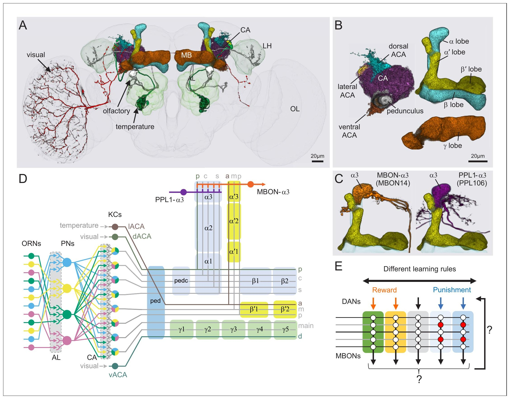

<small>圖片出處：Li F, Lindsey JW, Marin EC, et al. *eLife* 9:e62576 (2020)，Figure 2。© 2020 Li et al.，CC BY 4.0；全文見 [PMC](https://pmc.ncbi.nlm.nih.gov/articles/PMC7909955/)。</small>

> **原圖說（Figure 2）：** Anatomy of the adult *Drosophila* MB. Diagram of structure and information flow in the MB. (**A**) An image of the brain showing subregions of the MB (see panel B for more detail) and examples of the sensory pathways that provide information to the KCs. Projection neurons (PNs) from the 51 olfactory glomeruli of the antennal lobe (AL) extend axons to the calyx (CA) of the MB and the lateral horn (LH). A total of 126 PNs, using a threshold of 25 synapses, innervate the CA and two innervate the lACA. Six olfactory PNs from the DL3 glomerulus are shown (white). Also shown is a visual projection neuron, aMe12 (red) that conveys information from the optic lobe (OL) to the ventral accessory calyx (vACA) and a thermosensory projection neuron (green) that conveys cold temperature information from arista sensory neurons in glomerulus VP3 to the lACA; the positions of the accessory calyces are shown in (B). (**B**) Subregions within the MB. The γ lobe, CA, and pedunculus are displayed separately from other lobes; their normal positions are as shown in panel A. (**C**) The MB output neuron (MBON14) whose dendrites fill the α3 compartment at the tip of the vertical lobe is shown along with the dopaminergic neuron (PPL106), whose axonal terminals lie in the same compartment. (**D**) A schematic representation of the key cellular components and information flow during processing of sensory inputs to the MB. … A small number (generally 3–4) of PNs from each of the 51 olfactory glomeruli innervate the MB, where they synapse on the dendrites of the ~2000 Kenyon cells (KCs) in a globular structure, the CA. Each KC exhibits, on average, six dendritic 'claws', and each claw is innervated by a single PN. … Dendrites of MBONs and terminals of modulatory dopaminergic neurons (DANs) intersect the longitudinal axis of the KC axon bundle, forming 15 subdomains or compartments, five each in the α/β, α′/β′, and γ lobes … Additionally, one MBON and one DAN innervate the core of the distal pedunculus (pedc) intersecting the α/β KCs. In the current work, we further classified KCs into 14 types, 10 main types and four unusual embryonic born KCs, named KCγs1-s4 … Different KCs occupy distinct layers in the lobes as indicated (p: posterior; c: core; s: surface; a: anterior; m: middle, main and d: dorsal). (**E**) Individual compartments serve as parallel units of memory formation … Reward or punishment is conveyed by dopaminergic neurons, and the coincidence of dopamine release with activity of a KC modifies the strength of that KC's synapses onto the MBONs in that compartment.

**圖說中譯：** 成年果蠅蕈狀體的解剖。(A) 全腦影像，標出蕈狀體的各個次區，以及送資訊給 KC 的感覺路徑範例。嗅葉（antennal lobe, AL）51 個嗅小球的投射神經元（PN）把軸突送到蕈狀體的主萼（CA）與側角（LH）。**以 25 個突觸為門檻，共有 126 條 PN 支配主萼、2 條支配側副萼。** 白色是 DL3 嗅小球的六條嗅覺 PN；紅色是一條視覺投射神經元 aMe12，把視葉（OL）的資訊送到腹側副萼（vACA）；綠色是一條溫覺投射神經元，把觸角芒感覺神經元經 VP3 嗅小球送來的冷空氣資訊帶到側副萼（lACA）。(B) 蕈狀體的次區：γ 葉、主萼與柄另外畫出。(C) 樹突填滿垂直葉末端 α3 區室的 MBON14，與軸突末梢落在同一區室的多巴胺神經元 PPL106。(D) 感覺資訊在蕈狀體中流動的示意。表現同一種氣味受體的嗅覺受體神經元（ORN）匯聚到嗅葉的單一嗅小球；51 個嗅小球各派出少數（通常 3–4 條）PN 進入蕈狀體，接到主萼裡約 2,000 顆 KC 的樹突上。**每顆 KC 平均有六個樹突「爪」，每個爪由單一一條 PN 支配。** KC 的軸突平行地經柄（ped）往前投射到葉，在那裡接到 MBON 的樹突。MBON 的樹突與 DAN 的末梢橫切 KC 軸突束的長軸，形成 **15 個次區或區室**，α/β、α′/β′、γ 葉各五個；此外另有一個 MBON 與一個 DAN 支配遠端柄的核心（pedc）。本研究進一步把 KC 分成 14 型——10 個主要型別加上四顆胚胎期生成的特殊 KC（KCγs1–s4）。不同 KC 在葉中佔據不同的層（p 後、c 核心、s 表面、a 前、m 中／主、d 背）。(E) 個別區室是記憶形成的平行單位：獎賞或懲罰由多巴胺神經元傳遞，多巴胺釋放與某顆 KC 的活動同時發生，就會改變該 KC 接到此區室 MBON 的突觸強度。

**解讀：**

**(B) 是全篇唯一把三個副萼的相對位置一次畫清楚的圖。** 後面的論文 Figure 10、11、12 各自只畫一個副萼，讀者沒有這張就拼不起來：dACA 在主萼背側、lACA 在側面、vACA 在腹側。要看懂「視覺從哪裡進蕈狀體」，必須先在這張圖上找到 vACA。

**同一張圖牽涉到三個互不相同的「有幾條 PN 進主萼」。** 本圖圖說寫 **126** 條（門檻為 25 個突觸）；引言寫「約 **150** 條」；而論文 Figure 9 的圖說把主萼的輸入逐類拆開：129 條嗅覺 uPN ＋ 23 條嗅覺 mPN ＋ 35 條溫濕覺 mPN ＋ 19 條溫濕覺 uPN，**合計 206 條，不設門檻**（這也順便說明一件事：**主萼並不是只收氣味**，其中 35 ＋ 19 ＝ 54 條是溫濕覺的）。⚠️ 這三個數論文沒有在任何一處並列說明。「約 150」落在中間、來源不明。**引用「有幾條 PN 進萼」時一定要連門檻一起引。**

**而這張圖最好用的地方是它讓門檻的效果可以算出來，論文自己沒有算。** 不設門檻是 206 條，門檻設 25 個突觸之後只剩 126 條，**也就是有 80 條 PN、佔 39%，支配弱到被這一個門檻擋掉**（本頁計算）。這是「門檻選多少會改變結論」的第一個例子。

**對過度解讀踩煞車：(E) 只畫了五個區室，而 (D) 畫了 15 個。** (E) 是示意用的，那五個方框不是某個解剖事實；而且 (E) 上有兩個問號，標的正是本篇要處理的兩個問題（MBON 的輸出怎麼合流、怎麼回饋給 DAN）。**把 (E) 的方框數當成區室總數會數錯。**

### 論文做了哪九套分析

下面九套分析**數的東西各不相同**：有的數細胞顆數、有的數細胞型數、有的數突觸個數、有的只看「有沒有連線」、有的算百分比、有的算正確率。每一套都會寫出它數的是什麼。

#### 第一套：把 KC 重新分型（論文 Figure 3、Figure 4；本頁圖 2）。數的是**細胞顆數**。

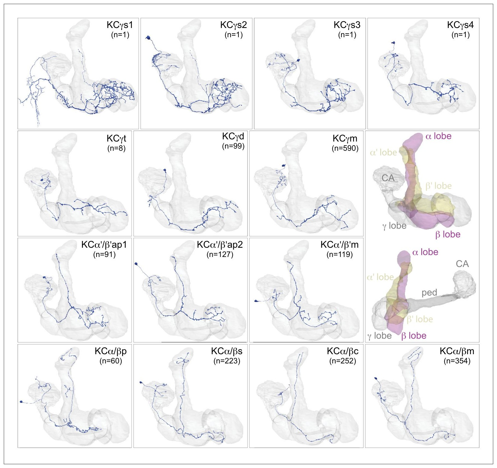

<small>圖片出處：Li F, Lindsey JW, Marin EC, et al. *eLife* 9:e62576 (2020)，Figure 3。© 2020 Li et al.，CC BY 4.0；全文見 [PMC](https://pmc.ncbi.nlm.nih.gov/articles/PMC7909955/)。</small>

> **原圖說（Figure 3）：** Kenyon cells. Each panel shows a representative neuron of the indicated KC subtype together with the outline of the MB lobes and CA in gray, in a perspective view from an oblique angle to better display neuronal morphology. The insert on the right provides a key to the position of the individual lobes, the pedunculus (ped) and CA; the upper image presents the same view as KC subtype panels and the lower image shows a rotated view to better visualize the ped and CA. The numbers (n=) indicate the number of cells that comprise each KC subtype in this animal; the number of KCs is known to vary between animals (reviewed in Aso et al., 2009). Several of the KC subtypes are defined here for the first time, based on morphological clustering, as described in Figure 4. Although reconstruction of 78 KCα/β was incomplete in the CA as a consequence of a small area of reduced image quality, it did not affect morphological clustering, which was based on simplified axonal skeletons.

**圖說中譯：** Kenyon 細胞。每一格顯示該 KC 亞型的一顆代表性神經元，灰色為蕈狀體葉與主萼的外形，以斜角透視呈現以便看清形態。右側插圖是各葉、柄（ped）與主萼位置的圖例；上圖與各亞型格同視角，下圖轉過來以便看清柄與主萼。**(n=) 是這隻動物中構成該亞型的細胞數；KC 的數目在不同個體之間會變動**（Aso et al., 2009 回顧）。好幾個 KC 亞型是本文依形態分群首次定義的（方法見圖 4）。**雖然有 78 顆 KCα/β 在主萼的重建並不完整（因為一小塊影像品質較差），但這不影響形態分群，因為分群用的是簡化後的軸突骨架。**

**圖說中譯補充：** 14 格的標籤與顆數（本頁逐格讀出，並與 PDF 的內嵌文字層核對）：KCγs1 (1)、KCγs2 (1)、KCγs3 (1)、KCγs4 (1)、KCγt (8)、KCγd (99)、KCγm (590)、KCα′/β′ap1 (91)、KCα′/β′ap2 (127)、KCα′/β′m (119)、KCα/βp (60)、KCα/βs (223)、KCα/βc (252)、KCα/βm (354)。

**解讀：**

**做法與結果。** 作者先把 1,927 顆 KC 按三大類分開（γ 701 顆、α′/β′ 337 顆、α/β 889 顆），再用 NBLAST 對每一類的軸突骨架做形態分群，得到 14 個亞型（10 個主要型別，加上四顆胚胎期生成的特殊細胞 KCγs1–s4）。分群結果另以 CBLAST 獨立驗證，少數不一致由人工檢查解決。

**分型不是純演算法的產物。** 方法節最末寫明：KC 的分型是「逐步人工 NBLAST 分群＋人工覆核」，**覆核的結果把 17 顆 KC 改歸到別的亞型**（原文 17 reassignments；17 顆對 1,927 顆是 0.9%）。論文自己解釋這 17 顆幾乎都是「垂直葉像某一個 KCα/β 亞型、水平葉卻像前一個或後一個亞型」的細胞，推測它們出生在發育的轉換期。**這句話只出現在方法節最末，正文一個字都沒提**；它重要的原因是：亞型的界線在這 17 顆身上是人判斷的，不是演算法判斷的。

**這張圖是全篇數字品質最好的一處，可以當成整篇的錨。** 14 格加總正好 **1,927**，而且三大類的小計（γ 701、α′/β′ 337、α/β 889）各自與正文的三句話完全吻合。本頁把它重製成「三、結果」的第一張表，並補上論文沒有並列的「占全部 KC 的比例」一欄。**在一篇到處有數字對不上的論文裡，先確認手上的數字屬不屬於這一組，是最省事的自保動作。**

**真正該注意的是四顆 n = 1 的 KCγs。** 它們各佔一格，版面與 n = 590 的 KCγm 相同，顯示作者很重視這幾顆細胞。但這也意味著**關於它們的任何結論樣本數都是 1**，不可能有個體變異的估計。

**圖說裡藏了全篇唯一自陳的重建缺口，而正文一個字都沒提。** 78 顆 KCα/β 在主萼的重建不完整（佔 889 顆 KCα/β 的 8.8%）。圖說只保證「不影響形態分群」——**它沒有說不影響主萼的輸入統計**。而主萼的輸入組成、每顆 KC 的爪數，以及第三套分析（KC 取樣是否隨機），全部建立在主萼的連結上。**論文沒有說這 78 顆有沒有被排除在那些分析之外：`？待查`。**

**對過度解讀踩煞車：n 是「這隻動物的顆數」，不是族群值**，圖說自己寫了 KC 數會因個體而異。引用「99 顆 KCγd」時必須帶這個限定——⚠️ **矛盾 1.14｜視覺 Kenyon 細胞有幾顆｜未裁決**：[[s-ganguly-2024-visual-inputs-to-kc]] 在另一隻果蠅的全腦連結體（FlyWire）上數到左半腦 147 顆、右半腦 148 顆（該篇兩邊各數一次）。兩邊的量法與分型依據都不同，**本頁不裁決**，見 [[syn-contradictions]] 1.14。

#### 第二套：四個萼各收什麼訊號（論文 Figure 9 到 Figure 12；本頁圖 4 為其中的腹側副萼）。數的是**突觸個數**。

這一套的作法是：把每一群 KC 收到的全部輸入突觸當成 100%，逐類來源算占比，畫成圓餅圖。**圓餅的分母是「全部輸入」，不是「全部感覺輸入」**——而全部輸入裡有相當一部分根本不是感覺訊號（KC 彼此之間的突觸、APL 的突觸等）。

四個萼的結果是：主萼（1,757 顆 KC）以嗅覺 uPN 為主（129 條、63.6%）；腹側副萼 vACA（99 顆 KCγd ＋ 1 顆 KCγs1）以視覺為主，**直接來自 VPN 的佔 46.1%、經 LVIN 轉手的佔 24.6%**；背側副萼 dACA（60 顆 KCα/βp）也是視覺，但比例**正好相反**：**經 LVIN 的 57.8%、直接來自 VPN 的只有 9.8%**；側副萼 lACA（14 顆 KCα′/β′ap1 ＋ 1 顆 KCγs2）以兩條溫覺 PN 為主，共 928 個突觸。

**四個萼的 KC 顆數不能相加。** 一顆 KC 可以同時在主萼與某個副萼有樹突，論文對側副萼寫得最明白：側副萼「是主萼的一個小次區」，而且「**側副萼裡的多數 KC 同時也在主萼收到嗅覺與溫濕覺 PN 的輸入**」（原文）。所以那 15 顆同時被算在主萼的 1,757 顆裡，四個萼的名單相加會超過 1,927。至於 1,927 減去 1,757 的那 **170 顆**（樹突完全不在主萼的）由哪些亞型組成，**論文沒有列**，用兩個視覺副萼的 100 ＋ 60 也拼不出 170：`？待查`。

**兩個視覺副萼的路線相反，是這一套最乾淨的結果，而論文把它們寫在兩節裡、從來沒有並列。** 以視覺輸入為分母重算（本頁計算）：vACA 走直接路的佔 46.1 ÷ (46.1＋24.6) ＝ **65.2%**，dACA 只有 9.8 ÷ (9.8＋57.8) ＝ **14.5%**。

**整篇最清楚的一次門檻示範也在這一套。** 腹側副萼的圓餅圖上寫著 138 條 VPN（不設門檻，連只做一個突觸的也算）；同一張圖的圖說說，若要求「一條 VPN 對單一一顆 KC 至少做五個突觸」，就只剩 **49 條**。**同一件事、同一張圖，差 2.8 倍，純粹是門檻造成的。**

**同一件事的兩個百分比，分子與分母都不同，不能互換。** 論文正文說「主萼的**感覺資訊**超過 90% 來自**嗅覺 PN**」，圖說說「嗅覺 **uPN** 佔 **63.6%**」。兩句的**分母**不同（前者只算感覺輸入，後者算全部輸入），**分子**也不同（前者含 uPN 與 mPN，後者只有 uPN）。本頁在「三、結果」3.2 節把分母統一後重算過，結果與「超過 90%」相容（`※ 推論`）。**引用時必須同時指明分子與分母。**

**與過去的認知落差最大的一點也在這一套。** 論文引言寫「**約 8% 的 KC 收到的輸入以視覺為主**」，並說視覺輸入「遠比過去所認知的廣泛」。對應的顆數在論文另一處：它把 1,927 顆 KC 分成三群——1,664 顆標「嗅覺」、102 顆標「嗅覺＋溫濕覺」、161 顆標「嗅覺＋視覺」，三者相加正好 1,927，而 161 ÷ 1,927 ＝ 8.4%（本頁計算）。⚠️ **但這三個標籤每一個都含「嗅覺」，與引言的「以視覺為主」不是同一種說法**，論文也沒有交代兩者的關係（例如那 161 顆是不是同時收嗅覺與視覺，還是只是被歸在視覺那一股）。本頁只照兩處原文並列，不替它們調和。（同理，標「嗅覺＋溫濕覺」的 102 顆遠多於側副萼那 15 顆，不必覺得矛盾：**主萼自己也有 54 條溫濕覺 PN 進來**，溫濕覺不是只進側副萼。）

⚠️ **這一套裡有一句牽涉到一條未裁決的矛盾。** 論文說，VPN 與 LVIN 打在 KCγd 樹突上的**突觸**，不具主萼裡那種爪狀構造——唯一的證據是一支影片（Figure 10—video 1），**本庫未取得**。⚠️ **矛盾 1.15｜視覺 Kenyon 細胞的輸入突觸有沒有「爪」｜未裁決**：[[s-ganguly-2024-visual-inputs-to-kc]] 在另一份連結體上說有豆莢—爪接觸，證據是該篇的補充圖，**本庫同樣未取得**。兩邊數的也不是同一群細胞。**本頁不裁決**，見 [[syn-contradictions]] 1.15。

#### 第三套：KC 挑哪幾條 PN，是不是隨機的（論文 Figure 13、Figure 14；本頁圖 5）。只看**有沒有連線**，而且**這一套有零模型**。

這是本篇唯一直接檢驗「隨機」的分析，而**它是不是隨機，取決於拿什麼當對照**，所以零模型必須寫清楚。

第一個做法叫**主成分分析**。先把「哪一顆 KC 和哪一條嗅覺 uPN 之間有連線」做成一個只有 0 與 1 的表格（門檻：5 個突觸）。主成分分析是一種找「這張表裡有沒有重複出現的樣式」的方法：它把表格裡的差異拆成一條條彼此獨立的「樣式」（成分），並算出每一條樣式解釋了全部差異的百分之幾（這個百分比叫它解釋的**變異**）。**如果連線是隨機的，就不會有哪一條樣式特別突出。** 所以作法是把真實資料的各成分，拿去和一組**洗牌模型**的同一個成分比。

**洗牌模型是這樣造的：每顆 KC 保留它原本的連線總數（也就是爪數分布），但在全部 uPN 裡隨機挑，挑中某條 uPN 的機率正比於該 uPN 的連線總數；除此之外的結構一概不保留。** 結果是真實資料有**三個**成分明顯大於洗牌模型的對應值（原文：three principal components are clearly larger），所以**不是隨機**。

但「不是隨機」與「結構很強」是兩件事，**這張圖支持前者，不支持後者。** 最大的那一條樣式本身只解釋 7–10% 的變異，而真實資料對洗牌模型的相對差只有 **9–14%**（`※ 從圖判讀`）；分成三大類之後，**γ 這一類根本看不到偏離**。偏離的來源是「α′/β′ 與 α/β 偏重少數幾個嗅小球（最明顯的是 DP1m 與 DM1），γ 比較平均」——也就是說，**結構出在「KC 型別 × 嗅小球」這個層級，而不是「某一顆 KC 特別愛挑某幾條 PN」。** 前者的意思是「把氣味通道分配給不同的 KC 群」，後者才是「單顆 KC 的取樣規則本身不隨機」。**論文沒有說這兩種情形對記憶的後果各是什麼**，所以本頁只寫出區別，不往下推。

第二個做法是**空間洗牌**：先求出每個 PN 小球在主萼裡的位置，再把連線限制在某個半徑 r 之內隨機重新指派（r 掃過一系列值，r ＝ 0 時模型就等於真實資料）。這樣做出來的模型保留了大尺度的空間安排、只把小尺度打亂。作者看兩個指標怎麼變：**參與比**（量「每個嗅小球在全部 KC 的輸入裡被多均勻地代表」，愈大代表愈均勻）與**維度**（量「KC 的活動樣式能支撐多細的氣味辨別」，愈大代表能分辨的氣味愈多）。**維度是算出來的，不是量到的**：它來自一個假設「一個氣味只讓少數 KC 放電」（稀疏放電）的模型，引自別人的理論工作。結果是真實資料的這兩個指標都比洗牌模型低——也就是說，真實的空間安排讓 KC 的輸入沒那麼均勻、能分辨的氣味也略少，論文的原話是「如非隨機結構所預期，**雖然效應不大**（the effect is modest）」。效應在 α/β 最強、γ 幾乎為零。

**而論文自己把結論限制得很緊**（原文）：這個空間結構對維度的影響只是 modest，**而且它對 KC 輸入的效應，在 KC 輸出到 MBON 的層級上已經看不出來了。**

#### 第四套：把 MBON 重新分型（論文 Figure 7、Figure 8；本頁圖 3）。數的是**細胞型數**。

本篇把 MBON 的清單從過去的 22 型改成 **34 型**：**20 型典型 ＋ 14 型非典型**。「非典型」的定義是「樹突除了在葉內大量接收 KC 輸入之外，還延伸到葉外的鄰近腦區」。這 14 型裡 **12 型是本篇首次描述**（論文把這句話寫在 Figure 8 的圖說裡，正文沒有）。

**關於「22 怎麼變成 34」，本篇自己的數字差一型。** 論文的三句話是：過去描述過 22 型；Figure 7 的 20 格「每一格都是過去描述過的典型 MBON」；而過去描述過的那些型裡，**MBON08 不在這隻果蠅身上**（所以不算在 34 型裡——34 ＝ 編號 MBON01 到 MBON35 扣掉 MBON08），另有 MBON10 與 MBON20 從典型改判為非典型。20 ＋ MBON08 ＋ MBON10 ＋ MBON20 ＝ 23，比「22」多一型；而同一段圖說又寫「其餘 **21** 型只有小差異」（21 ＝ 22 − MBON08），這只有在「Figure 7 的 20 格裡有一型其實不是前人描述過的」時才自洽（`※ 推論`：最可能是那 20 格裡編號最大的 MBON23）。⚠️ 這是單篇自身不一致，不需裁決；引用時用「20 型典型 ＋ 14 型非典型 ＝ 34 型」這組，不要從 22 去回推。

**「新發現」在這裡有一個具體的後果：沒有基因工具。** 論文自己寫明：「由於這些 MBON 在此首次被描述，目前還不存在任何關於它們功能或生理的實驗資料。」也就是沒辦法對它們做阻斷或活化實驗。

**而「非典型」這個分類沒有量化門檻。** 三顆 MBON10 細胞的突觸後位點（收訊號的那一側）落在葉外的比例分別是 69%、68%、50%——**最後那一顆剛好卡在一半**，而論文沒有說低於多少就算典型。**分型是整型一起歸的**，所以只要論文把 MBON10 這一型改歸回典型，後面所有「典型 vs 非典型」的對照（各有幾型、各佔多少輸出）分母就全部要重算。

**還有一件圖上看得出來、而圖說把話說得太肯定的事。** Figure 8 的外框線型區分實測與預測的傳遞物質（實線實測、虛線預測）。本頁逐格判讀的結果是：**14 格裡只有 MBON10 是實線，其餘 13 格全是虛線**；而圖說卻把其中一型寫成「the GABAergic MBON20」——**那一格是虛線，也就是預測值，圖說把預測寫成了既定事實。** ⚠️ 換句話說，**這 14 型裡有 13 型的傳遞物質從來沒有被量過**，而本篇關於它們怎麼影響下游（興奮還是抑制）的推論全部建立在預測之上。詳見「五、問題與限制」第 10 條。

#### 第五套：MBON 的下游會不會匯聚（論文 Figure 21；本頁圖 6）。數的是**下游神經元的顆數**，而且**這一套有零模型**。

把門檻設在 10 個突觸，約 **1,550 顆**神經元至少是一型 MBON 的下游，其中約 **600 顆**（論文寫「接近四成」）同時收到**兩型以上** MBON 的輸入。

**兩個關鍵限定只寫在圖說裡。** 第一，1,550 這個計數**含軸突對軸突的連結**——其中一部分「下游」並不是用樹突（收訊號的那一端）在接收 MBON，而是被打在自己的軸突（送訊號的那一端）上。**論文沒有量這類突觸的效果**，所以這一部分「下游」不能和樹突輸入等同看待（這一點是本頁的提醒；論文只在圖說裡註明「含軸突對軸突」，沒有說它佔多少）。第二，600 的條件是「至少兩個 MBON **細胞型**」，不是「至少兩顆 MBON 細胞」；同一型的兩顆細胞打到同一個目標，不算匯聚。

**零模型是這樣造的：把 MBON 的輸出隨機灑給中央腦的神經元，每顆細胞被挑中的機率正比於它自己的輸入突觸總數。** 這樣算出來預期會有約 **3,200 顆**下游，**其中只有 14%** 收到兩型以上。真實的四成遠大於 14%，論文據此說匯聚超出隨機。**沒有這個 14%，那個「接近四成」撐不起任何結論。**

**但這個比較有三個論文沒有處理的地方。** 第一，零模型預期的下游**總數**（約 3,200 顆）是真實量到的（約 1,550 顆）的兩倍多，論文沒有解釋這個差距，也沒有說在總數差這麼多的情況下，兩個比例怎麼比才公平。第二，論文沒有說這個零模型跑了幾次、沒有給信賴區間、沒有做顯著性檢定，所以「超出隨機多少」只有一個點估計。第三，**這裡的「約 3,200」和前面「約 3,200 顆在 DAN 上游」是兩個完全不相干的數字**，只是碰巧相同（一個是零模型預期的 MBON 下游數，一個是實際數到的 DAN 上游數），論文沒有提醒這一點。

**真正該看的不是最左邊那根長條，而是插圖最右邊那幾根。** 這張圖是一個長條圖，橫軸是「一顆下游細胞同時收到幾型 MBON 的輸入」（1、2、3……），縱軸是有幾顆細胞落在那一格；最左邊那根（只收一型）最高，右邊愈來愈矮。**收到十型以上 MBON 輸入的那一小撮細胞，幾乎全是側角神經元**（側角是嗅覺投射神經元除蕈狀體之外的另一個主要目標）。**本篇只報告了「它們幾乎全是側角神經元」這個解剖事實**；「側角是處理先天氣味價性的中心、所以習得與先天在這裡會合」這個意義**不是本篇的結論**，而是本庫 [[t-innate-learned-integration]] 一線來源的說法——配上那一線來源，整張圖最有分量的證據就在那幾根幾乎看不見的長條上。

#### 第六套：MBON 有沒有直通運動的路（論文 Figure 25、Figure 42；本頁圖 7）。數的是**突觸個數**。

**過去沒有人報告過 MBON 直接接到下行神經元**（原文：no direct MBON to DN connections have been reported）。本篇報告了第一條：**六型支配側副葉（LAL，蕈狀體腹側一個與動作控制有關的腦區，不要和「側副萼」搞混）的非典型 MBON 中，有四型（MBON26、27、31、32）是下行神經元 DNa03 最強的輸入之一，DNa03 再強力輸入 DNa02**。而 DNa02 **左右兩側活動的不對稱**已知與果蠅走路時的轉向控制有關（這一句的依據是別人的生理實驗 Rayshubskiy et al. 2020，不是本篇的資料）。另外，八型不支配側副葉的非典型 MBON 中，只有 MBON20 在前 20 大下游裡有已確認的下行神經元（DNp42 與 DNb05）。

**而這條鏈條上最細的一環，正是論文 Figure 25 的標題所宣稱的那一環**（該圖標題是「從非典型 MBON 下行到腹神經索的路徑」）。從該圖讀出的突觸數：MBON 直接打到下行神經元的連結裡最強的一條是 172 個突觸，而下行神經元之間 DNa03→DNa02 是 267 個，同一張圖最粗的一條（MBON32→MBON26，兩型 MBON 之間）是 357 個。論文說那四型 MBON「是 DNa03 最強的輸入**之一**」——那是相對於 DNa03 的其他輸入而言，不是絕對強度。

**論文自己給這個新宣稱設了一個很寬的界線**：hemibrain v1.1 只辨識出約 **15%** 的下行神經元、約 **50 個型別**。`※ 推論`：若 50 型是全體的 15%，全腦約有 330 個型別、其中約 280 型從來沒有被看過（依據就是這兩個數字相除），**也就是說「只有 DNa02 與 DNa03 收到顯著的 MBON 輸入」這句話，是對已辨識的那 15% 講的，剩下 85% 沒有被檢查過。**另外，Figure 25 的標題說「到腹神經索」，**而腹神經索那一端並不在這份資料集裡**——該圖自己註明下行神經元的軸突延伸到 hemibrain 體積之外，那一段是靠別人的光學影像（Namiki et al. 2018）補上的。**本篇證明的是「MBON → 下行神經元」，不是「MBON → 腹神經索」。**

#### 第七套：MBON 回饋給 DAN（論文 Figure 26；本頁圖 8）。數的有兩種：**DAN 的顆數**與 **MBON 的細胞型數**。

結果是：**分析裡的 5 顆 PPL1 全部、150 顆 PAM 中的 99 顆**收到直接的 MBON 輸入（數的是顆數）；而 **20 型典型 MBON 中有 19 型、14 型非典型中有 12 型**會直接接到 DAN（數的是型數）。**這兩組數字不能互相換算。** 回饋分三種模式：接回同一個區室（自我回饋）、接到不同區室（跨區室通訊）、兩者皆有。

**為什麼這裡是「5 顆 PPL1、150 顆 PAM」，而上面的名詞表寫「6 型 PPL1、151 顆 PAM」？** 因為兩顆細胞被排除掉了：本篇定義的 6 型 PPL1 每型各 1 顆（共 6 顆），其中 **PPL102** 的形態與極性和其他 PPL1 都不一樣，論文把它排除在「某些 DAN 的分析」之外（**論文沒有列出是哪些分析**）；而 151 顆 PAM 裡有一顆因為缺了同側軸突、重建不完整而被排除，剩 150 顆。同一篇裡因此出現 **158／156／155** 三個 DAN 總數：158 ＝ 151 PAM ＋ 6 PPL1 ＋ 1 顆 PPL201；156 是扣掉 PPL201 與那顆重建不全的 PAM；155 是 150 PAM ＋ 5 PPL1（再扣 PPL102）。⚠️ 三個數的組成本頁在「三、結果」3.5 節拆給你看，**但哪一套分析用哪一個數、為什麼排除，論文一處也沒有寫全**（單篇自身不一致，不需裁決）。

**原文有一句「唯一」，而「唯一」掛在區室上：「Only the α1 compartment displays exclusively self-feedback.」** 由於 α1 區室只有一型 MBON 的樹突，這句話在 α1 這個個案上與「MBON-α1 只接自己區室的 DAN」指向同一件事；**但「唯一一型 MBON」在字面上站不住**——同一段原文寫明有 1 型典型與 2 型非典型 MBON 完全不直接接任何 DAN，這 3 型當然也不接其他區室的 DAN。本庫先前的轉述已就地更正（見「為什麼重要」第四段第 2 點）。

#### 第八套：一個區室能不能再切小（論文 Figure 27、Figure 28、Figure 30、Figure 31、Figure 39；本頁圖 9）。數的是**百分比**，而且 KC 側與 MBON 側的門檻不一樣。

這是本篇最強的一套。作法是先依「樹突收到的輸入像不像」把同一個區室裡的多顆 DAN 分成亞型，再看這些亞型對 KC 與 MBON 的輸出有沒有同樣的結構。結果是：**同一個區室裡的 DAN 分成好幾個亞型，軸突各佔區室的一小塊，接的 KC 與 MBON 都不一樣。** 論文由此得到一條通則（原文）：**每一個被多顆 DAN 支配的區室都含有一個以上的 DAN 亞型，而且一般來說每個區室裡只有一個亞型收到直接的 MBON 輸入。** 這讓同一個區室裡不同組的突觸權重可以被獨立調整——也就是說，**同一個區室可以同時進行好幾種獨立的學習。**

最清楚的例子在 γ5 區室：**PAM01-nc 幾乎壟斷視覺那一股 KC（KCγd），PAM01-fb 幾乎壟斷嗅覺那一股（KCγm）。** 這是「多巴胺的調控可以是感覺模態專一的」這個主張的全部證據，也是第九套那個理論模型的全部經驗基礎。

**這一套的門檻要特別注意，而且論文自己給了兩個版本。** 圖上只畫出「這個 DAN 提供該 MBON 至少 **0.1%** 的突觸輸入」或「提供該 KC 型來自 DAN 的輸入至少 **1%**」的情形（Figure 30 圖說）。⚠️ 而方法節把 KC 側那個門檻寫成 **0.5%**（與圖說的 1% 差一倍；單篇自身不一致，不需裁決）。不論採哪一版，**KC 側都比 MBON 側嚴格**（用圖說是嚴格十倍，用方法節是五倍）：所以「某個 DAN 不接某個 KC」是比「某個 DAN 不接某個 MBON」強得多的斷言；反過來說，MBON 側看起來連線比較密，有一部分只是門檻比較鬆。

**由這一套還延伸出一個更弱的主張。** γ3 區室的兩個 DAN 亞型被指為**價性相反**（一個偏獎賞、一個偏懲罰），因此同一個區室可以同時跑方向相反的學習。`※ 推論`的部分在於**價性的指派完全是從「這個亞型與誰共享上游輸入」推出來的**：某個亞型若與已知偏懲罰的 DAN 共用上游，就被標成偏懲罰。而共享的強度很低——Figure 31 整張矩陣的最大值只有 **7.23%**（`※ 從圖判讀`；那是「單一一群上游細胞佔某個 DAN 亞型樹突輸入總數」的比例），絕大多數格子低於 2%。**這是一個很薄的推論基礎，而論文的 Figure 39 把它畫成了確定的標籤。**

#### 第九套：一個理論模型（論文 Figure 38；本頁圖 10）。算的是**二元分類的正確率**。

連結體發現「感覺模態是分流的」（不同 KC 群收不同模態、不同 DAN 亞型管不同 KC 群），於是論文最後用一個簡單的模型問：**什麼時候分流比混合划算？** 模型裡有一個線性讀出器（代表 MBON），任務是判斷一個刺激的價性是正還是負，量的是分類正確率（0.5 等於亂猜）。兩種任務：「可因式分解」的任務可以把整體價性拆回各模態分別處理，「不可因式分解」的不行。

結果的方向是：**可因式分解的任務，分流有利；不可因式分解的任務，混合有利。** 而把這個問題問在 DAN 那一側（Figure 38D）時，選錯架構的代價比問在 KC 那一側（Figure 38B）大得多。兩側的落差並列如下（柱高皆為`※ 從圖判讀`，誤差約 ±0.01）：**KC 側選錯是 0.795 掉到 0.60（差 0.195），DAN 側選錯是 0.81 掉到 0.49（差 0.32）。** 其中 **0.49** 這一根特別值得看，因為 0.5 就是亂猜的水準：`※ 推論`——在那種任務下，分流的 DAN 調控**與亂猜無法區分**（0.49 與 0.5 的差距落在判讀誤差 ±0.01 之內，所以只能說「分不出來」，不能說「正好等於亂猜」）。**「DAN 架構選錯比 KC 架構選錯嚴重得多」是這兩張圖最實質的訊息，而論文正文只寫了 KC 那一半。**

**這一套有三個不能忽略的限制。** 第一，兩個任務用的刺激數不同（25 個與 200 個），是作者為了讓難度可比而調的，**所以不能跨任務比較柱子的絕對高度**，只能比同一任務內的兩根。第二，⚠️ **論文正文與圖說對「可因式分解」的定義邏輯相反**（圖說是「兩個模態都為正才算正」，正文是「任一個為正就算正」），這決定了那幾根柱子各自在算什麼，本頁不猜哪一個是作者的本意。第三，**模型參數完全沒給**（KC 數、PN 數、稀疏度、讀出的正則化方式都不在圖說與方法節裡），**無法重現**。所以本庫引用這一套時只能引方向，不能引絕對數值，也不能說它量化了果蠅的實際表現。

### 九套分析數的東西不能互相換算

這九套分別數的是：**細胞顆數**（第一套的 1,927 顆、第五套的 1,550 顆、第七套的 99 顆）、**細胞型數**（第四套的 34 型、第七套的 19 型與 12 型）、**突觸個數**（第二套的 928 個、第六套的 172 個）、**有沒有連線**（第三套的 0／1 表格）、**百分比**（第二套的圓餅、第八套的門檻）、**分類正確率**（第九套）。

這一點不是形式問題。舉三個具體的例子：「34 型 MBON」與「1,550 顆下游」不能相除去算「每型 MBON 幾顆下游」，因為 1,550 是所有 MBON 下游的**聯集**（同一顆細胞可以同時是好幾型 MBON 的下游，有約 600 顆就是），不是逐型相加；「99 顆 PAM 收到 MBON 回饋」與「19 型典型 MBON 會接 DAN」是兩個方向的計數，不是同一件事的兩種寫法；第二套的 63.6% 與正文的「超過 90%」分子與分母都不同，不是差在結果。

**還有兩組碰巧相同、意思完全不同的數字**，讀的時候要分開：第一套的「99 顆 KCγd」與第七套的「150 顆 PAM 中的 99 顆」；解法那一節的「約 3,200 顆在 DAN 上游」與第五套零模型的「約 3,200 顆下游」。四個數字分屬四件事。

### 代價

這些結論全部建立在**一隻**果蠅的**半邊**中央腦上。成像範圍以右半邊為主，有些細胞的分枝跨過中線伸到左側，而左側的連結重建不完整，所以需要互相比較的那幾套分析一律只用右半腦的突觸。蕈狀體葉裡面做了極大的校對努力（超過八成的電腦預測突觸被指派給了具名神經元），**但 MBON 的輸出與 DAN 的輸入所在的那些腦區，重建常常遠不完整**，而本篇關於 DAN 從哪裡收訊號的整段分析就落在那裡。視葉與食道下區不在成像範圍內，所以「視覺從哪裡來」與「DAN 的訊號從哪裡來」這兩個問題，本篇都只能問到一半。神經傳遞物質大多不是量到的而是機器視覺預測的，而且預測是在**另一份**電顯資料集（FAFB）上跑的。此外，連結體看不到電突觸，也看不到距離較遠的非突觸調控——而飢餓、口渴這些內在狀態正是靠後者運作的，論文明說「連結體無法完整描述這套迴路」。

**還有一件在本頁特別嚴重的事。** 本篇有 53 處 figure supplement、33 支影片與兩個 Supplementary file，**本機 PDF 只印出它們的標題，影像一張都沒有，本庫全部未取得**。所以有幾個結論本頁只能標成 `？待查`，其中最重要的三處是：KCγd 的突觸形態（上面第二套那條矛盾的一側）；**credit assignment 的全部數據**——這個詞直譯是「功勞歸誰」，論文用它指的是「學習的訊號有送到對的地方」：原文的說法是「**控制相似行為的那些區室，它們的 DAN 也收到相似的增強訊號**」。這是第八套底下的一個子結論，而論文只報告「兩種相似度之間有顯著的正相關」，相關係數、p 值、樣本數（幾對區室）與檢定方法一個都沒給，唯一的數據在本庫未取得的那張補充圖裡；以及 DAN 輸入的腦區分布。

### 最後一段留給最容易被誤讀的一點

這是一篇關於**可能性**的論文，不是一篇關於**事實**的論文。它證明的是「這條線存在、而且不細」，推論的是「所以可能是這樣運作」。論文自己把話說得很明白：**「對相關活動的無知，很可能是把突觸數對應到迴路功能時最重要的不確定來源，而且很可能大於突觸辨識的誤差與各種門檻造成的影響。」** 一組突觸數很高的輸入，如果這些輸入彼此很少同時放電，在連結體上看起來是主幹、實際上不是；反過來，一組各自很弱但高度同步的輸入可能非常有效，而連結體完全看不出來。**引用本篇的任何一條迴路時，引的是解剖，不是功能。**

---

## 專業文

### 本頁用語

- **連結體（connectome）**：用電子顯微鏡（電顯）逐一追蹤神經元、畫出的接線圖，可數出兩顆細胞之間有幾個突觸。
- **hemibrain**：一隻成年雌果蠅**半邊中央腦**的電顯緻密重建，本篇用的版本是 **hemibrain:v1.1**。右半邊的連結完整，左半邊不完整；**沒有重建視葉**，食道下區（SEZ）也不在體積內。詳見 [[e-hemibrain]]。
- **neuPrint**：查詢 hemibrain 的網頁介面，背後是一個 Neo4J 圖資料庫。
- **FAFB**：另一份成年果蠅**全腦**電顯影像體積。本篇在兩處用到它：跨資料集確認髓質視覺投射神經元的身分，以及跑傳遞物質預測。
- **KC（Kenyon cell，Kenyon 細胞）**：蕈狀體的內在神經元，本篇在右半腦數到 1,927 顆、分 14 個亞型。見 [[e-kenyon-cell]]。
- **萼（calyx）／副萼（accessory calyx）**：KC 的樹突區。主萼（CA）收嗅覺，另有三個副萼收非嗅覺輸入：腹側副萼（vACA，視覺）、背側副萼（dACA，視覺）、側副萼（lACA，溫覺）。
- **PN（projection neuron，投射神經元）**：把感覺資訊從嗅葉（antennal lobe）等處送到萼的細胞。**uPN** 只在單一嗅小球有樹突，**mPN** 跨多個嗅小球。
- **VPN（visual projection neuron，視覺投射神經元）／LVIN（local visual interneuron，局部視覺中間神經元）**：前者本體在視葉、直接接到 KC；後者自己不伸進視葉，但收 VPN 的輸入再轉給 KC。**LVIN 這個名詞是本篇首創**（行 1115–1117）。
- **MBON（MB output neuron，蕈狀體輸出神經元）**：讀出 KC 訊號的細胞。本篇分成**典型**（樹突幾乎全在葉內，20 型）與**非典型**（樹突有一部分在葉外，14 型）。見 [[e-mbon]]。
- **DAN（dopaminergic neuron，多巴胺神經元）**：送多巴胺進區室的細胞，分 PPL1（多為懲罰）與 PAM（多為獎賞）兩大群。見 [[e-dopaminergic-neuron]]。
- **區室（compartment）**：MBON 樹突與 DAN 末梢重疊所界定的次區，共 15 個。見 [[c-mb-compartment]]。
- **軸突對軸突連結（axo-axonal）**：突觸打在對方的軸突上而不是樹突上。本篇大量出現，**而且計入了「MBON 下游」的計數**。
- **NBLAST**：比較兩顆神經元形態相似度的演算法。**CBLAST** 是它的連結度版本，用「輸入輸出分配到哪些細胞型」定義相似度。
- **有效連結（effective connectivity）**：把兩段連結的「比例矩陣」相乘，估計跨一個中間神經元的影響。本篇用它算「PN 經 KC 到 MBON」的模態組成。
- **餘弦相似度（cosine similarity）**：量兩顆細胞的輸入（或輸出）分布有多像，0 為毫無共同夥伴、1 為完全相同；**不設門檻、不受總突觸數影響**。
- **Mantel 檢定**：檢驗兩個距離矩陣是否互相獨立的排列檢定。本篇用它比較「形態分群」與「連結分群」。
- **標記**：`※ 推論`＝本庫推得、原文沒明說；`？待查`＝要靠其他資料確認；「從圖判讀」＝從圖上估讀的值。

### 一、概述

**主要問題。** 果蠅蕈狀體的細胞型目錄、各型的功能、以及學習的基本規則（KC 活動與多巴胺同時出現就壓低 KC→MBON 突觸）都已經靠光學顯微鏡與行為實驗建立起來，但**沒有人知道這些細胞之間實際的接線**。本篇要回答的是：把整塊蕈狀體的突觸層級接線圖攤開來之後，能不能推論出它在執行什麼計算。具體拆成五個子問題：KC 收到哪些感覺輸入、KC 的取樣是不是隨機的、MBON 的輸出怎麼合流、MBON 怎麼回饋給 DAN、DAN 自己從哪裡收訊號。

**重要性。** 蕈狀體是少數同時滿足三個條件的迴路：架構保守（與脊椎動物小腦高度相似，見論文圖 1）、有緻密連結體、而且有數十年的功能實驗可以對照。**這三件事缺一，從接線圖推論計算就沒辦法被檢驗。** 本篇因此同時是一份資料描述與一次方法論示範：它展示了連結體能問出哪些問題（例如「同一個區室內部還能不能再分」），也展示了連結體問不出哪些問題（例如「這條線是興奮還是抑制」）。

**發表當時的領域現狀（2020）。** 四條線索已經在那裡。第一，連結體這一側：Takemura et al. 2017 已經做出**三個區室**的微迴路，本篇確認這三個區室的整體組織在另一隻不同性別的個體上保守，並把分析擴張到全部 15 個區室；幼蟲的蕈狀體連結體（Eichler et al. 2017）與以它為基礎的後續分析（Eschbach et al. 2020a、2020b；Saumweber et al. 2018）提供了平行的參照，而幼蟲的每一型細胞數少得多。第二，細胞型目錄這一側：Aso et al. 2014a 用 split-GAL4 建立了 MBON 與 DAN 的分型與命名，本篇沿用並擴充（見 [[s-aso-2014-mb-architecture]]、[[s-aso-2014-mbon-valence]]）。第三，KC 取樣的隨機性爭議：Caron et al. 2013（成蟲）與 Eichler et al. 2017（幼蟲）都報告 KC 對嗅覺 uPN 的取樣看不出結構，但 Zheng et al. 2020 用 FAFB 的新分析發現特定 PN 的匯聚與隨機取樣不符——**這是當時最直接的對立**，本篇用 PCA 與空間洗牌模型重新檢驗。第四，hemibrain 本身的描述論文 Scheffer et al. 2020 與中央複合體的姊妹論文 Hulse et al. 2020 同期發表，本篇與後者在「MBON 到中央複合體」這一段上互相引用。

### 二、方法

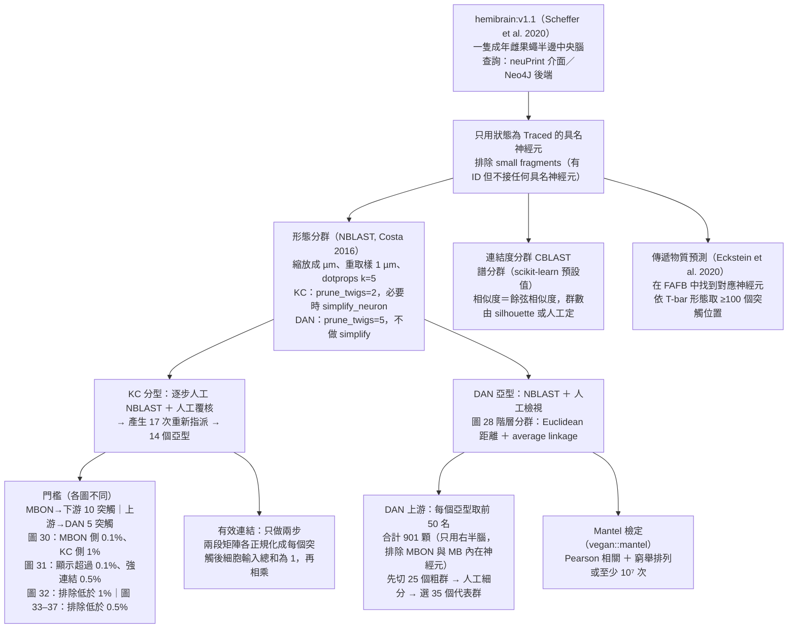

**資料集與排除規則。** 全部分析都在 hemibrain:v1.1 上做。每顆神經元有一個永久的數字 ID（一般 8–10 位數），細胞型名稱採 v1.1 的命名、嗅覺神經元採 Schlegel et al. 2020 的命名。**只用狀態標為 Traced 的具名神經元**；有 ID 但不接到任何具名神經元的 small fragments 全部排除。論文自己說明了為什麼要給 ID：細胞型的指派預期會隨新的生物學資訊不斷更新，而 ID 是永久的。

**門檻的選法，與一組必須被引用的敏感度數字。** 論文的通則是「門檻寫在各圖的圖說裡，沒寫就是全部連結都算」。引言裡交代了為什麼 MBON 與 DAN 用不同門檻：典型的 MBON 輸出突觸遠多於 DAN 的輸入突觸。**而真正重要的是後面那句敏感度陳述（行 446–449）：門檻設 5 時每顆 DAN 的中位上游神經元數是 31，提高到 10 就只剩 6 顆；相對地，門檻 10 時每顆 MBON 的中位下游神經元數是 90。** 門檻從 5 加到 10，DAN 的上游名單少掉八成。這是全篇唯一一處交代「門檻怎麼選」的地方，**也是本庫引用本篇任何一個計數時都應該一併引的脈絡**。

**形態分群的參數。** 骨架用 R 的 natverse 下載（`neuprintr::neuprint_read_neurons` 或 `hemibrainr`），補洞並以細胞體為根；必要時用 `nat::simplify_neuron` 簡化成一條主幹。NBLAST 之前縮放成微米、**重取樣步長 1 µm**、轉 dotprops 用 **k = 5** 個鄰居；為了降低電顯重建裡大量細枝的權重，用 `nat::prune_twigs` 修剪，**KC 用 twig_length = 2、DAN 用 5**（DAN 不做 simplify，以保留樹突與軸突的細微差異）。分群本身是 Costa et al. 2016 的標準 NBLAST 流程。**KC 分型是「逐步人工 NBLAST ＋ 人工覆核」，產生了 17 次重新指派**；論文把這句話放在方法節最末，正文完全沒提。那 17 顆幾乎都是「垂直葉像某一個 KCα/β 亞型、內側葉像前一個或後一個亞型」的細胞，作者推測它們出生在 KCα/βs→m 或 m→c 的發育轉換期。所有 NBLAST 分群另以 CBLAST 獨立驗證，少數不一致以人工檢查解決。

**各圖的突觸門檻**（引用任何一張圖的數字時都要帶上）：MBON→下游目標 **10 個突觸**；上游→DAN **5 個突觸**；圖 19 的 MBON→中央複合體 **10 個突觸**；圖 20 的「經一個中間神經元」兩段各 **20**（弱）或 **50**（強）；圖 24 的 MBON→MBON **30 個突觸**；圖 30 的 DAN→MBON **0.1%**、DAN→KC **1%**；圖 31 顯示 **>0.1%**、「強連結」定義為 **0.5%**；圖 32 排除低於 **1%**；圖 33–37 排除低於 **0.5%**。圖 13 的 uPN→KC 二元矩陣用 **5 個突觸**。

**傳遞物質預測是在 FAFB 上做的，不是 hemibrain。** 作法是先把每一型典型與非典型 MBON 在 FAFB 資料集裡跨資料集認出來，再依特徵性的 T-bar 形態取**至少 100 個**突觸位置，丟給 Eckstein et al. 2020 的機器視覺模型。作者在正文說明理由：抗體染色或 RNA profiling 需要的專一 GAL4 驅動品系還不存在。**這一點對本庫有實際後果**——若庫內有頁面寫「Li 2020 用 hemibrain 影像預測傳遞物質」，那是錯的（見 [[c-neurotransmitter-prediction]]）。另外，Eckstein et al. 2020 在本篇引用時**還是 bioRxiv 預印本**。圖上的標法：圖 7、圖 8 用虛線外框表示預測、實線表示實測；圖 17、圖 19、圖 26 用底線或空心圓表示預測。

**連結度分群。** CBLAST 用「該神經元把輸入／輸出分配到哪些神經元型」定義相似度特徵分數，迭代加人工修正。**譜分群**（Shi and Malik, 2000）用在圖 27 等多處，相似度度量是**餘弦相似度**，群數有時人工指定、有時用最佳 silhouette 分數自動決定，其餘參數採 Python **scikit-learn** `SpectralClustering` 的預設值。圖 28 的輸入連結分群另有一套：**先排除 KC→DAN 連結以免偏誤**，把上游到每顆 DAN 的突觸數除以該 DAN 的其餘輸入（扣掉 KC 輸入）正規化，再用 R `hclust`、**Manhattan 距離**、**Ward 準則**。圖 31–37 的連結資料來自 `neuprintr::neuprint_connection_table`，**只用右半腦的突觸**，理由是左半腦連結不完整、且要避免 PPL 與 PAM 之間的偏誤。

**統計檢定只有兩類。** 一是圖 5G 的置換檢定（n = 10,000）；二是圖 28 的 **Mantel 檢定**（`vegan::mantel`）：先算兩個距離矩陣的 Pearson 相關，再把其中一個矩陣**窮舉排列或至少排列 10⁷ 次**，以相關高於實際值的比例當 p 值。**論文沒有寫顯著水準訂在多少。** 圖 13 與圖 14 只有洗牌模型的 95% 信賴區間，沒有 p 值；圖 21 的零模型只給了一個點估計，沒有跑幾次、沒有信賴區間。

**有效連結度只做兩步。** 取「源的下游」或「標的上游」的中間神經元，把源—中間、中間—標的兩個矩陣各自正規化成「每個突觸後細胞的輸入總和為 1」，再相乘。隱含假設是：中間神經元的輸出突觸傳遞各路輸入的比重，正比於各路輸入的突觸數。方法節列出適用的圖是 10—fs2、11—fs1、26—fs2,3、27—fs3；**圖 15 不在這份清單上，而圖 15 的 16%／9%／62%／80% 全部依賴這個計算。**⚠️

**呈現工具。** 3D 彩現與電顯灰階圖用 NeuTu；標註用 Adobe Illustrator；MCFO 與 FAFB 骨架的 color-depth MIP 比對用 Fiji 的 ColorMIP_Mask_Search；連結圖的節點排版用 Cytoscape；影片用 Blender ＋ Python。**本篇沒有釋出自己的分析程式碼倉庫**（`grep` 過 `github.com/`、`code is available`、`Source code`，列出的都是現成套件）。

### 三、結果

#### 3.1 資料的組成與已知缺陷

hemibrain:v1.1 共約 **22,500 顆神經元**。其中約 **2,600 顆**在蕈狀體內有軸突或樹突，約 **1,500 顆**直接在 MBON 下游（門檻：每個 MBON 到每個下游目標 10 個突觸），約 **3,200 顆**在蕈狀體 DAN 上游（門檻：每個上游神經元到每個 DAN 5 個突觸）。作者據此說「本文的分析涵蓋了大約中央腦三分之一的神經元」。

資料的缺陷有六處，**全部是論文自陳的**，而且分布得很不平均：

1. **蕈狀體葉內的校對極為徹底：超過 80% 的電腦預測突觸被指派給了已辨識的神經元。** MBON 與 DAN 在葉外的樹枝也做了大量校對。
2. **但在 MBON 輸出與 DAN 輸入所在的其他腦區，重建常常遠不完整**（引 Scheffer et al. 2020 的 Table 2）。在那些區域，無法估計被標出的突觸能代表多少真實連結。
3. **左半腦的連結不完整**，所以圖 31–37 只用右半腦。
4. **食道下區（SEZ）的神經堆不在 hemibrain 體積內**，SEZ 輸出神經元的樹突形態只能去 FAFB 補（論文圖 35E）。
5. **視葉不在體積內**：小葉（LO）大致包含在 hemibrain 裡，髓質（ME）不在，所以髓質視覺投射神經元的身分要靠 FAFB 或光學影像跨資料集比對。
6. **只有約 15% 的下行神經元（約 50 個 DN 型）在 hemibrain v1.1 被辨識出來**（圖 42 圖說）；正文另一處寫「at most one-third」。⚠️ 同一件事兩個印象值，用 15% ＋ ~50 型比較具體。

另有三處個別的排除：一顆 PAM12 因缺同側軸突被排除；**PPL102 因形態與極性都和其他 PPL1 不同，「has not been included in certain analyses of DANs」——論文沒有列出是哪些分析**；78 顆 KCα/β 在主萼的重建不完整（圖 3 圖說）。

**本頁選了 10 張圖，依據是什麼。** 全篇 42 張主圖，本頁放 10 張：圖 2（解剖總綱）、圖 3（KC 分型）、圖 8（非典型 MBON）、圖 10（腹側副萼）、圖 13（KC 取樣的隨機性）、圖 21（下游匯聚）、圖 25（MBON→下行神經元）、圖 26（MBON→DAN 回饋）、圖 30（區室被拆成次單位）、圖 38（模型）。選擇依據有三條：**本庫既有頁面已經在引用它的數字卻沒人看過圖**（圖 21、圖 26）、**它是某個新主張的全部證據**（圖 8、圖 13、圖 30、圖 38）、**讀者沒有它就拼不起來後面的內容**（圖 2、圖 3、圖 10、圖 25）。沒放進來的 32 張裡，圖 9（主萼）、圖 11（背側副萼）、圖 12（側副萼）的資訊以本節的表格重製；圖 20、圖 26D、圖 18A 的數字以表格重製；圖 27、圖 28、圖 29、圖 31–37、圖 39–42 的關鍵觀察寫進內文。**本頁刻意沒有放圖 40 與圖 41**（嫌惡與獎賞記憶的 MBON 網路圖），理由寫在「問題與限制」第 9 條。

#### 3.2 KC 的 14 個亞型與四個萼

右半腦共 **1,927 顆 KC**，分 14 個亞型。下表由論文圖 3 逐格重製，並補上論文沒有並列的占比欄。

| 大類 | 亞型 | 顆數 | 占 1,927 | 樹突在哪 |
|---|---|---:|---:|---|
| γ | KCγs1 | 1 | 0.1% | vACA |
| γ | KCγs2 | 1 | 0.1% | lACA |
| γ | KCγs3 | 1 | 0.1% | 副萼 |
| γ | KCγs4 | 1 | 0.1% | 副萼 |
| γ | KCγt | 8 | 0.4% | 主萼前側（偏溫濕覺） |
| γ | **KCγd** | **99** | **5.1%** | **vACA（視覺）** |
| γ | KCγm | 590 | 30.6% | 主萼 |
| | **γ 小計** | **701** | **36.4%** | |
| α′/β′ | KCα′/β′ap1 | 91 | 4.7% | lACA ＋ 主萼前側 |
| α′/β′ | KCα′/β′ap2 | 127 | 6.6% | 主萼 |
| α′/β′ | KCα′/β′m | 119 | 6.2% | 主萼 |
| | **α′/β′ 小計** | **337** | **17.5%** | |
| α/β | **KCα/βp** | **60** | **3.1%** | **dACA（視覺）** |
| α/β | KCα/βs | 223 | 11.6% | 主萼 |
| α/β | KCα/βm | 354 | 18.4% | 主萼 |
| α/β | KCα/βc | 252 | 13.1% | 主萼 |
| | **α/β 小計** | **889** | **46.1%** | |
| | **總計** | **1,927** | **100%** | |

> 由論文圖 3 的 14 格逐格讀出（與 PDF 內嵌文字層核對過），占比為本頁計算。三個小計與正文行 637（701）、664（337）、674（889）完全吻合，總計與行 613、622 吻合。

KC 由四個神經母細胞依序產生，順序是 γ → α′/β′ → α/β。本篇推定的亞型出生順序（**是推論不是量測**，依據是軸突在柄裡的相對位置）：KCγs → KCγd 與 KCγt → KCγm；α′/β′ 為 ap1 → ap2 → m；α/β 為 p（最早，「先驅 KC」）→ s → m → c。四個神經母細胞譜系在主萼與柄裡形成分區，**進葉之後軸突被打散**。

四個萼的輸入組成如下。這張表是本頁的產出：**論文把四個萼分四張圖、四段文字寫，從來沒有並列過。**

| 萼 | 定義它的 KC | 主要感覺輸入 | 總輸入突觸（反推） | 每顆 KC 平均 | KC→KC | APL |
|---|---|---|---:|---:|---:|---:|
| 主萼 CA | 1,757 顆（α/β、α′/β′、γ） | 嗅覺 uPN 129 條，佔**全部輸入** 63.6% | ≈267,000 | ≈152 | 11.9% | 9.5% |
| 腹側副萼 vACA | 99 KCγd ＋ 1 KCγs1 | 視覺：VPN 直接 46.1% ＋ LVIN 間接 24.6% | ≈10,850 | ≈109 | 10.8% | 9.1% |
| 背側副萼 dACA | 60 KCα/βp | 視覺：LVIN 間接 57.8% ＋ VPN 直接 9.8% | ≈5,650 | ≈94 | 13.3% | 10.9% |
| 側副萼 lACA | 14 KCα′/β′ap1 ＋ 1 KCγs2 | 溫覺：VP3+ vPN 516 ＋ VP2 adPN 412 ＝ 928 個突觸 | ≈1,050 | ≈70 | 0.2% | 0.9% |

> 「總輸入突觸」由各圖圓餅上的突觸數除以對應百分比反推（`※ 推論`；三個獨立的扇形各自反推所得一致到 2% 以內）：CA 用 31.8K ÷ 11.9%、25.4K ÷ 9.5%、12.4K ÷ 4.6%；vACA 用 5.0K ÷ 46.1%、987 ÷ 9.1%；dACA 用 558 ÷ 9.8%、614 ÷ 10.9%、751 ÷ 13.3%；lACA 由 928＋49＋26＋15 ＝ 97% 反推。「每顆 KC 平均」為本頁計算。

**從這張表可以讀出三件論文沒有算的事。**

第一，**抑制性大神經元 APL 對四個萼的控制力差了一個數量級**：主萼 9.5%、vACA 9.1%、dACA 10.9%，而 lACA 只有 0.9%。圖 12 的圖說只定性地說 lACA「比 dACA 與 vACA 少得多」。APL 是全蕈狀體的增益控制元件（見 [[e-apl-neuron]]），**lACA 的溫覺通道幾乎不受它控制**，這對「溫覺輸入的增益怎麼調」有直接意義，論文沒有展開。

第二，**兩個視覺副萼走的路線完全相反，而這個對比要自己算**。把分母限定在視覺輸入上：vACA 的直接路佔 46.1 ÷ (46.1＋24.6) ＝ **65.2%**，dACA 只有 9.8 ÷ (9.8＋57.8) ＝ **14.5%**。論文把兩件事分別寫在兩節，從來沒有並列這個比值——而它正是「兩個副萼接線邏輯不同」的量化核心。**這個 14.5% 另外是本篇與 [[s-ganguly-2024-visual-inputs-to-kc]] 之間最乾淨的一處交叉驗證**：後者在另一份連結體（FlyWire）上對 KCαβ-p 算到 16%。

第三，**主萼的 KC 每顆收到的突觸是 lACA 的兩倍多**（152 vs 70）。這個差距會直接影響「一顆 KC 需要多少輸入才放電」這類推論在不同萼之間能不能通用。

兩個常被混用的分母必須分開寫。**「主萼的感覺資訊超過 90% 來自嗅覺 PN」（行 492）與「uPN 佔 63.6%」（圖 9 圖說）分母不同**：後者的分母是全部輸入，而全部輸入裡有約 26% 根本不是感覺輸入（KC→KC 11.9% ＋ APL 9.5% ＋ MB-C1 4.6%）。`※ 推論`：把分母限定在 PN 類上重算，嗅覺（≈170.4K uPN ＋ 約 2–3K mPN）對溫濕覺（2.9K th_uPN ＋ 6.1K th_mPN ＝ 9.0K）約為 **95 比 5**，與正文的「超過 90%」相容。**引用時必須指明分母。**

視覺輸入的細節寫在圖 10 與圖 11（本頁圖 4 為前者）。兩個關鍵的否定句都是作者自己下的：**「我們沒有觀察到 KC 的輸入形成高解析度空間地圖的證據」**（行 1113–1115），以及**「我們無法為『把味覺送進 dACA』找到強候選者」**（圖 11 圖說）——後者與它自己引用的文獻（Kirkhart and Scott 2015 報告 KCα/βp 對苦味或甜味有反應）相衝突，而論文沒有試圖調和。

溫覺那一邊有一個被埋沒的數字：**側副萼全部 928 個溫覺突觸裡，那顆唯一的 KCγs2 一個人收走 268 個（28.9%）**，而它只是 15 顆 KC 中的 1 顆；若平均分配應該只有 6.7%。論文把 268 寫在圖說中段，沒有任何評論。另外兩條溫覺 PN 的**冷暖不對稱**也沒有被討論：冷敏感的 VP3+ vPN 送 516 個突觸，暖敏感（而且是**預測**的暖反應，不是量到的）的 VP2 adPN 送 412 個，前者多 25%。

**本篇首次描述了味覺進入 KC 的路徑**：一群 KCγm 一邊在主萼收嗅覺 PN，一邊把爪狀樹突伸到主萼之外，從一條同時傳遞濕覺與味覺資訊的 PN 收訊號。這件事摘要沒提，只寫在正文一句話與一張補充圖裡。

#### 3.3 KC 的取樣是不是隨機的

主萼裡 PN 到 KC 的突觸有一個特徵形態：**每個突觸前小球（bouton）被一個爪狀的 KC 突起包住**，與脊椎動物小腦的苔狀纖維—顆粒細胞突觸高度相似。每條 PN 進萼後分枝，軸突平均終止於約 **6 個 bouton**；每顆 KC 在主萼收到的 bouton 數依型別而異：**KCα′/β′ 4.40 ± 1.58、KCα/β 4.67 ± 1.78、KCγ 8.49 ± 2.17**。

⚠️ **「每顆 KC 平均有幾個爪」這件事，論文自己給了三個互相對不上的答案。** 正文行 1172–1174 寫 **5.6 個**；圖 2 圖說寫 **六個**；而拿上面三個每型 bouton 均值做加權平均，`※ 推論`：若用三大類的全部顆數（337／889／701）加權，得 **6.01**；若只用主萼裡的 KC（扣掉 60 顆 α/βp 與 99 顆 γd ＋ 1 顆 γs1，即 337／829／601），得 **5.92**。**兩種算法都落在 5.9–6.0，沒有一種接近 5.6。** 三個數字可能指三件不同的事（主萼內的爪數 vs 全部 bouton 數 vs 約略值），但論文沒有區分，也沒有說 5.6 是怎麼算的。

檢驗隨機性用了兩套方法。**第一套是主成分分析（圖 13，本頁圖 5）**：把 uPN→KC 的二元連結矩陣（門檻 5 個突觸）與一組洗牌模型比較，洗牌模型保留每顆 KC 的連結總數（即爪數分布）與每條 uPN 的平均連結機率，**其他結構一概不保留**。正文的結論是「有三個主成分明顯大於隨機模型中的對應值」，偏離主要來自 γ、α′/β′、α/β 三類對嗅小球的取樣差異——α′/β′ 與 α/β 的輸入明顯偏向少數高度代表的嗅小球（最顯著的是 DP1m 與 DM1），而 γ 的分布比較平均。作者因此主張隨機模型應該擴充成「連結機率同時取決於 uPN 型別與 KC 型別」。

**第二套是空間洗牌（圖 14）**：先求出每個 uPN bouton 的形心，再把 PN→KC 的連結在半徑 r 內隨機重新指派，看兩個量怎麼變——**參與比（participation ratio）**量「每個嗅小球在全部 KC 輸入中被多均勻地代表」，**維度（dimension）**在「KC 對隨機 PN 活化模式稀疏放電」的模型下決定 KC 活動的線性讀出能做多好的氣味辨別（Litwin-Kumar et al. 2017）。結果是真實資料的兩個量都**低於**洗牌模型，「as expected from non-random structure, although the effect is modest」；效果在 α/β 與 α′/β′ 最強，γ KC 幾乎沒有。

總結句（行 1227–1233）值得照抄，因為它自己就把結論限制得很緊：**uPN 的輸入取決於 KC 亞型、以及主萼內部因局部受限取樣而產生的空間組織；這個空間結構對維度的影響只是 modest，而且它對 KC 輸入的效應在 KC 輸出到 MBON 的層級上已經看不出來了。**

#### 3.4 MBON：34 型、下游匯聚、中央複合體與下行神經元

**MBON 從 22 型變成 34 型。** 過去的清單是 22 型（Aso et al. 2014a；Takemura et al. 2017）。本篇在 hemibrain 裡找到了其中除 MBON08 以外的全部（**MBON08 不在這隻果蠅裡**），另外新增 14 型「非典型」MBON——定義是「樹突除了在葉內大量接收 KC 輸入之外，還延伸到葉外的鄰近腦區」。14 型中 **12 型是本篇首次發現**，另外兩型（MBON10、MBON20）是把 Aso et al. 2014a 描述過的細胞重新歸類。**最終 20 型典型 ＋ 14 型非典型 ＝ 34 型**，編號聯集為 MBON01–MBON35 扣掉 MBON08。

**非典型 MBON 的定義沒有量化門檻。** 圖 8 的圖說寫「樹突只有一部分在葉內」，正文寫「除了在葉內大量接收 KC 輸入之外還延伸到葉外」——兩種說法強度不同。而三顆 MBON10 的突觸後位點在葉外的比例分別是 **69%、68%、50%**；**50% 這一顆剛好卡在一半**，而論文沒說低於多少就算典型。14 型中 12 型支配水平葉，**6 型有顯著的腹側神經髓支配，特別是側副葉（LAL）**——這 6 型是後面「直通下行神經元」那條路的主角。

**輸出去哪裡，依傳遞物質分組之後有系統性偏好。** 下表由論文圖 18A 重製（數值與 PDF 內嵌文字層逐格核對），只列有數值的腦區：

| 腦區 | 典型 Glut | 典型 GABA | 典型 ACh | 非典型 Glut | 非典型 GABA | 非典型 ACh |
|---|---:|---:|---:|---:|---:|---:|
| AVLP | | | | | 6 | |
| **CRE** | **37** | **83** | **27** | **87** | 11 | 29 |
| ICL | | | | | 3 | |
| **LAL** | | | 1 | 3 | **37** | **30** |
| LH | | | 6 | | | |
| PLP | | | 2 | | 6 | 1 |
| PVLP | | | | | 1 | |
| SCL | | | 2 | | 7 | |
| SIP | 14 | 7 | 26 | | 1 | 7 |
| SLP | 9 | | 10 | | 5 | 4 |
| **SMP** | **38** | 8 | **23** | 8 | 12 | 19 |
| SPS | | | | | 2 | |
| VES | | | | | 1 | 2 |
| **欄和** | **98** | **98** | **96** | **98** | **92** | **92** |

> 單位為「該傳遞物質組的輸出突觸有百分之幾落在該腦區」，**含預測的傳遞物質**。⚠️ 六欄的和都不到 100（92–98），`※ 推論`：應是四捨五入加上小於 0.5% 的格子留白，論文沒有解釋。

**這張表最刺眼的對比是最後兩欄與第二欄。** 同樣是 GABA 型，**典型 MBON 有 83% 的輸出落在 CRE，非典型 MBON 卻有 37% 落在 LAL、只有 11% 在 CRE**。正文只寫「數型非典型 MBON 特有的強投射標的是 LAL」，沒有把這組對比算成一個量。**這一個數字就是「為什麼非典型 MBON 能直通運動系統，而典型 MBON 不能」的全部解剖依據。**

**下游匯聚（圖 21，本頁圖 6）是本庫既有頁面引用最多的一段。** 原文（行 1406–1407）：「At a threshold of 10 synapses, ~1550 neurons are downstream targets of at least one MBON, with nearly 40% of these (~600 neurons), getting input from at least two MBON types.」圖 21 的圖說補上了兩個關鍵限定：**1,550 這個計數含軸突對軸突連結**，而 600 的條件是「至少兩個 MBON **細胞型**」而不是「兩顆 MBON 細胞」。配套的零模型是：把 MBON 的輸出依各細胞的輸入突觸總數加權隨機取樣，預期會有 **~3,200 個下游，其中只有 14%** 收到兩型以上。**沒有這個 14%，那個「接近四成」撐不起「匯聚超出隨機」的結論。**

⚠️ **論文全文沒有出現「39%」**（`grep -n "39%"` 零命中）。本庫 [[t-mbon-to-action]] 與 [[s-aso-2023-upwind-neurons]] 先前寫的「600 顆（39%）」是本庫自己把 600/1550 算出來的；由於分子分母都加了「~」，寫成精確到個位的百分比會誤導。兩頁已於 2026-11-24 就地更正。

⚠️ 同一個量在引言寫成 **~1500**、在結果與圖說寫成 **~1550**；另外 MBON 的平均下游夥伴數，引言寫「median of 90」、結果寫「an average of 57」，**同一個門檻下差距很大，論文沒有說明兩句的集合是否相同**。

**MBON 到中央複合體只有兩條直接路。** 一是 MBON 接到扇形體（FB）切線神經元的樹突，二是三型非典型 MBON 在側副葉接到三型「軸突終止於結節」的中央複合體細胞。**橢球體（EB）與原腦橋（PB）完全沒有直接標的**（這是論文自己下的否定句）。下表由論文圖 20A 重製並補上論文沒有算的一欄：

| FB 層 | 打進來的 MBON 型數 | 收到輸入的 FB 型數（該層總型數） | MBON→FB 突觸 | **每個 FB 型平均突觸（本頁計算）** |
|---:|---:|---:|---:|---:|
| 9 | 0 | 0 (2) | 0 | — |
| 8 | 2 | 1 (9) | 54 | 54 |
| 7 | 0 | 0 (9) | 0 | — |
| 6 | 5 | 6 (26) | 94 | 15.7 |
| **5** | **14** | 13 (26) | **1,045** | **80.4** |
| **4** | **15** | 14 (18) | **2,385** | **170.4** |
| 3 | 0 | 0 (5) | 0 | — |
| 2 | 2 | 3 (14) | 77 | 25.7 |
| 1 | 1 | 1 (6) | 50 | 50 |
| **Σ** | **21** | **38** | **3,705** | |

> 括號內是 neuPrint 列在該層的全部細胞型數。Σ 列是「直接接到扇形體的 MBON 型數」與「收到直接輸入的 FB 型數」，不是逐列相加（有些 MBON 打進不只一層）。突觸合計 3,705 為本頁相加。

**第 4 層不只是「被比較多 MBON 打到」，而是每一個被打到的細胞型都被打得重得多**：每型平均 170 個突觸，約是第 5 層的兩倍、第 6 層的十倍。論文報告了分子與分母，沒有做這個除法。

⚠️ **這一段有三組數字對不上。** (1) **直接接到扇形體的 MBON 型數：正文寫 22，圖 20A 的 Σ 與圖 20D 的 Venn 都是 21。**`※ 推論`：22 應該是「直接接到中央複合體（扇形體＋結節）」的型數，21 才是「直接接到扇形體」的型數，正文把 22 掛在扇形體上了。(2) **收到 MBON 直接輸入的 FB 細胞型數：正文寫 37，圖 20A 的 Σ 與圖 20E 都是 38。** (3) **打進第 5 層的 MBON 型數：正文寫 13，圖 20A 寫 14**（13 剛好是同一列的 FB 型數欄）。另外正文寫「第 4 層的 MBON 支配該層 **58%** 的 FB 細胞型、第 5 層 **43%**」，但由圖 20A 算是 14/18 ＝ **78%** 與 13/26 ＝ **50%**，**反推正文的分母是 24 與 30，都不等於圖上的 18 與 26**。同一句的突觸百分比（62%／30%）與由表算出的 64.4%／28.2% 也略有出入，而且 62% 與 30% 本身無法共用同一個分母。

從圖 20D 的 Venn 可以反推一份論文沒有列出的名單：**完全沒有直接接到扇形體的 13 型 MBON 是 01、02、07、10、14、16、17、18、19、20、28、31、32**（`※ 推論`，由四個區域的型別清單反推；四區合計 13＋8＋7＋6 ＝ 34，自洽）。只有一型 FB 細胞的 MBON 輸入比例特別高：**CREFB4 有近 20%（圖上印 21.81%）的突觸輸入來自 MBON09 與 MBON21 兩型**，其餘所有 FB 細胞型都低於 5%。反過來看，把最多輸出投給扇形體的 MBON 是 MBON21（16%）、MBON33（9%）、MBON34（8%）。**而中央複合體到蕈狀體幾乎不存在**：論文明說「沒有找到任何中央複合體神經元直接輸入 KC、APL 或 DPM 的例子」，只找到 3 例在 DAN 上游。

**MBON 之間形成一個幾乎完全單向的多層前饋網路（圖 24，門檻 30 個突觸）。** 全網只有三對互連迴路：MBON06↔MBON11（葉內軸突對軸突）、MBON09↔MBON03 與 MBON09↔MBON01（葉外軸突對軸突）。連結的規則很整齊：**典型 MBON 之間的接觸幾乎全是軸突對軸突**（三型前饋 MBON 除外），而牽涉到非典型 MBON 的接觸可以是軸突對樹突。軸突對軸突的連結在傳遞物質上也有偏好（常見 Glut→Glut、Glut→ACh、GABA→Glut，**ACh 與 GABA 之間則沒有**），而且常常高度局限在單一一段軸突分支上——極端的例子是 **MBON09 打到 MBON01 的全部 110 個突觸都集中在 MBON01 的一小段軸突上**。⚠️ 正文說這個網路「synaptically organized into six layers」，**但圖上沒有任何層號、圖說沒提層、方法節也沒有分層演算法**（`grep` 全文 `six layers` 只命中一次）。讀者無從驗證層是怎麼定的，也看不出門檻從 30 改成 20 或 50 會不會改變層數。

**網路的頂端正好是兩型最專一於非嗅覺的 MBON。** MBON26（β′2d，溫濕覺有效輸入 30%）在第六層、MBON27（γ5d，視覺有效輸入 80%）在第五層；它們與第四層的 MBON31、MBON32 分別把約 **35%、60%、55%、70%** 的輸出突觸送到側副葉，其中 MBON27 與 MBON32 走對側。

**然後是本篇最具行為意義的單一結果：MBON 直通下行神經元（圖 25，本頁圖 7）。** 論文明說「在此之前沒有 MBON 到 DN 的直接連結被報告過」，而**六型支配側副葉的非典型 MBON 中有四型（MBON26、27、31、32）是下行神經元 DNa03 最強的輸入之一，DNa03 再強力輸入 DNa02**——後者的不對稱活動已知與果蠅走路的轉向控制有關（Rayshubskiy et al. 2020）。另外兩型支配側副葉的 MBON（MBON33、MBON35）也接到疑似 DN 的細胞，但需要進一步重建確認。八型不支配側副葉的非典型 MBON 中，只有 MBON20 在前 20 大下游裡有已確認的 DN（DNp42 與 DNb05）。

`※ 推論`：引言寫「至少**五型**非典型 MBON 與下行神經元強連結」，結果一節寫的是「**四型**」接到 DNa03——兩者可以相容，**第五型應該是 MBON20**（接 DNp42 與 DNb05），但論文沒有把這個加法寫出來。依據是行 462 的引言句與行 2359–2365 的結果句。

**論文自己對這個新宣稱設了界線**，而且界線很寬：「我們不是要暗示這些是僅有的直接 MBON→DN 連結。**從光學分析預期的下行神經元中，最多只有三分之一在 hemibrain v1.1 被辨識出來。**」圖 42 的圖說給了更具體的版本：**只有約 15% 的 DN 被辨識出來，約 50 個 DN 型**。`※ 推論`：若 50 型是全體的 15%，全腦約有 330 個 DN 型，**也就是說「只有 DNa02 與 DNa03 收到顯著的 MBON 輸入」這句話，是對約七分之一的下行神經元講的**。

#### 3.5 DAN：回饋三模式、亞型、把區室再拆一層

⚠️ **先處理 DAN 的總數，因為論文從頭到尾沒有把三個數字的關係寫清楚。**

| 數字 | 出現在哪 | 組成（`※ 推論`，依據為圖 6 的 21 個 n 值） |
|---:|---|---|
| **158** | 行 479「the inputs to all 158 DANs」 | 151 PAM ＋ 6 PPL1 ＋ 1 PPL201（支配主萼的 PPL2ab 細胞） |
| **156** | 行 2968「all pairs of the 156 DANs（圖 27）」 | 158 − 重建不全的 1 顆 PAM12 − PPL201 |
| **155** | 行 2391 ＋ 圖 26D 表頭（PPL1 Σ=5、PAM Σ=150） | 150 PAM ＋ 5 PPL1（被排除的是 PPL102） |

> 圖 6 的 15 個 PAM 型 n 值為 19、8、4、16、10、15、5、26、6、6、7、11、7、8、3 ＝ **151**；六型 PPL1 各 1 顆 ＝ 6。151 ＋ 6 ＋ 1 ＝ 158 ✓。本頁已與 PDF 內嵌文字層核對。**這三個數字加得起來，但論文沒有任何一處把排除規則寫清楚**，尤其是「PPL102 has not been included in certain analyses」完全沒說是哪些分析。寫頁面或引用時必須自己交代，否則讀者會以為 158/156/155 是三個互相矛盾的值。

**MBON→DAN 回饋（圖 26，本頁圖 8）有三種迴路模式。** 原文（行 2391–2393）：「All five PPL1 DANs and 99 of the 150 PAM DANs receive direct MBON input; **19 of 20 typical MBON cell types**, with representatives of all three neurotransmitter types, and **12 of 14 atypical MBON cell types** make direct connections to DANs.」三種模式是：同一區室（自我回饋）、不同區室（跨區室通訊）、兩者皆有。**「Only the α1 compartment displays exclusively self-feedback.」**

| 回饋模式 | PPL1（Σ=5） | PAM（Σ=150） |
|---|---:|---:|
| 只收同區室（Same） | 0 | 3 |
| 只收不同區室（Different） | 2 | 32 |
| 兩者皆有（Same + Different） | 3 | 65 |
| **欄和** | **5** ✓ | **100** ⚠️ |

> 由論文圖 26D 重製。⚠️ **PAM 欄加總是 100，正文寫的是 99**；PPL1 欄的 5 與正文的「five」完全吻合。`※ 推論`：「Same」列的 PAM ＝ 3，而 α1 是唯一純自我回饋的區室，PAM11-aad 亞型正好 3 顆（圖 28C 三顆全帶星號）——**這 3 顆就是那 3 個**，論文沒有把這兩處接起來。

**本庫先前把這句話轉述錯了，而且錯得有方向性。** [[e-mbon]] 與 [[s-yamada-2023-second-order-conditioning]] 寫的是「MBON-α1 是唯一一型不直接接到其他區室 DAN 的 MBON」。**原文的「唯一」掛在「區室」上，不是掛在「MBON 型」上。** 由於 α1 區室只有 MBON07 一型 MBON 的樹突（兩顆細胞各自填滿整個區室），兩種講法在 α1 這個個案上指向同一件事，所以方向沒錯；**但「唯一」在字面上站不住**——同一段原文寫明有 1 型典型與 2 型非典型 MBON 完全不直接接任何 DAN，這 3 型當然也「不接其他區室的 DAN」。本庫的「宣稱唯一性」已犯過八次，這是第九次的候選。兩頁已於 2026-11-24 就地加註。

**那 3 型是誰？本頁從圖 26 反推出了答案，而論文沒有點名。** 把圖 26 A–C 三格裡出現過的 MBON 編號抽出來（用 PDF 的內嵌文字層，不是目測），共 30 個相異編號。對照 34 型清單：**非典型 14 型中缺 MBON20 與 MBON24，正好是「12 of 14」**；**典型 20 型中缺 MBON14 與 MBON22，是 18 型，而正文寫的是「19 of 20」。**⚠️ 圖與正文差一型。`※ 推論`：不接任何 DAN 的是 MBON20、MBON24（非典型）與 MBON14、MBON22 中的至少一型（典型）；依據是圖 26 的圖說自陳 A 格列出「each of the instances we observed with this arrangement」，而 B、C 兩格的體例相同。**不確定範圍：若圖 26 只畫了達到某個未標示門檻的連結，則缺席不等於不存在；論文沒有為圖 26 標明門檻。**

另外兩個與回饋有關的事實：**麩胺酸型、其次是乙醯膽鹼型 MBON，明顯偏向回饋給同區室的 DAN**；而三型軸突末梢留在葉內的前饋 MBON（MBON05、06、11）也對一部分 DAN 做軸突對軸突突觸。⚠️ 圖 26D 右半的「提供回饋的 MBON 細胞型數」三列相加（典型 1＋10＋16 ＝ 27）**超過典型 MBON 的總型數 20**，所以同一型 MBON 會在多列被重複計數，**不能拿這張表去驗證「19 of 20」**。

**DAN 的輸入彼此很不像。** 圖 27 對 156 顆 DAN 兩兩算輸入的餘弦相似度，**而且刻意排除了蕈狀體葉內的輸入**（KC、其他 DAN、APL、DPM 一律排除）。整張圖偏淡——絕大多數 DAN 兩兩之間的相似度低於 0.3，只有對角線區塊內部與少數跨區室方塊偏深。**論文把「異質性」與「共通性」並列陳述，但視覺上兩者完全不對等**：異質性是壓倒性的，共通性只是少數深色方塊。由這個矩陣，作者宣稱「辨識出 **40 個 DAN 的推定功能群**」與「奇異值分析顯示葉內至少有 **20 個次區室分區**」。`※ 推論`：40 這個數字正好等於圖 31 的 40 列 ＝ **34 個 PAM 亞型 ＋ 6 個 PPL1 型**（PAM 各型的亞型數：4、2、1、3、2、2、1、4、2、2、3、2、2、2、2），論文沒有寫這個拆法。**而「20 個次區室分區」的奇異值分析方法節完全沒有描述**（`grep` `singular value` 只命中一句）。

**形態亞型與輸入亞型是同一組（圖 28）。** 用形態分群或用上游連結分群，結果高度一致；Mantel 檢定的三組結果是 PAM01（γ5）r = 0.764、p < 10⁻⁷、n = 10⁷；PAM12（γ3）r = 0.838、p = 2.76 × 10⁻⁷、n = 3.6 × 10⁶；PAM11（α1）r = 0.779、p = 3.97 × 10⁻⁴、n = 5 × 10⁴。**圖說的句子是雙重否定**：「Connectivity and morphology clustering are **not** significantly **independent**」＝兩者相關，照字面讀會讀反。`※ 推論`：**n 是排列次數，所以可以反推神經元數**——PAM12 有 10 顆，10! ＝ 3,628,800 ＝ 3.6 × 10⁶ ✓ 完全吻合；但 PAM11 有 7 顆，7! ＝ 5,040 ＝ 5 × 10³，**圖說印的是 5 × 10⁴，差一個數量級**，看起來是上標的印刷錯誤。

**最重要的一步：區室被拆成可獨立學習的次單位（圖 30，本頁圖 9）。** 作法是先依樹突輸入相似度在區室內把 DAN 分群，**不改順序**，再看它們對 KC 的輸出有沒有同樣的結構。**這裡有一個誠實的負結果**：β1、β′1、γ4 看得到保留下來的結構，但 α1、γ3、γ5 用這個分析看不到，所以作者改用逐一細查。細查的結果是：

- **γ5**：PAM01-nc 是視覺流（KCγd、KCγs1）的主要輸入，PAM01-fb 則主要接嗅覺的 KCγm。在 MBON 側，PAM01-fb 接 MBON01 與 MBON29 但**不接** MBON27（它的樹突偏在區室背側），而 MBON27 由另外三類 PAM01 供應；MBON24 **只**收 PAM01-lc。
- **γ3**：PAM12-md 提供 KCγd 大部分的 DAN 輸入，KCγm 與 KCγt 則偏向 PAM12-dd。
- **α1**：PAM11-nc 的軸突只佔 α1 的一小塊，優先支配視覺流的 KCα/βp，避開 KCα/βc 與 KCα/βm。**α1 區室只有一型 MBON，兩顆細胞各自填滿整個區室，所以三個亞型都接到它。**

通則（行 3176–3182）：「**每一個被多顆 DAN 支配的區室都含有一個以上的 DAN 亞型，而且一般來說每個區室裡只有一個亞型收到直接的 MBON 輸入，其他亞型沒有。**」這讓同一個區室裡不同組的突觸權重可以被獨立調整。

**跨區室的共享輸入（圖 31–37）。** 對每個 DAN 亞型取突觸數最多的 50 顆上游，合起來 **901 顆**（右半腦，排除 MBON 與蕈狀體內在神經元），形態分群後圖 31 畫出其中 **35 群**。幾個被論文強調的結果：PPL101、PPL103、PAM12 共享輸入，支持「嫌惡教學訊號被平行驅動」；**食道下區（SEZ）是 DAN 輸入的主要來源**，而 SEZ 不在 hemibrain 體積內，樹突形態要靠 FAFB 補；**沒有找到明顯的初級感覺區直接輸入到嫌惡 DAN**（論文自己的否定句），推論是大多數訊息在抵達 DAN 之前已經被預處理過。

`※ 推論`，兩個論文沒有報告的量：**(1) 圖 31 的色階上限是 7.23%**（本頁以 PDF 內嵌文字層確認該頁印出的最大值）——即使最強的那一格，單一輸入群也只佔該 DAN 亞型樹突輸入的 7.23%，絕大多數格子低於 2%。**這是「DAN 輸入極度分散」最硬的證據，同時替「這些 DAN 被同一個訊號一起觸發」這類推論踩了煞車。** (2) **40 個亞型 × 每個取前 50 名 ＝ 2,000 個名額，但只動用了 901 顆神經元**，平均每顆上游神經元是 2.2 個 DAN 亞型的前 50 名。**「跨區室共享輸入」有相當部分是取樣方式本身造成的**（取前 50 名而不是取「超過某門檻的全部」），而論文沒有給任何隨機對照基準。

**credit assignment 這個結論完全沒有數字。** 對每一對區室，比較「兩區室的 DAN 所收上游輸入的相似度」與「兩區室的 MBON 所投射下游目標的相似度」，報告「顯著的正相關」。⚠️ **正文與方法節都沒有給相關係數、p 值、樣本數（區室對數）或檢定方法**；唯一的數據在 Figure 27—figure supplement 4，而該補充圖本庫未取得：`？待查`。這是全篇被引用最多的 DAN 結論之一，**而本頁只能把它標成「定性宣稱」。**

#### 3.6 模型：分流的感覺通道什麼時候划算（圖 38）

論文最後用一個線性讀出模型問：把 KC 分成模態專屬的兩群（如連結體所見），什麼時候比混合取樣有利。兩種架構（分離 KC vs 共用 KC）× 兩種任務（可因式分解 vs 不可因式分解），讀出的是一個線性分類器的二元分類正確率。柱狀圖的值（從圖判讀，誤差約 ±0.01）：

| 任務 | 分離 KC 群 | 共用 KC 群 | | 分離的獎賞訊號 | 共用的獎賞訊號 |
|---|---:|---:|---|---:|---:|
| 不可因式分解 | 0.60 | **0.795** | | **0.49** | **0.81** |
| 可因式分解 | **0.85** | 0.75 | | **0.94** | 0.865 |

> 左半為圖 38B（KC 架構），右半為圖 38D（DAN 架構）。不可因式分解的任務用 25 個刺激、可因式分解的用 200 個，**是作者為了讓難度可比而調的，所以兩個任務之間不能比較絕對高度**，只能比同一任務內的兩根柱子。誤差棒為 20 次模擬的標準誤，極小。

**真正該看的是 D 不是 B，而論文正文只寫了 B 那一半。** B 說的是老問題（專化 vs 混合），D 才是本篇連結體發現（DAN 亞型模態專一）對應的理論主張。`※ 推論`：**D 圖左邊那根 0.49 就是二元分類的隨機水準**——當任務不可因式分解時，分流的 DAN 調控不是「比較差」，而是**完全學不起來**。把兩張圖的代價放在一起比：架構選錯在 KC 側的代價是 0.795 → 0.60（掉 0.195），在 DAN 側是 0.81 → 0.49（掉 0.32）。**「DAN 架構選錯比 KC 架構選錯嚴重得多」——論文從頭到尾沒有講這件事。** 不確定範圍來自柱高判讀誤差（±0.01），遠小於上述差距。

⚠️ **而圖 38 的任務定義，圖說與正文邏輯相反。** 正文（行 4358–4361）：每個嗅覺與視覺刺激被指派 positive 或 **neutral** 的子價性，合成價性為正的條件是「**if either** of these components is positive（嗅覺 **OR** 視覺）」。圖 38B 圖說（行 4974–4976）：每個模態的刺激有 positive 或 **negative** 的價性，整體價性為正的條件是「**only if both** constituent valences are positive」（**AND**）。**兩處差兩件事**（子價性是 positive/neutral 還是 positive/negative；合成規則是 OR 還是 AND），而這決定了四組柱子在算什麼。

### 四、討論

論文的主要主張與它們的證據強度，逐條如下。**分三級：【連】有本篇連結體數據直接支撐、【推】純推論或機制假說、【他】靠別人的功能性實驗。**

**主張一：DAN 的調控不是以區室為解析度，而是區室內的亞型各自作用。【連】** 這是全篇最強的主張，證據有三層：形態分群與連結分群在三個區室上給出一致的亞型（圖 28，三組 Mantel 檢定都顯著）；亞型對 KC 與 MBON 有選擇性（圖 30）；亞型的軸突在區室內鋪成不重疊的瓦片（圖 30A、B、D、E）。**弱點在於「亞型」這個單位本身**：論文用的是 subtype 而非 cell type，也沒說這些亞型在 neuPrint v1.1 裡有沒有對應標籤；而且「together tile」是定性說法，重疊程度沒有量化。

**主張二：MBON 對 DAN 的回饋廣泛存在，而且分三種模式。【連】** 99/150 PAM ＋ 5/5 PPL1 收到直接 MBON 輸入，是一個乾淨的計數結果。⚠️ 但 99 與圖 26D 的 100 差一；而且圖 26 自己顯示的典型 MBON 只有 18 型，正文寫 19 型。**這一條在本庫的既有頁面上被轉述得過強（見 3.5 節），引用時應該引區室而不是 MBON 型。**

**主張三：MBON 的下游有超出隨機的匯聚。【連】** 真實 40% vs 零模型 14%，差距大到不太可能是雜訊。**但論文沒有給零模型的重複次數、沒有信賴區間、沒有顯著性檢定**，所以「超出隨機多少」只有一個點估計。

**主張四：非典型 MBON 直通控制轉向的下行神經元。【連】＋【他】** 連線存在是連結體數據；「DNa02 與轉向有關」來自 Rayshubskiy et al. 2020。**最大的保留是覆蓋率**：只有約 15% 的下行神經元被辨識出來，所以「只有 DNa02、DNa03 收到顯著 MBON 輸入」是對七分之一的樣本講的。另外標題說的「到腹神經索」，**腹神經索那一端並不在資料集裡**——圖 25A 自己註明 DN 的軸突延伸到 hemibrain 體積之外，那一段是靠 Namiki et al. 2018 的光學形態補上的。

**主張五：感覺模態分流的 KC 在可因式分解的任務上有利；若 KC 分流，則配上分流的 DAN 學得更有效率。【推】** 純模型結果。**模型參數完全沒給**：KC 數、PN 數、稀疏度、讀出的正則化方式都不在圖說或方法節裡，**無法重現**。而且圖說與正文對任務的定義相反（見 3.6）。

**主張六：γ3 一個區室內可以同時進行相反價性的調控。【連】＋【推】** 共享輸入是連結體數據；**價性的指派完全是從「與誰共享上游輸入」推出來的**，而圖 31 整張矩陣的最大值也只有 7.23%、絕大多數格子低於 2%——共享的那些輸入在任何一顆 DAN 身上都只佔很小一部分。**這是一個很薄的推論基礎，而論文的圖 39 把它畫成了確定的標籤。**

**主張七：MBON06（β1>α）是獎賞記憶的樞紐。【連】＋【推】** 連線與突觸數是數據（MBON06 對 MBON07／MBON14 的連結是 MBON11 的兩倍），因果鏈是推論。**而這條推論建立在一個論文自己說沒被檢驗過的前提上**：作者假設 PAM10（β1）DAN 藉由壓低 KC→MBON06 的突觸來編碼獎賞記憶，而論文另一處明寫「MBON06 在獎賞記憶中的角色、以及 PAM10 怎麼調控 KC→MBON06 的突觸，**都還沒有被研究過**」。

**主張八：MBON06 用麩胺酸，而且推測為抑制性。【推】** 依據是「β1 DAN 驅動的記憶是正向的」——**由行為的符號反推傳遞物質的極性**。論文自己在另一處寫明麩胺酸的符號有爭議，而且有 RNA profiling 資料的六型 MBON 與十型 DAN **全部同時表現抑制性的 GluClα 與興奮性的 NMDA 型受體**。這是整段討論裡最弱的一環。

**主張九：推拉（push-pull）是普遍的基序。【連】＋【推】** 乙醯膽鹼型與麩胺酸型 MBON 常匯聚到同一個下游，而 GABA 型與兩者都沒有這種相似性。**但整個主張依賴「麩胺酸＝抑制」，而論文自己承認這一點有爭議，也沒有做「若麩胺酸是興奮性則結論如何」的替代分析。**

**主張十：某些 MBON 可能扮演 actor-critic 的 critic。【推】** 明確的類比（對照哺乳類腹側紋狀體），論文自己說需要功能實驗驗證。

⚠️ **討論裡有一個結果節找不到出處的量化結論**：「同時收多個 MBON 輸入的下游神經元，提供 DAN 直接輸入的機率是其他 MBON 目標的**兩倍**」。沒有附圖號、沒有 n、沒有檢定；`grep -n "twice as likely"` 全文只命中這一處；圖 21 及其圖說講的是 MBON 下游的匯聚，**完全沒有提到 DAN**。

### 五、問題與限制

**1.（論文自陳，最重要的一條）重建完整度在不同腦區差很多，而差的那一邊正是 DAN 分析所在的地方。** 原文：蕈狀體葉內「超過 80% 的電腦預測突觸被指派給了已辨識的神經元」，MBON 與 DAN 在葉外的樹枝也做了大量校對，「**However, in other brain regions, where MBON outputs and DAN inputs lie, reconstruction was often much less complete**」，在那些區域無法估計被標出的突觸能代表多少真實連結。**這句話削弱的是哪些分析，論文沒有列**，本頁列出來：圖 27（DAN 輸入的相似度）、圖 28（輸入分群與 Mantel 檢定）、圖 31–37（901 顆上游與 35 個輸入群）、圖 18（MBON 輸出的腦區分布）、圖 21（1,550 與 600）、圖 19–20（MBON→扇形體）、圖 25 與圖 42（MBON→下行神經元）——**也就是本篇大約一半的結果。**更正 2026-11-26**：這個「一半」沒有計數依據。本條列出的受影響圖號是 27、28、31–37、18、21、19–20、25、42，共 **15 張**，佔 42 張主圖的約 **36%**；寫成「約三分之一」才有依據。** 蕈狀體葉內的結果（圖 3–5、圖 22–24、圖 29–30）不受這一條影響。

**2.（論文自陳）「突觸數多」不等於「是主要驅動路徑」，而對活動相關性的無知是最大的不確定來源。** 原文把話說得比大多數連結體論文重：這個不確定性「比突觸辨識誤差與門檻選擇的影響都大」。一組突觸數高但很少同時放電的輸入，在連結體上看起來是主幹；一組各自微弱但高度相關的輸入可能很有效，而連結體看不出來。

**3.（論文自陳）門檻該用固定突觸數還是百分比、該取多少，都還有爭議。** 所以論文常常同時給百分比與突觸數。**本篇自己最好的示範是那組敏感度數字**：門檻 5 → 10，每顆 DAN 的中位上游數從 31 掉到 6。另一個示範在腹側副萼：同一張圖上有 138 條 VPN（不設門檻）與 49 條（≥5 突觸／單顆 KC）兩個數，**差 2.8 倍，純粹是門檻造成的**。

**4.（論文自陳）連結體看不到電突觸（gap junction），也看不到較遠距離的非突觸調控。** 而內在狀態（飢餓、口渴）正是靠容積釋放的胜肽與單胺運作的，論文明說「連結體無法完整描述這套迴路」。

**5.（論文自陳）單突觸、雙突觸的弱連結可能是突觸預測誤差或發育佈線誤差造成的假連結**；但真實的稀疏連結若同步放電仍可能有影響，而這無法從現有資訊判斷。

**6.（論文自陳）形態像不代表功能像，形態不同也可能功能相同。**

**7.（論文自陳）DAN→MBON 連結的生理與行為角色遠不如 DAN→KC 清楚**：只有一個案例有功能數據（Takemura 2017 的 PAM11→MBON07 慢速去極化）。**而圖 30C 把 DAN→MBON 畫得和 DAN→KC 一樣確定。**

**8.（本頁補充）大量結論依賴的補充資料本庫一張都沒有。** 53 處 figure supplement 與 33 支影片的影像不在本機 PDF 裡。影響最大的三處已列在資料表：KCγd 的突觸形態（Figure 10—video 1）是矛盾 1.15 的一側；credit assignment 的全部數據（Figure 27—fs 4）；DAN 輸入的腦區分布（Figure 27—fs 3）是本庫另一條轉述的唯一可能出處。**這三處一律標 `？待查`。**

**9.（本頁稽核）同一篇裡對立的事實與標籤，而最嚴重的幾處都落在價性上。** 本頁逐一回原文核對過的單篇自身不一致如下，**全部不需人類裁決**：

| # | 不一致 | 三處各自在哪 |
|---|---|---|
| a | **KC 總數 1,927 vs ~2,000** | 正文兩處寫 1927（行 613、622）；引言與圖 2 圖說三處寫 ~2000（行 176、219、467）。引用時應寫 1,927（本隻動物的實測值） |
| b | **每顆 KC 的爪數 5.6 vs 6 vs 5.9–6.0** | 正文行 1173 寫 5.6；圖 2 圖說寫 six；由每型 bouton 均值加權平均得 5.92–6.01（見 3.3） |
| c | **Supplementary file 1 的標題張冠李戴** | 正文行 3192、3196 說它是 **402 個「輸入神經元群」**的成員清單；附檔標題（行 5672）卻寫「Constituents of each of the **402 PAM subtype clusters**」——**PAM 亞型只有 34 個**，差一個數量級。而方法節（行 5268–5270）對同一件事寫的是 **235 群**（901 顆分 402 群是每群 2.24 顆，分 235 群是 3.83 顆）。更亂的是圖 28 圖說說 Supplementary file 1 是「PAM subtypes 的完整清單」，圖 31 圖說說輸入群列在 **Supplementary file 2**，而 Supplementary file 2 的標題說它是「圖 **32** 所示 DAN 輸入群」的成員。**五處指向三種內容。附檔不在 PDF 裡，無法再往下查；不要引用「402 個 PAM 亞型群」這個說法。** |
| d | **圖 38 的 factorizable 定義，圖說（AND）與正文（OR）相反** | 見 3.6。另外子價性在正文是 positive/neutral、在圖說是 positive/negative |
| e | **PAM12-dd 的價性，圖 32 圖說標反** | 正文行 3229–3236 與圖 39 的圖內文字都說 PAM12-**dd ＝ negative valence**、PAM12-**md ＝ positive**；而圖 32 圖說的 (E)(F) 兩處都寫「**positive valence** PAM12-dd」，**與同一段圖說自己的導言（「PAM12-dd shares inputs with negative-valence PPL1 DANs」）也矛盾**。出現兩次，不像單純筆誤 |
| f | **MBON09 的 DAN 輸入來自哪個亞型** | 結果（行 3160–3162）與討論（行 4385–4387）都說 PAM12-**dd**；圖 39 圖說說 PAM12-**md**。由於兩個亞型被指為相反價性，**這個錯會直接翻轉「MBON09 被哪一種價性調控」** |
| g | **MBON08 在正文說不存在，卻出現在圖 23** | 行 735、939 兩處都說 MBON08 不在這隻果蠅裡；而圖 23 下排的典型 MBON 方塊中確實有一個藍色（GABA）的 `08`，位在 γ3、與 `09` 相鄰，而且有連線拉出去（本頁以 300 dpi 整頁渲染與 PDF 內嵌文字層雙重確認）。**同一排沒有 MBON22（樹突在萼，放不進區室格），所以下排的 20 個相異編號與圖 7 的 20 型不是同一組** |
| h | **直接接扇形體的 MBON 與 FB 型數，三處對不上** | 22/21/21 與 37/38/38/41；FBl5 的 13 vs 14；58%／43% vs 由表算得的 78%／50%。細節見 3.4 |
| i | **DAN 總數 158／156／155（加上圖 6 的 151 PAM）** | 加得起來，但論文沒有任何一處寫出排除規則。見 3.5 的表 |
| j | **圖 26D 的 PAM 欄加總 100，正文寫 99** | PPL1 欄完全吻合（0＋2＋3 ＝ 5） |
| k | **圖 26 顯示的典型 MBON 只有 18 型，正文寫 19 of 20** | 見 3.5。非典型那一半（12 of 14）則完全吻合 |
| l | **圖 28C 的 Mantel n ＝ 5 × 10⁴ 與 7 個葉節點對不上**（7! ＝ 5 × 10³） | 圖 28B 的 10 顆對 3.6 × 10⁶ ＝ 10! 完全吻合，所以是上標的印刷錯誤 |
| m | **圖 29 圖說說「eight compartments」，面板裡標出的區室名有 11 個** | 「八」指的是八個面板組 |
| n | **圖 33 圖說把群號的出處寫成 Figure 30，實際編號在 Figure 31** | 圖 30 裡沒有任何編號的群 |
| o | **hemibrain 裡已辨識的下行神經元比例：at most one-third（行 2368）vs about 15%（行 5429）** | 兩者不衝突，但同一件事給了兩個很不同的印象值；用 15% ＋ ~50 型比較具體 |
| p | **MBON30 收到的扇形體輸入：nearly 500（行 868）vs 451（行 1376）；同一型細胞的別名 FR1 vs FS1** | |
| q | **圖 21 的 LHN 過度代表，門檻是 7 還是 10** | 正文行 1792 寫「particularly overrepresented among those receiving input from **seven or more** MBONs」；圖 21 圖說行 4315 寫「among the neurons that receive input from **10 or more** MBON types」。另外正文把 LH 神經元與 TON 並列為過度代表，圖說只寫 LHN（2026-11-26 新增） |
| r | **前人描述過的 MBON 型數，22 與由圖 7 回推的 23 對不上** | 正文行 890 寫「a network of **22** types of MBONs」；圖 7 圖說行 1300 把那 20 格稱為「the **previously described 20** types of MBONs」，同段又寫「For the **other 21** MBON types」。被扣掉的是 MBON08（不在這隻果蠅裡）加上改歸非典型的 MBON10、MBON20 共三型，20＋3 ＝ 23 ≠ 22。三處只有在「圖 7 的 20 格裡有一型其實是新的」時才自洽（2026-11-26 新增） |
| s | **圖 30 的 DAN→KC 門檻，圖說與方法節差一倍** | 圖說行 5989 寫「at least **1%** of a KC type's input from DANs」；方法節行 7302 寫「thresholded at **0.5%**」。兩邊各有出處，是論文自身不一致，不是誰抄錯；[[numbers]] 用的是方法節版（0.5%），本頁「圖」一節的門檻清單用圖說版（1%）（2026-11-26 新增） |

**10.（本頁稽核，論文自己沒處理的問題）圖 8 的 14 型非典型 MBON 裡，只有一型的傳遞物質是量到的。** 圖 8 的外框色碼分「GABA（實線）」與「predicted ACh／Glut／GABA（虛線）」。本頁逐格判讀：**只有 MBON10 是實線**；**MBON20 是虛線（predicted GABA）**，其餘 12 型也全是虛線（預測 ACh 7 型、預測 Glut 3 型、預測 GABA 3 型，1＋7＋3＋3 ＝ 14 ✓）。而同一張圖的圖說寫的是「The other two, **the GABAergic MBON10 and MBON20**, were described by Aso et al., 2014a」——**把一個預測值寫成了既定事實。** 這件事有實質後果：非典型 MBON 的輸出分布表（圖 18A）把「非典型 GABA」單獨成一欄，而那一欄 37% 落在側副葉、是「非典型 MBON 直通運動系統」這條線的核心數字；**若 MBON20 的 GABA 身分是預測的，那一欄就不是「兩型實測 GABA」的統計。** 論文沒有討論這個敏感度。本頁的判讀依據是圖 8 右下角的色鍵與各格外框的實虛線，以 300 dpi 整頁渲染確認；不確定範圍：實線與虛線在縮圖上可能混淆，但 MBON10 與其他 13 格的差異在整頁渲染下清楚可辨。

### 六、未來

**論文自陳的方向。** 第一，用功能實驗檢驗從連結體推出來的迴路假說——論文反覆強調這一點，特別是 DAN→MBON 連結（只有一個案例有功能數據）與非典型 MBON 的全部功能（它們是首次描述，完全沒有生理或行為資料）。第二，量測活動的相關性，因為論文自己把「對活動相關性的無知」列為最大的不確定來源。第三，把分析擴張到完整的中樞神經系統連結體，補上目前缺席的視葉、食道下區、腹神經索與絕大多數下行神經元。第四，發展把連結體對應到計算的方法學——論文的結語把蕈狀體與小腦、背側耳蝸核、電魚的電感葉並列，主張這類「由特定機制驅動學習」的架構可以為皮質學習的研究提供參考。

**本庫關注的後續。** 這篇留下的開口，庫內目前只有一部分有人接。[[e-hemibrain]] 可以立刻補上「整份資料集約 22,500 顆神經元」與本篇自陳的重建不均（葉內 >80% 突觸已指派，葉外的 MBON 輸出區與 DAN 輸入區遠不完整），**後者比前者重要得多，因為它決定了引用本篇哪一半結果要打折**。[[e-mbon]] 的清單要從 22 型改成 34 型，並把「非典型」這個分類（以及它沒有量化門檻這件事）寫進去。[[c-mb-compartment]] 要加一層：15 個區室底下有 40 個 DAN 亞型／功能群，同一個區室可以同時跑相反價性的學習。[[t-mbon-dan-feedback]] 可以把「99/150 PAM ＋ 5/5 PPL1、三種迴路模式」升級成具體的計數，並改掉 α1 那句「唯一」。[[t-mbon-to-action]] 已於 2026-11-24 補上零模型的 14%。[[c-sparse-coding]] 可以吃下本篇對「KC 取樣是否隨機」的回答（不是隨機，但偏離幅度 modest，而且在 KC 輸出到 MBON 的層級上已經看不出來）。**庫內還沒收錄而本篇一直在對話的兩篇是 Takemura et al. 2017（三個區室的微迴路，本篇說它在第二隻不同性別的個體上保守）與 Eichler et al. 2017 的幼蟲連結體**；兩篇都進來之後，「區室的微迴路有多保守」才撐得起一條主題線。而 [[s-ganguly-2024-visual-inputs-to-kc]] 已經收錄，並在一處修正了本篇（見「相關」一節的矛盾 1.15）。

**尚未被回答的。** 第一，**那 1 型典型與 2 型非典型完全不接 DAN 的 MBON 是誰**——本頁從圖 26 反推出非典型的兩型是 MBON20 與 MBON24，典型那一型落在 MBON14 與 MBON22 之間，但圖與正文差一型（18 vs 19），所以仍未定。第二，**圖 24 的「六層」是怎麼定的**：沒有演算法、沒有圖上標記、沒有門檻敏感度分析。第三，**「20 個次區室分區」的奇異值分析怎麼做的**，方法節一個字都沒有。第四，**credit assignment 的強度**：沒有 r、沒有 p、沒有樣本數。第五，**DAN 亞型是不是個體間穩定的**——本篇只有一個腦，而且左半腦連結不完整，所有亞型分群都只用右半腦。第六，**共享輸入有沒有基準線**：用「每個亞型取前 50 名」的取法，2,000 個名額由 901 顆填滿，共享是取樣的必然結果，而論文沒有做隨機對照。第七，**圖 38 模型的參數**，完全沒給，無法重現。第八，**78 顆主萼重建不完整的 KCα/β 有沒有被排除在主萼的輸入統計與圖 13、14 的分析之外**。第九，**lACA 的冷暖不對稱（516 vs 412）與 KCγs2 獨佔 28.9% 溫覺突觸，有什麼功能意義**：論文給了數字，沒有任何討論。

---

## 圖

本節收錄圖 3 至圖 10；圖 1（論文圖 2）與圖 2（論文圖 3）在「科普文」一節。

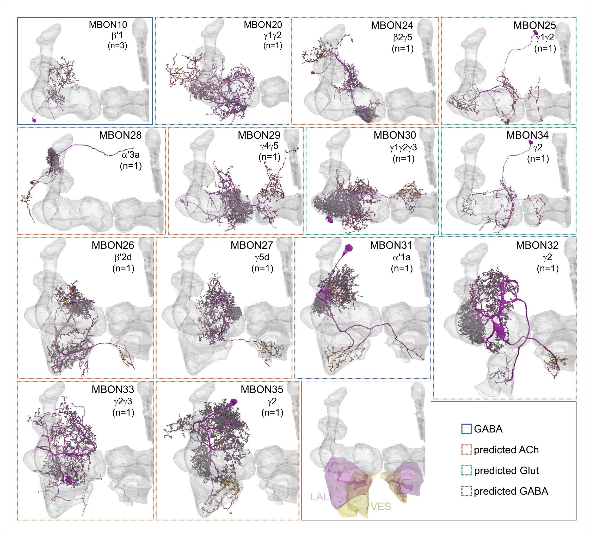

<small>圖片出處：Li F, Lindsey JW, Marin EC, et al. *eLife* 9:e62576 (2020)，Figure 8。© 2020 Li et al.，CC BY 4.0；全文見 [PMC](https://pmc.ncbi.nlm.nih.gov/articles/PMC7909955/)。</small>

> **原圖說（Figure 8）：** Atypical MBONs. Each panel shows one of the 14 types of atypical MBONs, with its name, the compartment(s) it innervates and the number of cells of that type per brain hemisphere indicated. … MB lobes are shown in gray and in the bottom right panel the lateral accessory lobe (LAL) and vest (VES) brain areas are highlighted. Neuronal morphologies are shown with dark gray dots and yellow dots indicating postsynaptic and presynaptic sites, respectively. The MBONs shown in this figure are considered to be atypical in that their dendritic arbors are only partially within the MB lobes. **Twelve of these types were discovered in the course of the current study.** The other two, the GABAergic MBON10 and MBON20, were described by Aso et al., 2014a, but we have reclassified them here as atypical MBONs because they have dendrites both inside and outside the MB lobes. **The three MBON10s in the EM volume have 69, 68, and 50% of their postsynaptic sites outside the MB lobes**; one is shown here. All the other atypical MBONs occur once per hemisphere. Unlike most typical MBONs that innervate brain areas that are dorsal to the MB, **six of the atypical MBONs innervate areas that are ventral to the MB**. The LAL is a target of several atypical MBONs, and one also innervates the VES. … The bounding box for each MBON is color-coded by the neurotransmitter used by that MBON; **dashed boxes are used where the transmitter type is based on computational prediction**.

**圖說中譯：** 非典型 MBON。每一格顯示 14 型非典型 MBON 之一，標出名稱、它支配的區室、以及該型在每個腦半球的細胞數。蕈狀體葉以灰色表示；右下角那一格另外標出側副葉（LAL）與 vest（VES）兩個腦區。神經元形態以深灰點表示突觸後位點、黃點表示突觸前位點。本圖的 MBON 之所以被視為非典型，是因為**它們的樹突只有一部分在蕈狀體葉內**。**這 14 型中有 12 型是本研究新發現的。** 另外兩型是 GABA 型的 MBON10 與 MBON20，由 Aso et al., 2014a 描述過，但我們在此把它們重新歸類為非典型 MBON，因為它們的樹突同時在葉內與葉外。**電顯體積中的三顆 MBON10，突觸後位點位於葉外的比例分別為 69%、68% 與 50%**；此處只顯示其中一顆。其餘所有非典型 MBON 每個腦半球各一顆。不同於多數支配蕈狀體背側腦區的典型 MBON，**有六型非典型 MBON 支配蕈狀體腹側的腦區**。側副葉是數型非典型 MBON 的標的，其中一型另外支配 vest。每個 MBON 的外框依它使用的傳遞物質上色；**傳遞物質若來自計算預測，外框用虛線**。

**解讀：**

**本庫若要講「連結體改寫了 MBON 清單」，這張圖就是主證據，而最該看的是外框的線型而不是神經元的形狀。** 逐格判讀的結果見「問題與限制」第 10 條：**14 格裡只有 MBON10 是實線，其餘 13 格全是虛線（預測值）**，包含圖說稱為「GABAergic」的 MBON20。也就是說，**這 14 型裡有 13 型的傳遞物質從來沒有被量過**，而本篇關於它們怎麼影響下游（推拉、興奮或抑制）的推論全部建立在預測之上。

**「非典型」沒有量化門檻，而 MBON10 的三顆細胞正好示範了這件事。** 69%、68%、50% ——第三顆剛好一半在葉外。論文沒有說低於多少就算典型，而這個分類決定了後面所有「典型 vs 非典型」的對照（圖 18A 的六欄、圖 21 的 B 與 B′、圖 26D 的兩半）。**如果 MBON10 被歸回典型，那些對照的分母全部要重算。**

**真正把這張圖接到行為上的是「六型支配腹側腦區」那一句。** 典型 MBON 幾乎全部輸出到蕈狀體背側；這六型往腹側去，而腹側正是側副葉所在、也是下行神經元樹突所在。**圖 8 與圖 25 必須一起讀**：前者說「有這麼一群細胞往下走」，後者說「它們走到了哪裡」。

**對過度解讀踩煞車：12 型新發現這件事只寫在圖說裡，正文沒有。** 而「新發現」的意思是**沒有 GAL4 驅動品系**，也就是沒有辦法對它們做阻斷或活化實驗。論文自己寫得很清楚：「As these MBONs are described here for the first time, no experimental data yet exists on their function(s) or physiology.」

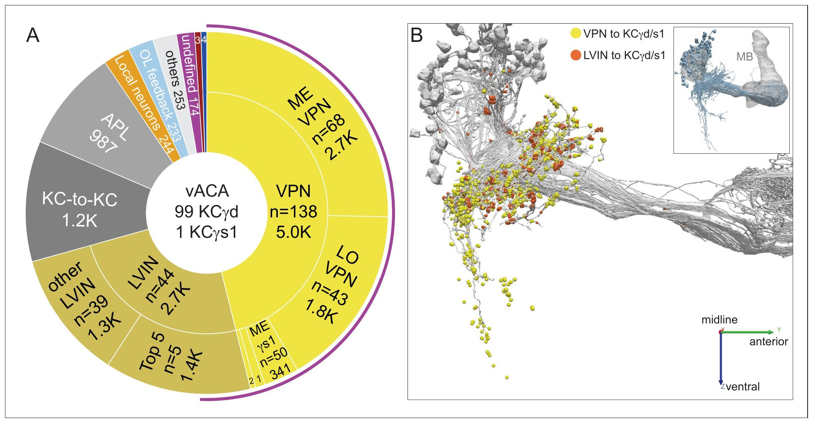

<small>圖片出處：Li F, Lindsey JW, Marin EC, et al. *eLife* 9:e62576 (2020)，Figure 10。© 2020 Li et al.，CC BY 4.0；全文見 [PMC](https://pmc.ncbi.nlm.nih.gov/articles/PMC7909955/)。</small>

> **原圖說（Figure 10）：** Ventral accessory calyx (vACA). The dendrites of the 99 γd and one γs1 KCs define the vACA. (**A**) The pie chart shows a breakdown of the inputs to these KCs; the number of cell (n=) and the number of the total synapses contributed by the cells in that sector are shown **without applying a threshold**. The majority of inputs convey visual information, either directly from visual projection neurons (VPNs; 46.1%) or through intermediate local visual interneurons (LVIN; 24.6%) that themselves receive input from VPNs. The number of VPNs shown in the pie chart counts VPNs that make as few as one synapse. **When a threshold is applied that requires a VPN to make at least five synapses to a single KC, then we find 49 VPNs, including 26 ME VPNs and 21 LO VPNs.** The synapses from the VPNs and the LVINs onto the KCγd dendrites **do not show the claw-like structure seen in the CA** (Figure 10—video 1). … More than half of the indirect input is mediated by five LVINs (Top 5)… **There are 68 VPNs that connect to the single KCγs1, with a total of 483 synapses: 50 from the ME, 34 of which are shared with other γd KCs, and 14 from the LO, eight of which are shared with other γd KCs.** The next most prominent inputs to KCs in the vACA are synapses between the KCs themselves (10.8%), from APL (9.1%), from local interneurons that do not appear to convey significant visual information (2.3%), from interneurons that send feedback from the vACA to optic lobe neurons (OL feedback; 2.2%) and neurons that leave the volume with undefined identity (undefined; 1.6%). … The remaining 2.3% is provided by 253 interneurons that are weakly connected to these KCs, with each providing one synapse to each of less than 4 KCs (others). The fraction of input to the vACA KCs conveying visual information is indicated by the outer purple arc… (**B**) Synaptic connections from visual projection neurons (VPN) and local visual interneurons (LVIN) onto γd and γs1 KCs (gray), color-coded. Note the different spatial distribution of synapses from VPNs and LVINs. **VPNs make synapses onto KCγd dendrites in an area ventral to the CA, previously recognized as the vACA, as well as in a diffuse ring surrounding the base of the CA; synapses from LVINs are restricted to the ring.**

**圖說中譯：** 腹側副萼（vACA）。99 顆 KCγd 與 1 顆 KCγs1 的樹突界定了 vACA。(A) 圓餅圖顯示這些 KC 的輸入組成；各扇形標出的細胞數（n=）與突觸總數**不設門檻**。多數輸入傳遞視覺資訊，或者直接來自視覺投射神經元（VPN；46.1%），或者經由本身接收 VPN 輸入的中介局部視覺中間神經元（LVIN；24.6%）。圓餅圖上的 VPN 數連只做一個突觸的也算進去。**若設一個「VPN 必須對單一一顆 KC 做至少五個突觸」的門檻，則只找到 49 條 VPN，其中 26 條來自髓質、21 條來自小葉。** VPN 與 LVIN 打在 KCγd 樹突上的突觸，**不具主萼裡那種爪狀構造**（Figure 10—video 1）。間接輸入有一半以上由五條 LVIN（Top 5）承擔。**有 68 條 VPN 接到那顆唯一的 KCγs1，共 483 個突觸：50 條來自髓質（其中 34 條與其他 γd KC 共用）、14 條來自小葉（其中 8 條共用）。** vACA 的 KC 其次顯著的輸入依序是 KC 彼此之間的突觸（10.8%）、APL（9.1%）、不傳遞顯著視覺資訊的局部中間神經元（2.3%）、把 vACA 訊號回送給視葉神經元的中間神經元（OL feedback；2.2%），以及離開體積、身分未定的神經元（1.6%）。剩下的 2.3% 由 253 條弱連結的中間神經元提供，每條對不到 4 顆 KC 各做一個突觸。傳遞視覺資訊的輸入比例以外圈紫色弧標示。(B) VPN 與 LVIN 接到 γd 與 γs1 KC（灰色）的突觸連結，依來源上色。注意 VPN 與 LVIN 的突觸空間分布不同：**VPN 的突觸落在主萼腹側（即傳統認定的 vACA）以及圍繞主萼底部的一圈瀰漫的環上；LVIN 的突觸則只落在那個環上。**

**解讀：**

**同一張圖上有 138 與 49 兩個 VPN 數，差 2.8 倍，純粹是門檻造成的。** 圓餅圖上寫 `VPN n=138`，圖說則寫「設門檻後只找到 49 條」。**兩個數字都是本篇的說法，任何引用都必須附門檻。** 這也是全篇對「門檻會改變結論」最直接的示範——比正文裡任何一句方法學的討論都有力。

**(B) 的黃／橘紅分離是本圖最強的結果，比圓餅圖強。** 黃點（VPN 直接）往腹側延伸成一長條，橘紅點（LVIN 間接）集中在主萼底部的環上，兩者在空間上清楚分開。**這說明 KCγd 的樹突上「直接路」與「間接路」接在不同位置**，因此有可能被分別調控——這是「兩條路線功能不同」這個推論的唯一解剖依據。對照圖 11（背側副萼）的同一格，兩色是混在一起的。**vACA 分開、dACA 不分開，這組對照是全篇最乾淨的一對，而論文把它們寫在兩節裡。**

⚠️ **圖說自己的加法不對：68 條 VPN 接到 KCγs1，但「50 來自髓質 ＋ 14 來自小葉」只有 64。** 差 4 條。可能是圖上那個「無法判定來自髓質或小葉（0.9%）」的類別，但圖說沒有這樣寫。（同一段的「49 VPNs, **including** 26 ME and 21 LO」＝ 47，用了 including，是有保留的寫法，不算不一致。）

**對過度解讀踩煞車：「這些突觸不呈爪狀」的唯一證據是一支影片，而本庫沒有這支影片。** 正文（行 1174–1176）與圖說（行 1798–1799）兩處措辭一致，主詞都是**突觸**而不是樹突。⚠️ **矛盾 1.15｜Li 2020（hemibrain 右半腦 99 顆 KCγd）說 VPN→KCγd 的突觸不呈爪狀；[[s-ganguly-2024-visual-inputs-to-kc]]（FlyWire 左半腦 147 顆）說有豆莢—爪接觸｜未裁決**。兩邊的關鍵證據本庫都沒有（一支影片與一張補充圖），而且數的不是同一群細胞。**什麼條件下算解決：** 取得 Figure 10—video 1 與 Ganguly 的補充圖 1D，確認兩邊用的是同一個「爪」的操作型判準（一顆 KC 樹突末端包住一個 PN 豆莢算爪，沿著樹突排列的點狀接觸不算）；若判準相同而結果仍相反，下一步要問的是左右半腦或兩份電顯資料的重建差異。詳見 [[syn-contradictions]] 1.15。**本頁不自行裁決。**

**一個本篇被庫內低估的分寸。** [[s-ganguly-2024-visual-inputs-to-kc]] 的引言說「hemibrain 沒重建視葉，所以那些 VPN 的身分無法確定」。回查原文：**這句話成立，但只對一小部分輸入成立**。本篇確實寫「小葉大致包含在 hemibrain 裡，髓質不在」，但緊接著寫「**在許多情況下，我們能夠藉由把神經元片段與它們在 FAFB 或光學顯微影像中的完整對應體比對，來確定地標註髓質 VPN**」；圖 10 的圓餅只把 0.9% 歸為「無法判定來自髓質或小葉」、1.6% 歸為「離開體積、身分未定」。**然而同一段緊接著寫：「we have little definitive insight into the type of visual information conveyed by their VPN inputs.」** 兩邊說的是同一件事的兩面——**來源腦區確認了，細胞身分與編碼內容沒有。** 引用時要把這個分寸寫清楚，不要只取一半。

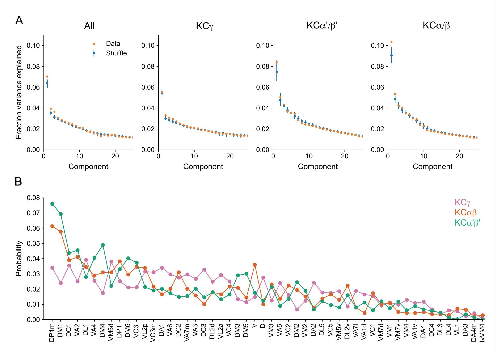

<small>圖片出處：Li F, Lindsey JW, Marin EC, et al. *eLife* 9:e62576 (2020)，Figure 13。© 2020 Li et al.，CC BY 4.0；全文見 [PMC](https://pmc.ncbi.nlm.nih.gov/articles/PMC7909955/)。</small>

> **原圖說（Figure 13）：** Comparison of KC input connectivity to random models. (**A**) Fraction of variance explained by components identified via principal components analysis of the olfactory uPN-to-KC input connectivity matrix—a binary matrix containing ones and zeros for present or absent connections between KCs and their inputs, at a threshold of five synapses. Results are shown for the reconstructed data (orange) and for a collection of shuffled models (blue) in which each KC retains the same total number of connections but samples among all uPNs randomly, with a probability proportional to the total number of connections each uPN makes. Such models therefore retain the degree distribution across KCs, (that is, the probability distribution of the number of claws formed by individual KCs) and the average connection probability for each uPN, but no other structure. Bars indicate 95% confidence intervals for shuffled models. Deviations in the first few components indicate structure inconsistent with a random model. Left: All KCs; Right: Analysis restricted to the indicated KC subtypes (visual α/βp and γd KCs, as well as γs KCs, were excluded). (**B**) Probability of uPN-to-KC connections from each olfactory glomerulus, sorted by most to least well-connected. Probabilities are plotted separately for the KC subtypes shown in (A).

**圖說中譯：** KC 輸入連結與隨機模型的比較。(A) 對嗅覺 uPN→KC 輸入連結矩陣（一個二元矩陣，以 1 與 0 表示 KC 與其輸入之間有無連結，門檻為五個突觸）做主成分分析，各成分所解釋的變異比例。橘色為重建資料，藍色為一組洗牌模型——**在洗牌模型中，每顆 KC 保留相同的連結總數，但在全部 uPN 中隨機取樣，取樣機率正比於各 uPN 的連結總數。因此這類模型保留了 KC 的度分布（也就是個別 KC 所形成的爪數的機率分布）與每條 uPN 的平均連結機率，其他結構一概不保留。** 誤差棒為洗牌模型的 95% 信賴區間。前幾個成分的偏離表示存在與隨機模型不符的結構。左：全部 KC；右：分析限定在圖示的 KC 亞型（**視覺的 α/βp 與 γd KC、以及 γs KC 被排除**）。(B) 各嗅小球的 uPN→KC 連結機率，由連結最多到最少排序，依 (A) 的 KC 亞型分別作圖。

**解讀：**

**這張圖的圖說是全篇方法描述最嚴謹的一處，值得照抄。** 它明確寫出洗牌模型保留了什麼（每顆 KC 的連結總數＝爪數分布、每條 uPN 的平均連結機率）與不保留什麼（其他全部）。**一個零模型的價值完全取決於它保留了什麼**，而大多數論文不寫這句。

**正文說「有三個主成分明顯大於隨機模型」，但分葉之後，γ 這一格根本看不到偏離。** 本頁從 300 dpi 整頁渲染讀出的第一主成分（誤差約 ±0.003）：**All 資料 ≈ 0.070 vs 洗牌 ≈ 0.064；KCγ 資料 ≈ 0.054 vs 洗牌 ≈ 0.055（資料甚至略低於洗牌，而且誤差棒涵蓋）；KCα′/β′ 資料 ≈ 0.084 vs 洗牌 ≈ 0.0745；KCα/β 資料 ≈ 0.104 vs 洗牌 ≈ 0.091。** 正文的「三個成分」顯然指 All 那一格。**論文從未明說「γ KC 的輸入與隨機模型無法區分」，而圖上就是這樣**；這與後文「空間組織的效應在 γ KC 幾乎為零」一致，但那是另一張圖的結果。

**論文報告了「clearly larger」，沒有報告任何效果量，而效果量可以直接算。** All 的第一主成分 0.070 vs 0.064，**相對差 9%**；α/β 是 0.104 vs 0.091，**相對差 14%**。而且第一主成分本身只解釋 7–10% 的變異。**「不是隨機」與「結構很強」是兩回事，這張圖支持前者、不支持後者。**

**(B) 才是真正解釋「為什麼不隨機」的那一格，而正文只用一句話帶過。** 三條曲線顯示 α′/β′ 與 α/β 偏重少數嗅小球（DP1m 綠 0.076、橘 0.061、粉紅 0.034；DM1 綠 0.069、橘 0.058、粉紅 0.024），而 γ 比較平均；中段的 V 與 D 兩個嗅小球則反過來出現 α/β 的尖峰（橘 ≈ 0.036，綠降到 ≈ 0.009）。**也就是說，結構的來源是「KC 型別 × 嗅小球」的交互作用，不是「個別 KC 挑特定的 PN 組合」。** 這兩種結構對記憶容量的意義完全不同：前者是把嗅覺空間分配給不同的 KC 群，後者才是取樣規則本身不隨機。

**視覺陷阱：四格的縱軸範圍相同（0–0.10），而橘藍兩點的距離小到接近點的直徑。** 四格乍看長得一樣，實際上 α/β 偏離最大、γ 幾乎沒有。**對過度解讀踩煞車：整個檢定只有 95% 信賴區間，沒有 p 值、沒有多重比較校正。** 25 個成分 × 4 組 ＝ 100 次比較，按 95% 信賴區間逐點判讀，期望就有約 5 次假陽性。

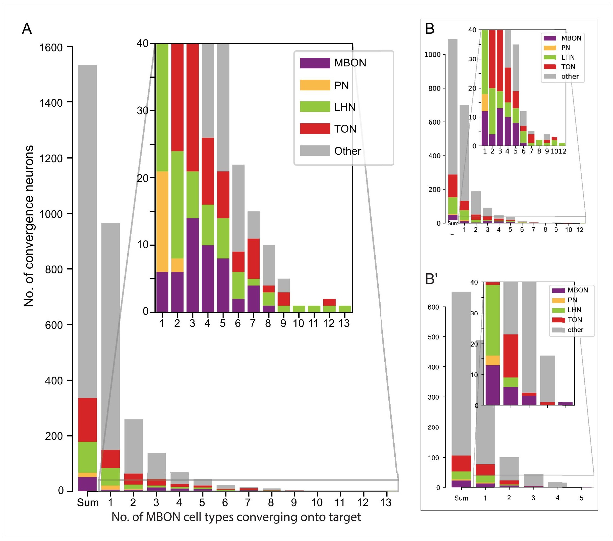

<small>圖片出處：Li F, Lindsey JW, Marin EC, et al. *eLife* 9:e62576 (2020)，Figure 21。© 2020 Li et al.，CC BY 4.0；全文見 [PMC](https://pmc.ncbi.nlm.nih.gov/articles/PMC7909955/)。</small>

> **原圖說（Figure 21）：** Downstream targets of MBONs often receive input from more than one MBON. (**A**) **About 1550 neurons are downstream (including axo-axonal connections) of one or more of the 34 MBON cell types when a threshold of 10 synapses is used. Among them, about 600 are downstream of at least 2 MBON cell types** and are therefore capable of integrating information from multiple MBONs. The inset shows an expanded view of the indicated portion of the plot. These neurons include a range of well-characterized neuron types, including MBONs, olfactory projection neurons (PNs), lateral horn neurons (LHNs), and third-order olfactory neurons (TONs; downstream targets of PNs outside the LH, see Schlegel et al., 2020) as well as less characterized neurons (other). **Among the neurons that receive input from 10 or more MBON types, LHNs are heavily over-represented.** (**B-B′**) The distribution shown in (A) has been divided into two separate histograms, one showing neurons downstream of multiple typical MBONs, in which atypical MBONs have not been counted (B), and one showing neurons downstream of multiple atypical MBONs, in which typical MBONs have not been counted (B′). The insets show expanded views of the indicated portions of each plot. **Atypical MBONs show less convergence than the typical MBONs and do not preferentially converge onto LHNs.**

**圖說中譯：** MBON 的下游目標經常收到不只一型 MBON 的輸入。(A) **以 10 個突觸為門檻時，約有 1,550 顆神經元是 34 型 MBON 中至少一型的下游（含軸突對軸突連結）。其中約 600 顆是至少兩型 MBON 的下游**，因而有能力整合多型 MBON 的資訊。插圖是標示區段的放大。這些神經元涵蓋一系列已被充分描述的型別：MBON、嗅覺投射神經元（PN）、側角神經元（LHN）、三階嗅覺神經元（TON，即側角之外的 PN 下游），以及較少被描述的其他神經元。**在收到 10 型以上 MBON 輸入的神經元中，側角神經元嚴重過度代表。** (B–B′) 把 (A) 的分布拆成兩張直方圖：一張只算典型 MBON 的下游（不計非典型，B），一張只算非典型 MBON 的下游（不計典型，B′）。**非典型 MBON 顯示的匯聚程度低於典型 MBON，也不特別偏好匯聚到側角神經元。**

**解讀：**

**本庫已經在兩頁引用這張圖的數字，而兩個最關鍵的限定只寫在圖說裡。** 第一，**1,550 這個計數包含軸突對軸突的連結**——也就是說，其中一部分「下游」並不是在接收 MBON 的樹突輸入，而是被打在自己的軸突上。第二，**600 的條件是「至少兩個 MBON 細胞型」，不是「至少兩顆 MBON 細胞」**。同一型的兩顆細胞打到同一個目標，不算匯聚。這兩點都不在正文裡。

**從長條判讀可以檢查圖與圖說的一致性。** Sum 柱 ≈ 1,530、x = 1 柱 ≈ 965（從圖判讀，±30），相減 ≈ 565，與圖說的「about 600」同量級但不相等。**這不是矛盾，而是提醒：600 與 1,550 都是概數**（論文自己加了 ~ 與 about），所以把 600/1550 算成「39%」並寫成精確值會誤導——**這正是本庫先前犯的錯**。論文自己寫的是「nearly 40%」。

**真正該看的是插圖最右邊那幾根，而不是最左邊那根。** 插圖把縱軸切到 0–40，顯示 x = 1 到 13 的組成。**x = 10 到 13 的長條幾乎只剩綠色（側角神經元）**——收到十型以上 MBON 輸入的那一小撮細胞，幾乎全是側角神經元。側角是果蠅處理**先天**嗅覺價值的中心，而 MBON 送的是**習得**的價值。**「習得與先天在側角會合」這件事，整張圖最有分量的證據就在這幾根幾乎看不見的長條上**（見 [[t-innate-learned-integration]]）。

**論文把 40% 與 14% 並列，但沒有給任何顯著性或信賴區間，也沒有說零模型跑了幾次。** 這是本篇幾個最常被引用的數字裡，統計支持最薄的一個。差距大到結論大概不會翻，但「超出隨機多少」沒有誤差範圍可引。

⚠️ **正文與圖說對非典型 MBON 的匯聚程度講法不同。** 正文（行 1416–1418）說兩者「**在校正非典型 MBON 數量較少之後程度大致相近**」；圖說（行 3330–3331）說「**非典型 MBON 的匯聚程度低於典型 MBON**」。差別在有沒有校正數量，而圖說沒有講它有沒有校正。**本頁判讀 B′ 的長條只延伸到 x = 5，B 延伸到 x = 12**，所以未校正時圖說是對的；要支持正文的說法必須自己做校正，而論文沒有給校正的方式。

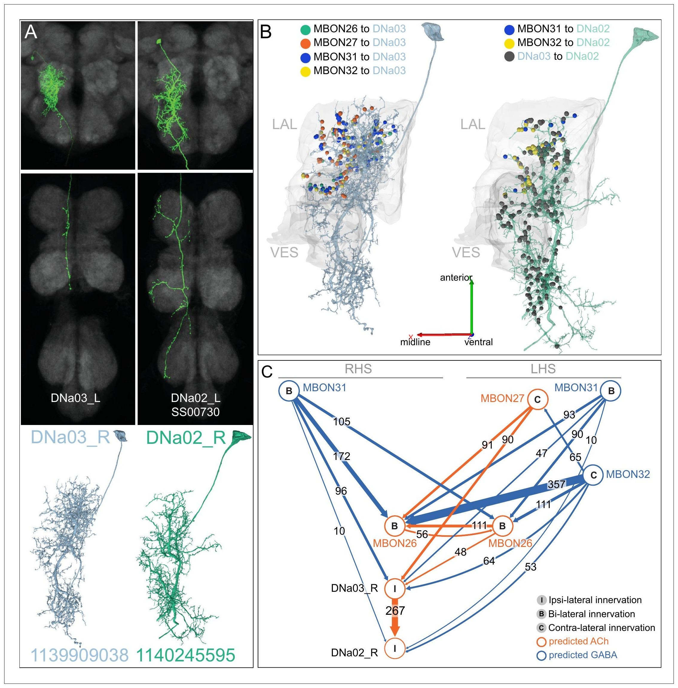

<small>圖片出處：Li F, Lindsey JW, Marin EC, et al. *eLife* 9:e62576 (2020)，Figure 25。© 2020 Li et al.，CC BY 4.0；全文見 [PMC](https://pmc.ncbi.nlm.nih.gov/articles/PMC7909955/)。</small>

> **原圖說（Figure 25）：** A descending pathway from atypical MBONs to the ventral nerve cord (VNC). **Four LAL-innervating atypical MBONs form strong connections to descending neurons (DN).** (**A**) A comparison between LM (Namiki et al., 2018) and EM morphologies of DNa02 and DNa03. Note that the LM images show the cells in the left hemisphere while the EM images are from the right hemisphere and that **the axons of the DNs extend outside the hemibrain volume**. (**B**) Synaptic connections from MBON26, MBON27, MBON31 and MBON32 to DNa03 (left) and from MBON31, MBON32, and DNa03 to DNa02 (right) are shown, color-coded. Note the connections from MBONs are **restricted to the LAL** while DNa03 makes synapses onto DNa02 throughout its arbor in the LAL and the VES. (**C**) Diagram of connectivity between MBONs, DNa03 and DNa02. Note that **MBON27 and MBON32 have contralateral axons** and thus innervate the contralateral DNa02 and DNa03 while **MBON26 and MBON31 have bilateral output**. Thus the connectivity diagram shows the inputs onto the DNa02 and DNa03 of the right hemisphere (RHS), while many of the neurons providing input have their cell bodies in the left hemisphere (LHS). … Predicted neurotransmitters are indicated. In addition to the diagrammed connections, these MBONs connect to the DNa02 and DNa03 using paths that include interneurons (see Figure 42). **DNa02 has been implicated in steering control (Rayshubskiy et al., 2020)** and the outputs of these MBONs are likely to play a role in guiding approach and avoidance.

**圖說中譯：** 從非典型 MBON 下行到腹神經索（VNC）的路徑。**四型支配側副葉的非典型 MBON 與下行神經元（DN）形成強連結。** (A) DNa02 與 DNa03 的光學顯微（Namiki et al., 2018）與電顯形態對照。注意光學影像顯示的是左半腦的細胞，電顯影像來自右半腦；**而且這些下行神經元的軸突延伸到 hemibrain 體積之外。** (B) MBON26、27、31、32 接到 DNa03 的突觸連結（左），以及 MBON31、32 與 DNa03 接到 DNa02 的突觸連結（右），依來源上色。注意來自 MBON 的連結**只限於側副葉**，而 DNa03 接到 DNa02 的突觸則分布在它位於側副葉與 vest 的整個分枝上。(C) MBON、DNa03 與 DNa02 之間的連結圖。注意 **MBON27 與 MBON32 的軸突走對側**，因此支配對側的 DNa02 與 DNa03；而 **MBON26 與 MBON31 是雙側輸出**。所以這張連結圖顯示的是右半腦（RHS）DNa02 與 DNa03 的輸入，而許多提供輸入的神經元細胞體在左半腦（LHS）。圖中標示的是**預測的**傳遞物質。除了圖示的連結之外，這些 MBON 還經由含中間神經元的路徑接到 DNa02 與 DNa03（見圖 42）。**DNa02 已被認為與轉向控制有關**（Rayshubskiy et al., 2020），這些 MBON 的輸出可能在引導趨近與迴避上扮演角色。

**解讀：**

**(C) 裡最粗的那兩條線都不是 MBON→DN 的線，而這一點推翻了這張圖給人的第一印象。** 從圖上讀出的突觸數：**MBON32 → MBON26 共 357 個**（全圖最粗）、**DNa03_R → DNa02_R 共 267 個**；而 MBON 直接打到下行神經元的連結裡，最強的也只有 105、172、96 這個量級，最弱的只有 10。**也就是說，這條「學習輸出 → 轉向」的鏈條上，最細的一環正是標題所宣稱的那一環。** 論文說這四型 MBON「是 DNa03 最強的輸入之一」——那是相對於 DNa03 的其他輸入而言，不是絕對強度。**引用「MBON 直通下行神經元」時，要連這個量級一起引。**

**標題寫「到腹神經索」，而腹神經索那一端不在資料集裡。** 圖 A 自己註明下行神經元的軸突延伸到 hemibrain 體積之外，所以「到 VNC」是靠 Namiki et al. 2018 的光學形態補上的。**本篇證明的是「MBON → 下行神經元」，不是「MBON → 腹神經索」。**

**(B) 真正該看的是突觸點的空間分布。** 來自 MBON 的突觸**只落在側副葉**，而 DNa03 打到 DNa02 的突觸鋪滿它在側副葉與 vest 的整個分枝。**這表示蕈狀體的影響力只能從側副葉這一個入口進來**，而下行神經元之間的耦合則是全面的。這個不對稱對「蕈狀體能多大程度左右轉向」是一個解剖上的上界，論文沒有把它說成一個論點。

**視覺陷阱：圖例寫的是 predicted ACh 與 predicted GABA。** 整張圖的顏色代表的是**預測的**傳遞物質，而後面的討論（圖 42、推拉配置）把這些符號當成已知的。**MBON26、27、31、32 四型全部是本篇首次描述的非典型 MBON，傳遞物質一型都沒有量過。**

**對過度解讀踩煞車：「第一次找到直接路徑」這個宣稱的覆蓋率只有七分之一。** 論文自己設了界線（見 3.4），而圖 42 的圖說把數字講得更清楚：只有約 15% 的下行神經元被辨識出來、約 50 個 DN 型。`※ 推論`：全腦約 330 個 DN 型，**約 280 型從來沒有被看過**。「只有 DNa02 與 DNa03 收到顯著的 MBON 輸入」這句話的強度上限就在這裡。

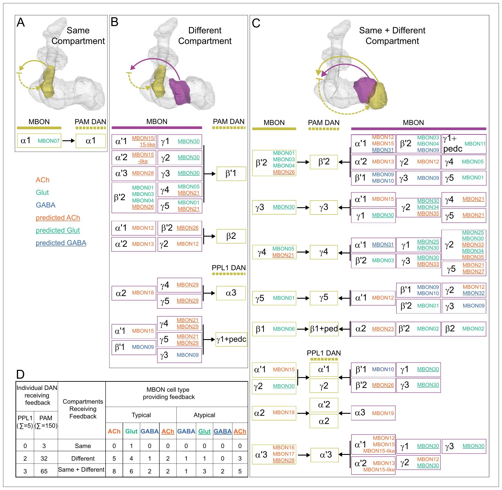

<small>圖片出處：Li F, Lindsey JW, Marin EC, et al. *eLife* 9:e62576 (2020)，Figure 26。© 2020 Li et al.，CC BY 4.0；全文見 [PMC](https://pmc.ncbi.nlm.nih.gov/articles/PMC7909955/)。</small>

> **原圖說（Figure 26）：** Feedback from MBONs to DANs. Input from MBONs onto DANs occurs in three distinct circuit motifs which are diagrammed. MBON connections to DANs from the same compartment are depicted as a yellow arrow, while MBON connections to DANs from a different compartment are depicted as a purple arrow. DANs downstream of these MBONs are depicted as dashed yellow arrows. (**A**) In the simplest case, the MBON and DAN form a reciprocal loop where the MBON innervates DAN(s) that send their axons back to the same compartment where the MBON's dendrites arborize. **Below the diagram of this circuit motif, each of the instances we observed with this arrangement is presented**; inputs onto PAM and PPL1 DANs are presented separately. The color of the MBON name indicates its neurotransmitter, as indicated. (**B**) In this case, MBON(s) synapse onto DAN(s) that send their axons to MB compartment(s) different from the compartment where the MBON's dendrites reside, providing a mechanism for cross-compartment communication. It is common for the DAN population of a compartment to receive input from several MBONs. (**C**) This motif combines the previous two motifs, with DANs receiving input from both MBON(s) of same and different compartments. (**D**) The table summarizes DAN populations that participate in the three different feedback motifs.

**圖說中譯：** MBON 到 DAN 的回饋。MBON 對 DAN 的輸入出現三種不同的迴路基序。MBON 連到**同一區室** DAN 的連結以黃色箭頭表示，連到**不同區室** DAN 的以紫色箭頭表示；這些 MBON 下游的 DAN 以黃色虛線箭頭表示。(A) 最簡單的情況：MBON 與 DAN 形成一個互惠迴路，MBON 支配的 DAN 把軸突送回該 MBON 樹突所在的同一個區室。**在這個基序的示意圖下方，列出了我們觀察到的每一個具有此配置的實例**；對 PAM 與 PPL1 DAN 的輸入分開呈現。MBON 名稱的顏色代表它的傳遞物質。(B) 這個情況中，MBON 接到的 DAN 把軸突送到與該 MBON 樹突所在不同的區室，提供了跨區室通訊的機制。一個區室的 DAN 族群收到好幾型 MBON 的輸入是常見的。(C) 這個基序結合前兩者，DAN 同時收到同區室與不同區室 MBON 的輸入。(D) 表格總結參與三種回饋基序的 DAN 族群。

**解讀：**

**(A) 看起來只是一個小框，實際上是全圖資訊密度最高的一格。** 它只有一列（α1：MBON07 → α1 的 PAM DAN），因為**純粹的自我回饋在 15 個區室裡只有一個**。本庫既有兩頁把這件事轉述成「MBON-α1 是唯一一型不接其他區室 DAN 的 MBON」，**主詞從「區室」被換成了「MBON 型」**（見 3.5）。這張圖是檢查那句轉述的唯一依據，而在它被仔細讀之前，錯誤的版本在庫裡存在了很久。

**(D) 的 PPL1 欄能跟 B、C 對上，但要先知道「C 的五個 PPL1 列其實是三顆神經元」。** PPL103（γ2α′1）與 PPL105（α′2α2）各支配兩個區室、各佔兩列，加上 PPL104（α′3）一列，共五列三顆；B 的 PPL1 有 α3（PPL106）與 γ1+pedc（PPL101）兩顆。0 ＋ 2 ＋ 3 ＝ 5 ✓。**不知道這件事就會以為 PPL1 有七顆。圖說完全沒有寫這一點。**

⚠️ **(D) 的 PAM 欄加總是 100（3＋32＋65），而正文寫 99。** PPL1 欄完全吻合，所以表的語意沒問題，就是 PAM 差 1。順帶可以算出論文沒有寫的一個數：**150 顆 PAM 裡有 50 顆（或 51 顆，取決於用 100 還是 99）完全不收任何直接的 MBON 回饋**——三分之一的 PAM DAN 不在這張回饋網裡。論文只報告了「99 顆收到」，沒有報告補集。

**本頁從這張圖反推出了論文沒有點名的那三型。** 用 PDF 的內嵌文字層把 A、B、C 三格出現過的 MBON 編號全部抽出來（不是目測），得到 30 個相異編號：**非典型 14 型中缺 MBON20 與 MBON24，正好對上正文的「12 of 14」；典型 20 型中缺 MBON14 與 MBON22，是 18 型，而正文寫「19 of 20」。**⚠️ 圖與正文差一型。`※ 推論`：完全不接 DAN 的非典型兩型是 MBON20 與 MBON24；典型那一型落在 MBON14（α3）與 MBON22（萼）之間，無法再縮小。依據是圖說自陳 (A) 格列出了「每一個我們觀察到的實例」，而 B、C 兩格的體例相同。**不確定範圍：若圖 26 只畫了達到某個未標示門檻的連結，則缺席不等於不存在，而論文沒有為圖 26 標明門檻。**

⚠️ **(D) 右半的「提供回饋的 MBON 細胞型數」不能拿來驗證「19 of 20」。** 典型三欄三列相加是 1＋10＋16 ＝ 27，**超過典型 MBON 的總型數 20**，所以同一型 MBON 會在多列被重複計數。圖說沒有說明這一點。

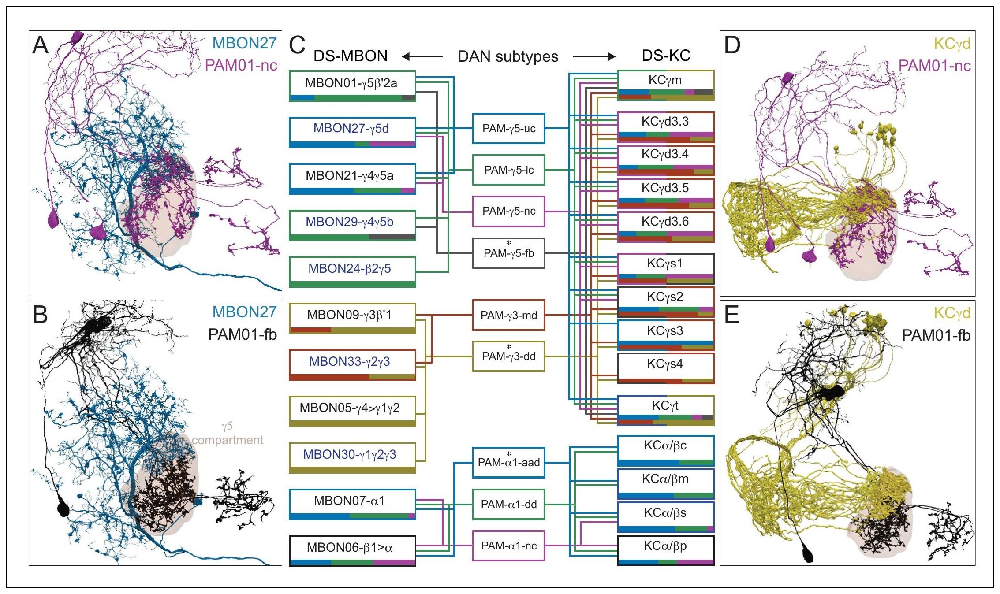

<small>圖片出處：Li F, Lindsey JW, Marin EC, et al. *eLife* 9:e62576 (2020)，Figure 30。© 2020 Li et al.，CC BY 4.0；全文見 [PMC](https://pmc.ncbi.nlm.nih.gov/articles/PMC7909955/)。</small>

> **原圖說（Figure 30）：** Different subtypes of the PAM01, PAM12, and PAM11 DANs synapse onto specific subpopulations of KCs and MBONs within their compartment. … **The axons from certain subtypes of DAN occupy different regions of, and together tile, a MB compartment. This permits for specific connectivity to KCs and MBONs within the compartment.** … (**A**) The axons from PAM01-nc (magenta) overlap with dendrites of MBON27 (γ5d; dark blue). … (**B**) PAM01-fb (black) axons do not overlap with the dendrites of MBON27 (dark blue). (**C**) Schematic of the innervation of subtypes of γ5, γ3, and α1 DANs within the compartment showing their connection to MBONs (left) and KCs (right). Boxes for DAN subtypes and connectivity edges are colored according to subtype identity. Boxes around MBON types are colored by their strongest DAN subtype input. The boxes around KC names are colored to reflect their strongest DAN subtype input in each compartment (the two halves for KCγ types reflect their projections through the γ3 and γ5 compartments). Horizontal bars along the lower edge of the MBON and KC boxes are histograms … representing the proportion of each DAN subtype providing input to the respective MBON or KC subtype. … Typical MBON names in black and atypical MBONs are in blue. **Asterisks denote DAN subtypes receiving MBON feedback.** **Only cases where a DAN provides at least 0.1% of the MBON's synaptic input or at least 1% of a KC type's input from DANs are shown.** … **Note that the synapses onto the feedforward MBON06 (β1>α) are likely axo-axonal.** (**D**) The axons from PAM01-nc (magenta) also overlap with the axonal processes of KCγd (yellow). (**E**) Axons from PAM01-fb (black) do not overlap with the axonal processes of KCγd (yellow).

**圖說中譯：** PAM01、PAM12 與 PAM11 的不同亞型，在自己的區室內接到特定的 KC 與 MBON 次族群。**某些 DAN 亞型的軸突各佔區室的不同區域，合起來鋪滿整個區室，因而容許區室內部的專一連結。** (A) PAM01-nc（洋紅）的軸突與 MBON27（γ5d，深藍）的樹突重疊。(B) PAM01-fb（黑）的軸突與 MBON27 的樹突不重疊。(C) γ5、γ3、α1 三個區室內 DAN 亞型支配方式的示意，左欄顯示它們與 MBON 的連結、右欄與 KC 的連結。DAN 亞型方框與連結邊依亞型上色；MBON 方框依其最強的 DAN 亞型輸入上色；KC 方框同理（KCγ 類別的兩半分別代表它們通過 γ3 與 γ5 區室的投射）。MBON 與 KC 方框下緣的橫條是直方圖，表示各 DAN 亞型提供輸入的比例。典型 MBON 名稱為黑色、非典型為藍色。**星號代表收到 MBON 回饋的 DAN 亞型。** **只顯示 DAN 提供該 MBON 至少 0.1% 突觸輸入、或提供該 KC 型來自 DAN 之輸入至少 1% 的情形。** **注意接到前饋 MBON06（β1>α）的突觸很可能是軸突對軸突的。** (D) PAM01-nc（洋紅）的軸突也與 KCγd（黃）的軸突突起重疊。(E) PAM01-fb（黑）的軸突與 KCγd 的軸突突起不重疊。

**解讀：**

**(C) 的右欄才是這張圖的重點，而不是左欄。** 右欄的 14 個 KC 方框直接顯示 **PAM01-nc 幾乎壟斷 KCγd（視覺流），PAM01-fb 幾乎壟斷 KCγm（嗅覺流）**——這是「DAN 的調控可以是感覺模態專一的」這個主張的全部證據，也是圖 38 那個理論模型的全部經驗基礎。**左欄（MBON 側）只是這件事的副產品。**

**本頁逐格核對過三欄的數目（用 PDF 的內嵌文字層）：左欄 11 個 MBON 方框、中欄 9 個 DAN 亞型方框、右欄 14 個 KC 方框。** 九個 DAN 亞型是 PAM-γ5-uc／lc／nc／fb\*、PAM-γ3-md／dd\*、PAM-α1-aad\*／dd／nc，星號三處與圖 28 的星號一致。

**α1 與 γ5 的對比，論文沒有並列著講。** α1 那一組左欄只有一個 MBON 方框（MBON07），**三個 α1 亞型全部接到它**；而 γ5 那一組的五個 MBON 各自由不同亞型供應。**也就是說，α1 的亞型分化完全體現在 KC 側，MBON 側沒有分化；γ5 則兩側都分化。** 這個差別直接關係到「一個區室能支援幾種獨立的學習」——α1 能分的是輸入通道，分不出輸出通道。

**視覺陷阱：兩側的門檻差了十倍。** MBON 側用 **0.1%**、KC 側用 **1%**。所以「某個 DAN 不接某個 KC」是比「某個 DAN 不接某個 MBON」嚴格十倍的斷言；反過來說，左欄看起來連線比較密，有一部分只是門檻比較鬆。**論文把兩個門檻寫在圖說同一句裡，但沒有提醒讀者不要橫向比較兩欄的密度。**

**對過度解讀踩煞車：圖說自己註明「接到 MBON06 的突觸很可能是軸突對軸突的」。** 也就是左欄最下面那一格的邊不是樹突輸入，不能和其他格同樣解讀。另外，論文自己承認 DAN→MBON 連結的生理角色幾乎完全未知（只有一個案例有功能數據），**而這張圖把 DAN→MBON 畫得和 DAN→KC 一樣確定。**

**「together tile」是定性說法。** 圖說說各亞型的軸突「合起來鋪滿」一個區室，但**重疊的程度沒有量化**；A、B、D、E 四張彩現是定性的視覺證據，不是測量。

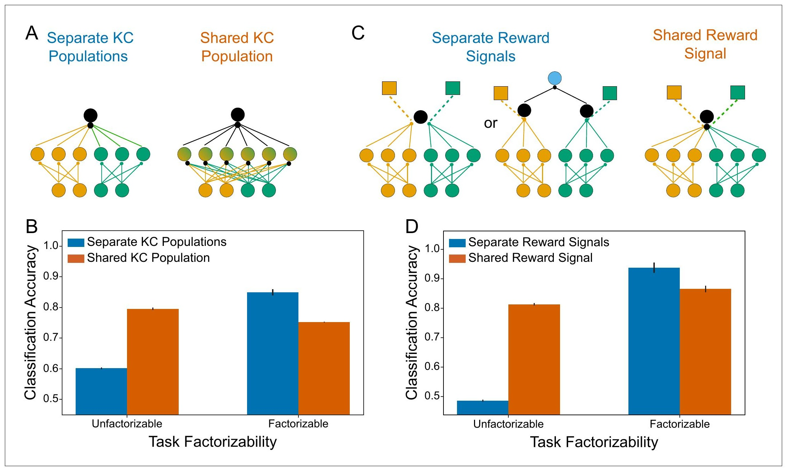

<small>圖片出處：Li F, Lindsey JW, Marin EC, et al. *eLife* 9:e62576 (2020)，Figure 38。© 2020 Li et al.，CC BY 4.0；全文見 [PMC](https://pmc.ncbi.nlm.nih.gov/articles/PMC7909955/)。</small>

> **原圖說（Figure 38）：** Effects of segregated or mixed-modality signals. (**A**) Schematic of two possible architectures for an MB-like circuit, in which KCs are either specialized for one sensory modality (left) or receive mixed input (right). Bottom layer circles represent PN inputs, middle layer circles represent KCs, and black output circles represent MBONs. Green and yellow shades indicate different sensory modalities. (**B**) Task performance in a stimulus discrimination model for the architectures shown in A. Stimuli consist of random binary patterns in two sensory modalities. **In the 'factorizable' task, the stimulus from each modality has an assigned valence (positive or negative) and the overall valence is positive only if both constituent valences are positive.** In the 'unfactorizable' task, each stimulus is randomly assigned its own unique valence, irrespective of its constituent modalities. A linear readout, modeling an MBON, is fit to discriminate the valences of the stimuli based on the activations of the KC population. The linear fit procedure corresponds to the experienced-based plasticity of KC-MBON synapses. Task performance is defined as the binary classification accuracy… **25 stimuli are presented in the unfactorizable task and 200 in the factorizable task, to make overall task difficulty comparable.** Error bars represent standard error over 20 simulations. (**C**) Schematic of possible architectures for DAN-dependent plasticity in an MB-like circuit. In the leftmost model, DANs (colored squares) modulate KC-MBON synapses for KCs of a particular sensory modality. The second-to-left model depicts two MBONs, each integrating input from KCs of a particular sensory modality, and each with its own corresponding DAN, that additively converge onto a common output (blue). These two models are functionally equivalent, and hence are grouped together under 'separate reward signals.' In the rightmost model, there is a single MBON, and DANs modulate all the KC-MBON synapses. (**D**) Task performance in a stimulus discrimination model (same as B) for the architectures shown in C. For each task the optimal KC structure from B is used ('separate' for the factorizable task, 'shared' for the unfactorizable task).

**圖說中譯：** 分離式與混合式模態訊號的效果。(A) 類蕈狀體迴路的兩種可能架構示意：KC 或者專化於單一感覺模態（左），或者接收混合輸入（右）。底層圓圈代表 PN 輸入，中層代表 KC，黑色輸出圓代表 MBON；綠色與黃色代表兩種不同的感覺模態。(B) 對 A 的兩種架構，在一個刺激辨別模型中的任務表現。刺激是兩個感覺模態中的隨機二元樣式。**在「可因式分解」的任務中，每個模態的刺激各被指派一個價性（正或負），而整體價性只有在兩個構成價性都為正時才為正。** 在「不可因式分解」的任務中，每個刺激被隨機指派自己獨有的價性，與構成它的模態無關。一個線性讀出器（代表 MBON）被擬合來依 KC 族群的活化辨別刺激的價性；這個線性擬合程序對應 KC–MBON 突觸的經驗依賴可塑性。任務表現定義為二元分類正確率。**不可因式分解的任務呈現 25 個刺激、可因式分解的呈現 200 個，以使整體任務難度可比。** 誤差棒為 20 次模擬的標準誤。(C) 類蕈狀體迴路中、依賴 DAN 的可塑性的可能架構示意。最左邊的模型中，DAN（彩色方塊）調控特定感覺模態 KC 的 KC–MBON 突觸。左起第二個模型畫的是兩個 MBON，各自整合某一模態 KC 的輸入、各自配一個對應的 DAN，兩者相加匯聚到一個共同輸出（藍）。這兩個模型功能上等價，因此合稱為「分離的獎賞訊號」。最右邊的模型只有一個 MBON，DAN 調控全部的 KC–MBON 突觸。(D) 對 C 的架構，在同一個刺激辨別模型中的任務表現。每個任務都採用 B 中該任務的最佳 KC 結構（可因式分解用「分離」、不可因式分解用「共用」）。

**解讀：**

**這是全篇唯一把連結體觀察接到計算主張的地方，而論文正文只寫了其中一半。** 正文詳細描述了 B（KC 架構）的結果，對 D（DAN 架構）只有一句帶過。**但 D 才是本篇連結體發現的對應命題**：圖 30 顯示 DAN 亞型是模態專一的，而 D 回答的正是「模態專一的 DAN 調控什麼時候划算」。

**D 圖左邊那根長條是全篇最強的單一數字，而論文沒有評論它。** 分離的獎賞訊號 × 不可因式分解任務 ＝ **0.49**，也就是**二元分類的隨機水準**。`※ 推論`：當任務不可因式分解時，分流的 DAN 調控不是「比較差」，而是**完全學不起來**。把兩張圖的代價並列：KC 架構選錯掉 0.195（0.795 → 0.60），DAN 架構選錯掉 0.32（0.81 → 0.49）。**「DAN 架構選錯比 KC 架構選錯嚴重得多」是這兩張圖最實質的訊息，而論文從頭到尾沒有講。** 不確定來源是柱高判讀誤差（±0.01），遠小於上述差距。

⚠️ **圖說對 factorizable 的定義與正文邏輯相反。** 圖說：每個模態的價性是 positive 或 **negative**，整體為正的條件是「**only if both**」（AND）；正文行 4358–4361：每個模態的子價性是 positive 或 **neutral**，整體為正的條件是「**if either**」（OR）。**這決定了四組柱子在算什麼。** 本頁不猜哪一個是作者的本意。

**視覺陷阱：兩個任務用的刺激數不同（25 vs 200），所以 B 與 D 的左右兩組柱子不能跨任務比較絕對高度。** 這是作者為了「讓難度可比」刻意調的，寫在圖說裡，**但圖上沒有任何標示提醒讀者**。只能比同一任務內的兩根柱子。

**對過度解讀踩煞車：這是純模型結果，而且無法重現。** KC 數、PN 數、稀疏度（coding level）、線性讀出的正則化方式，圖說與方法節一個字都沒有給。**本庫引用這張圖時只能引它的方向（哪一種架構在哪一類任務上較好），不能引絕對數值，也不能宣稱它量化了果蠅的實際表現。**

---

## 相關

- 主題：[[t-mbon-to-action]]（本篇提供這條線上最直接的解剖證據：四型非典型 MBON → DNa03 → DNa02 → 轉向；**但最細的一環正是 MBON→DN 那一環**，而且只有約 15% 的下行神經元被辨識出來）、[[t-mbon-dan-feedback]]（99/150 PAM ＋ 5/5 PPL1 收到直接 MBON 回饋，分三種迴路模式；α1 是唯一純自我回饋的**區室**）、[[t-innate-learned-integration]]（收到 10 型以上 MBON 輸入的下游幾乎全是側角神經元，見圖 6 的解讀）、[[t-visual-learning-circuits]]（本篇是「視覺怎麼進蕈狀體」在成蟲連結體上的第一份完整名單，但視葉不在體積內）
- 主題：[[t-stereotypy-to-individualization]]（本篇是唯一實測「KC 取樣是否隨機」的來源：不是隨機，但結構在「KC 型別 × 嗅小球」層級、相對幅度 9–14%、γ 型看不到偏離。**單一個腦，測不到個體差異**）
- ⚠️ **矛盾 1.15｜視覺 Kenyon 細胞的輸入突觸有沒有「爪」｜未裁決**：Li 2020（hemibrain 右半腦 99 顆 KCγd）說 VPN／LVIN 打在 KCγd 樹突上的**突觸**不呈爪狀，唯一證據是 Figure 10—video 1（本庫未取得）；[[s-ganguly-2024-visual-inputs-to-kc]]（FlyWire 左半腦 147 顆）說有豆莢—爪接觸，唯一證據是該篇補充圖 1D（本庫未取得）。兩邊數的不是同一群細胞（那兩個顆數本身是矛盾 1.14）。**什麼條件下算解決**見 [[syn-contradictions]] 1.15。**本頁不自行裁決。**
- 概念：[[c-mb-compartment]]（本篇把 15 個區室往下拆成 40 個 DAN 亞型／功能群，並主張每個被多顆 DAN 支配的區室都含一個以上亞型）、[[c-sparse-coding]]（KC 對 uPN 的取樣不是隨機的，但偏離幅度 modest，而且在 KC 輸出到 MBON 的層級已看不出來）、[[c-kc-mbon-plasticity]]（DAN 亞型選擇性地接特定 KC 與特定 MBON，等於讓同一區室裡不同組的突觸權重可以被獨立調整）、[[c-neurotransmitter-prediction]]（**本篇的預測是在 FAFB 上跑的，不是 hemibrain**；取 ≥100 個 T-bar 位置，模型為 Eckstein et al. 2020，當時仍是預印本）、[[c-feedforward-inhibition]]（三型前饋 MBON 都是推測抑制性，而且突觸打在目標樹突上的位置有偏差）、[[c-valence-coding]]（PAM12 兩亞型被指為相反價性，依據只是「與誰共享上游輸入」）
- 實體：[[e-hemibrain]]（**本篇給出整份資料集約 22,500 顆神經元，並自陳葉外重建遠不完整**）、[[e-kenyon-cell]]（14 個亞型、1,927 顆）、[[e-mbon]]（**34 型 ＝ 20 典型 ＋ 14 非典型**，其中 12 型本篇首次描述）、[[e-dopaminergic-neuron]]（158／156／155 三種算法與 40 個亞型）、[[e-apl-neuron]]（四個萼的 APL 佔比 9.5%／9.1%／10.9%／0.9%，lACA 差一個數量級）、[[e-dpm-neuron]]（與 APL、KC 一同被排除在 DAN 輸入分析之外）、[[e-mushroom-body]]、[[e-mbon-alpha1]]（α1 區室只有這一型 MBON，兩顆細胞各自填滿整個區室）、[[e-mbon-gamma1pedc]]、[[e-mbon-gamma5beta2a]]、[[e-mbon-alpha3]]、[[e-pam-alpha1]]（PAM11 三個亞型；aad 那三顆就是圖 26D「Same」列的 3）、[[e-ppl1-gamma1pedc]]、[[e-ppl1-alpha3]]、[[e-ellipsoid-body]]（**本篇明說橢球體沒有任何 MBON 的直接標的**）
- 來源：[[s-aso-2014-mb-architecture]]（本篇沿用它的 MBON／DAN 分型與命名，並把 MBON 從 22 型擴充到 34 型；兩篇的 KC 計數差異見 [[syn-contradictions]] 1.14）、[[s-aso-2014-mbon-valence]]、[[s-aso-2016-dan-cell-type-rules]]、[[s-ganguly-2024-visual-inputs-to-kc]]（**在 KCγd 的突觸形態上修正了本篇，並用全腦連結體補上本篇查不出的 VPN 身分**；LVIN 這個名詞承自本篇）、[[s-yamada-2023-second-order-conditioning]]（第一作者 Feng Li 亦為該篇共同作者；該篇對本篇的兩處轉述已於 2026-11-24 加註更正）、[[s-huang-2024-dopamine-memory-dynamics]]、[[s-aso-2023-upwind-neurons]]（「1550 顆中 600 顆」的 39% 已更正為原文的 nearly 40%，並補上零模型的 14%）、[[s-felsenberg-2018-memory-extinction]]（本篇圖 22 的 MBON11→MBON03 突觸位置偏離與該篇一致；四位共同作者重疊）、[[s-minnick-2026-untrained-connectome]]（另一篇以連結體原樣建模的來源）
- [[numbers]] — 本篇貢獻：hemibrain 整份資料集的神經元數（~22,500）、KC 的 14 亞型逐型計數與總數 1,927、四個萼的輸入組成與總突觸數、MBON 的 34 型與下游匯聚（1,550／600／零模型 3,200 與 14%）、MBON→扇形體的逐層突觸數、DAN 的 158/156/155 與 40 個亞型、MBON→DAN 回饋的 99/150 與 5/5、門檻敏感度（5 → 10 時 DAN 中位上游數 31 → 6）、圖 38 的四組分類正確率
- 待開頁面：[[e-neuprint]]（查詢 hemibrain 的介面與 Neo4J 後端）、[[e-fafb]]（本篇用來做傳遞物質預測與跨資料集比對的全腦電顯體積，[[s-ganguly-2024-visual-inputs-to-kc]] 的「待開頁面」亦列有它）、[[e-visual-projection-neuron]]（VPN）、[[e-lvin]]（LVIN，定義首見於本篇）、[[e-accessory-calyx]]（三個副萼）、`e-atypical-mbon`（14 型，本篇首創的分類）、`e-descending-neuron`（DNa02、DNa03、DNp42、DNb05）、`e-lateral-accessory-lobe`（側副葉；同時是非典型 MBON 的輸出區與 PPL103 的上游來源）、`e-fan-shaped-body`（扇形體，本篇與 Hulse et al. 2020 的交界）、`e-pam-cluster`、`e-ppl1-cluster`、`c-credit-assignment`（本篇只有定性宣稱，數據在未取得的補充圖裡）、`c-connectome-model`（從接線圖推論計算的方法學）、[[e-nblast]]

## 出處

Li, F., Lindsey, J. W., Marin, E. C., Otto, N., Dreher, M., Dempsey, G., Stark, I., Bates, A. S., Pleijzier, M. W., Schlegel, P., Nern, A., Takemura, S.-y., Eckstein, N., Yang, T., Francis, A., Braun, A., Parekh, R., Costa, M., Scheffer, L. K., Aso, Y., Jefferis, G. S. X. E., Abbott, L. F., Litwin-Kumar, A., Waddell, S. & Rubin, G. M. The connectome of the adult *Drosophila* mushroom body provides insights into function. *eLife* **9**, e62576 (2020). <https://doi.org/10.7554/eLife.62576>

本篇為 **CC BY（Creative Commons Attribution License）開放取用**，版權屬作者（© 2020 Li et al.）。在標明原作者與來源的條件下，全文與圖片**可自由使用與再散布**，本庫仍依既有規定逐圖標明出處與授權。全文請至 <https://pmc.ncbi.nlm.nih.gov/articles/PMC7909955/> 免費閱讀。

本頁引用的圖片為論文的 Figure 2、3、8、10、13、21、25、26、30、38，由本機 PDF 擷取；底層連結體資料（hemibrain:v1.1）亦為 CC-BY，可於 <https://neuprint.janelia.org> 查詢。
