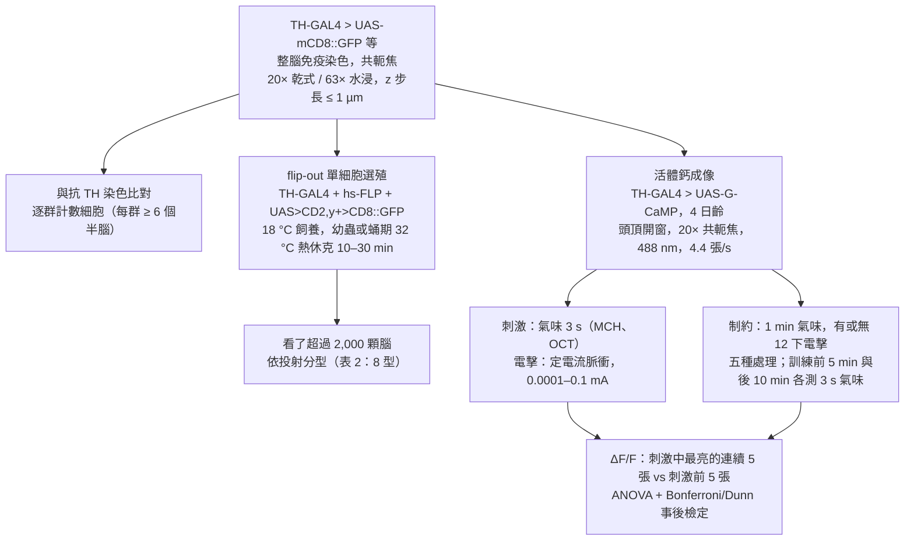
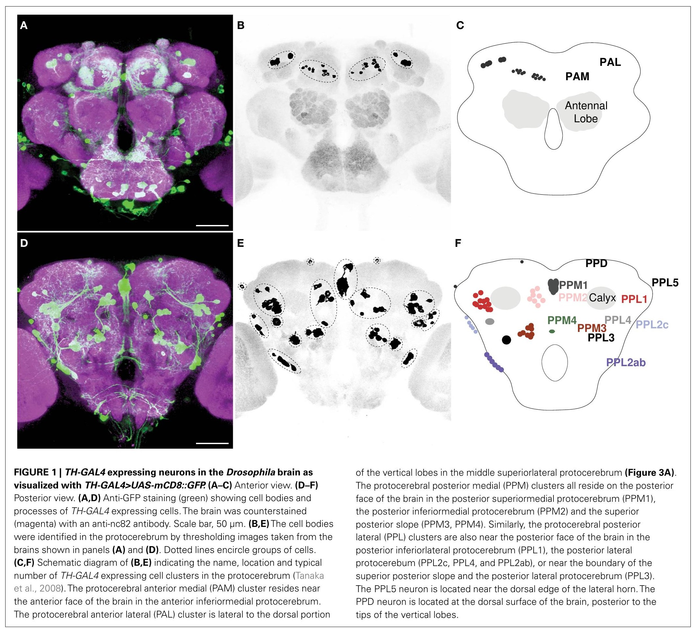
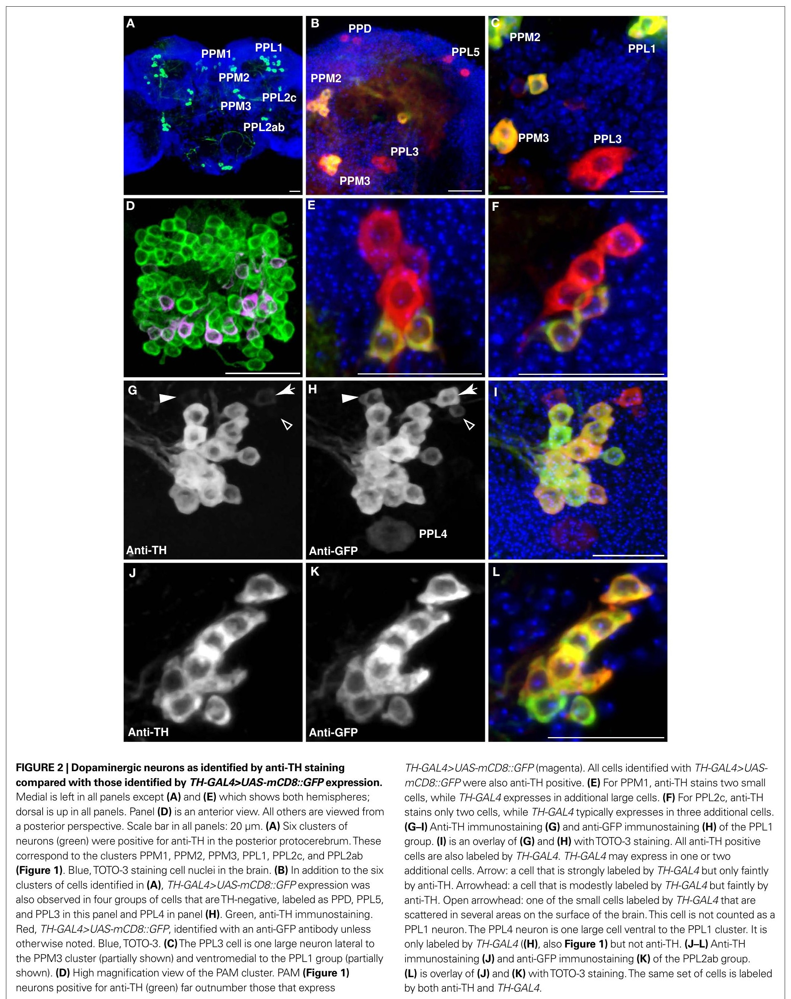
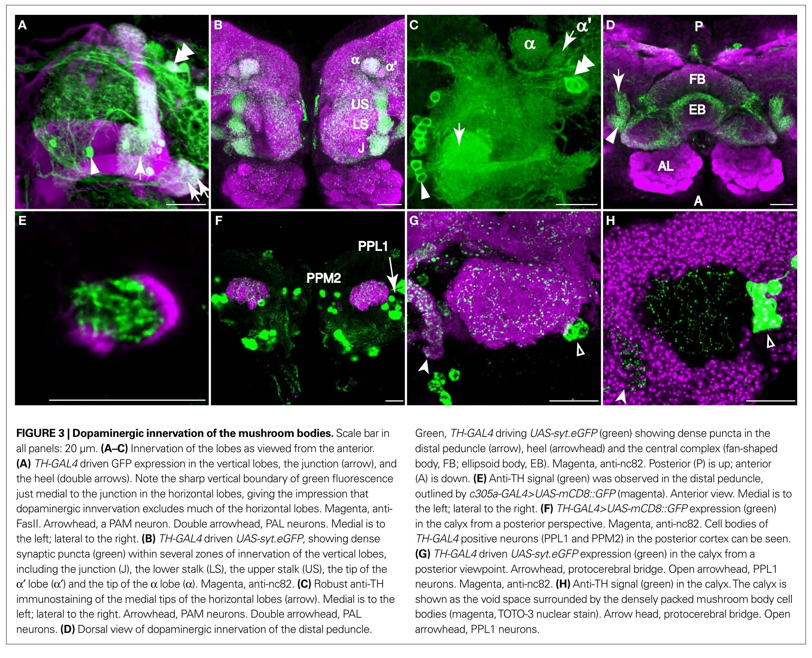
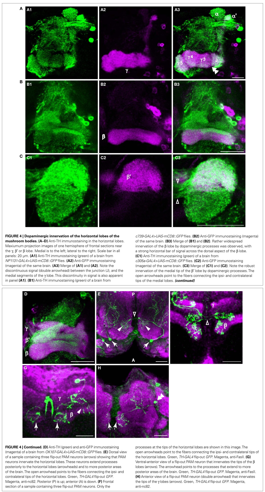
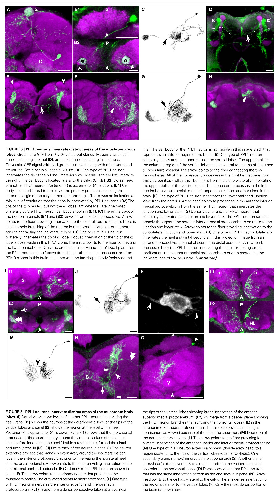
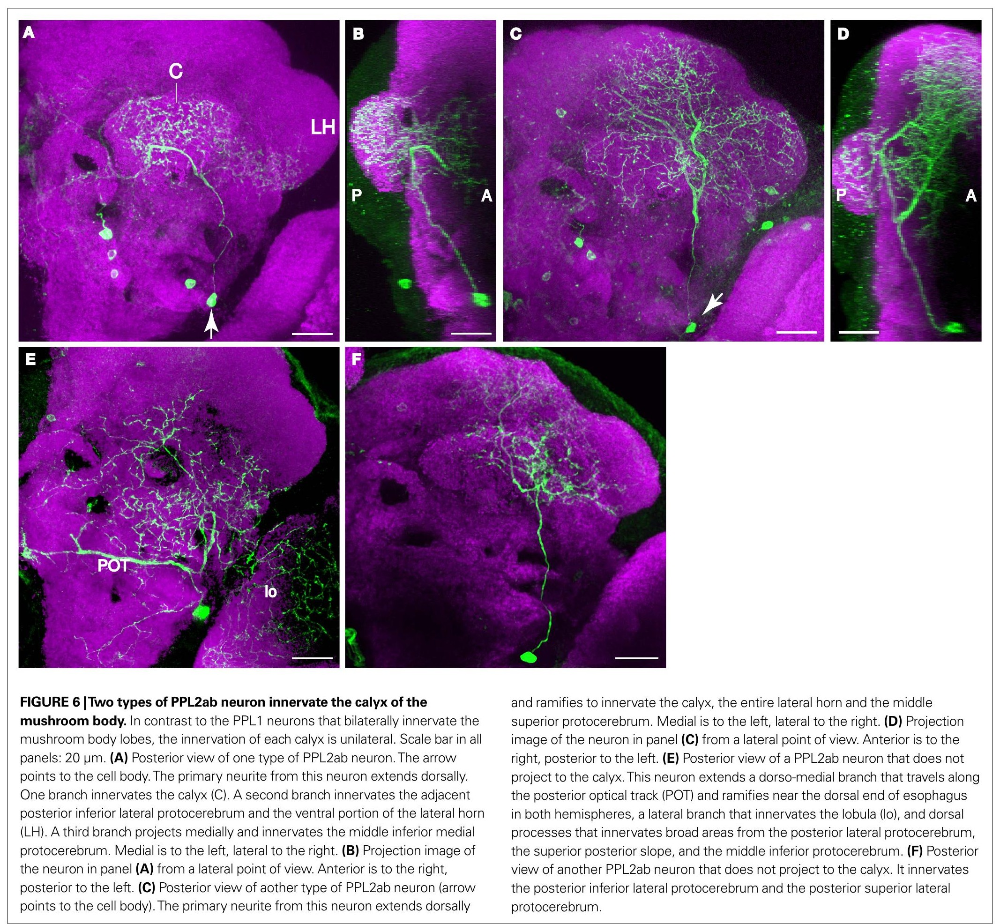
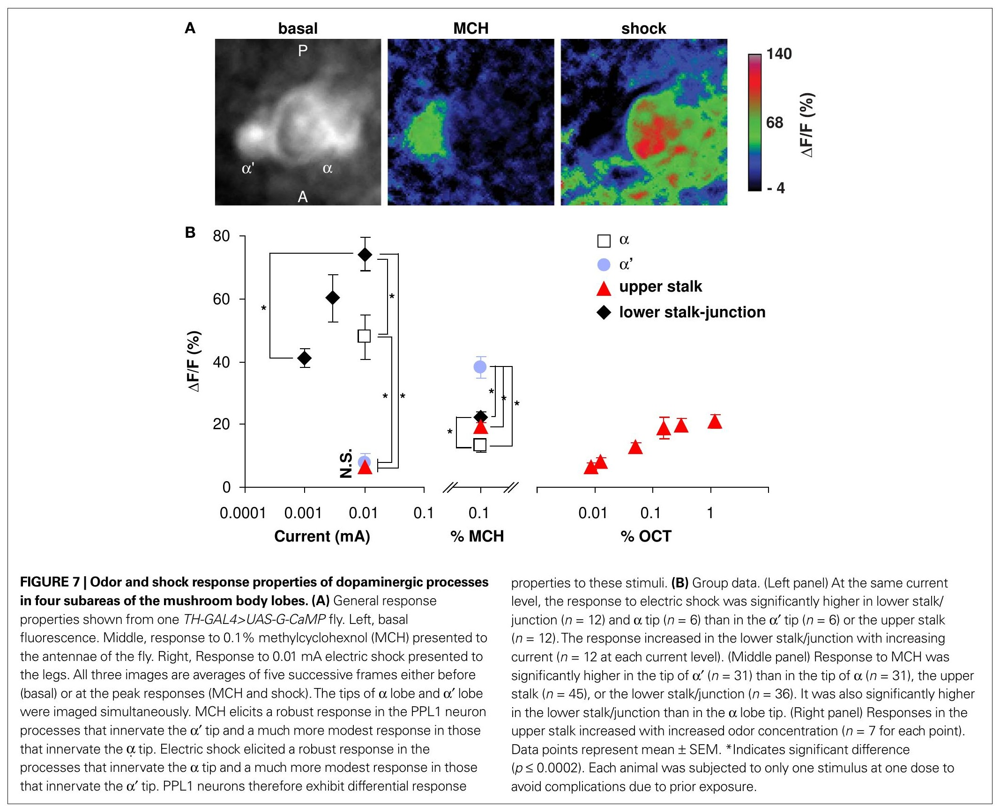
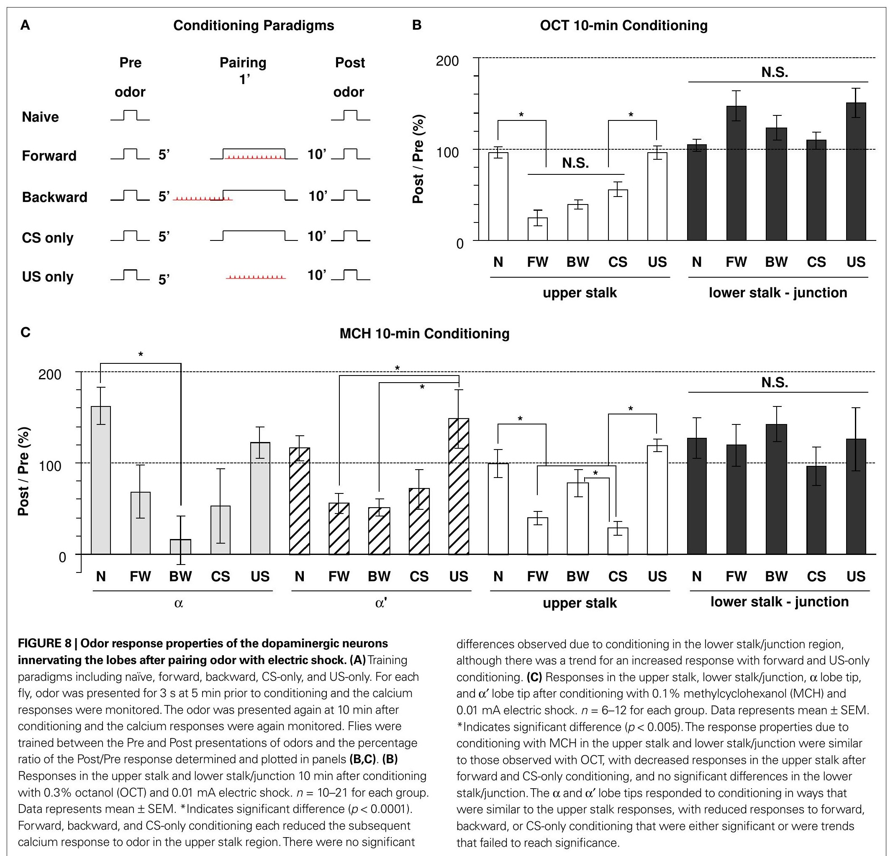

<!-- 本機 PDF：papers/2009-Eight%20different%20types%20of%20dopaminergic%20neurons%20innervate%20the%20Drosophila%20mushroom%20body%20neuropil%20anatomical%20and%20physiological%20heterogeneity.pdf -->

# Eight different types of dopaminergic neurons innervate the *Drosophila* mushroom body neuropil: anatomical and physiological heterogeneity

**八種不同的多巴胺神經元支配果蠅蕈狀體神經纖維區：解剖與生理上的異質性**

| 項目 | 內容 |
|---|---|
| **出處** | Front. Neural Circuits 3, 5 (2009；文章編號制，PDF 共 17 頁). doi: 10.3389/neuro.04.005.2009 [全文（PMC 免費閱讀）](https://pmc.ncbi.nlm.nih.gov/articles/PMC2708966/) |
| 日期 | 線上發表 2009-07-01。投稿 2009-04-06；「paper pending published」2009-04-25；接受 2009-06-03（PDF 第 17 頁）。修訂日期 PDF 未印 |
| 通訊作者 | Ronald L. Davis（rdavis@bcm.tmc.edu）。PDF 只有英文名 |
| 作者 | 共 2 人：Zhengmei Mao、Ronald L. Davis。PDF 未列分工 |
| 機構 | Department of Molecular and Cellular Biology、Menninger Department of Psychiatry and Behavioral Sciences（Baylor College of Medicine, Houston）。Mao 現職：Institute of Molecular Medicine, University of Texas Health Science Center at Houston |
| 資料庫 | 無（未釋出影像或程式） |
| 補充資料 | 正文引用補充圖 1–3（例如補充圖 2 有 PAL、PPM2、PPM3、T1 的投射，補充圖 3 是第三型支配萼部的細胞），放在出版社網站，**不在 PDF 內，本庫未取得**。凡引補充圖的內容，本頁只轉述正文的描述 |
| 編輯／審查 | 編輯 Liqun Luo（Stanford University）；審查人 Volker Hartenstein（UCLA）、Yi Rao（北京大學）、Tzumin Lee（University of Massachusetts） |

> 與本庫有關的作者：Ronald L. Davis 也是本庫 [[s-tomchik-2009-camp-dynamics]] 的通訊作者（同一實驗室同年的論文）。本篇被本庫的 [[s-tomchik-2009-camp-dynamics]]、[[s-aso-2016-dan-cell-type-rules]]、[[s-huang-2024-dopamine-memory-dynamics]] 引用。
>
> **授權：開放取用。** PDF 第 17 頁寫明本文「subject to an exclusive license agreement between the authors and the Frontiers Research Foundation, which permits unrestricted use, distribution, and reproduction in any medium, provided the original authors and source are credited」，即允許在註明作者與出處的條件下不受限制地使用、散布與重製；原文沒有出現「Creative Commons」字樣（已搜 Creative、CC BY）。本庫仍只給全文連結、不放 PDF；每張圖下方標明出處與授權。

---

## 為什麼重要

> 本節假設讀者已略知果蠅嗅覺學習的輪廓；**完全不熟的讀者可以先看「科普文」一節**，術語見「專業文」開頭的「本頁用語」表。
>
> 最小詞表：蕈狀體的軸突束分成幾條「葉」，往上的垂直葉（α、α′）、往內的水平葉（β、β′、γ）。每條葉再分成一格一格；本頁「段」「節」「區」「格」都指這種一小塊，後來的正式名稱是「區室」。新型名＝細胞群名＋所支配的格，例如 PPL1-α3＝支配 α 葉第 3 格的那型；字尾 pedc 見本頁用語。「群」指細胞體聚在一處的一群神經元，「型」指依投射位置分的細胞種類。「※」開頭的標記表示本頁自己的推論或從圖判讀，不是論文原話。

**第一個貢獻是命名上的橋。** 本庫目前的論文，談到多巴胺神經元（DAN）時幾乎都用「PPL1-γ1pedc」「PPL1-α3」這種**以區室命名**的型別名稱（Aso 2016、Huang 2024；PPL1 群是腦後外側的一群多巴胺神經元，約 12 顆）。較早的 Hige 2015、Felsenberg 2017 的實驗則用「MB-MP1」「MB-MV1」「MB-V1」這種舊名。

這篇 2009 年的論文落在兩套命名之間，而且它自己沒有取型名，只用位置描述。作者說在此之前，各細胞群裡單一細胞投射到哪裡「尚未描繪」。本篇用單細胞標記把支配蕈狀體的 DAN 一型一型拆開，說 PPL1 群有五型細胞，分別投射到：

- 垂直葉的尖端（α 尖端、α′ 尖端各一型）；
- 上段；
- 下段與交界（交界＝垂直葉與水平葉相接處）；
- 腳跟（柄轉進水平葉的轉彎處）與柄末端（柄＝KC 軸突從萼部往前的一束；KC 是蕈狀體的主要細胞，萼部是它收訊號的一端）。

橋的兩端這樣接起來：

1. 本篇把後三型（上段、下段與交界、腳跟與柄末端）對到 Tanaka 2008 的舊名 MB-V1、MB-MV1、MB-MP1。
2. Felsenberg 2017 雖然實驗用舊名，但文中附了舊名到新名的對照：MB-MP1＝PPL1-γ1pedc（腳跟與柄末端）、MB-MV1＝PPL1-γ2α′1（下段與交界，※ 推論）、MB-V1＝PPL1-α′2α2（上段）。
3. 兩者串接，本篇的位置描述就能接到新名；位置如何對齊詳見專業文 3.3 的對照表。

其中兩型（α 尖端、α′ 尖端）本篇沒有給舊名。

**第二個貢獻是生理。** 本篇用鈣成像（細胞活動時鈣離子湧入、螢光變亮）在活果蠅上逐區看 DAN 末梢，發現**不同區的 DAN 對電擊與氣味的偏好相反**：α 葉尖端對電擊反應強、對氣味弱；α′ 葉尖端反過來。這推翻了當時「DAN 只是把電擊訊號均勻送進蕈狀體」的簡化模型（作者引 Han et al. 1996、Kim et al. 2007 的說法）。

本篇鈣訊號（ΔF/F，即螢光增加的百分比）的電擊排序是：下段連交界約 74% ＞ α 尖端約 48% ＞ α′ 尖端、上段約 6–8%（※ 從圖判讀，見科普文與 3.5）。十五年後的 Huang 2024 用電壓成像逐型量 PPL1 的放電，排序相同：γ2α′1（下段連交界）＞ α3（α 尖端，※ 推論）；α′2α2（上段）與 α′3（α′ 尖端，※ 推論）幾乎沒有反應（3.3 表中兩者都「不顯著」）。新舊名對應見 3.3。電壓成像看得到每一次放電，也看得到放電減少——後者本篇的鈣成像看不到，見科普文最後。Huang 2024 主張 DAN 同時帶著「氣味天生的好惡」與「學到的價值」兩種訊號，所以「DAN 也對氣味本身反應」正是它論證的出發點。

**第三，本篇也量了學習會不會改變 DAN。** 做法是比較「一分鐘氣味配電擊」之後 10 分鐘與訓練前，DAN 對同一氣味的反應。**答案是沒有專一於配對的改變**。在 α 尖端、α′ 尖端、上段三區，只聞氣味、氣味配電擊、電擊先於氣味三種處理都讓反應下降。第四區下段連交界，五組處理（另含只挨電、完全沒處理）都沒變。所以下降來自「聞過一分鐘氣味」本身，而不是學習。

這個陰性結果和 Huang 2024 的「訓練數回合後，α3 的 DAN 開始對受訓氣味放電」並不直接牴觸，因為協定、時間點、讀數都不同。但有一處待確認的張力：

- 本篇：「只聞氣味」就讓 DAN 反應下降。
- Huang 2024：沒配電擊的氣味（CS−）在所有 PPL1 都不變。

兩者不能直接說矛盾。Huang 2024 的 CS− 是在同一次訓練中和配電擊的氣味（CS+）交替出現、本身不配電擊的對照氣味，不等於本篇「整段只聞氣味、完全沒有電擊」的組。兩篇的讀數（鈣 vs 放電）、氣味、品系也都不同。這處張力列在專業文第五節與 [[syn-contradictions]] 草稿中。

---

## 論文摘要（原文與中譯）

> We examined tyrosine hydroxylase (TH-GAL4) expression and anti-TH immunoreactivity in the *Drosophila* protocerebrum and characterized single cell clones of the TH-GAL4 neurons. Eight clusters of putative dopaminergic neurons were characterized. Neurons in three of the clusters project to the mushroom body neuropil: PAM neurons project to the medial portion of the horizontal lobes; PPL1 neurons project to the vertical lobes, the junction area, the heel and distal peduncle; and PPL2ab neurons project to the calyx. Five types of PPL1 neurons were discovered that innervate different zones of the mushroom body lobes. Functional imaging experiments showed that the dopaminergic processes in four of the zones differ in response properties to odor, electric shock, or following the pairing of odor and electric shock. These results indicate that distinct dopaminergic neurons define separate zones of the mushroom body lobes and are probably involved in different functions. Differences in functional response properties of these neurons suggest that they are involved in different behavioral processes.

（Frontiers 的摘要不分 Background／Results／Conclusion 段，照原樣一段。）

**中譯**（本節為忠實翻譯，非自撰內容）：

> 我們檢視了果蠅前大腦中酪胺酸羥化酶驅動品系（TH-GAL4）的表現與抗 TH 免疫反應，並描述了 TH-GAL4 神經元的單細胞選殖株。共描述了八個推定的多巴胺神經元細胞群。其中三群的神經元投射到蕈狀體神經纖維區：PAM 神經元投射到水平葉的內側部分；PPL1 神經元投射到垂直葉、交界區、腳跟與柄的末端；PPL2ab 神經元投射到萼部。我們發現五型 PPL1 神經元，分別支配蕈狀體葉的不同分區。功能成像實驗顯示，其中四個分區的多巴胺突起，在對氣味、電擊，或氣味與電擊配對之後的反應特性上各不相同。這些結果表示，不同的多巴胺神經元界定出蕈狀體葉上分開的分區，並可能參與不同的功能。這些神經元功能反應特性的差異，暗示它們參與不同的行為歷程。

---

## 科普文

想像一棟大樓裡有一套廣播系統。過去大家以為整棟樓只有一支擴音器，警報一響，每層樓聽到的是同一句「有危險」。這篇論文爬上每一層樓去看線路，發現**每層樓接的是不同的擴音器，而且每支擴音器對不同的事情特別敏感**：有的聽到失火（電擊）就大叫，有的對訪客上門（氣味）反應比較大。

這棟大樓是果蠅的蕈狀體（mushroom body），負責把氣味和好壞經驗連起來。氣味讓蕈狀體裡的 Kenyon 細胞（KC）放電。KC 的軸突（送訊號的長枝）從萼部（calyx，KC 的樹突、也就是收訊號端所在之處）往前集成一束，叫柄；柄的末端分岔成幾條「葉」（lobe），往上走的叫垂直葉（α、α′），往內側走的叫水平葉（β、β′、γ）。柄轉進水平葉的轉彎處叫腳跟，垂直葉與水平葉相接處叫交界。擴音器則是多巴胺神經元（dopaminergic neuron, DAN）：當時的主流模型認為，DAN 在電擊時放出多巴胺，告訴蕈狀體「剛剛的氣味很糟」。

**難題：多巴胺神經元太多、纏在一起，看不出誰接到哪裡。** 果蠅腦裡有上百顆會製造多巴胺的細胞，以細胞體的位置分成「群」（cluster）：前人（Budnik & White 1988；Nässel & Elekes 1992）在全腦描述了 15 群；本篇只看前大腦，找到 8 群，例如腦前方內側的 PAM 群、腦後方外側的 PPL1 群。用一般的染色把它們全部點亮，只看到一團纏繞的線，分不出某一顆細胞的線伸到哪裡。

**解法一：一次只點亮一顆。** 作者的基礎工具是 TH-GAL4 品系：它只在（大部分）多巴胺神經元中開啟外加基因。在它之上，作者再用一種隨機開關的遺傳技巧（flip-out）：在幼蟲或蛹期給果蠅短暫加熱，讓少數幾顆多巴胺神經元隨機亮起綠色螢光，其他的保持暗的。原理是：加熱讓一種剪接酵素短暫表現，它隨機在少數細胞中剪掉一段擋住綠色螢光基因的片段，只有那幾顆細胞才發綠光。看了超過 2,000 顆腦，每次只看到一顆或幾顆亮起來的細胞，就能追出它的整條線路。

結果三群 DAN 伸進蕈狀體：

- PAM 群到水平葉；
- PPL1 群到垂直葉，以及腳跟與柄末端；
- PPL2ab 群到萼部（在此之前一般認為萼部沒有多巴胺）。

**PPL1 群大約只有 12 顆細胞，卻分出五種伸進蕈狀體的線路：α 葉尖端、α′ 葉尖端、垂直葉上段、垂直葉下段連交界，以及腳跟連柄末端。** 每一種都只占一段，所以垂直葉看起來被切成一節一節。這是後來「區室」（compartment）這個想法的早期解剖證據之一。區室指葉上的一格：每格由一型 DAN 支配，也由一型輸出神經元（MBON，把蕈狀體的訊號送出去的神經元）讀取。本篇沒有用「區室」一詞；它引 Tanaka 2008 在輸出神經元上看到的同樣分段，來支持「葉被細分成小單元」。

**解法二：在活果蠅上看每一節的擴音器什麼時候響。** 作者讓 TH-GAL4 標到的多巴胺神經元（大部分的群，但 PAM 群只有一小部分）帶上一種鈣感測器（G-CaMP，細胞活動時鈣離子湧入，螢光變亮）。接著從果蠅頭頂開一個小窗，用共軛焦顯微鏡分層對焦，分別看四節的多巴胺末梢：α 尖端、α′ 尖端、上段、下段連交界。

結果四節對電擊和氣味都有反應，但偏好不同：

- **電擊**（0.01 毫安培）：下段連交界最亮（ΔF/F 約 74%，ΔF/F 是螢光變化除以原本亮度），α 尖端次之（約 48%），α′ 尖端與上段只有約 6–8%（※ 從圖判讀）。
- **氣味**（0.1% 甲基環己醇，MCH）：α′ 尖端最亮（約 38%），α 尖端最暗（約 13%）。

同一隻果蠅裡，α 尖端對電擊大叫、對氣味輕聲；α′ 尖端反過來。**所以「多巴胺＝電擊訊號」這句話太簡單：有的多巴胺神經元對氣味本身的反應比對電擊還大。**

**接著問：學習之後，擴音器會不會改口？** 作者讓果蠅聞一分鐘氣味；氣味開始 5 秒後才給第一下電擊，12 下電擊在這一分鐘內給完（各下的間隔原文未寫）。10 分鐘後再聞同一個氣味，看反應比訓練前大還是小。為了分辨「學習」和「單純聞過」，另設四組：完全沒處理、只聞氣味、只挨電、電擊先於氣味 45 秒。

結果：

- α 尖端、α′ 尖端與上段：在「氣味配電擊」「電擊在前」「只聞氣味」三組都變小；只挨電與沒處理的不變。
- 下段連交界：五組都沒有顯著改變。

**變小的三組，共同點是「聞了一分鐘氣味」，所以作者的結論是：沒有看到專屬於學習的改變。**

**代價與需要小心的地方。**

- 第一，鈣成像用的是一次標到許多群多巴胺神經元的品系（TH-GAL4）。每一節的訊號是推定由某一型 PPL1 貢獻，但也可能混進其他細胞的分枝；作者自己就說 PPL1 細胞在葉旁有大片「雲狀」分枝。
- 第二，這個品系只標到 PAM 群的一小部分（每半腦約 13 顆，而用抗體染出約 100 顆），所以水平葉的多巴胺功能本篇幾乎沒有量。
- 第三，鈣訊號只容易看到「變亮」，看不到「變暗」：螢光只在鈣大量湧入時明顯變亮，放電減少時鈣濃度變化很小。Huang 2024 用電壓成像證明，同一型 DAN 在聞到喜歡的氣味時放電會下降，而鈣成像幾乎看不出來（見 [[s-huang-2024-dopamine-memory-dynamics]] 延伸圖 13）。所以本篇可能漏看了 DAN 放電減少的反應。

**最容易被誤讀的一點：本篇沒有顯示「DAN 學會預測電擊」，也沒有顯示「DAN 不會學」。** 「學會預測電擊」在實驗上的樣子是：配對後，DAN 對那個氣味本身的反應變大，好像預期電擊要來。本篇只量了一種協定（單次一分鐘配對）、一個時間點（10 分鐘後）、一種讀數（鈣），看到的下降也不專屬於配對組（只聞氣味的組也一樣下降）。

Huang 2024 看到 α3 的 DAN 開始對受訓氣味放電，是在連續訓練三到六回合之後。短期記憶指訓練後數分鐘就測得到的記憶，長期記憶指數小時以上仍在的記憶。依 Huang 2024，α3 這一格與長期記憶有關：α3 的 DAN 對氣味放電，才能在那一格寫入長期記憶。它的解釋是：與短期記憶有關的 γ1pedc 這一格（γ 葉最靠近柄的那一格，大致是本篇的腳跟連柄末端，※ 推論），其輸出神經元原本抑制 α3 的 DAN，像一道關著的閘門。連續訓練數回合後，這條抑制變弱，閘門打開，α3 的 DAN 才開始對受訓氣味放電，長期記憶才寫得進去。本篇的單次配對正好落在「閘門還沒打開」的階段（※ 推論）。兩篇並排時，該比的是協定，不是結論。

---

## 專業文

### 本頁用語

本頁各節可單獨查閱，故把反覆出現的詞集中在這裡。

| 詞 | 意思 |
|---|---|
| 蕈狀體（mushroom body, MB） | 果蠅腦中負責嗅覺學習與記憶的結構，左右各一 |
| KC（Kenyon cell） | 蕈狀體的主要神經元。樹突在萼部，軸突成束形成柄與各葉 |
| 萼部（calyx） | KC 樹突所在處，接收嗅覺投射神經元（把嗅覺訊號從前一站「嗅葉」送進蕈狀體萼部的神經元）送來的氣味訊號 |
| 柄（peduncle） | KC 軸突從萼部往前走的一束；「柄末端」（distal peduncle）指靠近分岔處的一段 |
| 垂直葉、水平葉 | KC 軸突在柄的前端分岔：往背側的是垂直葉（α、α′），往內側的是水平葉（β、β′、γ） |
| 交界（junction）、腳跟（heel） | 本篇用語。交界是垂直葉與水平葉相接的區域；腳跟是柄轉彎進入水平葉之處（本篇圖 3A、3D 以箭頭標出）。本篇沒有給精確的邊界定義 |
| 上段、下段（upper stalk、lower stalk） | 本篇用語。垂直葉的柱狀部分，上段在 α、α′ 尖端的下方，下段再往下、接近交界（圖 3B 標 US、LS） |
| 外在神經元（MBEN，mushroom body extrinsic neuron） | 細胞體在蕈狀體外、突起伸進蕈狀體的神經元。DAN 與 MBON 都屬此類，所以 Tanaka 2008 的舊名同時涵蓋兩者 |
| DAN（dopaminergic neuron） | 多巴胺神經元，以多巴胺（dopamine, DA）為傳遞物質。本篇稱「推定的多巴胺神經元」（putative DA neuron），因為判定依據是 TH-GAL4 表現加抗 TH 染色，不是直接量多巴胺 |
| MBON（mushroom body output neuron） | 蕈狀體輸出神經元：樹突伸進蕈狀體某一段，接收 KC 的訊號，再把訊號送出蕈狀體。本篇沒有量 MBON，只引 Tanaka 2008 的外在神經元分類 |
| MBON 名稱裡的「>」 | 例如 MBON-γ1pedc>α/β：樹突在 γ1pedc 區室，軸突送到 α/β 葉。字尾 pedc 的意思本庫來源沒有解釋（？待查），字面上像是 peduncle（柄） |
| 區室（compartment） | 後來的通行用語：每個葉沿長度分成一格一格，每格由一型 DAN 支配，也由一型 MBON 的樹突在那一格接收 KC 的訊號。本篇還沒有用這個詞，寫的是「zone」「sub-area」「subcompartment」。見 [[c-mb-compartment]] |
| 區室編號（γ1、γ2、α′1…） | 新名中葉名後的數字是第幾格。※ 推論：依新名慣例由靠近柄的一端往尖端數，見 [[c-mb-compartment]] |
| 教學訊號 | 告訴蕈狀體「剛才的氣味是好是壞」的訊號，例如電擊引起的多巴胺 |
| 群、類、型 | 三個層級： 「群」（cluster）依細胞體位置分，前大腦共 8 群多巴胺神經元。 「類」（class）是計數時依形態與位置歸的類。8 群多巴胺神經元各算一類，再加 5 類非多巴胺細胞，共 13 類。 「型」（type）依單細胞選殖的投射分。表 2 的 8 型＝PAM 1＋PPL1 5＋PPL2ab 2。 「8 型」與摘要「八個細胞群」的 8 只是巧合，不是同一組（見第五節第 7 點 (f)） |
| 細胞群（cluster）名稱 | 依細胞體位置命名：P＝protocerebral（前大腦）；A／P＝anterior／posterior（前／後）；M／L＝medial／lateral（內／外）。PAM＝前內側，PAL＝前外側，PPM＝後內側，PPL＝後外側，PPD＝後背側；數字與字母是同一位置的分群編號 |
| GAL4／UAS、「A>B」 | GAL4 是酵母的轉錄因子，只會開啟接在 UAS 序列後面的基因。「TH-GAL4 > UAS-mCD8::GFP」表示 TH-GAL4 品系驅動 mCD8::GFP 表現。注意本頁「>」有三種用法：A>B（A 驅動 B）；UAS>…>…（FLP 切點，見 flip-out 列）；MBON 名稱裡（樹突在前、軸突送到後） |
| 驅動品系、報告基因 | 驅動品系是決定「在哪些細胞表現」的那一半（如 TH-GAL4）。報告基因是讓細胞發光、供觀察的外加基因（如 GFP、syt.eGFP、G-CaMP）。mCD8::GFP 亮整個細胞膜，用來看形態；syt.eGFP 是接在突觸小泡蛋白上的 GFP，集中在送出訊號的突觸前末梢，所以能分辨末梢 |
| 抗 nc82、抗 FasII、TOTO-3 | 對照用的背景染色。抗 nc82 與抗 FasII 畫出腦區與蕈狀體葉的輪廓；TOTO-3 染細胞核 |
| split-GAL4 | 把 GAL4 拆成兩半，各由一段調控序列控制，只有兩段都開啟的細胞才湊成完整 GAL4，因此能只標一型細胞。見 [[e-split-gal4]] |
| TH、TH-GAL4 | TH 是酪胺酸羥化酶，合成多巴胺的酵素。TH-GAL4 借用 TH 基因的調控序列，讓外加基因在大致會製造多巴胺的細胞中表現。見 [[e-th-gal4]] |
| 抗 TH 染色（anti-TH） | 用抗體直接染 TH 蛋白。與 TH-GAL4 比對，可以看出這個品系漏標或多標了哪些細胞 |
| flip-out 單細胞選殖（single cell clone） | 熱休克讓 FLP 重組酶表現，隨機切掉一段「阻擋」序列，只有被切到的少數細胞才表現綠色螢光標記（CD8::GFP），於是可以看到單一細胞的完整形態。品系寫法 UAS>CD2,y+>CD8::GFP 中，兩個「>」是 FLP 的切點，中間的 CD2,y+ 是阻擋片段 |
| 選殖不飽和 | 看的腦還不夠多，不是每顆 TH-GAL4 細胞都被單獨點亮過，所以可能漏掉某些型 |
| 舊名（MB-MP1 等） | Tanaka 2008 對蕈狀體外在神經元的命名（涵蓋 DAN 與 MBON）。本篇把三型 PPL1 對到 MB-V1、MB-MV1、MB-MP1；把一型 PPL2ab 對到 MB-C1 |
| G-CaMP、ΔF/F | G-CaMP 是鈣感測器，細胞活動時變亮（本篇引 Yu et al. 2004，未寫版本號）。ΔF/F＝（刺激中最亮的連續 5 張平均 − 刺激前 5 張平均）÷ 刺激前 5 張平均，以百分比表示。見 [[e-gcamp]] |
| 鈣成像、電壓成像 | 鈣成像（本篇用）看細胞內鈣濃度的螢光，反應慢，放電減少時螢光幾乎不變暗。電壓成像（Huang 2024 用）看膜電壓，看得到每一次放電，也看得到放電減少 |
| N.S. | not significant，統計上不顯著 |
| Post/Pre | 本篇圖 8 的讀數：訓練後 10 分鐘的氣味反應 ÷ 訓練前 5 分鐘的氣味反應 × 100%。100% 表示不變 |
| 五種處理 | 未處理（naïve, N）；順向（forward, FW：1 分鐘氣味配 12 下電擊，氣味先 5 秒）；逆向（backward, BW：同樣 1 分鐘氣味＋12 下電擊，但第一下電擊比氣味開始早 45 秒）；只給氣味（CS only）；只給電擊（US only） |
| 制約、訓練 | 本頁同義，指上列五種處理 |
| CS、US | CS（conditioned stimulus）是被拿來配對的氣味；US（unconditioned stimulus）是懲罰本身，本篇為電擊 |
| MCH、OCT | 4-甲基環己醇（4-methylcyclohexanol）與 3-辛醇（3-octanol），果蠅嗅覺學習常用的一對氣味，以礦物油稀釋 |
| 吸引氣味 | 果蠅天生會趨近的氣味 |
| 側角（lateral horn, LH） | 嗅覺訊號的另一個去處，與萼部並列 |
| T 迷宮 | 行為測驗裝置：果蠅從中央選左右兩臂之一，兩臂各接一種氣味。見 [[c-performance-index]] |
| ※ 推論 | 論文沒有明說、本頁自行推得的內容，並寫出依據 |
| ？待查 | 值得查證但本頁刻意不填的內容 |

### 一、概述

**主要問題。** 果蠅前大腦裡的多巴胺神經元有哪幾群？每群裡的單一細胞投射到哪裡？哪些伸進蕈狀體、伸到哪一段？伸到不同段的 DAN，對電擊、氣味、氣味配電擊的反應是否不同？

**重要性。** 2009 年的主流模型把 DAN 當成均勻送進蕈狀體的電擊訊號（作者引 Han et al. 1996、Kim et al. 2007）。若不同段由不同的 DAN 支配、且這些 DAN 反應不同，蕈狀體就不是一個均勻的學習器，而是一組分段、各有教學訊號（見本頁用語）的單元。這正是本庫 [[c-mb-compartment]] 的前提。

**發表當時的領域現狀（2009）。**

- **多巴胺細胞群的位置與數目**：Nässel & Elekes 1992 以抗多巴胺（DA）、抗 TH 染色，主要在麗蠅（blowfly，另一種蠅類）上描述 15 群，其中前大腦 7 群；他們也染了果蠅，指出果蠅的分群大致相同。Budnik & White 1988 也有分布描述。各群單一細胞的投射當時未知。本篇在前大腦數到 8 群，比 7 群多一群。原因是：前人的 PPL2 群包含後來的 PPL2ab 與 PPL2c；本篇因兩者細胞體相距遠、投射不同，把 PPL2c 獨立成一群（見 3.1）。
- **TH-GAL4 品系**：Friggi-Grelin et al. 2003 建立，並已注意到它在 PAM 群漏標。
- **蕈狀體的分段**：Tanaka et al. 2008 以 GAL4 增強子篩選（從許多隨機插入、各自標出不同細胞的 GAL4 品系中，挑出標到特定神經元的品系）看到外在神經元（MBEN，見本頁用語）只在葉上特定的 2–5 段分枝，提出葉被分成較小單元。
- **DAN 的功能**：Schwaerzel et al. 2003 顯示阻斷 DAN 輸出損害嫌惡記憶（氣味配懲罰後學到避開），不損害食慾記憶（氣味配糖等獎賞後學到趨近）。Riemensperger et al. 2005 用 FRET 鈣感測器（另一種鈣感測器，與本篇的 G-CaMP 不同），看到蕈狀體葉上的 DA 末梢對電擊強、對氣味弱。氣味配電擊訓練後 1 分鐘再測，受訓氣味引起的鈣反應持續得比較久。他們把「反應延長」解讀為：原本中性的氣味經配對後變得「有意義」（gain of relevance），並據此提出 DAN 能預告懲罰（predict the reinforcement）。本篇在討論中直接與它對話。
- 本庫內：同一實驗室同年的 [[s-tomchik-2009-camp-dynamics]] 引用本篇，說明多巴胺神經元支配蕈狀體。

### 二、方法

**果蠅與標記。** TH-GAL4 由 S. Birman 提供（Friggi-Grelin et al. 2003），分別驅動 mCD8::GFP（細胞膜，看形態）、syt.eGFP（突觸小泡蛋白，看突觸前的點狀結構）、GFP::LacZ.nls（細胞核）。蕈狀體各葉的位置標記：NP1131-GAL4（γ 葉）、c739-GAL4（β 葉，見 [[e-c739-gal4]]）、c305a-GAL4（β′ 葉）、OK107-GAL4（全部 KC）；腦區輪廓用 anti-nc82 與 anti-FasII。**果蠅的性別全文沒有寫**（已搜 female、male、sex），成像組為 4 日齡。

**單細胞選殖。** hs-FLP 是接在熱休克啟動子後面的 FLP 基因，平時幾乎不表現，加熱才開啟。果蠅養在 18 °C，在幼蟲或蛹期以 32 °C 水浴或空氣培養箱熱休克，通常 10–30 分鐘。※ 推論：養在低溫是為了減少平時的漏表現；原文沒有說明 18 °C 的理由。共看了「超過 2,000 顆腦」。

- 每一型都要在至少兩個樣本看到才列入表 2。表 2 把 PAM 當成一型，樣本數 11。
- 圖 4G、4H 是 PAM 中的兩種亞型（投射到 β 葉尖端、γ 葉尖端），各只在一個樣本看到（只出現一次的選殖），所以沒有另列為型。
- 表 2 各型的樣本數為 2–14。「一些 PAM 與 PPL1 樣本含多個選殖」：同一顆腦同時亮了幾顆細胞，分枝可能重疊，較難判定哪條分枝屬於哪一顆。

**計數。** 在整腦影像上以形態、位置、主要突起的走向把細胞歸「類」（class；群、類、型的分別見本頁用語）。表 1 註 b 給的是所有類別共同的下限：每一類至少數了 6 個半腦。TH-GAL4 各類實際數了 21–36 個半腦；抗 TH 各類實際數了幾個，原文沒有逐一列出。PPM1 的細胞體在腦的中線上，分不出左右，所以以整顆腦計（14 顆腦）。

**活體鈣成像。** 方法沿用 Yu et al. 2004：果蠅卡在修過的吸管尖，頭與胸背以肉豆蔻酸（myristic acid）黏在吸管尖上（※ 推論：當黏著用，非化學固定組織；原文只寫 immobilized）；頭頂開窗、覆塑膠膜、矽膠封邊；20× 物鏡、氬雷射 488 nm、每秒 4.4 張。氣味在 4 ml 礦物油中稀釋，總氣流 100 ml/min，以三向電磁閥切換。每隻先做一次空瓶的假刺激：只有氣流切換、沒有氣味。若果蠅對單純氣流就有鈣反應，表示它對機械刺激變得特別敏感（敏感化），之後的氣味反應會混入氣流造成的反應，所以排除。電擊以 50 µm 鉑銥絲電極接觸腳（腳靠近腹部時也碰到腹部），刺激器 Grass S48 加隔離器 PSIU6，產生**定電流**脈衝，每一下都以電流計確認。

- **單下電擊的脈衝長度、12 下之間的間隔，全文沒有寫**（已搜 pulse、duration、ms、interval）。※ 推論：圖 8A 示意圖上 12 下電擊大致均勻分布在 1 分鐘內，間隔約 5 秒；但這是示意圖，不是參數。
- **電擊強度以電流（mA）表示**，例如 0.01 mA。電流取決於電極與果蠅之間的電阻，本篇沒有報告電阻，所以無法換算成其他研究常用的電壓：Huang 2024 的定電壓 20 V，或 T 迷宮行為實驗常用的 60–90 V（本庫 [[e-ppl1-gamma1pedc]] 等頁有記錄）。結果是本篇的 0.01 mA 相當於多強的電擊無法判斷。
- **每隻果蠅只接受一種刺激、一種劑量**（圖 7）或一種制約協定（圖 8），避免前一次刺激的影響。
- 排除標準：實驗結束時再給一次氣味；受過電擊的組（順向、逆向、只給電擊）再給 12 下電擊，沒反應的果蠅不列入。**被排除的隻數沒有報告**（已搜 exclud）。

**分析。** 手動圈 ROI（感興趣區），取 ROI 平均亮度；F₀＝刺激前連續 5 張的平均，F＝刺激期間最亮的連續 5 張平均。偽色圖先做半徑 3 像素的中值濾波。統計用 ANOVA 加 Bonferroni/Dunn 事後檢定；圖 7 的顯著門檻 p ≤ 0.0002、圖 8B p < 0.0001、圖 8C p < 0.005。這些是圖說中標星號的門檻；原文沒有說明為何各圖不同，也沒有給比較次數。

**評價：** 解剖部分的單細胞追蹤是本篇最紮實的部分，但每型的樣本數不大（2–14），而且作者自承「一些樣本含多個選殖」「一些型可能不是真正的多巴胺神經元」。功能部分的關鍵弱點是**驅動品系不專一**：ROI 裡的鈣訊號是所有 TH-GAL4 細胞在共軛焦顯微鏡同一對焦平面（一層光學切片）的總和，「上段＝某一型 PPL1」是依解剖推定，不是單型成像。

### 三、結果

#### 3.1 前大腦的 TH-GAL4 細胞：13 類約 127 顆，其中 8 群是多巴胺神經元（圖 1、圖 2、表 1）

TH-GAL4 在前大腦標到約 127 顆細胞，分成 13 類。比對抗 TH 染色，其中 8 群也含 TH（對應 Nässel & Elekes 1992 的 7 群，作者把 PPL2c 從 PPL2 獨立出來，所以多一群）；另外 5 類多半只有一顆細胞、抗 TH 陰性，作者判為「不太可能是多巴胺神經元」（PPD、PPM4、PPL3、PPL4、PPL5）。

> 注意：這裡的「8 群」是依細胞體位置分的細胞群（表 1）；3.2 的「8 型」是依投射到蕈狀體哪一區分的單細胞類型（表 2）。兩個「8」不相干，只是恰好相同（見第五節第 7 點 (f)）。

重製表 1 的計數。各欄單位都是「每半腦」（左右腦各一份，只算一邊），唯一例外是 PPM1：它的細胞體在中線上，不分左右，所以 TH-GAL4 欄改以「每腦」（左右合計）計。

第二欄是前人的計數。Nässel & Elekes 1992 數的是麗蠅（另一種蠅類），並指出果蠅各群數目與麗蠅相同，只有兩處例外；表中括號「果蠅較少」「果蠅 2」就是這兩處例外。PPL2c 在麗蠅沒有；在果蠅，前人把它當成 PPL2 的一個亞群，本篇再把它獨立成一群。

| 群 | 抗 TH（麗蠅，Nässel & Elekes 1992） | 抗 TH（本篇） | TH-GAL4（本篇，平均 ± SEM） | 主要投射 |
|---|---|---|---|---|
| PAM | 110（果蠅較少） | 約 100 | 12.85 ± 0.30 | 水平葉內側尖端與其後方 |
| PAL | 5 | 5 | 5.30 ± 0.20 | 視丘結節、視葉 lobula 等 |
| PPM1 | 1 | 1 | 5.46 ± 0.17（每腦） | 沿中線往腹側 |
| PPM2 | 6 | 8 | 8.07 ± 0.16 | 腹內側前大腦、食道下神經節 |
| PPM3 | 4 | 6–8 | 8.02 ± 0.19 | 中央複合體 |
| **PPL1** | 12 | 12 | **11.77 ± 0.22** | **蕈狀體及其周圍、上弓（superior arch）** |
| PPL2ab | a：6；b：2 | 6 | 6.10 ± 0.35 | 萼部、側角等 |
| PPL2c | 0（果蠅 2） | 2 | 4.62 ± 0.11 | 後外側前大腦 |
| PPD、PPM4、PPL3、PPL4、PPL5 | — | 0 | 0.94、0.07、1.00、0.91、0.54 | — |
| **合計** | | **約 282（每腦）** | **127（每腦）** | |

> 「主要投射」欄的視丘結節、lobula、食道下神經節、中央複合體等都是腦區名稱，在這裡只當位置標籤，本頁不逐一解釋；側角見本頁用語。上弓（superior arch）是蕈狀體以外的另一個腦區，原文只當位置名。
>
> 依 PDF 第 4 頁表 1 重製。本庫驗算 TH-GAL4 合計：12 類每半腦的平均和為 60.19，×2 ＝ 120.38，加 PPM1 每腦 5.46，得 **125.8**，表上寫 127（差約 1 顆；⚠️ 單篇自身的小出入，可能是四捨五入或計數批次不同，論文未說明）。抗 TH 合計分三步：(1) PPM3 原文是 6–8，取 7；(2) 其餘各群與 PPM1 都是每半腦數，相加 100＋5＋1＋8＋7＋12＋6＋2 ＝ 141；(3) ×2 ＝ 282，正好等於表上的「約 282」。PPM1 抗 TH 欄的 1 即每腦 2 顆（正文也說這群有兩顆抗 TH 陽性細胞）；原文沒有說明中線上的細胞如何分到左右。
>
> PPL2ab 一列：麗蠅的前人計數分成 a 亞群 6 顆、b 亞群 2 顆；原文沒有說明本篇的「6」是否含 b 亞群。
>
> 最後一列的 0.94、0.07 等小於 1，因為這些是每半腦的平均顆數：小於 1 表示不是每個半腦都看得到這顆細胞（例如 PPM4 平均 0.07，多數半腦沒有）。

**TH-GAL4 與抗 TH 的不一致集中在三群**：PAM（TH-GAL4 約 13 顆 vs 抗 TH 約 100 顆）、PPM1（5 vs 2，兩者都是每腦：TH-GAL4 每腦 5.46 顆；抗 TH 表上每半腦 1 顆，即每腦 2 顆）、PPL2c（5 vs 2）。PPL1 的 12 顆抗 TH 細胞全部被 TH-GAL4 標到，TH-GAL4 另可能多標一兩顆；圖 2G–I 中有一顆 TH-GAL4 強、抗 TH 弱的細胞。「全部標到」是圖 2I 圖說對同時染兩種標記的樣本的描述；表 1 的 11.77 ± 0.22 是另在 26 個半腦只數 TH-GAL4 的平均。平均略低於 12，原文沒有說明原因（※ 推論：部分細胞 TH-GAL4 表現弱而漏數；原文也說兩種標記的強度逐顆不一）。

**評價：** 「TH-GAL4 只標到約八分之一的 PAM」是本篇對後續研究影響最大的一句話：作者自己說，以 TH-GAL4 做的 DA 功能研究「可能低估了 PAM–水平葉這一部分」。本庫 [[e-th-gal4]] 記錄 Hige 2015 說 TH-GAL4 標「少數 PAM」，與本篇一致。

#### 3.2 三群 DAN 伸進蕈狀體（圖 3、圖 4、圖 6、表 2）

- **群體層級**：TH-GAL4 強表現於垂直葉、水平葉的外側部分、交界、腳跟與柄末端；水平葉內側只有稀疏纖維。抗 TH 卻在水平葉較廣、內側尖端特別強（圖 3C、4A–D）。所以 TH-GAL4 的空白不代表水平葉沒有多巴胺。
- **垂直葉分段**：syt.eGFP（標出突觸末梢的報告基因，見本頁用語）的點狀結構在垂直葉呈五段：α 尖端、α′ 尖端、上段、下段、交界（圖 3B）。這是解剖上看到的五段。但下段與交界由同一型 PPL1 支配（表 2 第 5 型），功能成像（3.5、3.6）也把兩者合成一個區域「下段連交界」，所以後文分析的單位是**四段**。
- **水平葉也分段**：抗 TH 訊號在水平葉同樣呈分段，例如 γ 葉從交界往水平葉尖端方向，分得出 γ3、γ4、γ5 三段（圖 4A3）。這些編號是作者自己標的：γ 葉在交界處的那一段另列為「交界區」，作者沒有標 γ1、γ2，也沒有定義 γ3 從哪裡起算（※ 推論：γ1、γ2 可能落在交界區附近，見本頁用語「區室編號」）。
- **萼部**：與前人（Nässel & Elekes 1992、Schwaerzel 2003、Zhang 2007）不同，本篇在萼部看到稀疏的 TH-GAL4 纖維、syt.eGFP 點狀結構與抗 TH 訊號（圖 3F–H）。
- **單細胞選殖（表 2，共 8 型）**：表 2 只收「伸進蕈狀體」的型，不進蕈狀體的型不列入。「熱休克時期」欄只記錄在哪個發育期加熱、得到這型選殖（依原文照錄），對結論沒有直接影響。

| 型 | 細胞群 | 支配的蕈狀體區域 | 樣本數 | 熱休克時期 |
|---|---|---|---:|---|
| 1 | PAM | 水平葉內側部分（有 γ 尖端、β 尖端、約 β′ 尖端等亞型，但高品質單一選殖不足 2 個，無法確認全部亞型） | 11 | 蛹期 |
| 2 | PPL1 | α 尖端 | 11 | 幼蟲與蛹期 |
| 3 | PPL1 | α′ 尖端 | 5 | 幼蟲與蛹期 |
| 4 | PPL1 | 上段 | 5 | 蛹期 |
| 5 | PPL1 | 下段與交界 | 13 | 幼蟲與蛹期 |
| 6 | PPL1 | 腳跟與柄末端 | 14 | 幼蟲與蛹期 |
| 7 | PPL2ab | 萼部與側角腹側 | 4 | 幼蟲與蛹期 |
| 8 | PPL2ab | 萼部與整個側角 | 2 | 蛹期或幼蟲晚期 |
| **合計** | | | **65** | |

> 依 PDF 第 9 頁表 2 重製；樣本數合計為本庫加總（11＋11＋5＋5＋13＋14＋4＋2 ＝ 65）。對照「看了超過 2,000 顆腦」（方法），可用的選殖約占 3%（※ 推論：多數腦不含伸進蕈狀體的選殖，或品質不足；論文沒有報告各腦的選殖數）。

**評價：** 標題的「八種」就是這張表的八列。它是一個下限，而不是完整的清單：PAM 被當成一型，但註腳承認至少有三種亞型；第三種支配萼部的細胞（像 Tanaka 2008 的 MB-CP1）因為不穩定表現 TH-GAL4 而沒有列入；作者也說 PPL1 可能還有沒找到的亞型。

#### 3.3 PPL1：12 顆細胞、八種投射樣式，五種伸進葉（圖 5）

> 注意：這裡的「8 種投射樣式」是 PPL1 一群之內的 8 種，與 3.1 的 8 群、表 2 的 8 型都不同。

PPL1 群約 12 顆細胞，位在萼部外側；主要突起沿萼部前緣走，不進入萼部（圖 5B1）。單細胞選殖看到：

- **四型各投射到垂直葉的一段**：α 尖端（圖 5A–C）、α′ 尖端（5D）、上段（5E）、下段與交界（5F、5G）。
- **第五型投射到腳跟與柄末端**（5H–J）。
- 另三型不進葉、只在葉的周圍：水平葉內側周緣（5L、5M）；與細胞體同側的垂直葉周圍的大片區域（未附圖）；垂直葉後方加上弓（5N、5O）。
- 多數選殖**左右兩側對稱地支配同一段**。此外，在與細胞體同側的半腦，每型還有自己特有的複雜分枝。

作者據此說：「約 12 顆細胞有 8 種投射樣式，所以每一種可能只有 1–2 顆」（12 ÷ 8 ＝ 1.5）。

**舊名對照（本頁整理）。** 本篇原文：「Neurons of the latter three subtypes have been identified as mushroom body extrinsic neurons MB-V1, MB-MV1, and MB-MP1, respectively (Tanaka et al., 2008)」，「latter three」指上段、下段與交界、腳跟與柄末端三型。本庫 [[s-felsenberg-2017-re-evaluation]] 給了舊名到新名的對照。兩者串接：

| 本篇的描述 | 本篇給的舊名 | 新名（依 Felsenberg 2017 的對照） | 本庫實體頁 | Huang 2024 的電擊反應（電壓成像） |
|---|---|---|---|---|
| 腳跟與柄末端 | MB-MP1 | PPL1-γ1pedc | [[e-ppl1-gamma1pedc]] | 顯著上升（基線約 22 → 約 50 次/s） |
| 下段與交界 | MB-MV1 | PPL1-γ2α′1 | [[e-ppl1-gamma2alpha1]] | 顯著上升（約 13 → 約 43） |
| 上段 | MB-V1 | PPL1-α′2α2 | [[e-ppl1-alpha2alpha2]] | 不顯著 |
| α 尖端 | （本篇未給） | ※ PPL1-α3 | [[e-ppl1-alpha3]] | 顯著上升（約 15 → 約 27） |
| α′ 尖端 | （本篇未給） | ※ PPL1-α′3（本庫無實體頁） | — | 不顯著 |

> 前三列是兩篇原文的串接，前提是兩篇的 MB-V1、MB-MV1、MB-MP1 都指 Tanaka 2008 的同一批細胞（兩篇都引 Tanaka 2008，本庫未取得 Tanaka 2008）。後兩列是 ※ 推論：依位置，α3、α′3 是 α、α′ 葉最末端的一格（本庫 [[c-mb-compartment]] 也以 ※ 推論處理這個編號方向），而 Huang 2024 量的五型 PPL1 正是這五個名字。Huang 2024 的數值見 [[numbers]]。
>
> ※ 推論：新名把「下段與交界」寫成 γ2α′1，表示這型細胞的末梢同時在 γ 葉第 2 格（靠近交界）與 α′ 葉第 1 格（垂直葉最下段）；新名把「腳跟與柄末端」寫成 γ1pedc，表示腳跟對應 γ 葉第 1 格。本篇沒有用 γ1、γ2 這些詞描述 PPL1，所以這是靠名字字面對齊位置，邊界未經本篇證實。

**評價：** 「五型 PPL1 進葉」與 Huang 2024 量的五型 PPL1（「Five PPL1-DANs innervate eight compartments」）數目一致。但本庫 [[e-th-gal4]] 記錄 Felsenberg 2017 延伸圖 6b 說 TH-GAL4 標到「六型」支配蕈狀體的 PPL1：γ1pedc、γ1、γ2α′1、α′2α2、α3、α′3。比起上表的五型，多出的是「γ1」。在那張圖上，γ1 與 γ1pedc 是分開列的兩型，但兩者的關係本庫沒有原始描述（？待查 Felsenberg 2017 延伸圖 6b 原文）。本篇自己說可能有沒找到的亞型，所以這個 5 對 6 可能是偵測不全，不一定是矛盾（見第五節第 6 點）。

#### 3.4 PPL2ab 支配萼部，單側（圖 6）

PPL2ab 至少四型：

- 兩型支配萼部：一型另到側角腹側與中下內側前大腦，對到 Tanaka 2008 的 MB-C1；另一型另到整個側角與中上前大腦。這兩型就是表 2 的第 7、8 型。
- 兩型不進萼部：一型到視葉 lobula，一型到後外側前大腦。它們不進蕈狀體，所以不在表 2。

**與 PPL1 的兩側支配不同，萼部的支配是單側的**（原文 unilateral）：每顆細胞只支配與細胞體同側（ipsilateral）的萼部。作者因 PPL2ab 細胞全部抗 TH 陽性，推定萼部的支配是多巴胺性的。

#### 3.5 DAN 末梢對電擊與氣味的反應因段而異（圖 7）

成像從背側拍，α 尖端與 α′ 尖端落在同一層對焦平面，所以兩者能在同一隻果蠅、同一張影像上直接比較（圖 7A 就是如此）；上段與下段連交界要換兩個深度另拍。

| 段 | 電擊 0.01 mA：ΔF/F（%） | MCH 0.1%：ΔF/F（%） | 電擊 ÷ MCH |
|---|---:|---:|---:|
| 下段連交界 | 約 74%（n＝12） | 約 22%（n＝36） | 約 3.4 |
| α 尖端 | 約 48%（n＝6） | 約 13%（n＝31） | 約 3.6 |
| α′ 尖端 | 約 8%（n＝6） | 約 38%（n＝31） | 約 0.2 |
| 上段 | 約 6%（n＝12） | 約 19%（n＝45） | 約 0.3 |

> ΔF/F（螢光變化百分比），全部 ※ 從圖 7B 判讀，誤差約 ±2 個百分點；n 為圖說原文。比值是本庫推算。電擊欄是 0.01 mA 的電擊刺激；原文未寫單次電擊的長度與下數（見第五節第 3 點）。**電擊與氣味的強度都是作者選的單一劑量，「電擊 ÷ 氣味」的比值會隨劑量改變**，只能用來比較四段之間的相對偏好，不能說某段「對電擊比對氣味敏感」到某個倍數。

- **劑量反應**：下段連交界在 0.001、約 0.003、0.01 mA 分別約 41%、60%、74%（各 n＝12；※ 從圖判讀；中間那一點的電流值圖上沒有標，依對數軸位置估）。正文寫「螢光反應與電流成正比」（proportional），但電流增為 10 倍，反應只增為約 1.8 倍，比較接近隨電流的對數上升（⚠️ 見第五節）。
- **氣味劑量**：上段對 OCT 的反應，在 OCT 濃度 0.01% 時 ΔF/F 約 6%，濃度 1% 時約 21%；濃度在 0.15% 以上時反應趨於平坦（各 n＝7；※ 從圖判讀）。
- **α 尖端周圍的訊號**：電擊時 α 尖端內側與前外側也變亮。作者推測這是支配 α 尖端的同一型 PPL1，在與細胞體同側的半腦裡的分枝同步活動。作者並說，在「衛星區」（satellite area）也有顯著的電擊反應（未附圖）。交界是垂直葉與水平葉相接的葉本身；衛星區則是兩葉之間、葉外面的空間（原文「between the vertical and horizontal lobes」，見圖 3A、3B）。

**評價：** 這份逐段 DAN 反應資料，方向上和 Huang 2024 的逐型放電一致（見 3.3 的對照表最後一欄）：γ2α′1（下段連交界）與 α3（α 尖端）對電擊強，α′2α2（上段）與 α′3（α′ 尖端）弱。兩篇的讀數、刺激與品系都不同，一致的是排序，不是數值。另一處不衝突：Huang 2024 發現多數 PPL1 對果蠅喜歡的氣味放電下降、對不喜歡的氣味放電上升；α′3 是五型中唯一不論氣味好惡、「主要是上升」的一型。結論先講：本篇的方法看不到下降，所以無從判斷各段對 MCH 是否也有下降（※ 推論）。原因是鈣成像只看得到上升（見本頁用語「鈣成像 vs 電壓成像」），四段對 MCH 都是上升；本篇也沒有交代 MCH 對果蠅是喜歡還是討厭的氣味。α′ 尖端對 MCH 的上升在四段中最大，與 Huang 2024 的 α′3「主要上升」不衝突，但不能當成支持。

需要踩煞車的地方：ROI 是群體品系（TH-GAL4）的訊號，作者自己描述了 PPL1 在葉旁的雲狀分枝（PPL1 的側枝在葉外形成大片雲霧狀的訊號，見結果的成像段與討論；與 3.3 的「每型特有的複雜分枝」可能相關，原文未說是否同一件事），所以各段數值可能混有鄰近段或其他細胞的貢獻；電擊與氣味各只測了一個主要劑量。群體資料（圖 7B）每隻果蠅只給一種刺激、一個劑量，所以四段之間、電擊與氣味之間的比較，是不同果蠅之間的比較。圖 7A 是作者另外展示的一隻果蠅，同時給了 MCH 與電擊；「同一隻果蠅 α 尖端與 α′ 尖端偏好相反」只有這一隻示範。⚠️ 圖 7A 這隻果蠅受過兩種刺激，與圖說「每隻只給一種」的規則不同，原文沒有說明。

#### 3.6 配對後 10 分鐘：沒有專屬於配對的改變（圖 8）

| 段 | 氣味 | 未處理 | 順向 | 逆向 | 只氣味 | 只電擊 | 圖上標示的顯著差異 |
|---|---|---:|---:|---:|---:|---:|---|
| 上段 | OCT 0.3% | 96 | 24 | 39 | 55 | 95 | 未處理 vs 順向、只氣味 vs 只電擊；順向、逆向、只氣味三者彼此之間 N.S. |
| 下段連交界 | OCT 0.3% | 104 | 147 | 123 | 109 | 151 | 全部 N.S. |
| α 尖端 | MCH 0.1% | 161 | 68 | 16 | 53 | 122 | 只有未處理 vs 逆向 |
| α′ 尖端 | MCH 0.1% | 117 | 56 | 51 | 72 | 148 | 順向 vs 只電擊、逆向 vs 只電擊 |
| 上段 | MCH 0.1% | 99 | 40 | 78 | 29 | 119 | 未處理 vs 順向、只氣味 vs 只電擊、逆向 vs 只氣味 |
| 下段連交界 | MCH 0.1% | 127 | 120 | 142 | 97 | 127 | 全部 N.S. |

> Post/Pre（%），全部 ※ 從圖 8B、8C 判讀，誤差約 ±3 個百分點。n：OCT 組每組 10–21、MCH 組每組 6–12（圖說）。電擊皆 0.01 mA、12 下。「圖上標示」依括號端點判讀；MCH 上段「逆向 vs 只氣味」的括號很短，端點不易辨認（※）。
>
> 兩個尖端只用 MCH 測，OCT 只測了上段與下段連交界；原文沒有說明原因。OCT 與 MCH 兩組是分開的實驗，不宜跨氣味直接比數值。
>
> 下段連交界的順向（147%）、只電擊（151%）看似偏高，作者仍報告為不顯著，原文沒有討論原因。表上是本庫從圖判讀的平均（※），個體之間的變異在表上看不到；可能是變異大或樣本少（※ 推論）。

作者的解讀：α 尖端、α′ 尖端與上段在順向、逆向、只氣味三組下降。三組的共同點是一分鐘的氣味，所以下降可能是「先前聞過氣味」造成。下段連交界沒有改變。作者「沒有看到專屬於順向配對的顯著改變」，反應的時間走勢也沒有變（未附圖）。找順向專屬的改變、看時間走勢，是在檢驗 Riemensperger 2005 的「配對後 DAN 對受訓氣味的反應延長、預告懲罰」（見一、概述）；行為上也只有順向配對會形成記憶（原文「only forward pairing leads to associative memory」），所以要找只在順向組出現的改變。

「三組下降」在不同段的統計份量不同：

| 段（氣味） | 作者原文的說法 |
|---|---|
| 上段（OCT） | 順向、逆向、只氣味三組「顯著下降」 |
| 上段（MCH） | 只有順向與只氣味達顯著，逆向沒有 |
| α 尖端、α′ 尖端（MCH） | 「不同程度地下降」（decreased, to various degrees），沒有宣稱顯著 |

> 這張小表與上表是兩種不同的資料：小表列作者在正文的宣稱（下降「達顯著」，原文沒寫比較對象；※ 推論：從上下文看是相對未處理組）；上表列圖上括號標示的兩兩比較。例如 MCH 上段，圖上沒有「未處理 vs 只氣味」的標示；上段（OCT）圖上也沒有標出逆向組的下降。兩者不一致屬於原文本身（⚠️ 見第五節第 7 點 (d)）。

**評價：** 「沒有配對專屬的改變」這個陰性結論本身是站得住的：順向組在每一段都沒有和只氣味組分開。但「共同的一分鐘氣味」這個解釋，和圖上的兩處細節不完全吻合：

- **MCH 的上段，逆向（約 78%）與只氣味（約 29%）之間標了顯著差異。** 兩組都聞了一分鐘 MCH；若下降只來自聞氣味，兩組應該相近。逆向組的電擊先到、且依示意圖與氣味開頭重疊（※ 推論，見下一點），電擊似乎抵銷了部分下降。作者沒有討論這個差異。
- **α 尖端的「未處理」組本身就是 161%。** 沒有任何處理的果蠅，第二次聞 MCH 的反應比第一次大六成。拿順向組的 68% 和 100% 比，是下降三成；和未處理的 161% 比，是下降近六成。基準線本身在動，而作者的顯著標示只有「未處理 vs 逆向」一組。

另外，**逆向組未必是乾淨的「電擊先、氣味後」**。正文寫「電擊先於氣味 45 秒」；圖 8A 示意圖上，逆向組的電擊列延伸到氣味開始之後（※ 從示意圖判讀，約重疊十秒上下；示意圖未必依比例）。若 12 下電擊均勻分布在約一分鐘內、第一下在氣味前 45 秒，最後幾下就會落在氣味期間（※ 推論）。本庫 [[syn-contradictions]] 1.1 已記錄同實驗室同年的 [[s-tomchik-2009-camp-dynamics]] 有同型的「逆向但重疊約 15 秒」協定。

### 四、討論

**主張一：DAN 系統是多群、多亞型、長距離投射的網路。** 證據強（定性）。單細胞選殖直接看到同一群內有投射不同的亞型（PPL1、PPL2ab、PPM2、PPM3），同一腦區也由多群支配：例如中央複合體（果蠅腦中央的一組結構，與控制行走有關；本篇只拿它當多群共同支配的例子），由 PPM3、PPL1 兩群加上 T1 這一對細胞支配。T1 的細胞體在第三腦節（tritocerebrum，腦的腹側前端），不在前大腦，所以不在表 1；名稱沿用 Nässel 與 Elekes 1992。原文說它支配中央複合體的前大腦橋（protocerebral bridge；見補充圖 2O、2P，本庫未取得），沒有寫它的抗 TH 結果。定量的部分（每型幾顆、每段幾顆）較弱，因為選殖不飽和（見本頁用語）。

**主張二：PPL1 的投射把垂直葉切成分開的段，支持 Tanaka 2008 的「葉的細分」。** 證據：解剖分段本身強；名稱對應的部分是推論。本篇五型的數目與位置，和 Huang 2024 的五型 PPL1 對得上（3.3 對照表）。其中三型（上段、下段與交界、腳跟與柄末端）經舊名串接到新名；另兩型（α 尖端、α′ 尖端）本篇沒有給舊名，是依位置的 ※ 推論。Felsenberg 2017 另列六型（見第五節第 6 點）。限制是本篇的「段」以光學顯微鏡下的投射範圍劃分，沒有定義邊界。

**主張三：萼部也有多巴胺末梢。** 證據中等。三種標記（mCD8::GFP、syt.eGFP、抗 TH）都看到，但作者自己說萼部的支配「不夠密、不夠亮，現有的驅動品系與報告基因（見本頁用語）看不到功能訊號」，所以沒有功能資料。

**主張四：不同段的 DAN 對電擊與氣味的反應不同，所以不只帶電擊訊息。** 證據中等偏強。四段之間的差異顯著（p ≤ 0.0002），方向也與後來的單型電壓成像一致。限制是用群體品系、只用單一劑量。

作者說「DA 纖維不可能只提供電擊的訊息」，這句話被本篇資料支持。但 DAN 的氣味反應從哪裡來，本篇沒有資料；作者推測來自細胞體或沿途突起上的不同輸入。Huang 2024 後來給了一部分答案：果蠅喜歡的氣味（吸引氣味，見本頁用語）會讓 PPL1-α3 的放電下降。這個下降有一大半，是因為另一個神經元抑制了 PPL1-α3。這個神經元是 MBON-γ1pedc>α/β：樹突在 γ1pedc 區室、軸突送到 α/β 葉的輸出神經元（見 [[t-mbon-dan-feedback]]）。

**主張五：配對後 10 分鐘，DAN 沒有獲得預測價值。** 「獲得預測價值」在實驗上的意思是：氣味配過電擊之後，DAN 對受訓氣味本身的反應變大或變長，好像在預期電擊要來。證據中等，範圍窄。作者與 Riemensperger 2005「配對後 1 分鐘，受訓氣味的鈣反應延長」對照，說沒看到幅度或時間走勢的改變，並自承兩篇的時間點與鈣感測器都不同，不能直接比。本庫補充：本篇只做一次一分鐘的配對。Huang 2024 看到 PPL1-α3、α′2α2 對受訓氣味的放電，訓練前是下降、訓練後轉為上升（3.3 表中 α′2α2 的「不顯著」是對電擊的反應，這裡是對受訓氣味的反應，兩者不衝突；科普文只舉 α3 為例）；這個轉變是在第三回合與第六回合訓練之後才看到（見 [[s-huang-2024-dopamine-memory-dynamics]] 3.3）。※ 推論：本篇沒看到改變，可能是因為只做了一次訓練，還沒到 Huang 2024 看到轉變所需的回合數。

### 五、問題與限制

**1. 功能成像用群體品系。** TH-GAL4 在每一段的訊號，是依解剖推定屬於某一型 PPL1。作者自己指出 PPL1 在葉旁有「雲狀」分枝，α 尖端周圍與衛星區也有電擊反應。這表示 ROI 外面也有會亮的分枝，ROI 裡面就可能混進它們的訊號；混入的程度沒有估計。

**2. 水平葉幾乎沒有功能資料。** 作者明說只成像垂直葉與交界，因為 TH-GAL4 在水平葉不能重現抗 TH 的強度與範圍。PAM 支配的是水平葉（表 2），PPL1 支配垂直葉與交界；本篇只成像後者，所以生理只涉及 PPL1，不涉及 PAM。

**3. 電擊參數不完整。** 單下的長度、12 下之間的間隔沒有寫；電擊以電流表示，電阻未報告，不能和以電壓表示的 T 迷宮（見本頁用語）或 Huang 2024 換算。

**4. 鈣成像的方向限制。** G-CaMP 只容易看到上升；Huang 2024 延伸圖 13 示範了同一型 DAN 的放電下降在鈣成像下幾乎看不出來，強刺激時鈣訊號又會飽和。本篇「四段都對 MCH 上升」不能排除某些細胞同時下降、被 ROI 平均掉（※ 推論）。

**5. 果蠅性別與排除隻數未報告**（已搜 female、male、sex、exclud）。

**6. PPL1 型數與他篇的計數不同。** 本篇五型進葉；本庫 [[e-th-gal4]] 記錄 Felsenberg 2017 延伸圖 6b 說 TH-GAL4 標到六型支配蕈狀體的 PPL1（含一個 γ1）；Huang 2024 寫五型支配八格。本篇自己承認可能有未偵測的亞型，所以這比較像偵測不全。本庫有一份記錄「各篇說法不同之處」的清單草稿（[[syn-contradictions]]），其中分「已確認的矛盾」與「可能只是偵測不全的差異」；這一項屬後者，所以不判定誰對誰錯。

**7. 本頁稽核出的問題（論文自己沒處理的）。**

- (a) ⚠️ **「與電流成正比」說得比資料強。** 圖 7B：電流 0.001 → 0.01 mA（10 倍），下段連交界的反應約 41% → 74%（約 1.8 倍）。三點在對數電流軸上近似直線，所以較準確的說法是「隨電流的對數上升」。
- (b) ⚠️ **摘要說四段「在氣味配電擊之後」的反應不同，結果卻說沒有配對專屬的改變。** 四段在配對後確實不同（下段連交界不變、其他三段下降），但這個差異同樣出現在只聞氣味的組，作者也歸因於聞氣味。摘要的寫法容易被讀成「配對造成分段不同的改變」。
- (c) ⚠️ **表 1 的 TH-GAL4 合計 127，逐項加總為 125.8**（見 3.1 的驗算）。
- (d) ⚠️ **圖 8B（OCT）的顯著標示少於正文的宣稱。** 正文說上段在順向、逆向、只氣味三組「顯著下降」；圖上只標「未處理 vs 順向」與「只氣味 vs 只電擊」，逆向組與未處理組之間沒有標示。「只氣味 vs 未處理」同樣沒有標顯著；作者正文說只氣味組顯著下降，但「下降來自聞氣味」這個解釋最需要的正是這項比較，圖上卻缺標示。
- (e) **「一分鐘氣味」的解釋與圖 8C（MCH）上段的「逆向 vs 只氣味」顯著差異不合**（3.6），作者沒有討論。
- (f) **同一個數字「八」有三個意思，彼此不相干，只是恰好相同**：摘要的「八個細胞群」是抗 TH 陽性的 8 群（表 1）；標題的「八種 DAN」是表 2 的 8 型選殖（PAM 1＋PPL1 5＋PPL2ab 2）；正文的「PPL1 的八種投射樣式」是 PPL1 一群內的 5 種進葉＋3 種不進葉。引用「八種」時要說清楚是哪一個。

### 六、未來

**論文自陳的方向。** (1) 這些 DAN 的輸入在哪裡。作者提出三種可能：

- 細胞體旁的短突起。
- 主要突起沿途的細分枝。樹突是神經元接收輸入的分枝；這些細分枝分布在腦中多處（包括衛星區），所以若它們是樹突，多處的訊號都可能讓 DAN 放電、釋放多巴胺。
- DAN 與 KC 互為上下游：不只 DAN 把訊號傳給 KC，KC 也可能把訊號傳給 DAN。

(2) 誰把電擊與氣味的訊息送進不同型的 PPL1。(3) 順向、逆向、只氣味三組共有的反應下降有沒有意義，作者說「目前不了解其機制或相關性（if any）」。

**本庫關注的後續。** 本篇留下的三個開口，本庫已有來源接手：
- **單型、可看到下降的讀數**：[[s-huang-2024-dopamine-memory-dynamics]] 以 split-GAL4 逐型表現電壓指示劑（兩者見本頁用語），量到 PPL1 五型的放電；電壓成像比鈣成像好在看得到放電減少，因此量到了本篇看不到的下降。
- **型與功能的對應**：[[s-aso-2016-dan-cell-type-rules]] 逐型活化 PPL1-γ1pedc、γ2α′1＋α′2α2（「＋」表示該篇的一個品系同時標到這兩型，一起活化）、α3，看各自的學習規則，也就是活化這一型 DAN 時果蠅學得多快、記多久（例如 γ1pedc 這格學得快、忘得快，α3 學得慢、記得久）；[[s-hige-2015-heterosynaptic-plasticity]] 量 PPL1-γ1pedc（舊名 MB-MP1）對 MBON 突觸的作用；[[s-felsenberg-2017-re-evaluation]] 以舊名 MB-MV1、MB-V1、MB-MP1 稱這些 DAN 並加以阻斷，看糖獎賞記憶被再聞氣味叫出之後，再鞏固與消退各需要哪一型（詳見該頁）。再鞏固指記憶被重新叫出後需要再存一次的過程；消退指反覆只聞氣味、沒有獎賞，原本的記憶表現減弱。這篇與本篇的開口有關，因為它示範了本篇描述的這幾型 PPL1 在行為上各有分工，即使是在糖獎賞記憶中。
- **DAN 的氣味反應從哪裡來**：[[t-mbon-dan-feedback]] 收集的 MBON→DAN 回饋（Cohn 2015、Felsenberg 2017、Huang 2024）。

**尚未被回答的。** (1) 萼部的 PPL2ab 多巴胺做什麼——本庫其他來源頁搜「PPL2」沒有結果，庫內沒有萼部 DAN 的功能資料（「庫裡沒有」≠「沒人做過」）。(2) 單次一分鐘配對之後，DAN 對受訓氣味的反應會不會在更早（例如 1 分鐘，Riemensperger 2005 的時間點）或用電壓成像時看到改變。(3) 只聞氣味就讓 PPL1 的鈣反應下降，和 Huang 2024 的 CS− 結果如何並存（見 [[syn-contradictions]] 的候選條目草稿）。Huang 2024 的訓練用兩種氣味：CS+ 是配電擊的氣味，CS− 是同一次訓練中交替出現、但不配電擊的對照氣味。該篇的結果是：訓練前後，所有 PPL1 對 CS− 的放電反應都沒有改變（「不變」不是指對氣味沒反應）。CS− 不完全等於本篇整段沒有電擊的「只聞氣味」；兩篇的讀數、氣味、品系也不同。張力在於兩者都是「聞了沒配電擊的氣味」，一篇看到下降，一篇看到不變。

---

## 圖

> 本篇主圖 8 張全部收錄。圖 4 與圖 5 原文跨兩頁（「continued」），本庫把兩頁的圖區上下拼成一張。所有圖都從 300 dpi 整頁渲染裁切。表 1、表 2 已在專業文中重製為中文表。

<small>圖片出處：Mao Z, Davis RL. *Front Neural Circuits* 3:5 (2009)，Figure 1。© 2009 Mao and Davis，開放取用（Frontiers 獨家授權，允許註明作者與出處後自由使用與散布）；全文見 [PMC](https://pmc.ncbi.nlm.nih.gov/articles/PMC2708966/)。</small>

> **原圖說（Figure 1）：** TH-GAL4 expressing neurons in the Drosophila brain as visualized with TH-GAL4>UAS-mCD8::GFP. (A–C) Anterior view. (D–F) Posterior view. (A,D) Anti-GFP staining (green) showing cell bodies and processes of TH-GAL4 expressing cells. The brain was counterstained (magenta) with an anti-nc82 antibody. Scale bar, 50 µm. (B,E) The cell bodies were identified in the protocerebrum by thresholding images taken from the brains shown in panels (A) and (D). Dotted lines encircle groups of cells. (C,F) Schematic diagram of (B,E) indicating the name, location and typical number of TH-GAL4 expressing cell clusters in the protocerebrum (Tanaka et al., 2008). The protocerebral anterior medial (PAM) cluster resides near the anterior face of the brain in the anterior inferiormedial protocerebrum. The protocerebral anterior lateral (PAL) cluster is lateral to the dorsal portion of the vertical lobes in the middle superiorlateral protocerebrum (Figure 3A). The protocerebral posterior medial (PPM) clusters all reside on the posterior face of the brain in the posterior superiormedial protocerebrum (PPM1), the posterior inferiormedial protocerebrum (PPM2) and the superior posterior slope (PPM3, PPM4). Similarly, the protocerebral posterior lateral (PPL) clusters are also near the posterior face of the brain in the posterior inferiorlateral protocerebrum (PPL1), the posterior lateral protocerebum (PPL2c, PPL4, and PPL2ab), or near the boundary of the superior posterior slope and the posterior lateral protocerebrum (PPL3). The PPL5 neuron is located near the dorsal edge of the lateral horn. The PPD neuron is located at the dorsal surface of the brain, posterior to the tips of the vertical lobes.

**圖說中譯：** 以 TH-GAL4>UAS-mCD8::GFP 顯示的果蠅腦中 TH-GAL4 表現神經元。(A–C) 前視圖。(D–F) 後視圖。(A、D) 抗 GFP 染色（綠）顯示 TH-GAL4 表現細胞的細胞體與突起；腦以抗 nc82 抗體複染（洋紅）。比例尺 50 µm。(B、E) 以 (A)、(D) 的影像設定閾值，辨識前大腦中的細胞體；虛線圈出細胞群。(C、F) (B、E) 的示意圖，標出前大腦中 TH-GAL4 表現細胞群的名稱、位置與典型數目（Tanaka et al., 2008）。前內側（PAM）群位於腦前表面附近的前下內側前大腦。前外側（PAL）群位於垂直葉背側部分的外側、中上外側前大腦（圖 3A）。後內側（PPM）各群都在腦後表面：後上內側前大腦（PPM1）、後下內側前大腦（PPM2）與上後坡（PPM3、PPM4）。後外側（PPL）各群也靠近腦後表面：後下外側前大腦（PPL1）、後外側前大腦（PPL2c、PPL4、PPL2ab），或上後坡與後外側前大腦的交界附近（PPL3）。PPL5 神經元位於側角背緣附近。PPD 神經元位於腦背表面、垂直葉尖端後方。

**解讀：**
- **C 與 F 是本庫讀所有 DAN 細胞群名稱的地圖**（命名規則見本頁用語「細胞群名稱」）。後來的新型名（如 PPL1-α3）前半段就是這裡的群名。F 該看的是紅點 PPL1：它緊貼萼部外側。PAM（C）則在腦的另一面、靠前方。PPL1 的軸突要從腦後一路走到前方的垂直葉尖端（蕈狀體的葉位在腦的前半部，萼部在後方）。圖 5C、5J 畫出它的完整走向，顯示它沿途在同側大量分枝。作者推測 DAN 的輸入可能就在這些沿途分枝上（見第六節「論文自陳的方向」(1) 與第四節主張四），這條走向是該推測的解剖基礎。
- **示意圖上的點數只反映 TH-GAL4 標到的典型數目，不是真實細胞數。** F 的 PPL1 畫了約 12 個點，與表 1 相符。C 的 PAM 只畫了十來個點，對應 TH-GAL4 標到的約 13 顆；用抗 TH 直接染，PAM 約有 100 顆。拿這張圖估 PAM 有多少，會低估約八倍。
- **不要把 F 上每個有名字的群都當成多巴胺神經元：PPD、PPL3、PPL4、PPL5、PPM4 都不是。** 前四組依圖 2 是抗 TH 陰性；PPM4 依表 1 抗 TH 為 0。圖上名稱的來源也混在一起。圖說把全部名稱與位置標為引自 Tanaka 2008；正文卻說其中 5 類是「先前未被辨識」的非多巴胺細胞。正文另說 8 群對應 Nässel & Elekes 1992 的 7 群（PPL2c 原屬 PPL2，本篇把它獨立出來）。哪些名稱是前人原有、哪些是本篇新增，只能靠正文分辨（本庫未取得 Tanaka 2008）。

<small>圖片出處：Mao Z, Davis RL. *Front Neural Circuits* 3:5 (2009)，Figure 2。© 2009 Mao and Davis，開放取用（Frontiers 獨家授權，允許註明作者與出處後自由使用與散布）；全文見 [PMC](https://pmc.ncbi.nlm.nih.gov/articles/PMC2708966/)。</small>

> **原圖說（Figure 2）：** Dopaminergic neurons as identified by anti-TH staining compared with those identified by TH-GAL4>UAS-mCD8::GFP expression. Medial is left in all panels except (A) and (E) which shows both hemispheres; dorsal is up in all panels. Panel (D) is an anterior view. All others are viewed from a posterior perspective. Scale bar in all panels: 20 µm. (A) Six clusters of neurons (green) were positive for anti-TH in the posterior protocerebrum. These correspond to the clusters PPM1, PPM2, PPM3, PPL1, PPL2c, and PPL2ab (Figure 1). Blue, TOTO-3 staining cell nuclei in the brain. (B) In addition to the six clusters of cells identified in (A), TH-GAL4>UAS-mCD8::GFP expression was also observed in four groups of cells that are TH-negative, labeled as PPD, PPL5, and PPL3 in this panel and PPL4 in panel (H). Green, anti-TH immunostaining. Red, TH-GAL4>UAS-mCD8::GFP, identified with an anti-GFP antibody unless otherwise noted. Blue, TOTO-3. (C) The PPL3 cell is one large neuron lateral to the PPM3 cluster (partially shown) and ventromedial to the PPL1 group (partially shown). (D) High magnification view of the PAM cluster. PAM (Figure 1) neurons positive for anti-TH (green) far outnumber those that express TH-GAL4>UAS-mCD8::GFP (magenta). All cells identified with TH-GAL4>UAS-mCD8::GFP were also anti-TH positive. (E) For PPM1, anti-TH stains two small cells, while TH-GAL4 expresses in additional large cells. (F) For PPL2c, anti-TH stains only two cells, while TH-GAL4 typically expresses in three additional cells. (G–I) Anti-TH immunostaining (G) and anti-GFP immunostaining (H) of the PPL1 group. (I) is an overlay of (G) and (H) with TOTO-3 staining. All anti-TH positive cells are also labeled by TH-GAL4. TH-GAL4 may express in one or two additional cells. Arrow: a cell that is strongly labeled by TH-GAL4 but only faintly by anti-TH. Arrowhead: a cell that is modestly labeled by TH-GAL4 but faintly by anti-TH. Open arrowhead: one of the small cells labeled by TH-GAL4 that are scattered in several areas on the surface of the brain. This cell is not counted as a PPL1 neuron. The PPL4 neuron is one large cell ventral to the PPL1 cluster. It is only labeled by TH-GAL4 ((H), also Figure 1) but not anti-TH. (J–L) Anti-TH immunostaining (J) and anti-GFP immunostaining (K) of the PPL2ab group. (L) is overlay of (J) and (K) with TOTO-3 staining. The same set of cells is labeled by both anti-TH and TH-GAL4.

**圖說中譯：** 以抗 TH 染色辨識的多巴胺神經元，與以 TH-GAL4>UAS-mCD8::GFP 表現辨識者的比較。除 (A) 與 (E) 顯示兩側半腦外，各格內側在左；各格背側在上。(D) 為前視圖，其餘皆為後視。各格比例尺 20 µm。(A) 後側前大腦中有六群神經元（綠）抗 TH 陽性，對應 PPM1、PPM2、PPM3、PPL1、PPL2c 與 PPL2ab（圖 1）。藍色為 TOTO-3 染的細胞核。(B) 除 (A) 的六群外，TH-GAL4>UAS-mCD8::GFP 也表現在四組 TH 陰性的細胞：本格標為 PPD、PPL5、PPL3，以及 (H) 的 PPL4。綠為抗 TH 免疫染色；紅為 TH-GAL4>UAS-mCD8::GFP（除另註明外以抗 GFP 抗體顯示）；藍為 TOTO-3。(C) PPL3 是一顆大型神經元，位於 PPM3 群（部分顯示）外側、PPL1 群（部分顯示）的腹內側。(D) PAM 群的高倍視圖。抗 TH 陽性的 PAM 神經元（綠）遠多於表現 TH-GAL4>UAS-mCD8::GFP 者（洋紅）；所有 TH-GAL4 標到的細胞也都抗 TH 陽性。(E) PPM1：抗 TH 染出兩顆小細胞，TH-GAL4 另表現於幾顆大細胞。(F) PPL2c：抗 TH 只染出兩顆，TH-GAL4 通常另表現於三顆。(G–I) PPL1 群的抗 TH（G）與抗 GFP（H）免疫染色；(I) 為兩者與 TOTO-3 的疊圖。所有抗 TH 陽性細胞也被 TH-GAL4 標到；TH-GAL4 可能另表現於一兩顆細胞。箭頭：TH-GAL4 強標、抗 TH 僅微弱的細胞。箭頭尖：TH-GAL4 中等、抗 TH 微弱的細胞。空心箭頭尖：散布在腦表面數處、被 TH-GAL4 標到的小細胞之一，不計為 PPL1 神經元。PPL4 是 PPL1 群腹側的一顆大細胞，只被 TH-GAL4 標到（(H)，亦見圖 1），抗 TH 陰性。(J–L) PPL2ab 群的抗 TH（J）與抗 GFP（K）免疫染色；(L) 為兩者與 TOTO-3 的疊圖。同一組細胞同時被抗 TH 與 TH-GAL4 標到。

**解讀：**
- **D 是全篇對後續研究影響最大的一格。** 綠色（抗 TH）的 PAM 細胞布滿整格，洋紅（TH-GAL4）只有十幾顆。伸進蕈狀體的三群 DAN 中，TH-GAL4 標到全部 PPL1，卻只標到少數 PAM。兩群被標到的顆數其實差不多（PPL1 約 12 顆、PAM 約 13 顆），差別在涵蓋比例：PPL1 幾乎整群都被標到，PAM 只標到約八分之一（約 13 ÷ 100）。所以用 TH-GAL4 在蕈狀體上活化、阻斷或成像多巴胺神經元時，PPL1 這一群幾乎全被動到，PAM 這一群則大多沒被動到。本庫 [[e-th-gal4]] 記錄 Hige 2015 也說它只標「少數 PAM」。第三群 PPL2ab 支配萼部，也被 TH-GAL4 完整標到（J–L 格；表 1：抗 TH 6、TH-GAL4 6.10）；但本篇的功能成像只看葉，所以這裡只比 PAM 與 PPL1。
- **圖 2 只拍到 PPD、PPL5、PPL3、PPL4 四組 TH 陰性細胞；PPM4 的抗 TH 陰性只見於表 1。**
- **G–I 的 PPL1 是本庫最需要的一格，因為圖 7、8 的功能成像量的就是 PPL1 在垂直葉的末梢。** 圖說說 PPL1 群裡所有抗 TH 陽性細胞都被 TH-GAL4 標到；表 1 的抗 TH 是 12 顆。圖說指的是同時做兩種染色的樣本。表 1 TH-GAL4 欄的 11.77 ± 0.22 是另一種數法：在 26 個半腦上只數 TH-GAL4 細胞，取平均。平均略低於 12 的原因原文沒有說明（※ 推論：可能部分細胞 TH-GAL4 表現弱、計數時漏掉；原文也說兩種標記的強度逐顆不一）。
- **所以用 TH-GAL4 看垂直葉，至少不會漏掉 PPL1；要擔心的反而是多標。** 圖說說 TH-GAL4 可能另表現於一兩顆細胞，但沒有指明是哪幾顆。箭頭所指那顆位在 PPL1 群內、TH-GAL4 強而抗 TH 微弱，是可能的例子；它算不算在 12 顆抗 TH 細胞內，原文沒說。PPL1 群腹側還有 PPL4 這顆非多巴胺細胞。多標會不會影響垂直葉的訊號，要看這些細胞的突起有沒有伸進垂直葉。PPL4 的投射原文沒有描述，它是否影響垂直葉的訊號不得而知。
- **表 1 的 PPM1 單位要小心。** 抗 TH 欄寫「1」（每半腦），TH-GAL4 欄寫「5.46 每腦」，E 格與正文都說抗 TH 共染出「兩顆」。表 1 的每半腦 1 顆與正文的兩顆合起來，就是每腦 2 顆。這群細胞在中線附近，作者如何分到左右，原文沒有說明。換成每腦後兩欄才可比較。同一列混用兩種單位，直接比數字會以為 TH-GAL4 多標了五倍，實際是約 2.7 倍（5.46 ÷ 2）。

<small>圖片出處：Mao Z, Davis RL. *Front Neural Circuits* 3:5 (2009)，Figure 3。© 2009 Mao and Davis，開放取用（Frontiers 獨家授權，允許註明作者與出處後自由使用與散布）；全文見 [PMC](https://pmc.ncbi.nlm.nih.gov/articles/PMC2708966/)。</small>

> **原圖說（Figure 3）：** Dopaminergic innervation of the mushroom bodies. Scale bar in all panels: 20 µm. (A–C) Innervation of the lobes as viewed from the anterior. (A) TH-GAL4 driven GFP expression in the vertical lobes, the junction (arrow), and the heel (double arrows). Note the sharp vertical boundary of green fluorescence just medial to the junction in the horizontal lobes, giving the impression that dopaminergic innvervation excludes much of the horizontal lobes. Magenta, anti-FasII. Arrowhead, a PAM neuron. Double arrowhead, PAL neurons. Medial is to the left; lateral to the right. (B) TH-GAL4 driven UAS-syt.eGFP, showing dense synaptic puncta (green) within several zones of innervation of the vertical lobes, including the junction (J), the lower stalk (LS), the upper stalk (US), the tip of the α′ lobe (α′) and the tip of the α lobe (α). Magenta, anti-nc82. (C) Robust anti-TH immunostaining of the medial tips of the horizontal lobes (arrow). Medial is to the left; lateral to the right. Arrowhead, PAM neurons. Double arrowhead, PAL neurons. (D) Dorsal view of dopaminergic innervation of the distal peduncle. Green, TH-GAL4 driving UAS-syt.eGFP (green) showing dense puncta in the distal peduncle (arrow), heel (arrowhead) and the central complex (fan-shaped body, FB; ellipsoid body, EB). Magenta, anti-nc82. Posterior (P) is up; anterior (A) is down. (E) Anti-TH signal (green) was observed in the distal peduncle, outlined by c305a-GAL4>UAS-mCD8::GFP (magenta). Anterior view. Medial is to the left; lateral to the right. (F) TH-GAL4>UAS-mCD8::GFP expression (green) in the calyx from a posterior perspective. Magenta, anti-nc82. Cell bodies of TH-GAL4 positive neurons (PPL1 and PPM2) in the posterior cortex can be seen. (G) TH-GAL4 driven UAS-syt.eGFP expression (green) in the calyx from a posterior viewpoint. Arrowhead, protocerebral bridge. Open arrowhead, PPL1 neurons. Magenta, anti-nc82. (H) Anti-TH signal (green) in the calyx. The calyx is shown as the void space surrounded by the densely packed mushroom body cell bodies (magenta, TOTO-3 nuclear stain). Arrow head, protocerebral bridge. Open arrowhead, PPL1 neurons.

**圖說中譯：** 蕈狀體的多巴胺支配。各格比例尺 20 µm。(A–C) 由前方看各葉的支配。(A) TH-GAL4 驅動的 GFP 表現於垂直葉、交界（箭頭）與腳跟（雙箭頭）。注意水平葉中、交界內側那條銳利的綠色螢光垂直邊界，讓人以為多巴胺支配不包括水平葉的大部分。洋紅為抗 FasII。箭頭尖：一顆 PAM 神經元；雙箭頭尖：PAL 神經元。內側在左、外側在右。(B) TH-GAL4 驅動 UAS-syt.eGFP，顯示垂直葉數個支配區中密集的突觸點狀結構（綠），包括交界（J）、下段（LS）、上段（US）、α′ 葉尖端（α′）與 α 葉尖端（α）。洋紅為抗 nc82。(C) 水平葉內側尖端的強烈抗 TH 免疫染色（箭頭）。內側在左、外側在右。箭頭尖：PAM 神經元；雙箭頭尖：PAL 神經元。(D) 由背側看柄末端的多巴胺支配。綠為 TH-GAL4 驅動 UAS-syt.eGFP，顯示柄末端（箭頭）、腳跟（箭頭尖）與中央複合體（扇形體 FB、橢圓體 EB）中密集的點狀結構。洋紅為抗 nc82。後（P）在上、前（A）在下。(E) 在 c305a-GAL4>UAS-mCD8::GFP（洋紅）勾勒出的柄末端中觀察到抗 TH 訊號（綠）。前視，內側在左、外側在右。(F) 由後方看萼部中的 TH-GAL4>UAS-mCD8::GFP 表現（綠）；洋紅為抗 nc82。可見後側皮質中 TH-GAL4 陽性神經元（PPL1 與 PPM2）的細胞體。(G) 由後方看萼部中 TH-GAL4 驅動的 UAS-syt.eGFP 表現（綠）。箭頭尖：前大腦橋；空心箭頭尖：PPL1 神經元。洋紅為抗 nc82。(H) 萼部中的抗 TH 訊號（綠）。萼部是被密集的蕈狀體細胞體（洋紅，TOTO-3 細胞核染色）圍繞的空洞處。箭頭尖：前大腦橋；空心箭頭尖：PPL1 神經元。

**解讀：**
- **B 是全篇功能實驗的座標系，該看的是 US、LS、J 三個字母的位置。** 圖 7、8 的「上段」「下段連交界」就是這裡的 US 與 LS＋J。本頁 3.3 把它們對到 α′2α2 與 γ2α′1。
- **LS 與 J 在 B 上是兩個位置，功能成像卻合成一個 ROI（成像時圈起來算平均亮度的範圍）。** 本篇說兩者由同一型 PPL1 支配（圖 5F、5G），所以合在一起在解剖上說得通。需要小心的是 J 的鄰居。第一，J 緊鄰腳跟，而腳跟由另一型 PPL1 支配。第二，J 也緊鄰衛星區（垂直葉與水平葉之間的區域）；作者描述 PPL1 的側枝在葉外形成大片雲霧狀的訊號，尤其集中在衛星區。這些側枝是否就是 3.3 那三型不進葉的 PPL1，原文沒有區分。這個 ROI 因此可能混入鄰近細胞的訊號（※ 推論）。
- **A 與 C 並排看才不會誤讀**（A 的洋紅是背景染色，見本頁用語）。A 的 TH-GAL4 在水平葉有一條銳利的邊界，邊界內側幾乎空白、只有稀疏纖維；C 的抗 TH 在同一處的內側尖端最亮。A 的空白是品系漏標，不是沒有多巴胺（圖 4 解讀再接著說明那幾條稀疏纖維）。圖說自己用了「giving the impression」，提醒的正是這個視覺陷阱。
- **E 的洋紅只是借來畫輪廓。** c305a-GAL4 標的是 β′ 葉的 KC；這些 KC 的軸突也經過柄，所以能描出柄末端的形狀，讓綠色的抗 TH 訊號有位置可對（本庫註，※ 推論）。
- **F–H 的萼部訊號很稀疏**，與 F 中同一視野裡又大又亮的 PPL1、PPM2 細胞體相比，只是一些點。作者在討論中承認這些末梢「不夠密、不夠亮」：用現有的驅動品系與報告基因做鈣成像，量不到萼部的訊號；所以「萼部有多巴胺支配」目前只是解剖層級的結論。

<small>圖片出處：Mao Z, Davis RL. *Front Neural Circuits* 3:5 (2009)，Figure 4（原文跨兩頁，本庫上下拼接）。© 2009 Mao and Davis，開放取用（Frontiers 獨家授權，允許註明作者與出處後自由使用與散布）；全文見 [PMC](https://pmc.ncbi.nlm.nih.gov/articles/PMC2708966/)。</small>

> **原圖說（Figure 4）：** Dopaminergic innervation of the horizontal lobes of the mushroom bodies. (A–D) Anti-TH immunostaining in the horizontal lobes. Maxiumum projection images of one hemisphere of frontal sections near the γ, β′ or β lobe. Medial is to the left; lateral to the right. Scale bar in all panels: 20 µm. (A1) Anti-TH immunostaining (green) of a brain from NP1131-GAL4>UAS-mCD8::GFP flies. (A2) Anti-GFP immunostaining (magenta) of the same brain. (A3) Merge of (A1) and (A2). Note the discontinuous signal (double arrowhead) between the junction (J), and the medial segments of the γ lobe. This discontinuity in signal is also apparent in panel (A1). (B1) Anti-TH immunostaining (green) of a brain from c739-GAL4>UAS-mCD8::GFP flies. (B2) Anti-GFP immunostaining (magenta) of the same brain. (B3) Merge of (B1) and (B2). Rather widespread innervation of the β lobe by dopaminergic processes was observed, with a strong horizontal bar of signal across the dorsal aspect of the β lobe. (C1) Anti-TH immunostaining (green) of a brain from c305a-GAL4>UAS-mCD8::GFP flies. (C2) Anti-GFP immunostaining (magenta) of the same brain. (C3) Merge of (C1) and (C2). Note the robust innervation of the medial tip of the β′ lobe by dopaminergic processes. The open arrowheads point to the fibers connecting the ipsi- and contralateral tips of the medial lobes. (continued) — FIGURE 4 | Continued. (D) Anti-TH (green) and anti-GFP immunostaining (magenta) of a brain from OK107-GAL4>UAS-mCD8::GFP flies. (E) Dorsal view of a sample containing three flip-out PAM neurons (arrows) showing that PAM neurons innervate the horizontal lobes. These neurons extend processes posteriorly to the horizontal lobes (arrowheads) and to more posterior areas of the brain. The open arrowhead points to the fibers connecting the ipsi- and contralateral tips of the horizontal lobes. Green, TH-GAL4 flip-out GFP. Magenta, anti-nc82. Posterior (P) is up; anterior (A) is down. (F) Frontal section of a sample containing three flip-out PAM neurons. Only the processes at the tips of the horizontal lobes are shown in this image. The open arrowheads point to the fibers connecting the ipsi- and contralateral tips of the horizontal lobes. Green, TH-GAL4 flip-out GFP. Magenta, anti-FasII. (G) Ventral-anterior view of a flip-out PAM neuron that innervates the tips of the β lobes (arrows). The arrowhead points to the processes that extend to more posterior areas of the brain. Green, TH-GAL4 flip-out GFP. Magenta, anti-FasII. (H) Anterior view of a flip-out PAM neuron (double arrowhead) that innervates the tips of the γ lobes (arrows). Green, TH-GAL4 flip-out GFP. Magenta, anti-nc82.

**圖說中譯：** 蕈狀體水平葉的多巴胺支配。(A–D) 水平葉中的抗 TH 免疫染色：靠近 γ、β′ 或 β 葉的額切面、一側半腦的最大投影。內側在左、外側在右。各格比例尺 20 µm。(A1) NP1131-GAL4>UAS-mCD8::GFP 果蠅腦的抗 TH 染色（綠）。(A2) 同一腦的抗 GFP 染色（洋紅）。(A3) (A1) 與 (A2) 的疊圖。注意交界（J）與 γ 葉內側各段之間的不連續訊號（雙箭頭尖），(A1) 也看得到。(B1) c739-GAL4>UAS-mCD8::GFP 果蠅腦的抗 TH 染色（綠）。(B2) 同一腦的抗 GFP 染色（洋紅）。(B3) 疊圖。β 葉有相當廣泛的多巴胺突起支配，並在 β 葉背側有一條強的水平帶狀訊號。(C1) c305a-GAL4>UAS-mCD8::GFP 果蠅腦的抗 TH 染色（綠）。(C2) 同一腦的抗 GFP 染色（洋紅）。(C3) 疊圖。注意 β′ 葉內側尖端有強烈的多巴胺突起支配。空心箭頭尖指向連接同側與對側內側葉（即水平葉）尖端的纖維。（續）(D) OK107-GAL4>UAS-mCD8::GFP 果蠅腦的抗 TH（綠）與抗 GFP（洋紅）染色。(E) 含三顆 flip-out PAM 神經元（箭頭）的樣本背視圖，顯示 PAM 神經元支配水平葉。這些神經元往水平葉後方（箭頭尖）以及腦更後方的區域伸出突起。空心箭頭尖指向連接同側與對側水平葉尖端的纖維。綠為 TH-GAL4 flip-out GFP；洋紅為抗 nc82。後（P）在上、前（A）在下。(F) 含三顆 flip-out PAM 神經元的樣本額切面；本圖只顯示水平葉尖端的突起。空心箭頭尖指向連接兩側水平葉尖端的纖維。綠為 TH-GAL4 flip-out GFP；洋紅為抗 FasII。(G) 一顆支配 β 葉尖端（箭頭）的 flip-out PAM 神經元，腹前視。箭頭尖指向伸往腦更後方的突起。綠為 TH-GAL4 flip-out GFP；洋紅為抗 FasII。(H) 一顆支配 γ 葉尖端（箭頭）的 flip-out PAM 神經元（雙箭頭尖），前視。綠為 TH-GAL4 flip-out GFP；洋紅為抗 nc82。

**解讀：**
- **A–D 的讀法。** 「額切面」是從腦的正前方看過去的一層切面；「最大投影」是把一疊不同深度的影像壓成一張，每個像素取最亮的值。綠色一律是抗 TH（多巴胺細胞）。洋紅用來標出「是哪一葉」：A 標 γ 葉（NP1131），B 標 β 葉（c739），C 標 β′ 葉（c305a），D 標全部 KC（OK107）。綠色落在洋紅裡，就表示多巴胺末梢在那一葉。
- **A3 是本篇唯一在水平葉上標出區室編號的一格**：γ3、γ4、γ5 三段加交界 J（這三個編號是作者自己在正文與圖上標的，原文：「three zones, γ3, γ4, and γ5 could be distinguished」；中譯的圖說沒有逐字列出），以及 J 與 γ 葉內側各段之間的訊號斷開。這是「γ 葉也分段」的證據。本篇的 PAM 選殖只找到尖端（G、H）。若 γ5 就是 γ 葉尖端，H 的「γ 尖端」選殖可能就是支配 γ5 的細胞（※ 推論，依區室編號往尖端遞增的方向；原文沒有寫明 γ5 的位置）。γ3、γ4 則沒有任何選殖，由誰支配本篇沒有答案。
- **E–H 的 PAM 選殖都在水平葉尖端，與 C3 抗 TH 最亮的位置相同。** 表 2 寫 PAM 支配「內側部分」（medial portion），容易被讀成 PAM 支配整段水平葉中靠內側的一大片。其實它指的是水平葉往中線的那一端，也就是尖端。
- **圖 3A 水平葉內側幾乎空白、只有稀疏纖維，這裡的單顆 PAM 卻伸到尖端，兩者不矛盾。** TH-GAL4 每半腦只標到約 13 顆 PAM（抗 TH 約 100 顆），群體訊號因此稀疏。群體影像裡水平葉內側那幾條稀疏纖維，就是 TH-GAL4 標到的這十幾顆 PAM；單顆點亮時，才看得清它們一路伸到尖端（※ 推論）。
- **本篇沒有找到支配水平葉其他部位的 PAM 選殖。** 作者列了三個可能原因：選殖不飽和（見本頁用語）、TH-GAL4 漏標、細胞體在前大腦之外。
- **G、H 是單一樣本**（見第二節方法：只有這兩個樣式沒有重複觀察到）。所以「有一型 PAM 支配 β 尖端、一型支配 γ 尖端」是 n＝1 的觀察。表 2 列的 PAM 樣本有 11 個，但註腳說明了為什麼仍只有單例：這些樣本常常是好幾顆細胞一起亮，單顆細胞的螢光又偏弱，所以高品質的單一選殖不足 2 個，無法確認全部亞型。

<small>圖片出處：Mao Z, Davis RL. *Front Neural Circuits* 3:5 (2009)，Figure 5（原文跨兩頁，本庫上下拼接）。© 2009 Mao and Davis，開放取用（Frontiers 獨家授權，允許註明作者與出處後自由使用與散布）；全文見 [PMC](https://pmc.ncbi.nlm.nih.gov/articles/PMC2708966/)。</small>

> **原圖說（Figure 5）：** PPL1 neurons innervate distinct areas of the mushroom body lobes. Green, anti-GFP from TH-GAL4 flip-out clones. Magenta, anti-FasII immunostaining in panel (D), anti-nc82 immunostaining in all others. Grayscale, GFP signal with background removed along with other unrelated structures. Scale bar in all panels: 20 µm. (A) One type of PPL1 neuron innervates the tip of the α lobe. Posterior view. Medial is to the left; lateral to the right. The cell body is located lateral to the calyx (C). (B1,B2) Dorsal view of another PPL1 neuron. Posterior (P) is up; anterior (A) is down. (B1) Cell body is located lateral to the calyx. The primary process runs along the anterior margin of the calyx rather than entering it. There was no indication at this level of resolution that the calyx is innervated by PPL1 neurons. (B2) The tips of the α lobes (α), but not the α′ lobes (arrowheads), are innervated bilaterally by the PPL1 neuron cell body shown in (B1). (C) The entire track of the neuron in panels (B1) and (B2) viewed from a dorsal perspective. Arrow points to the fiber providing innervation to the contralateral α lobe tip. There is considerable branching of the neuron in the dorsal ipsilateral protocerebrum prior to contacting the ipsilateral α lobe. (D) One type of PPL1 neuron bilaterally innervates the tip of α′ lobe. Robust innervation of the tip of the α′ lobe is observable in this PPL1 clone. The arrow points to the fiber connecting the two hemispheres. Only the processes innervating the α′ lobe tip are from the PPL1 neuron clone (above dotted line); other labeled processes are from PPM3 clones in this brain that innervate the fan-shaped body (below dotted line). The cell body for the PPL1 neuron is not visible in this image stack that represents an anterior region of the brain. (E) One type of PPL1 neuron bilaterally innervates the upper stalk of the vertical lobes. The upper stalk is the columnar region of the vertical lobes that is ventral to the tips of the α and α′ lobes (arrowheads). The arrow points to the fiber connecting the two hemispheres. All of the fluorescent processes in the right hemisphere from this viewpoint as well as the fiber link is from the clone bilaterally innervating the upper stalks of the vertical lobes. The fluorescent processes in the left hemisphere ventromedial to the left upper stalk is from another clone in the brain. (F) One type of PPL1 neuron innervates the lower stalk and junction. View from the anterior. Arrowhead points to processes in the anterior inferior medial protocerebrum from the same PPL1 neuron that innervates the junction and lower stalk. (G) Dorsal view of another PPL1 neuron that bilaterally innervates the junction and lower stalk. The PPL1 neuron ramifies broadly throughout the anterior inferior medial protocerebrum en route to the junction and lower stalk. Arrow points to the fiber providing innervation to the contralateral junction and lower stalk. (H) One type of PPL1 neuron bilaterally innervates the heel and distal peduncle. In this projection image from an anterior perspective, the heel obscures the distal peduncle. Arrowhead, processes from the PPL1 neuron innervating the heel, exhibiting broad ramification in the superior medial protocerebrum prior to contacting the ipsilateral heel/distal peduncle. (continued) — FIGURE 5 | PPL1 neurons innervate distinct areas of the mushroom body lobes. (I) Dorsal view at two levels of another PPL1 neuron innervating the heel. Panel (I1) shows the neurons at the dorsal/ventral level of the tips of the vertical lobes and panel (I2) shows the neuron at the level of the heel. Posterior (P) is up; anterior (A) is down. Panel (I1) shows that the more dorsal processes of this neuron ramify around the anterior surface of the vertical lobes before innervating the heel (double arrowhead in (I2)) and the distal peduncle (arrow in (I2)). (J) Entire track of the neuron in panel (I). The neuron extends a process that branches extensively around the ipsilateral vertical lobe in the anterior protocerebrum, prior to innervating the ipsilateral heel and the distal peduncle. Arrow points to the fiber providing innervation to the contralateral heel and peduncle. (K) Cell body of the PPL1 neuron shown in panel (F). The arrow points to the primary neurite that projects to the mushroom bodies. The arrowhead points to short processes. (L) One type of PPL1 neuron innervates the anterior superior and inferior medial protocerebrum. (L1) Image from a dorsal perspective taken at a level near the tips of the vertical lobes showing broad innervation of the anterior superior medial protocerebrum. (L2) An image from a deeper plane showing the PPL1 neuron branches that surround the horizontal lobes (HL) in the anterior inferior medial protocerebrum. This is more obvious in the right hemisphere as viewed because of the tilt of the specimen. (M) Depiction of the neuron shown in panel (L). The arrow points to the fiber providing for bilateral innervation of the anterior superior and inferior medial protocerebrum. (N) One type of PPL1 neuron extends a process (double arrowhead) to a region posterior to the tips of the vertical lobes (open arrowhead). One secondary branch (arrow) innervates the superior arch (S). Another branch (arrowhead) extends ventrally to a region medial to the vertical lobes and posterior to the horizontal lobes. (O) Dorsal view of another PPL1 neuron that has the same innervation pattern as the one shown in panel (N). Arrow head points to the cell body lateral to the calyx. There is dense innervation of the region posterior to the vertical lobes (V). Only the most dorsal portion of the brain is shown here.

**圖說中譯：** PPL1 神經元支配蕈狀體葉的不同區域。綠為 TH-GAL4 flip-out 選殖的抗 GFP；洋紅在 (D) 為抗 FasII 免疫染色，其餘為抗 nc82。灰階為去除背景與其他無關結構後的 GFP 訊號。各格比例尺 20 µm。(A) 一型 PPL1 神經元支配 α 葉尖端。後視；內側在左、外側在右；細胞體在萼部（C）外側。(B1、B2) 另一顆 PPL1 神經元的背視圖；後（P）在上、前（A）在下。(B1) 細胞體在萼部外側；主要突起沿萼部前緣走而不進入萼部；在此解析度下沒有 PPL1 支配萼部的跡象。(B2) (B1) 那顆細胞兩側地支配 α 葉尖端（α），但不支配 α′ 葉（箭頭尖）。(C) (B1)、(B2) 那顆神經元的完整走向，背視。箭頭指向支配對側 α 葉尖端的纖維。在接觸同側 α 葉之前，它在同側背側前大腦有相當多的分枝。(D) 一型 PPL1 神經元兩側支配 α′ 葉尖端，這個選殖可見 α′ 尖端的強烈支配。箭頭指向連接兩側半腦的纖維。只有支配 α′ 尖端的突起（虛線以上）來自這個 PPL1 選殖；其他被標記的突起（虛線以下）來自同一腦中支配扇形體的 PPM3 選殖。這個影像堆疊代表腦的前方區域，看不到這顆 PPL1 的細胞體。(E) 一型 PPL1 神經元兩側支配垂直葉的上段。上段是垂直葉在 α、α′ 葉尖端（箭頭尖）以下的柱狀區域。箭頭指向連接兩側半腦的纖維。由此視角，右半腦所有螢光突起與連接纖維都來自這個兩側支配上段的選殖；左半腦、左上段腹內側的螢光突起來自腦中另一個選殖。(F) 一型 PPL1 神經元支配下段與交界，前視。箭頭尖指向同一顆神經元在前下內側前大腦的突起。(G) 另一顆兩側支配交界與下段的 PPL1 神經元，背視。它在前往交界與下段的途中，在前下內側前大腦廣泛分枝。箭頭指向支配對側交界與下段的纖維。(H) 一型 PPL1 神經元兩側支配腳跟與柄末端。在這張前視投影中，腳跟遮住了柄末端。箭頭尖：支配腳跟的 PPL1 突起，在接觸同側腳跟／柄末端之前於上內側前大腦廣泛分枝。（續）(I) 另一顆支配腳跟的 PPL1 神經元，在兩個高度的背視。(I1) 在垂直葉尖端的背腹高度；(I2) 在腳跟的高度。後（P）在上、前（A）在下。(I1) 顯示這顆神經元較背側的突起在垂直葉前表面周圍分枝，之後才支配腳跟（(I2) 雙箭頭尖）與柄末端（(I2) 箭頭）。(J) (I) 那顆神經元的完整走向：它在前側前大腦、同側垂直葉周圍大量分枝，之後支配同側腳跟與柄末端。箭頭指向支配對側腳跟與柄的纖維。(K) (F) 那顆 PPL1 神經元的細胞體。箭頭指向投射到蕈狀體的主要神經突；箭頭尖指向短突起。(L) 一型 PPL1 神經元支配前上與前下內側前大腦。(L1) 在垂直葉尖端附近高度的背視，顯示前上內側前大腦的廣泛支配。(L2) 較深的平面，顯示這顆 PPL1 在前下內側前大腦環繞水平葉（HL）的分枝；因標本傾斜，右半腦較明顯。(M) (L) 那顆神經元的描繪圖。箭頭指向提供兩側支配的纖維。(N) 一型 PPL1 神經元伸出一條突起（雙箭頭尖）到垂直葉尖端後方的區域（空心箭頭尖）；一條次級分枝（箭頭）支配上弓（S）；另一條分枝（箭頭尖）往腹側伸到垂直葉內側、水平葉後方的區域。(O) 另一顆與 (N) 支配樣式相同的 PPL1 神經元，背視。箭頭尖指向萼部外側的細胞體；垂直葉後方（V）有密集的支配。只顯示腦的最背側部分。

**解讀：**
- **這張圖是本庫各型 PPL1 專頁的解剖依據。** 各型的名字本身則來自 Tanaka 2008 的舊名，以及 Felsenberg 2017 的新舊名對照（見 3.3）。A–C（α 尖端）、D（α′ 尖端）、E（上段）、F–G（下段與交界）、H–J（腳跟與柄末端）五型，依本頁 3.3 的對照，分別是後來的 PPL1-α3（※）、α′3（※）、α′2α2、γ2α′1、γ1pedc。B2 的箭頭尖特別有用：同一顆細胞只進 α 尖端、不進緊鄰的 α′ 尖端，直接說明兩個尖端由不同細胞支配，這是圖 7 能把兩者分開比較的解剖前提。
- **該看的是灰階格上，細胞在進入蕈狀體之前的大片分枝。** 灰階格依圖說是「去除背景與無關結構後的 GFP 訊號」，等於只留下單顆細胞的完整走向；C、G、J、M 四格屬此類（※ 從圖判讀）。 支配 α 尖端的那顆在同側背側前大腦大量分枝（C），支配下段與交界的那顆在前下內側前大腦廣泛分枝（G），支配腳跟的那顆繞著垂直葉分枝（J）。每型的沿途分枝位置不同。作者假設這些分枝是樹突（收訊號的一端），於是推測「不同型 PPL1 收到不同輸入」；這是該推測唯一的解剖依據。但這個假設沒有被驗證：分枝是輸入（樹突）還是輸出，本篇沒有用突觸標記區分。syt.eGFP 會集中在送出訊號的末梢，若用它就能看出分枝上有沒有突觸前末梢；圖 5 只用亮出整個細胞膜的 mCD8::GFP。
- **D 的虛線以下不是這顆 PPL1。** 圖說特別指出虛線以下是同腦 PPM3 選殖的扇形體突起；E 的左半腦也混了另一個選殖。這是作者在表 2 註腳說的「一些 PAM 與 PPL1 樣本含多個選殖」（本頁 3.2 的重製表未列註腳，第二節方法有引）的實例：判讀每一型的範圍，靠的是作者對兩側對稱與纖維走向的判斷。

<small>圖片出處：Mao Z, Davis RL. *Front Neural Circuits* 3:5 (2009)，Figure 6。© 2009 Mao and Davis，開放取用（Frontiers 獨家授權，允許註明作者與出處後自由使用與散布）；全文見 [PMC](https://pmc.ncbi.nlm.nih.gov/articles/PMC2708966/)。</small>

> **原圖說（Figure 6）：** Two types of PPL2ab neuron innervate the calyx of the mushroom body. In contrast to the PPL1 neurons that bilaterally innervate the mushroom body lobes, the innervation of each calyx is unilateral. Scale bar in all panels: 20 µm. (A) Posterior view of one type of PPL2ab neuron. The arrow points to the cell body. The primary neurite from this neuron extends dorsally. One branch innervates the calyx (C). A second branch innervates the adjacent posterior inferior lateral protocerebrum and the ventral portion of the lateral horn (LH). A third branch projects medially and innervates the middle inferior medial protocerebrum. Medial is to the left, lateral to the right. (B) Projection image of the neuron in panel (A) from a lateral point of view. Anterior is to the right, posterior to the left. (C) Posterior view of aother type of PPL2ab neuron (arrow points to the cell body). The primary neurite from this neuron extends dorsally and ramifies to innervate the calyx, the entire lateral horn and the middle superior protocerebrum. Medial is to the left, lateral to the right. (D) Projection image of the neuron in panel (C) from a lateral point of view. Anterior is to the right, posterior to the left. (E) Posterior view of a PPL2ab neuron that does not project to the calyx. This neuron extends a dorso-medial branch that travels along the posterior optical track (POT) and ramifies near the dorsal end of esophagus in both hemispheres, a lateral branch that innervates the lobula (lo), and dorsal processes that innervates broad areas from the posterior lateral protocerebrum, the superior posterior slope, and the middle inferior protocerebrum. (F) Posterior view of another PPL2ab neuron that does not project to the calyx. It innervates the posterior inferior lateral protocerebrum and the posterior superior lateral protocerebrum.

**圖說中譯：** 兩型 PPL2ab 神經元支配蕈狀體萼部。與兩側支配蕈狀體葉的 PPL1 神經元不同，每個萼部的支配是單側的。各格比例尺 20 µm。(A) 一型 PPL2ab 神經元的後視圖。箭頭指向細胞體。主要神經突往背側伸；一條分枝支配萼部（C），第二條支配鄰近的後下外側前大腦與側角（LH）的腹側部分，第三條往內側、支配中下內側前大腦。內側在左、外側在右。(B) (A) 那顆神經元的側視投影，前在右、後在左。(C) 另一型 PPL2ab 神經元的後視圖（箭頭指向細胞體）。主要神經突往背側伸並分枝，支配萼部、整個側角與中上前大腦。內側在左、外側在右。(D) (C) 那顆神經元的側視投影，前在右、後在左。(E) 一顆不投射到萼部的 PPL2ab 神經元的後視圖：一條背內側分枝沿後視徑（POT）走、在兩側食道背端附近分枝；一條外側分枝支配視葉 lobula（lo）；背側突起支配後外側前大腦、上後坡與中下前大腦的大片區域。(F) 另一顆不投射到萼部的 PPL2ab 神經元的後視圖，支配後下外側前大腦與後上外側前大腦。

**解讀：**
- **A 與 C 該對照的是萼部裡的分枝密度與側角的覆蓋範圍。** A 的萼部分枝呈細網狀、側角只到腹側；C 的分枝主要在側角與上方前大腦，萼部只佔一部分。兩型都同時伸進萼部與側角（側角的意思見本頁用語）。萼部是 KC 的樹突接收氣味訊號的地方；葉才是 KC 把訊號交給 MBON 的地方。所以這兩型若釋放多巴胺，影響的是 KC 接收氣味訊號這一步，而不是葉上 KC 交給 MBON 的輸出突觸（※ 推論；本篇沒有功能資料）。
- **「單側」是這張圖最容易被略過、也最有用的一句。** PPL1 的選殖幾乎都兩側對稱支配同一段（圖 5 的箭頭都指向跨中線的纖維），PPL2ab 只管同側萼部。這是解剖上的對比，作者沒有推論它的功能意義。
- **E 與 F 提醒「PPL2ab」不等於「萼部的 DAN」。** 同一群至少四型、兩型不進萼部。表 2 只收伸進蕈狀體的型，所以 PPL2ab 在表 2 只占 2 型；不進萼部的兩型沒列入。以後讀到「活化 PPL2ab」的實驗，要先問用的品系標到哪幾型。

<small>圖片出處：Mao Z, Davis RL. *Front Neural Circuits* 3:5 (2009)，Figure 7。© 2009 Mao and Davis，開放取用（Frontiers 獨家授權，允許註明作者與出處後自由使用與散布）；全文見 [PMC](https://pmc.ncbi.nlm.nih.gov/articles/PMC2708966/)。</small>

> **原圖說（Figure 7）：** Odor and shock response properties of dopaminergic processes in four subareas of the mushroom body lobes. (A) General response properties shown from one TH-GAL4>UAS-G-CaMP fly. Left, basal fluorescence. Middle, response to 0.1% methylcyclohexnol (MCH) presented to the antennae of the fly. Right, Response to 0.01 mA electric shock presented to the legs. All three images are averages of five successive frames either before (basal) or at the peak responses (MCH and shock). The tips of α lobe and α′ lobe were imaged simultaneously. MCH elicits a robust response in the PPL1 neuron processes that innervate the α′ tip and a much more modest response in those that innervate the α tip. Electric shock elicited a robust response in the processes that innervate the α tip and a much more modest response in those that innervate the α′ tip. PPL1 neurons therefore exhibit differential response properties to these stimuli. (B) Group data. (Left panel) At the same current level, the response to electric shock was significantly higher in lower stalk/junction (n = 12) and α tip (n = 6) than in the α′ tip (n = 6) or the upper stalk (n = 12). The response increased in the lower stalk/junction with increasing current (n = 12 at each current level). (Middle panel) Response to MCH was significantly higher in the tip of α′ (n = 31) than in the tip of α (n = 31), the upper stalk (n = 45), or the lower stalk/junction (n = 36). It was also significantly higher in the lower stalk/junction than in the α lobe tip. (Right panel) Responses in the upper stalk increased with increased odor concentration (n = 7 for each point). Data points represent mean ± SEM. *Indicates significant difference (p ≤ 0.0002). Each animal was subjected to only one stimulus at one dose to avoid complications due to prior exposure.

**圖說中譯：** 蕈狀體葉四個分區中多巴胺突起對氣味與電擊的反應特性。(A) 以一隻 TH-GAL4>UAS-G-CaMP 果蠅示範一般反應特性。左：基礎螢光。中：對觸角給予 0.1% 甲基環己醇（MCH）的反應。右：對腳給予 0.01 mA 電擊的反應。三張影像都是刺激前（基礎）或反應峰值（MCH 與電擊）連續五張的平均。α 葉與 α′ 葉的尖端同時成像。MCH 在支配 α′ 尖端的 PPL1 神經元突起引起強烈反應，在支配 α 尖端者只引起溫和得多的反應；電擊在支配 α 尖端的突起引起強烈反應，在支配 α′ 尖端者則溫和得多。所以 PPL1 神經元對這些刺激表現出不同的反應特性。(B) 群體資料。（左）同一電流下，下段／交界（n＝12）與 α 尖端（n＝6）對電擊的反應顯著高於 α′ 尖端（n＝6）或上段（n＝12）；下段／交界的反應隨電流增加而增加（每個電流 n＝12）。（中）α′ 尖端對 MCH 的反應（n＝31）顯著高於 α 尖端（n＝31）、上段（n＝45）或下段／交界（n＝36）；下段／交界也顯著高於 α 葉尖端。（右）上段的反應隨氣味濃度增加而增加（每點 n＝7）。資料點為平均 ± 標準誤。＊表示顯著差異（p ≤ 0.0002）。每隻果蠅只接受一種刺激、一個劑量，以避免先前暴露造成的影響。

**解讀：**
- **左欄的 x 軸是對數電流，所以三個黑色菱形看起來像一條斜線。** 三點電流是 0.001、約 0.003、0.01 mA（見 3.5）。從 0.001 到 0.01 mA，電流增為 10 倍，反應只從約 41% 增為約 74%，即約 1.8 倍（※ 從圖判讀）。若反應與電流成正比，電流 10 倍、反應也該約 10 倍。在對數軸上呈直線，表示反應是隨電流的對數上升。所以正文的「與電流成正比」只在對數軸上看起來成立（⚠️ 見第五節第 7 點 (a)）。電擊的劑量反應只量了下段連交界；其他三段只在 0.01 mA 一個電流下量過。所以換成別的電流時四段的排序是否相同，本篇沒有資料。另一個獨立的觀察：下段連交界的反應到 0.01 mA 仍在上升，還沒飽和（「飽和」指電流再加大、反應也不再上升）。
- **真正該看的是 0.01 mA 那一欄的兩群點：上面兩個（下段連交界約 74%、α 尖端約 48%）與底部兩個（α′ 尖端約 8%、上段約 6%）。** 這兩群的分界和 Huang 2024 的電壓成像完全對得上：γ2α′1（下段連交界）、α3（α 尖端）顯著上升，α′2α2（上段）、α′3（α′ 尖端）不顯著（本頁 3.3 對照表）。兩篇相隔 15 年、讀數不同（本篇是鈣訊號，Huang 2024 是電壓成像看到的單次放電，見本頁用語）、品系不同（群體 vs 單型），**排序一致是本篇資料最有力的外部驗證**。
- **中欄只有一個氣味濃度（0.1% MCH），四段之間的差距（約 13–38%）比電擊欄（約 6–74%）小得多**。氣味的劑量反應（右欄）只在上段、只用 OCT 測過（正文寫明是 3-octanol），上段的 OCT 反應在約 0.15% 以上就不再上升。四段之間的比較則只用一個 MCH 濃度。所以四段的氣味排序在其他濃度下是否相同，本篇沒有資料。
- **鈣成像看不到放電下降。** 放電減少時鈣濃度變化很小，螢光幾乎不變暗（見本頁用語）。Huang 2024 說 PPL1-α3 對果蠅喜歡的氣味放電下降。本圖 α 尖端對 MCH 只有最小的上升，可能是上升與下降的細胞混在同一個量測區（ROI）：下降的細胞幾乎不改變螢光，卻仍算在 ROI 範圍內，取平均時把上升稀釋，上升因此看起來較小。這要成立，MCH 得是果蠅喜歡的氣味；本篇沒有量 MCH 的好惡，所以只是可能（※ 推論）。
- **A 的偽色只是一隻果蠅。** 群體資料中 α 尖端的電擊組（n＝6）與 MCH 組（n＝31）是不同的果蠅；「同一型細胞對電擊強、對氣味弱」的群體比較是跨果蠅的。圖說 (A) 一隻果蠅接受兩種刺激，與圖說結尾「每隻只接受一種刺激」不一致，原文沒有說明（⚠️，見 3.5）。

<small>圖片出處：Mao Z, Davis RL. *Front Neural Circuits* 3:5 (2009)，Figure 8。© 2009 Mao and Davis，開放取用（Frontiers 獨家授權，允許註明作者與出處後自由使用與散布）；全文見 [PMC](https://pmc.ncbi.nlm.nih.gov/articles/PMC2708966/)。</small>

> **原圖說（Figure 8）：** Odor response properties of the dopaminergic neurons innervating the lobes after pairing odor with electric shock. (A) Training paradigms including naïve, forward, backward, CS-only, and US-only. For each fly, odor was presented for 3 s at 5 min prior to conditioning and the calcium responses were monitored. The odor was presented again at 10 min after conditioning and the calcium responses were again monitored. Flies were trained between the Pre and Post presentations of odors and the percentage ratio of the Post/Pre response determined and plotted in panels (B,C). (B) Responses in the upper stalk and lower stalk/junction 10 min after conditioning with 0.3% octanol (OCT) and 0.01 mA electric shock. n = 10–21 for each group. Data represents mean ± SEM. *Indicates significant difference (p < 0.0001). Forward, backward, and CS-only conditioning each reduced the subsequent calcium response to odor in the upper stalk region. There were no significant differences observed due to conditioning in the lower stalk/junction region, although there was a trend for an increased response with forward and US-only conditioning. (C) Responses in the upper stalk, lower stalk/junction, α lobe tip, and α′ lobe tip after conditioning with 0.1% methylcyclohexanol (MCH) and 0.01 mA electric shock. n = 6–12 for each group. Data represents mean ± SEM. *Indicates significant difference (p < 0.005). The response properties due to conditioning with MCH in the upper stalk and lower stalk/junction were similar to those observed with OCT, with decreased responses in the upper stalk after forward and CS-only conditioning, and no significant differences in the lower stalk/junction. The α and α′ lobe tips responded to conditioning in ways that were similar to the upper stalk responses, with reduced responses to forward, backward, or CS-only conditioning that were either significant or were trends that failed to reach significance.

**圖說中譯：** 氣味與電擊配對之後，支配各葉的多巴胺神經元的氣味反應特性。(A) 訓練協定：未處理、順向、逆向、只給氣味（CS only）、只給電擊（US only）。每隻果蠅在制約（即訓練，指上述五種處理）前 5 分鐘給 3 秒氣味並記錄鈣反應；制約後 10 分鐘再給一次並記錄。訓練在前後兩次氣味之間進行；計算後／前反應的百分比，畫在 (B)、(C)。(B) 以 0.3% 辛醇（OCT）與 0.01 mA 電擊制約後 10 分鐘，上段與下段／交界的反應。每組 n＝10–21。資料為平均 ± 標準誤。＊表示顯著差異（p < 0.0001）。順向、逆向與只給氣味的制約，都降低了上段之後對氣味的鈣反應。下段／交界沒有觀察到制約造成的顯著差異，但順向與只給電擊的制約有反應增加的趨勢。(C) 以 0.1% 甲基環己醇（MCH）與 0.01 mA 電擊制約後，上段、下段／交界、α 葉尖端與 α′ 葉尖端的反應。每組 n＝6–12。資料為平均 ± 標準誤。＊表示顯著差異（p < 0.005）。以 MCH 制約時，上段與下段／交界的反應特性與 OCT 相似：上段在順向與只給氣味的制約後反應降低，下段／交界沒有顯著差異。α 與 α′ 葉尖端對制約的反應與上段相似：順向、逆向或只給氣味的制約後反應降低，有的達顯著，有的是未達顯著的趨勢。

**解讀：**
- **最該看的是 C 的 α 尖端「N」（未處理）柱：約 161%。** 沒有任何處理的果蠅，第二次聞 MCH 時 α 尖端的反應比第一次大六成；同一張圖其他三段的未處理組約 99–127%。基準線本身在動，所以「順向組 68%」是比 100% 低三成，還是比未處理組低近六成，取決於拿誰當比較對象。圖上 α 尖端唯一的顯著標示是「未處理 vs 逆向」。所以順向組相對未處理組的下降，在圖上沒有統計標示支持。
- **與正文對不上的一處：C（MCH）的上段，逆向（約 78%）與只氣味（約 29%）之間標了星號。** 作者把順向、逆向、只氣味三組的下降歸因於共同的一分鐘氣味。逆向與只氣味兩組都聞了一分鐘 MCH，若下降只來自聞氣味，兩組應該相近，實際卻顯著不同。B（OCT）上段的同一對比較沒有差異：順向、逆向、只氣味三組彼此之間 N.S.（不顯著）。所以這個「逆向 vs 只氣味」的差異只在 MCH 出現。
- **另一處：圖上相對未處理組的顯著標示比正文說法少。** 正文說這三組都比未處理組「顯著下降」。以 B 的 OCT 上段為例，圖上標了「未處理 vs 順向」與「只氣味 vs 只電擊」兩組；相對未處理組，圖上只標了「未處理 vs 順向」一組（⚠️ 見第五節第 7 點 (d)）。所以這裡的「下降」指平均值，不是每組都有圖上的統計標示。
- **A 的示意圖顯示逆向組的電擊列延伸到氣味開始之後**（※ 從示意圖判讀，約重疊十秒上下，示意圖未必依比例）。正文只寫「電擊先於氣味 45 秒」。若確實重疊，逆向組最後幾下電擊時其實是氣味與電擊同時出現。這樣逆向組就混進了一部分「氣味與電擊同時出現」的配對，不再是乾淨的對照。本庫 [[syn-contradictions]] 1.1 記錄的同實驗室 Tomchik 2009 也用了這種重疊的逆向協定，所以兩篇的逆向組都要這樣看。
- **踩煞車：這張圖不能拿來說「DAN 在配對後不會改變」。** 只有一個時間點（10 分鐘）、一次配對、兩種氣味、每組 6–21 隻、看的是鈣的峰值。Huang 2024 的 PPL1-α3 就是本圖的 α 尖端（※ 推論，見 3.3）。該篇看到它對受訓氣味「由降轉升」：放電原本下降，訓練後變成上升。但那是三到六回合訓練之後、用電壓成像量到的。鈣成像本來就不容易看到「下降」這個起點（理由同圖 7 的第四點）。所以本篇沒看到專屬於配對的改變，也沒看到由降轉升，可能是因為只訓練一次，而且鈣成像看不到下降。

---

## 相關

- [[numbers]] — 本篇貢獻了前大腦各群多巴胺神經元的 TH-GAL4 與抗 TH 計數、單細胞選殖各型樣本數、四段 DAN 對電擊與氣味的 ΔF/F、配對後 10 分鐘的 Post/Pre
- 主題：[[t-dopamine-to-plasticity]]（第三環：區室的解剖基礎）、[[t-mbon-dan-feedback]]（DAN 對氣味本身的反應）、[[t-timing-rules]]（逆向協定與電擊重疊）
- 概念：[[c-mb-compartment]]、[[c-us-substitution]]
- 實體：[[e-dopaminergic-neuron]]、[[e-th-gal4]]、[[e-ppl1-gamma1pedc]]、[[e-ppl1-gamma2alpha1]]、[[e-ppl1-alpha2alpha2]]、[[e-ppl1-alpha3]]、[[e-mushroom-body]]、[[e-gcamp]]、[[e-c739-gal4]]、[[e-kenyon-cell]]
- 來源：[[s-huang-2024-dopamine-memory-dynamics]]（同五型 PPL1 的電壓成像）、[[s-felsenberg-2017-re-evaluation]]（舊名對照）、[[s-tomchik-2009-camp-dynamics]]（同實驗室同年）、[[s-aso-2016-dan-cell-type-rules]]、[[s-hige-2015-heterosynaptic-plasticity]]
- 矛盾：[[syn-contradictions]]（候選條目草稿：只聞氣味是否改變 PPL1 的氣味反應）
- 待開頁面：[[e-ppl1-alpha3prime]]（PPL1-α′3，α′ 尖端）、`e-pam-cluster`、`e-ppl2ab`（萼部的 DAN）、`e-ok107-gal4`、`e-c305a-gal4`、`c-flp-out-clone`（單細胞選殖）、`e-tanaka-2008-mben-nomenclature`（舊名系統）

## 出處

Mao, Z., and Davis, R. L. (2009). Eight different types of dopaminergic neurons innervate the *Drosophila* mushroom body neuropil: anatomical and physiological heterogeneity. *Frontiers in Neural Circuits* 3, 5. https://doi.org/10.3389/neuro.04.005.2009

本篇為開放取用，版權屬作者（© 2009 Mao and Davis），依作者與 Frontiers Research Foundation 的獨家授權協議，允許在註明原作者與出處的條件下以任何媒介不受限制地使用、散布與重製。圖片擷取自原文並標明出處，本庫以教學與評論目的引用。全文請至 https://pmc.ncbi.nlm.nih.gov/articles/PMC2708966/ 免費閱讀。
