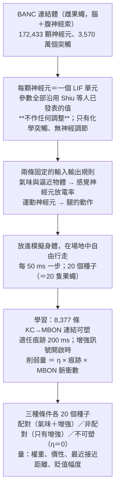
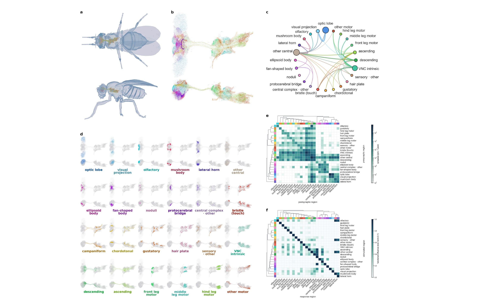
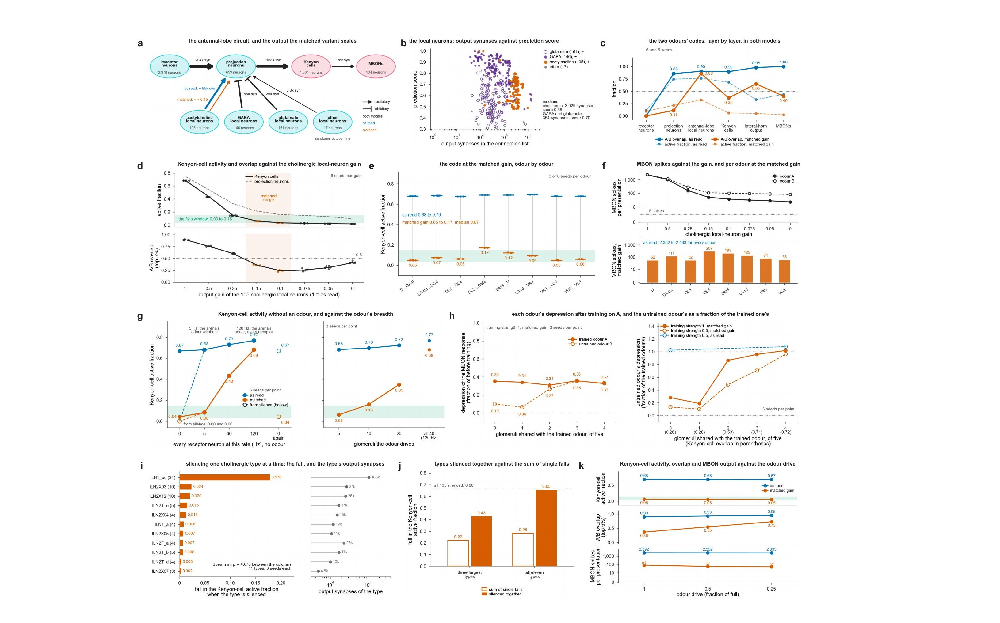
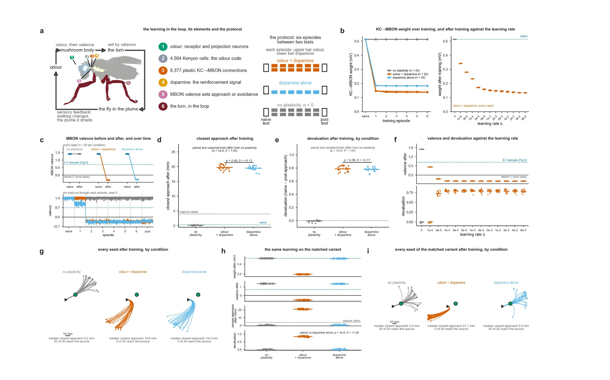

<!-- 本機 PDF：papers/2026-Sensorimotor%20behaviour%20from%20an%20untrained%20brain-and-nerve-cord%20connectome.pdf -->

# Sensorimotor behaviour from an untrained brain-and-nerve-cord connectome

**未經訓練的腦與腹神經索連結體所產生的感覺運動行為**

| 項目 | 內容 |
|---|---|
| **出處** | arXiv:2610.33881v1 [q-bio.NC] (2026-10-24)，42 頁。[全文（arXiv 免費閱讀）](https://arxiv.org/abs/2610.33881)。**預印本，未經同儕審查。** |
| 日期 | arXiv 上傳 2026-10-24（v1）。未投稿或未註明投稿中的期刊；無接受日期 |
| 通訊作者 | John R. Minnick，jrminnic@ucsc.edu；Mircea Teodorescu，mteodore@ucsc.edu（PDF 只有英文名） |
| 作者 | 共 7 人：John R. Minnick、Jesus Gonzalez-Ferrer、Jinghui Geng、Jason K. Eshraghian、Mohammed A. Mostajo-Radji、David Haussler、Mircea Teodorescu。PDF 未標示共同第一作者，兩位通訊作者以 \* 標出 |
| 機構 | University of California, Santa Cruz：電機與電腦工程系、UCSC 基因體學研究所、電腦科學與工程系、生物分子工程系 |
| 資料庫 | 連結體資料為 BANC（Brain And Nerve Cord，雌果蠅的腦與腹神經索重建），經 FlyWire 平台發布，由 BANC-FlyWire Consortium 校對與標註。**本篇自己的模擬程式與資料在哪裡發布，全文（含補充資料）都沒有寫**：方法節只提到有一份「reproducibility bundle」（重現資料包），沒給位置：？待查 |
| 補充資料 | 補充討論、補充圖 1–4、補充表 1–8，**全部在本機 PDF 第 32–42 頁**（2026-11-16 確認；原頁誤寫為「部分內容、未取得」）。本頁 3.4 末段「讀法與懲罰範圍」即取自補充討論、補充圖 4 與補充表 6–7 |
| 編輯／審查 | 無。arXiv 預印本不經同儕審查。**本篇有一項不常見的作法：多數檢定在執行前就把判準寫定（論文稱 registered，預先登記）**，並把未預先登記的分析另外標為探索性 |
| 經費 | Schmidt Futures (SF857)、NHGRI (RM1HG011543)、NSF（多項）、CIRM (DISC4-16285)、加州大學總校 (M25PR9045) 等；模擬在 National Research Platform 執行 |
| 授權 | **PDF 未印授權聲明**（已搜 licence、Creative Commons、CC BY、copyright，無命中）：？待查。本頁依本庫慣例只給連結、不轉載全文；圖以教學與評論目的引用 |

> **本頁的範圍。** 這篇論文有 42 頁、六張主圖，大半篇幅在講導航與運動控制，與蕈狀體無關。依本庫範圍（果蠅的學習與記憶，以及蕈狀體本身），本頁**完整處理蕈狀體與學習的部分**——嗅葉到 Kenyon 細胞的氣味編碼（圖 3）與多巴胺調控的突觸變弱（圖 6）——其餘的導航、擾動實驗與運動控制只寫成背景，所需的結論在「三、結果」3.1 與 3.5 各一段帶過。六張主圖中本頁重製三張（圖 1、3、6）。想讀導航那部分的人請看原文。
>
> 作者在致謝中聲明，本研究在準備過程中使用了 Claude 大型語言模型（Fable 5.1、Opus 5）產生部分程式碼與分析圖，並協助編修文字，作者已複閱並為內容負全責。
>
> **本篇為預印本，未經同儕審查**，所以本頁的 `confidence` 降一級為 medium。授權不明，本庫不轉載全文 PDF；圖片擷取自原文，以教學與評論目的引用，每張圖下方標明出處。

---

## 為什麼重要

**先說一個貫穿全篇的限制，因為它決定了底下每一句話該怎麼讀：這一篇沒有做任何動物實驗，所有數字都是電腦模擬的輸出；而這個模擬刻意不被訓練，也沒有為任何結果調過參數——唯一的例外是一個倍數，而全篇最重要的學習結論剛好只在用了那個例外的版本裡成立。** 所以本節凡是寫「果蠅走到氣味源」「果蠅掉頭」，主詞都是模擬裡的那隻虛擬果蠅。本節只有兩項東西來自真果蠅，而且都是論文引用別人的文獻、不是本篇量的：一個是數字（一種氣味會活化真果蠅 5–10% 的 Kenyon 細胞），一個是方向（活化某一型蕈狀體輸出神經元，會讓未受訓的真果蠅靠近或走開）。模擬的輸出與這兩項文獻值不能並排比大小，只能看「對得上還是對不上」。

本庫其他來源多半在活果蠅（或取出的腦）上量測，也有純以電子顯微重建的接線圖做分析的（例如 [[s-li-2020-mb-connectome]]、[[s-ganguly-2024-visual-inputs-to-kc]]）。這一篇是第三種作法：把一份接線圖直接當程式跑起來，看**光憑接線能產生多少行為**。

**模型是怎麼搭起來的。** 以下設定是本頁談到的每一套模擬共同的底，各套自己的改動（調某類細胞的輸出、沉默某些細胞、改某顆細胞的正負號）寫在下方「科普文」的分套表裡。

- **接線圖從資料來。** 用 BANC 連結體：一隻雌果蠅的腦與腹神經索一起重建。本篇模擬其中 172,433 顆神經元、3,570 萬個突觸。連結體裡被標為非神經元的單位（膠細胞等）也照樣留在網路裡當普通單元跑。
- **神經元模型沿用別人發表的值。** 每顆神經元是一個「漏電積分發放」（LIF）單元：輸入累積到門檻就發一個脈衝，不然就慢慢漏掉。方程式與全部參數沿用 Shiu 等人為「只有腦、沒有腹神經索」的模型所發表的值，本篇一個都沒有重調。
- **突觸強度從資料來。** 一條連結每傳一個脈衝，讓下游膜電位變動「該連結的突觸數 × 0.275 mV」。突觸數就是連結體數到的數目。
- **突觸的正負號由自動預測決定。** 取自連結體附的傳遞物質自動預測（用電子顯微影像訓練出來的分類器）。乙醯膽鹼、多巴胺、血清素、章魚胺、酪胺記為興奮；GABA、麩胺酸、組織胺記為抑制；沒有預測值的神經元一律記為興奮。
- **網路本身唯一調過的參數。** 把嗅葉中 105 顆被預測為膽鹼性的局部神經元送出的輸出突觸，強度一律乘上 0.15。本頁把這一版叫**校正版**，沒調的叫**原樣版**。校正版的網路只改這一項，連 KC→MBON 的起始權重都和原樣版相同。（**但實驗設定另有兩處隨之不同**：價性那個除數由校正版自己的校準跑重算，學習場地的氣味源位置也依一條事先寫定的規則移過去。詳見「科普文」。）
- **作者外加、不是連結體算出來的。** 網路與身體之間的兩條固定規則（氣味與逼近物體決定感覺神經元的放電率；運動神經元的放電決定腿的步幅）、一條手寫的轉向規則、一條學習規則，以及「哪一型 MBON 代表靠近、哪一型代表走開」這組標籤。這些都在跑模擬之前寫定，但它們是作者加上去的知識。

**這篇對蕈狀體研究的意義在兩個結果。兩者都是模擬的輸出。**

**第 1 個結果：照連結體原樣讀出來的 Kenyon 細胞編碼，與文獻量到的真果蠅差一個數量級，而且根本不跟著氣味走。** 這一點由兩個不同的測試條件各自看到，兩個數字不可混用：拿**窄氣味**（只刺激五個嗅小球的氣味）去測，原樣版有 68% 的 Kenyon 細胞活化（圖 3c；八種窄氣味是 68–70%），而論文引用的真果蠅文獻值是 5–10%；把輸入完全關掉、而網路先被打開過之後，原樣版仍有 67% 的 Kenyon 細胞在放電（圖 3g）。兩個測試都在身體之外、都用原樣版。

**第 2 個結果：在這個網路上跑多巴胺調控的突觸變弱，行為確實從趨近翻成躲避，但在原樣版裡那不是聯結式的。** 不給氣味、只給增強訊號，突觸照樣變弱（可塑連結的平均權重由 0.513 降到 0.183 mV），虛擬果蠅照樣掉頭（20 隻都走不到氣味源），行為上與配對組分不出差別（訓練後離氣味源最近距離的檢定：P＝0.49、Cliff's δ＝+0.13）。換成校正版重跑同一套流程，就變成聯結式的：配對讓價性降到 −0.53、20 隻都走不到；只給增強訊號則權重幾乎沒動（0.513 → 0.508 mV）、價性 1.38、20 隻全部走到。前者是圖 6b–g（原樣版），後者是圖 6h–i（校正版），兩者都在身體之內、都用場地氣味。

**這兩點合起來，是對本庫既有主題的一種新型態證據。** [[t-dopamine-to-plasticity]] 整條線建立在「多巴胺改變 KC→MBON 突觸」這個機制上，而庫內各篇量的都是真果蠅身上的分子、突觸或行為。這一篇把同一個機制放進一個完全由接線決定的網路裡跑，於是能問一個實驗問不出來的問題：**要讓這個機制在模型裡運作，接線之外還必須加上什麼？** 論文自己的答案是「Kenyon 細胞的活動必須依賴氣味」，而這件事在原樣讀出的連結體裡不成立。

論文並由此提出一項可在真果蠅上檢驗的預測（原文照譯）：**一隻 Kenyon 細胞在沒有氣味時也會活動的果蠅，應該會被沒有與氣味配對的增強訊號所貶值。** 這是預測，不是本篇的結果；模擬跑出某個行為，不等於真果蠅用同一個機制。

**兩處摘要比資料強，讀的時候要扣回來。** 第一，摘要把「需要配對」與「具有氣味專一性」寫成同一句話的兩半，但這兩件事出自不同的模擬：「需要配對」在身體之內的學習實驗裡測過（圖 6h–i），而身體裡的學習場地只有一種氣味，**氣味專一性從頭到尾沒有在身體裡測過**；它的證據是身體之外、不經學習規則、用一次性手動削弱做的離線測試（圖 3h，作法見「科普文」第 5 套）。第二，標題的「untrained」（未經訓練）對原樣版成立，對校正版要附帶條件：校正版動了一個倍數，而且那個倍數是對著論文圖上畫的「果蠅的範圍」挑出來的。

Kenyon 細胞編碼密度為什麼對不上，本庫列為尚未解決的空缺（[[syn-contradictions]] 3.14），不在本頁裁決。

---

## 論文摘要（原文與中譯）

> Connectomes now map the neurons and synapses of an adult fly's brain and nerve cord, but how much of behaviour follows from the wiring is unknown. Here we turn one such connectome into a spiking network of 172,433 neurons with a published brain model's untuned parameters, and run it alone and inside a simulated body. Two fixed rules join them: odours and looming objects drive sensory neurons, and motor neurons move the legs. Alone, the network passes a signal to the motor neurons it is known to drive when the pathway supplies about 2% or more of their input. In the body, the fly navigates around obstacles to 95% of the odour sources. A rewiring that keeps each neuron's connection counts and signs reaches 18%, and the fly's leg commands replayed with the senses off reach almost none, so navigation needs the measured wiring and sensory feedback. Dopamine-gated weakening of the mushroom body's output synapses turns approach to an odour into avoidance, which requires the pairing and is odour-specific once one olfactory synapse class is scaled. An untrained connectome thus supports a behaviour and its learned reversal, and the pathways it cannot drive mark what the diagram leaves out.

**中譯**（本節為忠實翻譯，非自撰內容）：

> 連結體如今已描繪出成年果蠅腦與腹神經索的神經元與突觸，但行為有多少是由接線本身決定的，仍然未知。我們在此把這樣一份連結體轉成 172,433 顆神經元的脈衝網路，採用一個已發表的腦模型未經調整的參數，並讓它單獨運行以及在模擬的身體之內運行。兩條固定的規則把兩者接起來：氣味與逼近的物體驅動感覺神經元，運動神經元驅動腿。單獨運行時，當一條通路提供其目標約 2% 或更多的輸入時，網路便能把訊號傳給已知由它驅動的運動神經元。在身體之內，果蠅能繞過障礙物到達 95% 的氣味源。一個保持每顆神經元連線數與正負號的重新接線版本只到達 18%，而把果蠅的腿部指令在關閉感覺的情況下重播，則幾乎到達不了，可見導航需要實測的接線與感覺回饋。蕈狀體輸出突觸的多巴胺調控性減弱，把對氣味的趨近轉成躲避；一旦把一類嗅覺突觸的強度加以調整，這個轉變便需要配對，並且具有氣味專一性。因此，一個未經訓練的連結體能夠支持一項行為及其習得的逆轉，而它無法驅動的那些通路，則標示出接線圖遺漏了什麼。

---

## 科普文

**讀這一節之前要先知道的一件事：這篇論文沒有做任何動物實驗。** 它的每一個數字都是電腦模擬跑出來的，而這個模擬刻意不被訓練、也不為任何結果調參數——唯一的例外是一個倍數（底下會說明），而全篇最重要的那個學習結論剛好只在用了這個例外的版本裡成立。所以下文凡是寫「果蠅走到氣味源」「果蠅掉頭」，主詞都是**模擬裡的那隻虛擬果蠅**，不是真果蠅。

本節只有兩項東西來自真果蠅，而且都是論文引用別人的文獻、不是本篇量的：(1) 一個數字——一種氣味會活化真果蠅 5–10% 的 Kenyon 細胞；(2) 一個方向——活化某一型蕈狀體輸出神經元，會讓沒受過訓練的真果蠅靠近或走開。這兩項在本節只當對照，不能和模擬的數字並排比大小。本節另外用到三項真果蠅的**事實**（不是數值），也都引自文獻，下文會在用到的地方說明：APL 這顆細胞在真果蠅中是抑制性的；嗅葉的膽鹼性局部神經元對投射神經元的興奮主要走電性接點；真果蠅的嗅小球之間是抑制占優勢。

### 名詞對照（白話版）

本節用到的詞先一次講清楚。更嚴格的定義見下方「專業文」的「本頁用語」。

| 詞 | 白話意思 |
|---|---|
| 連結體（connectome） | 整個神經系統的完整接線圖：哪一顆神經元接到哪一顆、兩者之間有幾個接點（突觸），以及每顆神經元可能釋放哪一種化學物質。它**不**記錄神經元的動態特性，也**不**記錄電流直接流通的那種接點 |
| 脈衝網路、LIF 單元 | 把每顆神經元當成一個會漏水的水桶：輸入往裡加、同時慢慢漏掉，水位到了某條線就「發一個脈衝」並倒空，隨後短暫不收輸入 |
| 興奮性與抑制性 | 一顆神經元放電時，讓下游**更**容易放電就是興奮性，**更不**容易就是抑制性 |
| 嗅葉（antennal lobe） | 氣味訊號進腦之後的第一站 |
| 嗅小球（glomerulus） | 嗅葉裡的一個小球狀結構，每一個收集同一型嗅覺受體神經元的輸入，相當於「一種氣味成分」的接收站。一種氣味刺激哪幾個嗅小球，就是這種氣味的「身分」 |
| 投射神經元（PN） | 把氣味訊號從嗅葉送往蕈狀體的神經元。本篇 699 顆 |
| 局部神經元（LN） | 只在嗅葉內部互相接線、負責彼此調節的神經元。本篇 429 顆 |
| 蕈狀體（mushroom body） | 果蠅腦中把「聞到什麼」與「後來發生了什麼好事壞事」連起來的構造，學習就發生在這裡 |
| Kenyon 細胞（KC） | 蕈狀體裡代表「現在聞到哪一種氣味」的神經元。本篇 4,504 顆 |
| 蕈狀體輸出神經元（MBON） | 讀取 Kenyon 細胞的訊號，推動果蠅靠近或走開。本篇 104 顆 |
| 區室（compartment） | 蕈狀體的「葉」沿長度被切成的一格一格，每格由一型多巴胺神經元支配、由一型 MBON 讀取。對應懲罰的那幾格稱為**嫌惡區室** |
| 增強訊號（reinforcement） | 懲罰或獎賞的統稱。真果蠅實驗裡是電擊或糖；**在本篇裡它是研究者從外部打開的一個開關，不是網路自己產生的** |
| 配對與非配對 | **配對**＝訓練時氣味與增強訊號同時給。**非配對**＝只給增強訊號、不給氣味。若學習是聯結式的，非配對就不該造成任何改變 |
| 價性（valence） | 本篇自訂的一個數：推靠近的 MBON 放電數減掉推走開的 MBON 放電數，再除以一個固定常數（原樣版 37.35、校正版 25.22）。正值代表虛擬果蠅會轉向氣味，負值代表轉開。常數只是尺度的選擇、沒有生物意義：兩版各用自己的校準跑回推，回推的規則相同（讓完整、未訓練的果蠅落在 1.44 附近），所以兩版的價性被刻意放在同一個尺度上 |
| 活化比例 | 一段刺激期間，某一層裡**至少放過一個脈衝**的細胞占該層的比例 |
| 重疊度 | 本篇的窄氣味一次用兩種（稱 A 與 B）。重疊度＝A 最活躍的前 5% 細胞與 B 最活躍的前 5% 細胞裡，有多少比例是同一批。越高表示這一層越分不出兩種氣味 |
| 種子（seed） | 隨機數的起點。它決定一次模擬裡的隨機輸入與身體的起始狀態，接線與參數則完全不受它影響；論文把一個種子稱為「一隻果蠅」，本頁沿用，但要記得這二十隻的腦是同一個。一隻果蠅可以在好幾個場地各跑一次 |
| 原樣版與校正版 | 本頁對兩個模型版本的固定稱呼。**原樣版**＝完全照連結體讀出來的網路。**校正版**＝把嗅葉那 105 顆被預測為膽鹼性的局部神經元送出的輸出突觸強度一律乘上 0.15，網路其餘部分完全不動（KC→MBON 的起始權重也相同） |
| 窄氣味與場地氣味 | 本頁對兩種刺激的固定稱呼。**窄氣味**＝只刺激五個嗅小球的氣味，一次用兩種（各五個、互不重疊），用在身體之外的測試。**場地氣味**＝走路實驗用的那一種，會驅動**每一顆**嗅覺受體神經元，所以不帶氣味身分；左側每一顆受體的放電率是 120＋80a Hz、右側是 120−80a Hz（a 是左右濃度的不對稱度），兩側的放電率相加固定是 240 Hz，所以網路只知道哪一邊比較濃、不知道離源多遠 |
| 平衡讀法與加總讀法 | 兩種把 MBON 放電換成價性的算法。**平衡讀法**＝推靠近的減推走開的（正文採用）。**加總讀法**＝全部 104 顆的脈衝加總（補充資料採用；因為是總和，不可能變成負數）。完整、未訓練的果蠅在平衡讀法下讀出 1.41，在加總讀法下讀出 1.44 |
| 「果蠅的範圍」 | 論文在圖上畫的一個參考窗口，範圍是 3–15%，用來判斷模型的 Kenyon 細胞編碼夠不夠稀疏。它比正文引用的真果蠅文獻值（5–10%）寬，**兩者不是同一個數**，底下挑倍數用的是圖上這個 3–15% 的窗口 |

### 問題：地圖和路況是兩回事

你可以有一張完整的城市道路圖，卻仍然不知道尖峰時刻車子實際上怎麼流動——因為地圖沒有記錄紅綠燈的秒數、每條路的速限、司機的習慣。果蠅的連結體就是這樣一張地圖。這篇論文問的是：**光憑這張地圖，能跑出多少真實的行為？**

### 作法：把地圖直接當程式跑

底下十套模擬都從**同一個基礎模型**出發。除了每一套自己註明的改動（把某類細胞的輸出調小、沉默某些細胞、改某顆細胞的正負號）之外，設定都一樣，內容如下：

- **接線圖從資料來。** 用 BANC 連結體：一隻雌果蠅的腦與腹神經索一起重建。本篇模擬其中 172,433 顆神經元、3,570 萬個突觸。連結體裡被標為非神經元的單位（膠細胞等）也照樣留在網路裡當普通單元跑——這就是「照原樣讀」的意思。
- **神經元模型是現成的。** 每顆神經元是一個 LIF 單元（見上表）。方程式與全部參數（膜電位怎麼漏、門檻多高、放電後多久不收輸入）沿用 Shiu 等人為「只有腦、沒有腹神經索」的模型所發表的值，本篇一個都沒有重調。
- **突觸強度從資料來。** 一條連結每傳一個脈衝，就讓下游的膜電位變動「這條連結有幾個突觸 × 0.275 mV」。突觸數就是連結體數到的數目。
- **突觸是興奮還是抑制，由自動預測決定。** 連結體附了一欄傳遞物質預測，是用電子顯微影像訓練出來的分類器判的（見 [[c-neurotransmitter-prediction]]）。乙醯膽鹼、多巴胺、血清素、章魚胺、酪胺記成興奮；GABA、麩胺酸、組織胺記成抑制。沒有預測值的神經元一律記成興奮。**這一欄之後會出問題，見下文的 APL。**
- **網路本身只有一個參數被調過。** 就是校正版的那個 0.15。
- **人訂的、不是連結體算出來的部分。** 網路與身體之間只有兩條固定規則（場地的氣味與逼近物體決定感覺神經元的放電率；六組腿部運動神經元的放電決定每條腿的步幅），外加一條手寫的轉向規則、一條學習規則，以及「哪一型 MBON 代表靠近、哪一型代表走開」這組標籤。這些都在跑模擬之前寫定，但它們是作者加上去的知識，不是從接線圖算出來的。

### 本頁用得到的十套模擬

同一個模型可以跑在身體之外（只讓網路自己跑），也可以跑在模擬的身體之內（接上一具物理模擬的果蠅身體，在場地裡自己走）。刺激也有兩種。**設定不同的兩套，數字不能互相比大小**，所以下表把每一套的設定寫出來：

| 套 | 做什麼 | 圖／表 | 哪一版網路 | 在身體裡？ | 刺激 |
|---|---|---|---|---|---|
| 第 1 套 | 量各層的活化比例與兩種窄氣味的重疊度 | 圖 3c、3e、3f | 原樣版與校正版各跑一次，畫在同一張圖上對照 | 否 | 窄氣味 |
| 第 2 套 | 增益掃描：把那 105 顆細胞的輸出乘上倍數 g，g 取八個值 | 圖 3d、補充表 4 | 由原樣版（g＝1）一路到把這些輸出全部關掉（g＝0）；校正版就是其中 g＝0.15 那一格 | 否 | 窄氣味 |
| 第 3 套 | **均勻驅動測試**：不給有身分的氣味，而讓每一顆受體神經元都以同一個放電率被驅動，看 Kenyon 細胞跟不跟著輸入走 | 圖 3g 左 | 原樣版與校正版 | 否 | 0／5／40／120 Hz 四種放電率（0 Hz 就是完全沒有輸入），每一種都分「網路先被打開過」與「從完全靜止啟動」兩版 |
| 第 4 套 | 一次沉默一個膽鹼性型別（共 11 個型別），再測幾型一起沉默 | 圖 3i、3j | 原樣版，每次把一個型別的輸出突觸設為零 | 否 | 窄氣味 |
| 第 5 套 | 離線的類化測試：一次性手動削弱對氣味 A 有反應的突觸，再看另一種氣味 B 被波及多少 | 圖 3h | 原樣版與校正版 | 否 | 窄氣味（B 與 A 共用 0 到 4 個嗅小球） |
| 第 6 套 | 九個場地的導航，加上擾動與救援（打亂接線、切除蕈狀體、固定價性、動作重播） | 圖 4、圖 5、補充表 1–2 | 原樣版 | 是 | 場地氣味 |
| 第 7 套 | 邊走邊學：配對／非配對／不可塑三種條件，每條件 20 個種子 | 圖 6b–g | 原樣版 | 是 | 場地氣味（學習用的是另一個場地，裡面只有一個氣味源） |
| 第 8 套 | 同一套學習流程，換成校正版重跑 | 圖 6h、6i | 校正版 | 是 | 同上，但氣味源位置另定（見下文） |
| 第 9 套 | 把「價性怎麼讀」與「懲罰送到哪些區室」兩個人訂設定各換一次，共四種組合（其中一格就是第 7、8 套的正文設定） | 補充圖 4、補充表 7 | 原樣版與校正版都跑 | 是 | 場地氣味 |
| 第 10 套 | **探索性測試（未預先登記）**：把兩顆 APL 細胞改成抑制性 | 討論節與方法節，沒有圖 | 原樣版，只改 APL 的正負號（另在 g＝1、0.5、0.25、0.15、0.05 五個增益下都跑過） | 否 | 窄氣味；另有「做過與沒做過第 5 套那種一次性手動削弱」兩種條件 |

論文另有兩部分屬本庫範圍外，不列在上表，也不在本節討論：圖 1（24 個腦區之間的突觸量與「刺激一區、看別區反應」）與圖 2（15 條已知行為通路逐條測試）。

### 第 6 套：牠真的會走

場地共九個，雜亂程度由低到高（空地、單一繞道、寬門、幾種蛇行等），每個場地裡有 3 到 5 個氣味源，九個加起來是 32 個。每一個種子（一隻虛擬果蠅）九個場地都走一次，所以一個條件共 180 次模擬。

完整接線的虛擬果蠅能繞過障礙，平均走到那 32 個氣味源中的 30.25 個（95%，20 隻的平均）。三種擾動的成績是：

- **打亂接線**（保留每顆神經元有幾條連線、每條連線是興奮還是抑制，只把連線的對象隨機換掉）：掉到 5.8 個（18%）。
- **切除蕈狀體**（把這個區域的神經元移出網路）：3.45 個。在另一個只有三個氣味源藏在牆後的覓食場地裡，完整果蠅 20 個種子每次都到達全部三個，切除後 20 個種子一個也到不了；但走路本身沒壞（腿部運動神經元放電率 152 對 154 Hz）。
- **動作重播**：先把閉迴路走路時每一步六條腿的步幅錄下來，再把這串步幅原封不動重播給身體，重播時關掉感覺、也不讀網路的輸出，起點的朝向轉 30°。重播幾乎走不到任何一個氣味源（2%），而從同一個轉過 30° 的起點跑閉迴路則走到 94%，可見光是轉 30° 本身不影響成績。

**所以在這個模型裡，導航既需要實測的接線，也需要走動時持續收到的感覺回饋。** ※ 推論：轉 30° 的用意應該是讓重播時的處境與錄製時不同，否則照原路重播本來就會走到；論文只寫了這個作法與上述對照，沒有說明理由。

還有一個救援實驗，它解釋了缺損在哪裡：把價性直接固定成一個常數（繞過蕈狀體的讀數，等於告訴身體「這個氣味是好的」），切除蕈狀體的果蠅就恢復趨近——固定在 1.44 與固定在 0.7 都能完全救回（覓食場地 3.00 / 3），固定在 0 則完全救不回來。**既然補上這個數值就救得回來，缺損就在蕈狀體的輸出，而不在走路的機制。**

### 為什麼一個編碼「壞掉」的網路還能導航到 95%？

這是本篇最容易讓人困惑的地方：下文會說原樣版的 Kenyon 細胞編碼又密又不跟著氣味走，可是導航成績 95% 用的正是原樣版。兩件事能並存，原因在於**導航用不到氣味編碼的細緻程度**：

- 場地裡只有一種抽象的氣味，強度隨距離衰減，而且它驅動每一顆受體神經元、兩側放電率相加固定，所以網路收到的只有「哪一邊比較濃」，沒有氣味身分、也沒有距離。
- 「朝濃的一側轉」是一條手寫的規則，它直接讀場地的左右濃度差，不經過網路；網路只提供一個乘在轉向力道上的數，也就是價性。
- 而價性在導航時幾乎是常數：完整接線的 180 次模擬裡，104 顆 MBON 每一步的總放電都落在 153.7 到 154.9 之間。

所以連結體在導航裡的貢獻只有兩件事：**給出一個夠大的正價性**，以及**正常的腿部驅動**。上一段的救援實驗（把價性固定成常數就能救回切除蕈狀體的果蠅）也支持這個讀法。密不密、分不分得出氣味，在這個只有一種氣味的導航任務裡根本用不到——要到學習實驗才會變成關鍵。

### 第 7 套與第 8 套：學習翻轉了行為

研究者接著在這個網路裡模擬學習。蕈狀體沿長度分成一格一格（區室），每格各由一型多巴胺神經元負責，其中幾格對應「壞事」（嫌惡區室）。作法是讓這幾格裡 Kenyon 細胞送往 MBON 的 8,377 條連結，在增強訊號開著的時候變弱；另外 7,146 條在第 7、8 套裡固定不動。

削弱的量是**三個東西相乘**：學習率 η（主實驗取 0.02）、該連結的「最近有沒有傳過訊號」（一個以 200 毫秒衰減的量，來源是它的那顆 Kenyon 細胞剛才放了幾個脈衝），以及該步中它下游那顆 MBON 放了幾個脈衝。**增強訊號本身不是乘式裡的一項，它是一個開關**：只有在它開著的期間，這個乘積才會被累積起來，一個回合結束時再一次從權重扣掉。所以要削弱，Kenyon 細胞和 MBON 都得在放電。**這條規則只會讓突觸變弱，不會讓它變強。**

第 7 套（原樣版）的結果：六個訓練回合把那 8,377 條連結的平均權重從 0.513 mV 降到 0.138 mV，推靠近的 MBON 從每步 103 個脈衝降到 37 個脈衝，推走開的幾乎不動（每步 50 個脈衝降到 49 個），價性因此從 +1.41 翻成 −0.33。行為跟著翻轉：訓練前 20 隻全部走到氣味源，訓練後一隻都沒有，牠們改成掉頭就走。

### 但原樣版的那個學習是假的

研究者在第 7 套裡做了一個對照：只給增強訊號、完全不給氣味（非配對）。照理說沒有氣味就不該學到任何跟氣味有關的東西。結果突觸照樣變弱、虛擬果蠅照樣掉頭。原樣版三種條件的對照是這樣的：

| 第 7 套（原樣版）的條件 | 可塑連結的平均權重 | 訓練後價性 | 20 隻中走到氣味源 |
|---|---:|---:|---:|
| 不可塑（η＝0，所以權重不會變） | 0.513 mV | 1.41 | 20 |
| 配對（氣味＋增強訊號） | 0.138 mV | −0.33 | 0 |
| 非配對（只有增強訊號） | 0.183 mV | −0.29 | 0 |

非配對的權重降得比配對略少（0.183 對 0.138 mV），但價性與行為幾乎一樣。**論文做的統計檢定是在行為上，不是在權重上**：配對與非配對在「訓練後離氣味源最近的距離」上 P＝0.49、Cliff's δ＝+0.13，在「貶值幅度」上 P＝0.36、δ＝+0.17，兩個行為量都分不出差別。

原因來自第 3 套。**在原樣版裡，Kenyon 細胞根本停不下來**：網路先被打開過之後，即使輸入完全關掉，仍有 67% 在放電。而「非配對」並不是真的一片安靜——方法節規定撤掉氣味時，兩根觸角的每一顆受體還是各收到 5 Hz 的輸入（和第 3 套的 5 Hz 是同一種量），而**原樣版在 5 Hz 下有 68% 的 Kenyon 細胞在放電，校正版只有 8.3%**。既然原樣版的 Kenyon 細胞一直在活動、MBON 也因此一直收得到輸入，上面那個三項乘積在沒有氣味時也不為零，於是單獨的增強訊號就足以削弱同一批突觸；校正版在同樣的 5 Hz 下幾乎是安靜的，所以單獨的增強訊號削不到東西。

**順帶一提，論文自己在方法節寫非配對條件時說「兩根觸角各收 5 Hz，所以 Kenyon 細胞會安靜」。** 這個設計假設被同一篇的圖 3g 推翻了。論文把這個落差當成結果清楚報告出來，但沒有說明是什麼時候發現假設不成立的。

### 一個關鍵細節：原樣版不是「每顆神經元自己會放電」

模型程式裡沒有「神經元自發放電」這個機制：沒有輸入的神經元就完全不放電。第 3 套同時測了「從完全靜止啟動」這一組，論文的原話是 "It fires none when started from silence"——從靜止啟動、而且完全不給輸入時，一顆 Kenyon 細胞也不發。

那 67% 是怎麼來的？它是「網路先被打開過」之後量的：先讓受體神經元放電一段，再把輸入關掉，活動就自己撐住了。原因是網路裡的神經元彼此興奮、形成迴圈（A 讓 B 放電，B 又讓 A 放電），一旦點燃就停不下來。打個比方：教室裡沒有人會自己開口，但只要有人起個頭，大家就你一句我一句接下去，起頭的人走了也停不下來。論文說，只要 5 Hz 的微弱輸入就足以起這個頭，而且輸入移除後仍維持 67%。

※ 推論：所以 "fires none when started from silence" 指的應該是「從靜止啟動、而且輸入為 0」那一格，不是「從靜止啟動的四個放電率都不發」；依據是緊接的下一句明說 5 Hz 就能把網路打開。論文沒有逐一寫出其他放電率從靜止啟動的數值。

### 修好它要動一個地圖沒記錄的東西

研究者追查出密編碼的來源：嗅葉裡的投射神經元與局部神經元之間形成了一個互相興奮的迴圈。那 429 顆局部神經元依預測的傳遞物質分成五類，**五類相加剛好是 429 顆**：

| 類別 | 顆數 | 在模型裡是 | 每顆細胞的輸出突觸數（中位數） |
|---|---:|---|---:|
| 麩胺酸性 | 161 | 抑制 | 304 |
| GABA 性 | 146 | 抑制 | 456 |
| **膽鹼性** | **105** | **興奮** | **3,029** |
| 血清素性 | 14 | 興奮 | 論文未給 |
| 章魚胺性 | 3 | 興奮 | 論文未給 |

**膽鹼性這一類既是興奮性、送出的突觸又最多**，所以成了嫌疑犯。第 4 套逐一沉默這 105 顆所屬的 11 個型別，量出最大的一型（lLN1_bc，34 顆、輸出突觸約 10.6 萬個）單獨沉默就讓 Kenyon 細胞對窄氣味的活化比例從 68% 降到 50%；其餘十型單獨沉默後是 66–68%，也就是幾乎沒有變化（68% 本來就是沒沉默時的值）。下降幅度跟著該型別的輸出突觸數走（Spearman ρ＝0.78、11 個型別、P＝0.0045）。要注意這一套只能說明哪些細胞貢獻最多，**不能說明「把它們判成興奮性」這件事對不對**——而那正是密編碼的另一個可能原因。

第 2 套把這 105 顆的輸出強度乘上倍數 g 逐步調小，測 Kenyon 細胞對窄氣味的活化比例（表是橫向的：第一列是 g，第二列是對應的活化比例）：

| 量 | ↓ 各個 g 的值 |
|---|---|
| 倍數 g | 1（原樣版）／0.5／0.25／**0.15（校正版）**／0.1／0.075／0.05／0 |
| KC 活化比例 | 68%／43%／15%／**6.1%**／3.4%／2.7%／2.3%／1.8% |

**作者取 g＝0.15 作為校正版。** 挑選的規則是「在活化比例落在**圖上畫的『果蠅的範圍』3–15%**、而且兩種窄氣味的重疊度不超過 0.5 的那些 g 裡，取最大的一個」，論文說這條規則是在掃描開始之前就寫定的。注意兩件事：(1) 判準是圖上那個 3–15% 的窗口，不是正文引的 5–10%；(2) g＝0.25 的活化比例（15%）其實剛好擠進 3–15%，它是被規則的另一半擋掉的——論文只有 g＝0.15 與 0.1 這兩格的重疊度低於 0.5。所以 0.15 這個值同時由「夠稀疏」與「兩種氣味分得開」兩個條件決定。

**這個 0.15 不是憑空挑的倍數，論文給了生物學上的理由。** 在真果蠅身上，這類膽鹼性局部神經元確實存在，但它們對投射神經元的興奮作用主要走的是**電性接點**（電流直接流過的那種接點：阻斷化學傳遞之後，這個作用還在；不過論文也提到，配對記錄另外找到了乙醯膽鹼的成分）。而連結體只收錄化學突觸、本模型也沒有電性接點，於是模型把這些細胞的每一個化學突觸都當成全強度的興奮來算，投射神經元與局部神經元之間就接成一個會自己撐住的正回饋迴圈。論文還提到，真果蠅的嗅小球之間是抑制占優勢，不是興奮。

### 那為什麼不乾脆把判錯的細胞改對？

這裡有一顆細胞特別刺眼：**APL**（見 [[e-apl-neuron]]）是蕈狀體裡的一顆大型回饋神經元，在真果蠅中是抑制性的，而且公認就是把 Kenyon 細胞的編碼壓稀疏的那個機制（見 [[c-sparse-coding]]）。這份連結體裡有兩顆 APL，左右各一，兩顆都被預測成膽鹼性（興奮性），所以在模型裡它們反而推高 Kenyon 細胞的活性。連結體另有一欄依文獻註記「已驗證」的傳遞物質，那一欄把 APL 記為 GABA（抑制性）。兩顆之中只有右邊那顆在神經元表裡帶有型別標註，左邊那顆沒有。

作者的選擇是整篇都用自動預測欄、不逐顆手改，理由是本篇的主張講的就是「照連結體原樣讀」會怎樣。

不過**作者並沒有放著不測**。這就是第 10 套：討論節報告了一次未預先登記的探索性測試，把兩顆 APL 都改成抑制性（沒有標註的那顆比照有標註的那顆），原樣版的 Kenyon 細胞活化比例從 68% 降到 **42%**，仍然遠高於真果蠅的 5–10%；再把連結體表中其他所有「已驗證」的正負號也一併套上（約 2,700 顆神經元），結果還是 42%，表示 APL 以外的修正沒有額外效果。作者據此主張：校正版修正的是嗅葉的興奮迴圈，不是 APL 的正負號。（本庫曾把這一項誤寫成「論文沒有測」，2026-11-16 更正。）

**但這項測試有一處沒報完。** 方法節寫，這次探索性測試在膽鹼性輸出增益 1、0.5、0.25、0.15、0.05 五個值、以及「有沒有做過那種一次性手動削弱」的條件下都跑過——也就是說「APL 改成抑制性」與「校正版的 0.15」合在一起也跑了；可是論文只報了增益 1 那一個數（42%），兩者合起來會怎樣，正文與補充資料都沒有寫。

### 第 8 套：校正版的學習是真的

同一套流程換成校正版重跑，配對讓可塑連結的平均權重降到 0.195 mV、價性降到 −0.53，20 隻訓練過的虛擬果蠅沒有一隻走到氣味源。**真正的重點是非配對那一組**：只給增強訊號時，權重幾乎沒動（0.513 → 0.508 mV）、價性 1.38 完全沒有變負、20 隻全部走到氣味源，和完全不給可塑性的那一組沒有差別。配對與非配對的差距極大（訓練後離氣味源最近的距離：P＝6.8×10⁻⁸、Cliff's δ＝+1.00），與原樣版的 P＝0.49、δ＝+0.13 恰成對比。

**但第 7 套與第 8 套之間，只能比「有沒有差別」，不能比數值大小。** 兩套有兩處設定不同：

1. **學習場地的氣味源不在同一個位置。** 論文依一條事先寫定的規則，把校正版的氣味源移到另一個座標（規則是把原樣版氣味源相對起點的距離、在哪一側、離邊多遠，轉移到校正版自己「把價性強制設為零」時走出來的路徑上），目的是讓兩版的難度相當。所以原樣版配對組訓練後「離氣味源最近距離」的中位數 19.6 mm 與校正版的 21.1 mm，只能各自與自己那一版的對照組比。
2. **價性的除數不同**（原樣版 37.35、校正版 25.22）。兩個常數是用同一條規則回推的（讓完整、未訓練的果蠅落在 1.44 附近），所以兩版的價性刻意被放在同一個尺度上；但那是人訂的尺度，「−0.33 對 −0.53」只能讀成「校正版翻得更負」，不要當成生理量。

每一版內部的三個條件用的是同一個場地、同一個除數，所以上面兩張表內部的比較是成立的。

### 最容易被誤讀的一點：「修好」到底修了什麼

很容易以為修好的是「活化比例變稀疏了」。這只對一半，因為活化比例要看拿哪一種刺激去測：

| 測試條件（數值＝有放電的 KC 占全部 KC 的比例） | 原樣版 | 校正版 | 真果蠅（文獻值） |
|---|---:|---:|---|
| (甲) 窄氣味：只刺激五個嗅小球（第 1、2 套） | 68% | 6.1% | 5–10% |
| (乙) 每一顆受體以 120 Hz 均勻驅動（第 3 套） | 77% | 68% | 論文未給 |
| (丙) 每一顆受體以 5 Hz 均勻驅動（第 3 套） | 68% | 8.3% | 論文未給 |
| (丁) 輸入完全關掉、網路先被打開過（第 3 套） | 67% | 4.2% | 論文未給（本頁不推測） |

（第 3 套還測了 40 Hz：校正版 43%，原樣版的 40 Hz 論文未給。）

**(乙) 這一列就是走路時的狀態**，因為場地氣味每一顆受體的中心放電率正是 120 Hz，論文也直接用這一列的數字來描述「走路時有氣味」的狀態。所以在真正做出聯結式學習的第 7、8 套裡，兩版的編碼**都是密的**（原樣版 77%、校正版 68%）。

而讓「只給懲罰不會學」成立的，**不是**稀疏，而是 (丙) 與 (丁) 這兩列：**沒有氣味時會不會安靜**。非配對條件實際上就是 (丙)——原樣版 68% 不安靜，校正版 8.3% 幾乎安靜。這兩件事常被混為一談，而這篇剛好把它們拆開了。

**這裡還有一個值得注意的錯位。** 0.15 這個倍數是**依 (甲) 這一列挑出來的**（校正版的 6.1% 落進圖上畫的 3–15% 窗口），可是真正讓學習變成聯結式的是 (丙)、(丁) 那個性質。兩者在同一個修正下一起改善了，但挑選規則只看了前者。論文自己的結論也是這樣說的：聯結性來自編碼對氣味的依賴，不需要稀疏編碼。

另外提醒一下 68% 這個數字：它在本節出現三次，分別是 (甲) 的原樣版、(乙) 的校正版、(丙) 的原樣版，**三者設定完全不同**，只是數值碰巧相同。讀到 68% 時請先看它屬於哪一列。

**不過這不代表稀疏不重要。** 稀疏決定的是另一件事：學了一種氣味之後，別的氣味會不會被一起削弱。這要看第 5 套（圖 3h）。第 5 套的削弱方式和第 7、8 套**不是同一回事**：它不在身體裡跑、沒有多巴胺開關、沒有那個 200 毫秒的衰減量、也沒有逐回合訓練，而是一次性手動把每條 KC→MBON 突觸削掉一個比例，這個比例等於「該 Kenyon 細胞對氣味 A 的反應 ÷ 全部 Kenyon 細胞中最大的反應」再乘上一個係數（論文稱「訓練強度」，跑了 0.5 與 1.0 兩個值，本節引 0.5 那一組）；削完之後再把兩種氣味各呈現一次、量 MBON 輸出。**「訓練強度 0.5」與主實驗的「學習率 η＝0.02」是兩種不同的量**：前者是一次就削掉的比例，後者是每一步累積的係數，所以數值大小不能互相比。結果是：

- **原樣版完全沒有專一性**：不管未受訓的氣味 B 與 A 共用幾個嗅小球，B 被削弱的幅度與 A 幾乎一樣（兩者的比值貼在 1.0）。
- **校正版有專一性，而且大致跟著重疊度走**：B 與 A 共用的嗅小球越多，B 被削弱得越厲害，而兩者 Kenyon 細胞的重疊度同時也越高；共用得夠多時，B 就幾乎和 A 一樣被削光。

**第 7、8 套的身體學習實驗只有一種氣味，所以「分辨氣味」這一層在身體裡從來沒有被測到。**

### 第 9 套：「訓練後掉頭」需要兩個人訂設定同時成立

正文的結果建立在兩個作者自選的設定上：價性用平衡讀法（推靠近減推走開），而且增強訊號只送到嫌惡區室的 8,377 條連結。第 9 套把這兩個設定各換一次，四種組合都跑，兩版都跑。**要注意「送到所有區室」那兩格把全部 15,523 條 KC→MBON 連結都變成可塑的**，包括正文裡固定不動的那 7,146 條。以下是原樣版在**配對**條件下的結果（括號內為校正版的價性）：

| 讀法 ＼ 懲罰送到 | 所有區室（15,523 條全部可塑） | 只送嫌惡區室（8,377 條可塑） |
|---|---|---|
| **加總讀法**（訓練前 1.44） | 價性降到 0.24（校正版 0.25）；19/20 仍走到氣味源 | 價性降到 0.83（0.84）；20/20 走到 |
| **平衡讀法**（訓練前 1.41） | 價性降到 0.03（−0.02）；果蠅不轉向、直直走過，2/20 走到 | 價性降到 −0.33（−0.53）；**0/20 走到**（正文圖 6） |

四格裡削弱都確實發生了，差別只在削弱怎麼被讀成行為。加總讀法把全部 104 顆 MBON 的脈衝加起來，總數不可能是負的，所以價性降不到零以下；平衡讀法加上「懲罰只打在嫌惡區室」才會讓價性翻負——因為嫌惡區室的 50 顆 MBON 細胞裡有 41 顆是推靠近型，削弱它們就讓天平倒向躲避。**所以「訓練後掉頭」只在右下那一格成立，原樣版與校正版都是如此**（校正版在右下那一格同樣是 0/20，見第 8 套；其他三格校正版走到幾隻，本頁未登記）。

### 這套模擬能證明什麼、不能證明什麼

**能支持的：**

1. 在這一套固定的規則與參數下，實測的接線比「連線數與正負號都保留、只把連線對象隨機換掉」的接線更能支持導航（30.25 對 5.8 個氣味源），而且需要走動中的感覺回饋（重播只到 2%）。
2. 在同一套設定下，照原樣讀出的接線所產生的 Kenyon 細胞編碼，與文獻量到的真果蠅稀疏編碼差一個數量級，而且不跟著刺激走。
3. 在同一套設定下，「多巴胺調控的 KC→MBON 變弱」要成為聯結式的，條件是 Kenyon 細胞在沒有氣味時安靜。

**不能支持的：**

1. 不能說真果蠅就是用這個機制轉向或學習。轉向規則、價性標籤與增強訊號都是作者外加的，MBON 之後的下游接線在轉向上被整個繞過去了。
2. 不能把模型對不上的地方直接判成「接線圖漏掉了這些東西」——也可能是模型其他簡化造成的（沒有電性接點、沒有神經調節、每顆神經元只有一種正負號、沒有行走時的背景活動）。論文自己把這些逐項列為限制。
3. 這裡的 P 值不是個體差異。學習實驗 20 個種子的接線與參數完全相同，只有隨機輸入與身體的起始狀態不同（打亂接線那一組例外，它的種子還決定接線怎麼被打亂），所以 P＝6.8×10⁻⁸ 的意思是「模型行為對輸入雜訊很穩」，不是「換一隻果蠅也成立」。
4. 校正版不是「修好了模型」，只是修好一件事。它壓掉了嗅葉的興奮迴圈、讓網路在沒有氣味時安靜，但 APL 的正負號仍然是錯的、非神經元仍然當神經元在跑、仍然沒有電性接點。所以「校正版的學習是真的」，精確的說法是「在一個別處仍然有錯的模型裡，學習的形式對了」。

Kenyon 細胞編碼密度為什麼對不上，本庫列為尚未解決的空缺（[[syn-contradictions]] 3.14），不在本頁裁決。

---

## 專業文

### 本頁用語

| 詞 | 意思 |
|---|---|
| 蕈狀體（mushroom body） | 果蠅腦中負責把氣味與好壞結果連起來的構造，學習就發生在這裡。它由 Kenyon 細胞的軸突束成幾條「葉」，葉沿長度被切成一格一格（見下方「區室」） |
| 興奮性與抑制性 | 一顆神經元放電時，若讓下游更容易放電就是**興奮性**，更不容易就是**抑制性**。連結體以神經元釋放的傳遞物質推測它屬於哪一種：**膽鹼性**（乙醯膽鹼）在果蠅中是興奮性，**GABA 性**與**穀胺酸性**多為抑制性。**本篇密編碼問題的核心，就是一類膽鹼性（興奮性）細胞把活性不斷推高** |
| 嗅小球（glomerulus） | 嗅葉裡的一個小球狀結構，每一個收集同一型受體神經元的輸入，相當於「一種氣味成分」的接收站。本篇以「一種氣味刺激五個嗅小球」來定義一個窄的氣味 |
| 顆數與型別 | 本頁兩種計數都會出現，容易混淆：嗅葉的膽鹼性局部神經元共 **105 顆**，這 105 顆依形態與連線分屬 **11 個型別**（最大的一型 lLN1_bc 含 34 顆）。校正版調整的是全部 105 顆的輸出；圖 3i、3j 的「逐型沉默」測試針對的則是那 11 個型別 |
| 腹神經索（ventral nerve cord） | 位於胸腹部的神經組織，相當於脊椎動物的脊髓，控制腿與翅。BANC 把它與腦一起重建，所以訊號可在同一份資料裡從感覺一路追到運動 |
| 多巴胺神經元、PPL1、嫌惡區室 | 送來「這是好事還是壞事」訊號的神經元。**PPL1** 是其中一群，一般對應懲罰；它所支配的那些區室因此稱為**嫌惡區室**。本篇只讓這些區室的 KC→MBON 連結可塑，是依循真果蠅中嫌惡學習發生在這些區室的既有知識，屬於模型的設定選擇 |
| 增強訊號（reinforcement） | 懲罰或獎賞的統稱。真果蠅實驗裡是電擊或糖，由多巴胺神經元送進蕈狀體。**在本篇中它不是由網路自己產生的，而是研究者從外部強加的一個開關**：開啟期間，可塑連結就依規則被削弱。論文把「改由網路自身的多巴胺神經元產生」列為下一步 |
| 連結與突觸 | 兩個不同的計數單位：一條**連結**是「某顆 KC 接到某顆 MBON」這一對關係，其中可能包含多個**突觸**（接點）。所以 KC→MBON 有 28,415 個突觸、卻只有 15,523 條連結 |
| 化學突觸與縫隙連接 | **化學突觸**以傳遞物質傳訊，是連結體唯一收錄的類型。**縫隙連接**（電突觸）讓電流直接流過，連結體沒有記錄；本篇有一條通路就是因為少了它而導通失敗，手動補上即恢復 |
| 權重（mV） | 一條連結每傳一個脈衝，讓下游膜電位上升多少毫伏。可塑連結的初始值**平均**為 0.513 mV（原文 `mean weight 0.513 mV`；本頁先前漏了「平均」，2026-11-26 補） |
| Cliff's δ | 一個效果量，範圍 −1 到 +1：**+1.00 表示兩組完全不重疊**（一組的每個值都大於另一組），**接近 0 表示兩組幾乎分不開**。本篇用它搭配 P 值判斷兩個條件有沒有差別 |
| 貶值（devaluation） | 本篇的一個行為指標：比較訓練前後「果蠅縮短了多少與氣味源的距離」，下降越多表示牠對那個氣味越失去興趣。白話即「原本會靠過去，現在不去了」 |
| 暖機（warm-up） | 模擬開始時先跑一段讓網路進入穩定狀態。本篇一個關鍵現象就與它有關：原樣版若**從完全靜止啟動**則一顆 KC 也不發，但只要被 5 Hz 的輸入打開過，之後即使移除輸入仍維持 67%——**所以「沒有輸入時 67%」指的是暖機之後的狀態，不是從零啟動** |
| hemibrain | 另一份果蠅連結體資料集（只涵蓋半邊中央腦），本篇用它的區室對應表來決定哪些 MBON 屬於嫌惡區室，而模擬本身跑的是 BANC |
| 連結體（connectome） | 整個神經系統的完整接線圖：哪一顆神經元接到哪一顆、各用幾個突觸，以及每顆神經元可能釋放什麼傳遞物質（由電子顯微影像預測）。它**不記錄**神經元的動態特性與調節作用 |
| BANC | Brain And Nerve Cord，一隻雌果蠅的腦與腹神經索一起重建的連結體（本篇註明性別，因為果蠅的神經系統有性別差異）。本篇用的就是它；庫內其他頁引用的多數實驗來自別的資料集或活體 |
| 脈衝網路、LIF | 把每顆神經元當成一個「漏電積分發放」（leaky integrate-and-fire, LIF）單元：輸入累積到門檻就發一個脈衝，不然就慢慢漏掉。本篇的參數全部沿用 Shiu 等人為「只有腦、沒有腹神經索」的模型所定的值，未作調整 |
| Brian 2 | 開源的 Python 套件，專門模擬放電型神經網路（Stimberg 等 2019，eLife）：用接近數學式的寫法描述每顆神經元的方程式、放電門檻與突觸，套件自動轉成程式一步步往前算。本篇用 2.7.1 版、時間步長 0.1 毫秒，整個 172,433 顆神經元的網路都在它裡面跑；Shiu 等人的原全腦模型也是用它寫的 |
| 嗅葉（antennal lobe, AL） | 氣味訊號進入腦後的第一站。本頁出現的三類細胞：**受體神經元（ORN）** 由觸角送入，**投射神經元（PN）** 把訊號送往蕈狀體與側角（lateral horn，氣味訊號的另一個目的地，一般認為處理不需學習的天生反應；本篇未深入），**局部神經元（LN）** 只在嗅葉內部連接、負責互相調節 |
| KC、MBON、區室 | Kenyon 細胞（蕈狀體裡代表氣味的神經元）、蕈狀體輸出神經元（讀出 KC 的訊號、推動趨近或躲避）、區室（蕈狀體的葉沿長度切成的一格一格，每格由一型多巴胺神經元支配、一型 MBON 讀取，見 [[c-mb-compartment]]） |
| 活化比例、重疊度 | **活化比例**（active fraction）＝某一層有多少比例的細胞在反應。**重疊度**＝兩種氣味各自最活躍的前 5% 細胞有多少是同一批；越高表示兩種氣味在這一層越難分辨 |
| 稀疏編碼與密編碼 | 一種氣味只活化少數細胞叫**稀疏**，活化大半叫**密**。真果蠅的 Kenyon 細胞是稀疏的（5–10%），本篇圖上標為「果蠅的範圍 0.03 到 0.15」 |
| 原樣版與校正版 | 本頁對本篇兩個模型版本的稱呼。**原樣版**（as read）＝完全照連結體讀出來的網路。**校正版**（matched variant）＝把那 105 顆膽鹼性局部神經元送出的所有突觸（不論下游是投射神經元、其他局部神經元或別的細胞）強度一律乘以 0.15（「105」是顆數，不是型別編號），其餘不動。**校正的目標是讓 Kenyon 細胞對一個窄氣味的活化比例落回果蠅的範圍**——這個條件很重要，見下一列 |
| 「活化比例」要看拿什麼氣味測 | 本頁出現兩組看似衝突的數字，差別在刺激不同，**不是矛盾**： ・**窄氣味**（只刺激五個嗅小球）：原樣版 68%、校正版 6.1%（八種窄氣味為 4.9–17.2%，中位數 6.8%）。校正版落在果蠅的範圍內。 ・**場地氣味**（走路實驗所用，會驅動**每一顆**受體神經元）：原樣版 77%、校正版 68%，**兩者都是密的**。 **學習實驗用的是場地氣味**，所以讓學習成為聯結式（只給懲罰不會學）的不是稀疏，而是「沒有氣味時會不會安靜」（原樣版 67%、校正版 4.2%）。稀疏的作用在分辨不同氣味（圖 3h），本篇的身體學習實驗只有一種氣味，沒有測到 |
| 增益（gain） | 乘在某一類連線強度上的倍數。本篇掃描膽鹼性局部神經元輸出的增益從 1（原樣）降到 0，看 Kenyon 細胞的活化比例怎麼變 |
| APL | 蕈狀體裡一顆大型的回饋神經元，在真果蠅中是抑制性的，負責把 Kenyon 細胞的編碼壓得稀疏。**本篇的連結體自動判讀把它預測成興奮性的**，所以在模型裡它反而推高活性（見問題與限制） |
| 價性（valence） | 本篇定義的一個量：**（推動趨近的 MBON 每步脈衝總數 − 推動躲避的 MBON 每步脈衝總數）÷ 一個正規化常數**（原樣版 37.35、校正版 25.22，由完整網路校準時的平均值定出）。**正值表示果蠅會趨近氣味，負值表示躲開**；完整網路的基準值是 1.41（這些常數怎麼定、1.41 與 1.44 的關係，見 3.1「1.44、1.41、154、107、37.35 這幾個數字的關係」）。可驗算：訓練前 (103 − 50) ÷ 37.35 ≈ 1.42，訓練後 (37 − 50) ÷ 37.35 ≈ −0.35，與論文報的 1.41 與 −0.33 相符（差異來自取的種子不同） |
| MBON 的正負號怎麼定 | 依該型 MBON 的傳遞物質：穀胺酸性者驅使果蠅**遠離**，GABA 性或膽鹼性者驅使果蠅**靠近**（引自先前的活化實驗）。104 顆 MBON 中 **75 顆推動趨近、25 顆推動躲避、4 顆未定號**。**注意：這裡的「正負」只是標籤，和網路裡突觸的正負號是兩回事。** 價性只數每顆 MBON 的放電次數（都是正數），再依標籤加或減；GABA 型 MBON 在網路裡是抑制性（−1），算價性時仍當成推靠近，網路的正負號完全沒用到。也就是說，MBON 之後的下游接線在轉向上被繞過，「放電代表靠近或遠離」是從真果蠅活化實驗外加的知識，不是連結體算出來的 |
| 可塑連結、適任痕跡、η | **可塑連結**＝允許改變強度的那些 KC→MBON 連線（本篇是 8,377 條，其餘 7,146 條固定不動）。**適任痕跡**（eligibility trace）＝每條連線記住「我最近傳過多少訊號」的一個會衰減的量（時間常數 200 毫秒）；增強訊號出現時，依照這個痕跡的大小決定削弱多少。**η**（eta）是學習率，決定每次削弱的幅度 |
| 配對與非配對 | **配對**＝訓練時氣味與增強訊號同時給。**非配對**＝只給增強訊號、不給氣味。**若學習是聯結式的，非配對就不該造成改變**，這一組對照是本篇最關鍵的檢驗 |
| 種子（seed） | 一次完整的模擬，每個種子有自己的隨機輸入與起始狀態，相當於實驗裡的一隻果蠅。本篇多數測試用 20 個種子 |
| 預先登記 | 在跑模擬之前就把要用的指標與判準寫定，事後不得更改。本篇多數檢定都這樣做，未預先登記者另標為探索性 |
| ※ 推論／？待查 | 論文沒有明說、本頁自行推得的內容／值得查證但本頁刻意不填的內容 |

**MBON 在網路裡的正負號與價性標籤對照**（兩者不一致：價性標籤依的是從真果蠅活化實驗歸納出的規律，不是網路裡的正負號）：

| MBON 類型 | 網路裡對下游的作用 | 價性標籤 |
|---|---|---|
| 乙醯膽鹼型 | +1（興奮） | 推靠近 |
| GABA 型 | −1（抑制） | 推靠近 |
| 麩胺酸型 | −1（抑制；模型照 Shiu 等人把麩胺酸記為抑制） | 推遠離 |

「−1」是對下游的作用：這顆 MBON 每放電一次，下游神經元的膜電位就降低「突觸數 × 0.275 mV」。它自己的放電次數仍是正數。價性數的就是這個次數，所以一顆在網路裡抑制下游的 GABA 型 MBON，放電越多，價性反而越正。

**價性標籤的實驗根據有多少。** 標籤來自 [[s-aso-2014-mbon-valence]]（Aso 2014b）的光遺傳活化：作者一型一型活化 MBON，看未受訓的果蠅靠近或走開，結論是方向與傳遞物質種類「高度相關」（麩胺酸 → 走開；GABA、乙醯膽鹼 → 靠近）。這是經驗規律，與興奮或抑制無關（GABA 與麩胺酸在模型裡都是 −1，方向卻相反），作者也沒有解釋原因。而且 25 條品系（GABA 型 4、乙醯膽鹼型 12、麩胺酸型 8、萼部 1；萼部是蕈狀體上端接收投射神經元輸入的部位）只有 9 條顯著：GABA 型 3 條（兩條不同品系都同時標 γ3 與 γ3β′1 兩型，另一條標 γ1pedc>α/β 即 MBON11）測出靠近，標 β′1 的一條不顯著；乙醯膽鹼型 3 條顯著（含標 γ2α′1 即 MBON12 的兩條），都是靠近；麩胺酸型 3 條顯著，都是走開，其餘 5 條不顯著（其中 α1、β2β′2a 的偏好指數中位數接近 0）；萼部那條不顯著。（γ3、γ1pedc 等是 MBON 樹突所在區室的名字，見 [[c-mb-compartment]]。）本篇把這條規律推廣到 BANC 全部 104 顆 MBON，其中包括 Aso 2014b 測了沒效果的型別，以及之後才分出、從未做過活化實驗的型別（MBON23–35 一批，傳遞物質部分取自同型各顆細胞「自動預測」〔見 4b〕結果的多數決），所以本篇「75 顆推靠近、25 顆推遠離、4 顆不定〔傳遞物質定不出來〕（共 104 顆）」的分類大部分是推論，不是測量。

### 一、概述

**主要問題：** 一個神經系統的功能，有多少是由接線本身決定的？

**重要性：** 以連結體為基礎的模型通常會針對任務去擬合未知的參數，或用強化學習訓練一個「介面」（接在網路與身體之間、負責把神經活動翻譯成動作的轉換層，下文線蟲的例子稱之為解碼器）。這類作法能達到未經訓練的模型達不到的準確度，但也讓「接線本身解釋了多少」這個問題無法回答——一個訓練過的介面可以讓任何接線驅動身體，論文引用的一個例子是：把線蟲的連結體讀進果蠅的身體，中間接一個以強化學習訓練來模仿真果蠅的解碼器，牠也走得像果蠅。本篇反其道而行：**什麼都不擬合**，照讀出來跑，記錄它在哪裡重現了已知的生物學、在哪裡失敗。

**全篇結構：導航與學習只占約一半。** 論文分六部分：(1) 網路本身（圖 1）：24 個區域的突觸量與「刺激一區、看別區反應」的功能影響圖、訊號傳到腿要多久、放電先後跟著接線距離；(2) 已知通路驗證（圖 2）：15 條已知行為通路逐條測試，歸納「占目標輸入約 2% 以上才傳得過去」，並找出缺電突觸、缺背景活動的地方；(3) 嗅覺編碼（圖 3）：原樣版 KC 太密且停不下來、調低嗅葉興奮迴路後回到果蠅範圍、APL 正負號、類化跟著 KC 重疊走；(4) 身體裡找氣味（圖 4、5）：九個場地導航與打亂接線、切除蕈狀體、價性救援、動作重播；(5) 身體裡的旁支測試（圖 5）：直接刺激單一下行神經元看怎麼轉、逐步移除神經元、視覺躲牆；(6) 邊走邊學（圖 6、補充圖 4）。前三部分都是沒放進身體、只讓網路自己跑的分析；除第 3 部分兩版並排、第 6 部分最後兩格用校正版外，全部是原樣版（見 3.3 的版本總表）。本頁依本庫範圍詳寫第 3、6 部分，其餘摘要帶過。

**發表當時的領域現狀（2026）：** 線蟲與果蠅幼蟲已有完整接線圖；成蟲方面，中央腦、全腦與腹神經索都已重建，而 BANC 與另一個雄果蠅的資料集首次把腦與腹神經索接在同一隻動物上。已有的連結體模型包括：一個以原腦橋（protocerebral bridge，中央複合體的一部分，與方位感有關）為對象的脈衝模型，重現了果蠅用來記住自己朝向哪個方位的那種持續活動樣式（該訊號在細胞排成的環上像一個光點繞行，稱環狀吸引子），而且在很寬的參數範圍內都成立；Shiu 等人的全腦 LIF 模型（參數事先固定、權重取自連結體）成功預測了驅動取食與理毛的神經元並獲實驗證實；腹神經索的模擬找出產生行走節律的小迴路。另一方面也有限制的證據：當神經元特性未知時，連結體常無法唯一決定一個回饋網路的動態；而在線蟲中，實測的訊號傳播與解剖預測並不一致。

### 二、方法

**哪些連結可塑。** KC→MBON 共 15,523 條連結，其中可塑的是**支配嫌惡區室（由 PPL1 多巴胺神經元支配的那些格）的 8,377 條**，對應 MBON11–14、16–20、23、25、28、30、32–35 共 50 顆細胞，區室對應關係取自 hemibrain 的區室圖。其餘 7,146 條維持原權重。可塑連結的初始平均權重為 0.513 mV。

**學習規則。** 每 50 毫秒一步，每條可塑連結的適任痕跡以 200 毫秒的時間常數衰減，並加上該步中它的 Kenyon 細胞所發的脈衝。增強訊號開啟期間，連結累積一個等於 η × 適任痕跡 × 該步中其 MBON 脈衝數的削弱量；一個回合結束時，把累積的削弱量從權重中扣掉，並將權重限制在 0 與初始值之間。

**訓練流程。** 一次完整的執行是：一個初始測驗回合、六個訓練回合、一個訓練後測驗回合，每回合 6 秒、起點相同，氣味源在開始時開啟、接觸時關閉。**每回合固定跑滿 6 秒，所以一次完整執行是 8 × 6＝48 秒模擬時間（960 步）**：果蠅中心進到氣味源 4 mm 內時，氣味源被「吃掉」而關閉，但回合不提早結束；訓練回合中，代表懲罰的多巴胺增強訊號整回合開著；它會削弱嫌惡區室裡 Kenyon 細胞到 MBON 的 8,377 條連結，但這些削弱先累積著，到回合結束才一次從連結的權重扣掉（方法節）。判斷「不提早結束」的依據是原文的用詞：方法節寫每回合 "each 6 s"，學習場地寫 "6 s episodes"；而同一節描述導航場地與覓食場地時，寫的是時間上限（"a 20 s cap"、"a 16 s cap"），表示那些場地可能提早結束。學習場地沒有用「上限」一詞，碰到氣味源也只寫「關閉氣味源」，沒寫結束回合。每回合開始前另有 25 步（1.25 秒）校準（見 3.1），不算在 6 秒內，所以 48 秒不含校準時間。主實驗的學習率 η（每一步削弱多少的比例常數）取 0.02；配對（氣味＋多巴胺）、非配對（多巴胺訊號照樣整回合開著，但不給氣味：兩隻觸角的受器只收 5 Hz 的背景輸入，Kenyon 細胞因此不放電；這只發生在六個訓練回合，前後兩個測驗回合三組都有氣味源，是否走到氣味源就是在測驗回合量的；多巴胺訊號原文只寫在訓練回合開著）、不可塑（η＝0）三種條件各跑 20 個種子（種子＝決定模擬中隨機成分的起始值，不同種子相當於不同隻果蠅）；另有學習率階梯，在 10⁻⁵ 到 0.08 之間取十一個 η 值，每值 20 個種子。

**三種條件。** **配對**：訓練回合全程開啟增強訊號，果蠅在氣味中覓食。**非配對**：增強訊號照開，但氣味被撤掉，兩根觸角各收到 5 Hz 的輸入；論文在設計時預期「這樣 Kenyon 細胞就會安靜」——**這個預期在原樣版中不成立，正是 3.4 的核心**。**不可塑**：η＝0。

**導航的 9 個場地與統計做法（方法節、補充表 1）。** 場地依雜亂程度排列：i 空地（0 道牆、4 個氣味源）、ii 單一繞道（1、3）、iii 二牆蛇行（2、3）、iv 寬門（2、3）、v 兩道單側牆（2、3）、vi 長 S 形（2、3）、vii 三牆蛇行（3、4）、viii 四牆蛇行（4、5）、ix 密集蛇行（4、4），合計 32 個氣味源，每次最多 20 秒。每個種子（一隻果蠅）走完 9 個場地，9 個成績屬於同一隻的重複量測，不當成獨立樣本。檢定的目的是判斷兩個條件的差別是真的還是隨機輸入造成的：兩組比較用 Mann–Whitney U 加 Cliff's δ（+1＝完全不重疊，0＝分不開），同一隻比兩種情況（例如閉迴路對動作重播）用配對 Wilcoxon；20 對 20 時 δ＝0.5 的檢定力 0.83、δ＝0.35 只有 0.49；沒做多重比較校正，作者說用 Bonferroni 校正六個學習檢定結論不變。常見的 P＝6.8×10⁻⁸、δ＝+1.00，就是 20 對 20 完全不重疊時的最小 P 值。

### 三、結果

#### 3.1 模型的規模與導航（背景，本庫範圍外的部分只摘結論）

**先說明「氣味源」是什麼：** 場地裡只有一種抽象的氣味，強度隨距離平方衰減；它不是某種化學物質，也不只刺激某幾個嗅小球，而是讓每隻觸角上所有嗅覺受器以同一放電率放電（左右分別 120＋80a 與 120−80a Hz；a＝（左濃度 − 右濃度）÷ 兩邊平均，限制在 −1 到 +1），所以網路只收到「哪邊比較濃」，分不出氣味身分。果蠅會靠近，不是因為這個氣味被設定成天生喜歡，而是它讓 MBON 放電、而 104 顆 MBON 中推靠近的有 75 顆，平衡讀法（推靠近的 MBON 放電 − 推遠離的 MBON 放電，再除以一個校準常數）讀出正的價性（約 1.41），再由作者寫的規則「價性為正就轉向較濃一側」轉成動作。因此下面的導航結果驗證的是「連結體能提供方向正確、強度足夠的價性」，不是重現果蠅對某種天生偏好氣味的反應。受器的放電率也不跟著濃度高低變：兩隻觸角加起來固定 240 Hz，只有左右差的比例會變，網路不知道離源多遠。**轉向規則的細節（方法節）。** 每 50 毫秒，規則先用頭部兩側感測器量到的氣味算出轉向量 e＝tanh(β²)×（β 的正負號），β＝−500 ×（左 − 右）÷ 平均；e 的正負號只用來標出哪一側較濃，大小決定轉多用力。這一步直接用場地的濃度，不經過網路。價性 v 為正時，只把較濃那一側三條腿的步幅乘上 1 − 0.8|e|v，另一側不變，步幅較小的一側在內，果蠅就彎向濃的一側；v 為負時改壓較淡那一側，果蠅轉開。兩側的縮放都限制在 0.3 到 1。因為係數 500 很大，左右濃度只差 1% 時 β²＝25、e 已接近 1，所以轉向近似開關：只要有一點左右差，濃的一側就被壓到下限 0.3（完整果蠅 v 約 1.41 時，1 − 0.8 × 1.41 已小於 0.3）。把價性固定在 0.7 與 1.44 都能完全救回（3.5；0.7 時係數 0.44，濃側步伐縮到 44%，見下方表格）。網路雖然也收到左右受器放電的差，但它算出的左右訊息沒有用在氣味轉向上；網路自己的轉向神經元 DNa02 只在有逼近物、需要躲障礙時才被讀。有逼近物時，氣味項乘上 (1 − r)（r 隨逼近強度由 0 升到 1），並改壓低逼近物對側的腿（係數 1 − 2.2r）。**而且價性在導航時幾乎是常數**：完整接線的 180 次模擬，MBON 每 50 毫秒（一步）的總放電都在 153.7–154.9 之間（約 154；學習實驗訓練前，推靠近的 MBON 每步 103、推遠離的 50）。也就是說，朝濃的一側轉是手寫規則，力道乘上一個幾乎固定的正價性；連結體的貢獻是「給出夠大的正價性」，以及「正常的腿部驅動」（腿運動神經元的放電，決定每條腿的步伐力道）；把價性直接固定在 1.44 就能完全救回切除蕈狀體的果蠅（3.5），也支持這個讀法。

**1.44、1.41、154、107、37.35 這幾個數字的關係。** 論文用了兩種從 MBON 讀出價性的算法，這幾個數字都出自這兩種算法：

- **154 是量出來的。** 模型每 50 毫秒算一步，每一步把全部 104 顆 MBON 放的脈衝加起來（前文說的「放電」次數就是這個脈衝數）。完整接線的果蠅導航時，這個總數很穩定，180 次模擬都落在 153.7–154.9，所以取約 154。論文在學習實驗（3.4）把訓練前的放電拆開報過：推靠近的 MBON 每步共放約 103 個脈衝，推遠離的約 50 個脈衝，合計約 153（論文沒說這兩個數是單一種子還是 20 個種子的平均）。104 顆 MBON 中，75 顆推靠近、25 顆推遠離，另有 4 顆沒有歸類（屬於 MBON24 與 MBON29 兩個型別）；它們的脈衝算進總數，但不算進推靠近或推遠離。※ 推論：153 與 154 差的約 1 個脈衝，可能就是這 4 顆的放電，也可能只是四捨五入，或學習場地與導航場地的差別。
- **107 是作者定的除數。** 「加總讀法」不分推靠近或推遠離，直接拿總脈衝數除以 107 當價性（再限制在 0 到 1.5 之間）。完整果蠅是 154 ÷ 107 ≈ 1.44；論文說 1.44 是「完整果蠅在加總讀法下的平均」，也就是用 107 量出來的值。107 怎麼來，論文沒有交代（方法節與補充討論都只寫「除以 107」）。※ 推論：154 ÷ 1.44 ≈ 107，所以可能是先決定「完整果蠅的價性要是 1.44」再回推 107，也可能反過來；原文無法判斷是哪一種。
- **37.35 是為了配合 1.44 定出來的。** 本篇主要用的是「平衡讀法」：先算推靠近的脈衝減推遠離的脈衝，再除以一個常數。作者先讓完整網路跑一段校準，量出這個差值的平均是 53.78。所謂校準，是每回合開始前先讓網路空跑 25 步（每步 50 毫秒，共 1.25 秒）：兩隻觸角的嗅覺受器都給 120 Hz，也就是有氣味、但左右沒有差的狀態（方法節）。同一段校準有兩個用途：量腿部運動神經元的基準放電（取後 17 步），以及量平衡值的平均；原文對後者只寫「校準步的平均」，沒說是全部 25 步還是同樣後 17 步。再除以 1.44，得到常數 53.78 ÷ 1.44＝37.35。（「校正版」是本篇另一個網路版本：把嗅葉中 105 顆局部神經元的輸出調小，讓 Kenyon 細胞只在有氣味時放電，見前文。它用自己的校準跑同樣算一次：36.32 ÷ 1.44＝25.22；加總讀法在校正版改除以 81。）這樣完整果蠅在兩種讀法下的價性都約等於 1.44。原文說，目的是讓後面那條「價性乘上轉向力道」的規則在兩種讀法下用同一個尺度，不必改係數。
- **1.41 是平衡讀法下完整果蠅的實際讀數。** 論文報的 1.41 出自學習實驗的初始測驗回合（訓練前那一回合）：每個種子先取這 6 秒回合內的平均價性，再取 20 個種子的平均（補充表 6、7；「種子」是決定模擬中隨機成分的起始值，不同種子相當於不同隻果蠅）。不訓練的對照組到最後一回合仍是 1.41，各種子落在 1.40–1.42，可見很穩定。3.5 救援節也把 1.41 當作完整果蠅的平均。用學習實驗訓練前的放電驗算：(103 − 50) ÷ 37.35 ≈ 1.42，與 1.41 相符，差的 0.01 應來自四捨五入。它接近 1.44 是設計的結果：除數本來就定成讓校準期的平均落在 1.44，測驗回合時的放電又和校準期差不多。※ 推論：原因是受器的總輸入不隨果蠅位置改變（兩隻觸角合計固定 240 Hz，走動時只有左右比例會變，見本節前文），而 MBON 總放電在導航中幾乎不變（153.7–154.9）。所以 1.44 與 1.41 可視為同一水準。3.5 救援時「把價性固定在 1.44」，是跳過兩種讀法、直接把 1.44 這個數餵給轉向規則；因為兩種讀法已調成同一尺度，這個數對兩者都代表「完整果蠅的水準」。加總讀法用在哪裡：論文說，每一個需要讀價性的身體模擬，都用兩種讀法各跑一次；正文報平衡讀法，加總讀法的結果放在補充討論與補充表 6、7。切除、救援、固定價性與動作重播兩種讀法結果相同；導航略有差別（以下為每隻果蠅平均到達的氣味源數，九個場地共 32 個，加總讀法對平衡讀法：完整果蠅 29.20 對 30.25，加總讀法較常卡在牆邊；打亂接線 3.50 對 5.80）；差最多的是學習實驗：平衡讀法下，訓練讓價性從 1.41 降到 −0.33（轉負，果蠅改為躲開），20 隻都走不到氣味源；加總讀法把所有 MBON 的脈衝加起來，總數不可能是負的，所以價性只從 1.44 降到 0.24 就降不下去了（補充討論：學習率從 3 × 10⁻⁴ 往上，訓練後都停在 0.24–0.25；這是一個底限，來自主要不由 Kenyon 細胞驅動、學習改不動的那些 MBON 的放電），訓練後仍有 19/20 隻走到氣味源（見 3.4）。論文也寫明，平衡讀法與它的預測是在跑圖 4–6 的身體模擬之前就寫下的。

1.44、107、37.35 都只是尺度的選擇，就像換一個量測單位，沒有生物意義。真正來自連結體的只有兩件事：MBON 每步大約放 154 個脈衝；推靠近的那一群放的脈衝比推遠離的多（學習實驗訓練前是 103 對 50）。又因為 v 大於約 0.9 時，濃側的係數已截在下限 0.3，只要尺度讓完整果蠅的價性維持在約 0.9 以上（現在是 1.41–1.44），尺度怎麼選對導航影響就不大；若尺度選到讓價性只剩 0.3 之類的小值，轉向力道就會明顯變弱。

**價性多大就「轉到最用力」：代入幾個值。** 轉向時，氣味較濃那一側三條腿的步幅乘上係數 1 − 0.8 × |e| × v，而且規則規定係數最小只能到 0.3（不讓腿完全停下）。只要兩側濃度有一點差，|e| 就接近 1（見上文），所以係數約等於 1 − 0.8 × v：

| 價性 v | 算出的係數 | 實際係數 | 濃側步伐 |
|---|---|---|---|
| 0.3 | 0.76 | 0.76 | 剩 76%，轉得很輕 |
| 0.5 | 0.60 | 0.60 | 剩 60% |
| 0.7 | 0.44 | 0.44 | 剩 44%，尚未到下限（3.5 救援時固定的值之一，已足以完全救回） |
| 0.875 | 0.30 | 0.30 | 剩 30%，碰到下限 |
| 1.0 | 0.20 | **0.30** | 仍是 30% |
| 1.44 | −0.15 | **0.30** | 仍是 30%（完整果蠅的水準） |

價性到 0.875（約 0.9）時係數就到底，再大也一樣是 0.3，轉彎力道不再增加。所以完整果蠅（1.41–1.44）永遠以最大力道轉向氣味，價性是 1.0 還是 1.44 轉起來完全一樣。固定在 0.7 時係數 0.44，還沒到下限，轉向比 1.44 輕；但 3.5 的實驗顯示，這樣的轉向已經足以讓果蠅走到氣味源，固定在 0.7 與 1.44 同樣完全救回。換句話說，「轉多用力才夠」是由實驗結果看出來的，表格本身只說明 0.7 轉得比 1.44 輕，推不出它夠不夠。※ 推論：作者是否刻意把尺度選得讓完整果蠅剛好落在這個「最用力」的區間，論文沒說明，可能有意、也可能碰巧。

價性的大小看 MBON 的放電次數，不是顆數：打亂接線後，75 顆推靠近的 MBON 都還在，但 104 顆 MBON 每步總共只放電 7.5 次，價性只剩 0.11（7.5 是總數，不能直接除以 37.35；平衡讀法用的是推靠近減推遠離的差。※ 推論：0.11 × 37.35 ≈ 4，即差約 4 個脈衝；同樣的 7.5 次用加總讀法讀是 7.5 ÷ 107 ≈ 0.07，補充討論也報 0.07），果蠅只到達 18%（打亂接線的果蠅腿部驅動也較弱，覓食場地量到腿運動神經元的放電率 98 對 154 Hz〔與 MBON 每步 154 次無關〕，所以 18% 不全是價性造成的；價性與到達率也不是線性關係，學習場地中價性 0.24 仍走得到，見 3.4）。模型裡價性只從 MBON 讀出，所以切除蕈狀體就完全不靠近（3.5）；真果蠅切除蕈狀體後天生的氣味反應是否保留，本篇沒有比較：？待查。

網路有 172,433 顆神經元、3,570 萬個突觸。在身體裡，完整接線的果蠅繞過障礙到達 32 個氣味源中的 30.25 個（95%，20 次模擬的平均；論文討論一節取整寫成 30）；保留每顆神經元連線數與正負號的重新接線版本只到 5.8 個（18%）；把閉迴路時錄下的六條腿步幅，從轉 30° 的起點照順序重播、不再接收感覺，則幾乎到不了（2%；同樣轉 30° 的閉迴路是 94%，只轉 30° 本身不影響成績）。單獨運行時，一條已知通路要能驅動其目標運動神經元，大致需要提供該目標 **2% 以上的輸入突觸**；達不到的通路不是訊號太弱，就是依賴連結體沒有記錄的東西——巨大纖維與其運動神經元之間在真果蠅中有縫隙連接，連結體只收錄化學突觸，**手動補上一條連線就恢復了該通路**。

#### 3.2 嗅覺路徑的規模（圖 3a）

2,978 顆受體神經元經 203,937 個突觸連到 699 顆投射神經元中的 616 顆，並經 172,141 個突觸連到嗅葉的 429 顆局部神經元。投射神經元回送 217,657 個突觸到局部神經元，並送出 168,315 個突觸到 4,504 顆 Kenyon 細胞。**Kenyon 細胞送往 104 顆 MBON 的 28,415 個突觸，就是圖 6 的學習所改變的對象。**

局部神經元依預測的傳遞物質分為：穀胺酸性 161、GABA 性 146、膽鹼性 105、血清素性 14、章魚胺性 3（後兩類共 17 顆：方法節把血清素、章魚胺與乙醯膽鹼、多巴胺、酪胺一律記為興奮〔+1〕，所以在模型裡都是興奮性）。**膽鹼性這一類的突觸最多**：每顆細胞輸出突觸的中位數為 3,029，而 GABA 性為 456、穀胺酸性為 304。

#### 3.3 原樣版的 Kenyon 細胞編碼是密的，與實驗差一個數量級（圖 3c–g）

**以下用的是「窄氣味」**：兩種各由五個不重疊的嗅小球構成的氣味。在原樣版中，**任一種氣味都會活化 68% 的 Kenyon 細胞**，兩種氣味最活躍的前 5% 細胞重疊度達 0.90。投射神經元層已經有 74% 活化、重疊度 0.86，而 MBON 不論哪種氣味都發出約 2,400 個脈衝。**在真果蠅中，一種氣味只讓 5% 到 10% 的 Kenyon 細胞反應。**

密度的來源是膽鹼性局部神經元對投射神經元的輸出。把這個輸出乘上增益 g（g＝1 即原樣版）。隨著 g 由 1 降到 0，Kenyon 細胞對窄氣味的活化比例依序為：

| g | 1 | 0.5 | 0.25 | **0.15** | 0.1 | 0.075 | 0.05 | 0 |
|---|---:|---:|---:|---:|---:|---:|---:|---:|
| KC 活化比例 | 68% | 43% | 15% | **6.1%** | 3.4% | 2.7% | 2.3% | 1.8% |

> g 的取值**出自方法節**（原文明列 `The sweep used g = 1, 0.5, 0.25, 0.15, 0.1, 0.075, 0.05 and 0`），不是從圖上讀的；補充表 4 還逐列給出各 g 的活化比例與重疊度。本頁先前標「依圖 3d 橫軸讀出」，2026-11-26 更正。活化比例為正文所列的數列依序對應。投射神經元的活化比例同時由 74% 降到 10%。

**g＝0.15 被選為校正版**，此時編碼落在果蠅的範圍內且重疊度低於 0.5。另一種作法——把所有局部神經元一律當成抑制性——會得到 1.4% 的活化比例，低於果蠅的範圍。

**論文各部分用哪一版網路。** 大部分結果是原樣版，校正版只出現在少數地方：

| 論文部分 | 用的版本 |
|---|---|
| 圖 1 區域、功能影響圖 | 原樣版 |
| 圖 2 已知通路測試 | 原樣版 |
| 圖 3 嗅葉與 KC 編碼 | 兩版都有（增益掃描，0.15 在此選出） |
| 圖 4 九個場地導航 | 原樣版 |
| 圖 5 擾動（切除、救援、重播、刺激下行神經元、逐步移除） | 原樣版 |
| 圖 6b–g 邊走邊學主結果 | 原樣版（非聯結式） |
| 圖 6h–i | 校正版（聯結式學習只在這裡成立） |
| 補充圖 4、補充表 6–7 | 兩版都有 |

所以導航、擾動與通路測試的結論，都建立在參數全照 Shiu 等人、APL 仍為興奮性的原樣版上；全篇最重要的學習結論只在校正版成立，而校正版只占圖 6 的最後兩格。反過來說，撇開學習，只有圖 3 的編碼分析用到校正版；校正版從沒拿來做導航或擾動（它的價性除數 25.22 雖來自自己的校準跑，但論文沒有報告它在九個場地的成績），所以「會走、會找」與通路測試，確實是參數全照 Shiu 等人、未經任何調整的結果。

**最關鍵的一組數字在圖 3g。** 這一格改用另一種刺激：不給特定氣味，而是讓**每一顆**受體神經元都以同一個放電率被驅動。原樣版在 0 Hz（完全沒有輸入）時仍有 **67%** 的 Kenyon 細胞在放電，5 Hz 時 68%，120 Hz 時 77%。

這裡有一個看似矛盾、實則關鍵的細節。「自發放電」有兩種意思，要分開看：

- **第一種：單顆神經元自己會放電。** 真的神經元即使完全沒有輸入，也會因細胞本身的雜訊或節律偶爾放電。這篇模型的程式裡**沒有**這個機制：沒有輸入的神經元就完全不放電。所以網路若從一片安靜開始跑，**一顆 Kenyon 細胞也不發**（原文："It fires none when started from silence"）。
- **第二種：網路被點燃後，自己撐住活動。** 上述 67% 是在「暖機」之後量的。※ 推論：暖機應是方法節描述的步驟——先讓受體神經元以 80 Hz 放電 0.5 秒，再把輸入關掉（原文沒有直接把這一步叫做 warm-up）。暖機後，即使已經完全沒有輸入，仍有 67% 的 Kenyon 細胞持續放電；只給 5 Hz 的微弱輸入也足以把整個網路「打開」，打開後移除輸入仍維持在 67%。原因是網路裡的神經元彼此興奮、形成迴圈（A 讓 B 放電，B 又讓 A 放電），一旦開始就停不下來。打個比方：教室裡沒有人會自己開口說話，但只要有人起個頭，大家就你一句我一句接下去，起頭的人走了也停不下來。

所以 67% 屬於第二種，不是任何一顆神經元自己放電，而是網路被點燃後靠接線自己維持的。問題與限制第 1 條把「沒有自發活動」列為模型的簡化，指的是第一種，因此兩者並不衝突。這件事對學習很重要：在原樣版裡，Kenyon 細胞被點燃後就一直有大半在放電，而學習只削弱「最近有放電的 Kenyon 細胞」的突觸，所以即使不給氣味、只給多巴胺，突觸照樣會被削弱（見 3.4）。

校正版則跟著輸入走：0、5、40、120 Hz 分別為 4.2%、8.3%、43%、68%，移除輸入後回到 4.2%。

#### 3.4 多巴胺調控的突觸減弱把趨近變成躲避——但在原樣版裡不是聯結式的（圖 6）

讓嫌惡區室的 KC→MBON 突觸在增強訊號下變弱，其餘不動。**以下數字除非另註，都是原樣版、使用場地氣味的結果。** 六個訓練回合把 8,377 條可塑連結的平均權重從 0.513 降到 0.138 mV。推動趨近的 MBON 從每步 103 個脈衝降到 37，推動躲避的維持在 50（訓練後 49），**價性因此由 1.41 轉為 −0.33**。

**這裡有一個容易卡住的環節：為什麼削弱「嫌惡」區室的突觸，掉下來的是推動「趨近」的 MBON？** 因為嫌惡區室裡的 MBON 本來就多半是推動趨近的那一種——本篇的可塑目標是 **50 顆** MBON，其中 **41 顆**推趨近（原文 `where 41 of the 50 MBONs drive approach`）。本頁先前把這句寫成「41 顆可塑目標全部屬於趨近型」，容易被讀成可塑目標只有 41 顆，2026-11-26 更正。真果蠅也是這個邏輯：懲罰訊號削弱的是「叫果蠅靠過去」的那條輸出，靠近的力量變小，天平就倒向躲避（庫內的對應說明見 [[c-kc-mbon-plasticity]]）。所以削弱趨近型的輸出，正是把行為推向躲避的方式，而不是矛盾。一個訓練回合就足以達到這個程度。行為跟著改變：訓練前每一隻都走到氣味源，訓練後 20 隻沒有一隻走到；訓練過的果蠅掉頭離開，最近接近距離的中位數為 19.6 mm，而不可塑組是 0.15 mm（P＝6.8×10⁻⁸、Cliff's δ＝+1.00）。學習率有門檻：η＝10⁻⁵ 時訓練後價性為 0.44、20 隻全部走到；3×10⁻⁵ 時為 −0.21、一隻也沒走到。

**然後是本篇對蕈狀體研究最重要的發現。在原樣版中，這個減弱不是聯結式的。** 把氣味撤掉、只給增強訊號，突觸幾乎一樣變弱（權重 0.183 mV、價性 −0.29），那些果蠅也一樣掉頭：20 隻沒有一隻走到氣味源，與配對組在最近接近距離上的差異為 P＝0.49、δ＝+0.13（95% 區間 −0.25 到 +0.49），也就是**兩組無法區分**。

原因直接來自 3.3：**原樣版的 Kenyon 細胞在沒有氣味時照樣放電**（0 Hz 時 67%；撤掉氣味時場地仍供給 5 Hz，此時 68%）。削弱量的公式是 η × 適任痕跡 × MBON 脈衝數，而這兩個因子在沒有氣味時都不為零——適任痕跡來自 Kenyon 細胞持續的放電，MBON 也因為持續收到 Kenyon 細胞的輸入而持續放電。單獨的增強訊號因此就足以削弱同一批突觸。

**為什麼原樣版只給增強訊號，也「一定」看起來學會避開（※ 本庫推論，依據補充圖 4、補充表 7）。** 削弱一定會發生，理由如上；但削弱被讀成「避開」，還要兩個設定同時成立：增強訊號只送到嫌惡區室（50 顆 MBON 中 41 顆是推靠近型，削弱幾乎只打在推靠近一邊），加上平衡讀法（推靠近變弱、推遠離不變 → 價性變負 → 掉頭）。補充表 7 中原樣版「只給增強訊號、沒有氣味」在四種設定下的結果正好對應：

| 讀法 ＋ 增強訊號送到哪 | 訓練後價性 | 20 隻中走到源 | 結果 |
|---|---:|---:|---|
| 平衡讀法 ＋ 只送嫌惡區室（正文設定） | −0.29 | 0 | 全部掉頭（最近距離中位數 19.54 mm），看起來學會避開 |
| 平衡讀法 ＋ 送到所有區室 | 0.03 | 1 | 推靠近、推遠離一起降，果蠅直直走過（9.98 mm） |
| 加總讀法 ＋ 只送嫌惡區室 | 0.83 | 20 | 價性不會變負，照樣走到源 |
| 加總讀法 ＋ 送到所有區室 | 0.29 | 20 | 價性不會變負，照樣走到源 |

四種設定下削弱都有發生，差別只在削弱怎麼被讀成行為；校正版在四種設定下只給增強訊號都不會學（價性 1.38–1.43、20 隻都走到）。由此還可推得：原樣版的「配對」組削弱的也是同一大批突觸，學到的是「推靠近的輸出整體變弱」，不是「這個氣味不好」。測試只有一種氣味，所以看起來像專屬於該氣味的學習；換成兩種氣味，原樣版的果蠅應該兩種都避開（與圖 3h 原樣版兩種氣味一起被削弱一致）。

**在校正版中，同一套流程就變成聯結式的**，而且在突觸與行為兩個層次都成立。配對使權重降到 0.195 mV、價性降到 −0.53，20 隻訓練過的果蠅沒有一隻走到氣味源（最近接近距離中位數 21.1 mm）；只給增強訊號則權重維持在 0.508 mV、價性 1.38，20 隻全部走到氣味源，與不可塑組無異。配對組與非配對組在最近接近距離上因此差距極大：P＝6.8×10⁻⁸、δ＝+1.00（與原樣版的 P＝0.49、δ＝+0.13 恰成對比）。

**關鍵的澄清：在學習實驗所用的場地氣味下，兩個版本都是密編碼**——原樣版 77%、校正版 68%。場地氣味會驅動**每一顆**受體神經元，與 3.3 用的窄氣味不同，所以校正版在這裡不是 6.1% 而是 68%。（方法中場地把兩根觸角的受體驅動設為 120±80a Hz，a 為左右不對稱度，所以中心值是 120 Hz；這正好對應 3.3 圖 3g 中 120 Hz 那一欄的 77% 與 68%。）換句話說，**校正版做出聯結式學習時，它的編碼並不稀疏**。KC→MBON 突觸的減弱之所以成為聯結式的（區分「氣味加懲罰」的配對與「沒有氣味、只給懲罰」），來自編碼對氣味的依賴（沒有氣味時 4.2% 對 67%），在這個單一氣味的實驗裡不需要稀疏編碼。這個結論的範圍要注意：「配對 vs 只給懲罰」只比了有沒有氣味；要讓學到的東西只針對被懲罰的那種氣味、不波及其他氣味，還是要靠編碼的重疊低，也就是稀疏（圖 3h），而本篇的身體實驗沒有測這一點。

**讀法與懲罰範圍：學會掉頭要兩個設定同時成立（補充討論、補充圖 4、補充表 6–7）。** 實驗流程同上：先測未訓練的果蠅會不會走到氣味源，再訓練 6 段（果蠅在氣味中走、增強訊號〔懲罰〕開著，只削弱 KC→MBON 的突觸），最後再測。正文的結果建立在兩個作者自選的設定上：價性讀成「趨近型 MBON 減躲避型 MBON」（平衡讀法），且增強訊號只送到嫌惡區室的 8,377 條 KC→MBON 連結。嫌惡區室裡的 MBON 50 顆中 41 顆是推靠近型（例如 MBON11、MBON12），削弱它們，推靠近的放電變少，價性就往負的方向走。作者把四種組合都跑了（每格 20 隻、兩個版本，預測事先寫好）：

| 讀法 ＼ 增強訊號送到 | 所有區室（15,523 條） | 只送嫌惡區室（8,377 條） |
|---|---|---|
| **加總讀法**（全部 104 顆 MBON 脈衝總和 ÷ 107，107 的來源論文未交代，完整果蠅讀數約 1.44；不會變負） | 價性 1.44 → 0.24；**19/20 仍走到氣味源** | 價性 → 0.83；**20/20 走到** |
| **平衡讀法**（正文） | 價性 → 0.03；果蠅不轉向、直直走過，離氣味源最近距離中位數 11.2 mm（4 mm 內算走到），2/20 走到 | 價性 → −0.33；**0/20 走到**（正文圖 6） |

（以上為原樣版；校正版各格相近：0.25、0.84、−0.02、−0.53。）加總讀法降到 0.24 就停，是因為訓練後剩下的每步 26 個 MBON 脈衝有 87% 來自 10 顆 MBON，其中 6 顆（MBON19、兩顆 MBON26、MBON04、兩顆 MBON31）只有不到四分之一的輸入來自 KC，學習動不到它們。**所以「學會掉頭」只在平衡讀法＋懲罰只送嫌惡區室時成立**，換掉任一個都不會。作者說平衡讀法與各條件的預測，在正式的身體模擬（模擬果蠅在場地裡走，圖 4–6）之前就寫下，當時已跑過 150 次先導試跑（作者以此表示讀法不是看了正式結果才挑的；先導試跑看過哪些結果，論文沒有說）。讀法也會影響**未訓練**果蠅的導航，因為價性決定朝氣味轉的力道（補充表 6，九個場地合計 32 個源、20 隻平均）：完整果蠅加總讀法 29.20 個、平衡讀法 30.25 個，作者說差別在加總讀法下較常卡在牆邊；打亂接線的果蠅 3.50 對 5.80，因為它的 MBON 雖然幾乎不放電，但 104 顆中 75 顆是推靠近型，平衡讀法讀出 0.11、加總讀法只有 0.07。

#### 3.5 蕈狀體損傷與價性救援（背景）

在一個三個氣味源藏在牆後的場地中，完整的果蠅在 20 個種子中每次都到達全部三個；**切除蕈狀體後（在模擬中把該區域的神經元移出網路，與前面「沉默」某幾顆細胞——保留細胞但令其不放電——是不同的操作），20 個種子全部一個也到不了**，但走路本身沒壞（腿部運動神經元放電率 152 對 154 Hz，貼牆步數〔距牆 0.5 mm 內的步數〕切除組 1.9 步、完整組 0 步〔補充表 2〕，路徑長度 220 對 193 mm）。把價性固定在 1.44（接近完整果蠅的 1.41），趨近行為就恢復，平均到達 3.00 個氣味源（滿分 3 個）。**所謂「固定」，是繞過蕈狀體的讀數，直接把一個常數餵給決定轉向的那條規則**——等於告訴身體「這個氣味是好的」，而不管蕈狀體算出什麼。既然補上這個數值就能救回行為，**缺損的位置就在蕈狀體的輸出，而不在走路的機制**。救援有門檻：固定在 0.7（同一個價性尺度上的值）就足以完全救回，固定在 0 則完全救不回來。

### 四、討論

**論文的主要主張與其強弱：**

- **「未經訓練的連結體能支持一項行為及其習得的逆轉」**——這是全篇的總結論。導航那一半有重新接線與重播兩個對照支撐，相當強。**學習那一半要分版本講**：在原樣版中「逆轉」做出來了，但那不是學習（非配對同樣有效）；只有在校正版中才真的是習得的逆轉。摘要把這個條件寫成「一旦把一類嗅覺突觸的強度加以調整」，但主標題的「untrained」在這一點上需要附帶條件——**校正版動了一個參數，嚴格說已不是完全照讀**。
- **「2% 的輸入份額是通路能否導通的分界」**——作者自己明說這是**本模型的經驗結果**，由 Shiu 等人的突觸權重與門檻得出，不是取自文獻的數值。這句自我限制寫得很清楚。
- **「連結體遺漏了什麼，可以由它驅動不了的通路標示出來」**——這是本篇方法論上最有價值的一句。最乾淨的例子是巨大纖維（giant fibre，果蠅腦中一對特別粗大的下行神經元，負責觸發逃跑反應）：它與下游運動神經元之間在真果蠅中靠縫隙連接傳訊，而連結體只收化學突觸，所以模型裡這條通路導不通；手動補一條連線就恢復了。
- **關於 APL 的處理**：模型中的兩顆 APL 細胞被預測為膽鹼性（興奮性），而在真果蠅中 APL 是 GABA 性（抑制性）的、正是壓低 Kenyon 細胞編碼密度（一種氣味下有放電的 KC 占全部 KC 的比例，越高越「密」）的回饋來源：APL 是蕈狀體裡一顆大型神經元，接收 KC 的輸出、再回頭抑制 KC。**同一份連結體裡其實有兩個互相衝突的欄位**：自動預測欄寫膽鹼性，而註記欄把 GABA 列為該細胞「已驗證」的傳遞物質；論文採用了預測欄。作者照預測值使用，並報告「沉默那顆在連結體神經元表中帶有型別標註的 APL，會把 KC 活化比例從 68% 降到 61%」（果蠅的範圍是 3–15%）（另一顆沒有標註、未被沉默，見問題與限制 4b）。**這等於承認模型在這一點上與已知生物學相反**，而它又恰好是編碼密度問題的核心。作者在討論節另報告一次**未預先登記、標為探索性**的測試：把兩顆 APL 都改成抑制性（GABA），原樣版的活化比例從 68% 降到 **42%**，仍高於果蠅的範圍；改正 APL 之外再把連結體表中其他所有「已驗證」的傳遞物質正負號也套上（共約 2,700 顆神經元；無標籤的那顆 APL 比照另一顆），也是 42%，表示 APL 以外的修正對 KC 活化比例沒有額外效果。作者據此說：**校正版修正的是嗅葉的興奮迴路，不是 APL 的正負號。**

### 五、問題與限制

1. **模型的簡化（作者自陳）**：點神經元（不考慮細胞的空間形狀）、每顆神經元只有一種正負號、只有化學突觸（沒有縫隙連接）、沒有神經調節（傳遞物質只負責興奮或抑制，不改變其他突觸的運作方式——本篇的學習規則是外加的，不是網路自己產生的調節）、沒有內建的自發放電（但網路的迴圈可以自己維持活動，見 3.3）、只有一隻動物。作者逐項說明每個省略都已知有影響，並提出可逐一加回來測試的候選項。
2. **參數取自為另一個資料集、另一隻動物所定的模型**（作者自陳）。Shiu 等人的參數是為「只有腦」的模型所定，本篇原封不動用在腦加腹神經索上。
3. **幾條通路的方向與實測相反**（作者自陳；屬本庫範圍外的導航部分，此處只摘其方法論意義）：有幾顆負責轉向的下行神經元（從腦把指令送往腿的神經元，論文以 DNa02、DNp09 等編號稱之），在模型中造成的效果與真果蠅相反。作者的解釋是：這些神經元在真果蠅中靠**壓低同一側腿部既有的活動**來讓身體轉向，而一個本來就安靜的模擬網路壓不低一個已經是零的放電率，所以只表現得出興奮的那一半。這條限制真正指出的是**模型缺少真果蠅行走時的背景活動**。
4. **以下為本庫稽核出來、論文自己沒有處理或未凸顯的問題：**

   - **（a）「未經訓練」這個賣點與校正版之間有張力，而論文的標題與摘要只在摘要後段交代。** 全篇最重要的學習結論（聯結式、氣味專一）只在校正版中成立，而校正版把那 105 顆膽鹼性局部神經元的輸出乘上 0.15——那正是一個被擬合出來的參數，擬合的目標是「讓 Kenyon 細胞的活化比例落進果蠅的範圍」。論文用的字是 scaled（調整尺度）而非 fitted（擬合），並在方法中說明 g 是掃描後選定的。**但掃描一個參數、以「對上實測資料」為標準挑出其中一個值，就是擬合**；用詞的差別不改變這件事的性質。本頁認為這是一個單參數擬合，**規模雖小，但它恰好決定了全篇最關鍵的那個結論**。
   - **（b）APL 正負號這個候選，論文只用一次探索性測試排除。** 先說明 APL 為什麼在模型裡是興奮性：模型裡每顆神經元的正負號，取自連結體附的傳遞物質**自動預測**（用電顯影像訓練的分類器），它把兩顆 APL 都判成乙醯膽鹼型。連結體表另有一欄依文獻註記的「已驗證」傳遞物質，只有部分神經元有，APL 在這欄是 GABA；**作者所有主結果都只用自動預測欄**，「已驗證」欄只用在下述的探索性測試。論文把密編碼歸因於嗅葉裡兩類細胞之間的迴圈——把氣味訊號送往蕈狀體的投射神經元，和只在嗅葉內部連接的膽鹼性（興奮性）局部神經元——並以調降該迴圈的增益（把膽鹼性局部神經元的輸出突觸強度乘上 g）作為修正。同一篇也報告 APL 被預測成興奮性而真實是抑制性——APL 正是公認壓低 Kenyon 細胞編碼密度的機制。論文在結果節測了「沉默 APL」（68%→61%）；**討論節另有「把兩顆 APL 都改成抑制性」的測試：68%→42%**，再加上全表其他已驗證的正負號（已包含 APL）也是 42%，都仍高於果蠅的 3–15%。所以單靠修正 APL 不足以解釋密編碼，作者的歸因（嗅葉迴路）在這個測試下站得住。**仍要打折的地方**：這項測試沒有預先登記；方法節說在膽鹼性局部神經元輸出增益 1、0.5、0.25、0.15、0.05 與有無訓練下都跑過，正文卻只報 42% 一個數，「APL 改成抑制性＋調降增益」的組合對編碼與學習有何影響，正文與補充資料都沒有報告。

  **「沉默 APL」這個測試本身也不完整**：本篇的兩顆 APL 中，只有一顆在連結體的神經元表中帶有型別標註，論文沉默的是那一顆。另一顆在模型中照常運作（並在下面的 (d) 中成為校正版殘餘輸出的來源），所以「沉默 APL」實際上只關掉了一半（上述探索性測試則是兩顆都改）。
   - **（c）非配對條件的設計建立在一個事後被推翻的假設上。** 方法明寫非配對條件「兩根觸角各收到 5 Hz，**所以 Kenyon 細胞會安靜**」。而同一篇的圖 3g 顯示原樣版在 5 Hz 時有 68% 的 Kenyon 細胞在活動。論文把這個落差當成結果來報告（而且報告得很清楚），但**沒有說明這個設計假設是在什麼時候被發現不成立的**。這件事要緊，是因為本篇主打多數檢定都預先登記：若判準是在已知「Kenyon 細胞其實不會安靜」之後才寫下的，那麼非配對組就不是一個中立的對照，而是一個已知會失敗的條件，預先登記的保障也就打了折。本頁無從判斷實際順序：？待查。
   - **（d）校正版的 MBON 輸出有一部分根本不經過 Kenyon 細胞。** 論文自己報告：在窄氣味的測試中，校正版對其中一種氣味（論文稱氣味 A）每次呈現的 52 個 MBON 脈衝全部來自一顆 MBON05 細胞，而那顆細胞由無標籤的 APL 細胞經 62 個突觸驅動，Kenyon 細胞只供給它 468 個輸入突觸中的 154 個（約三分之一），**因此削弱 Kenyon 細胞的突觸無法移除那部分輸出**：就算把那三分之一壓到零，其餘三分之二（含 APL 的驅動）仍足以讓它放電。還有一個更直接的理由，論文沒有點出、由本頁指出——**MBON05 根本不在可塑名單上**（可塑連結限於 MBON11–14、16–20、23、25、28、30、32–35，不含 MBON05），所以它的 Kenyon 細胞突觸從頭到尾都不會被削弱。這一點論文寫在結果中但未列入限制，而它意味著校正版的價性讀數有一個不受學習影響的底。
   - **（e）嫌惡區室的界定依賴另一個資料集的區室圖。** 可塑連結的選定（8,377 條、MBON11–14 等 50 顆細胞）依據 hemibrain 的區室對應，而模型跑的是 BANC。補充表 5 逐型列出所用的 hemibrain 區室名與是否屬嫌惡區室，但沒有核對 BANC 本身的區室；兩個資料集的區室與型別對應是否一一吻合，本篇沒有交代：？待查。**共通的問題是「標籤與實物對不對得上」**：本篇是拿 A 資料集的分區表去標 B 資料集的細胞，庫內既有的案例則是同一個果蠅品系在各篇論文中被說成涵蓋不同的細胞（見 [[syn-contradictions]] 1.4 與 1.5）。兩者都讓「某個結果該歸因於哪些細胞」失去把握。
   - **（f）不可塑組的最近接近距離，正文與圖上不一致。** 正文寫 0.15 mm，圖 6g 的標註寫 0.2 mm。⚠️ 單一來源自身不一致；兩者都遠小於論文判定「到達」所用的捕獲半徑（距氣味源 4 mm 以內即算到達），結論不受影響，記錄即可。
   - **（h）主結果全部建立在「APL 是興奮性」這個已知錯誤上。** 第 1–6 張主圖都用自動預測的正負號，兩顆 APL 對 KC 的 22,926 個突觸在模型裡是推高 KC 放電，而不是壓低。因此校正版的增益 g＝0.15 是在這個錯誤之下調出來的；APL 若改正，要讓 KC 落進果蠅範圍需要多大的修正，沒有報告。學習結果也受牽連：校正版那塊學習動不到的 MBON 輸出（見 (d)），來源正是被興奮性 APL（經 62 個直接突觸）驅動的 MBON05。導航的主要對照（打亂接線、切除蕈狀體、價性救援、動作重播）不依賴這一點。這是作者「照原樣讀、不逐顆修正」的刻意選擇，但代價是 KC 編碼與學習這兩部分的結論，都綁在一個已知錯誤的前提上，而修正後是否仍成立只有一次探索性的數字（68% → 42%）。
   - **（i）P 值量的是對隨機輸入的穩定度，不是個體差異。** 20 個種子的差異只來自隨機輸入（受器放電時刻、身體初始狀態），接線與參數完全相同，不像真果蠅每隻腦都不同；論文自己也說功能影響圖幾乎是確定性的（種子間變異係數中位數為 0）。所以 P＝6.8×10⁻⁸ 這類數字代表「模型行為對輸入雜訊很穩」，不是「換一隻果蠅仍成立」，不能當成生物學上的強證據（※ 本庫評析）。
   - **（j）只做嫌惡學習，沒有獎賞學習，論文也沒說明原因。** 全文只有嫌惡區室的可塑性，沒有 PAM 群與獎賞（正文與方法都沒有提到）。本庫推測的原因（※ 推論）：未訓練的完整果蠅價性已是 1.41、95% 的氣味源都走得到，而轉向在價性約 0.9 以上已截在下限，獎賞學習「更想靠近」的效果會被天花板蓋掉；作者依據的機制資料（[[s-hige-2015-heterosynaptic-plasticity]]）也是嫌惡區室的。後果是學習規則只有削弱、沒有增強（對照 [[s-cohn-2015-coordinated-neuromodulation]] 報告未配對的多巴胺可讓突觸變強），本篇結論不能推論到獎賞學習。
   - **（g）模擬程式與資料的取得方式沒有寫。** 致謝只提到計算資源與連結體來源，全文未給程式碼或資料的網址（已搜 github、zenodo、code availability、data availability）。對一篇全部結論都來自模擬的論文，這使得外部重現無從進行。補充資料也沒有網址；方法節只說有一份 reproducibility bundle，未說放在哪：？待查。

### 六、未來

**論文自陳的方向。** 作者把這套固定的測試組合（通路測試與行為測試）當成一個基準，讓每一項被省略的生物學可以當作「一項新增」逐一加回來並以同一組量測評分。點名的候選包括：一股背景輸入（讓網路在靜止時也有基礎活動，強度對照真果蠅行走時全腦量到的活動）、已測繪的縫隙連接（即電突觸，連結體未收錄的那一類）、依傳遞物質而異的突觸權重，以及**由網路自己的多巴胺神經元產生增強訊號（其輸入本就包含來自 MBON 的回饋），取代現在由外部強加的訊號**。論文並提出三項可在真果蠅上檢驗的預測，其中與本庫直接相關的一項是：**一隻 Kenyon 細胞在沒有氣味時也活動的果蠅，應該會被沒有與氣味配對的增強訊號所貶值。**

**本庫關注的後續。** 這篇留下三個開口，庫內已有論文可以接手。第一，**它把「MBON 回饋到多巴胺神經元」列為下一步，而這正是 [[t-mbon-dan-feedback]] 整條主題線的內容**；[[s-felsenberg-2018-memory-extinction]] 與 [[s-ichinose-2015-reward-recurrent-circuit]] 量到的回饋迴路，可以直接拿來取代本篇外加的增強訊號。第二，本篇的學習規則是「增強訊號出現時，依適任痕跡削弱」，只有削弱、沒有增強，而 [[s-handler-2019-dopamine-receptor-timing]] 顯示同一個突觸依時序可以雙向改變（見 [[t-timing-rules]]）；把雙向規則放進同一個網路，是一個現成的對照。第三，本篇的 Kenyon 細胞編碼密度問題，正好**從反方向碰到** [[s-hige-2015-heterosynaptic-plasticity]] 所依賴的稀疏編碼前提：那一篇在真果蠅身上量到稀疏的編碼，並以氣味之間的重疊程度解釋記憶為什麼會類化；本篇則顯示光靠連結體讀不出那個稀疏。兩者不衝突，但合起來指向同一個問題——**稀疏是從哪裡來的**（見 [[c-sparse-coding]]）。

**尚未被回答的。** 連結體要加上什麼，才會自己產生稀疏的 Kenyon 細胞編碼？本篇示範了兩條路（調降膽鹼性局部神經元的增益、把所有局部神經元當成抑制性），前者落在果蠅的範圍內、後者過頭，但兩者都是人為設定，而非從資料推出。APL 的正負號只做了一次探索性測試（改成抑制性後 42%，仍不夠稀疏），所以它不是主因；還缺什麼仍未知。

---

## 圖

本頁重製本篇六張主圖中的三張：圖 1（模型總覽）、圖 3（嗅葉迴路與 Kenyon 細胞編碼）、圖 6（蕈狀體的學習）。圖 2、4、5 為通路測試、導航與擾動實驗，屬本庫範圍外，不重製。每張圖由圖片、出處行、原圖說（英文照抄，長者標明摘錄）、圖說中譯與解讀構成。

<small>圖片出處：Minnick, J.R., Gonzalez-Ferrer, J., Geng, J. et al. *Sensorimotor behaviour from an untrained brain-and-nerve-cord connectome*. arXiv:2610.33881v1 (2026)，Fig. 1。版權屬作者（授權未註明），本庫以教學與評論目的引用；全文見 [arXiv](https://arxiv.org/abs/2610.33881)。</small>

> **原圖說（Fig. 1）：** The brain-and-nerve-cord connectome as a spiking network inside a fly body. a, The body model from above and from the side, with the connectome inside it at physical scale. b, The neurons of the connectome drawn as their arbors and coloured by region, from above and from the side. c, Synapse counts between the 24 regions as a chord diagram; each ribbon joins a presynaptic region to a postsynaptic region and its width is the number of synapses between them. d, The 24 regions used throughout, one tile each; the region's neurons are coloured on the grey outline of the whole central nervous system. e, The synapse counts of c as a matrix, presynaptic region by row and postsynaptic region by column, on a logarithmic colour scale (10⁰ to 10⁶ synapses); rows and columns are ordered by hierarchical clustering, shown by the dendrograms; the coloured strips give each region's colour. f, Functional influence: each region was stimulated on its own, at 40 Hz for 3 s in the network outside the body, and the spiking evoked in every region was recorded. Rows, the stimulated region; columns, the responding region, in the order of e; each row is normalised to its maximum (0 to 1); mean over three seeds. The body model is NeuroMechFly and the connectome is BANC.

**圖說中譯：** 腦與腹神經索的連結體，作為放進果蠅身體內的脈衝網路。（a）身體模型的俯視圖與側視圖，連結體依實際比例置於其中。（b）連結體的神經元以其分枝形態繪出，依所屬區域著色，俯視與側視。（c）24 個區域之間的突觸數目，以弦圖表示；每一條帶連接一個突觸前區域與一個突觸後區域，寬度即兩者之間的突觸數。（d）全文使用的 24 個區域，每格一個；該區域的神經元被著色在整個中樞神經系統的灰色輪廓上。（e）（c）的突觸數目改以矩陣表示，**行**為突觸前區域、**列**為突觸後區域（原文 `presynaptic region by row and postsynaptic region by column`；本頁先前把行列寫反，2026-11-26 更正），採對數色階（10⁰ 到 10⁶ 個突觸）；列與行依階層式分群排序，並以樹狀圖標示；彩色條帶標出各區域的顏色。（f）功能性影響：在身體之外的網路中，每個區域單獨以 40 Hz 刺激 3 秒，記錄每個區域被引發的放電。**行**為被刺激的區域、**列**為有反應的區域（原文 `Rows, the stimulated region; columns, the responding region`；本頁先前寫反，2026-11-26 更正），順序同（e）；每一列以其最大值正規化（0 到 1）；三個種子的平均。身體模型為 NeuroMechFly，連結體為 BANC。

**解讀：** 這張圖對本頁的作用是定位，不是結論。所謂「24 個區域」是本篇自訂的分區，把整個中樞神經系統切成 24 塊（蕈狀體是其中一塊，其餘包括視葉、嗅葉、中央複合體各部、各類感覺與運動神經元群等），(d) 把每一塊單獨畫出來，(c) 與 (e) 則是同一份突觸數目的兩種畫法——(c) 是弦圖、(e) 是矩陣，不是兩種不同的量。

值得注意的是 (f) 與 (e) 的對比：**解剖上相連（兩區之間至少有一個突觸）的區域對有 358 個，而在脈衝模型中真正傳得過去的只有 139 個**，因為脈衝網路只傳遞那些能把目標推過門檻的輸入。論文用「比解剖稀疏」來描述這個落差，並把它當成本篇方法的核心賣點之一——**接線圖上有一條線，不代表訊號會走這條線**。蕈狀體在 (c)、(d) 中都只是 24 個區域之一，本篇對它的細部處理要看圖 3 與圖 6。

<small>圖片出處：Minnick, J.R., Gonzalez-Ferrer, J., Geng, J. et al. *Sensorimotor behaviour from an untrained brain-and-nerve-cord connectome*. arXiv:2610.33881v1 (2026)，Fig. 3。版權屬作者（授權未註明），本庫以教學與評論目的引用；全文見 [arXiv](https://arxiv.org/abs/2610.33881)。</small>

> **原圖說（Fig. 3）：** The antennal-lobe circuit and the Kenyon-cell odour code, as read and with the cholinergic gain scaled. Blue, as read; vermillion, the matched variant (the cholinergic local neurons' output scaled to 0.15); green, the fly's window; all outside the body. a, The circuit: cell counts in ovals, synapse counts on arrows (arrowhead excitatory, bar inhibitory), local neurons by predicted transmitter, the scaled output in both colours. b, Each local neuron's output synapses (logarithmic) against its prediction score, coloured by class. c, Active fraction (dashed) and the two odours' top-5% overlap (solid) per layer: olfactory receptor neurons (ORN), projection neurons (PN), local neurons (LN), Kenyon cells (KC), lateral-horn output neurons (LHON) and mushroom-body output neurons (MBON); six seeds each. d, Kenyon-cell (solid) and projection-neuron (dashed) active fraction and overlap against the cholinergic gain (1 = as read); six seeds; shading, the matched range. e, Kenyon-cell active fraction at the matched gain for eight odours of five glomeruli (labelled by first and last glomerulus); lines join as-read and matched; three or six seeds. f, MBON spikes per presentation against the gain, odour A filled and B open, and per odour at the matched gain (bars) with the as-read range (band); dotted, 5 spikes. g, Kenyon-cell active fraction with every receptor driven at one rate and no odour (filled, after a warm-up; hollow, from silence); right, against the glomeruli per odour; six and three seeds. h, After training on odour A: MBON depression (fraction of before) of A (filled) and B (open) against the glomeruli B shares with A; right, B's as a fraction of A's at training strengths 1 and 0.5 (matched) and 0.5 (as read, from the median depressions), Kenyon-cell overlap in parentheses; three seeds. i, One cholinergic type silenced at a time: the fall in Kenyon-cell active fraction (bars) and the type's output synapses (logarithmic); Spearman ρ = 0.78, 11 types, two-sided P = 0.0045; three seeds. j, Types silenced together (filled) against the sum of their single falls (open); dotted, all 105. k, Kenyon-cell active fraction, overlap and MBON spikes against the odour drive (fraction of full); six seeds at drive 1, three below.

**圖說中譯：** 嗅葉迴路與 Kenyon 細胞的氣味編碼，原樣讀出者與調整膽鹼性增益者。藍色為原樣版；朱紅色為校正版（膽鹼性局部神經元的輸出調整為 0.15）；綠色為果蠅的範圍；全部在身體之外進行。

- **（a）** 迴路圖：橢圓內為細胞數，箭頭上為突觸數（箭頭為興奮性、短棒為抑制性），局部神經元依預測的傳遞物質分類，兩種顏色標出調整後的輸出。
- **（b）** 每顆局部神經元的輸出突觸數（對數）對其預測分數（連結體對該細胞傳遞物質預測的把握程度），依類別著色。
- **（c）** 各層的活化比例（虛線）與兩種氣味最活躍前 5% 的重疊度（實線）：嗅覺受體神經元（ORN）、投射神經元（PN）、局部神經元（LN）、Kenyon 細胞（KC）、側角輸出神經元（LHON，側角是與蕈狀體並列的另一個氣味目的地，本篇未深入）與蕈狀體輸出神經元（MBON）；各六個種子。
- **（d）** Kenyon 細胞（實線）與投射神經元（虛線）的活化比例與重疊度對膽鹼性增益（1＝原樣）；六個種子；陰影標出被選為校正版的增益範圍。
- **（e）** 在校正增益下，八種由五個嗅小球構成的氣味各自的 Kenyon 細胞活化比例（每種氣味以它所含的第一個與最後一個嗅小球命名）；連線接起同一種氣味在原樣版與校正版的值；三或六個種子。
- **（f）** 每次呈現的 MBON 脈衝數對增益，氣味 A 為實心、B 為空心，以及校正增益下各氣味的值（長條）與原樣版的範圍（色帶）；虛線畫在 5 個脈衝處（作為「幾乎沒有輸出」的參考線）。
- **（g）** 左：**不給特定氣味**，而是讓每一顆受體神經元都以同一放電率（0、5、40、120 Hz）被驅動時的 Kenyon 細胞活化比例（實心為暖機後，空心為由完全靜止啟動）。右：改回給氣味，橫軸是那種氣味刺激幾個嗅小球（氣味的「寬度」），縱軸仍是活化比例；六個與三個種子。
- **（h）** 以氣味 A 訓練之後，看另一種未受訓的氣味 B 有沒有被波及。**左半**：A（實心）與 B（空心）各自的 MBON 輸出剩下訓練前的幾成（數值越小表示被削弱得越多），橫軸是 B 與 A 共用幾個嗅小球。**右半**：換一個量——「B 被削弱的幅度相當於 A 的幾倍」（1.0 表示 B 和 A 被削弱得一樣多，即完全沒有專一性；越接近 0 表示越專一）；三條線分別是訓練強度 1 與 0.5 的校正版、以及訓練強度 0.5 的原樣版（取自減弱幅度的中位數），括號內為 Kenyon 細胞重疊度；三個種子。〔本庫註：「訓練強度」是論文在這項離線測試中自用的縮放係數，與正文主實驗的學習率 η＝0.02 不是同一個量；定義在方法節：每條 KC→MBON 突觸被削弱「該 KC 對 A 的反應 ÷ 所有 KC 中的最大反應」再乘上 0.5（或 1.0）的比例，訓練後再呈現兩種氣味。〕
- **（i）** 每次沉默一個膽鹼性型別（依形態與連線分出的細胞類別）：Kenyon 細胞活化比例的下降（長條）與該型別的輸出突觸數（對數）；Spearman ρ＝0.78，11 個型別，雙尾 P＝0.0045；三個種子。
- **（j）** 多個型別一起沉默（實心）對其各自單獨下降的總和（空心）；虛線為全部 105 顆一起沉默的結果。〔本庫註：這一格要看的是**實心高於空心**，表示多型一起沉默的效果大於各自效果相加，亦即這些細胞的作用互相疊乘而非獨立。〕
- **（k）** Kenyon 細胞活化比例、重疊度與 MBON 脈衝數對氣味驅動強度（佔完整的比例）；驅動為 1 時六個種子，以下為三個。

**解讀：** 這張圖真正該看的是 **(g) 的左半，而不是作者強調的 (d)**。(d) 顯示增益怎麼把編碼壓回果蠅的範圍，是修正的手段；(g) 顯示的卻是問題的性質：**原樣版在完全沒有輸入時仍有 67% 的 Kenyon 細胞在放電，而且一旦被 5 Hz 打開就停不下來（移除輸入後仍是 67%）**。這不是「編碼太密」而已，是「編碼與刺激脫鉤」。圖 6 的學習之所以不是聯結式的，根源全在這一格。

**(c) 的讀法有一個容易誤判的地方**：投射神經元層已經 74% 活化、重疊度 0.86，表示**密度在訊號進入蕈狀體之前就已經產生**，不是 Kenyon 細胞層自己的問題。這一點支持作者把原因歸到嗅葉的迴圈，但也正因如此，(i)、(j) 那組「逐一沉默膽鹼性型別」的分析只能說明誰貢獻最多（105 顆膽鹼性細胞分屬 11 個型別；最大的 lLN1_bc 一型共 34 顆、輸出突觸約 10.6 萬個，單獨沉默它就讓活化比例從 68% 降到 50%，其餘十型各自只讓它降到 66–68%），不能說明這些細胞被判定為興奮性或抑制性是否正確——而那正是密編碼的另一個候選原因。

**(a) 裡藏著本頁問題與限制 4b 的證據**：圖上把局部神經元依預測的傳遞物質分成四組，而 APL——真果蠅中負責壓低 Kenyon 細胞編碼密度的抑制性回饋——在本模型中被預測為膽鹼性（興奮性）。(b) 的縱軸是「預測分數」，顯示作者知道這些傳遞物質預測有信心高低之分。「把 APL 改成抑制性」這個單一修改，作者只在討論節以探索性測試報告（68%→42%），沒有放進這張圖。

**(h) 是本篇對氣味專一性的直接檢驗**，也是唯一一處把原樣版與校正版放在同一張圖上比較減弱幅度的地方：在校正版中，未受訓的氣味 B 的減弱幅度隨它與 A 共用的嗅小球數上升；原樣版（圖中訓練強度 0.5 那條藍線）則幾乎貼在 1.0，也就是 **B 和 A 被削弱得一樣多，完全沒有專一性**。

<small>圖片出處：Minnick, J.R., Gonzalez-Ferrer, J., Geng, J. et al. *Sensorimotor behaviour from an untrained brain-and-nerve-cord connectome*. arXiv:2610.33881v1 (2026)，Fig. 6。版權屬作者（授權未註明），本庫以教學與評論目的引用；全文見 [arXiv](https://arxiv.org/abs/2610.33881)。</small>

> **原圖說（Fig. 6）：** Dopamine-gated plasticity at the Kenyon-cell-to-MBON synapses, run inside the loop. a, The elements of the learning, numbered on the body: the odour's receptor and projection neurons, the Kenyon cells, the plastic Kenyon-cell-to-MBON synapses (those of the aversive compartments), the dopamine reinforcement signal, the MBON valence that sets approach or avoidance, and the turn in the loop. Right, the protocol: six training episodes between a naive test and a post test, each episode an odour bar over a dopamine bar, under odour + dopamine (paired, vermillion), dopamine alone (unpaired, blue) or no plasticity (η = 0, grey). b, Left, the mean weight of the plastic connections over training by condition (n = 20 seeds); right, the paired condition's weight after training against the learning rate η, every seed; dotted, the naive weight. c, Top, MBON valence before and after training, every seed; dotted, the 0.7 that rescues approach in Fig. 5; grey line, zero (below it the fly turns away). Bottom, the valence read out through the protocol for one seed per condition; vertical lines, episode boundaries. d, Closest approach to the source after training, by condition: dots, seeds; bars, means; dotted, the capture radius (4 mm) and the naive value. Two-sided Mann–Whitney U tests with Cliff's δ, n = 20 per group: paired and unpaired against no plasticity, each P = 6.8 × 10⁻⁸, δ = +1.00; paired against unpaired P = 0.49, δ = +0.13. e, Devaluation (the fall from the naive to the post test in the fraction of the start distance closed) by condition, as d: paired and unpaired against no plasticity, each P = 6.8 × 10⁻⁸, δ = +1.00; paired against unpaired P = 0.36, δ = +0.17. f, Valence after training (top) and devaluation (bottom) against η; dotted, 0.7; grey line, zero. g, Every seed's path after training by condition, in the model as read; the paired seed at the median devaluation is bold; green dot, the source; under each arena, the median closest approach and the seeds reaching the source; bar, 10 mm. h, The same measures for the matched variant of Fig. 3 (weight and valence after training, closest approach, devaluation), every seed; devaluation, paired against unpaired, **U = 400**, P = 6.8 × 10⁻⁸, δ = +1.00. i, As g for the matched variant.〔更正 2026-11-26：本頁先前註記「原圖說在此頁截斷」，實際上 PDF 的圖頁有完整圖說，已補完 h、i 兩個分項。其中 **U ＝ 400**（校正版貶值幅度的配對對非配對檢定）是本頁先前沒有的數字。〕

**圖說中譯：** 在迴路中運行的 Kenyon 細胞到 MBON 突觸的多巴胺調控可塑性。（a）學習的各項元件，在身體上編號：氣味的受體神經元與投射神經元、Kenyon 細胞、可塑的 KC→MBON 連結（嫌惡區室的那些）、多巴胺增強訊號、決定趨近或躲避的 MBON 價性，以及迴路中的轉向（果蠅的轉彎動作，它會改變下一步聞到的氣味，所以是迴路的一環）。右側為流程：初始測驗與訓練後測驗之間有六個訓練回合，每回合上方長條為氣味、下方長條為多巴胺，分為氣味＋多巴胺（配對，朱紅）、僅多巴胺（非配對，藍）或不可塑（η＝0，灰）。〔本庫註：(b) 到 (f) 為原樣版的結果，(g) 亦然；(h)、(i) 才是校正版。〕（b）左，各條件下可塑連結的平均權重隨訓練的變化（n＝20 個種子）；右，配對條件訓練後的權重對學習率 η，每個種子一點；虛線為初始權重。（c）上，每個種子訓練前後的 MBON 價性；虛線為圖 5 中能救援趨近的 0.7〔本庫註：圖 5 本頁未重製，該數值見「三、結果」3.5〕；灰線為零（低於零果蠅就掉頭）。下，每種條件取一個種子，價性在整個流程中的讀數；垂直線為回合邊界。（d）各條件訓練後對氣味源的最近接近距離：點為種子，長條為平均；虛線為捕獲半徑（4 mm，距離氣味源在此之內即算到達）與初始值。雙尾 Mann–Whitney U 檢定附 Cliff's δ，每組 n＝20：配對與非配對各自對不可塑組，P＝6.8×10⁻⁸、δ＝+1.00；配對對非配對 P＝0.49、δ＝+0.13。（e）各條件的貶值幅度〔本庫註：先算每次測驗中果蠅「把起始距離縮短了幾成」，再看訓練後比訓練前少了多少成；數值越大表示越不願意靠近〕（由初始測驗到訓練後測驗，所縮短的起始距離比例之下降），格式同 d：配對與非配對各自對不可塑組，P＝6.8×10⁻⁸、δ＝+1.00；配對對非配對 P＝0.36、δ＝+0.17。（f）訓練後的價性（上）與貶值幅度（下）對 η；虛線為 0.7，灰線為零。（g）原樣版模型中，各條件下每個種子訓練後的路徑；貶值幅度取中位數的配對種子以粗線標示；綠點為氣味源；各場地下方標出最近接近距離的中位數與到達氣味源的種子數；比例尺 10 mm。（h）校正版的同一組量測。

**本庫重製的數值表**（由圖 6 的 g、h 與正文讀出；「到達」指 20 個種子中有幾個走到氣味源）：

| 條件 | 原樣版：最近接近距離中位數 | 原樣版：到達 | 校正版：最近接近距離中位數 | 校正版：到達 |
|---|---:|---:|---:|---:|
| 不可塑（η＝0） | 0.2 mm | 20 / 20 | 0.2 mm | 20 / 20 |
| 氣味＋多巴胺（配對） | 19.6 mm | **0 / 20** | 21.1 mm | **0 / 20** |
| 僅多巴胺（非配對） | 19.5 mm | **0 / 20** | 0.3 mm | **20 / 20** |

> 依圖 6g（原樣版）與 6h、6i（校正版；6i 圖說原文為「As g for the matched variant」，即校正版各種子訓練後的路徑）下方的標註讀出。**判讀方向：距離越大代表離氣味源越遠，也就是越躲避**；論文以 4 mm 的「捕獲半徑」作為「到達」的判準。
>
> **整張表的重點在最後一橫列（僅多巴胺）**：原樣版的非配對組與配對組幾乎一模一樣（19.5 對 19.6 mm、都是 0/20），校正版的非配對組則與不可塑組一樣（0.3 對 0.2 mm、都是 20/20）。
>
> ⚠️ 不可塑組的最近接近距離，正文寫 0.15 mm、圖 6g 的標註寫 0.2 mm。兩者相差不大且結論不受影響，本表採圖上的 0.2 mm，3.4 則引正文的 0.15 mm。屬單一來源自身不一致，記錄即可。

**解讀：** 這張圖的設計本身就是本篇最好的部分：**它把「學到了」與「只是突觸變弱了」分開量**。(b) 量權重、(c) 量價性、(d)(e) 量行為，三層並排，所以當原樣版的非配對組在三層都跟配對組一樣時，結論無可迴避——那不是聯結式學習。

真正該看的是 **(d) 與 (e) 裡那兩個「不顯著」的檢定**。一般論文裡 P＝0.49、δ＝+0.13 會被當成陰性結果草草帶過，但在這裡它們是全篇最重要的兩個數字：**配對與非配對無法區分，正是「這個學習不是聯結式的」的直接證據**。論文把它們放在圖上與正文中都處理得很清楚，沒有淡化。

**(f) 顯示學習率像一種「有門檻的劑量」**——低於某個 η 完全沒有效果，超過之後再加也不會更強：價性從 η＝10⁻⁴ 到 0.08 一直停在 −0.31 到 −0.33 之間，而權重還在繼續下降（0.233 降到 0.134 mV）。論文的解釋是：減弱只發生在被列為可塑的那一部分突觸上，其餘突觸的輸出不受影響，於是價性降到某個程度就再也降不下去。拆開來看（取一個記錄的種子）：

| MBON 群 | 顆數 | 訓練前→後（每步脈衝） |
|---|---:|---|
| 嫌惡區室中推動趨近的（**可塑**） | 41 | 69 → **6** |
| 其他區室中推動趨近的（不可塑） | 34 | 35 → 31 |
| 推動躲避的（不可塑） | — | 50 → 49 |

> 「其他區室」即那 7,146 條不可塑連結所屬的區室。前兩列相加（69＋35＝104、6＋31＝37）與 3.4 所引的「趨近型由 103 降到 37」一致，差異來自種子不同。**所以價性的地板不是生理上的飽和，而是這個模型只讓一部分突觸可塑所造成的結構性下限。** 不可塑那兩群 MBON 的輸出撐住了地板。

與本庫既有來源相比，這裡有一個值得指出的方向性問題：本篇的規則**只有削弱、沒有增強**，而 [[s-handler-2019-dopamine-receptor-timing]] 在真突觸上量到同一個突觸依時序可以雙向改變，[[s-cohn-2015-coordinated-neuromodulation]] 也報告沒有與氣味配對的多巴胺會讓突觸**變強**。若把後者的規則放進這個模型，非配對條件的結果可能不只是「一樣變弱」，而是方向相反。本篇沒有討論這個可能：？待查。

---

## 相關

- [[numbers]] — 本篇貢獻了 BANC 模型的規模、嗅覺路徑各層的細胞與突觸數、Kenyon 細胞活化比例（原樣版與校正版）、以及學習前後的權重、價性與行為數值
- 主題：[[t-dopamine-to-plasticity]]（在一個完全由接線決定的網路裡跑同一個機制）、[[t-mbon-dan-feedback]]（論文把「以網路自身的多巴胺神經元產生增強訊號」列為下一步）
- 概念：[[c-kc-mbon-plasticity]]、[[c-coincidence-detection]]（聯結性的直接檢驗）、[[c-mb-compartment]]（可塑連結以嫌惡區室界定）、[[c-us-substitution]]（本篇的增強訊號是外加的純量，不是活化真的多巴胺神經元）
- 實體：[[e-mushroom-body]]、[[e-kenyon-cell]]、[[e-mbon]]、[[e-dopaminergic-neuron]]
- 待開頁面：`e-banc`（連結體資料集）、`e-flywire`、`c-connectome-model`（以連結體建模的作法）、[[e-apl-neuron]]、`c-eligibility-trace`

## 出處

Minnick, J.R., Gonzalez-Ferrer, J., Geng, J., Eshraghian, J.K., Mostajo-Radji, M.A., Haussler, D., and Teodorescu, M. (2026). Sensorimotor behaviour from an untrained brain-and-nerve-cord connectome. *arXiv* 2610.33881v1 [q-bio.NC]. https://arxiv.org/abs/2610.33881

**預印本，未經同儕審查。** PDF 未印授權聲明（？待查）。圖片擷取自原文，版權屬作者，本庫以教學與評論目的引用，不代表作者授權。全文請至 https://arxiv.org/abs/2610.33881 免費閱讀。
