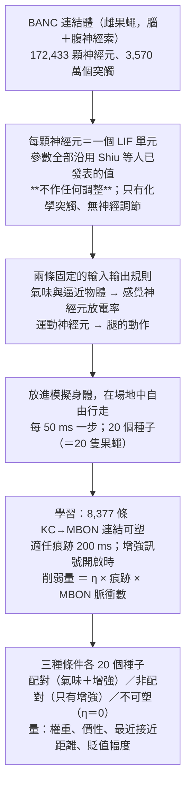
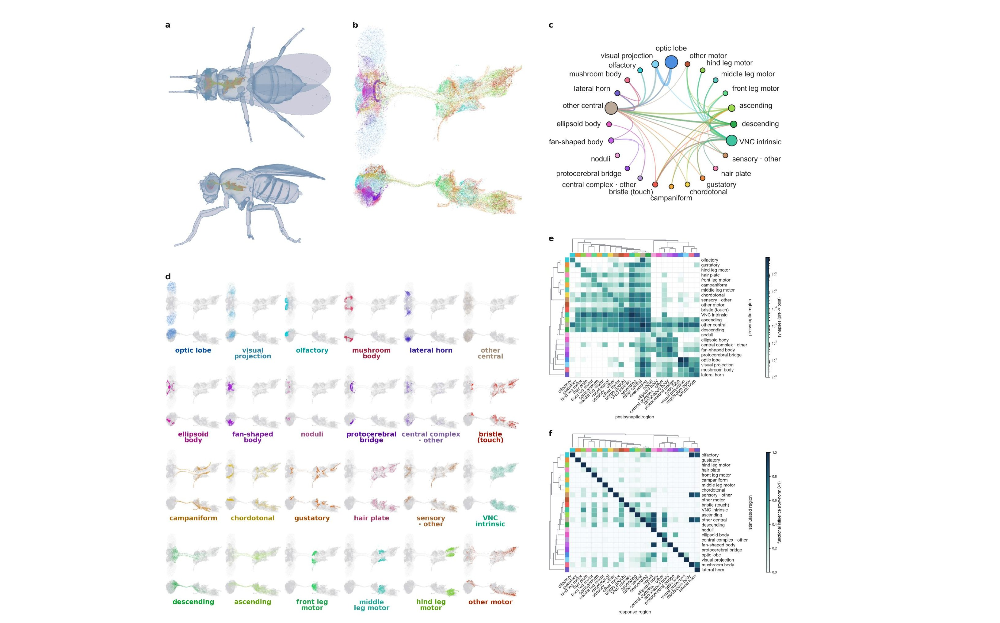
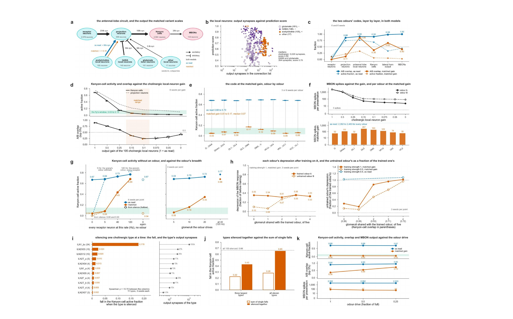
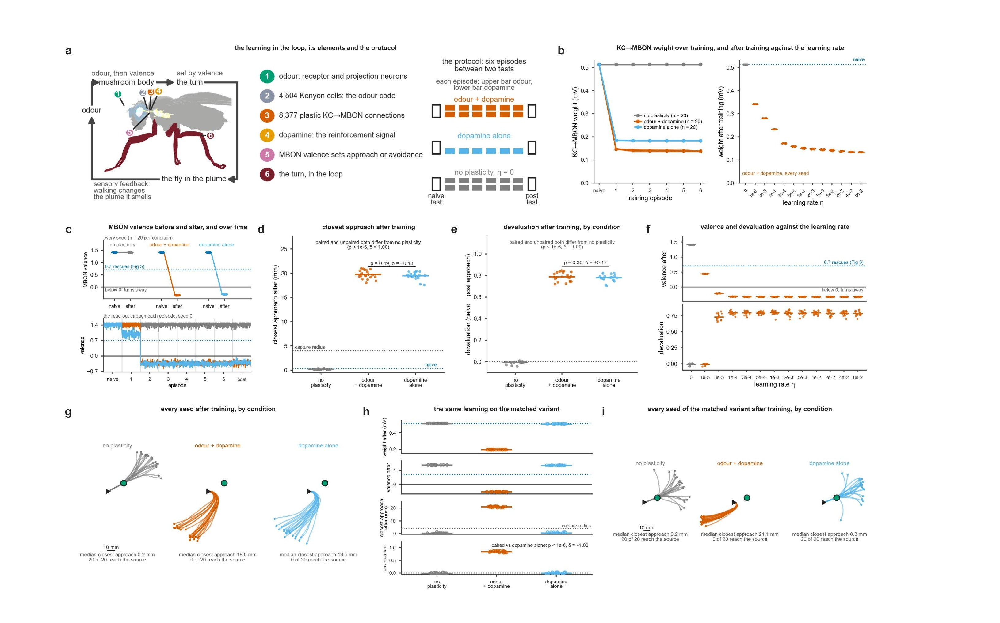

<!-- 本機 PDF：papers/2026-Sensorimotor%20behaviour%20from%20an%20untrained%20brain-and-nerve-cord%20connectome.pdf -->

# Sensorimotor behaviour from an untrained brain-and-nerve-cord connectome

**未經訓練的腦與腹神經索連結體所產生的感覺運動行為**

| 項目 | 內容 |
|---|---|
| **出處** | arXiv:2610.33881v1 [q-bio.NC] (2026-10-24)，42 頁。[全文（arXiv 免費閱讀）](https://arxiv.org/abs/2610.33881)。**預印本，未經同儕審查。** |
| 日期 | arXiv 上傳 2026-10-24（v1）。未投稿或未註明投稿中的期刊；無接受日期 |
| 通訊作者 | John R. Minnick，jrminnic@ucsc.edu；Mircea Teodorescu，mteodore@ucsc.edu（PDF 只有英文名） |
| 作者 | 共 7 人：John R. Minnick、Jesus Gonzalez-Ferrer、Jinghui Geng、Jason K. Eshraghian、Mohammed A. Mostajo-Radji、David Haussler、Mircea Teodorescu。PDF 未標示共同第一作者，兩位通訊作者以 \* 標出 |
| 機構 | University of California, Santa Cruz：電機與電腦工程系、UCSC 基因體學研究所、電腦科學與工程系、生物分子工程系 |
| 資料庫 | 連結體資料為 BANC（Brain And Nerve Cord，雌果蠅的腦與腹神經索重建），經 FlyWire 平台發布，由 BANC-FlyWire Consortium 校對與標註。**本篇自己的模擬程式與資料在哪裡發布，PDF 沒有寫**：？待查（致謝只提到計算資源，未給程式碼網址） |
| 補充資料 | 補充討論、補充圖 1–4、補充表 1–7。**本 PDF 的第 1–42 頁含正文、方法與補充資料的部分內容**；本頁凡依賴補充圖表的內容一律標 `？待查（補充資料未取得）` |
| 編輯／審查 | 無。arXiv 預印本不經同儕審查。**本篇有一項不常見的作法：多數檢定在執行前就把判準寫定（論文稱 registered，預先登記）**，並把未預先登記的分析另外標為探索性 |
| 經費 | Schmidt Futures (SF857)、NHGRI (RM1HG011543)、NSF（多項）、CIRM (DISC4-16285)、加州大學總校 (M25PR9045) 等；模擬在 National Research Platform 執行 |
| 授權 | **PDF 未印授權聲明**（已搜 licence、Creative Commons、CC BY、copyright，無命中）：？待查。本頁依本庫慣例只給連結、不轉載全文；圖以教學與評論目的引用 |

> **本頁的範圍。** 這篇論文有 42 頁、六張主圖，大半篇幅在講導航與運動控制，與蕈狀體無關。依本庫範圍（果蠅的學習與記憶，以及蕈狀體本身），本頁**完整處理蕈狀體與學習的部分**——嗅葉到 Kenyon 細胞的氣味編碼（圖 3）與多巴胺調控的突觸變弱（圖 6）——其餘的導航、擾動實驗與運動控制只寫成背景，所需的結論在「三、結果」3.1 與 3.5 各一段帶過。六張主圖中本頁重製三張（圖 1、3、6）。想讀導航那部分的人請看原文。
>
> 作者在致謝中聲明，本研究在準備過程中使用了 Claude 大型語言模型（Fable 5.1、Opus 5）產生部分程式碼與分析圖，並協助編修文字，作者已複閱並為內容負全責。
>
> **本篇為預印本，未經同儕審查**，所以本頁的 `confidence` 降一級為 medium。授權不明，本庫不轉載全文 PDF；圖片擷取自原文，以教學與評論目的引用，每張圖下方標明出處。

---

## 為什麼重要

本庫先前的來源都是在活的果蠅（或取出的腦）上做實驗。這一篇反過來：它不做實驗，而是把一份完整的接線圖直接當成程式跑起來，看**光憑接線能產生多少行為**。作法是把 BANC 連結體（一隻雌果蠅的腦加腹神經索）變成 172,433 顆神經元的脈衝網路，每一個參數都沿用別人已發表的值、一個都不調，再把它放進模擬的身體裡走路。

這對蕈狀體研究的意義在於兩個結果。第一，**照連結體原樣讀出來的 Kenyon 細胞編碼密度，與實驗量到的差了一個數量級**：模型裡任何一種氣味都會活化 68% 的 Kenyon 細胞，而真果蠅只有 5–10%。第二，**在這樣的網路上跑多巴胺調控的突觸變弱，學習確實把趨近變成了躲避，但那個學習不是聯結式的**——不給氣味、只給增強訊號，突觸照樣變弱。要把一類嗅葉突觸的強度調小、讓 Kenyon 細胞只在有氣味時才放電，學習才恢復成「有配對才發生」。

這兩點合起來是一個對本庫既有主題的新型態證據。[[t-dopamine-to-plasticity]] 整條線建立在「多巴胺改變 KC→MBON 突觸」這個機制上，而庫內各篇量的都是真果蠅身上的分子、突觸或行為。這一篇把同一個機制放進一個完全由接線決定的網路裡跑，於是能問一個實驗問不出來的問題：**這個機制要能運作，接線之外還必須加上什麼？** 答案是「Kenyon 細胞的活動必須依賴氣味」，而這件事在原樣的連結體裡不成立。
論文並由此推出一項可在真果蠅上檢驗的預測：**一隻 Kenyon 細胞在沒有氣味時也會活動的果蠅，應該會被沒有與氣味配對的增強訊號所貶值。**

---

## 論文摘要（原文與中譯）

> Connectomes now map the neurons and synapses of an adult fly's brain and nerve cord, but how much of behaviour follows from the wiring is unknown. Here we turn one such connectome into a spiking network of 172,433 neurons with a published brain model's untuned parameters, and run it alone and inside a simulated body. Two fixed rules join them: odours and looming objects drive sensory neurons, and motor neurons move the legs. Alone, the network passes a signal to the motor neurons it is known to drive when the pathway supplies about 2% or more of their input. In the body, the fly navigates around obstacles to 95% of the odour sources. A rewiring that keeps each neuron's connection counts and signs reaches 18%, and the fly's leg commands replayed with the senses off reach almost none, so navigation needs the measured wiring and sensory feedback. Dopamine-gated weakening of the mushroom body's output synapses turns approach to an odour into avoidance, which requires the pairing and is odour-specific once one olfactory synapse class is scaled. An untrained connectome thus supports a behaviour and its learned reversal, and the pathways it cannot drive mark what the diagram leaves out.

**中譯**（本節為忠實翻譯，非自撰內容）：

> 連結體如今已描繪出成年果蠅腦與腹神經索的神經元與突觸，但行為有多少是由接線本身決定的，仍然未知。我們在此把這樣一份連結體轉成 172,433 顆神經元的脈衝網路，採用一個已發表的腦模型未經調整的參數，並讓它單獨運行以及在模擬的身體之內運行。兩條固定的規則把兩者接起來：氣味與逼近的物體驅動感覺神經元，運動神經元驅動腿。單獨運行時，當一條通路提供其目標約 2% 或更多的輸入時，網路便能把訊號傳給已知由它驅動的運動神經元。在身體之內，果蠅能繞過障礙物到達 95% 的氣味源。一個保持每顆神經元連線數與正負號的重新接線版本只到達 18%，而把果蠅的腿部指令在關閉感覺的情況下重播，則幾乎到達不了，可見導航需要實測的接線與感覺回饋。蕈狀體輸出突觸的多巴胺調控性減弱，把對氣味的趨近轉成躲避；一旦把一類嗅覺突觸的強度加以調整，這個轉變便需要配對，並且具有氣味專一性。因此，一個未經訓練的連結體能夠支持一項行為及其習得的逆轉，而它無法驅動的那些通路，則標示出接線圖遺漏了什麼。

---

## 科普文

地圖和路況是兩回事。你可以有一張完整的城市道路圖，卻仍然不知道尖峰時刻車子實際上怎麼流動——因為地圖沒有記錄紅綠燈的秒數、每條路的速限、司機的習慣。果蠅的**連結體**（connectome，整個神經系統的完整接線圖，記錄哪一顆神經元接到哪一顆、用了幾個接點）就是這樣一張地圖。這篇論文問的是：**光憑這張地圖，能跑出多少真實的行為？**

**作法是把地圖直接當程式跑。** 研究者拿一份涵蓋果蠅整顆腦加上腹神經索的連結體，把 172,433 顆神經元各自變成一個簡單的計算單元，接線照圖，強度照突觸數目。關鍵在於**什麼都不調**：所有參數都沿用別人已發表的數值，不針對任何目標微調。然後把這個網路接上一副模擬的身體——氣味和逼近的物體驅動感覺神經元，運動神經元驅動腿——讓牠在虛擬的場地裡自己走。

**第一個結果是牠真的會走。** 完整接線的果蠅能繞過障礙，平均走到 32 個氣味源中的 30.25 個（95%）。這裡的「一隻果蠅」是一次獨立的模擬，各有自己的隨機輸入與起始位置，所以 20 次的結果不會相同，相當於 20 隻個體。把接線打亂（但保留每顆神經元有幾條連線、是興奮還是抑制）就掉到 18%；把腿的指令錄下來原樣重播、同時關掉感覺，則幾乎走不到任何一個。**所以導航既需要真實的接線，也需要走動時持續收到的感覺回饋。**

**第二個結果是這篇對蕈狀體研究最重要的地方，而它是個壞消息。** 研究者接著在這個網路裡模擬學習。蕈狀體沿長度分成一格一格，每格各由一型多巴胺神經元負責，其中幾格對應「壞事」；作法是讓這幾格裡 Kenyon 細胞送往輸出神經元的接點，在**增強訊號**（代表懲罰的訊號，由研究者從外部開啟，不是網路自己產生的）出現時變弱。結果行為確實翻轉了——訓練前 20 隻果蠅全部走到氣味源，訓練後一隻都沒有，牠們改成掉頭就走。

**但這個學習是假的。** 研究者做了一個對照：只給增強訊號、完全不給氣味。照理說沒有氣味就不該學到任何跟氣味有關的東西，結果突觸照樣變弱、果蠅照樣躲開。原因出在編碼：在照地圖原樣讀出來的網路裡，**Kenyon 細胞根本停不下來**——連完全沒有任何輸入時，都有 67% 在放電。既然它們一直在活動，增強訊號不管什麼時候來，都會碰到「正在活動」的接點而把它削弱。

**修好它需要動一個地圖沒記錄的東西。** 研究者追查出原因：嗅葉（氣味訊號進腦的第一站）裡有一批只在嗅葉內部互相連接、負責彼此調節的「局部神經元」，其中 105 顆被連結體的自動判讀認為是**興奮性**的（放電時讓下游更容易放電），於是在模型裡不斷把訊號推高。把這 105 顆的輸出強度調到原來的 0.15 之後，學習就恢復正常：配對才會變弱，不配對就不會。本頁把原本的網路稱為**原樣版**，調整過的稱為**校正版**。

**最容易被誤讀的一點，是「修好」到底修了什麼。** 很容易以為修好的是「活化比例變稀疏了」。這只對一半，因為比例要看拿什麼氣味去測：

| 用什麼氣味測 | 原樣版 | 校正版 | 真果蠅 |
|---|---:|---:|---:|
| 窄氣味（只刺激五個氣味接收站） | 68% | **6.1%** | 5–10% |
| 場地氣味（走路實驗所用，刺激每一顆受體神經元，約 120 Hz） | 77% | **68%** | — |
| 完全沒有氣味 | **67%** | **4.2%** | 應接近 0 |

**而學習實驗用的是場地氣味。** 也就是說，在真正做出聯結式學習的那個實驗裡，編碼從頭到尾都是密的（68%）。所以關鍵**不是**「稀疏」，而是最後一列：**沒有氣味時會不會安靜**。原樣版不會（67%），校正版會（4.2%）。這兩件事常被混為一談，而這篇剛好把它們拆開了。

---

## 專業文

### 本頁用語

| 詞 | 意思 |
|---|---|
| 蕈狀體（mushroom body） | 果蠅腦中負責把氣味與好壞結果連起來的構造，學習就發生在這裡。它由 Kenyon 細胞的軸突束成幾條「葉」，葉沿長度被切成一格一格（見下方「區室」） |
| 興奮性與抑制性 | 一顆神經元放電時，若讓下游更容易放電就是**興奮性**，更不容易就是**抑制性**。連結體以神經元釋放的傳遞物質推測它屬於哪一種：**膽鹼性**（乙醯膽鹼）在果蠅中是興奮性，**GABA 性**與**穀胺酸性**多為抑制性。**本篇密編碼問題的核心，就是一類膽鹼性（興奮性）細胞把活性不斷推高** |
| 嗅小球（glomerulus） | 嗅葉裡的一個小球狀結構，每一個收集同一型受體神經元的輸入，相當於「一種氣味成分」的接收站。本篇以「一種氣味刺激五個嗅小球」來定義一個窄的氣味 |
| 顆數與型別 | 本頁兩種計數都會出現，容易混淆：嗅葉的膽鹼性局部神經元共 **105 顆**，這 105 顆依形態與連線分屬 **11 個型別**（最大的一型 lLN1_bc 含 34 顆）。校正版調整的是全部 105 顆的輸出；圖 3i、3j 的「逐型沉默」測試針對的則是那 11 個型別 |
| 腹神經索（ventral nerve cord） | 位於胸腹部的神經組織，相當於脊椎動物的脊髓，控制腿與翅。BANC 把它與腦一起重建，所以訊號可在同一份資料裡從感覺一路追到運動 |
| 多巴胺神經元、PPL1、嫌惡區室 | 送來「這是好事還是壞事」訊號的神經元。**PPL1** 是其中一群，一般對應懲罰；它所支配的那些區室因此稱為**嫌惡區室**。本篇只讓這些區室的 KC→MBON 連結可塑，是依循真果蠅中嫌惡學習發生在這些區室的既有知識，屬於模型的設定選擇 |
| 增強訊號（reinforcement） | 懲罰或獎賞的統稱。真果蠅實驗裡是電擊或糖，由多巴胺神經元送進蕈狀體。**在本篇中它不是由網路自己產生的，而是研究者從外部強加的一個開關**：開啟期間，可塑連結就依規則被削弱。論文把「改由網路自身的多巴胺神經元產生」列為下一步 |
| 連結與突觸 | 兩個不同的計數單位：一條**連結**是「某顆 KC 接到某顆 MBON」這一對關係，其中可能包含多個**突觸**（接點）。所以 KC→MBON 有 28,415 個突觸、卻只有 15,523 條連結 |
| 化學突觸與縫隙連接 | **化學突觸**以傳遞物質傳訊，是連結體唯一收錄的類型。**縫隙連接**（電突觸）讓電流直接流過，連結體沒有記錄；本篇有一條通路就是因為少了它而導通失敗，手動補上即恢復 |
| 權重（mV） | 一條連結每傳一個脈衝，讓下游膜電位上升多少毫伏。可塑連結的初始值為 0.513 mV |
| Cliff's δ | 一個效果量，範圍 −1 到 +1：**+1.00 表示兩組完全不重疊**（一組的每個值都大於另一組），**接近 0 表示兩組幾乎分不開**。本篇用它搭配 P 值判斷兩個條件有沒有差別 |
| 貶值（devaluation） | 本篇的一個行為指標：比較訓練前後「果蠅縮短了多少與氣味源的距離」，下降越多表示牠對那個氣味越失去興趣。白話即「原本會靠過去，現在不去了」 |
| 暖機（warm-up） | 模擬開始時先跑一段讓網路進入穩定狀態。本篇一個關鍵現象就與它有關：原樣版若**從完全靜止啟動**則一顆 KC 也不發，但只要被 5 Hz 的輸入打開過，之後即使移除輸入仍維持 67%——**所以「沒有輸入時 67%」指的是暖機之後的狀態，不是從零啟動** |
| hemibrain | 另一份果蠅連結體資料集（只涵蓋半邊中央腦），本篇用它的區室對應表來決定哪些 MBON 屬於嫌惡區室，而模擬本身跑的是 BANC |
| 連結體（connectome） | 整個神經系統的完整接線圖：哪一顆神經元接到哪一顆、各用幾個突觸，以及每顆神經元可能釋放什麼傳遞物質（由電子顯微影像預測）。它**不記錄**神經元的動態特性與調節作用 |
| BANC | Brain And Nerve Cord，一隻雌果蠅的腦與腹神經索一起重建的連結體（本篇註明性別，因為果蠅的神經系統有性別差異）。本篇用的就是它；庫內其他頁引用的多數實驗來自別的資料集或活體 |
| 脈衝網路、LIF | 把每顆神經元當成一個「漏電積分發放」（leaky integrate-and-fire, LIF）單元：輸入累積到門檻就發一個脈衝，不然就慢慢漏掉。本篇的參數全部沿用 Shiu 等人為「只有腦、沒有腹神經索」的模型所定的值，未作調整 |
| 嗅葉（antennal lobe, AL） | 氣味訊號進入腦後的第一站。本頁出現的三類細胞：**受體神經元（ORN）** 由觸角送入，**投射神經元（PN）** 把訊號送往蕈狀體與側角（lateral horn，氣味訊號的另一個目的地，一般認為處理不需學習的天生反應；本篇未深入），**局部神經元（LN）** 只在嗅葉內部連接、負責互相調節 |
| KC、MBON、區室 | Kenyon 細胞（蕈狀體裡代表氣味的神經元）、蕈狀體輸出神經元（讀出 KC 的訊號、推動趨近或躲避）、區室（蕈狀體的葉沿長度切成的一格一格，每格由一型多巴胺神經元支配、一型 MBON 讀取，見 [[c-mb-compartment]]） |
| 活化比例、重疊度 | **活化比例**（active fraction）＝某一層有多少比例的細胞在反應。**重疊度**＝兩種氣味各自最活躍的前 5% 細胞有多少是同一批；越高表示兩種氣味在這一層越難分辨 |
| 稀疏編碼與密編碼 | 一種氣味只活化少數細胞叫**稀疏**，活化大半叫**密**。真果蠅的 Kenyon 細胞是稀疏的（5–10%），本篇圖上標為「果蠅的範圍 0.03 到 0.15」 |
| 原樣版與校正版 | 本頁對本篇兩個模型版本的稱呼。**原樣版**（as read）＝完全照連結體讀出來的網路。**校正版**（matched variant）＝把那 105 顆膽鹼性局部神經元的輸出強度一律乘以 0.15（「105」是顆數，不是型別編號），其餘不動。**校正的目標是讓 Kenyon 細胞對一個窄氣味的活化比例落回果蠅的範圍**——這個條件很重要，見下一列 |
| 「活化比例」要看拿什麼氣味測 | 本頁出現兩組看似衝突的數字，差別在刺激不同，**不是矛盾**： ・**窄氣味**（只刺激五個嗅小球）：原樣版 68%、校正版 6.1%（八種窄氣味為 4.9–17.2%，中位數 6.8%）。校正版落在果蠅的範圍內。 ・**場地氣味**（走路實驗所用，會驅動**每一顆**受體神經元）：原樣版 77%、校正版 68%，**兩者都是密的**。 **學習實驗用的是場地氣味**，所以讓學習成為聯結式的不是稀疏，而是「沒有氣味時會不會安靜」（原樣版 67%、校正版 4.2%） |
| 增益（gain） | 乘在某一類連線強度上的倍數。本篇掃描膽鹼性局部神經元輸出的增益從 1（原樣）降到 0，看 Kenyon 細胞的活化比例怎麼變 |
| APL | 蕈狀體裡一顆大型的回饋神經元，在真果蠅中是抑制性的，負責把 Kenyon 細胞的編碼壓得稀疏。**本篇的連結體自動判讀把它預測成興奮性的**，所以在模型裡它反而推高活性（見問題與限制） |
| 價性（valence） | 本篇定義的一個量：**（推動趨近的 MBON 每步脈衝總數 − 推動躲避的 MBON 每步脈衝總數）÷ 一個正規化常數**（原樣版 37.35、校正版 25.22，由完整網路校準時的平均值定出）。**正值表示果蠅會趨近氣味，負值表示躲開**；完整網路的基準值是 1.41。可驗算：訓練前 (103 − 50) ÷ 37.35 ≈ 1.42，訓練後 (37 − 50) ÷ 37.35 ≈ −0.35，與論文報的 1.41 與 −0.33 相符（差異來自取的種子不同） |
| MBON 的正負號怎麼定 | 依該型 MBON 的傳遞物質：穀胺酸性者驅使果蠅**遠離**，GABA 性或膽鹼性者驅使果蠅**靠近**（引自先前的活化實驗）。104 顆 MBON 中 **75 顆推動趨近、25 顆推動躲避、4 顆未定號** |
| 可塑連結、適任痕跡、η | **可塑連結**＝允許改變強度的那些 KC→MBON 連線（本篇是 8,377 條，其餘 7,146 條固定不動）。**適任痕跡**（eligibility trace）＝每條連線記住「我最近傳過多少訊號」的一個會衰減的量（時間常數 200 毫秒）；增強訊號出現時，依照這個痕跡的大小決定削弱多少。**η**（eta）是學習率，決定每次削弱的幅度 |
| 配對與非配對 | **配對**＝訓練時氣味與增強訊號同時給。**非配對**＝只給增強訊號、不給氣味。**若學習是聯結式的，非配對就不該造成改變**，這一組對照是本篇最關鍵的檢驗 |
| 種子（seed） | 一次完整的模擬，每個種子有自己的隨機輸入與起始狀態，相當於實驗裡的一隻果蠅。本篇多數測試用 20 個種子 |
| 預先登記 | 在跑模擬之前就把要用的指標與判準寫定，事後不得更改。本篇多數檢定都這樣做，未預先登記者另標為探索性 |
| ※ 推論／？待查 | 論文沒有明說、本頁自行推得的內容／值得查證但本頁刻意不填的內容 |

### 一、概述

**主要問題：** 一個神經系統的功能，有多少是由接線本身決定的？

**重要性：** 以連結體為基礎的模型通常會針對任務去擬合未知的參數，或用強化學習訓練一個「介面」（接在網路與身體之間、負責把神經活動翻譯成動作的轉換層，下文線蟲的例子稱之為解碼器）。這類作法能達到未經訓練的模型達不到的準確度，但也讓「接線本身解釋了多少」這個問題無法回答——一個訓練過的介面可以讓任何接線驅動身體，論文引用的一個例子是：把線蟲的連結體讀進果蠅的身體，中間接一個以強化學習訓練來模仿真果蠅的解碼器，牠也走得像果蠅。本篇反其道而行：**什麼都不擬合**，照讀出來跑，記錄它在哪裡重現了已知的生物學、在哪裡失敗。

**發表當時的領域現狀（2026）：** 線蟲與果蠅幼蟲已有完整接線圖；成蟲方面，中央腦、全腦與腹神經索都已重建，而 BANC 與另一個雄果蠅的資料集首次把腦與腹神經索接在同一隻動物上。已有的連結體模型包括：一個以原腦橋（protocerebral bridge，中央複合體的一部分，與方位感有關）為對象的脈衝模型，重現了果蠅用來記住自己朝向哪個方位的那種持續活動樣式（該訊號在細胞排成的環上像一個光點繞行，稱環狀吸引子），而且在很寬的參數範圍內都成立；Shiu 等人的全腦 LIF 模型（參數事先固定、權重取自連結體）成功預測了驅動取食與理毛的神經元並獲實驗證實；腹神經索的模擬找出產生行走節律的小迴路。另一方面也有限制的證據：當神經元特性未知時，連結體常無法唯一決定一個回饋網路的動態；而在線蟲中，實測的訊號傳播與解剖預測並不一致。

### 二、方法

**哪些連結可塑。** KC→MBON 共 15,523 條連結，其中可塑的是**支配嫌惡區室（由 PPL1 多巴胺神經元支配的那些格）的 8,377 條**，對應 MBON11–14、16–20、23、25、28、30、32–35 共 50 顆細胞，區室對應關係取自 hemibrain 的區室圖。其餘 7,146 條維持原權重。可塑連結的初始平均權重為 0.513 mV。

**學習規則。** 每 50 毫秒一步，每條可塑連結的適任痕跡以 200 毫秒的時間常數衰減，並加上該步中它的 Kenyon 細胞所發的脈衝。增強訊號開啟期間，連結累積一個等於 η × 適任痕跡 × 該步中其 MBON 脈衝數的削弱量；一個回合結束時，把累積的削弱量從權重中扣掉，並將權重限制在 0 與初始值之間。

**訓練流程。** 一次完整的執行是：一個初始測驗回合、六個訓練回合、一個訓練後測驗回合，每回合 6 秒、起點相同，氣味源在開始時開啟、接觸時關閉。主實驗用 η＝0.02、每條件 20 個種子；另有學習率階梯，在 10⁻⁵ 到 0.08 之間取十一個 η 值，每值 20 個種子。

**三種條件。** **配對**：訓練回合全程開啟增強訊號，果蠅在氣味中覓食。**非配對**：增強訊號照開，但氣味被撤掉，兩根觸角各收到 5 Hz 的輸入；論文在設計時預期「這樣 Kenyon 細胞就會安靜」——**這個預期在原樣版中不成立，正是 3.4 的核心**。**不可塑**：η＝0。

### 三、結果

#### 3.1 模型的規模與導航（背景，本庫範圍外的部分只摘結論）

網路有 172,433 顆神經元、3,570 萬個突觸。在身體裡，完整接線的果蠅繞過障礙到達 32 個氣味源中的 30.25 個（95%，20 次模擬的平均；論文討論一節取整寫成 30）；保留每顆神經元連線數與正負號的重新接線版本只到 5.8 個（18%）；把腿部指令在關閉感覺的情況下重播則幾乎到不了（2%）。單獨運行時，一條已知通路要能驅動其目標運動神經元，大致需要提供該目標 **2% 以上的輸入突觸**；達不到的通路不是訊號太弱，就是依賴連結體沒有記錄的東西——巨大纖維與其運動神經元之間在真果蠅中有縫隙連接，連結體只收錄化學突觸，**手動補上一條連線就恢復了該通路**。

#### 3.2 嗅覺路徑的規模（圖 3a）

2,978 顆受體神經元經 203,937 個突觸連到 699 顆投射神經元中的 616 顆，並經 172,141 個突觸連到嗅葉的 429 顆局部神經元。投射神經元回送 217,657 個突觸到局部神經元，並送出 168,315 個突觸到 4,504 顆 Kenyon 細胞。**Kenyon 細胞送往 104 顆 MBON 的 28,415 個突觸，就是圖 6 的學習所改變的對象。**

局部神經元依預測的傳遞物質分為：穀胺酸性 161、GABA 性 146、膽鹼性 105、血清素性 14、章魚胺性 3（後兩類共 17 顆在模型中如何定號，本篇未說明：？待查）。**膽鹼性這一類的突觸最多**：每顆細胞輸出突觸的中位數為 3,029，而 GABA 性為 456、穀胺酸性為 304。

#### 3.3 原樣版的 Kenyon 細胞編碼是密的，與實驗差一個數量級（圖 3c–g）

**以下用的是「窄氣味」**：兩種各由五個不重疊的嗅小球構成的氣味。在原樣版中，**任一種氣味都會活化 68% 的 Kenyon 細胞**，兩種氣味最活躍的前 5% 細胞重疊度達 0.90。投射神經元層已經有 74% 活化、重疊度 0.86，而 MBON 不論哪種氣味都發出約 2,400 個脈衝。**在真果蠅中，一種氣味只讓 5% 到 10% 的 Kenyon 細胞反應。**

密度的來源是膽鹼性局部神經元對投射神經元的輸出。把這個輸出乘上增益 g（g＝1 即原樣版）。隨著 g 由 1 降到 0，Kenyon 細胞對窄氣味的活化比例依序為：

| g | 1 | 0.5 | 0.25 | **0.15** | 0.1 | 0.075 | 0.05 | 0 |
|---|---:|---:|---:|---:|---:|---:|---:|---:|
| KC 活化比例 | 68% | 43% | 15% | **6.1%** | 3.4% | 2.7% | 2.3% | 1.8% |

> g 的取值依圖 3d 橫軸讀出，活化比例為正文所列的數列依序對應。投射神經元的活化比例同時由 74% 降到 10%。

**g＝0.15 被選為校正版**，此時編碼落在果蠅的範圍內且重疊度低於 0.5。另一種作法——把所有局部神經元一律當成抑制性——會得到 1.4% 的活化比例，低於果蠅的範圍。

**最關鍵的一組數字在圖 3g。** 這一格改用另一種刺激：不給特定氣味，而是讓**每一顆**受體神經元都以同一個放電率被驅動。原樣版在 0 Hz（完全沒有輸入）時仍有 **67%** 的 Kenyon 細胞在放電，5 Hz 時 68%，120 Hz 時 77%。

這裡有一個看似矛盾、實則關鍵的細節：**若網路從完全靜止啟動，則一顆也不發**；上述 67% 指的是「暖機（先跑一段讓網路進入穩定狀態）之後」的數值。5 Hz 的輸入足以把它「打開」，之後即使移除輸入也維持在 67%。換句話說，**這個持續活動不是程式裡內建的自發放電，而是網路自己的迴圈一旦啟動就停不下來**——這也解釋了為什麼問題與限制第 1 條把「沒有自發活動」列為模型的簡化，卻不與這個 67% 衝突。校正版則跟著輸入走：0、5、40、120 Hz 分別為 4.2%、8.3%、43%、68%，移除輸入後回到 4.2%。

#### 3.4 多巴胺調控的突觸減弱把趨近變成躲避——但在原樣版裡不是聯結式的（圖 6）

讓嫌惡區室的 KC→MBON 突觸在增強訊號下變弱，其餘不動。**以下數字除非另註，都是原樣版、使用場地氣味的結果。** 六個訓練回合把 8,377 條可塑連結的平均權重從 0.513 降到 0.138 mV。推動趨近的 MBON 從每步 103 個脈衝降到 37，推動躲避的維持在 50（訓練後 49），**價性因此由 1.41 轉為 −0.33**。

**這裡有一個容易卡住的環節：為什麼削弱「嫌惡」區室的突觸，掉下來的是推動「趨近」的 MBON？** 因為嫌惡區室裡的 MBON 本來就多半是推動趨近的那一種——本篇的 41 顆可塑目標全部屬於趨近型。真果蠅也是這個邏輯：懲罰訊號削弱的是「叫果蠅靠過去」的那條輸出，靠近的力量變小，天平就倒向躲避（庫內的對應說明見 [[c-kc-mbon-plasticity]]）。所以削弱趨近型的輸出，正是把行為推向躲避的方式，而不是矛盾。一個訓練回合就足以達到這個程度。行為跟著改變：訓練前每一隻都走到氣味源，訓練後 20 隻沒有一隻走到；訓練過的果蠅掉頭離開，最近接近距離的中位數為 19.6 mm，而不可塑組是 0.15 mm（P＝6.8×10⁻⁸、Cliff's δ＝+1.00）。學習率有門檻：η＝10⁻⁵ 時訓練後價性為 0.44、20 隻全部走到；3×10⁻⁵ 時為 −0.21、一隻也沒走到。

**然後是本篇對蕈狀體研究最重要的發現。在原樣版中，這個減弱不是聯結式的。** 把氣味撤掉、只給增強訊號，突觸幾乎一樣變弱（權重 0.183 mV、價性 −0.29），那些果蠅也一樣掉頭：20 隻沒有一隻走到氣味源，與配對組在最近接近距離上的差異為 P＝0.49、δ＝+0.13（95% 區間 −0.25 到 +0.49），也就是**兩組無法區分**。

原因直接來自 3.3：**原樣版的 Kenyon 細胞在沒有氣味時照樣放電**（0 Hz 時 67%；撤掉氣味時場地仍供給 5 Hz，此時 68%）。削弱量的公式是 η × 適任痕跡 × MBON 脈衝數，而這兩個因子在沒有氣味時都不為零——適任痕跡來自 Kenyon 細胞持續的放電，MBON 也因為持續收到 Kenyon 細胞的輸入而持續放電。單獨的增強訊號因此就足以削弱同一批突觸。

**在校正版中，同一套流程就變成聯結式的**，而且在突觸與行為兩個層次都成立。配對使權重降到 0.195 mV、價性降到 −0.53，20 隻訓練過的果蠅沒有一隻走到氣味源（最近接近距離中位數 21.1 mm）；只給增強訊號則權重維持在 0.508 mV、價性 1.38，20 隻全部走到氣味源，與不可塑組無異。配對組與非配對組在最近接近距離上因此差距極大：P＝6.8×10⁻⁸、δ＝+1.00（與原樣版的 P＝0.49、δ＝+0.13 恰成對比）。

**關鍵的澄清：在學習實驗所用的場地氣味下，兩個版本都是密編碼**——原樣版 77%、校正版 68%。場地氣味會驅動**每一顆**受體神經元，與 3.3 用的窄氣味不同，所以校正版在這裡不是 6.1% 而是 68%。（方法中場地把兩根觸角的受體驅動設為 120±80a Hz，a 為左右不對稱度，所以中心值是 120 Hz；這正好對應 3.3 圖 3g 中 120 Hz 那一欄的 77% 與 68%。）換句話說，**校正版做出聯結式學習時，它的編碼並不稀疏**。減弱之所以成為聯結式的，來自編碼對氣味的依賴（沒有氣味時 4.2% 對 67%），而不需要稀疏編碼。

#### 3.5 蕈狀體損傷與價性救援（背景）

在一個三個氣味源藏在牆後的場地中，完整的果蠅在 20 個種子中每次都到達全部三個；**切除蕈狀體後（在模擬中把該區域的神經元移出網路，與前面「沉默」某幾顆細胞——保留細胞但令其不放電——是不同的操作），20 個種子全部一個也到不了**，但走路本身沒壞（腿部運動神經元放電率 152 對 154 Hz，撞牆步數 1.9 步，路徑長度 220 對 193 mm；論文只給撞牆步數一個值，未標明屬於哪一組：？待查）。把價性固定在 1.44（接近完整果蠅的 1.41），趨近行為就恢復，平均到達 3.00 個氣味源（滿分 3 個）。**所謂「固定」，是繞過蕈狀體的讀數，直接把一個常數餵給決定轉向的那條規則**——等於告訴身體「這個氣味是好的」，而不管蕈狀體算出什麼。既然補上這個數值就能救回行為，**缺損的位置就在蕈狀體的輸出，而不在走路的機制**。救援有門檻：固定在 0.7（同一個價性尺度上的值）就足以完全救回，固定在 0 則完全救不回來。

### 四、討論

**論文的主要主張與其強弱：**

- **「未經訓練的連結體能支持一項行為及其習得的逆轉」**——這是全篇的總結論。導航那一半有重新接線與重播兩個對照支撐，相當強。**學習那一半要分版本講**：在原樣版中「逆轉」做出來了，但那不是學習（非配對同樣有效）；只有在校正版中才真的是習得的逆轉。摘要把這個條件寫成「一旦把一類嗅覺突觸的強度加以調整」，但主標題的「untrained」在這一點上需要附帶條件——**校正版動了一個參數，嚴格說已不是完全照讀**。
- **「2% 的輸入份額是通路能否導通的分界」**——作者自己明說這是**本模型的經驗結果**，由 Shiu 等人的突觸權重與門檻得出，不是取自文獻的數值。這句自我限制寫得很清楚。
- **「連結體遺漏了什麼，可以由它驅動不了的通路標示出來」**——這是本篇方法論上最有價值的一句。最乾淨的例子是巨大纖維（giant fibre，果蠅腦中一對特別粗大的下行神經元，負責觸發逃跑反應）：它與下游運動神經元之間在真果蠅中靠縫隙連接傳訊，而連結體只收化學突觸，所以模型裡這條通路導不通；手動補一條連線就恢復了。
- **關於 APL 的處理**：模型中的兩顆 APL 細胞被預測為膽鹼性（興奮性），而在真果蠅中 APL 是 GABA 性（抑制性）的、正是壓低 Kenyon 細胞編碼密度的回饋來源。**同一份連結體裡其實有兩個互相衝突的欄位**：自動預測欄寫膽鹼性，而註記欄把 GABA 列為該細胞「已驗證」的傳遞物質；論文採用了預測欄。作者照預測值使用，並報告「沉默那顆在連結體神經元表中帶有型別標註的 APL，會把活化比例從 68% 降到 61%」（另一顆沒有標註、未被沉默，見問題與限制 4b）。**這等於承認模型在這一點上與已知生物學相反**，而它又恰好是編碼密度問題的核心。

### 五、問題與限制

1. **模型的簡化（作者自陳）**：點神經元（不考慮細胞的空間形狀）、每顆神經元只有一種正負號、只有化學突觸（沒有縫隙連接）、沒有神經調節（傳遞物質只負責興奮或抑制，不改變其他突觸的運作方式——本篇的學習規則是外加的，不是網路自己產生的調節）、沒有內建的自發放電（但網路的迴圈可以自己維持活動，見 3.3）、只有一隻動物。作者逐項說明每個省略都已知有影響，並提出可逐一加回來測試的候選項。
2. **參數取自為另一個資料集、另一隻動物所定的模型**（作者自陳）。Shiu 等人的參數是為「只有腦」的模型所定，本篇原封不動用在腦加腹神經索上。
3. **幾條通路的方向與實測相反**（作者自陳；屬本庫範圍外的導航部分，此處只摘其方法論意義）：有幾顆負責轉向的下行神經元（從腦把指令送往腿的神經元，論文以 DNa02、DNp09 等編號稱之），在模型中造成的效果與真果蠅相反。作者的解釋是：這些神經元在真果蠅中靠**壓低同一側腿部既有的活動**來讓身體轉向，而一個本來就安靜的模擬網路壓不低一個已經是零的放電率，所以只表現得出興奮的那一半。這條限制真正指出的是**模型缺少真果蠅行走時的背景活動**。
4. **以下為本庫稽核出來、論文自己沒有處理或未凸顯的問題：**

   - **（a）「未經訓練」這個賣點與校正版之間有張力，而論文的標題與摘要只在摘要後段交代。** 全篇最重要的學習結論（聯結式、氣味專一）只在校正版中成立，而校正版把那 105 顆膽鹼性局部神經元的輸出乘上 0.15——那正是一個被擬合出來的參數，擬合的目標是「讓 Kenyon 細胞的活化比例落進果蠅的範圍」。論文用的字是 scaled（調整尺度）而非 fitted（擬合），並在方法中說明 g 是掃描後選定的。**但掃描一個參數、以「對上實測資料」為標準挑出其中一個值，就是擬合**；用詞的差別不改變這件事的性質。本頁認為這是一個單參數擬合，**規模雖小，但它恰好決定了全篇最關鍵的那個結論**。
   - **（b）編碼密度的歸因有一個更簡單的候選，論文沒有並排比較。** 論文把密編碼歸因於投射神經元與膽鹼性局部神經元之間的迴圈，並以調降該迴圈的增益作為修正。但同一篇也報告 APL 被預測成興奮性而真實是抑制性——APL 正是公認壓低 Kenyon 細胞編碼密度的機制。論文測了「沉默 APL」（68%→61%），**卻沒有測「把 APL 改成抑制性」**會把活化比例壓到多少。**兩者不是同一回事**：沉默只是移走一股錯誤的推力，改成抑制性則會再加上一股往下壓的力，後者可能壓得低得多（※ 推論，依興奮與抑制的定義推得，論文未做此比較）。這兩個候選解釋因此沒有被並排評估：？待查（補充表 4 可能有相關內容，本庫未取得）。

  **「沉默 APL」這個測試本身也不完整**：本篇的兩顆 APL 中，只有一顆在連結體的神經元表中帶有型別標註，論文沉默的是那一顆。另一顆在模型中照常運作（並在下面的 (d) 中成為校正版殘餘輸出的來源），所以「沉默 APL」實際上只關掉了一半。
   - **（c）非配對條件的設計建立在一個事後被推翻的假設上。** 方法明寫非配對條件「兩根觸角各收到 5 Hz，**所以 Kenyon 細胞會安靜**」。而同一篇的圖 3g 顯示原樣版在 5 Hz 時有 68% 的 Kenyon 細胞在活動。論文把這個落差當成結果來報告（而且報告得很清楚），但**沒有說明這個設計假設是在什麼時候被發現不成立的**。這件事要緊，是因為本篇主打多數檢定都預先登記：若判準是在已知「Kenyon 細胞其實不會安靜」之後才寫下的，那麼非配對組就不是一個中立的對照，而是一個已知會失敗的條件，預先登記的保障也就打了折。本頁無從判斷實際順序：？待查。
   - **（d）校正版的 MBON 輸出有一部分根本不經過 Kenyon 細胞。** 論文自己報告：在窄氣味的測試中，校正版對其中一種氣味（論文稱氣味 A）每次呈現的 52 個 MBON 脈衝全部來自一顆 MBON05 細胞，而那顆細胞由無標籤的 APL 細胞經 62 個突觸驅動，Kenyon 細胞只供給它 468 個輸入突觸中的 154 個（約三分之一），**因此削弱 Kenyon 細胞的突觸無法移除那部分輸出**：就算把那三分之一壓到零，其餘三分之二（含 APL 的驅動）仍足以讓它放電。還有一個更直接的理由，論文沒有點出、由本頁指出——**MBON05 根本不在可塑名單上**（可塑連結限於 MBON11–14、16–20、23、25、28、30、32–35，不含 MBON05），所以它的 Kenyon 細胞突觸從頭到尾都不會被削弱。這一點論文寫在結果中但未列入限制，而它意味著校正版的價性讀數有一個不受學習影響的底。
   - **（e）嫌惡區室的界定依賴另一個資料集的區室圖。** 可塑連結的選定（8,377 條、MBON11–14 等 50 顆細胞）依據 hemibrain 的區室對應，而模型跑的是 BANC。兩個資料集的區室與型別對應是否一一吻合，本篇沒有交代：？待查。**共通的問題是「標籤與實物對不對得上」**：本篇是拿 A 資料集的分區表去標 B 資料集的細胞，庫內既有的案例則是同一個果蠅品系在各篇論文中被說成涵蓋不同的細胞（見 [[syn-contradictions]] 1.4 與 1.5）。兩者都讓「某個結果該歸因於哪些細胞」失去把握。
   - **（f）不可塑組的最近接近距離，正文與圖上不一致。** 正文寫 0.15 mm，圖 6g 的標註寫 0.2 mm。⚠️ 單一來源自身不一致；兩者都遠小於論文判定「到達」所用的捕獲半徑（距氣味源 4 mm 以內即算到達），結論不受影響，記錄即可。
   - **（g）模擬程式與資料的取得方式沒有寫。** 致謝只提到計算資源與連結體來源，全文未給程式碼或資料的網址（已搜 github、zenodo、code availability、data availability）。對一篇全部結論都來自模擬的論文，這使得外部重現無從進行：？待查（可能在補充資料中，本庫未取得）。

### 六、未來

**論文自陳的方向。** 作者把這套固定的測試組合（通路測試與行為測試）當成一個基準，讓每一項被省略的生物學可以當作「一項新增」逐一加回來並以同一組量測評分。點名的候選包括：一股背景輸入（讓網路在靜止時也有基礎活動，強度對照真果蠅行走時全腦量到的活動）、已測繪的縫隙連接（即電突觸，連結體未收錄的那一類）、依傳遞物質而異的突觸權重，以及**由網路自己的多巴胺神經元產生增強訊號（其輸入本就包含來自 MBON 的回饋），取代現在由外部強加的訊號**。論文並提出三項可在真果蠅上檢驗的預測，其中與本庫直接相關的一項是：**一隻 Kenyon 細胞在沒有氣味時也活動的果蠅，應該會被沒有與氣味配對的增強訊號所貶值。**

**本庫關注的後續。** 這篇留下三個開口，庫內已有論文可以接手。第一，**它把「MBON 回饋到多巴胺神經元」列為下一步，而這正是 [[t-mbon-dan-feedback]] 整條主題線的內容**；[[s-felsenberg-2018-memory-extinction]] 與 [[s-ichinose-2015-reward-recurrent-circuit]] 量到的回饋迴路，可以直接拿來取代本篇外加的增強訊號。第二，本篇的學習規則是「增強訊號出現時，依適任痕跡削弱」，只有削弱、沒有增強，而 [[s-handler-2019-dopamine-receptor-timing]] 顯示同一個突觸依時序可以雙向改變（見 [[t-timing-rules]]）；把雙向規則放進同一個網路，是一個現成的對照。第三，本篇的 Kenyon 細胞編碼密度問題，正好**從反方向碰到** [[s-hige-2015-heterosynaptic-plasticity]] 所依賴的稀疏編碼前提：那一篇在真果蠅身上量到稀疏的編碼，並以氣味之間的重疊程度解釋記憶為什麼會類化；本篇則顯示光靠連結體讀不出那個稀疏。兩者不衝突，但合起來指向同一個問題——**稀疏是從哪裡來的**（見 [[c-sparse-coding]]）。

**尚未被回答的。** 連結體要加上什麼，才會自己產生稀疏的 Kenyon 細胞編碼？本篇示範了兩條路（調降膽鹼性局部神經元的增益、把所有局部神經元當成抑制性），前者落在果蠅的範圍內、後者過頭，但兩者都是人為設定，而非從資料推出。APL 的正負號這個最可疑的候選沒有被單獨測試。

---

## 圖

本頁重製本篇六張主圖中的三張：圖 1（模型總覽）、圖 3（嗅葉迴路與 Kenyon 細胞編碼）、圖 6（蕈狀體的學習）。圖 2、4、5 為通路測試、導航與擾動實驗，屬本庫範圍外，不重製。每張圖由圖片、出處行、原圖說（英文照抄，長者標明摘錄）、圖說中譯與解讀構成。

<small>圖片出處：Minnick, J.R., Gonzalez-Ferrer, J., Geng, J. et al. *Sensorimotor behaviour from an untrained brain-and-nerve-cord connectome*. arXiv:2610.33881v1 (2026)，Fig. 1。版權屬作者（授權未註明），本庫以教學與評論目的引用；全文見 [arXiv](https://arxiv.org/abs/2610.33881)。</small>

> **原圖說（Fig. 1）：** The brain-and-nerve-cord connectome as a spiking network inside a fly body. a, The body model from above and from the side, with the connectome inside it at physical scale. b, The neurons of the connectome drawn as their arbors and coloured by region, from above and from the side. c, Synapse counts between the 24 regions as a chord diagram; each ribbon joins a presynaptic region to a postsynaptic region and its width is the number of synapses between them. d, The 24 regions used throughout, one tile each; the region's neurons are coloured on the grey outline of the whole central nervous system. e, The synapse counts of c as a matrix, presynaptic region by row and postsynaptic region by column, on a logarithmic colour scale (10⁰ to 10⁶ synapses); rows and columns are ordered by hierarchical clustering, shown by the dendrograms; the coloured strips give each region's colour. f, Functional influence: each region was stimulated on its own, at 40 Hz for 3 s in the network outside the body, and the spiking evoked in every region was recorded. Rows, the stimulated region; columns, the responding region, in the order of e; each row is normalised to its maximum (0 to 1); mean over three seeds. The body model is NeuroMechFly and the connectome is BANC.

**圖說中譯：** 腦與腹神經索的連結體，作為放進果蠅身體內的脈衝網路。（a）身體模型的俯視圖與側視圖，連結體依實際比例置於其中。（b）連結體的神經元以其分枝形態繪出，依所屬區域著色，俯視與側視。（c）24 個區域之間的突觸數目，以弦圖表示；每一條帶連接一個突觸前區域與一個突觸後區域，寬度即兩者之間的突觸數。（d）全文使用的 24 個區域，每格一個；該區域的神經元被著色在整個中樞神經系統的灰色輪廓上。（e）（c）的突觸數目改以矩陣表示，列為突觸前區域、行為突觸後區域，採對數色階（10⁰ 到 10⁶ 個突觸）；列與行依階層式分群排序，並以樹狀圖標示；彩色條帶標出各區域的顏色。（f）功能性影響：在身體之外的網路中，每個區域單獨以 40 Hz 刺激 3 秒，記錄每個區域被引發的放電。列為被刺激的區域，行為有反應的區域，順序同（e）；每一列以其最大值正規化（0 到 1）；三個種子的平均。身體模型為 NeuroMechFly，連結體為 BANC。

**解讀：** 這張圖對本頁的作用是定位，不是結論。所謂「24 個區域」是本篇自訂的分區，把整個中樞神經系統切成 24 塊（蕈狀體是其中一塊，其餘包括視葉、嗅葉、中央複合體各部、各類感覺與運動神經元群等），(d) 把每一塊單獨畫出來，(c) 與 (e) 則是同一份突觸數目的兩種畫法——(c) 是弦圖、(e) 是矩陣，不是兩種不同的量。

值得注意的是 (f) 與 (e) 的對比：**解剖上相連（兩區之間至少有一個突觸）的區域對有 358 個，而在脈衝模型中真正傳得過去的只有 139 個**，因為脈衝網路只傳遞那些能把目標推過門檻的輸入。論文用「比解剖稀疏」來描述這個落差，並把它當成本篇方法的核心賣點之一——**接線圖上有一條線，不代表訊號會走這條線**。蕈狀體在 (c)、(d) 中都只是 24 個區域之一，本篇對它的細部處理要看圖 3 與圖 6。

<small>圖片出處：Minnick, J.R., Gonzalez-Ferrer, J., Geng, J. et al. *Sensorimotor behaviour from an untrained brain-and-nerve-cord connectome*. arXiv:2610.33881v1 (2026)，Fig. 3。版權屬作者（授權未註明），本庫以教學與評論目的引用；全文見 [arXiv](https://arxiv.org/abs/2610.33881)。</small>

> **原圖說（Fig. 3）：** The antennal-lobe circuit and the Kenyon-cell odour code, as read and with the cholinergic gain scaled. Blue, as read; vermillion, the matched variant (the cholinergic local neurons' output scaled to 0.15); green, the fly's window; all outside the body. a, The circuit: cell counts in ovals, synapse counts on arrows (arrowhead excitatory, bar inhibitory), local neurons by predicted transmitter, the scaled output in both colours. b, Each local neuron's output synapses (logarithmic) against its prediction score, coloured by class. c, Active fraction (dashed) and the two odours' top-5% overlap (solid) per layer: olfactory receptor neurons (ORN), projection neurons (PN), local neurons (LN), Kenyon cells (KC), lateral-horn output neurons (LHON) and mushroom-body output neurons (MBON); six seeds each. d, Kenyon-cell (solid) and projection-neuron (dashed) active fraction and overlap against the cholinergic gain (1 = as read); six seeds; shading, the matched range. e, Kenyon-cell active fraction at the matched gain for eight odours of five glomeruli (labelled by first and last glomerulus); lines join as-read and matched; three or six seeds. f, MBON spikes per presentation against the gain, odour A filled and B open, and per odour at the matched gain (bars) with the as-read range (band); dotted, 5 spikes. g, Kenyon-cell active fraction with every receptor driven at one rate and no odour (filled, after a warm-up; hollow, from silence); right, against the glomeruli per odour; six and three seeds. h, After training on odour A: MBON depression (fraction of before) of A (filled) and B (open) against the glomeruli B shares with A; right, B's as a fraction of A's at training strengths 1 and 0.5 (matched) and 0.5 (as read, from the median depressions), Kenyon-cell overlap in parentheses; three seeds. i, One cholinergic type silenced at a time: the fall in Kenyon-cell active fraction (bars) and the type's output synapses (logarithmic); Spearman ρ = 0.78, 11 types, two-sided P = 0.0045; three seeds. j, Types silenced together (filled) against the sum of their single falls (open); dotted, all 105. k, Kenyon-cell active fraction, overlap and MBON spikes against the odour drive (fraction of full); six seeds at drive 1, three below.

**圖說中譯：** 嗅葉迴路與 Kenyon 細胞的氣味編碼，原樣讀出者與調整膽鹼性增益者。藍色為原樣版；朱紅色為校正版（膽鹼性局部神經元的輸出調整為 0.15）；綠色為果蠅的範圍；全部在身體之外進行。

- **（a）** 迴路圖：橢圓內為細胞數，箭頭上為突觸數（箭頭為興奮性、短棒為抑制性），局部神經元依預測的傳遞物質分類，兩種顏色標出調整後的輸出。
- **（b）** 每顆局部神經元的輸出突觸數（對數）對其預測分數（連結體對該細胞傳遞物質預測的把握程度），依類別著色。
- **（c）** 各層的活化比例（虛線）與兩種氣味最活躍前 5% 的重疊度（實線）：嗅覺受體神經元（ORN）、投射神經元（PN）、局部神經元（LN）、Kenyon 細胞（KC）、側角輸出神經元（LHON，側角是與蕈狀體並列的另一個氣味目的地，本篇未深入）與蕈狀體輸出神經元（MBON）；各六個種子。
- **（d）** Kenyon 細胞（實線）與投射神經元（虛線）的活化比例與重疊度對膽鹼性增益（1＝原樣）；六個種子；陰影標出被選為校正版的增益範圍。
- **（e）** 在校正增益下，八種由五個嗅小球構成的氣味各自的 Kenyon 細胞活化比例（每種氣味以它所含的第一個與最後一個嗅小球命名）；連線接起同一種氣味在原樣版與校正版的值；三或六個種子。
- **（f）** 每次呈現的 MBON 脈衝數對增益，氣味 A 為實心、B 為空心，以及校正增益下各氣味的值（長條）與原樣版的範圍（色帶）；虛線畫在 5 個脈衝處（作為「幾乎沒有輸出」的參考線）。
- **（g）** 左：**不給特定氣味**，而是讓每一顆受體神經元都以同一放電率（0、5、40、120 Hz）被驅動時的 Kenyon 細胞活化比例（實心為暖機後，空心為由完全靜止啟動）。右：改回給氣味，橫軸是那種氣味刺激幾個嗅小球（氣味的「寬度」），縱軸仍是活化比例；六個與三個種子。
- **（h）** 以氣味 A 訓練之後，看另一種未受訓的氣味 B 有沒有被波及。**左半**：A（實心）與 B（空心）各自的 MBON 輸出剩下訓練前的幾成（數值越小表示被削弱得越多），橫軸是 B 與 A 共用幾個嗅小球。**右半**：換一個量——「B 被削弱的幅度相當於 A 的幾倍」（1.0 表示 B 和 A 被削弱得一樣多，即完全沒有專一性；越接近 0 表示越專一）；三條線分別是訓練強度 1 與 0.5 的校正版、以及訓練強度 0.5 的原樣版（取自減弱幅度的中位數），括號內為 Kenyon 細胞重疊度；三個種子。〔本庫註：「訓練強度」是論文在這項離線測試中自用的縮放係數，與正文主實驗的學習率 η＝0.02 不是同一個量；其確切定義在補充資料，本庫未取得：？待查。〕
- **（i）** 每次沉默一個膽鹼性型別（依形態與連線分出的細胞類別）：Kenyon 細胞活化比例的下降（長條）與該型別的輸出突觸數（對數）；Spearman ρ＝0.78，11 個型別，雙尾 P＝0.0045；三個種子。
- **（j）** 多個型別一起沉默（實心）對其各自單獨下降的總和（空心）；虛線為全部 105 顆一起沉默的結果。〔本庫註：這一格要看的是**實心高於空心**，表示多型一起沉默的效果大於各自效果相加，亦即這些細胞的作用互相疊乘而非獨立。〕
- **（k）** Kenyon 細胞活化比例、重疊度與 MBON 脈衝數對氣味驅動強度（佔完整的比例）；驅動為 1 時六個種子，以下為三個。

**解讀：** 這張圖真正該看的是 **(g) 的左半，而不是作者強調的 (d)**。(d) 顯示增益怎麼把編碼壓回果蠅的範圍，是修正的手段；(g) 顯示的卻是問題的性質：**原樣版在完全沒有輸入時仍有 67% 的 Kenyon 細胞在放電，而且一旦被 5 Hz 打開就停不下來（移除輸入後仍是 67%）**。這不是「編碼太密」而已，是「編碼與刺激脫鉤」。圖 6 的學習之所以不是聯結式的，根源全在這一格。

**(c) 的讀法有一個容易誤判的地方**：投射神經元層已經 74% 活化、重疊度 0.86，表示**密度在訊號進入蕈狀體之前就已經產生**，不是 Kenyon 細胞層自己的問題。這一點支持作者把原因歸到嗅葉的迴圈，但也正因如此，(i)、(j) 那組「逐一沉默膽鹼性型別」的分析只能說明誰貢獻最多（105 顆膽鹼性細胞分屬 11 個型別；最大的 lLN1_bc 一型共 34 顆、輸出突觸約 10.6 萬個，單獨沉默它就讓活化比例從 68% 降到 50%，其餘十型各自只讓它降到 66–68%），不能說明這些細胞被判定為興奮性或抑制性是否正確——而那正是密編碼的另一個候選原因。

**(a) 裡藏著本頁問題與限制 4b 的證據**：圖上把局部神經元依預測的傳遞物質分成四組，而 APL——真果蠅中負責壓低 Kenyon 細胞編碼密度的抑制性回饋——在本模型中被預測為膽鹼性（興奮性）。(b) 的縱軸是「預測分數」，顯示作者知道這些傳遞物質預測有信心高低之分，但全篇沒有做「把 APL 改成抑制性」這個單一修改的對照，而那是與調降增益並列的另一個候選解釋。

**(h) 是本篇對氣味專一性的直接檢驗**，也是唯一一處把原樣版與校正版放在同一張圖上比較減弱幅度的地方：在校正版中，未受訓的氣味 B 的減弱幅度隨它與 A 共用的嗅小球數上升；原樣版（圖中訓練強度 0.5 那條藍線）則幾乎貼在 1.0，也就是 **B 和 A 被削弱得一樣多，完全沒有專一性**。

<small>圖片出處：Minnick, J.R., Gonzalez-Ferrer, J., Geng, J. et al. *Sensorimotor behaviour from an untrained brain-and-nerve-cord connectome*. arXiv:2610.33881v1 (2026)，Fig. 6。版權屬作者（授權未註明），本庫以教學與評論目的引用；全文見 [arXiv](https://arxiv.org/abs/2610.33881)。</small>

> **原圖說（Fig. 6）：** Dopamine-gated plasticity at the Kenyon-cell-to-MBON synapses, run inside the loop. a, The elements of the learning, numbered on the body: the odour's receptor and projection neurons, the Kenyon cells, the plastic Kenyon-cell-to-MBON synapses (those of the aversive compartments), the dopamine reinforcement signal, the MBON valence that sets approach or avoidance, and the turn in the loop. Right, the protocol: six training episodes between a naive test and a post test, each episode an odour bar over a dopamine bar, under odour + dopamine (paired, vermillion), dopamine alone (unpaired, blue) or no plasticity (η = 0, grey). b, Left, the mean weight of the plastic connections over training by condition (n = 20 seeds); right, the paired condition's weight after training against the learning rate η, every seed; dotted, the naive weight. c, Top, MBON valence before and after training, every seed; dotted, the 0.7 that rescues approach in Fig. 5; grey line, zero (below it the fly turns away). Bottom, the valence read out through the protocol for one seed per condition; vertical lines, episode boundaries. d, Closest approach to the source after training, by condition: dots, seeds; bars, means; dotted, the capture radius (4 mm) and the naive value. Two-sided Mann–Whitney U tests with Cliff's δ, n = 20 per group: paired and unpaired against no plasticity, each P = 6.8 × 10⁻⁸, δ = +1.00; paired against unpaired P = 0.49, δ = +0.13. e, Devaluation (the fall from the naive to the post test in the fraction of the start distance closed) by condition, as d: paired and unpaired against no plasticity, each P = 6.8 × 10⁻⁸, δ = +1.00; paired against unpaired P = 0.36, δ = +0.17. f, Valence after training (top) and devaluation (bottom) against η; dotted, 0.7; grey line, zero. g, Every seed's path after training by condition, in the model as read; the paired seed at the median devaluation is bold; green dot, the source; under each arena, the median closest approach and the seeds reaching the source; bar, 10 mm. h, The same measures for the matched variant of 〔原圖說在此頁截斷，i 分項的說明見原文〕

**圖說中譯：** 在迴路中運行的 Kenyon 細胞到 MBON 突觸的多巴胺調控可塑性。（a）學習的各項元件，在身體上編號：氣味的受體神經元與投射神經元、Kenyon 細胞、可塑的 KC→MBON 連結（嫌惡區室的那些）、多巴胺增強訊號、決定趨近或躲避的 MBON 價性，以及迴路中的轉向（果蠅的轉彎動作，它會改變下一步聞到的氣味，所以是迴路的一環）。右側為流程：初始測驗與訓練後測驗之間有六個訓練回合，每回合上方長條為氣味、下方長條為多巴胺，分為氣味＋多巴胺（配對，朱紅）、僅多巴胺（非配對，藍）或不可塑（η＝0，灰）。〔本庫註：(b) 到 (f) 為原樣版的結果，(g) 亦然；(h)、(i) 才是校正版。〕（b）左，各條件下可塑連結的平均權重隨訓練的變化（n＝20 個種子）；右，配對條件訓練後的權重對學習率 η，每個種子一點；虛線為初始權重。（c）上，每個種子訓練前後的 MBON 價性；虛線為圖 5 中能救援趨近的 0.7〔本庫註：圖 5 本頁未重製，該數值見「三、結果」3.5〕；灰線為零（低於零果蠅就掉頭）。下，每種條件取一個種子，價性在整個流程中的讀數；垂直線為回合邊界。（d）各條件訓練後對氣味源的最近接近距離：點為種子，長條為平均；虛線為捕獲半徑（4 mm，距離氣味源在此之內即算到達）與初始值。雙尾 Mann–Whitney U 檢定附 Cliff's δ，每組 n＝20：配對與非配對各自對不可塑組，P＝6.8×10⁻⁸、δ＝+1.00；配對對非配對 P＝0.49、δ＝+0.13。（e）各條件的貶值幅度〔本庫註：先算每次測驗中果蠅「把起始距離縮短了幾成」，再看訓練後比訓練前少了多少成；數值越大表示越不願意靠近〕（由初始測驗到訓練後測驗，所縮短的起始距離比例之下降），格式同 d：配對與非配對各自對不可塑組，P＝6.8×10⁻⁸、δ＝+1.00；配對對非配對 P＝0.36、δ＝+0.17。（f）訓練後的價性（上）與貶值幅度（下）對 η；虛線為 0.7，灰線為零。（g）原樣版模型中，各條件下每個種子訓練後的路徑；貶值幅度取中位數的配對種子以粗線標示；綠點為氣味源；各場地下方標出最近接近距離的中位數與到達氣味源的種子數；比例尺 10 mm。（h）校正版的同一組量測。

**本庫重製的數值表**（由圖 6 的 g、h 與正文讀出；「到達」指 20 個種子中有幾個走到氣味源）：

| 條件 | 原樣版：最近接近距離中位數 | 原樣版：到達 | 校正版：最近接近距離中位數 | 校正版：到達 |
|---|---:|---:|---:|---:|
| 不可塑（η＝0） | 0.2 mm | 20 / 20 | 0.2 mm | 20 / 20 |
| 氣味＋多巴胺（配對） | 19.6 mm | **0 / 20** | 21.1 mm | **0 / 20** |
| 僅多巴胺（非配對） | 19.5 mm | **0 / 20** | 0.3 mm | **20 / 20** |

> 依圖 6g（原樣版）與 6h、6i（校正版，6i 為該圖最後一個分項，原圖說在 h 之後截斷，本頁未取得其文字）下方的標註讀出。**判讀方向：距離越大代表離氣味源越遠，也就是越躲避**；論文以 4 mm 的「捕獲半徑」作為「到達」的判準。
>
> **整張表的重點在最後一橫列（僅多巴胺）**：原樣版的非配對組與配對組幾乎一模一樣（19.5 對 19.6 mm、都是 0/20），校正版的非配對組則與不可塑組一樣（0.3 對 0.2 mm、都是 20/20）。
>
> ⚠️ 不可塑組的最近接近距離，正文寫 0.15 mm、圖 6g 的標註寫 0.2 mm。兩者相差不大且結論不受影響，本表採圖上的 0.2 mm，3.4 則引正文的 0.15 mm。屬單一來源自身不一致，記錄即可。

**解讀：** 這張圖的設計本身就是本篇最好的部分：**它把「學到了」與「只是突觸變弱了」分開量**。(b) 量權重、(c) 量價性、(d)(e) 量行為，三層並排，所以當原樣版的非配對組在三層都跟配對組一樣時，結論無可迴避——那不是聯結式學習。

真正該看的是 **(d) 與 (e) 裡那兩個「不顯著」的檢定**。一般論文裡 P＝0.49、δ＝+0.13 會被當成陰性結果草草帶過，但在這裡它們是全篇最重要的兩個數字：**配對與非配對無法區分，正是「這個學習不是聯結式的」的直接證據**。論文把它們放在圖上與正文中都處理得很清楚，沒有淡化。

**(f) 顯示學習率像一種「有門檻的劑量」**——低於某個 η 完全沒有效果，超過之後再加也不會更強：價性從 η＝10⁻⁴ 到 0.08 一直停在 −0.31 到 −0.33 之間，而權重還在繼續下降（0.233 降到 0.134 mV）。論文的解釋是：減弱只發生在被列為可塑的那一部分突觸上，其餘突觸的輸出不受影響，於是價性降到某個程度就再也降不下去。拆開來看（取一個記錄的種子）：

| MBON 群 | 顆數 | 訓練前→後（每步脈衝） |
|---|---:|---|
| 嫌惡區室中推動趨近的（**可塑**） | 41 | 69 → **6** |
| 其他區室中推動趨近的（不可塑） | 34 | 35 → 31 |
| 推動躲避的（不可塑） | — | 50 → 49 |

> 「其他區室」即那 7,146 條不可塑連結所屬的區室。前兩列相加（69＋35＝104、6＋31＝37）與 3.4 所引的「趨近型由 103 降到 37」一致，差異來自種子不同。**所以價性的地板不是生理上的飽和，而是這個模型只讓一部分突觸可塑所造成的結構性下限。** 不可塑那兩群 MBON 的輸出撐住了地板。

與本庫既有來源相比，這裡有一個值得指出的方向性問題：本篇的規則**只有削弱、沒有增強**，而 [[s-handler-2019-dopamine-receptor-timing]] 在真突觸上量到同一個突觸依時序可以雙向改變，[[s-cohn-2015-coordinated-neuromodulation]] 也報告沒有與氣味配對的多巴胺會讓突觸**變強**。若把後者的規則放進這個模型，非配對條件的結果可能不只是「一樣變弱」，而是方向相反。本篇沒有討論這個可能：？待查。

---

## 相關

- [[numbers]] — 本篇貢獻了 BANC 模型的規模、嗅覺路徑各層的細胞與突觸數、Kenyon 細胞活化比例（原樣版與校正版）、以及學習前後的權重、價性與行為數值
- 主題：[[t-dopamine-to-plasticity]]（在一個完全由接線決定的網路裡跑同一個機制）、[[t-mbon-dan-feedback]]（論文把「以網路自身的多巴胺神經元產生增強訊號」列為下一步）
- 概念：[[c-kc-mbon-plasticity]]、[[c-coincidence-detection]]（聯結性的直接檢驗）、[[c-mb-compartment]]（可塑連結以嫌惡區室界定）、[[c-us-substitution]]（本篇的增強訊號是外加的純量，不是活化真的多巴胺神經元）
- 實體：[[e-mushroom-body]]、[[e-kenyon-cell]]、[[e-mbon]]、[[e-dopaminergic-neuron]]
- 待開頁面：`e-banc`（連結體資料集）、`e-flywire`、`c-connectome-model`（以連結體建模的作法）、[[e-apl-neuron]]、`c-eligibility-trace`

## 出處

Minnick, J.R., Gonzalez-Ferrer, J., Geng, J., Eshraghian, J.K., Mostajo-Radji, M.A., Haussler, D., and Teodorescu, M. (2026). Sensorimotor behaviour from an untrained brain-and-nerve-cord connectome. *arXiv* 2610.33881v1 [q-bio.NC]. https://arxiv.org/abs/2610.33881

**預印本，未經同儕審查。** PDF 未印授權聲明（？待查）。圖片擷取自原文，版權屬作者，本庫以教學與評論目的引用，不代表作者授權。全文請至 https://arxiv.org/abs/2610.33881 免費閱讀。
