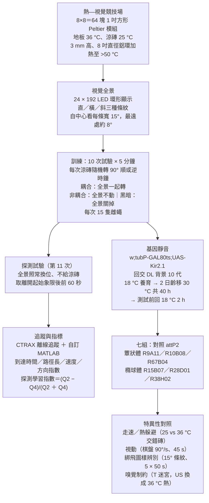
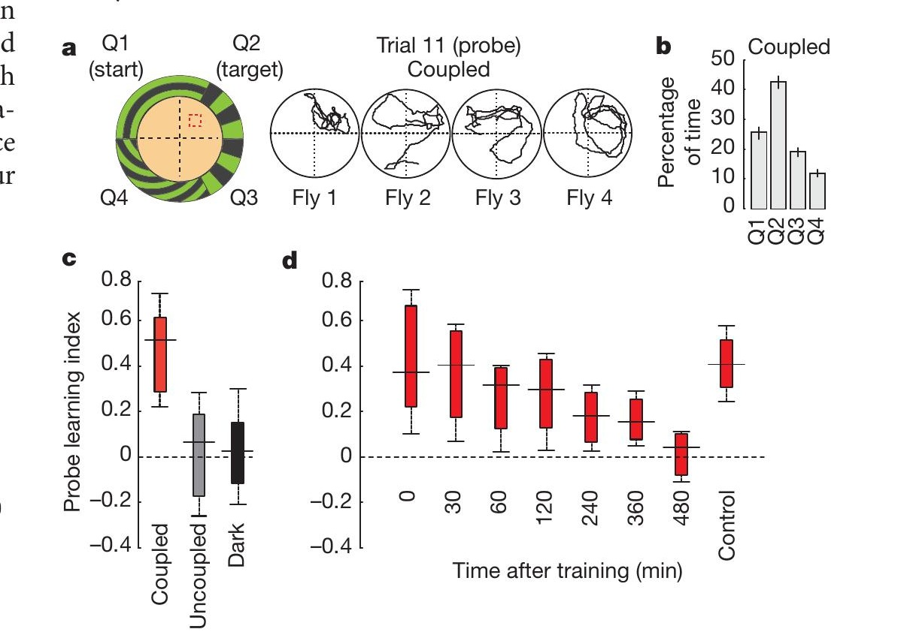

<!-- 本機 PDF：papers/2011-Visual%20place%20learning%20in%20Drosophila%20melanogaster.pdf -->

# Visual place learning in *Drosophila melanogaster*

**果蠅的視覺位置學習**

| 項目 | 內容 |
|---|---|
| **出處** | Nature 474(7350), 204–207 (2011). doi: 10.1038/nature10131 [全文（PMC 免費閱讀）](https://pmc.ncbi.nlm.nih.gov/articles/PMC3169673/) |
| 日期 | 收稿 2010-10-28・接受 2011-04-14（PDF p.3）。PDF 頁眉印「9 JUNE 2011」，PMC 書目資料則記為 2011-06-08（⚠️ 兩處差一天，屬同一份文獻的著錄差異，不影響內容） |
| 通訊作者 | Charles S. Zuker（cz2195@columbia.edu）、Michael B. Reiser（reiserm@janelia.hhmi.org）。PDF 只有英文名 |
| 作者 | 共 3 人：Tyler A. Ofstad、Charles S. Zuker、Michael B. Reiser。**PDF 未標示共同第一作者**（已查作者列的上標與作者貢獻段）。貢獻：三人共同設計研究並撰稿，Ofstad 一人執行全部實驗與資料分析 |
| 機構 | Janelia Farm Research Campus, HHMI（美國維吉尼亞州 Ashburn）；University of California at San Diego 的 Neurosciences 與 Neurobiology 兩系（La Jolla）；Columbia University 的 Biochemistry and Molecular Biophysics 與 Neuroscience 兩系（紐約）。全部掛 HHMI |
| 資料庫 | **無。** 本篇沒有釋出資料、程式碼或品系編號（已 grep `deposit`、`available`、`accession`、`code`，全文無相關條目）。追蹤用的 CTRAX 是引用的既有軟體（Branson 2009），不是本篇的產物。GAL4 品系依 Pfeiffer 2008 製作、由 Gerry Rubin 提供，PDF 未給品系編號 |
| 補充資料 | 補充圖 1–8 與補充影片 1–3（由正文引用處推得：圖 S1 單隻果蠅、S2 探測試驗軌跡與「繞圈」搜尋、S3a/S3b 各條件與各品系的探測分數、S4 羥基脲剝除蕈狀體、S5 運動與視覺對照（含 78y 品系）、S6 嗅覺制約裝置、S7 熱成像、S8 六種非視覺協定；影片 1 配對訓練、影片 2 配對探測、影片 3 無資訊條件探測）。**以上全部不在本機 PDF 內，本庫未取得**；凡依賴它們的內容一律標 ？待查。**本機 PDF 含完整 Methods（p.4–6）**，所以多數方法參數拿得到 |
| 編輯／審查 | Nature 不具名審查，PDF 未列編輯或審查人 |
| 經費 | HHMI Janelia Farm Research Campus 訪問學人計畫（Ofstad 與 Zuker，由 Reiser 接待）。Zuker 為 HHMI 研究員兼 Janelia Farm 資深研究員。作者聲明無競爭性財務利益 |

> 與本庫有關的作者：無。本篇與庫內既有來源的交會處有兩個。其一，它的嗅覺制約協定明寫是依 Tully & Quinn 1985（本庫 [[s-tully-1985-classical-conditioning]]）的高架 T 迷宮（[[e-t-maze]]）改的，只把電擊換成 36 °C 的熱。其二，它用的成蟲期限時開關 GAL80ts（[[e-gal80ts]]）與蕈狀體驅動品系 OK107（[[e-ok107-gal4]]）都是庫內已有的工具頁。
>
> **付費期刊（版權屬出版社）。** 全文請由資料表「出處」列的連結到 PMC 免費閱讀；該版本是 **HHMI 作者稿（author manuscript）**，不是出版社排版版（PMC 頁面標示「Author manuscript; available in PMC: 2011 Dec 9」）。**本庫不散布全文 PDF。** 本頁的圖擷取自原文，版權屬原出版社，以教學與評論目的引用，每張圖下方標明出處。

---

## 為什麼重要

本庫既有的來源幾乎都以蕈狀體為中心，學習都發生在同一條線路上：氣味活化一小群 Kenyon 細胞（Kenyon cell, KC），多巴胺神經元（dopaminergic neuron, DAN）帶來好壞訊號，KC 與蕈狀體輸出神經元（mushroom body output neuron, MBON）之間的突觸因此改變。**本篇把學習放在蕈狀體以外，而且它是用「蕈狀體不需要」這個否定結果把門推開的。** 它量的不是氣味，而是位置：果蠅要在一片 36 °C 的熱地板上找到唯一一塊 25 °C 的涼磚，而涼磚沒有任何近處線索，只能靠周圍一圈 LED 顯示的條紋全景判斷它在哪裡。十次訓練之後果蠅學得起來；把蕈狀體關掉不影響，把橢球體（ellipsoid body, EB；中央複合體的一部分）裡特定一小群環狀神經元關掉就垮掉。

第二件事是它給了本庫一個**雙向的雙重分離**，而不是單向的否定。同一批果蠅、同一天、同一套工具：關掉蕈狀體 → 位置學習完好、氣味學習歸零；關掉橢球體的 R1 環 → 位置學習歸零、氣味學習完好。單向的「某區不需要」隨時可能是實驗不夠靈敏；雙向交叉的結果就難用靈敏度解釋，因為同一組品系在另一個作業上**確實**量得出缺陷。這是本頁認為本篇最強的一塊證據，強過作者自己最強調的橢球體發現。

第三，它標出本庫一個整段的空缺。庫內多數來源把「學習」寫成「KC→MBON 突觸變強或變弱」，而本篇的學習不經過那個突觸，也沒有人知道它經過什麼突觸——本篇全篇沒有任何細胞層級的量測，連環狀神經元在果蠅導航時會不會放電都沒有量（作者自己在結尾把這件事列為下一步）。所以本篇進庫之後，本庫同時多了一個新的腦區與一個新的無知：**視覺位置記憶存在哪裡、以什麼形式存在，本庫一篇都答不出來。** 它與庫內既有的橢球體線索（[[s-aso-2019-nitric-oxide-cotransmitter]] 引 Kuntz 2017，說橢球體環狀神經元的視覺工作記憶需要一氧化氮／cGMP）方向一致但不重疊：一篇講需要哪個分子，一篇講需要哪一環。

---

## 論文摘要（原文與中譯）

> The ability of insects to learn and navigate to specific locations in the environment has fascinated naturalists for decades. The impressive navigational abilities of ants, bees, wasps and other insects demonstrate that insects are capable of visual place learning, but little is known about the underlying neural circuits that mediate these behaviours. *Drosophila melanogaster* (common fruit fly) is a powerful model organism for dissecting the neural circuitry underlying complex behaviours, from sensory perception to learning and memory. *Drosophila* can identify and remember visual features such as size, colour and contour orientation. However, the extent to which they use vision to recall specific locations remains unclear. Here we describe a visual place learning platform and demonstrate that *Drosophila* are capable of forming and retaining visual place memories to guide selective navigation. By targeted genetic silencing of small subsets of cells in the *Drosophila* brain, we show that neurons in the ellipsoid body, but not in the mushroom bodies, are necessary for visual place learning. Together, these studies reveal distinct neuroanatomical substrates for spatial versus non-spatial learning, and establish *Drosophila* as a powerful model for the study of spatial memories.

（Nature 的 Letter 摘要不分 Background／Results／Conclusion 段，照原樣一段；原文的文獻編號上標已略去。）

**中譯**（本節為忠實翻譯，非自撰內容）：

> 昆蟲學習並導航到環境中特定地點的能力，數十年來一直令博物學家著迷。螞蟻、蜜蜂、胡蜂與其他昆蟲令人驚嘆的導航能力顯示，昆蟲具有視覺位置學習的能力，但對於支撐這些行為的神經迴路，所知甚少。黑腹果蠅（一般的果蠅）是一種強大的模式生物，可用來解剖複雜行為背後的神經迴路，從感覺知覺到學習與記憶皆然。果蠅能夠辨識並記住大小、顏色與輪廓方位等視覺特徵。然而，牠們利用視覺回想特定地點的程度，仍不清楚。本文描述一套視覺位置學習平台，並證明果蠅能夠形成並保留視覺位置記憶以引導選擇性的導航。藉由對果蠅腦中一小群細胞進行標的性的基因靜默，我們顯示橢球體（而非蕈狀體）中的神經元，是視覺位置學習所必需。這些研究合起來揭示了空間學習與非空間學習各有不同的神經解剖基質，並確立果蠅是研究空間記憶的強大模式生物。

---

## 科普文

想像你被丟進一間圓形的房間，地板整片燙腳，只有一塊地磚是涼的，而那塊涼磚從外表看跟其他地磚一模一樣——你站上去之前不會知道它在哪裡。牆上貼著一圈條紋壁紙，有直的、橫的、斜的。你被放進去十次，每一次涼磚都換地方，但**壁紙跟著一起轉**，所以「涼磚在斜紋那一邊」這件事永遠成立。幾輪之後你會怎麼做？如果你聰明，你不會再滿地亂找，你會先抬頭看牆，再直接走過去。這篇論文做的就是這個實驗，受試者是果蠅。

**難題：怎麼證明果蠅「記住了一個地點」，而不是「學會了一個動作」。** 這是整套設計裡最難的一關。果蠅在熱地板上亂走，遲早會踩到涼磚；只要重複夠多次，牠可能學會「一直往左繞」這種固定動作，而不是真的記住地點。作者的辦法有三層。第一層是**每一次都把涼磚換位置**，而且是隨機往順時鐘或逆時鐘轉 90 度，所以固定的動作沒有用。第二層是**讓壁紙跟著轉**：涼磚的絕對位置一直變，但它相對於壁紙的位置不變。第三層是**對照組**。一組關燈（什麼都看不到），一組壁紙不動（壁紙變成跟涼磚無關的擺設）。如果果蠅進步是靠別的東西——氣味、磁場、自己走過幾步的記數——那三組應該一起進步。結果只有壁紙跟著轉的那一組進步了。

結果很明確。第一次試驗，三組果蠅平均都花九十秒左右才找到涼磚；十次之後，壁紙跟著轉的那組降到五十幾秒，而且走的路從八十八公分縮到六十二公分，第一個進入的象限有一半以上直接是正確的那一區。關燈那組不但沒進步，走的路還愈來愈長（一百零三公分變成一百一十五公分）。走路速度三組都差不多，所以進步不是因為跑得比較快——事實上進步最多的那組走得最慢。

**真正的關鍵實驗是第十一次：把涼磚拿掉。** 壁紙照樣轉到新位置，但地板上沒有涼的地方了。如果果蠅只是「碰巧愈來愈幸運」，牠應該到處亂找；如果牠真的記住了地點，牠應該跑到壁紙指示的那個位置、在那裡打轉找一塊不存在的涼磚。後者發生了：果蠅把四成二的時間花在那一個象限（亂走的話應該是四分之一），而關燈組與壁紙不動組是平均分布。作者還測了記得多久：訓練完立刻測、半小時、一小時、兩小時……分數在頭一小時幾乎沒動，之後一路往下，八小時後幾乎歸零。**所以這是一份會退的記憶，不是一個永久的習慣。**

**接下來是腦。** 作者用的是一種「基因遙控開關」：先讓特定一群神經元帶上一個鉀離子通道（Kir2.1），這個通道一旦打開，那群神經元就很難放電，等於被靜音；再用一個溫度開關（GAL80ts）控制什麼時候讓它出現——果蠅養在 18 °C 時完全不做，移到 30 °C 才開始做。這樣做的用意是**避開發育期**：如果某群神經元從幼蟲時期就被關掉，腦可能長歪，之後測到的缺陷就分不清是「這群細胞在執行時需要」還是「少了它腦發育不正常」。作者挑了兩個區域各三條品系：蕈狀體（果蠅學氣味的地方）與橢球體（一個位在腦中央、長得像甜甜圈的構造）。

**答案是反過來的。** 關掉蕈狀體——三條品系，加上另一條叫 OK107 的品系，再加上用藥把蕈狀體整個剝除——位置學習一點事也沒有。關掉橢球體裡的兩條品系，位置學習直接掉到零。而第三條橢球體品系沒事。橢球體像一個套疊的同心環，由外而內分成好幾環（R1 最內、R4 在外圈）；垮掉的兩條品系都標到 R1，沒事的那條只標到 R4。**所以不是「橢球體」需要，是「橢球體裡面的某一環」需要。**

但這還不夠。如果那些果蠅只是瞎了、或走不動、或怕熱怕得不正常，位置學習當然會垮。作者因此補了一整排對照：走路速度正常、躲熱的反應正常、看到旋轉的棋盤會跟著轉（視動反應）正常、被綁著飛的時候仍然能分辨直條紋與橫條紋。最後一項最關鍵——**他們自己再造了一個氣味學習測驗**：把氣味配上 36 °C 的熱（而不是傳統的電擊），看果蠅學不學得會躲那個氣味。關掉蕈狀體的果蠅完全學不會；關掉橢球體的果蠅學得跟正常果蠅一樣好。

**代價是什麼？** 這套設計的代價是它完全停在行為層次。作者證明了「少了這一環就不會」，但沒有證明「這一環裡裝著地圖」。缺的那一步是：果蠅在找路的時候，那些環狀神經元到底在做什麼？本篇沒有任何電生理或鈣成像，一次都沒有。作者在最後一段自己寫出了這一點，並指出下一步應該是在果蠅執行導航作業時把腦打開來看。

**最容易被誤讀的一點：這篇沒有說果蠅腦裡有「位置細胞」。** 哺乳類的海馬迴裡有位置細胞——動物走到某個地點，某顆特定的細胞就放電，那是一個可以直接看到的地圖。本篇的邏輯完全不是這樣：它是「把這群細胞關掉，這個行為就不見了」，也就是**必要性**，不是**編碼**。作者自己把話說得很保留：這些神經元「可能是在實作、儲存，或讀取空間資訊」（原文 implementing, storing, or reading）——這三件事在行為實驗裡分不開，而牠們在解剖位置上甚至可能只是這條路的入口或出口，而不是記憶本身所在。

---

## 專業文

### 本頁用語

本頁各節可單獨查閱，故把反覆出現的詞集中在這裡。

| 詞 | 意思 |
|---|---|
| 視覺位置學習（visual place learning） | 利用遠處（distal）的視覺地標記住一個地點，並在地點本身沒有近處線索時仍能導航過去。本篇的行為定義就是它的作業：找到一塊沒有任何局部線索的涼磚 |
| 熱—視覺競技場（thermal–visual arena） | 本篇的裝置：一片可逐格控溫的地板加上一圈 LED 全景。作者說它的設計取自哺乳類的 Morris 水迷宮（Morris 1981）與用在蟑螂、蟋蟀的熱迷宮（Mizunami 1998、Wessnitzer 2008） |
| 耦合／非耦合／黑暗（coupled／uncoupled／dark） | 三種訓練條件。**耦合**：涼磚與全景一起旋轉，所以涼磚相對於全景的位置固定。**非耦合**：涼磚每次隨機換位，全景不動，於是全景不提供位置資訊。**黑暗**：全景關掉。後兩者是本篇的兩組對照 |
| 探測試驗（probe trial） | 第 11 次試驗：全景照常換位，但**不給涼磚**。用來看果蠅會不會跑到「應該有涼磚」的地方找一塊不存在的涼磚。這個手法取自 Morris 水迷宮 |
| 象限（quadrant，Q1–Q4） | 競技場被切成四個象限。**Q1 是起點**（上一次試驗的涼磚所在處），**Q2 是目標**（新的涼磚所在處，與 Q1 相隔 90°），Q4 是從 Q1 往反方向轉 90° 的象限，Q3 與 Q1 相對 |
| 方向指數（direction index，又稱象限選擇） | 訓練期的指標：（第一個進入目標象限的果蠅數 − 第一個進入相對象限的果蠅數）÷ 總果蠅數。範圍 −1 到 +1 |
| 探測學習指數（probe learning index） | 探測試驗的指標：離開起始象限後的**前 60 秒**內，待在 Q2 的時間減去待在 Q4 的時間，除以在這兩個象限的總時間。範圍 −1 到 +1。**公式只用 Q2 與 Q4，不計 Q1 與 Q3** |
| 熱躲避指數（thermal aversion index） | （待在 25 °C 的時間 − 待在 36 °C 的時間）÷ 總時間 |
| 方位指數（orientation index） | 綁飛實驗的指標：（朝向直條紋的時間 − 朝向橫條紋的時間）÷ 總時間 |
| 嗅覺學習指數（olfactory learning index） | 本篇用來檢查氣味學習的讀數。**本篇沒有寫出它的公式**（方法只寫「以兩組的學習指數平均」，而單組的算法沒有定義）：？待查。協定本身引 Tully & Quinn 1985（[[s-tully-1985-classical-conditioning]]），見 [[c-performance-index]] |
| 蕈狀體（mushroom body, MB） | 果蠅腦中把氣味與好壞經驗連起來的構造，本庫多數來源的主角。見 [[e-mushroom-body]] |
| KC（Kenyon cell） | 蕈狀體的內在神經元（本篇用語 mushroom body intrinsic neurons）。見 [[e-kenyon-cell]] |
| 中央複合體（central complex） | 腦正中央的一組構造，含橢球體、扇形體等。本篇引 Strauss 2002、Neuser 2008 說它與定向行為、多感覺整合有關 |
| 橢球體（ellipsoid body, EB） | 中央複合體的一部分，外形是環狀。本篇的主角 |
| 環狀神經元（ring neuron）、R1–R4 | 投射到橢球體的神經元，依投射到哪一層同心環分成 R1、R2、R3、R4。**本篇只在圖 4 的圖說與示意圖裡給出這套劃分與各品系的歸屬，正文與方法一字未提**（已 grep `R1`、`R2`、`R3`、`R4`、`ring neuron` 全文確認） |
| Kir2.1 | 內向整流鉀離子通道。在神經元裡表現它會讓細胞難以放電，等於長期靜音。本篇引 Baines 2001 |
| GAL80ts | 溫度敏感的 GAL4 抑制子：18 °C 養育時擋住 Kir2.1，升到 30 °C 才放行，用來把操作限制在成蟲期、避開發育期的影響。本篇引 McGuire 2004。見 [[e-gal80ts]] |
| GAL4 驅動品系（driver line） | 讓外加基因只在選定神經元表現的果蠅品系。本篇用的七條（含對照）都出自 Pfeiffer 2008 的 Janelia 系列，由 Gerry Rubin 提供。見 [[e-split-gal4]] |
| 羥基脲剝除（hydroxyurea ablation） | 在幼蟲早期餵羥基脲，化學方式去掉蕈狀體。本篇引 de Belle & Heisenberg 1994 |
| 自體線索（idiothetic cue） | 動物由自身動作（步數、轉角）得到的位置資訊，不需要外界地標。又稱路徑積分（path integration）的素材 |
| CTRAX | 本篇用的果蠅群體影片追蹤軟體（Branson 2009），事後離線追蹤，再以自訂 MATLAB 腳本處理質心資料 |
| DL 野生型 | 本篇用的野生型品系：1995 年由數十條野外單雌系雜交建立、由 Michael Dickinson 實驗室維持（引 Dickinson 1999）。**不是常見的 Canton-S 或 Berlin** |
| n.s.、s.e.m.、s.d. | 不顯著；平均數的標準誤；標準差。本篇圖 2、圖 3b、圖 4i–k 用 s.e.m.，圖 4l、4m 用 s.d. |

### 一、概述

**主要問題。** 果蠅會不會利用遠處的視覺地標記住一個**地點**（而不是一個圖樣、一個顏色或一個動作），如果會，腦中哪些神經元是必需的？

**重要性。** 2011 年之前，果蠅的視覺學習研究幾乎都在飛行模擬器裡做**特徵**學習——大小、顏色、輪廓方位（本篇引 Ernst & Heisenberg 1999、Tang & Guo 2001）。而昆蟲導航的經典研究在蜜蜂、螞蟻、蟋蟀、蟑螂身上（Wehner & Raber 1979、Cartwright & Collett 1982、Capaldi & Dyer 1999、Mizunami 1998、Wessnitzer 2008），那些物種缺乏遺傳工具。本篇要做的是把「可做位置學習的作業」與「可逐群關掉神經元的物種」接在一起。

**發表當時的領域現狀（2011）。** 三條線在此交會。第一，哺乳類的空間記憶已有成熟的細胞層級答案：位置細胞、網格細胞、頭方向細胞構成的「認知地圖」（Moser 2008），行為端的標準作業是 Morris 水迷宮（Morris 1981），而海馬迴受損的大鼠會出現固定的「繞圈」搜尋（Morris 1990）。第二，果蠅的蕈狀體已被確立為嗅覺聯結學習的必要構造（de Belle & Heisenberg 1994），但同時已有報告說它對視覺、觸覺、運動學習以及非視覺引導的位置學習是**可有可無**的（Wolf 1998、Putz & Heisenberg 2002、Heisenberg 2003）——而在社會性昆蟲與蟑螂，蕈狀體反而被指為位置學習所必需（Bernstein 1969、Fahrbach & Robinson 1995、Mizunami 1998）。第三，果蠅已被證明能用自體線索與路徑積分導航（Neuser 2008、Wustmann 1996、Zars 2009），也就是說「不靠視覺的空間行為」已經存在，缺的是「靠遠處視覺地標的位置記憶」。本篇在校樣階段加註，審稿期間另有一篇用熱迷宮研究果蠅空間搜尋策略的論文發表（Foucaud 2010）。

### 二、方法

**競技場。** 地板是 64 塊 1 吋見方、可逐塊定址的熱電模組（Oven Industries）排成 8×8，覆黑色遮蔽膠帶做出均一無特徵的表面，可在實驗之間更換。外緣圍一圈 3 mm 高、8 吋直徑的鋁環，以絕緣電阻線（Pelican Wire，29 AWG Nichrome 60 w/Kapton）加熱至 50 °C 以上，防止果蠅爬上牆；鋁環上蓋一片塗 Sigmacote 矽膜的玻璃盤讓果蠅爬不上去。全場以紅外光照明（Smart Vision Lights），用裝紅外濾鏡的 Basler 622f CMOS 相機錄影。**作者強調沒有可用的溫度梯度**：以熱成像（Optotherm）與熱電偶確認（圖 1b、補充圖 7）。

**視覺全景。** 環形 LED 顯示器（24 × 192，引 Reiser & Dickinson 2008），顯示等間距的直、橫、斜三種條紋。自競技場中心看，每條寬 15°；自場內最遠距離 8.8 吋看，每個視覺元素約佔果蠅視野 8°，作者據此說果蠅應能解析。

**行為協定。** 每次 15 隻果蠅，10 次訓練試驗各 5 分鐘，第 11 次為探測試驗。每次試驗之間涼磚與全景隨機往順時鐘或逆時鐘轉 90°。第 1 次試驗有 94% 的果蠅最終找到涼磚（**data not shown**）。

**果蠅。** 全部為雌性，除非另有說明皆為 DL 野生型。25 °C、16/8 光暗週期飼養，取 4 日齡成蠅，在其主觀日的第 11–15 小時、室溫 25 °C、相對濕度 40% 的房間裡測試。

**基因靜音。** 效應品系 w+;tubP-GAL80ts;UAS-Kir2.1，已回交進 DL 野生型背景 10 代以控制遺傳背景（引 de Belle & Heisenberg 1996），與 GAL4 驅動品系雜交後養在 18 °C；2 日齡成蠅移到 30 °C 共 40 小時，測試前再回 18 °C 2 小時。對照是 w1118;attP2（與 GAL4 品系同背景）與同一效應品系的子代。作者另說明效應／報導基因都帶 mini-white 並以平衡染色體保存，三年來定期監測沒有轉位（P–M 雜種劣育）的跡象。

**指標的定義。** 方向指數＝（第一個進入含涼磚象限的果蠅數 − 第一個進入相對象限的果蠅數）÷ 總果蠅數。探測學習指數＝離開起始象限後前 60 秒內（Q2 時間 − Q4 時間）÷（Q2 ＋ Q4 時間）；方法明寫選 Q4 的理由是「與起始象限距離相同、但方向錯誤」。熱躲避指數＝（25 °C 時間 − 36 °C 時間）÷ 總時間，測法是把模組設成 25/36 °C 交錯，給 2 分鐘分布後對調，再給 2 分鐘。視動反應＝棋盤圖樣以 90°/s 順時鐘再逆時鐘各轉 45 秒時，果蠅沿刺激方向的平均旋轉速度。方位指數＝（朝向直條紋時間 − 朝向橫條紋時間）÷ 總時間，在圓柱形 LED 顯示器＋光學拍翅分析儀的閉迴路綁飛中測，5 次各 50 秒。

**嗅覺制約。** 依 Tully & Quinn 1985 的高架 T 迷宮（[[e-t-maze]]），但把非條件刺激由電擊改為熱：給第一個氣味的同時，以 5 V、0.43 A 電流通過插在訓練管裡的絕緣電阻線網，把管子加熱到 36 °C。氣味為 5% 4-甲基環己醇（MCH，流速 128 ml/min）與 5% 3-辛醇（OCT，流速 60 ml/min），以石蠟油稀釋，總流速以加濕清潔空氣補到 800 ml/min。每次實驗約 200 隻果蠅，一半以 MCH 為受訓氣味、一半以 OCT，取兩組平均。

**非視覺位置學習的排除實驗。** 六種改過的協定（補充圖 8，本庫未取得）：(a) 涼磚固定不動、(b) 涼磚朝固定方向旋轉、(c) 涼磚隨機旋轉，三者都在黑暗中；(d) 全景不動而涼磚隨機換位、(e) 全景隨機旋轉而涼磚不動、(f) 全景與涼磚各自獨立隨機換位。作者說六種都看不到位置學習。涼磚不動時，為了把果蠅趕離涼磚，每次試驗開始前把整片陣列加熱到 36 °C 共 60 秒；作者說這個操作加在標準的耦合協定上不影響學習（**data not shown**）。

**統計。** 單因子 ANOVA 配 Bonferroni 校正；圖 3c 與圖 4 的 P 值用**單尾 t 檢定**（圖 4 是比較同一品系 Kir2.1 誘導前後）。盒鬚圖的鬚涵蓋全距但不含離群值，離群值定義為 q3 ＋ 1.5(q3 − q1) 以上或 q1 − 1.5(q3 − q1) 以下。

**不在本機 PDF 裡的方法。** 羥基脲剝除蕈狀體的劑量、時程與驗證方式（補充圖 4）、單隻果蠅訓練的協定（補充圖 1）、七條 GAL4 品系各自的表現樣式細節與環狀神經元歸屬的判定依據（致謝提到由 A. Jenett 做解剖註解，但沒有引用可查的資料集）：皆 ？待查。

### 三、結果

#### 3.1 果蠅學得起來，而且只在視覺地標有用時學得起來（圖 2）

十次訓練後，耦合組的到達時間由約 93 秒降到約 53 秒（第 8 次最低約 50 秒），路徑長由約 88 公分降到約 62 公分，方向指數由約 −0.02 升到約 0.54（皆 ※ 從圖 2 判讀）。非耦合組與黑暗組的方向指數全程在 0 附近（約 −0.05 到 +0.10）。n：耦合 33 次實驗 495 隻、非耦合 21 次 315 隻、黑暗 23 次 345 隻——**三者都是每次 15 隻，33 × 15 ＝ 495、21 × 15 ＝ 315、23 × 15 ＝ 345，與方法一致**（本頁驗算）。

**本頁的驗算：圖 2 的三個面板互相自洽。** 路徑長 ÷ 速度應該等於到達時間，四個檢查點都對得上：耦合第 1 次 88 ÷ 0.98 ＝ 90 秒（量到 93）、耦合第 10 次 62 ÷ 1.20 ＝ 52 秒（量到 53）、黑暗第 10 次 115 ÷ 1.27 ＝ 91 秒（量到 91）、非耦合第 10 次 99 ÷ 1.25 ＝ 79 秒（量到 77）。誤差都在 3% 以內。這表示三個面板量的是同一批軌跡，而不是各自獨立處理的結果。

#### 3.2 探測試驗：果蠅跑去找一塊不存在的涼磚（圖 3a–c）

第 11 次試驗拿掉涼磚之後，耦合訓練過的果蠅把約 42% 的時間花在 Q2（目標象限），Q1（起點）約 25%、Q3 約 18.5%、Q4 約 11%（※ 從圖 3b 判讀，四者合計約 96.5%，在判讀誤差內即 100%）。方法報告 Q2 顯著高於其餘三者（P < 0.01，單因子 ANOVA ＋ Bonferroni）。探測學習指數的中位數：耦合約 0.51、非耦合約 0.06、黑暗約 0.02；對零檢定（單尾 t 檢定）耦合 P < 0.0001（n ＝ 33）、非耦合 P ＝ 0.28（n ＝ 21）、黑暗 P ＝ 0.39（n ＝ 23）；組間比較耦合顯著高於另兩組（P < 0.01），而非耦合與黑暗之間在 P < 0.05 的水準上沒有差別。

#### 3.3 記憶保留：兩小時還是六小時，看你跟誰比（圖 3d）

訓練後 0、30、60、120、240、360、480 分鐘各測一次探測試驗（n ≥ 5），中位數依序約 0.37、0.41、0.31、0.30、0.18、0.15、0.04（※ 從圖判讀）。圖說寫「至少保留 2 小時」。方法寫出了兩個不同的判準：與非耦合組相比，探測分數顯著較高的範圍是**訓練後 120 分鐘以內**；但在 4 小時與 6 小時雖然已與非耦合組無異，**仍顯著大於零**（單尾 t 檢定，P < 0.05）。**所以同一份資料支持「至少 2 小時」也支持「至少 6 小時」，差別在拿什麼當基線；作者在標題句裡選了嚴格的那一個。** 這一點值得給正面評價：本篇大可只寫「大於零」而宣稱六小時。另有一組對照是把同胞果蠅先在競技場裡放 8 小時再訓練並立刻測試（中位數約 0.41），用來排除「久待競技場本身讓分數下滑」。

#### 3.4 蕈狀體不需要（圖 4a–c、4g）

三條蕈狀體內在神經元的 GAL4 品系（R9A11、R10B08、R67B04）加上 OK107（[[e-ok107-gal4]]；**正文列出它但沒有引任何圖**），以及用羥基脲化學剝除蕈狀體（補充圖 4，未取得），對位置學習都沒有顯著影響。圖 4g 的中位數（白＝18 °C 活性、灰＝30 °C 靜音；※ 從圖判讀）：對照 0.51 → 0.375、R9A11 0.285 → 0.26、R10B08 0.23 → 0.215、R67B04 0.325 → 0.42。

#### 3.5 橢球體的 R1 環需要（圖 4d–h）

R15B07（圖說標為投射到 R1 與 R4）與 R28D01（標為只到 R1）靜音後位置學習崩潰：0.485 → 0.065、0.46 → 0.05（降幅 87% 與 89%，本頁推算），圖上標 \*\*\* P < 0.001（方法說明這是 Kir2.1 誘導前後的單尾 t 檢定）；方法另報告這兩組在 30 °C 時與對照相比 P < 0.01，其餘組與對照相比在 P < 0.05 的水準上都不顯著。R38H02（標為只到 R4）則不受影響（0.53 → 0.36）。

#### 3.6 雙重分離：同一組品系在氣味學習上的結果正好相反（圖 4i–m）

走路速度（圖 4i）、熱躲避（4j）、視動反應（4k）、綁飛的直／橫條紋辨別（4l）在七組之間都沒有顯著差異（ANOVA ＋ Bonferroni，P < 0.05 水準）。關鍵的是嗅覺制約（4m）：三條蕈狀體品系的學習指數掉到約 0（控制組約 0.17，※ 從圖判讀），方法報告三者都顯著受損（P < 0.05）；三條橢球體品系與對照沒有差別。**這就是雙重分離：蕈狀體關掉 → 氣味學習歸零、位置學習完好；橢球體 R1 關掉 → 位置學習歸零、氣味學習完好。**

#### 3.7 非視覺線索不足以支撐這份記憶

六種改過的協定（見二、方法）全部看不到位置學習。作者的措辭很克制：果蠅導航時**可能**用到自體資訊，但這個經驗不足以形成位置記憶。

### 四、討論

**主張一：果蠅能形成並保留視覺位置記憶。** 證據強。三條獨立的證據線互相支持：訓練曲線（時間、路徑長、方向指數三個指標同向改善）、探測試驗（拿掉目標後仍偏向正確象限）、兩組對照（黑暗與非耦合都沒有）。探測試驗尤其有力，因為它把「進步」與「運氣」分開——沒有涼磚可踩，就不可能靠碰巧找到。

**主張二：橢球體的特定環狀神經元是視覺位置學習所必需。** 證據中等。強的地方是兩條獨立品系給出同一結果，第三條橢球體品系作為陰性對照、以及一整排感覺與運動對照。弱的地方有三處。其一，**環狀神經元的 R1/R4 歸屬只出現在圖 4 的圖說與示意圖，正文、方法都沒有寫，也沒有引可查的註解資料**（致謝提到 A. Jenett 做解剖註解）；圖 4d–f 是低倍全腦影像，解析不到同心環的層次。其二，圖 4d–f 顯示三條品系都有橢球體以外的表現（見「圖」一節對圖 4 的解讀）。其三，Kir2.1 是長期靜音，GAL80ts 只能把它限制在成蟲期 40 小時，不能做到急性或可逆。

**主張三：空間與非空間學習有不同的神經解剖基質。** 證據強，而且是本篇最可靠的一塊。理由在於它是**雙向**的：同一組果蠅、同一套靜音工具，在兩個作業上得到相反的結果。單向的否定結果（「關掉蕈狀體位置學習沒事」）永遠可以用「操作不夠有效」解釋；但同一條品系在氣味學習上確實把分數打到零，這個解釋就不成立了。

**主張四：果蠅與其他昆蟲對蕈狀體的需求不同，可能因為果蠅的蕈狀體輸入以嗅覺為主。** 這是作者提出的解釋（引 Mizunami 1998、Stocker 1994），**本篇沒有做任何實驗檢驗它**。評價：這是一個合理的猜想，但它與 2011 年之後的發展有張力——本庫收錄的 [[s-aso-2014-mb-architecture]] 已把果蠅蕈狀體的非嗅覺輸入（視覺、溫度、味覺）寫成解剖事實。

**主張五：橢球體神經元「可能在實作、儲存或讀取空間資訊」。** 這句的動詞選得很謹慎（原文 implementing, storing, or reading），因為必要性實驗分不出這三者。作者並指出靜音橢球體的果蠅表現出一種「繞圈」搜尋（補充圖 2d，未取得），讓人聯想到海馬迴受損的大鼠（Morris 1990）。評價：這個類比在修辭上有力，但**沒有量化**，而且本庫無法檢查補充圖。

### 五、問題與限制

**1. 沒有任何細胞層級的量測。** 作者自陳：下一步應該在果蠅執行導航作業時做神經活動成像（建議用頭固定加虛擬實境，引 Seelig 2010、Dombeck 2010）。本篇全篇沒有電生理或成像。

**2. Kir2.1 是慢性靜音，限時只到 40 小時。** GAL80ts 把操作推遲到成蟲期，但在成蟲期內仍是連續 40 小時，分不出「學習時需要」「記憶保存時需要」還是「測驗時需要」。本庫其他來源常用的 shibirets（[[e-shibire-ts]]）可以做到分時段阻斷，本篇沒有用。

**3. 補充資料完全不在本機 PDF 內。** 單隻果蠅的對照（補充圖 1）、繞圈搜尋（S2d）、羥基脲剝除（S4）、六種非視覺協定（S8）都只能看正文轉述。其中羥基脲那一組尤其重要：它是「蕈狀體不需要」的最強形式（整個構造不見了，不只是靜音），而本庫完全無法檢查它的 n、剝除比例與驗證方式。

**4. 探測學習指數只用兩個象限。** 公式只計 Q2 與 Q4，而探測試驗中這兩個象限合計只佔約 53% 的時間（42% ＋ 11%），其餘 47%（Q1 約 25%、Q3 約 18.5%）被丟掉。方法為選 Q4 給了理由（與起點等距、方向相反），但沒有說明為什麼不用 Q3，也沒有討論 Q3 的時間明顯多於 Q4 這件事。

**5. 統計用單尾檢定。** 圖 3c 與圖 4g 的 P 值都是單尾 t 檢定。單尾在方向有明確先驗時可以接受，但它讓同一份資料的 P 值減半；本篇沒有說明為何選單尾。

**6. 蕈狀體三條品系的基線本身偏低。** 圖 4g 中 R9A11 與 R10B08 在**未靜音**（18 °C）時的中位數只有約 0.285 與 0.23，而對照是 0.51——還沒做任何操作就只有對照的四成到六成。圖 4g 標星號用的是同品系誘導前後的比較，基線本來就低的品系少了可掉的空間。方法確實報告了「30 °C 組與對照比不顯著」，但以 n ≥ 8、盒子跨度 0.1–0.5 的離散度，這個不顯著排除不掉中等幅度的缺陷。

**7. 溫度位移本身就會讓分數下降，而這個效果沒有被扣掉。** 對照組由 0.51 掉到 0.375（降 26%），R38H02 由 0.53 掉到 0.36（降 32%）。這不影響兩條橢球體品系的結論（它們掉 87%、89%，遠大於此），但它表示「30 °C 的灰盒」不是一個乾淨的基線。本篇沒有討論這一點。

**8. 嗅覺學習指數的公式沒有定義。** 五個指標裡，方向指數、探測學習指數、熱躲避指數、方位指數都在方法裡寫出了算式；唯獨**嗅覺學習指數沒有**——方法只寫「學習指數以兩組的學習指數平均而得」，單組怎麼算沒有說（已 grep `learning index`、`learning indices`、`calculated as` 全文確認）。而這正是整篇「特異性」論證所依賴的那個讀數。協定本身引 Tully & Quinn 1985（本庫 [[s-tully-1985-classical-conditioning]] 的 Λ 有完整定義），但本篇用的是不是同一個公式，無法確認：？待查。

**9. 本頁稽核出來、論文自己沒處理的問題：沒找到目標的果蠅怎麼算，全篇沒有交代，而這會偏向有利於對照組的方向。** 方法寫「到達時間、路徑長與速度**逐隻**計算，時間窗為試驗開始到**該隻果蠅到達目標磚**為止」。但正文同時寫第 1 次試驗只有 94% 的果蠅最終找到目標（data not shown）——也就是說有一部分果蠅根本沒有「到達目標」這個時間點。這些果蠅是被排除、還是被指派 300 秒（試驗長度），本篇沒有寫。這不是吹毛求疵：**如果是排除，那麼在黑暗與非耦合條件下失敗率若較高，排除掉的正是表現最差的個體，這兩組的平均到達時間會被系統性地壓低，使耦合組與它們的差距被低估。** 而本篇只報告了「第 1 次試驗 94%」這一個數字，沒有逐條件、逐試驗的成功率。評價：這個缺口不影響探測試驗（探測試驗沒有目標，不存在「沒找到」）與圖 4 的全部結論（圖 4 只用探測學習指數），所以本篇的主要結論不受動搖；受影響的是圖 2a、2b 這兩個面板的量值本身，以及「非耦合組只有輕微進步」這句話的強度——圖上非耦合組的到達時間其實從約 93 秒降到約 77 秒（降 17%），接近耦合組降幅（43%）的四成，正文把它描述成 little improvement，比圖上看到的要輕描淡寫。

### 六、未來

**論文自陳的方向。** 在果蠅執行導航作業時做神經活動成像，以進一步界定中央複合體、特別是橢球體神經元在空間記憶中的角色；作者具體點名頭固定配虛擬實境競技場的做法（引 Seelig 2010、Dombeck 2010）。更長程的目標是藉果蠅釐清空間記憶在組織與實作上的通則。

**本庫關注的後續。** 本篇在本庫裡目前沒有接手的人：庫內既有的主題全部建立在 KC→MBON 的骨架上，而本篇的學習不經過它。最接近的三個接點是：(1) [[s-aso-2019-nitric-oxide-cotransmitter]] 引 Kuntz 2017 說橢球體環狀神經元的視覺工作記憶需要一氧化氮／cGMP，與本篇的「R1 環是位置學習所必需」在同一群細胞上，但一篇講分子、一篇講必要性，兩者沒有重疊的量測；(2) [[s-aso-2014-mb-architecture]] 的解剖圖譜可以用來檢驗本篇主張四（果蠅蕈狀體以嗅覺輸入為主）是否成立；(3) [[c-performance-index]] 可以補上本篇沒給的嗅覺學習指數公式——如果能確認本篇沿用的是 Tully & Quinn 1985 的 Λ。`papers/` 裡的 2014 Shared mushroom body circuits 與 2025 Multimodal cue integration in head direction 兩篇若收錄，會直接接上本篇留下的兩個開口（蕈狀體到底參不參與視覺記憶、橢球體裡的方向訊號長什麼樣）。

**尚未被回答的。** 第一，環狀神經元在果蠅導航時做什麼——本篇只證明必要性，完全沒有編碼的證據。第二，視覺位置記憶存在哪裡：R1 環本身、它的上游、還是它的下游？本篇的三個動詞（實作、儲存、讀取）分不開。第三，這份記憶的細胞機制是什麼：本庫其他來源的學習全部建立在 KC→MBON 突觸的改變上，而本篇的學習不經過那個突觸，所以本庫目前沒有任何關於它的機制說法。第四，蕈狀體在果蠅的**其他**視覺學習（圖樣、顏色）裡是否同樣可有可無——本篇只測了位置。

---

## 圖

本篇正文共四張主圖，全數收錄。四張都是複合圖，`pdfimages` 抽出的 8 張內嵌點陣影像全部被小圖濾網判為過小（0 張保留），所以四張都改用 300 dpi 整頁渲染後裁切，裁完逐張以 Read 檢視過四個角落與全部分格字母。

<small>圖片出處：Ofstad TA, Zuker CS, Reiser MB. *Nature* 474(7350):204–207 (2011)，Figure 1。© 2011 Macmillan Publishers Limited 教學引用；全文見 [PMC](https://pmc.ncbi.nlm.nih.gov/articles/PMC3169673/)。</small>

> **原圖說（Figure 1）：** *Drosophila* trained in a thermal–visual arena show place learning. **a**, Illustration of the arena. The floor is composed of 64 thermoelectric modules (a Peltier array), the panorama is provided by a 24 × 192 light-emitting-diode (LED) display and flies are recorded using a camera under infrared (IR) illumination. **b**, Top: thermal imaging view of the arena's floor showing the uniformly warm surface with a single cool tile; also shown is the heated ring barrier. Bottom: temperature readings across the arena. **c**, Trajectories of four representative flies from trials 1, 2 and 10 are shown below a diagrammatic representation of the visual panorama denoting the locations of the cool tile in the previous trial (dashed square) and in the current trial (blue square). In this coupled condition, the position of the cool tile relative to the visual panorama remains constant even as its absolute position changes between trials.

**圖說中譯：** 在熱—視覺競技場中受訓的果蠅表現出位置學習。(a) 競技場示意。地板由 64 塊熱電模組（Peltier 陣列）組成，全景由 24 × 192 的 LED 顯示器提供，果蠅在紅外光照明下以相機錄影。(b) 上：競技場地板的熱成像俯視圖，顯示均一的溫暖表面與單一一塊涼磚，也顯示了加熱的環形障壁。下：橫越競技場的溫度讀值。(c) 四隻代表性果蠅在第 1、2、10 次試驗的軌跡，上方是視覺全景的示意圖，標出涼磚在前一次試驗（虛線方框）與本次試驗（藍色方框）的位置。在這個耦合條件下，涼磚的絕對位置在試驗之間改變，但它相對於視覺全景的位置保持固定。

**解讀：**

**這張圖真正該看的是 b 的下半截，而不是 a 的立體示意。** 下半截那條溫度剖面是整篇方法論的基石，因為它要排除的是一個足以推翻全文的替代解釋：**如果涼磚周圍有溫度梯度，果蠅根本不需要記住任何地點，沿著梯度往下走就行了。** 剖面圖顯示溫度在涼磚以外是一條約 36–37 °C 的平線，到涼磚處才陡降到約 24.5 °C，下降幾乎發生在兩條虛線之間（標示 2.5 公分，即一塊 1 吋磚的寬度 2.54 公分）。換句話說**溫度資訊的作用半徑只有一塊磚**。本篇正文只用一句話帶過（no thermal gradients exist that could guide flies to the cool spot from a distance），而那句話的全部證據就在這張小圖裡。

**正文沒說、要自己算的一件事：目標只佔地板的 2%。** 涼磚是 1 吋見方（6.45 平方公分），競技場是 8 吋直徑的圓（約 324 平方公分），所以目標面積佔 2.0%（本頁推算，兩個數字都取自方法）。這讓第 1 次試驗「94% 的果蠅在 5 分鐘內找到」這個數字有了尺度：果蠅是靠大量亂走掃過地板找到的，不是靠任何遠距線索。**這也正是為什麼學習曲線必須拿路徑長來看而不只是到達時間**——亂走也會找到，差別在走了多遠。

**c 的三格軌跡是全圖訊息量最高的部分，但它是挑出來的代表性例子。** 第 1 次試驗四隻果蠅的軌跡糊成一團填滿整個圓，第 2 次已經收斂，第 10 次只剩幾條短線直接通到藍框。視覺上非常有說服力，但圖說明寫 representative——**沒有告訴讀者這四隻是從幾隻裡挑出來的，也沒有給任何量化**。量化在圖 2，所以 c 應該當成插圖讀，不是當成證據讀。

**兩個視覺陷阱。** 其一，b 上半的熱成像用的是「藍—黃—紅」的彩虹色階，而這個色階在 20–45 °C 之間不是線性感知的：地板的 36 °C 顯示成飽和的橘黃、加熱環的 50 °C 以上顯示成深紅，視覺上對比極強，容易讓人以為環與地板之間有一大片中間溫度的區域；下半的剖面顯示並沒有，從 37 °C 跳到 50 °C 幾乎是垂直的。其二，c 的全景示意圖畫成綠／灰條紋，但實際的 LED 顯示器是單色的（a 圖裡畫成綠色點陣）——**示意圖的顏色是製圖的選擇，不是刺激的性質**，而「三種條紋方位」才是果蠅實際可用的區辨特徵。

<small>圖片出處：Ofstad TA, Zuker CS, Reiser MB. *Nature* 474(7350):204–207 (2011)，Figure 2。© 2011 Macmillan Publishers Limited 教學引用；全文見 [PMC](https://pmc.ncbi.nlm.nih.gov/articles/PMC3169673/)。</small>

> **原圖說（Figure 2）：** Flies use visual cues to improve in place learning tasks. Flies were trained with a coupled visual panorama (red; *n* = 33 experiments, 495 flies), an uncoupled visual panorama (grey; *n* = 21 experiments, 315 flies) or in the dark (black; *n* = 23 experiments, 345 flies). **a**, When trained in the coupled condition (red) flies reduce the time taken to find the cool tile by nearly one-half, whereas flies trained with an uncoupled panorama (grey) or in the dark (black) show little or no reduction in the time taken to locate the target. **b–d**, The improvement seen for the coupled visual panorama is due to flies taking shorter (**b**), more direct (**c**) paths to the target rather than simply increasing walking speed (**d**). See Methods for details of calculations. Values shown are mean ± s.e.m.

**圖說中譯：** 果蠅利用視覺線索在位置學習作業上進步。果蠅分別以耦合的視覺全景（紅；*n* ＝ 33 次實驗、495 隻）、非耦合的視覺全景（灰；*n* ＝ 21 次、315 隻）或在黑暗中（黑；*n* ＝ 23 次、345 隻）受訓。(a) 在耦合條件受訓時（紅），果蠅找到涼磚所需的時間減少將近一半，而以非耦合全景（灰）或在黑暗中（黑）受訓的果蠅，在找到目標的時間上幾乎或完全沒有減少。(b–d) 耦合視覺全景所見的進步，是因為果蠅走了較短（b）、較直接（c）的路徑到目標，而不是單純走得比較快（d）。計算細節見方法。數值為平均 ± 標準誤。

**解讀：**

**真正該看的面板是 c，不是作者在圖說裡先講的 a。** 到達時間與路徑長都可能被「走得比較有效率」污染，而方向指數不會：它問的是果蠅離開起點後**第一個**進入哪個象限，這是一個在知道結果之前就做出的選擇。耦合組的方向指數由約 −0.02 升到約 0.54，另兩組全程貼在 0 附近（約 −0.05 到 +0.10，※ 皆從圖判讀）。**這是整張圖唯一一個「不可能靠運氣或體能解釋」的指標。**

**本頁的驗算：三個面板互相自洽。** 路徑長 ÷ 速度應該等於到達時間。耦合第 1 次 88 ÷ 0.98 ＝ 90 秒（圖上 93）、耦合第 10 次 62 ÷ 1.20 ＝ 52 秒（圖上 53）、黑暗第 10 次 115 ÷ 1.27 ＝ 91 秒（圖上 91）、非耦合第 10 次 99 ÷ 1.25 ＝ 79 秒（圖上 77），誤差皆在 3% 以內。n 也對得上：33 × 15 ＝ 495、21 × 15 ＝ 315、23 × 15 ＝ 345。**一張圖能被自己的另外兩個面板驗算過，值得說出來——本庫多數來源的圖做不到這件事。**

**正文沒說的三件事，都在 b 和 d 上。** 其一，**黑暗組不是「沒有進步」，是變差**：路徑長由約 103 公分升到約 115 公分、到達時間由約 89 秒升到約 91 秒。圖說寫 little or no reduction，嚴格說是對的，但它漏掉了方向。其二，**三條曲線在第 1 次試驗就沒有對齊**：到達時間三組都約 89–93 秒，路徑長卻是黑暗組 103 公分、另兩組約 88 公分——黑暗組在第一次試驗就多走了 15 公分，因為牠們走得比較快（d 圖黑線全程最高）。這表示光照條件本身改變了果蠅的運動狀態，而這個差異在任何學習發生之前就存在。其三，**速度的「沒有變化」說得太滿**：d 圖裡三組都從第 1 次的約 0.98–1.17 公分/秒升到第 2 次的約 1.22–1.37，之後持平，升幅約 20–25%。圖說要說的其實是另一回事——**進步最多的耦合組速度最慢**（第 10 次約 1.20，黑暗組約 1.27）。這個事實比「速度沒變」更有力地排除了「跑得快所以找得快」，作者卻沒有把它寫出來。

**視覺陷阱：四個面板的縱軸範圍都被裁過。** a 由 40 到 100 秒、b 由 50 到 120 公分、d 由 0 到 2（這一格有包含 0）。a 與 b 不含 0，所以耦合組的下降在視覺上被放大：路徑長由 88 降到 62 是降 30%，但在圖上看起來像掉了一半以上。d 圖含 0，所以三條曲線擠在一起、看起來「沒差別」——**同一張圖裡用了兩種縱軸慣例，一種誇大差異、一種壓縮差異，而壓縮的那一格正好是作者想說「沒有差別」的那一格。**

**踩煞車：圖說的 nearly one-half 要打一點折。** 耦合組由約 93 秒降到約 53 秒，是降 43%；最低點（第 8 次）約 50 秒，降 46%。而同一句話裡被形容成 little improvement 的非耦合組，其實由約 93 秒降到約 77 秒（降 17%）——是耦合組降幅的四成。兩組在**方向指數**上確實是天差地別（0.54 對 0），但在**到達時間**上的差距，比圖說的措辭所暗示的要小。

<small>圖片出處：Ofstad TA, Zuker CS, Reiser MB. *Nature* 474(7350):204–207 (2011)，Figure 3。© 2011 Macmillan Publishers Limited 教學引用；全文見 [PMC](https://pmc.ncbi.nlm.nih.gov/articles/PMC3169673/)。</small>

> **原圖說（Figure 3）：** Trained flies show a persistent search bias in the absence of the cool tile and retain this memory for several hours. Flies are tested in a probe trial (trail 11) in which the visual display is relocated but no cool tile is present. **a**, Trajectories from four representative flies, each plotted for 60 s after leaving its starting quadrant. Flies start in Q1; the dashed square denotes the 'expected' location of the cool tile, in Q2. **b**, Flies preferentially search in the quadrant where they have been trained to find the cool spot (Q2), even when the cool spot is absent. Values shown are mean ± s.e.m.; *n* = 33 experiments, 495 flies. **c**, Probe learning index is significantly greater than zero (indicating learning) when flies are trained with a coupled visual panorama (red; *P* < 0.0001, *n* = 33), but not when they are trained with an uncoupled visual panorama (grey; *P* = 0.28, *n* = 21) or in the dark (black; *P* = 0.39, *n* = 23). **d**, To test place memory retention, flies were tested in a probe trial at several time intervals following training (*n* ≥ 5). Flies retain visual place memories for at least 2 h after training. Because flies were left in the arena between training and testing (for up to 8 h), 'control' refers to siblings placed in the arena for an equivalent amount of time (8 h) before training followed by immediate testing. Box plots indicate the median value (solid black line), 25th and 75th percentiles (box), and the data range (whiskers). For details of calculations and additional statistics, see Methods.

**圖說中譯：** 受訓果蠅在涼磚不存在時表現出持續的搜尋偏向，並保留這份記憶數小時。果蠅在探測試驗（第 11 次試驗）中受測，視覺顯示照常換位但沒有涼磚。(a) 四隻代表性果蠅的軌跡，各自繪出離開起始象限後的 60 秒。果蠅從 Q1 出發；虛線方框標出涼磚「預期」所在的位置，在 Q2。(b) 即使涼磚不存在，果蠅仍優先在受訓時找到涼點的象限（Q2）搜尋。數值為平均 ± 標準誤；*n* ＝ 33 次實驗、495 隻。(c) 以耦合視覺全景受訓時，探測學習指數顯著大於零（表示有學習）（紅；*P* < 0.0001，*n* ＝ 33），以非耦合全景（灰；*P* ＝ 0.28，*n* ＝ 21）或在黑暗中（黑；*P* ＝ 0.39，*n* ＝ 23）受訓時則否。(d) 為測試位置記憶的保留，果蠅在訓練後數個時間間隔接受探測試驗（*n* ≥ 5）。果蠅在訓練後至少保留視覺位置記憶 2 小時。由於果蠅在訓練與測試之間被留在競技場內（最長 8 小時），「對照」指的是在訓練前被放進競技場同樣時間（8 小時）、隨後立即受測的同胞。盒鬚圖標出中位數（實心黑線）、第 25 與第 75 百分位（盒）與資料全距（鬚）。計算細節與其他統計見方法。

**解讀：**

**b 圖藏著一個論文沒算的量：換一個分母，結論的強度就變了。** 四個象限的時間百分比約為 Q1 25%、Q2 42%、Q3 18.5%、Q4 11%（※ 從圖判讀；四者合計約 96.5%，在判讀誤差內即 100%，可驗算）。探測學習指數的公式只用 Q2 與 Q4，所以由這組平均值算出來是 (42 − 11) ÷ (42 + 11) ＝ **0.585**。但**如果改用 Q3 當分母的另一半**（Q3 與 Q1 相對，同樣不是目標），就變成 (42 − 18.5) ÷ (42 + 18.5) ＝ **0.39**。方法為選 Q4 給了理由（與起點等距、方向相反），理由本身合理；但後果是**指數的量值有相當一部分來自 Q4 恰好是四個象限裡最低的那一個**。而「為什麼 Q4 比 Q3 還低」——也就是果蠅為什麼連「走錯方向 90°」都比「走到正對面」更少——本篇完全沒有討論。還有一件事值得注意：**這個指數丟掉了 47% 的時間**（Q1 的 25% 加 Q3 的 18.5%），其中 Q1（起點）是四個象限裡時間第二多的。

**c 與 d 之間有一處對不上（⚠️ 論文自身，不需裁決）。** c 圖的耦合組與 d 圖的「0 分鐘」是同一個條件：耦合訓練、訓練完立刻做探測試驗。但 c 的中位數約 0.51、d 的約 0.37（※ 皆從圖判讀），差了約 0.14。兩者的 n 不同（c 是 33，d 是 n ≥ 5），所以最可能的解釋是兩張圖用的不是同一批資料；但本篇沒有說明 d 的 0 分鐘組是否包含 c 的那 33 次實驗。引用時不要把這兩個數字當成同一個量。

**d 圖最該看的是「Control」那一根，而它被放在最右邊、最容易被跳過。** 這組是把同胞果蠅先在競技場裡放 8 小時、再訓練並立即測試，中位數約 0.41。它要排除的是一個很實在的混淆：d 圖其他各組在訓練與測試之間一直待在競技場裡，所以分數下滑可能是疲勞、脫水或飢餓造成的，而不是記憶消退。**對照組放了 8 小時仍有 0.41，等於把這個解釋擋掉了。** 這是這張圖裡設計得最好的一格。

**正文與方法對「保留多久」給了兩個答案，而圖說只寫了其中一個。** 圖說寫「至少 2 小時」，依據是與非耦合組相比的顯著性（方法：顯著高於非耦合的範圍到訓練後 120 分鐘）。但方法同一段另寫：4 小時與 6 小時雖然與非耦合組無異，**仍顯著大於零**（單尾 t 檢定，P < 0.05）。所以同一份資料可以說成「至少 2 小時」或「至少 6 小時」。**作者選了嚴格的那個說法，這一點應該給正面評價**——以非耦合組為基線比以零為基線保守，因為非耦合組的中位數本身就是 0.06 而不是 0。

**視覺陷阱：d 圖的橫軸不是等距的。** 刻度是 0、30、60、120、240、360、480 分鐘，間隔由 30 分鐘一路倍增到 120 分鐘，但在圖上等寬排列。視覺上看到的是一條大致線性的下滑；若按真實時間作圖，前 60 分鐘幾乎沒有衰退（0.37 → 0.41 → 0.31），衰退集中在之後的 7 小時。**「記憶衰退曲線」的形狀在這張圖上是被橫軸決定的，不是被資料決定的。**

**a 圖的四條軌跡要配著 b 圖讀，不能單獨看。** 四隻果蠅的軌跡都盤在上半部，與 Q2 在上半部一致；但軌跡圖沒有畫出象限界線以外的任何參考（圓圈中央只有十字虛線），而且同樣是 representative 的挑選。**真正的證據是 b 的 33 次實驗平均，a 只是讓讀者看得見「偏向」長什麼樣子。**

<small>圖片出處：Ofstad TA, Zuker CS, Reiser MB. *Nature* 474(7350):204–207 (2011)，Figure 4。© 2011 Macmillan Publishers Limited 教學引用；全文見 [PMC](https://pmc.ncbi.nlm.nih.gov/articles/PMC3169673/)。</small>

> **原圖說（Figure 4）：** Subsets of ellipsoid body ring neurons are required for place learning. **a–f**, *GAL4* driver lines targeting subsets of cells in the mushroom bodies (**a–c**) or the ellipsoid body (**d–f**); shown are the expression patterns for each driver using a green fluorescent protein reporter. **g**, White boxes indicate spatial learning before Kir2.1 induction; grey boxes indicate performance following Kir2.1 expression. Silencing ellipsoid body neurons projecting to R1 and R4 (R15B07) or to R1 alone (R28D01) severely impairs place learning (*P* < 0.001, red lines), whereas silencing mushroom body neurons or a separate subset of ellipsoid body neurons projecting to R4 alone (R38H02) leaves place learning intact. Box plots are as described in Fig. 3; *n* ≥ 8 experiments. **h**, Schematic representation of ellipsoid body ring neuron anatomy. p, posterior; v, ventral. **i–m**, Flies with impaired place learning (expressing Kir2.1) show normal walking speed (**i**), heat aversion (**j**), optomotor response (**k**), visual pattern discrimination during tethered flight (**l**) and olfactory learning (**m**). In **i–k** (*n* ≥ 8 experiments), values shown are mean ± s.e.m. In **l** (*n* ≥ 6 flies) and **m** (*n* = 8 experiments), values shown are mean ± s.d. See Methods for details of calculations and additional statistical analysis. MB, mushroom body; EB, ellipsoid body.

**圖說中譯：** 橢球體環狀神經元的子集是位置學習所必需。(a–f) 標的在蕈狀體（a–c）或橢球體（d–f）細胞子集的 GAL4 驅動品系；所示為以綠色螢光蛋白報導基因呈現的各驅動品系表現樣式。(g) 白色盒為 Kir2.1 誘導前的空間學習；灰色盒為 Kir2.1 表現後的表現。靜音投射到 R1 與 R4 的橢球體神經元（R15B07）或只投射到 R1 的（R28D01），嚴重損害位置學習（*P* < 0.001，紅線）；靜音蕈狀體神經元、或只投射到 R4 的另一組橢球體神經元（R38H02），則位置學習完好。盒鬚圖同圖 3；*n* ≥ 8 次實驗。(h) 橢球體環狀神經元解剖的示意。p，後側；v，腹側。(i–m) 位置學習受損（表現 Kir2.1）的果蠅，走路速度（i）、躲熱（j）、視動反應（k）、綁飛時的視覺圖樣辨別（l）與嗅覺學習（m）都正常。i–k（*n* ≥ 8 次實驗）的數值為平均 ± 標準誤；l（*n* ≥ 6 隻）與 m（*n* ＝ 8 次實驗）的數值為平均 ± 標準差。計算細節與其他統計分析見方法。MB，蕈狀體；EB，橢球體。

**解讀：**

**全圖最重要的一格是 m，而圖說把它排在最後、用一個「正常」帶過。** i 到 l 四格是排除性的對照（走不動、怕不了熱、看不見、分不出條紋），它們能證明的只是「果蠅沒壞」。m 不一樣：它是**正向**的對照——三條蕈狀體品系的嗅覺學習指數掉到約 0（對照約 0.17，※ 從圖判讀），方法報告三者都顯著受損。這一格做到兩件 i–l 做不到的事。第一，它證明 Kir2.1 在那三條蕈狀體品系裡**確實有效**，所以「位置學習沒事」不能用「操作無效」解釋——這是整篇最容易被攻擊的地方，而作者把它堵住了。第二，它與 g 圖合起來構成**雙向的雙重分離**（蕈狀體：氣味垮、位置好；橢球體 R1：位置垮、氣味好），這在神經解剖的功能歸屬上是最高等級的行為證據。**本頁認為 m 比作者最強調的 g 更有分量。**

**g 圖藏著兩件論文沒並列的事。** 第一，**對照組自己就掉了 26%**：白盒中位數約 0.51、灰盒約 0.375（※ 從圖判讀）。也就是說把果蠅移到 30 °C 這件事本身就讓分數下滑，灰盒不是一個乾淨的基線。這不影響兩條橢球體品系的結論（它們掉 87%、89%，遠大於 26%），但 R38H02 掉 32%、略大於對照的 26%，被歸類為「完好」。第二，**兩條蕈狀體品系的白盒本身就偏低**：R9A11 約 0.285、R10B08 約 0.23，相對於對照的 0.51 只有四到六成。圖 4g 的星號用的是**同品系誘導前後**的單尾 t 檢定（方法明寫），基線低的品系能掉的空間本來就小。方法另外報告了 30 °C 組與對照的 ANOVA 比較不顯著，但 n ≥ 8、盒子跨度 0.1–0.5，這個不顯著排除不掉中等幅度的缺陷。**「蕈狀體不需要」在本篇成立，靠的是 m 圖的雙重分離，不是 g 圖的星號。**

**h 的示意圖承擔了全篇最關鍵的一步推論，而支持它的資料不在這張圖裡。** 本篇的核心結論不是「橢球體需要」而是「**R1 環**需要、R4 環不需要」。這個區分完全依賴 h 的同心環劃分與圖說裡的三句歸屬（R15B07 → R1+R4、R28D01 → R1、R38H02 → R4）。但是：**R1/R2/R3/R4 這套劃分與各品系的歸屬，只出現在圖 4 的圖說與 h 的示意圖，正文與方法一字未提**（已全文 grep `R1`、`R2`、`R3`、`R4`、`ring neuron` 確認），也沒有引用任何可查的解剖註解資料（致謝感謝 A. Jenett 做解剖註解）。而 d–f 是低倍全腦影像，解析不到同心環的層次。**可以說的是：影像與圖說的歸屬彼此不矛盾**——f（標為 R4）的橢球體明顯是一個中空的甜甜圈（外環），e（標為 R1）是中央一團實心訊號（內環），d（標為 R1+R4）介於兩者之間。**但「不矛盾」不等於「被證明」**，而且 h 的示意圖把 R2 與 R4 畫成同一環（標 R4/R2），正文卻從頭到尾沒有提過 R2——**那三條品系有沒有標到 R2，本篇沒有任何地方說明。**

**d–f 三格都有橢球體以外的表現，而圖說把它們一律稱為「標的在橢球體細胞子集」。** d（R15B07）除了橢球體還有一束很顯眼的綠色纖維往腹側下行到食道下區一帶，是三格中額外表現最多的；e（R28D01）在上側與側側原腦有雙側標記，視葉上也有散布的綠點；f（R38H02）在兩側視葉的髓質有相當密集的散布標記。**R15B07 是兩條「有效」品系之一，它的腹側下行束是把缺陷歸因於橢球體時最實在的混淆因子。** 要補的話：i–m 五格排除的是行為上的副作用，不是解剖上的特異性——一群腹側下行神經元被靜音而走路、視動、熱躲避、圖樣辨別與氣味學習全都正常，是可能的。**本篇的補救其實是 R28D01**：它的表現樣式與 R15B07 很不一樣，兩條共有的只有橢球體，而兩條給出同樣的結果。這個論證作者沒有明講，但它是整段推論真正的支柱。

**i–m 的誤差棒有兩種，圖說寫了但很容易漏掉。** i–k 是標準誤（s.e.m.），l 與 m 是標準差（s.d.）。標準差不隨樣本數縮小，所以 l 與 m 的誤差棒看起來比 i–k 長得多——**那不是因為那兩項的資料比較吵，而是因為換了統計量。** 尤其 l（方位指數，n ≥ 6 隻）的誤差棒跨度幾乎與整個資料範圍相當，用它宣稱「七組沒有差別」幾乎不可能失敗。

**踩煞車：m 圖的對照只有 0.17，這個作業本身的靈敏度不高。** 嗅覺學習指數的橫軸只跨 −0.1 到 0.2，對照組約 0.17。本篇把非條件刺激由電擊換成 36 °C 的熱（見方法），熱是比電擊弱得多的懲罰；本庫 [[s-tully-1985-classical-conditioning]] 以電擊、同樣的 T 迷宮，單次訓練的 Λ 可達 0.89（量表定義不同，不可直接相比，見 [[c-performance-index]]）。後果是方向性的：**蕈狀體那三條掉到 0，是從 0.17 掉到 0，結論安全；但橢球體三條「與對照沒有差別」是在一個天花板只有 0.17 的作業上測出來的，排除不掉中小幅度的嗅覺學習缺陷。** 再加上本篇沒有寫出嗅覺學習指數的公式（？待查），這一格的解讀只能停在「蕈狀體品系確實失去氣味學習」這一半。

---

## 相關

- [[numbers]] — 本篇貢獻的數字：競技場與刺激參數（64 塊 1 吋 Peltier 模組、地板 36 °C／涼磚 25 °C／鋁環 >50 °C、24 × 192 LED、條紋 15°）、行為協定（10 × 5 分鐘＋第 11 次探測、每次 15 隻、第 1 次試驗 94% 成功）、三組 n（33/495、21/315、23/345）、四張圖的判讀值與本頁推算（目標佔地板 2.0%、探測指數改用 Q3 為 0.39、七條品系的靜音降幅）
- 主題：[[t-visual-learning-circuits]] — 本篇是這條線的一端（視覺位置學習不需要蕈狀體）
- **同一批一起收錄、直接相關的兩篇：** [[s-vogt-2014-shared-visual-olfactory-circuits]]（*eLife* 3, e02395；走路式的顏色制約**需要**蕈狀體 γ 葉的 KC 輸出，與本篇的「看不到蕈狀體參與的證據」構成本庫的待裁決矛盾 1.13。該篇在討論中點名了本篇，並歸因於典範差異；**但它把本篇歸進「flight simulator」那一類是不準確的，本篇用的是走路的、群體自由的競技場**）、[[s-ganguly-2024-visual-inputs-to-kc]]（*Nat Commun* 15, 5698；在 FlyWire 全腦連結體裡逐顆數出視覺訊息怎麼進蕈狀體，該篇引本篇〔其文獻 38〕來說明位置學習靠的是中央複合體而不是蕈狀體，用以界定蕈狀體視覺功能的邊界；它完全沒有測功能，所以不能裁決 1.13）
- ⚠️ **矛盾 1.13｜視覺記憶需不需要蕈狀體｜未裁決**：本篇與 Vogt 2014 的兩邊協定、蕈狀體操作範圍、訓練強度與讀數刻度逐項對照，以及「什麼條件下算解決」，見 [[syn-contradictions]] 1.13。相關的 1.14（視覺 Kenyon 細胞有幾顆）也直接卡住本條的裁決
- [[s-tully-1985-classical-conditioning]] — 本篇的嗅覺制約協定明寫依它的高架 T 迷宮改成以熱為非條件刺激
- [[s-aso-2019-nitric-oxide-cotransmitter]] — 該頁引 Kuntz 2017，說橢球體環狀神經元的視覺工作記憶需要一氧化氮／cGMP；與本篇同一群細胞、不同層次
- [[s-aso-2014-mb-architecture]] — 可用來檢驗本篇主張四（果蠅蕈狀體的輸入以嗅覺為主）
- [[e-mushroom-body]]、[[e-kenyon-cell]] — 本篇靜音與剝除的對象
- [[e-ellipsoid-body]] — 本篇的主角；該頁彙整庫內三篇對橢球體的用法（本篇是唯一有功能資料的一篇）
- [[e-kir2-1]] — 本篇唯一的操作工具；該頁說明它與 [[e-tnt]]、[[e-shibire-ts]] 的分工
- [[e-ok107-gal4]] — 本篇用到但未出示任何圖的蕈狀體驅動品系
- [[e-gal80ts]] — 本篇把 Kir2.1 限制在成蟲期的工具
- [[e-t-maze]] — 本篇嗅覺制約用的裝置
- [[e-split-gal4]] — 本篇七條 GAL4 品系的系統性背景（本篇用的是一般 GAL4，不是 split-GAL4）
- [[c-performance-index]] — 本篇的五個行為指數，其中嗅覺學習指數沒有定義
- [[e-shibire-ts]] — 本篇沒有用的分時段阻斷工具，對照出 Kir2.1 的限制
- 待開頁面（[[e-ellipsoid-body]] 與 [[e-kir2-1]] 已於 2026-11-21 開頁，其餘仍未過門檻）：[[e-ellipsoid-body]]、[[e-kir2-1]]、`e-ring-neuron`、`c-visual-place-learning`、`c-probe-trial`、`c-double-dissociation`、`e-ctrax`、`e-thermal-visual-arena`、`e-r15b07`、`e-r28d01`、`e-r38h02`、`e-r9a11`、`e-r10b08`、`e-r67b04`、`e-dl-wild-type`、`c-hydroxyurea-ablation`、`c-idiothetic-cue`

## 出處

Ofstad, T. A., Zuker, C. S. & Reiser, M. B. Visual place learning in *Drosophila melanogaster*. *Nature* **474**(7350), 204–207 (2011). doi: [10.1038/nature10131](https://doi.org/10.1038/nature10131)

圖片擷取自原文，版權屬原出版社（© 2011 Macmillan Publishers Limited），本庫以教學與評論目的引用，不代表出版社授權。全文請至 <https://pmc.ncbi.nlm.nih.gov/articles/PMC3169673/> 免費閱讀（HHMI 作者稿版本）。
