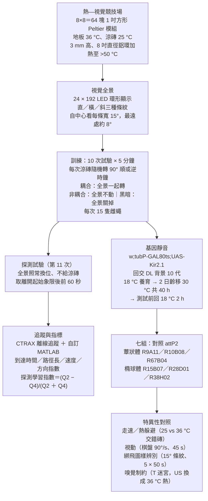
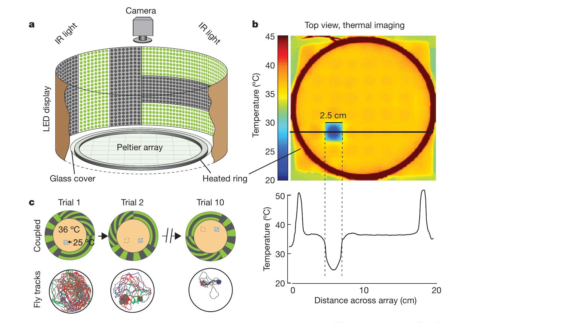
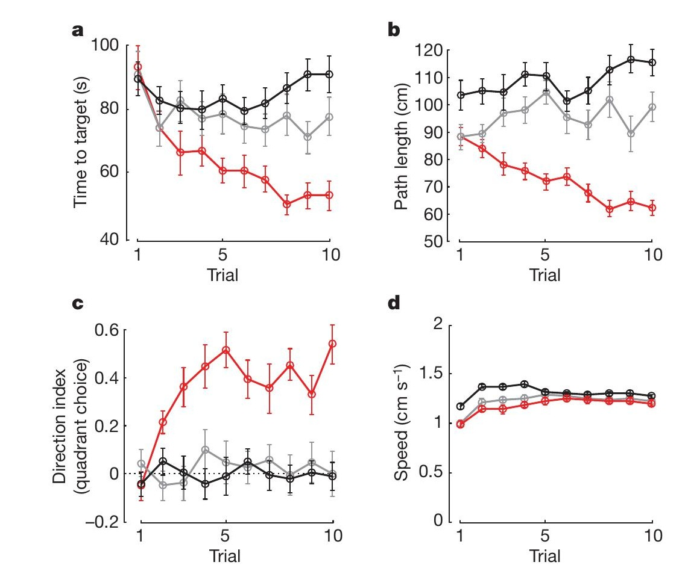
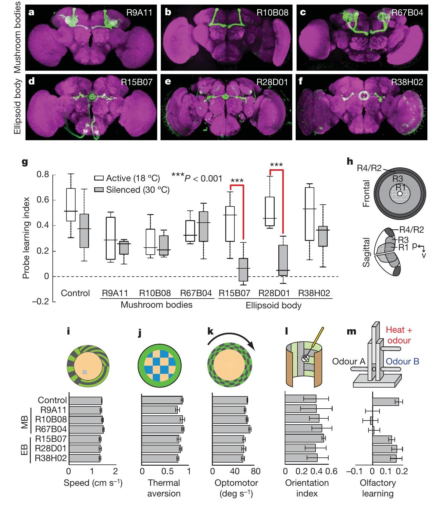

<!-- 本機 PDF：papers/2011-Visual%20place%20learning%20in%20Drosophila%20melanogaster.pdf -->

# Visual place learning in *Drosophila melanogaster*

**果蠅的視覺位置學習**

| 項目 | 內容 |
|---|---|
| **出處** | Nature 474(7350), 204–207 (2011). doi: 10.1038/nature10131 [全文（PMC 免費閱讀）](https://pmc.ncbi.nlm.nih.gov/articles/PMC3169673/) |
| 日期 | 收稿 2010-10-28・接受 2011-04-14（PDF p.3）。PDF 頁眉印「9 JUNE 2011」，PMC 書目資料則記為 2011-06-08（⚠️ 兩處差一天，屬同一份文獻的著錄差異，不影響內容） |
| 通訊作者 | Charles S. Zuker（cz2195@columbia.edu）、Michael B. Reiser（reiserm@janelia.hhmi.org）。PDF 只有英文名 |
| 作者 | 共 3 人：Tyler A. Ofstad、Charles S. Zuker、Michael B. Reiser。**PDF 未標示共同第一作者**（已查作者列的上標與作者貢獻段）。貢獻：三人共同設計研究並撰稿，Ofstad 一人執行全部實驗與資料分析 |
| 機構 | Janelia Farm Research Campus, HHMI（美國維吉尼亞州 Ashburn）；University of California at San Diego 的 Neurosciences 與 Neurobiology 兩系（La Jolla）；Columbia University 的 Biochemistry and Molecular Biophysics 與 Neuroscience 兩系（紐約）。全部掛 HHMI |
| 資料庫 | **無。** 本篇沒有釋出資料、程式碼或品系編號（已 grep `deposit`、`available`、`accession`、`code`，全文無相關條目）。追蹤用的 CTRAX 是引用的既有軟體（Branson 2009），不是本篇的產物。GAL4 品系依 Pfeiffer 2008 製作、由 Gerry Rubin 提供，PDF 未給品系編號 |
| 補充資料 | 補充圖 1–8 與補充影片 1–3（由正文引用處推得：圖 S1 單隻果蠅、S2 探測試驗軌跡與「繞圈」搜尋、S3a/S3b 各條件與各品系的探測分數、S4 羥基脲剝除蕈狀體、S5 運動與視覺對照（含 78y 品系）、S6 嗅覺制約裝置、S7 熱成像、S8 六種非視覺協定；影片 1 配對訓練、影片 2 配對探測、影片 3 無資訊條件探測）。**以上全部不在本機 PDF 內，本庫未取得**；凡依賴它們的內容一律標 ？待查。**本機 PDF 含完整 Methods（p.4–6）**，所以多數方法參數拿得到 |
| 編輯／審查 | Nature 不具名審查，PDF 未列編輯或審查人 |
| 經費 | HHMI Janelia Farm Research Campus 訪問學人計畫（Ofstad 與 Zuker，由 Reiser 接待）。Zuker 為 HHMI 研究員兼 Janelia Farm 資深研究員。作者聲明無競爭性財務利益 |

> 與本庫有關的作者：無。本篇與庫內既有來源的交會處有兩個。其一，它的嗅覺制約協定明寫是依 Tully & Quinn 1985（本庫 [[s-tully-1985-classical-conditioning]]）的高架 T 迷宮（[[e-t-maze]]）改的，只把電擊換成 36 °C 的熱。其二，它用的成蟲期限時開關 GAL80ts（[[e-gal80ts]]）與蕈狀體驅動品系 OK107（[[e-ok107-gal4]]）都是庫內已有的工具頁。
>
> **付費期刊（版權屬出版社）。** 全文請由資料表「出處」列的連結到 PMC 免費閱讀；該版本是 **HHMI 作者稿（author manuscript）**，不是出版社排版版（PMC 頁面標示「Author manuscript; available in PMC: 2011 Dec 9」）。**本庫不散布全文 PDF。** 本頁的圖擷取自原文，版權屬原出版社，以教學與評論目的引用，每張圖下方標明出處。

---

## 為什麼重要

**先說一個限制，它決定本篇每一句話能說到多重：本篇從頭到尾只量行為，一次也沒有量過腦裡的細胞。** 全篇沒有電生理（把電極靠到或插進細胞，量它送出的電訊號），也沒有鈣成像（讓細胞在活躍時發光，用顯微鏡把亮度拍下來）。圖 4 是一張複合圖，要分清楚哪一格是什麼：a 到 f 是六張腦照片，用一個會發綠光的標記蛋白照出「哪些細胞被選到了」，不是「這些細胞在做什麼」；h 是一張手繪的示意圖（橢球體分幾圈、哪條品系標到哪一圈）；真正的行為結果只在 g（位置學習）與 i 到 m（各項對照）。所以本篇關於腦區的話全是同一種形式：把一群細胞**靜音**（讓它們難以放電，也就是難以送出電訊號），行為垮了就說它必需；行為沒垮，就只能說「在這個作業、這套操作下沒有偵測到差異」。作者在正文裡也是這樣寫的——「we see no evidence for involvement of the mushroom bodies in our assay」——而摘要寫成「neurons in the ellipsoid body, but not in the mushroom bodies, are necessary for visual place learning」。**摘要比資料強：資料撐得住的是「沒有偵測到」，不是「不參與」。** 本頁以下一律按資料的強度寫。

**第一件事：本庫第一次收到一篇學習不落在蕈狀體上的來源。** 庫內既有的來源幾乎都在同一條線路上：氣味活化一小群 Kenyon 細胞（Kenyon cell, KC），多巴胺神經元（dopaminergic neuron, DAN）帶來好壞訊號，KC 與蕈狀體輸出神經元（mushroom body output neuron, MBON）之間的突觸因此改變。本篇量的不是氣味而是位置：果蠅要在一片 36 °C 的地板上找到唯一一塊 25 °C 的涼磚。這塊涼磚**沒有任何近處線索**——論文的原話是 no local cues that identify the cool tile，意思是涼磚所在的那一小塊地方本身沒有可辨識的特徵，果蠅踩上去之前無法從近處把它和別的磚分開，能用的只有遠處那一圈 LED 全景的條紋。跑完十個訓練試驗之後，涼磚與全景一起轉的那一組先在訓練曲線上看到進步（圖 2），再由拿掉涼磚的探測試驗確認牠記住的是一個地點（圖 3）。接著是腦：靜音三條蕈狀體驅動品系（一條品系＝一群基因組成相同、代代相傳的果蠅；另有第四條 OK107 只在正文被點名、沒有引任何圖），加上用羥基脲化學剝除蕈狀體，位置學習都**沒有偵測到**顯著影響（圖 4a–c、4g；剝除那一組的資料在未取得的補充圖 4：？待查（補充資料未取得））；靜音兩條標到橢球體（ellipsoid body, EB；中央複合體的一部分）R1 環的品系（投射到橢球體的神經元叫環狀神經元，依投射到哪一圈分成 R1 到 R4），位置學習崩到接近零（圖 4g，中位數由約 0.485 與 0.46 掉到約 0.065 與 0.05，※ 從圖判讀）；但第三條橢球體品系 R38H02 不受影響，所以本篇的結論是「橢球體裡的某一圈」而不是整個橢球體。**要注意本篇沒有量過任何一個突觸，所以它不能說「這個學習不經過 KC→MBON」，只能說「在本篇的作業裡沒有偵測到蕈狀體的參與」。** 這兩句話的差別，正是矛盾 1.13 卡住的地方。

**第二件事：一個雙向交叉的結果，而不是單向的否定——但兩個方向不是同一組實驗。** 單向的「某區不需要」隨時可以用「操作不夠有效」解釋。本篇把這個解釋的最強版本堵掉：同一組 GAL4 驅動品系、同一套 Kir2.1 靜音協定，在氣味學習上確實把學習指數由約 0.17 打到約 0（圖 4m，※ 從圖判讀；作者的措辭是 total loss of odour learning）。方向因此交叉：那三條蕈狀體品系在位置學習上沒有偵測到差異、在氣味學習上歸零；那兩條橢球體品系在位置學習上崩掉、在氣味學習上與對照沒有差別。**不過兩個方向用的不是同一批果蠅，也不是同一個裝置**：位置學習在熱—視覺競技場、每次 15 隻、讀數是探測學習指數（圖 4g）；氣味學習在高架 T 迷宮（[[e-t-maze]]）、每次約 200 隻、讀數是本篇沒有寫出公式的嗅覺學習指數（圖 4m；公式 ？待查）。連統計比較的對象都不同：圖 4g 的星號是同一條品系誘導前後比，圖 4m 的顯著是各品系與對照品系比。所以這個交叉成立的層次是「同一組品系、同一套靜音協定」，兩張圖的數值不能放在一起比大小。**還有一件要分清楚的事：這一格堵住的是「Kir2.1 在這些品系裡完全沒作用」這個版本的質疑，它堵不住「這些品系標到的細胞剛好不是位置學習要用的那些」**——後者要靠整個蕈狀體剝除那一組來補，而那組資料本庫未取得。

**第三件事：它標出本庫一整段的空缺。** 本篇沒有任何細胞層級的功能量測，連環狀神經元在果蠅導航時會不會放電都沒有量；作者在結尾自己把這件事列為下一步（建議把果蠅的頭固定住、周圍給一圈人造環境的螢幕，一邊做作業一邊看腦）。作者對這群細胞的措辭也只到「可能是在實作、儲存，或讀取空間資訊」（原文 implementing, storing, or reading）——必要性實驗分不開這三件事。所以本篇進庫之後，本庫同時多了一個新的腦區與一個新的無知：**視覺位置記憶存在哪裡、以什麼形式存在，本庫一篇都答不出來。** 它與庫內既有的橢球體線索（[[s-aso-2019-nitric-oxide-cotransmitter]] 引 Kuntz 2017，說橢球體環狀神經元要維持短時間的視覺記憶時，需要一氧化氮／cGMP 這兩種細胞內的訊號分子）方向一致但不重疊：一篇講需要哪個分子，一篇講需要哪一環。

**第四件事：它是本庫一條未裁決矛盾最強的一側。** ⚠️ **矛盾 1.13｜視覺記憶需不需要蕈狀體｜未裁決。** 本篇說在它的作業裡看不到蕈狀體參與的證據；[[s-vogt-2014-shared-visual-olfactory-circuits]] 說讓果蠅在地上走、用藍與綠兩色配電擊或配糖的顏色學習，需要蕈狀體的 Kenyon 細胞把訊號送出去（而且專一到蕈狀體 γ 葉這一段）。**本頁不裁決。** 目前最明顯的障礙是兩篇的作業類型不同：本篇測的是**地點**（在均一的熱地板上找一塊沒有近處線索的涼磚，只能靠一圈全景定位），Vogt 2014 測的是**特徵**（兩種顏色，其中一色配電擊或配糖）。「地點」與「特徵」在果蠅腦裡是否真的分流，本庫沒有來源：？待查。第二個障礙是本篇沒有說它的蕈狀體品系涵蓋哪幾類、幾顆 KC（？待查），而最強的那一組（整個蕈狀體剝除）的資料落在未取得的補充圖 4 裡。兩邊逐項對照見 [[syn-contradictions]] 1.13。

---

## 論文摘要（原文與中譯）

> The ability of insects to learn and navigate to specific locations in the environment has fascinated naturalists for decades. The impressive navigational abilities of ants, bees, wasps and other insects demonstrate that insects are capable of visual place learning, but little is known about the underlying neural circuits that mediate these behaviours. *Drosophila melanogaster* (common fruit fly) is a powerful model organism for dissecting the neural circuitry underlying complex behaviours, from sensory perception to learning and memory. *Drosophila* can identify and remember visual features such as size, colour and contour orientation. However, the extent to which they use vision to recall specific locations remains unclear. Here we describe a visual place learning platform and demonstrate that *Drosophila* are capable of forming and retaining visual place memories to guide selective navigation. By targeted genetic silencing of small subsets of cells in the *Drosophila* brain, we show that neurons in the ellipsoid body, but not in the mushroom bodies, are necessary for visual place learning. Together, these studies reveal distinct neuroanatomical substrates for spatial versus non-spatial learning, and establish *Drosophila* as a powerful model for the study of spatial memories.

（Nature 的 Letter 摘要不分 Background／Results／Conclusion 段，照原樣一段；原文的文獻編號上標已略去。）

**中譯**（本節為忠實翻譯，非自撰內容）：

> 昆蟲學習並導航到環境中特定地點的能力，數十年來一直令博物學家著迷。螞蟻、蜜蜂、胡蜂與其他昆蟲令人驚嘆的導航能力顯示，昆蟲具有視覺位置學習的能力，但對於支撐這些行為的神經迴路，所知甚少。黑腹果蠅（一般的果蠅）是一種強大的模式生物，可用來解剖複雜行為背後的神經迴路，從感覺知覺到學習與記憶皆然。果蠅能夠辨識並記住大小、顏色與輪廓方位等視覺特徵。然而，牠們利用視覺回想特定地點的程度，仍不清楚。本文描述一套視覺位置學習平台，並證明果蠅能夠形成並保留視覺位置記憶以引導選擇性的導航。藉由對果蠅腦中一小群細胞進行標的性的基因靜默，我們顯示橢球體（而非蕈狀體）中的神經元，是視覺位置學習所必需。這些研究合起來揭示了空間學習與非空間學習各有不同的神經解剖基質，並確立果蠅是研究空間記憶的強大模式生物。

---

## 科普文

### 先說一個限制，它決定下面每一句話有多重

**這篇論文從頭到尾只看果蠅的行為，一次也沒有量過牠腦裡的細胞。** 沒有電生理（把電極靠到或插進細胞，量它送出的電訊號），也沒有鈣成像（讓細胞在活躍時發光，用顯微鏡把亮度拍下來）。論文裡那幾張綠色的腦照片是用一個會發綠光的標記蛋白照出來的，只能說「哪些細胞被選到了」，不能說「這些細胞在做什麼」。

能用的手法只有一種：把一群神經元關掉，看行為垮不垮。垮了，可以說這群細胞「少了就不行」。沒垮，只能說「這一次沒有量到差別」——不能說它不參與。**沒量到差別至少有三種可能**：關得不夠徹底、測驗不夠靈敏、或者關到的不是該關的那些細胞。本篇最常被引用的那個結論（蕈狀體不是視覺位置學習所必需）就屬於「行為沒垮」這一類，所以讀它的時候要一直問兩件事：那個操作到底關掉了哪些細胞？對照做得多嚴？下面照這個標準寫。

### 名詞表（白話）

| 詞 | 意思（連做法一起說） |
|---|---|
| 放電 | 神經元送出電訊號，是它把訊息傳給下一顆細胞的動作。「靜音」就是讓它難以做這件事 |
| 試驗（trial） | 一輪測驗。本篇一次訓練有 10 個試驗，每個 5 分鐘 |
| 一次實驗（experiment） | 15 隻果蠅跑完一整輪：10 個訓練試驗加第 11 個探測試驗。所以「n ≥ 8 次實驗」是至少 8 輪、每輪 15 隻，統計的單位是「輪」不是「隻」 |
| 涼磚 | 地板上唯一一塊 25 °C 的磚，1 吋（2.54 公分）見方。其餘地板 36 °C |
| 近處線索（local cue） | 目標所在那一小塊地方本身的可辨識特徵。本篇的設計就是**不給**：涼磚外表與別的磚一樣，果蠅踩上去才知道，只能靠遠處的條紋定位 |
| 全景（panorama） | 競技場外圍一圈 LED 顯示的條紋圖案，有直、橫、斜三種（論文只寫「等間距」，**三種方位在那一圈上怎麼分段排列，本篇沒有寫：？待查**）。本文有時叫它「壁紙」 |
| 涼磚「旋轉」 | 地板本身不會動。64 塊磚每一塊都能單獨控溫，所以換位置的做法是**把冷切換到另一塊磚上**，同時把 LED 上的圖案轉過去（※ 推論：論文用 shifted／rotated 描述涼磚位置的改變，沒有說地板會轉動，而方法明寫每塊磚可單獨定址） |
| 耦合（coupled） | 訓練條件之一：每個試驗之間，涼磚與全景**一起**轉。涼磚的絕對位置一直變，但它相對於條紋的位置不變 |
| 非耦合（uncoupled） | 訓練條件之一：涼磚每個試驗隨機換位，全景**不動**。於是條紋不帶任何涼磚的位置資訊 |
| 黑暗（dark） | 訓練條件之一：全景關掉 |
| 象限 Q1–Q4 | 把圓形競技場切成四塊。**這套命名是替探測試驗定的，而且是相對於果蠅的起點**：Q1 是果蠅出發的那一塊（上一個試驗涼磚所在處），Q2 是全景指示「涼磚應該在」的那一塊（與 Q1 相隔 90°），Q4 是從 Q1 往反方向轉 90° 的那一塊，Q3 在 Q1 正對面。每一次試驗全景往順時鐘或逆時鐘轉是隨機的，所以哪一塊算 Q2、哪一塊算 Q4，要看這一次轉哪邊 |
| 到達時間 | 從試驗開始到該隻果蠅踩上涼磚為止的秒數，逐隻算。**沒找到涼磚的果蠅怎麼計入（排除？指派 300 秒？），本篇沒有寫：？待查** |
| 路徑長 | 同一段時間內走的總距離，公分 |
| 方向指數 | 訓練期的讀數：第一個走進涼磚那一塊的果蠅隻數，減掉第一個走進它正對面那一塊的果蠅隻數，再除以總隻數。範圍 −1 到 +1；0 代表走對與走反的一樣多。**訓練試驗裡果蠅從哪裡算「出發」，本篇沒有定義：？待查** |
| 探測試驗（probe trial） | 第 11 個試驗：全景照常換到新位置，但**不給涼磚**。用來看果蠅會不會跑去「全景指示應該有涼磚」的地方找一塊不存在的涼磚。這個手法借自哺乳類的 Morris 水迷宮。**探測試驗本身持續多久，本篇沒有寫：？待查** |
| 探測學習指數 | 探測試驗的讀數：只取果蠅離開 Q1 之後的**前 60 秒**，待在 Q2 的時間減掉待在 Q4 的時間，再除以牠待在這兩塊的總時間。範圍 −1 到 +1。**Q1 與 Q3 的時間完全不計**；整段都沒離開 Q1 的果蠅怎麼算，本篇沒有寫：？待查 |
| 盒鬚圖 | 一種畫分布的圖：中間一條線是中位數，盒子的上下緣是第 25 與第 75 百分位（中間一半的資料落在盒子裡），鬚是資料的全距 |
| 標準差與標準誤 | 標準差描述「個體之間差多少」，標準誤描述「平均數本身有多不準」。樣本數變大時標準誤會縮小，標準差不會——所以同一批資料改用標準差畫，誤差棒看起來就長得多 |
| 品系（line） | 一群基因組成相同、代代相傳的果蠅。本篇的品系名字是代號，例如 R9A11、R15B07 |
| DL 野生型 | 本篇用的野生型品系代號（1995 年由數十條野外單雌系雜交建立，由 Michael Dickinson 實驗室維持）。不是常見的 Canton-S |
| 驅動品系（GAL4 driver line） | 一種品系，它身上帶的 GAL4 決定「外加的基因只在哪一群神經元裡做出來」 |
| 效應品系（effector line） | 另一種品系，它帶著「要被做出來的那個基因」（這裡是 Kir2.1），但本身沒有 GAL4。兩種品系交配，子代才同時有這兩樣東西，Kir2.1 才會在指定的細胞裡做出來 |
| 遺傳背景 | 除了被研究的那個基因以外，果蠅身上其餘的基因組成。兩群果蠅背景不同時，行為差異可能來自背景而不是來自操作——本篇把效應品系回交進 DL 背景 10 代就是為了排除這件事 |
| Kir2.1 | 一個鉀離子通道。讓神經元做出它之後，那顆神經元變得難以放電。論文把這個操作叫「靜音」（silencing） |
| GAL80ts | 一個溫度開關，決定 Kir2.1 什麼時候做得出來：養在 18 °C 時它起作用、把 Kir2.1 擋住；升到 30 °C 時它失效、Kir2.1 才做得出來。**本篇只給這兩個溫度點；測驗當下的環境溫度（房間 25 °C、地板 36 °C）對這個開關是什麼狀態，本篇完全沒有討論：？待查** |
| 誘導 | 本頁指「把果蠅移到 30 °C，讓 Kir2.1 真的做出來」這個步驟。圖上的白盒是沒有誘導的，灰盒是誘導過的 |
| 三個零件怎麼搭 | **驅動品系決定「在哪些細胞做」，GAL80ts 決定「什麼時候做」，Kir2.1 是「做出來之後做什麼事」。** 同一隻果蠅身上三樣都有 |
| 蕈狀體（mushroom body） | 果蠅腦裡把氣味與好壞經驗連起來的構造，本庫多數來源的主角 |
| 橢球體（ellipsoid body） | 腦正中央那一組構造（中央複合體）的一部分，外形是環狀。本篇的主角 |
| 環狀神經元 R1–R4 | 投射到橢球體的神經元，依投射到哪一圈分類，名字是 R1、R2、R3、R4。**但圖 4h 的示意圖只畫出三圈，把 R4 與 R2 標在同一圈上，所以橢球體到底分幾圈、R2 落在哪裡，本篇沒有交代** |
| 羥基脲剝除 | 用羥基脲這種化學藥品把蕈狀體去掉。本篇引 de Belle & Heisenberg 1994 的做法。**這種藥為什麼只打到蕈狀體、什麼時候餵、剝得多乾淨，本篇一個字都沒寫：？待查（補充資料未取得）** |
| 嗅覺學習指數 | 氣味學習的讀數。**本篇沒有寫出它的公式**，只寫「以兩組的學習指數平均」 |
| 編碼 | 「腦裡真的有一份對應的訊號」，例如某顆細胞只在某個地點放電。與「必要性」（少了它就不行）是兩回事 |

以下把本篇的實驗拆成九套。**「第 N 套」是本頁加的編號，論文沒有這樣編號**，每一套後面都寫出它對應的圖。

### 這個實驗要果蠅做什麼

想像你被丟進一間圓形的房間，直徑約 20 公分（8 吋）。地板整片燙腳（36 °C），只有一塊地磚是涼的（25 °C），而那塊涼磚從外表看跟其他地磚一模一樣——你站上去之前不會知道它在哪裡。地板是 64 塊 1 吋見方的控溫磚排成 8×8。房間邊緣圍著一圈 3 公釐高的金屬環，環被加熱到 50 °C 以上，**環上蓋著一片玻璃盤**，玻璃上塗了一層滑溜的矽膜（商品名 Sigmacote），讓果蠅踩不住。所以你爬不上牆，而且**頭上只有 3 公釐的空間——飛不起來，只能走**。（那片玻璃本身、以及果蠅頭上那層空氣是幾度，本篇沒有量：？待查。）

牆外是一圈 LED 顯示的條紋，有直的、橫的、斜的。同一根條紋從不同距離看角度不同：從房間中央看寬 15°，從場內能離它最遠的地方（8.8 吋）看約 8°；作者據此說果蠅「應該可以輕易解析」（原文 should be easily resolvable）。**本篇沒有給果蠅能分辨多細的門檻，所以這一句是作者的判斷，沒有附依據。** 另外，三種方位的條紋在那一圈上怎麼分段排列，論文只寫「等間距」，沒有說明（？待查）；所以下文說「涼磚在斜紋那一邊」只是本頁用來說明「相對關係固定」的比喻，不是論文的設定。

涼磚只佔果蠅活動範圍的 2.0%（本頁推算：1 吋見方＝6.45 平方公分；直徑 8 吋的圓＝約 324 平方公分；相除得 2.0%）。注意這不是 1 除以 64（＝1.6%）：8×8 的磚陣是方形的，而果蠅能走的範圍是金屬環圍出的圓，四個角落的磚有一部分落在圓外（※ 推論，依據是環的直徑 8 吋恰好等於磚陣的邊長）。**涼磚是從哪些磚裡挑的（全部 64 塊，還是只有完整落在圓內的那些），本篇沒有寫：？待查**；若曾用到角落的磚，2.0% 就只是上限。

你被放進去跑十個試驗，每個五分鐘。果蠅**一直待在競技場裡，試驗之間不會被拿出來**：換位置的做法是把冷切換到另一塊磚、同時把條紋轉過去，論文的措辭是「迅速換到新位置」（※ 推論：方法只寫 rapidly shifted，沒有寫果蠅被移走；圖 3d 的圖說另外明寫訓練與測驗之間果蠅留在競技場裡）。每次之間涼磚隨機往順時鐘或逆時鐘轉 90 度，**而條紋跟著一起轉**，所以涼磚相對於條紋的位置永遠不變。幾輪之後你會怎麼做？如果你聰明，你不會再滿地亂找，你會先抬頭看牆，再直接走過去。這篇論文做的就是這個實驗，受試者是果蠅：每次放 15 隻，全部是 4 日齡的雌蠅，房間空氣 25 °C、濕度 40%（這個 25 °C 與涼磚的 25 °C 數值相同，但一個是空氣、一個是地板）。

第一個試驗裡，94% 的果蠅最後都找到了涼磚（論文註明 data not shown，沒有附圖）。把這個數字配上「目標只佔 2.0%」就知道第一次是怎麼找到的：靠大量亂走掃過地板。**所以學習曲線不能只看「多久找到」，還要看「走了多遠」。**

### 難題：怎麼證明果蠅記住的是一個地點，不是一個動作

這是整套設計最難的一關。果蠅在熱地板上亂走，遲早會踩到涼磚；只要重複夠多次，牠可能學會「一直往左繞」這種固定動作，而不是真的記住地點。作者的辦法有三層。

第一層是**每次都把涼磚換位置**，而且是隨機往順時鐘或逆時鐘轉 90 度，所以固定的動作沒有用。作者另外檢查過果蠅有沒有偏好某一塊象限或某一個旋轉方向：到達時間與全體平均的差，在四塊象限分別是 1.7 ± 2.3、−0.5 ± 2.7、0.0 ± 2.2、−1.2 ± 2.2 秒，順時鐘與逆時鐘是 0.6 ± 1.5 與 −0.6 ± 1.8 秒（± 後面是標準誤）；兩項都用單因子 ANOVA 檢定，都不顯著。（這裡的「四塊象限」指競技場上**固定不動**的四塊，看涼磚這一次落在哪一塊，與探測試驗那套隨果蠅起點而定的 Q1–Q4 不是同一套編號——※ 推論，依據是方法這一段說的是 target quadrant，即涼磚所在的象限。）

第二層是**讓條紋跟著轉**：涼磚的絕對位置一直變，但它相對於條紋的位置不變。

第三層是**兩組對照**：一組關燈（黑暗），一組條紋不動（非耦合，條紋變成跟涼磚無關的擺設）。論文針對**非耦合**組特別點出，那裡的果蠅並不是「完全沒有線索」：自己走過幾步、轉過幾個彎（論文稱自體線索），以及競技場牆的距離與局部方位，這兩類線索都還在。**作者列這兩類線索的用意是：這些東西都還在，果蠅卻還是沒學起來，所以它們不足以支撐一份位置記憶**（方法裡明寫了這個推論）。結果只有耦合組進步。

### 第 1 套：三種訓練條件下的學習曲線（圖 2）

受試果蠅是沒有做任何基因操作的 DL 野生型。訓練 10 個試驗、每個 5 分鐘。樣本數：耦合 33 次實驗 495 隻、非耦合 21 次 315 隻、黑暗 23 次 345 隻。四個讀數（以下數值皆 ※ 從圖 2 判讀，第 1 個試驗 → 第 10 個試驗）：

- 到達時間：耦合 93 → 53 秒（第 8 個試驗最低約 50 秒）、非耦合 93 → 77 秒、黑暗 89 → 91 秒。
- 路徑長：耦合 88 → 62 公分、非耦合 89 → 99 公分、黑暗 103 → 115 公分。
- 方向指數：耦合 −0.02 → 0.54；非耦合與黑暗全程在 −0.05 到 +0.10 之間。
- 走路速度：三組都在第 1 → 第 2 個試驗上升約 20–25%，之後持平（論文沒有討論為什麼會上升）；第 10 個試驗耦合約 1.20、非耦合約 1.25、黑暗約 1.27 公分/秒。

**方向指數是這張圖最難用「走得比較有效率」或「跑得比較快」解釋的讀數**，因為它問的是果蠅**第一個**走進哪一塊，這個選擇在牠踩到涼磚之前就做完了。至於能不能排除碰巧，靠的是另外兩組對照全程貼在 0 附近，以及統計檢定，不是這個讀數本身。還要注意 0.54 的意思：第一個走進涼磚那一塊的果蠅數，比第一個走進正對面那一塊的果蠅數，多出全部果蠅的約 54%——它不是「54% 的果蠅走對了」。

三件圖說沒並列的事。第一，**黑暗組不是沒進步，是變差**：路徑長多走了 12 公分。第二，非耦合組的到達時間其實降了 17%，約是耦合組降幅（43%）的四成；兩組真正拉開差距的是方向指數（0.54 對 0 附近），不是到達時間。第三，**第 10 個試驗走得最慢的（1.20）就是進步最多的那一組**，所以進步不是因為跑得比較快。

一個會影響前兩條曲線的缺口：第一個試驗有 94% 的果蠅找到涼磚，也就是有一部分果蠅根本沒有「踩上涼磚」這個時間點。**這些果蠅在到達時間與路徑長裡怎麼計入，本篇沒有寫：？待查。**

### 第 2 套：探測試驗，果蠅跑去找一塊不存在的涼磚（圖 3a–c）

這是整篇的關鍵一步，用的是第 1 套同一批實驗的果蠅：訓練完**立刻**做第 11 個試驗，條紋照常換到新位置，但地板上沒有涼的地方了。沒有涼磚，「目標」是怎麼定出來的？由**全景轉到哪裡**決定——論文的原話是「視覺地景指示涼磚應該在的那一區」，那一塊就是 Q2。如果果蠅只是「碰巧愈來愈幸運」，牠應該到處亂找；如果牠真的記住了地點，牠應該跑到 Q2、在那裡打轉找一塊不存在的涼磚。

後者發生了。耦合組把約 42% 的時間花在 Q2，Q1 約 25%、Q3 約 18.5%、Q4 約 11%（※ 從圖 3b 判讀；亂走的話每塊應該是 25%。四個數字相加是 96.5%，差的 3.5% 是本頁從圖上判讀的誤差，不是論文少掉的時間）；論文報告 Q2 顯著高於其餘三塊。探測學習指數的中位數：耦合約 0.51、非耦合約 0.06、黑暗約 0.02（※ 從圖 3c 判讀）；對零檢定的 P 值分別是 < 0.0001、0.28、0.39。

三點要留意。

其一，**正文說黑暗組與非耦合組「均勻地搜尋整個競技場」，但那兩組的四塊象限時間分布只畫在補充圖 3a，本庫未取得：？待查（補充資料未取得）**；本機能看到的只有牠們的探測學習指數接近 0。

其二，**上面那組象限百分比與探測學習指數不一定算在同一段時間。** 方法只替指數定義了「離開 Q1 之後的前 60 秒」這個窗口，沒有說圖 3b 的百分比取的是哪一段；而 Q1 還佔了 25% 的時間，表示圖 3b 至少把果蠅待在 Q1 的那段時間也算進去了。所以不要拿圖 3b 的平均值去反推指數：這樣算出來是 0.585（本頁推算），而圖 3c 報的是中位數 0.51——一個是平均、一個是中位數，本來就不會相等。

其三，這個指數只用 Q2 與 Q4 兩塊。依圖 3b 的平均，果蠅待在這兩塊的時間合計約 53%，其餘約 47% 的時間（Q1 與 Q3）不進公式——而 Q3 的時間其實明顯多於 Q4，論文沒有討論這件事。

### 第 3 套：這份記憶撐多久（圖 3d）

訓練一輪（十個試驗）之後，在 0、30、60、120、240、360、480 分鐘各做一次探測試驗，每個時間點 n ≥ 5（論文沒有寫這是幾次實驗還是幾隻果蠅；每個時間點是不同批果蠅各測一次、還是同一批重複測，論文也沒有寫：？待查）。中位數依序約 0.37、0.41、0.31、0.30、0.18、0.15、0.04（※ 從圖 3d 判讀）。對照組是同胞果蠅先在競技場裡放 8 小時、再訓練、立刻測，中位數約 0.41——它要排除的是「久待競技場本身讓分數下滑」（因為其他各組在訓練與測驗之間一直待在競技場裡）。**等待的那幾個小時裡，競技場是什麼狀態（地板還是 36 °C 嗎？有涼磚嗎？全景開著嗎？）本篇沒有寫：？待查**，而這正是這個對照組要排除的那件事的關鍵。

**同一份資料有兩個答案，看你跟誰比。** 與非耦合組比，顯著較高的範圍到訓練後 120 分鐘；與零比，4 小時與 6 小時仍然顯著（單尾 t 檢定，P < 0.05；本篇沒有說明為什麼選單尾，而單尾會讓同一份資料的 P 值減半）。圖說選了嚴格的那一個，寫「至少 2 小時」。引用時要寫明是拿哪一個當基線。要注意那個「非耦合組」是**圖 3c 的那一組非耦合資料**（方法明寫 pairwise comparisons to the uncoupled condition in Fig. 3c），不是非耦合組也跑了七個時間點。**480 分鐘（8 小時）那一點，論文沒有報告任何檢定結果**（已把方法全文搜過），所以「8 小時幾乎歸零」只是圖上的中位數，不是一個檢定出來的結論。

還有一處對不上：圖 3c 的耦合組（約 0.51）與圖 3d 的「0 分鐘」（約 0.37）是同一個條件，數值卻差約 0.14，兩者的 n 也不同（33 次實驗對 n ≥ 5），論文沒有說明是不是同一批資料（⚠️ 這是本篇自身的不一致，不是兩篇來源的矛盾）。

### 第 4 套：把全景與涼磚的關係拆開之後，還學得起來嗎（補充圖 8，未取得）

六種改過的協定：(a) 涼磚固定不動、(b) 涼磚朝固定方向旋轉、(c) 涼磚隨機旋轉，三者都在黑暗中；(d) 全景不動而涼磚隨機換位、(e) 全景隨機旋轉而涼磚不動、(f) 全景與涼磚各自獨立隨機換位。前三種是「完全不給視覺」，後三種是「給視覺，但它與涼磚的位置無關」。作者說六種都看不到位置學習。

其中 (c) 的描述（黑暗中涼磚隨機旋轉）與第 1 套的黑暗組、(d) 的描述（全景不動、涼磚隨機換位）與第 1 套的非耦合組看起來是同一件事，而兩邊的資料一組在圖 2、一組在補充圖 8。**兩者差在哪裡、是不是同一批資料，本篇沒有說明（⚠️ 本篇自身的描述重疊）。**

涼磚不動的那兩種（(a) 與 (e)，※ 推論：原文只說 the stationary cool tile），為了把果蠅趕離涼磚，每個試驗開始前把整片地板加熱到 36 °C 共 60 秒——**包含原本那塊涼磚**（原文 the entire array was heated），所以那 60 秒整個地板都是 36 °C、沒有涼處可站。作者說**這個 60 秒的加熱動作**加在標準的耦合協定上不影響學習（同樣註明 data not shown）。**這六套的資料全在補充圖 8，本庫未取得：？待查（補充資料未取得）。**

### 第 5 套：單隻果蠅也學得起來嗎（補充圖 1，未取得）

標準協定每次放 15 隻，所以有一個明顯的替代解釋：果蠅可能是跟著別隻走到涼磚的。作者說單獨測的果蠅位置學習一樣好。**資料在補充圖 1，本庫未取得：？待查（補充資料未取得）**；單隻訓練的協定與隻數也看不到。

### 第 6 套：把腦區關掉之後的位置學習（結果在圖 4g）

這一套用的作業與第 1、2 套相同：10 個試驗加第 11 個探測試驗。**但讀數只取探測學習指數**：這七組在訓練期的到達時間、路徑長與方向指數，本機 PDF 裡一個都沒有（正文另引了未取得的補充圖 3b，無法確認它包含什麼）：？待查。少了訓練曲線，就分不出橢球體品系是「根本學不起來」還是「學起來了但探測時表現不出來」。

**工具怎麼搭。** 驅動品系決定「在哪些細胞做」，溫度開關 GAL80ts 決定「什麼時候做」，Kir2.1 是「做出來之後做什麼事」——帶上這個鉀離子通道的神經元會變得難以放電（論文稱 silencing，引 Baines 2001）。本篇沒有量過這些細胞的電活性，所以**靜音有多徹底，在本篇裡無法確認**。溫度這一環的規則是：18 °C 時 GAL80ts 起作用、擋住 Kir2.1；30 °C 時它失效、Kir2.1 才做得出來。用意是**避開發育期**——如果某群神經元從幼蟲時期就被關掉，腦可能長歪，之後測到的缺陷就分不清是「這群細胞在執行時需要」還是「少了它腦發育不正常」。

**實際時程。** 18 °C 養育 → 2 日齡成蠅移到 30 °C 共 40 小時 → 測驗前回到 18 °C 兩小時。所以牠們是在回到 18 °C 之後受測，靜音靠的是已經做出來的 Kir2.1 還留著（※ 推論，依據是這段時程；論文沒有說明為什麼要移回 18 °C）。即使如此，這個操作在成蟲期內仍是連續 40 小時，分不出「學習時需要」「記憶保存時需要」還是「測驗時需要」。**另外，受測時房間是 25 °C、地板是 36 °C，這兩個溫度對 GAL80ts 是什麼狀態（會不會讓本來不該靜音的白盒那一組也開始做出 Kir2.1），本篇完全沒有討論：？待查。**

**七條品系。** 對照是 w1118;attP2 與同一個效應品系的子代：牠帶著同一套 Kir2.1 零件、血緣來歷（遺傳背景）與六條驅動品系相同，唯一的差別是**沒有「指定地點」的那個零件**，所以牠的 Kir2.1 哪裡都做不出來（※ 推論：方法只寫 attP2 是「與 GAL4 品系相同的遺傳背景」，而 attP2 是這批 GAL4 插入用的落點）。另外六條：蕈狀體三條 R9A11、R10B08、R67B04；橢球體三條 R15B07、R28D01、R38H02。每一條都測兩種狀態：一直留在 18 °C 的（沒有誘導，圖上白盒）與照上面時程誘導過的（灰盒）。每組 n ≥ 8 次實驗（每次實驗 15 隻）。**白盒與灰盒是同一批果蠅測兩次還是兩群果蠅各測一次，論文沒有寫（它只寫「誘導前」與「誘導後」）：？待查。**

**結果**（中位數，白盒 → 灰盒，※ 從圖 4g 判讀）：對照 0.51 → 0.375；R9A11 0.285 → 0.26；R10B08 0.23 → 0.215；R67B04 0.325 → 0.42；**R15B07 0.485 → 0.065；R28D01 0.46 → 0.05**；R38H02 0.53 → 0.36。兩條橢球體品系降了 87% 與 89%，圖上標 P < 0.001。（對照品系白盒的 0.51 與第 2 套野生型的 0.51 數值相同，但那是巧合：兩者是不同的果蠅、不同的實驗。）

**論文用了兩種統計，意思不同，不要混用。** 圖上的星號是**同一條品系誘導前後**比（單尾 t 檢定）；方法裡另外報告**各品系與對照品系**比（單因子 ANOVA 加 Bonferroni 校正），結果只有 R15B07 與 R28D01 在 30 °C 時顯著（P < 0.01），其他品系都不顯著。**圖上只給那兩條紅線與星號，其餘五條誘導前後比的檢定結果論文沒有報告：？待查**；所以論文把 R38H02 歸為「完好」，依據是「與對照相比不顯著」，不是「誘導前後比不顯著」。

**四件要一起看的事。** 第一，對照組自己就從 0.51 掉到 0.375（降 26%），所以「30 °C 的灰盒」不是一個乾淨的基線。第二，R38H02 掉了 32%，比對照的 26% 還多一點，**論文仍把它歸為位置學習完好**（圖 4 圖說的原話是 leaves place learning intact）。第三，R67B04 誘導後反而**上升**約 29%（0.325 → 0.42）；這個升幅和作者用來判斷「受損」的那些幅度是同一個量級，本篇沒有討論它，也沒有報告它顯不顯著——換句話說，這套讀數本身的雜訊有多大，本篇沒有交代。第四，R9A11 與 R10B08 在**還沒誘導**時就只有 0.285 與 0.23，是對照 0.51 的四到六成，本來就沒有多少可掉的空間。

**哪一圈需要。** 圖 4h 把橢球體畫成同心的幾圈，標籤由外到內是 R4/R2、R3、R1；圖說說 R15B07 標到 R1 與 R4、R28D01 只標到 R1、R38H02 只標到 R4。垮掉的兩條都標到 R1，沒事的那一條只標到 R4。所以作者的結論不是「橢球體需要」，而是「橢球體裡面某一圈需要」。但要注意三件事：**這套 R1–R4 的劃分與各品系的歸屬只出現在圖 4 的圖說與示意圖，正文與方法都沒有寫，也沒有引用任何可查的解剖註解資料**；示意圖把 R4 與 R2 標在同一圈上，而論文從頭到尾沒有提過 R2，所以那三條品系有沒有標到 R2、橢球體到底分幾圈，本篇都沒有說明；而「R1 是內圈、R4 是外圈」這一點是從圖判讀的（※ 從圖判讀，依據是圖 4h 的標籤排列，加上圖 4e 標為 R1 的訊號集中在中央、圖 4f 標為 R4 的呈中空環狀）。R2 與 R3 沒有任何品系去測。

作者另外提到，靜音橢球體的果蠅出現一種「繞圈」的搜尋方式，並引 Morris 1990 說海馬迴（哺乳類腦裡與空間記憶有關的構造）受損的大鼠也有這種行為。**但那張圖（補充圖 2d）本庫未取得，論文也沒有把它量化：？待查（補充資料未取得）。**

### 第 7 套：把整個蕈狀體剝除（補充圖 4，未取得）

作者在正文寫，用羥基脲化學剝除蕈狀體之後，位置學習同樣沒有顯著影響。**這是「蕈狀體不需要」涵蓋範圍最大的一種形式**——整個構造不在了，不只是被靜音。

但要注意兩件事。第一，劑量、時程、幾隻果蠅、剝得多乾淨、怎麼驗證、這種藥為什麼只打到蕈狀體，全部不在本機 PDF 裡（作者只引 de Belle & Heisenberg 1994 的做法，資料在補充圖 4）：？待查（補充資料未取得）。第二，**「涵蓋範圍最大」不等於「對照做得最好」**：羥基脲是什麼時候餵的本篇沒有寫，如果是在發育期動手，它就正好帶著第 6 套花一整段想避開的那個問題——腦可能因此重組或補償。本篇沒有討論這個張力。

同一句話裡還列了第四條蕈狀體品系 OK107，但它只在正文被點名，沒有引任何圖，連補充圖都沒有。

### 第 8 套：排除「果蠅只是壞了」（圖 4i–l）

如果那些果蠅只是走不動、感覺不到熱、看不見、或分不出條紋，位置學習當然會垮。作者因此補了四個讀數。受試的是**誘導過的果蠅**（圖 4 圖說明寫這些是「表現 Kir2.1 的果蠅」），七組之間都沒有顯著差異（單因子 ANOVA 加 Bonferroni 校正）：

- **走路速度**：七組都約 1.35–1.5 公分/秒。
- **熱躲避指數**：約 0.72–0.85。做法是把磚設成 25 與 36 °C 交錯，給 2 分鐘讓果蠅分布，再把冷熱對調、再給 2 分鐘，算待在 25 °C 的時間減待在 36 °C 的時間除以總時間。
- **視動反應**：約 57–70 度/秒。做法是把棋盤圖樣以每秒 90 度順時鐘再逆時鐘各轉 45 秒，量整群果蠅在競技場裡沿著刺激方向的平均轉向速度。也就是說果蠅跟著轉的速度約為刺激速度的 0.63–0.78 倍（本頁推算）。
- **方位指數**：約 0.33–0.47。正值代表朝向直條紋的時間比較多；作者說果蠅本來就明顯偏好直條紋，所以就用這個偏好當讀數——這一格問的是「牠還分得出直與橫嗎」，問法是「牠原本的偏好還在不在」。做法換了裝置：把果蠅黏在細桿上固定住，牠的翅膀照樣拍，一台光學拍翅分析儀量牠左右翅拍的差，再即時轉動牠周圍那圈圓柱形 LED 上的圖案——所以牠「想轉多少就轉多少」（閉迴路）。四個象限交錯顯示 15° 寬的直條紋（第 1、3 象限）與橫條紋（第 2、4 象限），每隻飛 5 次、各 50 秒。

四件事要留意。第一，**這四格都沒有「正常該是多少」的絕對基準**（本篇沒有給任何一項的參考值），所以它們只能用來比較七組之間有沒有差別。第二，熱躲避與視動是**探測試驗之後、在同一個競技場**接著測的（方法明寫）；綁飛換了裝置，也換了果蠅（n ≥ 6 隻）。第三，圖上的誤差棒有兩種：走速、熱躲避、視動用標準誤，綁飛與第 9 套的氣味學習用標準差，所以後兩格的棒看起來長得多——那是因為換了統計量（見名詞表），不是因為那兩項的資料比較吵。第四，這四格能排除的是「果蠅壞了」，**不能**排除「關掉的細胞不只橢球體」。

### 第 9 套：以熱當懲罰的氣味學習（圖 4m）

這一格是全篇最關鍵的對照，因為它是**正向**的：前面四格只能證明「果蠅沒壞」，這一格要證明「靜音這件事確實有效」。受試的同樣是誘導過的果蠅（圖 4 圖說把 i 到 m 五格一起寫成「表現 Kir2.1 的果蠅」）。

**裝置與流程。** 換成高架 T 迷宮（一根架高的 T 字形管子，依 Tully & Quinn 1985 改）。方法提到「訓練管」與「測驗管」：訓練時果蠅在訓練管裡聞氣味，**第一個氣味出現的同時**把訓練管加熱到 36 °C（5 V、0.43 A 的電流通過管裡的電阻線網）當作懲罰；也就是說被罰的永遠是先給的那一個氣味。測驗時讓果蠅在兩條岔管之間選一邊，看牠躲不躲開那個被加熱過的氣味（※ 推論：測驗這一步本篇一個字都沒寫，流程只能依它引的 Tully & Quinn 1985 推，見 [[s-tully-1985-classical-conditioning]]）。**訓練管與測驗管在 T 字形上的位置、果蠅怎麼從一邊換到另一邊、訓練給幾回合、每個氣味給多久、第二個氣味什麼時候給、訓練後多久測驗，本篇都沒有寫（已把方法全文搜過）：？待查。** 「總是第一個被罰」這個順序效果，本篇也沒有討論。

**氣味。** 5% MCH（4-甲基環己醇，流速 128 ml/min）與 5% OCT（3-辛醇，60 ml/min），總流速補到 800 ml/min。兩種氣味的流速差了一倍多，本篇沒有說明理由。每次實驗約 200 隻果蠅，一半以 MCH 當受訓氣味（也就是被配上加熱的那一個）、一半以 OCT，取兩組平均——這樣做可以抵掉果蠅對某一種氣味本身的偏好（※ 推論，依據是方法寫「一半以 MCH、一半以 OCT，取兩組的學習指數平均」）。n = 8 次實驗。

**結果**（※ 從圖 4m 判讀）：對照約 0.17；蕈狀體三條 −0.01、−0.01、0.00，論文報告三者都顯著受損（P < 0.05）；橢球體三條 0.13、0.16、0.16，與對照沒有差別。論文的措辭是「靜音蕈狀體導致氣味學習完全喪失」。**這個指數的公式本篇沒有寫，所以 −0.01 是「完全沒學到」還是「略微偏好那個被加熱過的氣味」，本篇無法判斷：？待查。**

**這一格做到兩件事。** 第一，它證明 Kir2.1 在那三條蕈狀體品系裡確實有作用，所以「位置學習沒事」不能用「這套工具根本沒作用」打掉——這是整篇最容易被攻擊的地方。第二，它與第 6 套合起來構成交叉的結果：蕈狀體那三條，氣味學習歸零、位置學習沒有偵測到差異；橢球體那兩條，位置學習崩掉、氣味學習與對照一樣。

**但它堵不住另一個版本的質疑。** 「這套工具有作用」不等於「位置學習要用的那些細胞被關掉了」——本篇沒有說這三條品系涵蓋哪幾類、幾顆 Kenyon 細胞（？待查），所以「它們標到的細胞剛好不是位置學習要用的那些」這個可能性還在。要補這一塊只能靠第 7 套（整個蕈狀體剝除），而那組資料本庫未取得。

**另外兩個限制。** 其一，**這個作業有多靈敏，本頁無法評估**：指數的公式本篇沒寫，所以「滿分是多少」算不出來，而對照組只有 0.17。能說的只有一件事——本庫其他用電擊當懲罰、同樣是高架 T 迷宮的來源，報出來的分數比它大一個量級（見本頁「圖」一節對圖 4m 的解讀；兩邊的量表定義不同，不能直接比大小）。所以「橢球體三條與對照沒有差別」這個陰性結論，落在一個本頁無法替它估靈敏度的作業上。其二，位置學習裡整片地板就是 36 °C、果蠅在上面走五分鐘，這裡 36 °C 卻是懲罰；本篇沒有解釋為什麼同一個溫度在一邊是可以忍受的環境、在另一邊是懲罰（已把全文搜過）。差別可能在「有沒有地方可逃」——競技場裡有一塊涼磚可站，訓練管裡沒有（※ 推論）。

### 哪些東西不能互相比

- **位置學習（第 6 套）與氣味學習（第 9 套）**：不同裝置、不同隻數、不同指數、不同的統計比較對象。只能比「有沒有缺陷」，不能比數值大小。
- **圖上的星號與方法裡的 ANOVA**：前者是同一條品系誘導前後比，後者是各品系與對照品系比。
- **訓練期的方向指數與探測試驗的探測學習指數**：一個數果蠅隻數，一個算時間比例，不是同一個量。
- **圖 3b 的象限時間百分比與探測學習指數**：兩者的時間窗不一定相同（見第 2 套），而且一邊是平均、一邊是中位數。
- **圖 3c 的耦合組（0.51）與圖 3d 的 0 分鐘（0.37）**：同一個條件、兩個數值，論文沒有說是不是同一批資料，所以不要把它們當成同一個量。
- **本篇的指數與本庫其他來源的學習指數**：公式不同，不可跨篇比大小。
- **基因操作過的果蠅與第 1 到第 3 套的野生型果蠅**：品系與遺傳背景都不同。所以第 6 套的探測分數、第 8 套的走路速度（1.35–1.5 公分/秒，高於第 1 套的 1.20–1.27），都只能在它們自己那一套之內比。

### 陰性結果能支持到什麼程度

本篇關於蕈狀體的結論是陰性的，所以只能讀成：**在這個作業、這些操作下沒有偵測到差異。** 四條具體的邊界：

1. **操作涵蓋了哪些細胞，不知道。** 本篇只說那三條品系標的是「蕈狀體內在神經元」，沒有說涵蓋哪幾類 Kenyon 細胞、標了幾顆：？待查。
2. **檢定力有限。** 每條品系 n ≥ 8 次實驗——統計的單位是「輪」而不是「隻」，所以是至少 8 個數字，不是 120 個。各組盒鬚圖的盒子（中間一半的資料）大致橫跨 0.1 到 0.5 這個區間，而且兩條蕈狀體品系還沒誘導時的基線就只有對照的四到六成。在這種離散度下，「不顯著」排除不掉中等幅度的缺陷。
3. **涵蓋範圍最大的那一組本庫無法檢查。** 羥基脲剝除整個蕈狀體那一組（第 7 套）的全部資料在未取得的補充圖 4 裡。
4. **作者自己的措辭比摘要保守。** 正文寫的是「我們在這個作業裡看不到蕈狀體參與的證據」，摘要寫成「橢球體（而非蕈狀體）中的神經元是視覺位置學習所必需」。資料撐得住的是前者。

### 代價：這套設計完全停在行為層次

作者證明了「少了這一圈就不會」，但沒有證明「這一圈裡裝著地圖」。缺的那一步是：果蠅在找路的時候，那些環狀神經元到底在做什麼？本篇沒有任何電生理或鈣成像，一次都沒有。作者在最後一段自己寫出了這一點，並指出下一步應該是在果蠅執行導航作業時把腦打開來看——具體建議是把果蠅的頭固定住、周圍給一圈人造環境的螢幕（引 Seelig 2010、Dombeck 2010）。

### 最容易被誤讀的一點：這篇沒有說果蠅腦裡有「位置細胞」

哺乳類的海馬迴裡有位置細胞——動物走到某個地點，某顆特定的細胞就放電，那是一個可以直接看到的地圖。本篇的邏輯完全不是這樣：它是「把這群細胞關掉，這個行為就不見了」，也就是**必要性**，不是**編碼**。論文自己在討論裡寫，果蠅腦裡有沒有這些細胞的直接對應物並不知道；對那群環狀神經元的措辭也很保留——它們「可能是在實作、儲存，或讀取空間資訊」（原文 implementing, storing, or reading）。這三件事在行為實驗裡分不開，而那些細胞在解剖位置上甚至可能只是這條路的入口或出口，而不是記憶本身所在。

### 一條還沒解決的矛盾

⚠️ **矛盾｜視覺記憶需不需要蕈狀體｜未裁決。** 本篇在它的作業裡看不到蕈狀體參與的證據；本庫另一篇來源（Vogt 等人 2014）說讓果蠅在地上走、用兩種顏色配電擊或配糖的顏色學習，**需要**蕈狀體 Kenyon 細胞把訊號送出去。**本頁不裁決這件事。** 目前最明顯的障礙是兩篇的作業類型不同：本篇測的是**地點**（在均一的熱地板上找一塊沒有近處線索的涼磚，只能靠一圈全景定位），Vogt 2014 測的是**特徵**（藍與綠兩種顏色，其中一色配電擊或配糖）。「地點」與「特徵」在果蠅腦裡是否真的分流，本庫目前沒有來源可依：？待查。另外一個障礙是本篇沒有說它的蕈狀體品系涵蓋哪幾類、幾顆 Kenyon 細胞。兩邊的逐項對照寫在本庫的矛盾清單裡。

---

## 專業文

### 本頁用語

本頁各節可單獨查閱，故把反覆出現的詞集中在這裡。

| 詞 | 意思 |
|---|---|
| 視覺位置學習（visual place learning） | 利用遠處（distal）的視覺地標記住一個地點，並在地點本身沒有近處線索時仍能導航過去。本篇的行為定義就是它的作業：找到一塊沒有任何局部線索的涼磚 |
| 熱—視覺競技場（thermal–visual arena） | 本篇的裝置：一片可逐格控溫的地板加上一圈 LED 全景。作者說它的設計取自哺乳類的 Morris 水迷宮（Morris 1981）與用在蟑螂、蟋蟀的熱迷宮（Mizunami 1998、Wessnitzer 2008） |
| 耦合／非耦合／黑暗（coupled／uncoupled／dark） | 三種訓練條件。**耦合**：涼磚與全景一起旋轉，所以涼磚相對於全景的位置固定。**非耦合**：涼磚每次隨機換位，全景不動，於是全景不提供位置資訊。**黑暗**：全景關掉。後兩者是本篇的兩組對照 |
| 探測試驗（probe trial） | 第 11 次試驗：全景照常換位，但**不給涼磚**。用來看果蠅會不會跑到「應該有涼磚」的地方找一塊不存在的涼磚。這個手法取自 Morris 水迷宮 |
| 象限（quadrant，Q1–Q4） | 競技場被切成四個象限。**Q1 是起點**（上一次試驗的涼磚所在處），**Q2 是目標**（新的涼磚所在處，與 Q1 相隔 90°），Q4 是從 Q1 往反方向轉 90° 的象限，Q3 與 Q1 相對 |
| 方向指數（direction index，又稱象限選擇） | 訓練期的指標：（第一個進入目標象限的果蠅數 − 第一個進入相對象限的果蠅數）÷ 總果蠅數。範圍 −1 到 +1 |
| 探測學習指數（probe learning index） | 探測試驗的指標：離開起始象限後的**前 60 秒**內，待在 Q2 的時間減去待在 Q4 的時間，除以在這兩個象限的總時間。範圍 −1 到 +1。**公式只用 Q2 與 Q4，不計 Q1 與 Q3** |
| 熱躲避指數（thermal aversion index） | （待在 25 °C 的時間 − 待在 36 °C 的時間）÷ 總時間 |
| 方位指數（orientation index） | 綁飛實驗的指標：（朝向直條紋的時間 − 朝向橫條紋的時間）÷ 總時間 |
| 嗅覺學習指數（olfactory learning index） | 本篇用來檢查氣味學習的讀數。**本篇沒有寫出它的公式**（方法只寫「以兩組的學習指數平均」，而單組的算法沒有定義）：？待查。協定本身引 Tully & Quinn 1985（[[s-tully-1985-classical-conditioning]]），見 [[c-performance-index]] |
| 蕈狀體（mushroom body, MB） | 果蠅腦中把氣味與好壞經驗連起來的構造，本庫多數來源的主角。見 [[e-mushroom-body]] |
| KC（Kenyon cell） | 蕈狀體的內在神經元（本篇用語 mushroom body intrinsic neurons）。見 [[e-kenyon-cell]] |
| 中央複合體（central complex） | 腦正中央的一組構造，含橢球體、扇形體等。本篇引 Strauss 2002、Neuser 2008 說它與定向行為、多感覺整合有關 |
| 橢球體（ellipsoid body, EB） | 中央複合體的一部分，外形是環狀。本篇的主角 |
| 環狀神經元（ring neuron）、R1–R4 | 投射到橢球體的神經元，依投射到哪一層同心環分成 R1、R2、R3、R4。**本篇只在圖 4 的圖說與示意圖裡給出這套劃分與各品系的歸屬**（已 grep `R1`、`R2`、`R3`、`R4` 確認）。**更正 2026-11-26**：本頁先前把 `ring neuron` 一起列進「正文與方法一字未提」的清單，但它在正文出現兩次——「silencing a different subset of **ring neurons** with line R38H02 leaves visual place learning intact」與「subsets of neurons in the fly brain (**ring neurons** of the ellipsoid body) are critical for visual place learning」。錯的只是那個 grep 清單，「R1–R4 的劃分只在圖 4」這個主張仍然成立（辛類） |
| Kir2.1 | 內向整流鉀離子通道。在神經元裡表現它會讓細胞難以放電，等於長期靜音。本篇引 Baines 2001 |
| GAL80ts | 溫度敏感的 GAL4 抑制子：18 °C 養育時擋住 Kir2.1，升到 30 °C 才放行，用來把操作限制在成蟲期、避開發育期的影響。本篇引 McGuire 2004。見 [[e-gal80ts]] |
| GAL4 驅動品系（driver line） | 讓外加基因只在選定神經元表現的果蠅品系。**更正 2026-11-26**：本頁先前寫「本篇用的七條（含對照）都出自 Pfeiffer 2008」，兩頭都不準——圖 4 的七組裡有一組是對照 `w1118;attP2`，它**不是 GAL4 驅動品系**；而本篇點名的 GAL4 品系是七條（六條 R 系加 OK107），方法只寫「GAL4 driver lines were constructed as described in ref. 39 and were provided by Gerry Rubin」，**沒有說 OK107 是否在內**（OK107 連圖都沒有）。見 [[e-split-gal4]] |
| 羥基脲剝除（hydroxyurea ablation） | 以化學方式去掉蕈狀體。**投藥時機本篇沒有寫**——全文只有一句「chemically ablating the mushroom bodies (using hydroxyurea; Supplementary Fig. 4)」（已 grep `hydroxyurea`、`larva`）。本頁先前寫「在幼蟲早期餵」，那個資訊來自被引用的 de Belle & Heisenberg 1994，不是本篇（壬類，2026-11-26 更正）：`？待查` |
| 自體線索（idiothetic cue） | 動物由自身動作（步數、轉角）得到的位置資訊，不需要外界地標。又稱路徑積分（path integration）的素材 |
| CTRAX | 本篇用的果蠅群體影片追蹤軟體（Branson 2009），事後離線追蹤，再以自訂 MATLAB 腳本處理質心資料 |
| DL 野生型 | 本篇用的野生型品系：1995 年由數十條野外單雌系雜交建立、由 Michael Dickinson 實驗室維持（引 Dickinson 1999）。**不是常見的 Canton-S 或 Berlin** |
| n.s.、s.e.m.、s.d. | 不顯著；平均數的標準誤；標準差。本篇圖 2、圖 3b、圖 4i–k 用 s.e.m.，圖 4l、4m 用 s.d. |

### 一、概述

**主要問題。** 果蠅會不會利用遠處的視覺地標記住一個**地點**（而不是一個圖樣、一個顏色或一個動作），如果會，腦中哪些神經元是必需的？

**重要性。** 2011 年之前，果蠅的視覺學習研究幾乎都在飛行模擬器裡做**特徵**學習——大小、顏色、輪廓方位（本篇引 Ernst & Heisenberg 1999、Tang & Guo 2001）。而昆蟲導航的經典研究在蜜蜂、螞蟻、蟋蟀、蟑螂身上（Wehner & Raber 1979、Cartwright & Collett 1982、Capaldi & Dyer 1999、Mizunami 1998、Wessnitzer 2008），那些物種缺乏遺傳工具。本篇要做的是把「可做位置學習的作業」與「可逐群關掉神經元的物種」接在一起。

**發表當時的領域現狀（2011）。** 三條線在此交會。第一，哺乳類的空間記憶已有成熟的細胞層級答案：位置細胞、網格細胞、頭方向細胞構成的「認知地圖」（Moser 2008），行為端的標準作業是 Morris 水迷宮（Morris 1981），而海馬迴受損的大鼠會出現固定的「繞圈」搜尋（Morris 1990）。第二，果蠅的蕈狀體已被確立為嗅覺聯結學習的必要構造（de Belle & Heisenberg 1994），但同時已有報告說它對視覺、觸覺、運動學習以及非視覺引導的位置學習是**可有可無**的（Wolf 1998、Putz & Heisenberg 2002、Heisenberg 2003）——而在社會性昆蟲與蟑螂，蕈狀體反而被指為位置學習所必需（Bernstein 1969、Fahrbach & Robinson 1995、Mizunami 1998）。第三，果蠅已被證明能用自體線索與路徑積分導航（Neuser 2008、Wustmann 1996、Zars 2009），也就是說「不靠視覺的空間行為」已經存在，缺的是「靠遠處視覺地標的位置記憶」。本篇在校樣階段加註，審稿期間另有一篇用熱迷宮研究果蠅空間搜尋策略的論文發表（Foucaud 2010）。

### 二、方法

**競技場。** 地板是 64 塊 1 吋見方、可逐塊定址的熱電模組（Oven Industries）排成 8×8，覆黑色遮蔽膠帶做出均一無特徵的表面，可在實驗之間更換。外緣圍一圈 3 mm 高、8 吋直徑的鋁環，以絕緣電阻線（Pelican Wire，29 AWG Nichrome 60 w/Kapton）加熱至 50 °C 以上，防止果蠅爬上牆；鋁環上蓋一片塗 Sigmacote 矽膜的玻璃盤讓果蠅爬不上去。全場以紅外光照明（Smart Vision Lights），用裝紅外濾鏡的 Basler 622f CMOS 相機錄影。**作者強調沒有可用的溫度梯度**：以熱成像（Optotherm）與熱電偶確認（圖 1b、補充圖 7）。

**視覺全景。** 環形 LED 顯示器（24 × 192，引 Reiser & Dickinson 2008），顯示等間距的直、橫、斜三種條紋。自競技場中心看，每條寬 15°；自場內最遠距離 8.8 吋看，每個視覺元素約佔果蠅視野 8°，作者據此說果蠅應能解析。

**行為協定。** 每次 15 隻果蠅，10 次訓練試驗各 5 分鐘，第 11 次為探測試驗。每次試驗之間涼磚與全景隨機往順時鐘或逆時鐘轉 90°。第 1 次試驗有 94% 的果蠅最終找到涼磚（**data not shown**）。

**果蠅。** 全部為雌性，除非另有說明皆為 DL 野生型。25 °C、16/8 光暗週期飼養，取 4 日齡成蠅，在其主觀日的第 11–15 小時、室溫 25 °C、相對濕度 40% 的房間裡測試。

**基因靜音。** 效應品系 w+;tubP-GAL80ts;UAS-Kir2.1，已回交進 DL 野生型背景 10 代以控制遺傳背景（引 de Belle & Heisenberg 1996），與 GAL4 驅動品系雜交後養在 18 °C；2 日齡成蠅移到 30 °C 共 40 小時，測試前再回 18 °C 2 小時。對照是 w1118;attP2（與 GAL4 品系同背景）與同一效應品系的子代。作者另說明效應／報導基因都帶 mini-white 並以平衡染色體保存，三年來定期監測沒有轉位（P–M 雜種劣育）的跡象。

**指標的定義。** 方向指數＝（第一個進入含涼磚象限的果蠅數 − 第一個進入相對象限的果蠅數）÷ 總果蠅數。探測學習指數＝離開起始象限後前 60 秒內（Q2 時間 − Q4 時間）÷（Q2 ＋ Q4 時間）；方法明寫選 Q4 的理由是「與起始象限距離相同、但方向錯誤」。熱躲避指數＝（25 °C 時間 − 36 °C 時間）÷ 總時間，測法是把模組設成 25/36 °C 交錯，給 2 分鐘分布後對調，再給 2 分鐘。視動反應＝棋盤圖樣以 90°/s 順時鐘再逆時鐘各轉 45 秒時，果蠅沿刺激方向的平均旋轉速度。方位指數＝（朝向直條紋時間 − 朝向橫條紋時間）÷ 總時間，在圓柱形 LED 顯示器＋光學拍翅分析儀的閉迴路綁飛中測，5 次各 50 秒。

**嗅覺制約。** 依 Tully & Quinn 1985 的高架 T 迷宮（[[e-t-maze]]），但把非條件刺激由電擊改為熱：給第一個氣味的同時，以 5 V、0.43 A 電流通過插在訓練管裡的絕緣電阻線網，把管子加熱到 36 °C。氣味為 5% 4-甲基環己醇（MCH，流速 128 ml/min）與 5% 3-辛醇（OCT，流速 60 ml/min），以石蠟油稀釋，總流速以加濕清潔空氣補到 800 ml/min。每次實驗約 200 隻果蠅，一半以 MCH 為受訓氣味、一半以 OCT，取兩組平均。

**非視覺位置學習的排除實驗。** 六種改過的協定（補充圖 8，本庫未取得）：(a) 涼磚固定不動、(b) 涼磚朝固定方向旋轉、(c) 涼磚隨機旋轉，三者都在黑暗中；(d) 全景不動而涼磚隨機換位、(e) 全景隨機旋轉而涼磚不動、(f) 全景與涼磚各自獨立隨機換位。作者說六種都看不到位置學習。涼磚不動時，為了把果蠅趕離涼磚，每次試驗開始前把整片陣列加熱到 36 °C 共 60 秒；作者說這個操作加在標準的耦合協定上不影響學習（**data not shown**）。

**統計。** 單因子 ANOVA 配 Bonferroni 校正；圖 3c 與圖 4 的 P 值用**單尾 t 檢定**（圖 4 是比較同一品系 Kir2.1 誘導前後）。盒鬚圖的鬚涵蓋全距但不含離群值，離群值定義為 q3 ＋ 1.5(q3 − q1) 以上或 q1 − 1.5(q3 − q1) 以下。

**不在本機 PDF 裡的方法。** 羥基脲剝除蕈狀體的劑量、時程與驗證方式（補充圖 4）、單隻果蠅訓練的協定（補充圖 1）、七條 GAL4 品系各自的表現樣式細節與環狀神經元歸屬的判定依據（致謝提到由 A. Jenett 做解剖註解，但沒有引用可查的資料集）：皆 ？待查。

### 三、結果

#### 3.1 果蠅學得起來，而且只在視覺地標有用時學得起來（圖 2）

十次訓練後，耦合組的到達時間由約 93 秒降到約 53 秒（第 8 次最低約 50 秒），路徑長由約 88 公分降到約 62 公分，方向指數由約 −0.02 升到約 0.54（皆 ※ 從圖 2 判讀）。非耦合組與黑暗組的方向指數全程在 0 附近（約 −0.05 到 +0.10）。n：耦合 33 次實驗 495 隻、非耦合 21 次 315 隻、黑暗 23 次 345 隻——**三者都是每次 15 隻，33 × 15 ＝ 495、21 × 15 ＝ 315、23 × 15 ＝ 345，與方法一致**（本頁驗算）。

**本頁的驗算：圖 2 的三個面板互相自洽。** 路徑長 ÷ 速度應該等於到達時間，四個檢查點都對得上：耦合第 1 次 88 ÷ 0.98 ＝ 90 秒（量到 93）、耦合第 10 次 62 ÷ 1.20 ＝ 52 秒（量到 53）、黑暗第 10 次 115 ÷ 1.27 ＝ 91 秒（量到 91）、非耦合第 10 次 99 ÷ 1.25 ＝ 79 秒（量到 77）。誤差都在 3% 以內。這表示三個面板量的是同一批軌跡，而不是各自獨立處理的結果。

#### 3.2 探測試驗：果蠅跑去找一塊不存在的涼磚（圖 3a–c）

第 11 次試驗拿掉涼磚之後，耦合訓練過的果蠅把約 42% 的時間花在 Q2（目標象限），Q1（起點）約 25%、Q3 約 18.5%、Q4 約 11%（※ 從圖 3b 判讀，四者合計約 96.5%，在判讀誤差內即 100%）。方法報告 Q2 顯著高於其餘三者（P < 0.01，單因子 ANOVA ＋ Bonferroni）。探測學習指數的中位數：耦合約 0.51、非耦合約 0.06、黑暗約 0.02；對零檢定（單尾 t 檢定）耦合 P < 0.0001（n ＝ 33）、非耦合 P ＝ 0.28（n ＝ 21）、黑暗 P ＝ 0.39（n ＝ 23）；組間比較耦合顯著高於另兩組（P < 0.01），而非耦合與黑暗之間在 P < 0.05 的水準上沒有差別。

#### 3.3 記憶保留：兩小時還是六小時，看你跟誰比（圖 3d）

訓練後 0、30、60、120、240、360、480 分鐘各測一次探測試驗（n ≥ 5），中位數依序約 0.37、0.41、0.31、0.30、0.18、0.15、0.04（※ 從圖判讀）。圖說寫「至少保留 2 小時」。方法寫出了兩個不同的判準：與非耦合組相比，探測分數顯著較高的範圍是**訓練後 120 分鐘以內**；但在 4 小時與 6 小時雖然已與非耦合組無異，**仍顯著大於零**（單尾 t 檢定，P < 0.05）。**所以同一份資料支持「至少 2 小時」也支持「至少 6 小時」，差別在拿什麼當基線；作者在標題句裡選了嚴格的那一個。** 這一點值得給正面評價：本篇大可只寫「大於零」而宣稱六小時。另有一組對照是把同胞果蠅先在競技場裡放 8 小時再訓練並立刻測試（中位數約 0.41），用來排除「久待競技場本身讓分數下滑」。

#### 3.4 蕈狀體不需要（圖 4a–c、4g）

三條蕈狀體內在神經元的 GAL4 品系（R9A11、R10B08、R67B04）加上 OK107（[[e-ok107-gal4]]；**正文列出它但沒有引任何圖**），以及用羥基脲化學剝除蕈狀體（補充圖 4，未取得），對位置學習都沒有顯著影響。圖 4g 的中位數（白＝18 °C 活性、灰＝30 °C 靜音；※ 從圖判讀）：對照 0.51 → 0.375、R9A11 0.285 → 0.26、R10B08 0.23 → 0.215、R67B04 0.325 → 0.42。

#### 3.5 橢球體的 R1 環需要（圖 4d–h）

R15B07（圖說標為投射到 R1 與 R4）與 R28D01（標為只到 R1）靜音後位置學習崩潰：0.485 → 0.065、0.46 → 0.05（降幅 87% 與 89%，本頁推算），圖上標 \*\*\* P < 0.001（方法說明這是 Kir2.1 誘導前後的單尾 t 檢定）；方法另報告這兩組在 30 °C 時與對照相比 P < 0.01，其餘組與對照相比在 P < 0.05 的水準上都不顯著。R38H02（標為只到 R4）則不受影響（0.53 → 0.36）。

#### 3.6 雙重分離：同一組品系在氣味學習上的結果正好相反（圖 4i–m）

走路速度（圖 4i）、熱躲避（4j）、視動反應（4k）、綁飛的直／橫條紋辨別（4l）在七組之間都沒有顯著差異（ANOVA ＋ Bonferroni，P < 0.05 水準）。關鍵的是嗅覺制約（4m）：三條蕈狀體品系的學習指數掉到約 0（控制組約 0.17，※ 從圖判讀），方法報告三者都顯著受損（P < 0.05）；三條橢球體品系與對照沒有差別。**這就是雙重分離：蕈狀體關掉 → 氣味學習歸零、位置學習完好；橢球體 R1 關掉 → 位置學習歸零、氣味學習完好。**

#### 3.7 非視覺線索不足以支撐這份記憶

六種改過的協定（見二、方法）全部看不到位置學習。作者的措辭很克制：果蠅導航時**可能**用到自體資訊，但這個經驗不足以形成位置記憶。

### 四、討論

**主張一：果蠅能形成並保留視覺位置記憶。** 證據強。三條獨立的證據線互相支持：訓練曲線（時間、路徑長、方向指數三個指標同向改善）、探測試驗（拿掉目標後仍偏向正確象限）、兩組對照（黑暗與非耦合都沒有）。探測試驗尤其有力，因為它把「進步」與「運氣」分開——沒有涼磚可踩，就不可能靠碰巧找到。

**主張二：橢球體的特定環狀神經元是視覺位置學習所必需。** 證據中等。強的地方是兩條獨立品系給出同一結果，第三條橢球體品系作為陰性對照、以及一整排感覺與運動對照。弱的地方有三處。其一，**環狀神經元的 R1/R4 歸屬只出現在圖 4 的圖說與示意圖，正文、方法都沒有寫，也沒有引可查的註解資料**（致謝提到 A. Jenett 做解剖註解）；圖 4d–f 是低倍全腦影像，解析不到同心環的層次。其二，圖 4d–f 顯示三條品系都有橢球體以外的表現（見「圖」一節對圖 4 的解讀）。其三，Kir2.1 是長期靜音，GAL80ts 只能把它限制在成蟲期 40 小時，不能做到急性或可逆。

**主張三：空間與非空間學習有不同的神經解剖基質。** 證據強，而且是本篇最可靠的一塊。理由在於它是**雙向**的：同一組果蠅、同一套靜音工具，在兩個作業上得到相反的結果。單向的否定結果（「關掉蕈狀體位置學習沒事」）永遠可以用「操作不夠有效」解釋；但同一條品系在氣味學習上確實把分數打到零，這個解釋就不成立了。

**主張四：果蠅與其他昆蟲對蕈狀體的需求不同，可能因為果蠅的蕈狀體輸入以嗅覺為主。** 這是作者提出的解釋（引 Mizunami 1998、Stocker 1994），**本篇沒有做任何實驗檢驗它**。評價：這是一個合理的猜想，但它與 2011 年之後的發展有張力——本庫收錄的 [[s-aso-2014-mb-architecture]] 已把果蠅蕈狀體的非嗅覺輸入（視覺、溫度、味覺）寫成解剖事實。

**主張五：橢球體神經元「可能在實作、儲存或讀取空間資訊」。** 這句的動詞選得很謹慎（原文 implementing, storing, or reading），因為必要性實驗分不出這三者。作者並指出靜音橢球體的果蠅表現出一種「繞圈」搜尋（補充圖 2d，未取得），讓人聯想到海馬迴受損的大鼠（Morris 1990）。評價：這個類比在修辭上有力，但**沒有量化**，而且本庫無法檢查補充圖。

### 五、問題與限制

**1. 沒有任何細胞層級的量測。** 作者自陳：下一步應該在果蠅執行導航作業時做神經活動成像（建議用頭固定加虛擬實境，引 Seelig 2010、Dombeck 2010）。本篇全篇沒有電生理或成像。

**2. Kir2.1 是慢性靜音，限時只到 40 小時。** GAL80ts 把操作推遲到成蟲期，但在成蟲期內仍是連續 40 小時，分不出「學習時需要」「記憶保存時需要」還是「測驗時需要」。本庫其他來源常用的 shibirets（[[e-shibire-ts]]）可以做到分時段阻斷，本篇沒有用。

**3. 補充資料完全不在本機 PDF 內。** 單隻果蠅的對照（補充圖 1）、繞圈搜尋（S2d）、羥基脲剝除（S4）、六種非視覺協定（S8）都只能看正文轉述。其中羥基脲那一組尤其重要：它是「蕈狀體不需要」的最強形式（整個構造不見了，不只是靜音），而本庫完全無法檢查它的 n、剝除比例與驗證方式。

**4. 探測學習指數只用兩個象限。** 公式只計 Q2 與 Q4，而探測試驗中這兩個象限合計只佔約 53% 的時間（42% ＋ 11%），其餘 47%（Q1 約 25%、Q3 約 18.5%）被丟掉。方法為選 Q4 給了理由（與起點等距、方向相反），但沒有說明為什麼不用 Q3，也沒有討論 Q3 的時間明顯多於 Q4 這件事。

**5. 統計用單尾檢定。** 圖 3c 與圖 4g 的 P 值都是單尾 t 檢定。單尾在方向有明確先驗時可以接受，但它讓同一份資料的 P 值減半；本篇沒有說明為何選單尾。

**6. 蕈狀體三條品系的基線本身偏低。** 圖 4g 中 R9A11 與 R10B08 在**未靜音**（18 °C）時的中位數只有約 0.285 與 0.23，而對照是 0.51——還沒做任何操作就只有對照的四成到六成。圖 4g 標星號用的是同品系誘導前後的比較，基線本來就低的品系少了可掉的空間。方法確實報告了「30 °C 組與對照比不顯著」，但以 n ≥ 8、盒子跨度 0.1–0.5 的離散度，這個不顯著排除不掉中等幅度的缺陷。

**7. 溫度位移本身就會讓分數下降，而這個效果沒有被扣掉。** 對照組由 0.51 掉到 0.375（降 26%），R38H02 由 0.53 掉到 0.36（降 32%）。這不影響兩條橢球體品系的結論（它們掉 87%、89%，遠大於此），但它表示「30 °C 的灰盒」不是一個乾淨的基線。本篇沒有討論這一點。

**8. 嗅覺學習指數的公式沒有定義。** 五個指標裡，方向指數、探測學習指數、熱躲避指數、方位指數都在方法裡寫出了算式；唯獨**嗅覺學習指數沒有**——方法只寫「學習指數以兩組的學習指數平均而得」，單組怎麼算沒有說（已 grep `learning index`、`learning indices`、`calculated as` 全文確認）。而這正是整篇「特異性」論證所依賴的那個讀數。協定本身引 Tully & Quinn 1985（本庫 [[s-tully-1985-classical-conditioning]] 的 Λ 有完整定義），但本篇用的是不是同一個公式，無法確認：？待查。

**9. 本頁稽核出來、論文自己沒處理的問題：沒找到目標的果蠅怎麼算，全篇沒有交代，而這會偏向有利於對照組的方向。** 方法寫「到達時間、路徑長與速度**逐隻**計算，時間窗為試驗開始到**該隻果蠅到達目標磚**為止」。但正文同時寫第 1 次試驗只有 94% 的果蠅最終找到目標（data not shown）——也就是說有一部分果蠅根本沒有「到達目標」這個時間點。這些果蠅是被排除、還是被指派 300 秒（試驗長度），本篇沒有寫。這不是吹毛求疵：**如果是排除，那麼在黑暗與非耦合條件下失敗率若較高，排除掉的正是表現最差的個體，這兩組的平均到達時間會被系統性地壓低，使耦合組與它們的差距被低估。** 而本篇只報告了「第 1 次試驗 94%」這一個數字，沒有逐條件、逐試驗的成功率。評價：這個缺口不影響探測試驗（探測試驗沒有目標，不存在「沒找到」）與圖 4 的全部結論（圖 4 只用探測學習指數），所以本篇的主要結論不受動搖；受影響的是圖 2a、2b 這兩個面板的量值本身，以及「非耦合組只有輕微進步」這句話的強度——圖上非耦合組的到達時間其實從約 93 秒降到約 77 秒（降 17%），接近耦合組降幅（43%）的四成，正文把它描述成 little improvement，比圖上看到的要輕描淡寫。

### 六、未來

**論文自陳的方向。** 在果蠅執行導航作業時做神經活動成像，以進一步界定中央複合體、特別是橢球體神經元在空間記憶中的角色；作者具體點名頭固定配虛擬實境競技場的做法（引 Seelig 2010、Dombeck 2010）。更長程的目標是藉果蠅釐清空間記憶在組織與實作上的通則。

**本庫關注的後續。** 本篇在本庫裡目前沒有接手的人：庫內既有的主題全部建立在 KC→MBON 的骨架上，而本篇的學習不經過它。最接近的三個接點是：(1) [[s-aso-2019-nitric-oxide-cotransmitter]] 引 Kuntz 2017 說橢球體環狀神經元的視覺工作記憶需要一氧化氮／cGMP，與本篇的「R1 環是位置學習所必需」在同一群細胞上，但一篇講分子、一篇講必要性，兩者沒有重疊的量測；(2) [[s-aso-2014-mb-architecture]] 的解剖圖譜可以用來檢驗本篇主張四（果蠅蕈狀體以嗅覺輸入為主）是否成立；(3) [[c-performance-index]] 可以補上本篇沒給的嗅覺學習指數公式——如果能確認本篇沿用的是 Tully & Quinn 1985 的 Λ。`papers/` 裡的 2014 Shared mushroom body circuits 與 2025 Multimodal cue integration in head direction 兩篇若收錄，會直接接上本篇留下的兩個開口（蕈狀體到底參不參與視覺記憶、橢球體裡的方向訊號長什麼樣）。

**尚未被回答的。** 第一，環狀神經元在果蠅導航時做什麼——本篇只證明必要性，完全沒有編碼的證據。第二，視覺位置記憶存在哪裡：R1 環本身、它的上游、還是它的下游？本篇的三個動詞（實作、儲存、讀取）分不開。第三，這份記憶的細胞機制是什麼：本庫其他來源的學習全部建立在 KC→MBON 突觸的改變上，而本篇的學習不經過那個突觸，所以本庫目前沒有任何關於它的機制說法。第四，蕈狀體在果蠅的**其他**視覺學習（圖樣、顏色）裡是否同樣可有可無——本篇只測了位置。

---

## 圖

本篇正文共四張主圖，全數收錄。四張都是複合圖，`pdfimages` 抽出的 8 張內嵌點陣影像全部被小圖濾網判為過小（0 張保留），所以四張都改用 300 dpi 整頁渲染後裁切，裁完逐張以 Read 檢視過四個角落與全部分格字母。

<small>圖片出處：Ofstad TA, Zuker CS, Reiser MB. *Nature* 474(7350):204–207 (2011)，Figure 1。© 2011 Macmillan Publishers Limited 教學引用；全文見 [PMC](https://pmc.ncbi.nlm.nih.gov/articles/PMC3169673/)。</small>

> **原圖說（Figure 1）：** *Drosophila* trained in a thermal–visual arena show place learning. **a**, Illustration of the arena. The floor is composed of 64 thermoelectric modules (a Peltier array), the panorama is provided by a 24 × 192 light-emitting-diode (LED) display and flies are recorded using a camera under infrared (IR) illumination. **b**, Top: thermal imaging view of the arena's floor showing the uniformly warm surface with a single cool tile; also shown is the heated ring barrier. Bottom: temperature readings across the arena. **c**, Trajectories of four representative flies from trials 1, 2 and 10 are shown below a diagrammatic representation of the visual panorama denoting the locations of the cool tile in the previous trial (dashed square) and in the current trial (blue square). In this coupled condition, the position of the cool tile relative to the visual panorama remains constant even as its absolute position changes between trials.

**圖說中譯：** 在熱—視覺競技場中受訓的果蠅表現出位置學習。(a) 競技場示意。地板由 64 塊熱電模組（Peltier 陣列）組成，全景由 24 × 192 的 LED 顯示器提供，果蠅在紅外光照明下以相機錄影。(b) 上：競技場地板的熱成像俯視圖，顯示均一的溫暖表面與單一一塊涼磚，也顯示了加熱的環形障壁。下：橫越競技場的溫度讀值。(c) 四隻代表性果蠅在第 1、2、10 次試驗的軌跡，上方是視覺全景的示意圖，標出涼磚在前一次試驗（虛線方框）與本次試驗（藍色方框）的位置。在這個耦合條件下，涼磚的絕對位置在試驗之間改變，但它相對於視覺全景的位置保持固定。

**解讀：**

**這張圖真正該看的是 b 的下半截，而不是 a 的立體示意。** 下半截那條溫度剖面是整篇方法論的基石，因為它要排除的是一個足以推翻全文的替代解釋：**如果涼磚周圍有溫度梯度，果蠅根本不需要記住任何地點，沿著梯度往下走就行了。** 剖面圖顯示溫度在涼磚以外是一條約 36–37 °C 的平線，到涼磚處才陡降到約 24.5 °C，下降幾乎發生在兩條虛線之間（標示 2.5 公分，即一塊 1 吋磚的寬度 2.54 公分）。換句話說**溫度資訊的作用半徑只有一塊磚**。本篇正文只用一句話帶過（no thermal gradients exist that could guide flies to the cool spot from a distance），而那句話的全部證據就在這張小圖裡。

**正文沒說、要自己算的一件事：目標只佔地板的 2%。** 涼磚是 1 吋見方（6.45 平方公分），競技場是 8 吋直徑的圓（約 324 平方公分），所以目標面積佔 2.0%（本頁推算，兩個數字都取自方法）。這讓第 1 次試驗「94% 的果蠅在 5 分鐘內找到」這個數字有了尺度：果蠅是靠大量亂走掃過地板找到的，不是靠任何遠距線索。**這也正是為什麼學習曲線必須拿路徑長來看而不只是到達時間**——亂走也會找到，差別在走了多遠。

**c 的三格軌跡是全圖訊息量最高的部分，但它是挑出來的代表性例子。** 第 1 次試驗四隻果蠅的軌跡糊成一團填滿整個圓，第 2 次已經收斂，第 10 次只剩幾條短線直接通到藍框。視覺上非常有說服力，但圖說明寫 representative——**沒有告訴讀者這四隻是從幾隻裡挑出來的，也沒有給任何量化**。量化在圖 2，所以 c 應該當成插圖讀，不是當成證據讀。

**兩個視覺陷阱。** 其一，b 上半的熱成像用的是「藍—黃—紅」的彩虹色階，而這個色階在 20–45 °C 之間不是線性感知的：地板的 36 °C 顯示成飽和的橘黃、加熱環的 50 °C 以上顯示成深紅，視覺上對比極強，容易讓人以為環與地板之間有一大片中間溫度的區域；下半的剖面顯示並沒有，從 37 °C 跳到 50 °C 幾乎是垂直的。其二，c 的全景示意圖畫成綠／灰條紋，但實際的 LED 顯示器是單色的（a 圖裡畫成綠色點陣）——**示意圖的顏色是製圖的選擇，不是刺激的性質**，而「三種條紋方位」才是果蠅實際可用的區辨特徵。

<small>圖片出處：Ofstad TA, Zuker CS, Reiser MB. *Nature* 474(7350):204–207 (2011)，Figure 2。© 2011 Macmillan Publishers Limited 教學引用；全文見 [PMC](https://pmc.ncbi.nlm.nih.gov/articles/PMC3169673/)。</small>

> **原圖說（Figure 2）：** Flies use visual cues to improve in place learning tasks. Flies were trained with a coupled visual panorama (red; *n* = 33 experiments, 495 flies), an uncoupled visual panorama (grey; *n* = 21 experiments, 315 flies) or in the dark (black; *n* = 23 experiments, 345 flies). **a**, When trained in the coupled condition (red) flies reduce the time taken to find the cool tile by nearly one-half, whereas flies trained with an uncoupled panorama (grey) or in the dark (black) show little or no reduction in the time taken to locate the target. **b–d**, The improvement seen for the coupled visual panorama is due to flies taking shorter (**b**), more direct (**c**) paths to the target rather than simply increasing walking speed (**d**). See Methods for details of calculations. Values shown are mean ± s.e.m.

**圖說中譯：** 果蠅利用視覺線索在位置學習作業上進步。果蠅分別以耦合的視覺全景（紅；*n* ＝ 33 次實驗、495 隻）、非耦合的視覺全景（灰；*n* ＝ 21 次、315 隻）或在黑暗中（黑；*n* ＝ 23 次、345 隻）受訓。(a) 在耦合條件受訓時（紅），果蠅找到涼磚所需的時間減少將近一半，而以非耦合全景（灰）或在黑暗中（黑）受訓的果蠅，在找到目標的時間上幾乎或完全沒有減少。(b–d) 耦合視覺全景所見的進步，是因為果蠅走了較短（b）、較直接（c）的路徑到目標，而不是單純走得比較快（d）。計算細節見方法。數值為平均 ± 標準誤。

**解讀：**

**真正該看的面板是 c，不是作者在圖說裡先講的 a。** 到達時間與路徑長都可能被「走得比較有效率」污染，而方向指數不會：它問的是果蠅離開起點後**第一個**進入哪個象限，這是一個在知道結果之前就做出的選擇。耦合組的方向指數由約 −0.02 升到約 0.54，另兩組全程貼在 0 附近（約 −0.05 到 +0.10，※ 皆從圖判讀）。**這是整張圖唯一一個「不可能靠運氣或體能解釋」的指標。**

**本頁的驗算：三個面板互相自洽。** 路徑長 ÷ 速度應該等於到達時間。耦合第 1 次 88 ÷ 0.98 ＝ 90 秒（圖上 93）、耦合第 10 次 62 ÷ 1.20 ＝ 52 秒（圖上 53）、黑暗第 10 次 115 ÷ 1.27 ＝ 91 秒（圖上 91）、非耦合第 10 次 99 ÷ 1.25 ＝ 79 秒（圖上 77），誤差皆在 3% 以內。n 也對得上：33 × 15 ＝ 495、21 × 15 ＝ 315、23 × 15 ＝ 345。**一張圖能被自己的另外兩個面板驗算過，值得說出來——本庫多數來源的圖做不到這件事。**

**正文沒說的三件事，都在 b 和 d 上。** 其一，**黑暗組不是「沒有進步」，是變差**：路徑長由約 103 公分升到約 115 公分、到達時間由約 89 秒升到約 91 秒。圖說寫 little or no reduction，嚴格說是對的，但它漏掉了方向。其二，**三條曲線在第 1 次試驗就沒有對齊**：到達時間三組都約 89–93 秒，路徑長卻是黑暗組 103 公分、另兩組約 88 公分——黑暗組在第一次試驗就多走了 15 公分，因為牠們走得比較快（d 圖黑線全程最高）。這表示光照條件本身改變了果蠅的運動狀態，而這個差異在任何學習發生之前就存在。其三，**速度的「沒有變化」說得太滿**：d 圖裡三組都從第 1 次的約 0.98–1.17 公分/秒升到第 2 次的約 1.22–1.37，之後持平，升幅約 20–25%。圖說要說的其實是另一回事——**進步最多的耦合組速度最慢**（第 10 次約 1.20，黑暗組約 1.27）。這個事實比「速度沒變」更有力地排除了「跑得快所以找得快」，作者卻沒有把它寫出來。

**視覺陷阱：四個面板的縱軸範圍都被裁過。** a 由 40 到 100 秒、b 由 50 到 120 公分、d 由 0 到 2（這一格有包含 0）。a 與 b 不含 0，所以耦合組的下降在視覺上被放大：路徑長由 88 降到 62 是降 30%，但在圖上看起來像掉了一半以上。d 圖含 0，所以三條曲線擠在一起、看起來「沒差別」——**同一張圖裡用了兩種縱軸慣例，一種誇大差異、一種壓縮差異，而壓縮的那一格正好是作者想說「沒有差別」的那一格。**

**踩煞車：圖說的 nearly one-half 要打一點折。** 耦合組由約 93 秒降到約 53 秒，是降 43%；最低點（第 8 次）約 50 秒，降 46%。而同一句話裡被形容成 little improvement 的非耦合組，其實由約 93 秒降到約 77 秒（降 17%）——是耦合組降幅的四成。兩組在**方向指數**上確實是天差地別（0.54 對 0），但在**到達時間**上的差距，比圖說的措辭所暗示的要小。

<small>圖片出處：Ofstad TA, Zuker CS, Reiser MB. *Nature* 474(7350):204–207 (2011)，Figure 3。© 2011 Macmillan Publishers Limited 教學引用；全文見 [PMC](https://pmc.ncbi.nlm.nih.gov/articles/PMC3169673/)。</small>

> **原圖說（Figure 3）：** Trained flies show a persistent search bias in the absence of the cool tile and retain this memory for several hours. Flies are tested in a probe trial (trail 11) in which the visual display is relocated but no cool tile is present. **a**, Trajectories from four representative flies, each plotted for 60 s after leaving its starting quadrant. Flies start in Q1; the dashed square denotes the 'expected' location of the cool tile, in Q2. **b**, Flies preferentially search in the quadrant where they have been trained to find the cool spot (Q2), even when the cool spot is absent. Values shown are mean ± s.e.m.; *n* = 33 experiments, 495 flies. **c**, Probe learning index is significantly greater than zero (indicating learning) when flies are trained with a coupled visual panorama (red; *P* < 0.0001, *n* = 33), but not when they are trained with an uncoupled visual panorama (grey; *P* = 0.28, *n* = 21) or in the dark (black; *P* = 0.39, *n* = 23). **d**, To test place memory retention, flies were tested in a probe trial at several time intervals following training (*n* ≥ 5). Flies retain visual place memories for at least 2 h after training. Because flies were left in the arena between training and testing (for up to 8 h), 'control' refers to siblings placed in the arena for an equivalent amount of time (8 h) before training followed by immediate testing. Box plots indicate the median value (solid black line), 25th and 75th percentiles (box), and the data range (whiskers). For details of calculations and additional statistics, see Methods.

**圖說中譯：** 受訓果蠅在涼磚不存在時表現出持續的搜尋偏向，並保留這份記憶數小時。果蠅在探測試驗（第 11 次試驗）中受測，視覺顯示照常換位但沒有涼磚。(a) 四隻代表性果蠅的軌跡，各自繪出離開起始象限後的 60 秒。果蠅從 Q1 出發；虛線方框標出涼磚「預期」所在的位置，在 Q2。(b) 即使涼磚不存在，果蠅仍優先在受訓時找到涼點的象限（Q2）搜尋。數值為平均 ± 標準誤；*n* ＝ 33 次實驗、495 隻。(c) 以耦合視覺全景受訓時，探測學習指數顯著大於零（表示有學習）（紅；*P* < 0.0001，*n* ＝ 33），以非耦合全景（灰；*P* ＝ 0.28，*n* ＝ 21）或在黑暗中（黑；*P* ＝ 0.39，*n* ＝ 23）受訓時則否。(d) 為測試位置記憶的保留，果蠅在訓練後數個時間間隔接受探測試驗（*n* ≥ 5）。果蠅在訓練後至少保留視覺位置記憶 2 小時。由於果蠅在訓練與測試之間被留在競技場內（最長 8 小時），「對照」指的是在訓練前被放進競技場同樣時間（8 小時）、隨後立即受測的同胞。盒鬚圖標出中位數（實心黑線）、第 25 與第 75 百分位（盒）與資料全距（鬚）。計算細節與其他統計見方法。

**解讀：**

**b 圖藏著一個論文沒算的量：換一個分母，結論的強度就變了。** 四個象限的時間百分比約為 Q1 25%、Q2 42%、Q3 18.5%、Q4 11%（※ 從圖判讀；四者合計約 96.5%，在判讀誤差內即 100%，可驗算）。探測學習指數的公式只用 Q2 與 Q4，所以由這組平均值算出來是 (42 − 11) ÷ (42 + 11) ＝ **0.585**。但**如果改用 Q3 當分母的另一半**（Q3 與 Q1 相對，同樣不是目標），就變成 (42 − 18.5) ÷ (42 + 18.5) ＝ **0.39**。方法為選 Q4 給了理由（與起點等距、方向相反），理由本身合理；但後果是**指數的量值有相當一部分來自 Q4 恰好是四個象限裡最低的那一個**。而「為什麼 Q4 比 Q3 還低」——也就是果蠅為什麼連「走錯方向 90°」都比「走到正對面」更少——本篇完全沒有討論。還有一件事值得注意：**這個指數丟掉了 47% 的時間**（Q1 的 25% 加 Q3 的 18.5%），其中 Q1（起點）是四個象限裡時間第二多的。

**c 與 d 之間有一處對不上（⚠️ 論文自身，不需裁決）。** c 圖的耦合組與 d 圖的「0 分鐘」是同一個條件：耦合訓練、訓練完立刻做探測試驗。但 c 的中位數約 0.51、d 的約 0.37（※ 皆從圖判讀），差了約 0.14。兩者的 n 不同（c 是 33，d 是 n ≥ 5），所以最可能的解釋是兩張圖用的不是同一批資料；但本篇沒有說明 d 的 0 分鐘組是否包含 c 的那 33 次實驗。引用時不要把這兩個數字當成同一個量。

**d 圖最該看的是「Control」那一根，而它被放在最右邊、最容易被跳過。** 這組是把同胞果蠅先在競技場裡放 8 小時、再訓練並立即測試，中位數約 0.41。它要排除的是一個很實在的混淆：d 圖其他各組在訓練與測試之間一直待在競技場裡，所以分數下滑可能是疲勞、脫水或飢餓造成的，而不是記憶消退。**對照組放了 8 小時仍有 0.41，等於把這個解釋擋掉了。** 這是這張圖裡設計得最好的一格。

**正文與方法對「保留多久」給了兩個答案，而圖說只寫了其中一個。** 圖說寫「至少 2 小時」，依據是與非耦合組相比的顯著性（方法：顯著高於非耦合的範圍到訓練後 120 分鐘）。但方法同一段另寫：4 小時與 6 小時雖然與非耦合組無異，**仍顯著大於零**（單尾 t 檢定，P < 0.05）。所以同一份資料可以說成「至少 2 小時」或「至少 6 小時」。**作者選了嚴格的那個說法，這一點應該給正面評價**——以非耦合組為基線比以零為基線保守，因為非耦合組的中位數本身就是 0.06 而不是 0。

**視覺陷阱：d 圖的橫軸不是等距的。** 刻度是 0、30、60、120、240、360、480 分鐘，間隔由 30 分鐘一路倍增到 120 分鐘，但在圖上等寬排列。視覺上看到的是一條大致線性的下滑；若按真實時間作圖，前 60 分鐘幾乎沒有衰退（0.37 → 0.41 → 0.31），衰退集中在之後的 7 小時。**「記憶衰退曲線」的形狀在這張圖上是被橫軸決定的，不是被資料決定的。**

**a 圖的四條軌跡要配著 b 圖讀，不能單獨看。** 四隻果蠅的軌跡都盤在上半部，與 Q2 在上半部一致；但軌跡圖沒有畫出象限界線以外的任何參考（圓圈中央只有十字虛線），而且同樣是 representative 的挑選。**真正的證據是 b 的 33 次實驗平均，a 只是讓讀者看得見「偏向」長什麼樣子。**

<small>圖片出處：Ofstad TA, Zuker CS, Reiser MB. *Nature* 474(7350):204–207 (2011)，Figure 4。© 2011 Macmillan Publishers Limited 教學引用；全文見 [PMC](https://pmc.ncbi.nlm.nih.gov/articles/PMC3169673/)。</small>

> **原圖說（Figure 4）：** Subsets of ellipsoid body ring neurons are required for place learning. **a–f**, *GAL4* driver lines targeting subsets of cells in the mushroom bodies (**a–c**) or the ellipsoid body (**d–f**); shown are the expression patterns for each driver using a green fluorescent protein reporter. **g**, White boxes indicate spatial learning before Kir2.1 induction; grey boxes indicate performance following Kir2.1 expression. Silencing ellipsoid body neurons projecting to R1 and R4 (R15B07) or to R1 alone (R28D01) severely impairs place learning (*P* < 0.001, red lines), whereas silencing mushroom body neurons or a separate subset of ellipsoid body neurons projecting to R4 alone (R38H02) leaves place learning intact. Box plots are as described in Fig. 3; *n* ≥ 8 experiments. **h**, Schematic representation of ellipsoid body ring neuron anatomy. p, posterior; v, ventral. **i–m**, Flies with impaired place learning (expressing Kir2.1) show normal walking speed (**i**), heat aversion (**j**), optomotor response (**k**), visual pattern discrimination during tethered flight (**l**) and olfactory learning (**m**). In **i–k** (*n* ≥ 8 experiments), values shown are mean ± s.e.m. In **l** (*n* ≥ 6 flies) and **m** (*n* = 8 experiments), values shown are mean ± s.d. See Methods for details of calculations and additional statistical analysis. MB, mushroom body; EB, ellipsoid body.

**圖說中譯：** 橢球體環狀神經元的子集是位置學習所必需。(a–f) 標的在蕈狀體（a–c）或橢球體（d–f）細胞子集的 GAL4 驅動品系；所示為以綠色螢光蛋白報導基因呈現的各驅動品系表現樣式。(g) 白色盒為 Kir2.1 誘導前的空間學習；灰色盒為 Kir2.1 表現後的表現。靜音投射到 R1 與 R4 的橢球體神經元（R15B07）或只投射到 R1 的（R28D01），嚴重損害位置學習（*P* < 0.001，紅線）；靜音蕈狀體神經元、或只投射到 R4 的另一組橢球體神經元（R38H02），則位置學習完好。盒鬚圖同圖 3；*n* ≥ 8 次實驗。(h) 橢球體環狀神經元解剖的示意。p，後側；v，腹側。(i–m) 位置學習受損（表現 Kir2.1）的果蠅，走路速度（i）、躲熱（j）、視動反應（k）、綁飛時的視覺圖樣辨別（l）與嗅覺學習（m）都正常。i–k（*n* ≥ 8 次實驗）的數值為平均 ± 標準誤；l（*n* ≥ 6 隻）與 m（*n* ＝ 8 次實驗）的數值為平均 ± 標準差。計算細節與其他統計分析見方法。MB，蕈狀體；EB，橢球體。

**解讀：**

**全圖最重要的一格是 m，而圖說把它排在最後、用一個「正常」帶過。** i 到 l 四格是排除性的對照（走不動、怕不了熱、看不見、分不出條紋），它們能證明的只是「果蠅沒壞」。m 不一樣：它是**正向**的對照——三條蕈狀體品系的嗅覺學習指數掉到約 0（對照約 0.17，※ 從圖判讀），方法報告三者都顯著受損。這一格做到兩件 i–l 做不到的事。第一，它證明 Kir2.1 在那三條蕈狀體品系裡**確實有效**，所以「位置學習沒事」不能用「操作無效」解釋——這是整篇最容易被攻擊的地方，而作者把它堵住了。第二，它與 g 圖合起來構成**雙向的雙重分離**（蕈狀體：氣味垮、位置好；橢球體 R1：位置垮、氣味好），這在神經解剖的功能歸屬上是最高等級的行為證據。**本頁認為 m 比作者最強調的 g 更有分量。**

**g 圖藏著兩件論文沒並列的事。** 第一，**對照組自己就掉了 26%**：白盒中位數約 0.51、灰盒約 0.375（※ 從圖判讀）。也就是說把果蠅移到 30 °C 這件事本身就讓分數下滑，灰盒不是一個乾淨的基線。這不影響兩條橢球體品系的結論（它們掉 87%、89%，遠大於 26%），但 R38H02 掉 32%、略大於對照的 26%，被歸類為「完好」。第二，**兩條蕈狀體品系的白盒本身就偏低**：R9A11 約 0.285、R10B08 約 0.23，相對於對照的 0.51 只有四到六成。圖 4g 的星號用的是**同品系誘導前後**的單尾 t 檢定（方法明寫），基線低的品系能掉的空間本來就小。方法另外報告了 30 °C 組與對照的 ANOVA 比較不顯著，但 n ≥ 8、盒子跨度 0.1–0.5，這個不顯著排除不掉中等幅度的缺陷。**「蕈狀體不需要」在本篇成立，靠的是 m 圖的雙重分離，不是 g 圖的星號。**

**h 的示意圖承擔了全篇最關鍵的一步推論，而支持它的資料不在這張圖裡。** 本篇的核心結論不是「橢球體需要」而是「**R1 環**需要、R4 環不需要」。這個區分完全依賴 h 的同心環劃分與圖說裡的三句歸屬（R15B07 → R1+R4、R28D01 → R1、R38H02 → R4）。但是：**R1/R2/R3/R4 這套劃分與各品系的歸屬，只出現在圖 4 的圖說與 h 的示意圖，正文與方法一字未提**（已全文 grep `R1`、`R2`、`R3`、`R4`、`ring neuron` 確認），也沒有引用任何可查的解剖註解資料（致謝感謝 A. Jenett 做解剖註解）。而 d–f 是低倍全腦影像，解析不到同心環的層次。**可以說的是：影像與圖說的歸屬彼此不矛盾**——f（標為 R4）的橢球體明顯是一個中空的甜甜圈（外環），e（標為 R1）是中央一團實心訊號（內環），d（標為 R1+R4）介於兩者之間。**但「不矛盾」不等於「被證明」**，而且 h 的示意圖把 R2 與 R4 畫成同一環（標 R4/R2），正文卻從頭到尾沒有提過 R2——**那三條品系有沒有標到 R2，本篇沒有任何地方說明。**

**d–f 三格都有橢球體以外的表現，而圖說把它們一律稱為「標的在橢球體細胞子集」。** d（R15B07）除了橢球體還有一束很顯眼的綠色纖維往腹側下行到食道下區一帶，是三格中額外表現最多的；e（R28D01）在上側與側側原腦有雙側標記，視葉上也有散布的綠點；f（R38H02）在兩側視葉的髓質有相當密集的散布標記。**R15B07 是兩條「有效」品系之一，它的腹側下行束是把缺陷歸因於橢球體時最實在的混淆因子。** 要補的話：i–m 五格排除的是行為上的副作用，不是解剖上的特異性——一群腹側下行神經元被靜音而走路、視動、熱躲避、圖樣辨別與氣味學習全都正常，是可能的。**本篇的補救其實是 R28D01**：它的表現樣式與 R15B07 很不一樣，兩條共有的只有橢球體，而兩條給出同樣的結果。這個論證作者沒有明講，但它是整段推論真正的支柱。

**i–m 的誤差棒有兩種，圖說寫了但很容易漏掉。** i–k 是標準誤（s.e.m.），l 與 m 是標準差（s.d.）。標準差不隨樣本數縮小，所以 l 與 m 的誤差棒看起來比 i–k 長得多——**那不是因為那兩項的資料比較吵，而是因為換了統計量。** 尤其 l（方位指數，n ≥ 6 隻）的誤差棒跨度幾乎與整個資料範圍相當，用它宣稱「七組沒有差別」幾乎不可能失敗。

**踩煞車：m 圖的對照只有 0.17，這個作業本身的靈敏度不高。** 嗅覺學習指數的橫軸只跨 −0.1 到 0.2，對照組約 0.17。本篇把非條件刺激由電擊換成 36 °C 的熱（見方法），熱是比電擊弱得多的懲罰；本庫 [[s-tully-1985-classical-conditioning]] 以電擊、同樣的 T 迷宮，單次訓練的 Λ 可達 0.89（量表定義不同，不可直接相比，見 [[c-performance-index]]）。後果是方向性的：**蕈狀體那三條掉到 0，是從 0.17 掉到 0，結論安全；但橢球體三條「與對照沒有差別」是在一個天花板只有 0.17 的作業上測出來的，排除不掉中小幅度的嗅覺學習缺陷。** 再加上本篇沒有寫出嗅覺學習指數的公式（？待查），這一格的解讀只能停在「蕈狀體品系確實失去氣味學習」這一半。

---

## 相關

- [[numbers]] — 本篇貢獻的數字：競技場與刺激參數（64 塊 1 吋 Peltier 模組、地板 36 °C／涼磚 25 °C／鋁環 >50 °C、24 × 192 LED、條紋 15°）、行為協定（10 × 5 分鐘＋第 11 次探測、每次 15 隻、第 1 次試驗 94% 成功）、三組 n（33/495、21/315、23/345）、四張圖的判讀值與本頁推算（目標佔地板 2.0%、探測指數改用 Q3 為 0.39、七條品系的靜音降幅）
- 主題：[[t-visual-learning-circuits]] — 本篇是這條線的一端（視覺位置學習不需要蕈狀體）
- **同一批一起收錄、直接相關的兩篇：** [[s-vogt-2014-shared-visual-olfactory-circuits]]（*eLife* 3, e02395；走路式的顏色制約**需要**蕈狀體 γ 葉的 KC 輸出，與本篇的「看不到蕈狀體參與的證據」構成本庫的待裁決矛盾 1.13。該篇在討論中點名了本篇，並歸因於典範差異；**但它把本篇歸進「flight simulator」那一類是不準確的，本篇用的是走路的、群體自由的競技場**）、[[s-ganguly-2024-visual-inputs-to-kc]]（*Nat Commun* 15, 5698；在 FlyWire 全腦連結體裡逐顆數出視覺訊息怎麼進蕈狀體，該篇引本篇〔其文獻 38〕來說明位置學習靠的是中央複合體而不是蕈狀體，用以界定蕈狀體視覺功能的邊界；它完全沒有測功能，所以不能裁決 1.13）
- ⚠️ **矛盾 1.13｜視覺記憶需不需要蕈狀體｜未裁決**：本篇與 Vogt 2014 的兩邊協定、蕈狀體操作範圍、訓練強度與讀數刻度逐項對照，以及「什麼條件下算解決」，見 [[syn-contradictions]] 1.13。相關的 1.14（視覺 Kenyon 細胞有幾顆）也直接卡住本條的裁決
- [[s-tully-1985-classical-conditioning]] — 本篇的嗅覺制約協定明寫依它的高架 T 迷宮改成以熱為非條件刺激
- [[s-aso-2019-nitric-oxide-cotransmitter]] — 該頁引 Kuntz 2017，說橢球體環狀神經元的視覺工作記憶需要一氧化氮／cGMP；與本篇同一群細胞、不同層次
- [[s-aso-2014-mb-architecture]] — 可用來檢驗本篇主張四（果蠅蕈狀體的輸入以嗅覺為主）
- [[e-mushroom-body]]、[[e-kenyon-cell]] — 本篇靜音與剝除的對象
- [[e-ellipsoid-body]] — 本篇的主角；該頁彙整庫內三篇對橢球體的用法（本篇是唯一有功能資料的一篇）
- [[e-kir2-1]] — 本篇唯一的操作工具；該頁說明它與 [[e-tnt]]、[[e-shibire-ts]] 的分工
- [[e-ok107-gal4]] — 本篇用到但未出示任何圖的蕈狀體驅動品系
- [[e-gal80ts]] — 本篇把 Kir2.1 限制在成蟲期的工具
- [[e-t-maze]] — 本篇嗅覺制約用的裝置
- [[e-split-gal4]] — 本篇七條 GAL4 品系的系統性背景（本篇用的是一般 GAL4，不是 split-GAL4）
- [[c-performance-index]] — 本篇的五個行為指數，其中嗅覺學習指數沒有定義
- [[e-shibire-ts]] — 本篇沒有用的分時段阻斷工具，對照出 Kir2.1 的限制
- 待開頁面（[[e-ellipsoid-body]] 與 [[e-kir2-1]] 已於 2026-11-21 開頁，其餘仍未過門檻）：[[e-ellipsoid-body]]、[[e-kir2-1]]、`e-ring-neuron`、`c-visual-place-learning`、`c-probe-trial`、`c-double-dissociation`、`e-ctrax`、`e-thermal-visual-arena`、`e-r15b07`、`e-r28d01`、`e-r38h02`、`e-r9a11`、`e-r10b08`、`e-r67b04`、`e-dl-wild-type`、`c-hydroxyurea-ablation`、`c-idiothetic-cue`

## 出處

Ofstad, T. A., Zuker, C. S. & Reiser, M. B. Visual place learning in *Drosophila melanogaster*. *Nature* **474**(7350), 204–207 (2011). doi: [10.1038/nature10131](https://doi.org/10.1038/nature10131)

圖片擷取自原文，版權屬原出版社（© 2011 Macmillan Publishers Limited），本庫以教學與評論目的引用，不代表出版社授權。全文請至 <https://pmc.ncbi.nlm.nih.gov/articles/PMC3169673/> 免費閱讀（HHMI 作者稿版本）。
