<!-- 本機 PDF：papers/2022-Postsynaptic%20plasticity%20of%20cholinergic%20synapses%20underlies%20the%20induction%20and%20expression%20of%20appetitive%20and%20familiarity%20memories%20in%20Drosophila.pdf -->

# Postsynaptic plasticity of cholinergic synapses underlies the induction and expression of appetitive and familiarity memories in *Drosophila*

**膽鹼性突觸的突觸後可塑性，是果蠅獎賞記憶與熟悉度記憶誘發與表現的基礎**

| 項目 | 內容 |
|---|---|
| **出處** | eLife 11, e80445 (2022). doi: 10.7554/eLife.80445 [全文（PMC 免費閱讀）](https://pmc.ncbi.nlm.nih.gov/articles/PMC9733945/) |
| 日期 | 預印本 2022-07-16；投稿 2022-05-20；接受 2022-10-17；刊出 2022-10-17（修訂日期 PDF 未印；*eLife* 的「預印本」日期早於投稿日以外的流程，PDF 照印） |
| 通訊作者 | David Owald（david.owald@charite.de）。PDF 只有英文名 |
| 作者 | 共 16 人：Carlotta Pribbenow、Yi-chun Chen、M-Marcel Heim、Desiree Laber、Silas Reubold、Eric Reynolds、Isabella Balles、Tania Fernández-d V Alquicira、Raquel Suárez-Grimalt、Lisa Scheunemann、Carolin Rauch、Tanja Matkovic、Jörg Rösner、Gregor Lichtner、Sridhar R Jagannathan、David Owald。Chen、Heim、Laber、Reubold、Reynolds 五人標為「貢獻相同」（†）。分工：Pribbenow 與 Owald 構想並寫初稿；Lichtner 做 FRAP 的統計模型；Jagannathan 做連結體分析的程式（GitHub 存檔署名 Jagannathan 2022） |
| 機構 | Institute of Neurophysiology（Charité – Universitätsmedizin Berlin）；Einstein Center for Neurosciences Berlin；NeuroCure（Charité）；Institut für Biologie（Freie Universität Berlin）；NWFZ（Charité）；Universitätsmedizin Greifswald 麻醉科 |
| 資料庫 | 程式：https://github.com/owaldlab/2022_postsynapticplasticity （Software Heritage 存檔 swh:1:rev:0550ee981ec5b6eb7e76e9062e3c9c8dead42306）。連結體分析用 hemibrain v1.2.1（neuprint-python）。資料「都在本文與附件中」，材料向通訊作者索取 |
| 補充資料 | 圖補充（figure supplement）共 10 張：圖 1 補 1、圖 2 補 1–2、圖 3 補 1、圖 4 補 1、圖 5 補 1、圖 6 補 1、圖 7 補 1、圖 8 補 1；另有 Supplementary file 1（補充統計）與 Source data 1。**PDF 只印這些補充的標題，內容全部不在 PDF 內，本庫未取得。** 正文有多項關鍵對照只放在圖補充裡（見專業文各節的 ？待查） |
| 編輯／審查 | Reviewing Editor：Patrik Verstreken（KU Leuven）。審查信與作者回覆另有 DOI（10.7554/eLife.80445.sa1、.sa2），不在 PDF 內，本庫未取得 |

> 與本庫有關的作者：無。本篇引用了本庫的 Hige 2015、Cohn 2015、Ichinose 2015、Aso 2016、Felsenberg 2017、Felsenberg 2018、Handler 2019。
>
> **本篇為 CC BY 開放取用**（PDF 第 1 頁：distributed under the terms of the Creative Commons Attribution License，PDF 未印版本號），圖片可在標明出處的條件下自由使用與散布。本庫仍依規定只給全文連結、不放 PDF；每張圖下方標明出處與授權。

---

## 為什麼重要

> 本節假設讀者已略知果蠅嗅覺學習的輪廓。**完全不熟的讀者可以先看「科普文」一節**；術語另見「專業文」開頭的「本頁用語」表。

本庫的主線（[[t-dopamine-to-plasticity]]）一直卡在一個問題：學習讓 KC→MBON 突觸變弱或變強時，改變的是 KC 末梢「送得少」（突觸前），還是 MBON「收得少」（突觸後）？庫內各篇的證據都偏向突觸前，但都是間接的：Tomchik 2009（[[s-tomchik-2009-camp-dynamics]]）與 Handler 2019 在 KC 裡量到 cAMP、鈣與多巴胺受體的作用；Hige 2015 證明 MBON 不放電也能誘發減弱，並說哪一側仍未定。這篇是**本庫第一篇直接操作突觸後那一側的分子**的論文：它在 MBON 裡逐一降低乙醯膽鹼受體（nAChR）的 α 次單元與支架蛋白 Dlg，看記憶會不會壞掉，再看受體本身會不會隨學習移動。

它的答案不是「全部在突觸後」，而是**依記憶種類而不同**。獎賞（糖）記憶需要 MBON 上的受體：在 M4/6 這群 MBON 降低 α5，訓練後立刻測就學不起來；降低 α2、α1 或 Dlg，3 小時後的記憶消失。同樣的降低對電擊記憶幾乎沒有影響。訓練時阻斷 KC 的輸出，獎賞記憶全沒、電擊記憶只略降。作者因此推測獎賞記憶靠突觸後、電擊記憶可能靠突觸前。另一種「熟悉度」記憶（同一個氣味聞多了，果蠅不再被它嚇到）在 α′3 格，同樣需要 MBON 上的 α5 與 α2。

它也帶進一個本庫原本沒有的觀念：**誘發（induction）與表現（expression）分兩步**，借自脊椎動物海馬迴的長期增強：NMDA 受體負責「啟動」，AMPA 受體的進出負責「把改變表現出來」。作者主張果蠅的 α5 像 NMDA 受體、α2 像 AMPA 受體。這是類比，不是量測：本篇沒有量受體的電流或鈣通透性。最直接的「突觸後可塑性」證據（離體腦繞過 KC 誘發的增強）只有約 6%，方向還和活體學習的減弱相反，作者自己稱它為「原理證明」。詳見專業文第五節。

---

## 論文摘要（原文與中譯）

> In vertebrates, several forms of memory-relevant synaptic plasticity involve postsynaptic rearrangements of glutamate receptors. In contrast, previous work indicates that *Drosophila* and other invertebrates store memories using presynaptic plasticity of cholinergic synapses. Here, we provide evidence for postsynaptic plasticity at cholinergic output synapses from the *Drosophila* mushroom bodies (MBs). We find that the nicotinic acetylcholine receptor (nAChR) subunit α5 is required within specific MB output neurons for appetitive memory induction but is dispensable for aversive memories. In addition, nAChR α2 subunits mediate memory expression and likely function downstream of α5 and the postsynaptic scaffold protein discs large (Dlg). We show that postsynaptic plasticity traces can be induced independently of the presynapse, and that in vivo dynamics of α2 nAChR subunits are changed both in the context of associative and non-associative (familiarity) memory formation, underlying different plasticity rules. Therefore, regardless of neurotransmitter identity, key principles of postsynaptic plasticity support memory storage across phyla.

（*eLife* 的摘要不分 Background／Results／Conclusion 段，照原樣一段。PDF 另附一段編輯評語「Editor's evaluation」，不屬摘要，未譯。）

**中譯**（本節為忠實翻譯，非自撰內容）：

> 在脊椎動物中，數種與記憶有關的突觸可塑性涉及麩胺酸受體在突觸後的重新排列。相對地，先前的研究顯示果蠅與其他無脊椎動物以膽鹼性突觸的突觸前可塑性儲存記憶。本文提出果蠅蕈狀體膽鹼性輸出突觸存在突觸後可塑性的證據。我們發現，菸鹼型乙醯膽鹼受體（nAChR）的 α5 次單元在特定蕈狀體輸出神經元中是獎賞記憶誘發所必需，但對嫌惡記憶並非必需。此外，nAChR 的 α2 次單元居中負責記憶的表現，且很可能作用在 α5 與突觸後支架蛋白 discs large（Dlg）的下游。我們顯示突觸後可塑性痕跡可以獨立於突觸前而被誘發，且 α2 nAChR 次單元的活體動態在聯結式與非聯結式（熟悉度）記憶形成中都會改變，背後是不同的可塑性規則。因此，不論神經傳遞物為何，突觸後可塑性的關鍵原則在不同動物門之間都支持記憶儲存。

---

## 科普文

想像一間郵局每天把信送到一戶人家。某天起，這戶人家收到的信變少了。可能是郵差少送了（寄件端變了），也可能是這戶人家把信箱口改小，信塞不進去（收件端變了）。從屋裡只看得到「收到的信變少」，分不出是哪一端。**果蠅學習時的突觸也有同樣的問題：學習讓一個突觸變弱，是送訊號的一側少送了，還是收訊號的一側少收了？**

**先交代果蠅怎麼學。** 果蠅聞到氣味時，蕈狀體（mushroom body）裡一小群 Kenyon 細胞（KC）放電，哪一群放電就代表哪個氣味。KC 把訊號交給蕈狀體輸出神經元（MBON），MBON 的活動推動果蠅靠近或走開。多巴胺神經元（DAN）送來「這是好事還是壞事」的訊號。氣味和糖或電擊一起出現時，KC→MBON 之間的突觸會改變強弱。KC 是送訊號的一側（突觸前），MBON 是收訊號的一側（突觸後）。KC 送出的化學訊號是乙醯膽鹼（acetylcholine），MBON 用乙醯膽鹼受體接住它；這種受體由五個次單元圍成一個通道，果蠅有 α1 到 α7 等多種 α 次單元可以拼。

**難題：以前的證據幾乎都指向送訊號的一側。** 過去發現的學習基因多半在 KC 裡作用；也有實驗在訓練時把 KC 的輸出關掉，記憶照樣形成——如果訓練時 MBON 根本沒收到訊號，改變就不可能是 MBON 自己「察覺」到的，只能發生在 KC 那一側。可是脊椎動物的記憶很大一部分存在收訊號的一側：海馬迴的突觸學習時，收件端會增減受體。果蠅真的不一樣嗎？

**解法一：重做「訓練時關掉 KC」。** 作者用一種升溫就暫時阻斷神經傳遞的工具，在訓練時關掉 KC，30 分鐘後恢復常溫再測。電擊記憶只略降、統計上沒有差別，和前人一致；但糖記憶完全消失。所以至少獎賞記憶在訓練時需要 MBON 收到 KC 的訊號。

**解法二：在收件端逐一拿掉受體零件。** 作者只在 M4/6 這群 MBON（讀取 β′2 與 γ5 等格，參與獎賞與嫌惡記憶）裡，用 RNA 干擾（RNAi）逐一降低七種 α 次單元與支架蛋白 Dlg（把受體固定在突觸上的蛋白）。訓練完立刻測，只有降低 α5 的果蠅學不起來；3 小時後測，降低 α1、α2、α5 或 Dlg 的都記不住。電擊記憶則幾乎都正常。作者據此提出「兩步驟」：α5 負責啟動改變，α2 負責把改變保持下來。

**解法三：繞過送件端，直接看收件端會不會變。** 作者把腦取出來，用藥物 TTX 讓整個腦的神經放電停下，用小玻璃管把乙醯膽鹼直接噴在 MBON 的樹突上（KC 本身對噴上的乙醯膽鹼沒有反應），同時用紅光叫醒多巴胺神經元。這樣配對五次後，MBON 對乙醯膽鹼的反應變大約 6%；只給乙醯膽鹼或只給光都沒有變。在 MBON 裡降低 α2 後，這個變化不再顯著。這是「不經過 KC 也能讓收件端改變」的原理證明。

**解法四：看受體自己會不會移動。** 作者在果蠅的 α2 基因上直接接上綠色螢光標籤，把一小塊突觸區的螢光用強光漂白，再看螢光多久恢復——恢復得越快，代表外面的受體搬進來得越多。單聞氣味時 α2 螢光會慢慢恢復；氣味配多巴胺時，恢復被壓住。在熟悉度記憶的 α′3 格，重複聞氣味後 α2 的恢復加快，而且這需要 MBON 上的 α5；同一格的 MBON 反應下降，KC 的反應卻不變。

**代價與需要小心的地方。** 幾個效果都小：離體增強約 6%；漂白後 20 分鐘只恢復約 8%（※ 從圖判讀）；RNAi 讓 MBON 所在格的受體螢光下降的幅度，在圖上是 5 到 14 個「相對螢光」單位（縱軸範圍是正負 20），論文沒有換算成「受體少了幾成」。離體實驗量到的是**增強**，活果蠅糖訓練後 M4 的反應卻是**減弱**約三成五，方向相反；作者明說離體實驗只是原理證明。多項關鍵對照只放在 PDF 沒印出的圖補充裡。

**最容易被誤讀的一點：這篇沒有證明「記憶存在突觸後、而不在突觸前」。** 它證明的是：在獎賞記憶的 M4/6 與熟悉度記憶的 α′3，MBON 上的特定受體次單元是記憶所必需，而且受體的移動會隨訓練改變。「必需」不等於「記憶就存在那裡」；作者自己也說突觸前的機制並未被排除，兩側可能同時改變。對電擊記憶，這篇找不到突觸後的需求——那一部分仍落在突觸前的解釋上。

---

## 專業文

### 本頁用語

本頁各節可單獨查閱，故把反覆出現的詞集中在這裡。

| 詞 | 意思 |
|---|---|
| 蕈狀體（mushroom body, MB） | 果蠅腦中負責嗅覺學習與記憶的結構，左右各一 |
| KC（Kenyon cell） | 蕈狀體的主要神經元，每個氣味活化一小群。KC 以乙醯膽鹼為傳遞物，所以 KC→MBON 是膽鹼性突觸 |
| MBON（mushroom body output neuron） | 蕈狀體輸出神經元，讀出 KC 的訊號，推動果蠅靠近或走開 |
| DAN（dopaminergic neuron） | 多巴胺神經元，送來好壞訊號。PAM 群多報告獎賞，PPL1 群多報告懲罰 |
| 區室（compartment） | 蕈狀體的葉沿長度分成一格一格，每格由一型 DAN 支配、一型 MBON 讀取。本篇說至少 15 格。見 [[c-mb-compartment]] |
| M4/6 | 一群 MBON 的舊名，本篇列為 MBON-γ5β′2a（即 M6）、MBON-β′2mp、MBON-β2β′2a、MBON-β′2mp bilateral（M4 指後兩型 β′2mp）。樹突主要在 γ5 與 β′2 兩格。見 [[e-mbon-gamma5beta2a]] |
| α′3 MBON | 樹突在 α′3 格（垂直葉頂端）的 MBON；前人（Hattori 2017）發現它編碼氣味的新奇與熟悉 |
| 突觸前、突觸後 | 突觸送訊號的一側（這裡是 KC 末梢）與收訊號的一側（MBON 樹突） |
| nAChR | 菸鹼型乙醯膽鹼受體（nicotinic acetylcholine receptor），由五個次單元圍成的離子通道。α 次單元是每種組合都必須有的成分；α5 可自己五個一組（同質），α1、α2 可與 β 次單元合組（異質） |
| Dlg（discs large） | 突觸後的支架蛋白，與哺乳類的 PSD-95 同源；PSD-95 負責把 AMPA 受體固定在突觸上 |
| NMDAR、AMPAR | 脊椎動物的兩種麩胺酸受體。海馬迴的長期增強中，NMDAR 偵測「前後同時活動」、啟動改變；AMPAR 的增減讓改變表現出來 |
| 誘發（induction）、表現（expression） | 借自脊椎動物文獻的兩個階段：誘發是觸發可塑性的那一刻；表現是改變之後維持並影響傳遞的階段。本篇用「立即記憶受損」代表誘發缺陷、「3 小時記憶受損」代表表現缺陷 |
| 熟悉度學習（familiarity learning） | 一種非聯結式學習（習慣化的一種）：同一氣味重複出現，果蠅對它的反應變小。α′3 格裡氣味同時活化 KC 與該格的 DAN，所以氣味既是 CS 也是 US |
| 聯結式、非聯結式 | 聯結式要兩個刺激配在一起（例如氣味配糖）；非聯結式只需單一刺激重複出現 |
| 理毛（grooming）測驗 | 熟悉度學習的行為讀法：果蠅身上撒黃色粉塵，牠會一直理毛；聞到新氣味時會停下來，聞熟了就繼續理毛 |
| Shi（shibire^ts） | 溫度敏感的 dynamin 突變，32 °C 時阻斷神經傳遞、23 °C 恢復。見 [[e-shibire-ts]] |
| RNAi | RNA 干擾，降低指定基因在指定細胞中的表現量 |
| Gal80ts | 溫度敏感的 GAL4 抑制蛋白：18–20 °C 時壓住 GAL4（RNAi 不表現），32 °C 時放開。用來把 RNAi 限制在成蟲期，排除發育的影響 |
| 驅動品系 | 決定外加基因在哪些細胞表現。本篇 M4/6 用 MB011B（split-GAL4）或 VT1211-GAL4；α′3 MBON 用 MB027B；KC 用 R13F02-GAL4、OK107-GAL4；α′β′ KC 用 MB369B；PAM 用 R58E02-LexA。見 [[e-split-gal4]]、[[e-r58e02]] |
| 247-dsRed | 在蕈狀體表現紅色螢光的標記品系，用來劃出區室邊界 |
| GFP 標記的內生受體（α2GFP 等） | 用 CRISPR 在果蠅自己的受體基因上接綠色螢光蛋白，受體仍由自己的啟動子控制，量的是真實分布（不是外加的過量表現）。α3 沒有做成 |
| FRAP | 光漂白後螢光恢復（fluorescence recovery after photobleaching）：用強光把一小塊的螢光漂掉，再看多久恢復。恢復來自外面未漂白的分子移進來，所以恢復越快代表分子越活動 |
| GCaMP6f | 鈣感測器，神經元活動時變亮。見 [[e-gcamp]] |
| CsChrimson | 照紅光就讓神經元放電的通道蛋白。見 [[e-cschrimson]] |
| TTX | 河豚毒素，阻斷鈉通道、讓神經元不能放電；離體實驗用它讓網路安靜 |
| 離體腦（explant） | 把腦取出放在人工溶液中做實驗。見 [[c-ex-vivo-explant]] |
| T 迷宮、PI | 果蠅的標準學習測驗；PI＝選對邊比例減選錯邊比例。獎賞記憶的 PI 為正，嫌惡記憶本篇畫成負值。見 [[e-t-maze]]、[[c-performance-index]] |
| 絕對式訓練（absolute paradigm） | 只有一個氣味（MCH）配糖，沒有對照氣味；對照組是「不配對」：先吃糖、45 秒後才給氣味 |
| AUC | 曲線下面積，這裡是氣味開始後 3 秒內的鈣反應總量 |
| OCT、MCH | 兩種訓練用氣味：3-辛醇、4-甲基環己醇 |
| 異突觸可塑性 | 由第三方（DAN）調整另外兩顆神經元之間的連結，不需要突觸後放電。見 [[s-hige-2015-heterosynaptic-plasticity]] |
| 統計記號 | `*` p < 0.05；本篇依常態性檢定選 ANOVA／t 檢定或無母數檢定 |
| ※ 推論 | 論文沒有明說、本頁自行推得的內容，並寫出依據 |
| ？待查 | 值得查證但本頁刻意不填的內容 |

### 一、概述

**主要問題。** 果蠅蕈狀體的 KC→MBON 膽鹼性突觸，學習時有沒有突觸後的可塑性？如果有，是哪些受體次單元、在哪個階段需要它們？

**重要性。** 若成立，它把本庫「改變在突觸哪一側」這個空缺（[[syn-contradictions]] 3.2、[[t-dopamine-to-plasticity]] 第四環）從「只有突觸前的間接證據」推到「至少某些記憶有突觸後的必要成分」。它也提出一個可檢驗的分工：獎賞記憶需要突觸後、電擊記憶不需要。

**發表當時的領域現狀（2022）。**

- 突觸前路線：KC 內的 cAMP 與 PKA（Boto et al. 2014；本庫 Tomchik 2009 為同一路線）、Bilz et al. 2020 在 KC 末梢看到學習造成的分布式改變、Handler et al. 2019 的 KC 上多巴胺受體路徑；作者把這些都列為「指向突觸前」的證據。
- 「訓練時阻斷 KC 輸出不影響記憶」：Dubnau et al. 2001、McGuire et al. 2001、Schwaerzel et al. 2002；但 Krashes et al. 2007、Yamazaki et al. 2018、Ichinose et al. 2021 在部分 KC 子群或下游元件上看到缺陷。
- MBON 端：長期記憶需要 MBON 裡的蛋白質合成（Pai et al. 2013；Wu et al. 2017；Widmer et al. 2018）；KC→MBON 突觸是膽鹼性、MBON 需要 nAChR 次單元才能正常傳遞（Barnstedt et al. 2016，與本篇同一實驗室出身）。
- 熟悉度：Hattori et al. 2017 發現 α′3 格的 MBON 隨氣味重複而反應下降，新奇感由此編碼。
- 解剖：電顯連結體顯示 DAN 末梢也直接與 MBON 形成突觸（Takemura et al. 2017；幼蟲 Eichler et al. 2017），這給「多巴胺直接作用在突觸後」一個解剖基礎。

### 二、方法

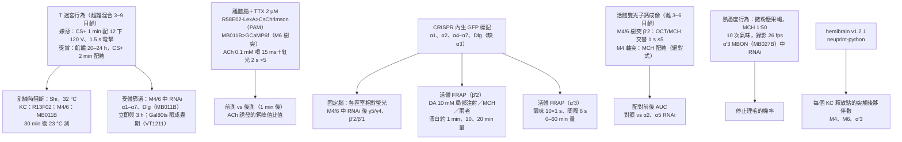

流程圖由上而下是四組獨立的實驗：行為（T 迷宮與理毛測驗）、離體腦的可塑性誘發、受體分布與動態（GFP 標記加 FRAP）、活體鈣成像，最後是連結體分析。各組用的是不同批果蠅。

**果蠅與品系。**

- T 迷宮行為用 3–9 日齡、雌雄混合群體一起訓練與測試；固定腦影像用 2–8 日齡雌蠅；活體鈣成像用 3–6 日齡雌蠅；活體 FRAP 用羽化後 3–4 天的雌蠅（α′3 的 FRAP 另寫 2–8 日齡）；離體腦用 3–10 日齡雌雄混合。
- 驅動品系：MB011B、MB112C、MB461B、MB027B（皆 split-GAL4）、R13F02-GAL4、OK107-GAL4、VT1211-GAL4、R58E02-LexA。**作者註明：基因型太複雜時無法同時使用 MB011B，這種情況改用 VT1211-GAL4 取用 M4/6。** 所以同一個結論的不同實驗，取用 M4/6 的品系不一定相同（見第五節第 5 條）。
- RNAi 品系為 Bloomington 編號 28688、27493、27671、31985、25943、27251、25835（七個 α 次單元）與 DlgS97-RNAi。**哪一個編號對應哪一個次單元，PDF 沒有逐一對應**（grep `28688`、`subunit RNAi` 確認），也沒有做降低效率的驗證（grep `efficien`、`qPCR`、`validat`：唯一命中的 validat 指的是 CRISPR 品系的基因定序）。所以「只有 α5 有效」不能排除其他 RNAi 效率不足（第五節第 1 條）。

**T 迷宮協定。** 氣味為 OCT 與 MCH，礦物油稀釋：嫌惡約 1:100、獎賞約 1:1000。嫌惡：CS+ 1 分鐘，內含 12 下 1.5 秒、120 V 電擊（刺激間隔 3.5 秒），接 45 秒空氣、CS− 1 分鐘、再 30 秒空氣。獎賞：先飢餓 20–24 小時；先給 CS− 2 分鐘，30 秒後給 CS+ 配糖 2 分鐘，再 30 秒空氣。測驗 2 分鐘，在暗中進行。Shi 實驗在訓練前 30 分鐘與訓練期間維持 32 °C，之後回到約 23 °C 室溫。Gal80ts 果蠅一律養在 18–20 °C，實驗前 3–5 天移到 32 °C 誘發 RNAi（對照組全程 18–20 °C）。

**離體腦的可塑性誘發。** 腦取出後以通氧溶液灌流，加 TTX 2 µM（20 ml／10 分鐘）。玻璃微管裝 0.1 mM 乙醯膽鹼，對準 M6 樹突；每次噴 15 毫秒，間隔 4 秒，噴射壓力依初始鈣反應校在 3–8 psi。流程：先噴三次乙醯膽鹼（第一次因管尖稀釋一律捨棄，取後兩次平均），休息 2–3 分鐘，測紅光反應（2 秒紅光、間隔 4 秒）；再噴三次，接著做訓練——五次乙醯膽鹼、五次紅光、或兩者配對（同時開始，乙醯膽鹼 15 毫秒、紅光 2 秒，重複 5 次、每次間隔 4 秒）；訓練後 1 分鐘再噴三次測試。檢驗 KC 是否被噴上的乙醯膽鹼活化時，壓力加大到 8–14 psi、時間拉長到 150–225 毫秒（GCaMP6f）或 300–525 毫秒（SynaptoPhluorin），仍看不到反應。

**受體的 GFP 標記與量化。** 所有 α 次單元（α3 除外）與 Dlg 以 CRISPR 在內生基因上接 EGFP（委由 WellGenetics 製作；位置與 gRNA 序列在表 1，該表只印表題、內容未在 PDF 中：？待查）。固定腦以單光子共軛焦（Leica SP5／STED，64× 油鏡）拍攝，體素 123 × 123 × 500 nm，ROI 依 247-dsRed 手動畫出。因為雷射功率與增益逐次調整，所有數值都以整個蕈狀體的平均螢光正規化。RNAi 後的量化用鄰格當內部對照：γ5 以 γ4 正規化（(γ5 − γ4)/γ4），β′2 以 β′1 正規化（原文寫 (β′2 − β′1)/β′2，**分母與前者不一致**，⚠️ 見第五節第 4 條）。每一個 n 是一個半腦。

**FRAP。** 活體、開窗後以含木瓜酶的溶液軟化腦鞘。β′2 的實驗（圖 6）在同一隻果蠅上依序做三種條件：多巴胺注射（10 mM，微量注射，管中加 Texas red 以便定位）、氣味（MCH）、氣味配多巴胺，各自先漂白再於 10 與 20 分鐘量。α′3 的實驗（圖 7）在漂白後做固定間隔訓練（OCT 或 MCH 10 次、每次 1 秒、間隔 6 秒），之後於 0、5、10、15、20、30、60 分鐘量。回復率先減去漂白後的基線、再除以漂白前的基線；擬合方式是把回復百分比取 1 減後取對數，用無截距的線性混合效應模型（固定效應為條件 × 時間的交互作用，時間為隨機效應，R 套件 lme4），再以 emmeans 做兩兩比較、Tukey 校正。**對照組是同一套流程但只給空氣。**

**活體鈣成像。** M4/6 的樹突反應在 β′2 格量：OCT 與 MCH 各 5 次、每次 1 秒、間隔 30 秒。絕對式訓練改在 M4 的軸突量：訓練前給兩次 1 秒 MCH，然後果蠅吃糖 30 秒、同時給 5 次 1 秒 MCH（間隔 6 秒）；不配對組是先吃糖 30 秒、延遲 45 秒後才給氣味。訓練後 1 分鐘再給兩次氣味。取氣味開始後 3 秒的 AUC，並以該組訓練前的平均正規化。**每種基因型與條件分析 9–12 個半腦，來自 5–7 隻果蠅**（所以圖上的 n 是半腦數，不是果蠅數）。

**熟悉度行為。** 果蠅沾滿黃色粉塵（Reactive Yellow 86），放進自製圓柱腔室，前後接氣泵與真空泵（800 ml/min），氣流來源可切換為純礦物油或 1:50 的 MCH。錄影 26 fps，以 Python 分析。

**連結體分析。** hemibrain v1.2.1，取狀態為 Traced 的 KC；對每個目標 MBON 找出與它相連的 KC，再對每個與該 MBON 相連的 KC 突觸前點，找出該點所有的突觸後夥伴，統計「一個 KC 釋放點同時接到幾個突觸後對象」。

**統計。** 一律先以 Shapiro–Wilk 檢定常態性，常態用 ANOVA 加事後檢定或（成對）t 檢定，非常態用 Kruskal–Wallis 加事後檢定或 Wilcoxon 符號等級檢定。

### 三、結果

#### 3.1 訓練時阻斷 KC 輸出：獎賞記憶全失、嫌惡記憶只略降（圖 1）

在 KC（R13F02-GAL4）表現 Shi，訓練時升到 32 °C，訓練後 30 分鐘在允許溫度測驗。嫌惡記憶：實驗組 PI 約 −0.55、兩個對照組約 −0.65 與 −0.68（※ 從圖判讀），差異不顯著（單因子 ANOVA 加 Tukey，p > 0.05），而且在 23 °C 對照也看得到同樣幅度的下降（圖 1 補 1a，未取得）。獎賞記憶：對照組約 0.29 與 0.26，實驗組約 −0.03，顯著（Kruskal–Wallis 加 Dunn，p < 0.05）。

阻斷下游的 M4/6（MB011B）則不影響獎賞記憶（約 0.13、0.23、0.17，不顯著）。作者由此推論可塑性的位置是 KC→MBON 突觸本身，而不是更下游的迴路。

**評價。** 這組實驗是全篇的前提：若訓練時 MBON 不必「看到」傳遞物，突觸後可塑性就難以成立。嫌惡那一半是陰性結果，n＝7–8，而且作者自己指出 23 °C 對照也有類似下降，所以「嫌惡記憶不需要 KC 輸出」的強度有限；比較穩的說法是「獎賞記憶需要、嫌惡記憶的需求小得多」。

#### 3.2 受體次單元篩選：α5 管立即、α1／α2／Dlg 管 3 小時（圖 2）

在 M4/6（MB011B）逐一降低七個 α 次單元與 Dlg：

| 測驗 | 受影響的 | 不受影響的 |
|---|---|---|
| 立即獎賞記憶 | 只有 α5（約 −0.04，對照約 0.25；※ 從圖判讀；單因子 ANOVA 加 Dunnett，p < 0.05） | α1–α4、α6、α7、Dlg |
| 3 小時獎賞記憶 | α1、α2、α5、Dlg（Kruskal–Wallis 加 Dunn，p < 0.05） | α3、α4、α6、α7 |
| 立即嫌惡記憶 | 無 | 全部 |
| 3 小時嫌惡記憶 | 只有 α7 | 其餘全部 |

α7 的例外作者沒有追，理由是 α7 在脊椎動物也作用於突觸前神經突（引 Eadaim et al. 2020）。為了排除發育期的影響，α5（立即與 3 小時）、α2（3 小時）、Dlg（3 小時）改用 VT1211-GAL4 加 Gal80ts，只在成蟲期最後 3–5 天誘發 RNAi，四組缺陷都重現（圖 2e–h；實驗組 PI 約 0.08–0.17，兩個對照組約 0.30–0.40，※ 從圖判讀），而全程壓住 RNAi 的溫度對照沒有缺陷（圖 2 補 2a–d，未取得）。

作者另以離體腦在 M4/6 樹突上局部施加乙醯膽鹼（TTX 存在下），α2、α5 降低組與對照組的樹突鈣反應相當（圖 3 補 1e，未取得），據此說記憶缺陷不是單純因為「收不到乙醯膽鹼」。

**評價與算術。** 「只有 α5」這個陳述的價值全在其他六個的陰性結果上，而本篇沒有驗證任何一個 RNAi 的降低效率（方法 grep 已確認）。另外，立即記憶的篩選每組 n＝8–13、對照 n＝20；圖 2a、2b 是「篩選所得」的畫法，完整的遺傳對照另畫在圖 2 補 2e–i（未取得）。

#### 3.3 繞過 KC 誘發突觸後可塑性（圖 3）

離體腦、TTX、紅光活化 PAM 群（R58E02-LexA>CsChrimson）、乙醯膽鹼直接噴在 M6 樹突。KC 軸突對噴上的乙醯膽鹼沒有鈣反應，也沒有囊泡釋放訊號（圖 3c 與圖 3 補 1f、g），所以 KC 這一側確實被繞過。結果：

- 只給乙醯膽鹼（n＝13）或只給紅光（n＝10）：訓練前後的鈣峰值比值沒有顯著變化。
- 兩者配對（n＝18）：後測／前測約 1.05–1.06，顯著（比值成對 t 檢定，p < 0.05）。
- 不表現 CsChrimson 的對照做同樣的配對：無變化（圖 3 補 1c、d，未取得）。
- 在 M4/6 降低 α2 後做配對（n＝15）：不顯著。

**評價。** 這是本篇唯一直接顯示「不經突觸前也能改變突觸後」的實驗，但三點要同時記住：(1) 幅度只有約 6%；(2) 方向是**增強**，而活體獎賞訓練後 M4 是**減弱**（3.5），作者自己把這解釋為全域施加乙醯膽鹼與自然稀疏活化的差別，並說這組實驗「只應被視為原理證明」；(3) α2 降低組的「不顯著」是陰性結果，圖 3i 的個體線有不少往上走，組平均約 1.03，和配對組的 1.05 差距小，論文沒有做兩組之間的直接比較（※ 推論：所以不能說 α2 降低「阻斷」了可塑性，只能說在該組測不到顯著變化）。

#### 3.4 受體在各區室分布不均，且 α5、Dlg 影響 α2 的量（圖 4）

內生 GFP 標記顯示每個次單元的分布各不相同。**圖 4b 的熱圖橫軸只有 13 格**（γ5、γ4、γ3、γ2、γ1、β′2、β2、β′1、β1、α′1/1、α′2/2、α′3、α3；※ 從圖判讀），少於正文所說的「至少 15 個區室」；論文沒有說明少了哪幾格或為什麼。縱軸共 7 列：α1、α2、α4、α5、α6、α7、Dlg（α3 沒有做成標記）。與本篇有關的兩格：α5 在整個 γ 葉含 γ5 都高，β′2 略低；α2 在 β′2 與 γ5 同樣偏高。兩者在 α′3 格也測得到，這是熟悉度學習所在的格。

在 M4/6（VT1211）降低特定成分後，以鄰格正規化的相對螢光：

| 量的對象 | 降低 α2 | 降低 α5 | 降低 Dlg |
|---|---|---|---|
| α2GFP 在 γ5（對 γ4） | 顯著下降 | 顯著下降 | 顯著下降 |
| α2GFP 在 β′2（對 β′1） | 顯著下降 | 顯著下降 | 顯著下降 |
| α5GFP 在 γ5（對 γ4） | 無 | 顯著下降 | 無 |
| α5GFP 在 β′2（對 β′1） | 無 | 顯著下降 | 無 |

**注意：正文只說 α5 降低會讓 β′2 的 α2 下降**（「reduced α2 … following α5 subunit knockdown in the β′2 compartment or Dlg knockdown in the β′2 and γ5 compartments」），而圖 4c 的 γ5 也畫了 α5 RNAi 的顯著星號。⚠️ 單篇自身不一致（第五節第 3 條）。作者的結論是 α5 與 Dlg 作用在 α2 的上游，並自己加上「至少在 β′2 格」的但書。

幅度：各組下降約 5 到 14 個相對螢光單位（圖 4c–f 的縱軸範圍 −20 到 +20，※ 從圖判讀）。這個單位是「該格與鄰格之差除以其中一格」的正規化值，不是受體減少的百分比。

#### 3.5 α2 是活體學習造成的可塑性所必需（圖 5）

- 單純重複聞氣味（β′2 樹突）：對照與 α2 降低組的初始 MCH 反應相當，α5 降低組明顯偏高（AUC 約 9.5，對照約 3.5；※ 從圖判讀，單因子 ANOVA 加 Dunnett，p < 0.05）。連續五次之後，對照與 α2 降低組沒有顯著變化，α5 降低組顯著下降（Wilcoxon，p < 0.05）。作者的解讀是：少了 α5，突觸一開始就處在「已經被增強」的狀態，所以只能往下掉。
- 絕對式糖訓練（M4 軸突）：對照組受訓氣味的反應顯著下降（後測約為前測的 0.65，n＝9，成對 t 檢定，p < 0.05）；不配對對照不下降（n＝12）；α2 降低組不論配對或不配對都不下降（n＝9）。
- 對照組對重複的 OCT 反而有易化（圖 5 補 1d，未取得），顯示這些反應有氣味依賴性。

**評價。** 這是全篇把「受體」與「活體學習造成的突觸改變」連起來的一步，但它是陰性結果撐起來的：α2 降低組「沒有下降」。論文沒有報告兩組變化量的直接比較（※ 推論：若要主張阻斷，應比較對照與 α2 組的前後變化比）。α5 降低組在這組實驗沒有做訓練，所以「α5 負責誘發」在活體突觸層次沒有對應資料。

#### 3.6 α2 受體的動態隨訓練改變（圖 6、圖 7）

β′2 格（聯結式）：單給 MCH 時 α2GFP 的螢光回復最快（回歸係數約 0.49）；只給多巴胺時不回復（約 −0.17）；氣味配多巴胺時被壓住（約 0.14），與單給氣味有顯著差異（n＝9–10，線性混合效應模型加兩兩比較，p < 0.05）。改用 OCT、且三種條件分在不同果蠅做時，只有單給氣味顯著回復（圖 6 補 1a–d，未取得）。只給空氣不引起回復（圖 6 補 1e，未取得）。20 分鐘時的回復幅度約 8%（※ 從圖 6d 判讀）。

α′3 格（非聯結式）：重複 10 次氣味後，MBON 的鈣反應由第 2–4 次的中位數約 0.32 降到第 8–10 次的約 0.07（n＝15，Kruskal–Wallis 加 Dunn，p < 0.05），而同一格的 α′β′ KC（MB369B）反應不變（約 0.88 → 0.85，※ 從圖 7b 判讀）。訓練後 α2GFP 的回復在 15、20、30 分鐘顯著高於空氣對照（n＝4–6，多重 t 檢定加 Sidak–Bonferroni 校正）；α5GFP 全程沒有顯著回復（n＝5–7）。在 α′3 MBON 裡降低 α2 或降低 α5，30 分鐘的 α2GFP 回復都消失（n＝4–5）。

**兩格的方向相反。** β′2 是「學習壓住受體動態」，α′3 是「學習提高受體動態」，而兩者對應的都是 MBON 反應下降。作者把這寫成「不同的可塑性規則」，並以哺乳類視覺系統的暗電流與小腦攀緣纖維誘發的長期抑制各作一個比喻；論文沒有提出統一的機制。

**評價。** α′3 那一組 n＝4–6，是全篇樣本最小的實驗之一，而它承擔了「同一個分子在兩種學習裡往相反方向動」這個主張。另外，FRAP 的「回復」只能說明分子在流動，不能分辨是搬進來還是換出去——作者自己在討論中明說這需要更高解析度的實驗。

#### 3.7 熟悉度行為也需要 α5 與 α2（圖 8）

沾粉塵的果蠅會持續理毛，聞到新氣味時停下，聞熟了就繼續理毛。在 α′3 MBON（MB027B）降低 α2：學習期間停止理毛的機率顯著高於對照（約 0.6 對 0.35，n＝9，單因子 ANOVA 加 Dunnett，p < 0.05），也就是學得慢、要好幾次才學會。降低 α5：第一次就不停下來，「像是早就學會這個氣味是熟悉的」；量化為「一開始就在理毛的機率」顯著升高（約 0.7 對 0.5，Kruskal–Wallis 加 Dunn，p < 0.05）。作者註明 α5 組的行為曲線用直線描述較好，其他組用非線性曲線。

**評價。** α5 的表現型與 3.5 的「突觸一開始就已增強」互相呼應，是全篇兩條線最漂亮的一次對上。但 n＝9，而且「對新氣味沒反應」也可以由嗅覺或行為本身的改變造成；本篇沒有對這組果蠅做獨立的嗅覺與理毛能力對照（已 grep 圖 8 與方法全文，只有圖 8 補 1 的額外行為圖譜，內容未取得：？待查）。

#### 3.8 連結體：一個 KC 釋放點同時接好幾個對象（圖 10）

hemibrain 分析顯示，提供輸入給 M4、M6 或 α′3 MBON 的 KC 突觸前點，多數同時連到 3–5 個突觸後對象（三張直方圖的眾數在 3–4，比例約 0.30–0.35；※ 從圖判讀）。共同接收者包括其他 KC、其他 MBON、PAM 與 PPL1 的 DAN、APL 與 DPM 神經元。作者的論點是：MBON 樹突沒有棘（spine），輸入專一性要靠別的方式；若可塑性發生在單一突觸後緻密區（PSD），同一個 KC 釋放點就可以對某個對象改變權重、對其他對象不變——這是突觸前可塑性做不到的分工。

**評價。** 這是解剖上的可能性論證，不是量測。※ 推論：它與本篇自己的實驗是分開的——本篇所有的可塑性量測都是整格平均，沒有單一 PSD 的解析度。

### 四、討論

**主張一：獎賞記憶需要 MBON 上的 nAChR 次單元。** 證據中等偏強。四組行為（α5 立即、α5 3 小時、α2 3 小時、Dlg 3 小時）都在限制在成蟲期的條件下重現，且同一操作不影響嫌惡記憶，這排除了「受體壞掉所以什麼都收不到」的簡單解釋。弱點是 RNAi 效率未驗證、取用 M4/6 的品系在不同實驗之間不一致。

**主張二：α5 負責誘發、α2 負責表現，分別類比 NMDAR 與 AMPAR。** 證據弱到中等，這是把行為的時間點（立即 vs 3 小時）讀成分子的階段。支持它的另外三件事是：α5 降低會拉低 α2 的量、α5 降低後 α2 的動態不再出現、α5 本身沒有可觀察到的動態。但本篇沒有量 α5 或 α2 的電流、鈣通透性或「偵測同時性」的能力——而這正是 NMDAR 類比的核心。作者自己用的詞是 could 與 potentially。

**主張三：突觸後可塑性可以獨立於突觸前被誘發。** 證據弱，幅度約 6%、方向與活體訓練相反、樣本 n＝18，作者自己限定為原理證明。它能成立的部分是「KC 沒有被活化」這一點做得乾淨（兩種讀數都查過）。

**主張四：同一個次單元在兩種學習裡遵循相反的規則。** 證據中等（β′2 與 α′3 的 FRAP 都有對照），但 α′3 組 n＝4–6，而且「動態變化」與「突觸變弱」之間是相關而非因果——兩者在同一格同時發生，本篇沒有阻斷動態再看突觸。

**主張五：獎賞與嫌惡記憶用不同的儲存機制。** 這是本篇最有分量、也最容易被過度解讀的主張。支持它的是兩組陰性結果（訓練時阻斷 KC 對嫌惡影響小、受體降低不影響嫌惡）。作者自己提出兩點保留：Hancock et al. 2022 在部分區室看到嫌惡訓練後的突觸後鈣改變；嫌惡記憶也可能含有獎賞成分（「從懲罰中解脫」）。作者也引本庫的 [[s-hige-2015-heterosynaptic-plasticity]]，說該篇在一個「嫌惡但非獎賞」所需的突觸上排除了突觸後的貢獻，與本篇一致。

**主張六：跨物種的普遍原則。** 作者主張不論傳遞物為何，突觸後可塑性都支持記憶儲存。這是從一個突觸類型推到門（phylum）的層級，屬於延伸推測。

### 五、問題與限制

**1. RNAi 的降低效率沒有驗證。** 全篇最重要的陳述之一是「只有 α5 影響立即獎賞記憶」，它要求其他六個 RNAi 確實有效。方法只給了 Bloomington 編號（28688、27493、27671、31985、25943、27251、25835），沒有列出哪個編號對應哪個次單元，也沒有 qPCR 或蛋白質層級的驗證（已 grep efficien／qPCR／validat 全文）。唯一的間接驗證是圖 4：α2 與 α5 的 RNAi 確實降低了對應的 GFP 螢光——但那只涵蓋兩個次單元。

**2. 離體誘發的方向與活體相反。** 圖 3 的配對造成增強（約 6%），圖 5k 的活體糖訓練造成減弱（約 35%）。作者列了三個理由：全域施加乙醯膽鹼而非稀疏活化、TTX 排除了 MVP2（γ1pedc MBON）帶來的去抑制、M4 與 M6 的角色不同。三個理由都沒有被實驗檢驗。

**3. 正文與圖 4 的範圍不一致。** ⚠️ 單篇自身不一致：正文寫 α5 降低使 α2 下降「在 β′2 格」，結論也只寫「至少在 β′2」；圖 4c 的 γ5 同樣標了 α5 RNAi 的顯著星號。不影響「α5 在 α2 上游」的方向，但影響它涵蓋哪幾格。

同一張圖還有第二處：正文與引言都說蕈狀體至少分成 15 個功能區室，圖 4b 的熱圖橫軸只列 13 格（※ 從圖判讀），論文沒有說明缺的是哪幾格。⚠️ 單篇自身不一致。

**4. 兩個正規化公式不一致。** ⚠️ 單篇自身不一致：方法寫 γ5 用 (γ5 − γ4)/γ4、β′2 用 (β′2 − β′1)/β′2，分母一個是對照格、一個是目標格。若照字面執行，圖 4c、e 與 4d、f 的縱軸不是同一個量，不能並排比較。※ 推論：較可能是誤植（兩式應同為對照格當分母），但本庫不替論文更正。

**5. 取用 M4/6 的品系在實驗之間換過。** 方法明說基因型太複雜時用 VT1211-GAL4 取代 MB011B。圖 2a–d 的篩選用 MB011B，圖 2e–h 的 Gal80ts 驗證用 VT1211；圖 3 的離體誘發用 MB011B，但其中不表現 CsChrimson 的對照改用 VT1211（方法明寫「for technical reasons」）。兩個品系標到的細胞是否完全相同，本篇沒有比較：？待查。

**6. 多數對照在未取得的圖補充裡。** 全部遺傳對照（圖 2 補 1、補 2）、離體的非 CsChrimson 對照（圖 3 補 1c、d）、受乙醯膽鹼的樹突反應對照（圖 3 補 1e）、OCT 版 FRAP（圖 6 補 1）、Dlg 的 FRAP（圖 7 補 1）、理毛的完整行為圖譜（圖 8 補 1）都只在 PDF 中留下標題。所以本頁對這些對照只能轉述正文的敘述，無法查核。

**7. ⚠️ 圖 7 的訓練氣味，圖說與方法不同。** 圖 7a 的圖說寫「MCH was given 10 times for 1 s」，方法「活體單光子受體動態成像」一節寫「OCT was presented 10 times for a second with a 6-s pause in between」。兩處指的是同一組 α′3 的 FRAP 實驗（間隔、次數、時長都相同），氣味卻不同。單篇自身不一致，不需裁決；但若兩種氣味的效果不同（本篇在圖 5 補 1d 自己報告過 OCT 與 MCH 在 M4/6 的反應不同），這會影響圖 7e–g 的解讀。

**8. 行為與生理用的是不同協定。** 行為是 T 迷宮的差別式訓練（兩個氣味，一個配糖），活體成像是絕對式訓練（只有 MCH 配糖）。作者自己指出全域活化無法提供氣味專一性；絕對式訓練同樣沒有 CS− 可以比較，所以成像看到的下降裡有多少屬於聯結式，靠的是「不配對組不下降」這一個對照（n＝12）。

**9. 本庫稽核：「α2 降低阻斷了可塑性」這句話在兩處都只有陰性結果，沒有組間比較。** 圖 3i（離體配對）與圖 5l（活體訓練）的分析都是各組自己的前後成對檢定：對照組顯著、α2 組不顯著。**「一組顯著、另一組不顯著」不等於「兩組不同」**——要主張阻斷，應比較兩組的變化量（例如對變化比做組間檢定，或做基因型 × 時間的交互作用）。圖 3i 的組平均約 1.03，與配對組的約 1.05 相差很小（※ 從圖判讀），尤其需要這個比較。論文全文沒有報告任何這類交互作用檢定（已 grep `interaction`、`two-way`：唯一命中的是 FRAP 模型裡「條件 × 時間」的交互作用，不是這兩組實驗）。這不影響「α5／α2 是記憶所必需」的行為結論，影響的是「受體動態就是那個可塑性」這一步。

### 六、未來

**論文自陳的方向。**
- 釐清 FRAP 的「動態增加」究竟是受體搬進來、換出去，還是沿膜側向擴散，需要高解析度成像。
- 哪些多巴胺受體在 MBON 這一側起作用，以及多巴胺訊號在活體的時間歷程。作者指出前人（Kim et al. 2007）在 KC 補回 DopR 可救回兩種記憶，但獎賞記憶只被部分救回，暗示 MBON 端另有受體。
- α5 是否真的帶來較高的鈣通透性（本篇未測）。
- 把突觸前與突觸後的分工延伸到逆轉學習、再鞏固與消退。

**本庫關注的後續。** 這篇直接對上本庫的 [[syn-contradictions]] 3.2（「改變在突觸前還是突觸後」）：它給了突觸後的第一組正面證據，但只在獎賞與熟悉度記憶、只在 M4/6 與 α′3 兩處；本庫其他篇量的嫌惡可塑性（[[s-hige-2015-heterosynaptic-plasticity]] 的 γ1pedc、[[s-handler-2019-dopamine-receptor-timing]] 的 γ4）在本篇的受體操作下都沒有行為缺陷。所以空缺沒有被填掉，而是被切成兩半：獎賞那一半有了突觸後的證據，嫌惡那一半仍然開著。[[t-dopamine-to-plasticity]] 第四環要相應改寫。

另一條接點是 [[s-hige-2015-heterosynaptic-plasticity]] 列出的三種解釋（突觸前鈣照常但釋放變少／鈣變化太小測不到／改變在突觸後）。本篇支持第三種，但只在不同的區室與不同的增強訊號下，兩者不能直接相接。

**尚未被回答的。** 嫌惡訓練後 MBON 的受體動態會不會變（本篇只在獎賞與熟悉度做 FRAP）？α5 與 α2 的電生理性質是否真的對應 NMDAR 與 AMPAR？同一格裡突觸前與突觸後的改變各占多少？本篇的受體操作會不會改變 MBON 回頭連到 DAN 的回饋（[[t-mbon-dan-feedback]]）？

---
## 圖

> 本篇主圖 10 張全部收錄（圖 9 是模型示意，圖 10 是連結體分析）。圖補充（figure supplement）共 10 張，內容不在 PDF 內、本庫未取得，只在專業文中以「？待查」標示。所有圖都從 300 dpi 整頁渲染裁切。

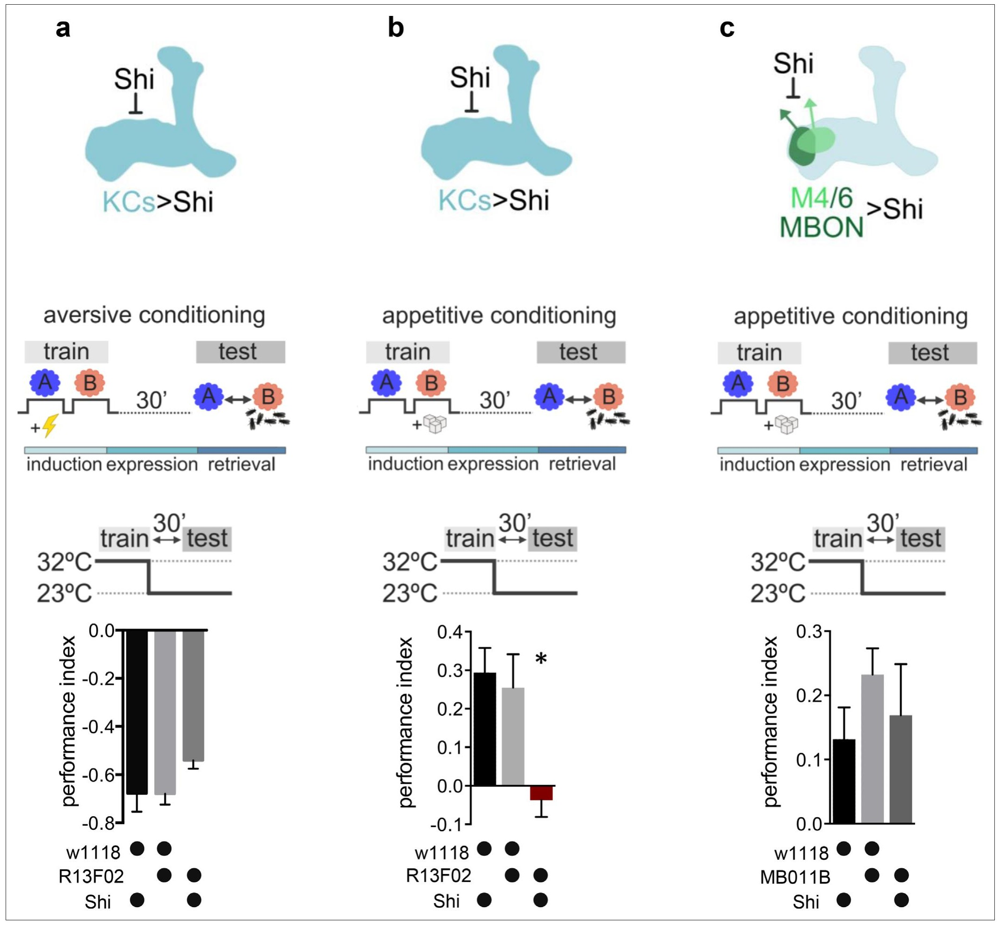

<small>圖片出處：Pribbenow C, Chen Y, Heim M-M et al. *eLife* 11:e80445 (2022)，Figure 1。CC BY（PDF 未印版本號）；全文見 [PMC](https://pmc.ncbi.nlm.nih.gov/articles/PMC9733945/)。</small>

> **原圖說（Figure 1）：** Figure 1. Kenyon cell (KC) neurotransmitter release is required for the acquisition of appetitive memories. (a–c) Flies expressing temperature-sensitive Shibire (Shi) within KCs or mushroom bodies output neurons (MBONs) are trained at restrictive temperature (32°C), and subsequently placed at permissive temperature (23°C) throughout the consolidation and retrieval phase. Memory performance was tested 30 min after training at permissive temperature. Shi blocks neurotransmitter release at 32°C. (a) Block of neurotransmitter release from KCs (driver line R13F02-Gal4) during training does not impact 30-min aversive memory performance. Bar graphs: mean ± SEM; n=7–8; one-way ANOVA followed by Tukey’s test (p>0.05). (b) Block of neurotransmitter release from KCs (driver line R13F02-Gal4) during training impairs 30-min appetitive memory performance. Bar graphs: mean ± SEM; n=10–16; Kruskal-Wallis followed by Dunn’s test (p<0.05), *p<0.05. (c) Block of neurotransmitter release from M4/6 MBONs (driver line MB011B [Split-GAL4]) during training does not impact 30-min appetitive memory performance. Bar graphs: mean ± SEM; n=14–24; one-way ANOVA followed by Tukey’s test (p>0.05). Also see Figure 1—figure supplement 1 for further information.

**圖說中譯：** Kenyon 細胞（KC）的神經傳遞物釋放是獎賞記憶習得所必需。(a–c) 在 KC 或蕈狀體輸出神經元（MBON）中表現溫度敏感型 Shibire（Shi）的果蠅，在限制溫度（32 °C）下受訓，之後在鞏固與提取期間都置於允許溫度（23 °C）。記憶表現於訓練後 30 分鐘、在允許溫度下測試。Shi 在 32 °C 阻斷傳遞物釋放。(a) 訓練時阻斷 KC（驅動品系 R13F02-Gal4）的傳遞物釋放，不影響 30 分鐘的嫌惡記憶表現。長條圖：平均 ± 標準誤；n ＝ 7–8；單因子變異數分析加 Tukey 檢定（p > 0.05）。(b) 訓練時阻斷 KC（R13F02-Gal4）的傳遞物釋放，損害 30 分鐘的獎賞記憶表現。平均 ± 標準誤；n ＝ 10–16；Kruskal–Wallis 加 Dunn 檢定（p < 0.05），\*p < 0.05。(c) 訓練時阻斷 M4/6 MBON（驅動品系 MB011B〔split-GAL4〕）的傳遞物釋放，不影響 30 分鐘的獎賞記憶表現。平均 ± 標準誤；n ＝ 14–24；單因子變異數分析加 Tukey 檢定（p > 0.05）。另見圖 1 補 1。

**解讀：**
- **該看的是 a 與 b 的縱軸方向不同。** 嫌惡記憶畫成負值（果蠅躲開 CS+），獎賞記憶畫成正值（果蠅靠近 CS+），兩張圖的「表現變差」因此是往相反方向移動。a 圖實驗組（約 −0.55）比對照（約 −0.65、−0.68）靠近 0，也就是略差；b 圖實驗組（約 −0.03）掉到 0 以下，等於完全沒學到（※ 從圖判讀）。
- **a 圖是陰性結果，而全篇的論證需要它。** n ＝ 7–8，三組的誤差棒重疊；論文自己指出 23 °C 對照也有同樣幅度的下降（圖 1 補 1a，本庫未取得）。所以這張圖能支持的是「嫌惡記憶受的影響比獎賞小得多」，不是「完全不受影響」。
- **c 圖排除的是下游，不是突觸後。** 阻斷的是 M4/6 自己往外送訊號的能力，不是它接收 KC 訊號的能力。所以它說明可塑性不發生在 M4/6 的下游，與「M4/6 的樹突有沒有可塑性」無關——後者要靠圖 2 以後的受體操作。
- **協定圖裡的 induction／expression／retrieval 色帶是作者的詮釋，不是量測。** 它把「訓練」對應誘發、訓練後到測驗對應表現、測驗對應提取；全篇把「立即記憶受損」讀成誘發缺陷、「3 小時記憶受損」讀成表現缺陷，依據就是這個分段。

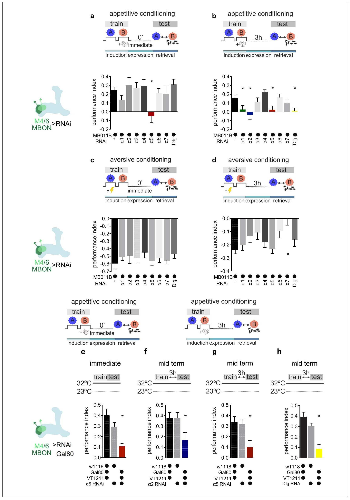

<small>圖片出處：Pribbenow C, Chen Y, Heim M-M et al. *eLife* 11:e80445 (2022)，Figure 2。CC BY（PDF 未印版本號）；全文見 [PMC](https://pmc.ncbi.nlm.nih.gov/articles/PMC9733945/)。</small>

> **原圖說（Figure 2）：** Figure 2. Specific nicotinic acetylcholine receptor (nAChR) α subunits are needed for specific memories in M4/6 neurons. Training and testing protocols indicated schematically. A and B indicate different odors. (a) Immediate appetitive memories are impaired following RNAi knockdown of the α5 nAChR subunit in M4/6 mushroom bodies output neurons (MBONs; driver line MB011B [Split-GAL4]). Bar graphs: mean ± SEM; n=8–13, for controls: n=20; one-way ANOVA followed by Dunnett’s test (p<0.05), *p<0.05. Note: data depicted correspond to initial screen, please see Figure 2—figure supplement  2e for alternate display including all genetic controls. (b) RNAi knockdown of the α1, α2, α5 nAChR subunits or discs large (Dlg) in M4/6 MBONs (driver line MB011B [Split-GAL4]) impairs 3-hr appetitive memories. Bar graphs: mean ± SEM; n=12–26, for controls: n=38; Kruskal-Wallis followed by Dunn’s test (p<0.05), *p<0.05. Note: data depicted correspond to initial screen, please see Figure 2—figure supplement 2 f–i for alternate display including all genetic controls. (c) Immediate aversive learning is not impaired by RNAi knockdown of any subunit in M4/6 MBONs (driver line MB011B [Split-GAL4]). Bar graphs: mean ± SEM; n=6–8, for controls: n=12; Kruskal-Wallis followed by Dunn’s test (p>0.05). (d) 3-hr aversive memory is not affected by knockdown of α subunits with the exception of α7 (driver line MB011B [Split-GAL4]). Bar graphs: mean ± SEM; n=21–32, for controls: n=61. Kruskal-Wallis followed by Dunn’s test (p<0.05), *p<0.05. (e) RNAi knockdown of the α5 subunit in M4/6 MBONs (driver line VT1211-Gal4) is suppressed during development using Gal80ts. 3–5 days before the experiment RNAi knockdown was induced. Immediate memory is significantly impaired. Bar graphs: mean ± SEM; n=6–7; Kruskal-Wallis followed by Dunn’s test (p<0.05), *p<0.05. (f) RNAi knockdown of the α2 subunit in M4/6 MBONs (driver line VT1211-Gal4) is suppressed during development using Gal80ts. 3–5 days before the experiment RNAi knockdown was induced. 3-hr memories are significantly impaired. Bar graphs: mean ± SEM; n=16–17; one-way ANOVA followed by Tukey’s test (p<0.05), *p<0.05. (g) RNAi knockdown of the α5 subunit in M4/6 MBONs (driver line VT1211-Gal4) is suppressed during development using Gal80ts. 3–5 days before the experiment RNAi knockdown was induced. 3-hr memories are significantly impaired. Bar graphs: mean ± SEM; n=25–27; one-way ANOVA followed by Tukey’s test (p<0.05), *p<0.05. (h) RNAi knockdown of Dlg in M4/6 MBONs (driver line VT1211-Gal4) is suppressed during development using Gal80ts. 3–5 days before the experiment RNAi knockdown was induced. 3-hr memories are significantly impaired. Bar graphs: mean ± SEM; n=8–11; one-way ANOVA followed by Tukey’s test (p<0.05), *p<0.05. Also see Figure 2—figure supplements 1 and 2 for further information.

**圖說中譯：** 特定的菸鹼型乙醯膽鹼受體（nAChR）α 次單元是 M4/6 神經元中特定記憶所需。訓練與測試協定以示意圖表示；A 與 B 表示不同氣味。(a) 在 M4/6 蕈狀體輸出神經元（MBON；驅動品系 MB011B〔split-GAL4〕）中以 RNAi 降低 α5 nAChR 次單元後，立即獎賞記憶受損。平均 ± 標準誤；n ＝ 8–13，對照 n ＝ 20；單因子變異數分析加 Dunnett 檢定（p < 0.05），\*p < 0.05。註：此處所示為初次篩選的資料，含全部遺傳對照的另一種呈現見圖 2 補 2e。(b) 在 M4/6 MBON 中以 RNAi 降低 α1、α2、α5 次單元或 discs large（Dlg），損害 3 小時獎賞記憶。平均 ± 標準誤；n ＝ 12–26，對照 n ＝ 38；Kruskal–Wallis 加 Dunn 檢定（p < 0.05），\*p < 0.05。註：同為篩選資料，另一種呈現見圖 2 補 2f–i。(c) 在 M4/6 MBON 中降低任一次單元都不損害立即嫌惡學習。平均 ± 標準誤；n ＝ 6–8，對照 n ＝ 12；Kruskal–Wallis 加 Dunn（p > 0.05）。(d) 3 小時嫌惡記憶不受各 α 次單元降低的影響，α7 除外。平均 ± 標準誤；n ＝ 21–32，對照 n ＝ 61。Kruskal–Wallis 加 Dunn（p < 0.05），\*p < 0.05。(e) 在 M4/6（VT1211-Gal4）以 Gal80ts 在發育期間壓住 α5 的 RNAi，實驗前 3–5 天才誘發。立即記憶顯著受損。n ＝ 6–7；Kruskal–Wallis 加 Dunn（p < 0.05），\*p < 0.05。(f) 同樣方式降低 α2，3 小時記憶顯著受損。n ＝ 16–17；單因子變異數分析加 Tukey（p < 0.05）。(g) 同樣方式降低 α5，3 小時記憶顯著受損。n ＝ 25–27；單因子變異數分析加 Tukey（p < 0.05）。(h) 同樣方式降低 Dlg，3 小時記憶顯著受損。n ＝ 8–11；單因子變異數分析加 Tukey（p < 0.05）。另見圖 2 補 1 與補 2。

**解讀：**
- **這張圖的分量全在 c 與 d 兩排陰性結果上。** 「α5 只影響獎賞、不影響嫌惡」這句話，是本篇區分兩種記憶儲存機制的全部基礎。c、d 的對照組 n 相當大（12 與 61），但實驗組每格只有 6–8 與 21–32，而嫌惡記憶的分數本來就大（約 −0.5），要看出部分缺陷需要的樣本更多。※ 推論：這組資料能排除大幅缺陷，不能排除小幅缺陷。
- **a、b 與 e–h 不是同一套實驗的兩種畫法。** a、b 用 MB011B 驅動 RNAi、全程表現；e–h 用 VT1211 加 Gal80ts、只在成蟲期最後 3–5 天表現。兩者連品系都不同，所以 e–h 不只是「排除發育影響」，也換掉了取用 M4/6 的工具（見專業文第五節第 5 條）。
- **α1 在 b 顯著，之後整篇幾乎不再出現。** 作者的理由是 α1 與 α2 可以組成同一種異質受體，所以集中看 α2。但圖 4b 的分布熱圖顯示 α1 與 α2 在 γ5、α′2 等格並不一致，作者在討論中自己也指出這一點——也就是說「α1 與 α2 在同一個受體裡」這個簡化在本篇的資料裡並不穩。
- **d 圖的 α7 是唯一在嫌惡記憶顯著的一格，被作者以文獻理由擱置。** 若 α7 真的作用在突觸前神經突（引 Eadaim et al. 2020），那它出現在「MBON 專一的 RNAi」實驗裡就需要解釋——MBON 自己的突觸前末梢也是突觸前。論文沒有追這一點。

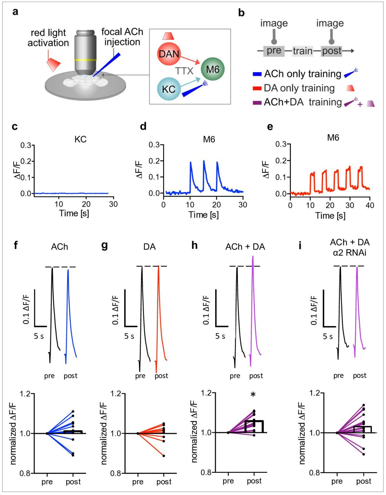

<small>圖片出處：Pribbenow C, Chen Y, Heim M-M et al. *eLife* 11:e80445 (2022)，Figure 3。CC BY（PDF 未印版本號）；全文見 [PMC](https://pmc.ncbi.nlm.nih.gov/articles/PMC9733945/)。</small>

> **原圖說（Figure 3）：** Figure 3. Induction of postsynaptic plasticity bypassing the presynapses. (a) Left: explant brain experimental configuration. Right: connectivity scheme of mushroom bodies (MB) output synapses. Cholinergic Kenyon cells (KCs) and dopaminergic neurons are presynaptic to M6 MB output neurons (MBONs). Only connections relevant for this protocol are shown for simplicity. Red light pulses trigger release of dopamine (DA) from dopaminergic neurons (R58E02-LexA>lexAop-CsChrimsontdTomato), while KC input is circumvented and mimicked by focal acetylcholine (ACh; 0.1 mM) injections to  M6 dendrites in an explant brain preparation. Postsynaptic responses at the level of M6 are measured using GCaMP6f (MB011B [Split-GAL4] >UAS-GCaMP6f). TTX (tetrodotoxine) in the bath suppresses feedback signaling and overall network activity within the circuit. (b) Training scheme (top). Baseline responses to ACh application were initially established (pre). Subsequent training protocols consist of either pairing ACh application with simultaneous activation of dopaminergic neurons (purple connection lines), activation of dopaminergic neurons (red light only, red connection lines), or ACh only (blue, connection lines). This is followed by a test trial (post) through ACh application. (c) Averaged traces of axonal KC calcium changes induced by focal ACh injections. No apparent transients are observable; n=7. Line is mean ± SEM. (d) Sample trace of dendritic M6 calcium changes induced by focal ACh injections. (e) Sample trace of dendritic M6 calcium changes induced by red-light pulses. (f-i) Above: sample calcium traces in response to ACh injections recorded from M6 dendrites pre (black traces) and post (colored traces) training. Below: peak quantification. (f) Changes in ACh-evoked calcium transients; comparison of mean peaks pre-and post-‘ACh only’ training. Before-after plots and bar graphs (mean); n=13, ratio paired t-test. (g) Changes in ACh-evoked calcium transients; comparison of mean peaks pre-and post ‘red light only’ training. Before-after plots and bar graphs (mean); n=10, ratio paired t-test. (h) Changes in ACh-evoked calcium transients; comparison of mean peaks pre-and post ‘paired’ training. Before-after plots and bar graphs (mean); n=18, ratio paired t-test, *p<0.05. (i) Changes in ACh-evoked calcium transients following RNAi knockdown of the α2 subunit in M4/6 MBONs; comparison of mean peaks pre-and post ‘paired’ training. Before-after plots and bar graphs (mean); n=15, ratio paired t-test. Also see Figure 3—figure supplement 1 for further information.

**圖說中譯：** 繞過突觸前誘發突觸後可塑性。(a) 左：離體腦實驗配置。右：蕈狀體輸出突觸的連結示意。膽鹼性 Kenyon 細胞（KC）與多巴胺神經元都是 M6 輸出神經元（MBON）的突觸前來源；為求簡潔只畫與本協定有關的連結。紅光脈衝觸發多巴胺神經元（R58E02-LexA>lexAop-CsChrimson-tdTomato）釋放多巴胺，KC 的輸入則被繞過，改以把乙醯膽鹼（ACh；0.1 mM）局部噴在離體腦的 M6 樹突來模擬。M6 的突觸後反應以 GCaMP6f（MB011B>UAS-GCaMP6f）量測。浴槽中的 TTX（河豚毒素）抑制迴路中的回饋訊號與整體網路活動。(b) 訓練示意（上）。先建立對 ACh 的基線反應（pre）。訓練協定為：ACh 與多巴胺神經元的同時活化配對（紫）、只活化多巴胺神經元（紅光，紅）、或只給 ACh（藍）。之後以一次 ACh 作為測試（post）。(c) 局部噴 ACh 時 KC 軸突鈣變化的平均曲線，看不到明顯的瞬變；n ＝ 7，線為平均 ± 標準誤。(d) 局部噴 ACh 引起的 M6 樹突鈣變化範例。(e) 紅光脈衝引起的 M6 樹突鈣變化範例。(f–i) 上：訓練前（黑）與訓練後（彩色）M6 樹突對 ACh 的鈣反應範例曲線。下：峰值量化。(f) 「只給 ACh」訓練前後平均峰值的比較。前後對照圖與長條圖（平均）；n ＝ 13，比值成對 t 檢定。(g) 「只給紅光」訓練前後的比較；n ＝ 10，比值成對 t 檢定。(h) 「配對」訓練前後的比較；n ＝ 18，比值成對 t 檢定，\*p < 0.05。(i) 在 M4/6 MBON 降低 α2 之後，「配對」訓練前後的比較；n ＝ 15，比值成對 t 檢定。另見圖 3 補 1。

**解讀：**
- **先看縱軸範圍：f–i 下排都是 0.8 到 1.2。** 顯著的 h 圖，長條頂端約在 1.05–1.06，也就是增強約 5–6%。在這個縱軸上，1.05 看起來是明顯的一步；換成 0 到 2 的軸就幾乎看不出來。這是全篇「突觸後可塑性」最直接的證據，幅度卻比活體訓練造成的減弱（圖 5k 約 35%）小一個量級。
- **h 與 i 的差別比圖面給人的印象小。** i 圖（降低 α2）的個別線大半仍往上走，組平均約 1.03（※ 從圖判讀）。論文只各做各的前後檢定，沒有比較兩組的變化量，所以「α2 是這個可塑性所必需」在這張圖上是「測不到」而不是「被阻斷」（見專業文第五節第 9 條）。
- **c 圖是這組實驗能成立的關鍵，而它是陰性結果。** 若噴上的 ACh 也活化了 KC 軸突，整個「繞過突觸前」就不成立。作者把壓力加大到 8–14 psi、噴射時間拉長十倍以上仍看不到反應（方法），另外也用囊泡釋放的指示劑查過（圖 3 補 1f、g，未取得）。這是本篇做得最紮實的一個對照。
- **方向與活體相反，作者沒有掩飾。** 離體配對造成增強，活體糖訓練造成減弱。論文明說這組實驗「只應被視為原理證明」，並列出三個可能原因（全域而非稀疏活化、TTX 排除了 MVP2 的去抑制、M4 與 M6 角色不同）。本庫提醒：這三個原因都沒有被檢驗。
- **TTX 讓這個製備同時失去兩樣東西。** 它排除了網路的干擾（這是作者要的），也排除了活體中 MBON 之間的相互作用（這是作者自己點名的 MVP2 去抑制，見 [[s-felsenberg-2018-memory-extinction]]）。所以這張圖量到的是「一個孤立突觸對多巴胺的反應」，不是學習時那個突觸的處境。

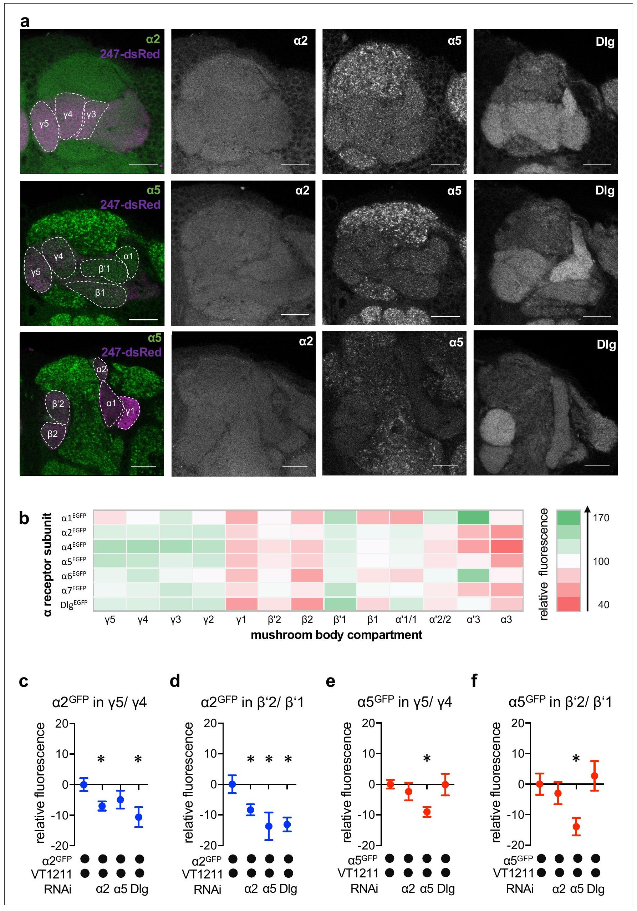

<small>圖片出處：Pribbenow C, Chen Y, Heim M-M et al. *eLife* 11:e80445 (2022)，Figure 4。CC BY（PDF 未印版本號）；全文見 [PMC](https://pmc.ncbi.nlm.nih.gov/articles/PMC9733945/)。</small>

> **原圖說（Figure 4）：** Figure 4. Nicotinic acetylcholine receptor (nAChR) α subunit localization throughout the mushroom bodies (MB): MB output neuron (MBON)-specific RNAi alters subunit distribution. (a) Representative images of the GFP-tagged nAChR subunits α2 and α5 as well as discs large (Dlg). Individual images displayed here are taken from different animals. For other subunits, see Figure 4—figure supplement 1. Scale bar: 20 μm. Left: merge of α subunit signal (green) with MB compartments marked with 247-dsRed (magenta). Compartments are indicated by dashed lines. Top row: γ compartments;  middle row: α, β’, β, and γ compartments, bottom row: α’, α, and β compartments. (b) Quantification of all GFP-tagged α receptors (except for the α3 subunit). GFP signals for the indicated MB compartments are relative to the mean intensity of the GFP signal of the complete MB; n=7–18. (c) Knockdown of Dlg or α2 in M4/6 neurons (driver line VT1211-Gal4) significantly reduces the α2GFP fluorescence within the γ5 compartment (relative to unmanipulated γ4). Bar graph: normalized mean ± SEM; n=8–20; Kruskal-Wallis followed by Dunn’s test (p<0.05), *p<0.05. (d) Knockdown of either the α2 or the α5 nAChR subunit or Dlg in M4/6 neurons (driver line VT1211-Gal4) decreases the relative fluorescence signal of α2GFP in the β’2 compartment (relative to unmanipulated β’1). Bar graph: normalized mean ± SEM; n=9–20; one-way ANOVA followed by Dunnett’s test (p<0.05), *p<0.05. (e) Knockdown of α5 in M4/6 neurons (driver line VT1211-Gal4) decreases the α5GFP signal in the γ5 compartment (relative to unmanipulated γ4). Bar graph: normalized mean ± SEM; n=9–28; Kruskal-Wallis followed by Dunn’s test (p<0.05), *p<0.05. (f) α5GFP fluorescence is significantly decreased in the β’2 compartment (relative to unmanipulated β’1) after knockdown of α5 in M4/6 neurons (driver line VT1211-Gal4). Bar graph: normalized mean ± SEM; n=10–28; Kruskal-Wallis followed by Dunn’s test (p<0.05), *p<0.05. Also see Figure 4—figure supplement 1 for further information.

**圖說中譯：** 菸鹼型乙醯膽鹼受體（nAChR）α 次單元在蕈狀體（MB）各處的定位：MBON 專一的 RNAi 改變次單元分布。(a) GFP 標記的 nAChR 次單元 α2、α5 與 discs large（Dlg）的代表影像。此處各張影像取自不同個體。其他次單元見圖 4 補 1。比例尺 20 μm。左：α 次單元訊號（綠）與以 247-dsRed 標出的 MB 區室（洋紅）合併，區室以虛線標示。上排：γ 區室；中排：α、β′、β、γ 區室；下排：α′、α、β 區室。(b) 所有 GFP 標記的 α 受體（α3 除外）的量化。各區室的 GFP 訊號相對於整個 MB 的 GFP 平均強度；n ＝ 7–18。(c) 在 M4/6 神經元（驅動品系 VT1211-Gal4）降低 Dlg 或 α2，顯著降低 γ5 區室內的 α2GFP 螢光（相對於未操作的 γ4）。長條圖：正規化後的平均 ± 標準誤；n ＝ 8–20；Kruskal–Wallis 加 Dunn（p < 0.05），\*p < 0.05。(d) 在 M4/6 降低 α2、α5 或 Dlg，都降低 β′2 區室的 α2GFP 相對螢光（相對於未操作的 β′1）。n ＝ 9–20；單因子變異數分析加 Dunnett（p < 0.05）。(e) 在 M4/6 降低 α5，降低 γ5 的 α5GFP 訊號（相對於 γ4）。n ＝ 9–28；Kruskal–Wallis 加 Dunn（p < 0.05）。(f) 在 M4/6 降低 α5 之後，β′2 的 α5GFP 螢光顯著下降（相對於 β′1）。n ＝ 10–28；Kruskal–Wallis 加 Dunn（p < 0.05）。另見圖 4 補 1。

**解讀：**
- **b 圖的格子數與正文對不上。** 正文說蕈狀體至少分成 15 個功能區室，熱圖橫軸只列 13 格（※ 從圖判讀）。論文沒有交代少了哪兩格以上、為什麼不量。所以「分布涵蓋整個蕈狀體」這個印象要打折。
- **b 圖的熱圖只有 7 列，不是 8 列。** α1、α2、α4、α5、α6、α7、Dlg——α3 沒有做成 GFP 標記品系（方法明寫）。所以「涵蓋所有 α 次單元」這句話在分布資料上有一個缺口，而 α3 的 RNAi 在圖 2 的行為篩選裡是有做的。
- **c 圖與正文對不上。** 正文只說 α5 降低會使 β′2 的 α2 下降，結論也寫「至少在 β′2」；但 c 圖的 γ5 同樣給了 α5 RNAi 顯著星號。⚠️ 單篇自身不一致（專業文第五節第 3 條）。
- **縱軸的單位不是「受體少了幾成」。** 它是目標格與鄰格的差再除以其中一格的正規化值，範圍畫成 −20 到 +20。各組的下降約 5–14 個單位（※ 從圖判讀）。要把它讀成「受體減少的比例」，必須先知道兩格原本的絕對螢光比，論文沒有給。
- **真正該注意的是 e、f 兩圖：α2 與 Dlg 的降低都不影響 α5。** 這個不對稱（α5 影響 α2，α2 不影響 α5）正是「α5 在上游」的主要依據，而它同樣是陰性結果撐起來的，n ＝ 9–28。
- **a 圖是不同個體的代表影像拼在一起。** 圖說明寫「taken from different animals」，而且雷射功率與增益逐次調整過（方法），所以 a 圖的綠色亮度不能跨欄比較；可比較的只有 b 圖那組以全蕈狀體平均正規化後的數值。

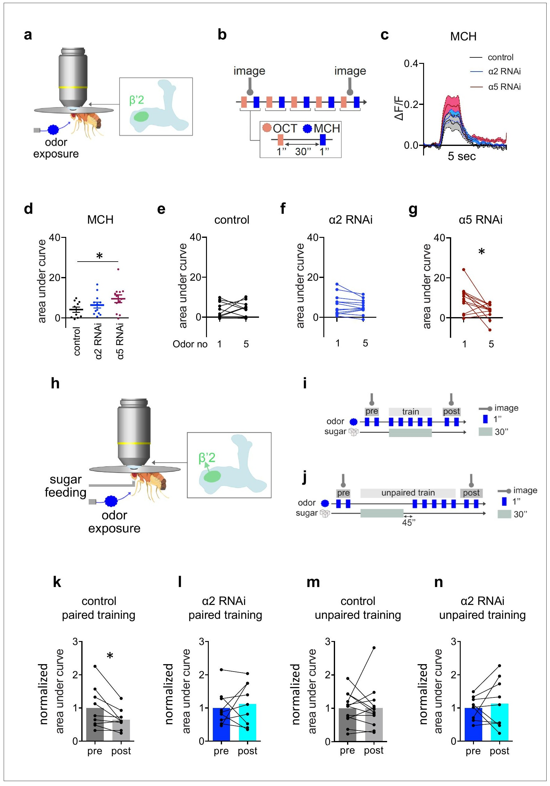

<small>圖片出處：Pribbenow C, Chen Y, Heim M-M et al. *eLife* 11:e80445 (2022)，Figure 5。CC BY（PDF 未印版本號）；全文見 [PMC](https://pmc.ncbi.nlm.nih.gov/articles/PMC9733945/)。</small>

> **原圖說（Figure 5）：** Figure 5. α2 is required for learning-associated plasticity in vivo. (a) Scheme indicating the dendritic imaging area (c–g) at the level of the β’2 compartment. (b) Odor exposure protocol. Five octanol (OCT) stimuli were alternatingly administered with five methylcyclohexanol (MCH) stimuli. 1-s odor puffs were separated by 30 s breaks. (c) Averaged traces of GCaMP6f (calcium) responses to MCH from control (black), α2 (blue), and α5 RNAi (red; driven in M4/6, respectively, driver line VT1211-Gal4) flies. Solid traces are mean, shaded areas SEM; n=10–12. (d) Area under curve (AUC) quantification  of averaged initial odor responses to MCH following α5 knockdown in M4/6 neurons (driver line VT1211-Gal4). Mean ± SEM; one-way ANOVA followed by Dunnett’s test; *p<0.05; n=10–12. (e) Control flies show no significant increase between the first and the fifth response to MCH. n=10; paired t-test. (f) α2 RNAi flies show no difference between the first and fifth odor response to MCH. Nicotinic acetylcholine receptor (nAChR) subunit RNAi is driven in M4/6 neurons (driver line VT1211-Gal4). n=12; paired t-test. (g) α5 RNAi flies show a significant decrease in calcium transients over the course of consecutive odor exposures. nAChR subunit RNAi is driven in M4/6 neurons (driver line VT1211-Gal4). n=12; Wilcoxon matched-pairs signed rank test; *p<0.05. (h) Arrow in scheme for absolute training indicates the axonal imaging area of M4 (k–n). (i) Scheme for absolute paired training under the microscope: flies are exposed to two brief stimuli of the odor (MCH) before training while recording GCaMP6f signals (preresponse). Immediately after, flies are presented with a sugar solution for 30 s accompanied by 5 pulses of odor stimuli. 1 min after training, flies are exposed to two brief odor stimuli again while recording GCaMP6f signals (postresponse). Axonal imaging area indicated by arrow. (j) Scheme for absolute unpaired training under the microscope: as in (i) except flies are exposed to 5 pulses of odor stimuli 45 s after presenting the sugar solution for 30 s. 1 min after training, the flies are exposed to two brief odor stimuli again while recording GCaMP6f signals (postresponse). Axonal imaging area indicated by arrow. (k) Control flies show a significant decrease in odor-evoked GCaMP6f signals. AUC of response to MCH (trained odor) following paired training (driver line VT1211-Gal4, axonal imaging). Before-after plots and bar graphs (mean); n=9; paired t-test; *p<0.05. (l) α2 RNAi flies show no significant decrease in odor-evoked GCaMP6f signals. AUC of response to MCH (trained odor) following paired training (driver line VT1211-Gal4, axonal imaging). Before-after plots and bar graphs (mean); n=9; paired t-test. (m) Control flies show no significant decrease in odor-evoked GCaMP6f signals. AUC of response to MCH (trained odor) following unpaired training (driver line VT1211-Gal4, axonal imaging). Before-after plots and bar graphs (mean); n=12; Wilcoxon matched-pairs signed rank test. (n) α2 RNAi flies show no significant decrease in odor-evoked GCaMP6f signals. AUC of response to MCH (trained odor) following unpaired training (driver line VT1211-Gal4, axonal imaging). Before-after plots and bar graphs (mean); n=9; paired t-test. Also see Figure 5—figure supplement 1 for further information.

**圖說中譯：** α2 是活體學習相關可塑性所必需。(a) 示意 (c–g) 的樹突成像範圍，位於 β′2 區室。(b) 氣味給予協定：五次辛醇（OCT）與五次甲基環己醇（MCH）交替給予，1 秒的氣味脈衝之間間隔 30 秒。(c) 對照（黑）、α2（藍）與 α5 RNAi（紅；分別在 M4/6 以 VT1211-Gal4 驅動）果蠅對 MCH 的 GCaMP6f（鈣）反應平均曲線。實線為平均，陰影為標準誤；n ＝ 10–12。(d) 在 M4/6 降低 α5 之後，對 MCH 的初始氣味反應平均值的曲線下面積（AUC）量化。平均 ± 標準誤；單因子變異數分析加 Dunnett；\*p < 0.05；n ＝ 10–12。(e) 對照果蠅對 MCH 的第一次與第五次反應沒有顯著增加。n ＝ 10；成對 t 檢定。(f) α2 RNAi 果蠅第一次與第五次的氣味反應沒有差別。n ＝ 12；成對 t 檢定。(g) α5 RNAi 果蠅在連續氣味給予過程中，鈣瞬變顯著下降。n ＝ 12；Wilcoxon 配對符號等級檢定；\*p < 0.05。(h) 絕對式訓練示意圖中的箭頭標出 (k–n) 的 M4 軸突成像範圍。(i) 顯微鏡下絕對式配對訓練示意：訓練前先給果蠅兩次短暫氣味（MCH）並記錄 GCaMP6f 訊號（前反應）；緊接著讓果蠅接觸糖溶液 30 秒，同時給五次氣味脈衝。訓練後 1 分鐘再給兩次短暫氣味並記錄（後反應）。(j) 絕對式不配對訓練示意：同 (i)，但在給糖 30 秒之後延遲 45 秒才給五次氣味脈衝。(k) 配對訓練後，對照果蠅對受訓氣味（MCH）的 GCaMP6f 反應顯著下降（VT1211-Gal4，軸突成像）。n ＝ 9；成對 t 檢定；\*p < 0.05。(l) α2 RNAi 果蠅沒有顯著下降。n ＝ 9；成對 t 檢定。(m) 不配對訓練的對照果蠅沒有顯著下降。n ＝ 12；Wilcoxon 配對符號等級檢定。(n) 不配對訓練的 α2 RNAi 果蠅沒有顯著下降。n ＝ 9；成對 t 檢定。另見圖 5 補 1。

**解讀：**
- **d 圖是本篇對「α5 讓突觸一開始就被增強」的唯一直接證據。** α5 降低組的初始 MCH 反應 AUC 約 9.5，對照約 3.5（※ 從圖判讀），而且只有它在重複刺激後會下降（g）。作者的推論是：既然已經增強到頂，剩下的只有往下。※ 推論：同一組資料也相容於另一種解釋——α5 降低改變了樹突本身的整合特性（作者在討論中引 Barnstedt 2016 說樹突活化升高反而讓軸突鈣下降），而不是突觸權重被推到上限。兩者在這張圖上分不開。
- **k–n 四張圖都用「各自的前後檢定」，沒有組間比較。** 對照配對組顯著下降（後約為前的 0.65），其餘三組都不顯著。這正是第五節第 9 條點名的問題：四張圖並排會讓人讀成「只有配對的對照組變了」，但實際成立的只有「只有配對的對照組達到顯著」。
- **這裡的 n 是半腦，不是果蠅。** 方法寫明每種基因型與條件分析 9–12 個半腦、來自 5–7 隻果蠅。同一隻果蠅的左右兩側不是獨立樣本，論文沒有說明是否處理了這一點（？待查）。
- **b 圖的協定沒有 CS−。** 絕對式訓練只有一個氣味配糖，所以「氣味專一」在這組實驗裡沒有被測；排除非聯結效應靠的是 m 圖那一個不配對對照。
- **c 圖三條曲線的分離主要在高度，不在形狀。** 三組的上升與回落時間接近，α5 組整條偏高。這支持「基線不同」而不是「反應動力學改變」的解讀（※ 推論）。

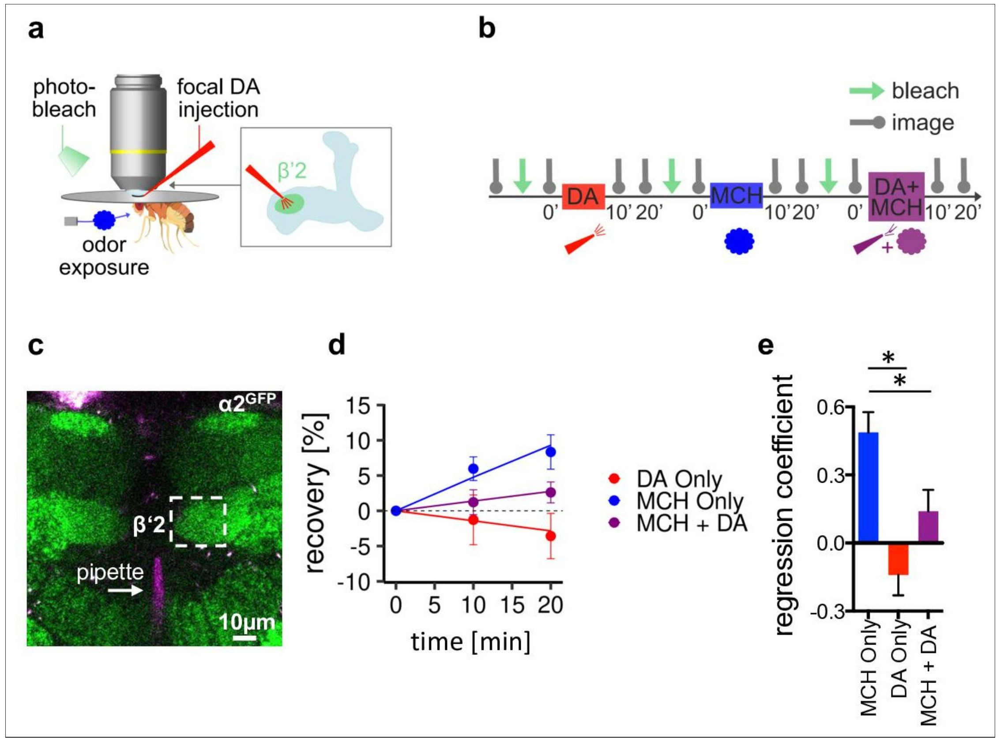

<small>圖片出處：Pribbenow C, Chen Y, Heim M-M et al. *eLife* 11:e80445 (2022)，Figure 6。CC BY（PDF 未印版本號）；全文見 [PMC](https://pmc.ncbi.nlm.nih.gov/articles/PMC9733945/)。</small>

> **原圖說（Figure 6）：** Figure 6. α2 nicotinic acetylcholine receptor (nAChR) subunits dynamically rearrange. (a) In vivo imaging configuration and scheme of site of dopamine (DA) injection during fluorescence recovery after photobleaching (FRAP) experiments at the level of the Kenyon cell to mushroom body output neuron synapses of the β’2 compartment. (b) FRAP experimental protocol. After bleaching, the baseline picture was taken followed by DA injection, odor presentation, and odor presentation simultaneously with DA injection in the same fly. Fluorescence recovery was monitored at the 10-and 20-min time points. (c) Example image of α2GFP expression; white dashed box shows the β’2 output zone; DA injection pipette (with Texas red) is labeled in magenta. Scale bar: 10 µm. (d) Inverse exponential decay fit of FRAP following methylcyclohexanol (MCH) exposure (blue line), MCH exposure simultaneously with DA injection (purple line), and DA injection alone (red line). (e) Regression coefficient for the inverse exponential decay fit. Bar graphs: regression coefficients of recovery kinetics ± standard error of regression; n=9–10, linear mixed effects model followed by pairwise comparison from estimated marginal trends. *p < 0.05. Also see Figure 6—figure supplement 1 for further experiments.

**圖說中譯：** α2 菸鹼型乙醯膽鹼受體（nAChR）次單元會動態重排。(a) 活體成像配置，以及在 β′2 區室 Kenyon 細胞到蕈狀體輸出神經元突觸層次做光漂白後螢光回復（FRAP）實驗時的多巴胺（DA）注射位置示意。(b) FRAP 實驗協定：漂白後先拍基線影像，接著在同一隻果蠅身上依序做多巴胺注射、氣味給予、以及氣味與多巴胺注射同時給予；於 10 與 20 分鐘兩個時間點監測螢光回復。(c) α2GFP 表現的範例影像；白色虛線框為 β′2 輸出區；注射多巴胺的微量吸管（含 Texas red）以洋紅標示。比例尺 10 µm。(d) 甲基環己醇（MCH）暴露（藍線）、MCH 與多巴胺注射同時（紫線）、以及單獨多巴胺注射（紅線）之後 FRAP 的反指數衰減擬合。(e) 反指數衰減擬合的回歸係數。長條圖：回復動力學的回歸係數 ± 回歸標準誤；n ＝ 9–10，線性混合效應模型加由估計邊際趨勢做的兩兩比較。\*p < 0.05。另見圖 6 補 1。

**解讀：**
- **d 圖的縱軸是 −10 到 15%，20 分鐘時最高的一組約 8%（※ 從圖判讀）。** FRAP 的回復幅度在這裡很小；論文沒有報告回復的上限（plateau），所以「可動分子占多少比例」無法由本圖推得。
- **e 圖的三根長條有兩種不同性質的比較混在一起。** 「單給 MCH」顯著高於另兩組（圖上兩條星號橫線），但「單給多巴胺」的係數是負的（約 −0.17）——負的回復在 FRAP 中沒有直接的物理意義（螢光比漂白後更低），比較可能的解讀是持續漂白或訊號漂移（※ 推論，論文未討論）。這一點會影響「多巴胺本身壓住動態」的解讀：壓住到「低於基線」，需要另外的機制。
- **b 圖的三種條件在同一隻果蠅上依序做，順序固定。** 多巴胺 → 氣味 → 兩者同時。所以「兩者同時」永遠排在最後，若漂白或注射有累積效應，就會偏向降低最後一組的回復。作者意識到這個問題，另外用 OCT 把三種條件分在不同果蠅上重做（圖 6 補 1a–d，本庫未取得），正文說結論相同。
- **這張圖量的是受體在動，不是受體變多或變少。** FRAP 的回復可以來自新受體插入、也可以來自既有受體側向擴散進來；論文在討論中自己說要分辨這兩者需要更高解析度的實驗。所以「學習壓住動態」不等於「學習讓受體減少」。

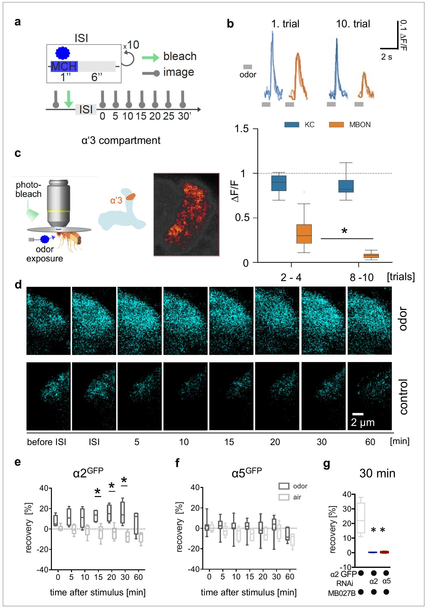

<small>圖片出處：Pribbenow C, Chen Y, Heim M-M et al. *eLife* 11:e80445 (2022)，Figure 7。CC BY（PDF 未印版本號）；全文見 [PMC](https://pmc.ncbi.nlm.nih.gov/articles/PMC9733945/)。</small>

> **原圖說（Figure 7）：** Figure 7. Non-associative plasticity alters postsynaptic α2 subunit receptor dynamics. (a) Training scheme indicating odor application, bleaching, and imaging time points. MCH was given 10 times for 1 s with a pause of 6 s in-between. Images were taken after training in absence of odor immediately afterward and 5, 10, 15, 20, 30, and 60 min later. (b) Top: Calcium peaks in response to odor stimuli of presynaptic Kenyon cells (KCs; MB369B as driver line) and adjacent postsynaptic mushroom body output neurons (MBONs; driver line: MB027B [Split-GAL4]). Individual calcium responses to trials  1 and 10 for MBONs (orange lines) and KCs (blue lines). Bottom: Averaged calcium responses to odor stimuli of presynaptic KCs and postsynaptic MBONs of trials 2–4 and 8–10, respectively. Responses decrease at the level of MBONs but not at the level of KCs over 10 trials. Box plots are median and 75% quartiles; n=15; Kruskal-Wallis followed by Dunn’s test (p<0.05), *p<0.05. (c) In vivo imaging configuration (left), scheme of α’3 compartment analyzed (right), and representative α5GFP fluorescent image (smoothed). Scale bar: 10 μm. (d) Example images of α2GFP fluorescence recovery after photobleaching (FRAP) experiment at the level of the α’3 compartment at specific time points before and after training. Top row: after training; bottom row: control settings. Scale bar: 2 μm. (e) FRAP of α2GFP nicotinic acetylcholine receptor (nAChR) subunit in the α’3 compartment after odor presentation. α2GFP shows significant recovery following odor training compared to the controls. Recovery rate is normalized to the baseline recorded after selective bleaching of the α’3 mushroom bodies (MB) compartment. Box plots are median and 75% quartiles; n=4–6; multiple t-tests with Sidak-Bonferroni correction, *p<0.05. (f) FRAP of α5GFP subunit in the α’3 compartment after odor presentation. α5GFP did not show significant recovery compared to the controls. Recovery rate is normalized to the baseline recorded after selective bleaching of α’3 MB compartment. Box plots are median and 75% quartiles; n=5–7, multiple t-tests with Sidak-Bonferroni correction. (g) FRAP of α2GFP nAChR subunit in the α’3 compartment after odor presentation and knockdown of either the α2 or α5 subunit (RNAi) in the α’3 MBON (driver line MB027B [Split-GAL4]). α2GFP shows no recovery 30 min after odor training in α2 or α5 knockdown animals compared to the controls. Recovery rate is normalized to the baseline recorded after selective bleaching of the α’3 MB compartment. Box plots are minimum value to maximum value; n=4–5; Kruskal-Wallis followed by Dunn’s test (p<0.05), *p<0.05. Also see Figure 7— figure supplement 1 for further information.

**圖說中譯：** 非聯結式可塑性改變突觸後 α2 次單元的受體動態。(a) 訓練示意，標出氣味給予、漂白與成像的時間點。MCH 給 10 次、每次 1 秒、中間停 6 秒。訓練後在沒有氣味的情況下立即取像，之後於 5、10、15、20、30、60 分鐘再取。(b) 上：突觸前 Kenyon 細胞（KC；驅動品系 MB369B）與相鄰突觸後蕈狀體輸出神經元（MBON；驅動品系 MB027B）對氣味刺激的鈣峰值。MBON（橘線）與 KC（藍線）在第 1 與第 10 次試驗的個別鈣反應。下：第 2–4 次與第 8–10 次試驗的平均鈣反應。十次試驗中 MBON 的反應下降，KC 則否。盒鬚圖為中位數與 75% 四分位；n ＝ 15；Kruskal–Wallis 加 Dunn（p < 0.05），\*p < 0.05。(c) 活體成像配置（左）、所分析的 α′3 區室示意（右），以及 α5GFP 螢光代表影像（已平滑化）。比例尺 10 μm。(d) α′3 區室 α2GFP 光漂白後螢光回復實驗的範例影像，標出訓練前後的特定時間點。上排：訓練後；下排：對照。比例尺 2 μm。(e) 氣味給予後 α′3 區室 α2GFP 的 FRAP。相較對照，α2GFP 在氣味訓練後顯著回復。回復率以選擇性漂白 α′3 區室後記錄的基線正規化。盒鬚圖為中位數與 75% 四分位；n ＝ 4–6；多重 t 檢定加 Sidak–Bonferroni 校正，\*p < 0.05。(f) α′3 區室 α5GFP 的 FRAP。相較對照沒有顯著回復。n ＝ 5–7，多重 t 檢定加 Sidak–Bonferroni 校正。(g) 在 α′3 MBON（驅動品系 MB027B）降低 α2 或 α5（RNAi）之後，氣味給予後 α′3 區室 α2GFP 的 FRAP。相較對照，降低 α2 或 α5 的果蠅在氣味訓練後 30 分鐘沒有回復。回復率以選擇性漂白後的基線正規化。盒鬚圖為最小值到最大值；n ＝ 4–5；Kruskal–Wallis 加 Dunn（p < 0.05），\*p < 0.05。另見圖 7 補 1。

**解讀：**
- **b 圖是全篇唯一一次在同一格同時量突觸前與突觸後，而且它支持突觸後。** MBON 的反應由第 2–4 次的中位數約 0.32 降到第 8–10 次的約 0.07，同一格的 α′β′ KC 幾乎不動（約 0.88 → 0.85，※ 從圖判讀）。但兩者來自不同的驅動品系、不同的果蠅（MB369B 對 MB027B），不是同一隻果蠅上的同步記錄。
- **b 圖下排的 KC 與 MBON 盒子寬度差很多。** MBON 第 8–10 次的盒子非常窄（接近 0 的地板），KC 兩組都寬。※ 推論：MBON 降到接近 0 之後，進一步下降的空間本來就小，所以不宜由這張圖推論「降到最低點」。
- **⚠️ 圖說寫 MCH，方法寫 OCT。** 同一組實驗（10 次、每次 1 秒、間隔 6 秒）的氣味在兩處不同，論文沒有說明。單篇自身不一致，見專業文第五節第 7 條。
- **e、f、g 三張圖的 n 是 4–7，全篇最小。** 而它們承擔的主張最重：α2 會動、α5 不會動、α5 是 α2 動態的上游。f 圖是陰性結果（α5 沒有回復），用這麼小的樣本說「α5 沒有動態」，只能是弱證據。
- **g 圖的兩個 RNAi 組幾乎都壓在 0。** 對照約 22%、兩個 RNAi 組接近 0（※ 從圖判讀）。α2 RNAi 組回復為 0 有一個簡單解釋：被量的螢光分子本身就是 α2，降低它之後可動的分子也變少。所以 g 圖裡真正提供新資訊的是 α5 那一組。
- **這一格的方向和圖 6 相反，而兩邊都對應 MBON 反應下降。** β′2 是「訓練壓住動態」，α′3 是「訓練加快動態」。作者承認這是兩套不同的規則，沒有提出統一機制；本庫認為這是本篇最值得後續檢驗的一點（見專業文第六節）。

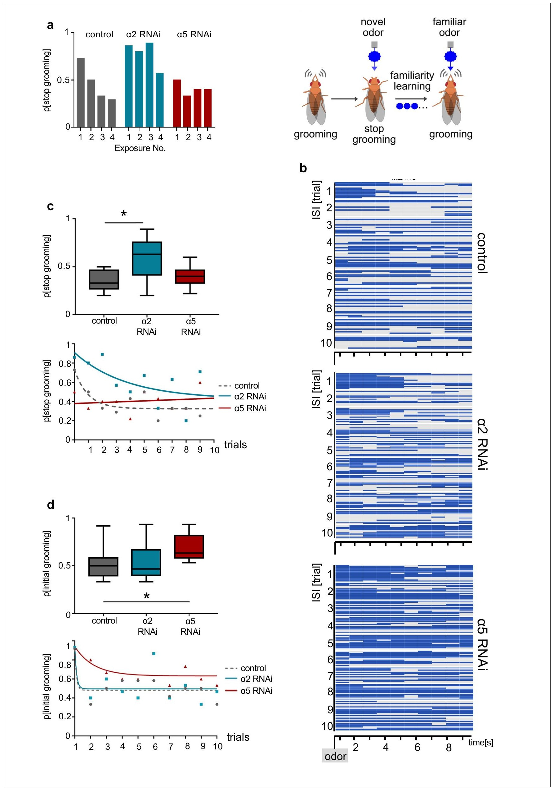

<small>圖片出處：Pribbenow C, Chen Y, Heim M-M et al. *eLife* 11:e80445 (2022)，Figure 8。CC BY（PDF 未印版本號）；全文見 [PMC](https://pmc.ncbi.nlm.nih.gov/articles/PMC9733945/)。</small>

> **原圖說（Figure 8）：** Figure 8. α2 and α5 nicotinic acetylcholine receptor (nAChR) subunits are required for non-associative familiarity learning at the level of α’3 mushroom body output neurons (MBONs). (a) Scheme of behavioral responses to novel and familiar odors (right). (Left): Knockdown of α nAChR subunits at the level of α’3 MBONs alters odor familiarity learning and the probability to stop grooming. α2 RNAi knockdown delays familiarity learning effects to novel odors. α5 RNAi knockdown flies do not show a novelty response at all. (b) Grooming behavior response of dusted flies following the repeated  presentations of a novel odor (MCH). Ethogram of grooming behavior (blue) during 10 intervals of odor exposures. Horizontal lines in each trial correspond to a single experimental fly within a trial group. Not grooming (gray) flies can further be categorized between pausing and wandering (see Figure 8—figure supplement 1). n=15. (c) Knockdown of α2 subunit in α’3 MBONs (driver line MB027B [Split-GAL4]) impairs odor familiarity learning significantly; animals show a higher probability to terminate grooming responses during the learning period. The learning period is defined as the odor exposure rounds following the first exposure. Bottom graph: Non-linear representation of grooming flies over 10 training trials. Note that α5 behavioral responses are best described by linear representation. Box plots are median and 75% quartiles; n=9, one-way ANOVA followed by Dunnett’s test (p<0.05) *p<0.05. (d) Knockdown of α5 subunits in α’3 MBONs (driver line MB027B [Split-GAL4]) leads to an increased probability to start grooming earlier. Bottom graph, non-linear representation of grooming flies over 10 training trials. Box plots are median and 75% quartiles; n=9, Kruskal-Wallis followed by Dunn’s test (p<0.05), *p<0.05. Also see Figure 8—figure supplement 1 for further information.

**圖說中譯：** α2 與 α5 菸鹼型乙醯膽鹼受體（nAChR）次單元是 α′3 蕈狀體輸出神經元（MBON）層次的非聯結式熟悉度學習所必需。(a) 右：對新奇與熟悉氣味的行為反應示意。左：在 α′3 MBON 層次降低 α nAChR 次單元，改變氣味熟悉度學習與停止理毛的機率。降低 α2 延遲對新奇氣味的熟悉度學習效果；降低 α5 的果蠅完全沒有新奇反應。(b) 沾粉塵的果蠅在重複給予新奇氣味（MCH）時的理毛行為反應。十個氣味給予區間內理毛行為（藍）的行為圖譜；每一列對應一次試驗中的一隻實驗果蠅。未理毛（灰）的果蠅還可再分為停頓與遊走（見圖 8 補 1）。n ＝ 15。(c) 在 α′3 MBON（驅動品系 MB027B）降低 α2 次單元顯著損害氣味熟悉度學習；動物在學習期間終止理毛反應的機率較高。學習期定義為第一次暴露之後的各輪氣味暴露。下圖：十次訓練試驗中理毛果蠅的非線性表示。注意 α5 的行為反應以線性表示最合適。盒鬚圖為中位數與 75% 四分位；n ＝ 9，單因子變異數分析加 Dunnett（p < 0.05）\*p < 0.05。(d) 在 α′3 MBON 降低 α5 次單元，使較早開始理毛的機率升高。下圖：十次訓練試驗中理毛果蠅的非線性表示。盒鬚圖為中位數與 75% 四分位；n ＝ 9，Kruskal–Wallis 加 Dunn（p < 0.05），\*p < 0.05。另見圖 8 補 1。

**解讀：**
- **c 與 d 量的是兩個不同的指標，方向也不同。** c 是「學習期間停止理毛的機率」（越高＝越沒學會氣味是熟悉的），α2 組約 0.6、對照約 0.35。d 是「一開始就在理毛的機率」（越高＝第一次就沒被新氣味嚇到），α5 組約 0.7、對照約 0.5（※ 從圖判讀）。兩個表現型是不同的缺陷：學得慢，與根本沒有新奇反應。
- **這張圖與圖 5d 的「α5 組突觸已被增強」互相呼應，是全篇兩條線接得最好的一次。** 若 α′3 的 MBON 在沒有訓練時就已處於「已學習」的狀態，果蠅第一次聞到新氣味就不會停下來。但這個對應建立在不同的格（圖 5 是 β′2、本圖是 α′3）與不同的讀數上（※ 推論）。
- **a 圖左半的長條是逐次的原始機率，只畫到第 4 次。** 右半的示意圖是概念圖。真正的統計在 c、d，n ＝ 9。
- **b 圖的行為圖譜很值得自己看一次。** 三組的藍色（理毛）在時間軸上的分布差異，比 c、d 的盒鬚圖更能看出 α5 組「從頭到尾都在理毛」。但圖上沒有標出氣味給予的精確時刻以外的對照條件，也沒有空氣對照組（？待查，可能在圖 8 補 1）。
- **這組實驗沒有獨立的嗅覺與運動對照。** 「對新氣味沒反應」也可以來自聞不到或不會停下來。本庫已 grep 圖 8 與方法全文，只找到圖 8 補 1 的額外行為圖譜（未取得）。

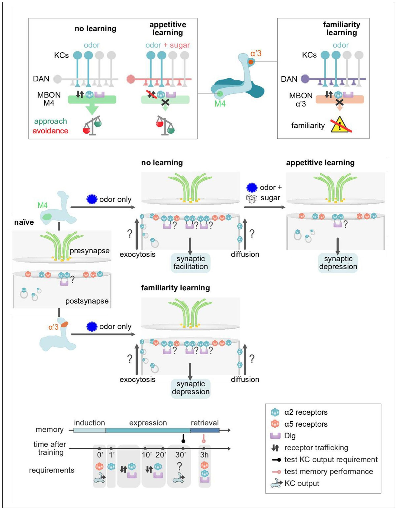

<small>圖片出處：Pribbenow C, Chen Y, Heim M-M et al. *eLife* 11:e80445 (2022)，Figure 9。CC BY（PDF 未印版本號）；全文見 [PMC](https://pmc.ncbi.nlm.nih.gov/articles/PMC9733945/)。</small>

> **原圖說（Figure 9）：** Figure 9. Model of postsynaptic plasticity sequence across compartments. Top panels (circuit and behavior level): Mushroom body (MB) compartments investigated. Odors elicit high responses in M4 neurons inducing α2 receptor dynamics. High activity in M4 tilts the balance toward odor avoidance. Learning (or concurrent odor exposure with dopamine application) reduces receptor exchange. This results in reduced postsynaptic responses and tilts the balance toward approach behavior. Suppressed dynamics through learning could be reminiscent of a ‘dark current’ mechanism as found in  the mammalian visual system (please see Discussion). At the level of the α’3 compartment repeated odor exposure triggers increased α2 receptor dynamics. In this compartment, the increased dynamics result in reduced odor-evoked activity in the MB output neurons (MBONs) resulting in familiarity learning (less behavioral responsiveness to familiar compared to novel odors). Middle panels (synaptic level): Our data are consistent with a model in which α5 subunit containing receptors (red) mediate the early phase of postsynaptic memory storage, potentially by leading to elevated calcium flux (not addressed in this study) at individual postsynaptic densities (see Discussion and Figure 10 showing separated PSDs (postsynaptic densities) and analyses concerning input specificity). Concurrent events see changed dynamics of the α2 receptor (blue). Changed dynamics likely reflect changed exocytosis of intracellular receptor populations or lateral diffusion across membranes. Nicotinic receptor subunits hereby potentially interact with adaptor proteins to bind to discs large (Dlg). Importantly, we identify elevated α2 subunit dynamics in the context of associative (M4; Kenyon cells [KC] and dopaminergic neuron [DAN] activation needed for memory formation) and non-associative (α’3 MBONs; odor activates both KCs and DANs) memory expression. Increased α2 subunit dynamics in both cases are triggered by odor application. At the level of M4, suppressed dynamics, would correspond to postsynaptic depression, while at the level of α’3 MBONs increased dynamics could result in postsynaptic depression. Therefore, different learning rules might govern the incorporation, exchange, or stabilization of receptors in or out of synapses. Please see Discussion for further details. Bottom panel: Proposed time line of molecular correlates and experimental read-outs of memory induction and expression (please see Discussion for details).

**圖說中譯：** 跨區室的突觸後可塑性順序模型。上排（迴路與行為層次）：所研究的蕈狀體（MB）區室。氣味在 M4 神經元引起強反應，誘發 α2 受體動態；M4 的高活動把天平推向躲避氣味。學習（或氣味與多巴胺同時給予）減少受體交換，造成突觸後反應下降，把天平推向趨近行為。學習造成的動態被壓制，可能讓人聯想到哺乳類視覺系統中的「暗電流」機制（見討論）。在 α′3 區室，重複的氣味暴露引發 α2 受體動態增加；在這一格，動態增加造成輸出神經元對氣味的反應下降，形成熟悉度學習（對熟悉氣味的行為反應小於新奇氣味）。中排（突觸層次）：我們的資料與以下模型相符——含 α5 次單元的受體（紅）居中負責突觸後記憶儲存的早期階段，可能的方式是在個別突觸後緻密區造成鈣流入上升（本研究未處理；見討論與圖 10，該圖顯示彼此分開的突觸後緻密區〔PSD〕與輸入專一性的分析）。與此同時 α2 受體（藍）的動態改變。動態改變很可能反映細胞內受體族群的胞吐，或沿膜的側向擴散。菸鹼型受體次單元在此可能透過轉接蛋白與 discs large（Dlg）結合。重要的是，我們在聯結式（M4；記憶形成需要 Kenyon 細胞〔KC〕與多巴胺神經元〔DAN〕活化）與非聯結式（α′3 MBON；氣味同時活化 KC 與 DAN）記憶表現中都看到 α2 次單元動態上升。兩種情況下 α2 動態的增加都由氣味給予觸發。在 M4 層次，動態被壓制對應突觸後的減弱；在 α′3 MBON 層次，動態增加則可能造成突觸後減弱。因此，不同的學習規則可能主宰受體進出突觸的插入、交換或穩定。細節見討論。下排：記憶誘發與表現的分子對應物與實驗讀數的時間線提案（細節見討論）。

**解讀：**
- **這是示意圖，不是資料。** 圖上凡是帶問號的箭頭（胞吐、擴散）都是作者標明未測的步驟；「α5 造成鈣流入上升」在圖說裡就寫著 not addressed in this study。讀這張圖時要把它當成假說的整理，不是結論的總結。
- **下排時間線是全篇主張的骨架，值得逐格對照資料。** 0′ 需要 α5 與 KC 輸出（來自圖 1、圖 2a）；1′ 起需要 α2 與 Dlg（來自圖 5 的活體訓練，訓練後 1 分鐘測）；10′–20′ 的受體運輸（來自圖 6 的 FRAP 時間點）；30′ 標問號（圖 1 的 KC 阻斷在 30 分鐘測）；3 h 需要 α2 與 Dlg（圖 2b、2f–h）。**也就是說，「誘發在前、表現在後」這條時間軸是由五組不同實驗的時間點拼起來的**，沒有任何一組實驗在同一批果蠅上掃過這整條線。
- **上排右半把 α′3 的氣味畫成同時活化 KC 與 DAN。** 這是引用前人（Hattori 2017）的設定，不是本篇的量測；本篇在 α′3 沒有記錄 DAN。
- **M4 那一側的方向在圖上被統一了，但資料裡沒有。** 圖畫的是「學習→受體交換減少→突觸後反應下降→趨近」，而本篇的離體誘發（圖 3）得到的是增強。作者在討論中承認 M4 與 M6 可能不同、或初期的增強之後會轉為減弱，但圖 9 只畫了其中一種。
- **「暗電流」的比喻方向值得留意。** 在脊椎動物視網膜，暗電流是沒有刺激時的持續電流，有刺激時被關掉。作者用它比喻「沒有形成聯結時受體一直在交換，形成聯結時停下來」。這是修辭上的對應，不涉及任何共同的分子機制。

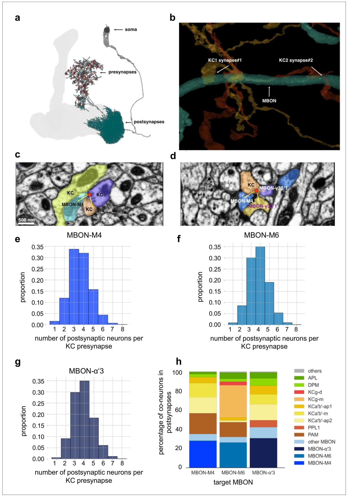

<small>圖片出處：Pribbenow C, Chen Y, Heim M-M et al. *eLife* 11:e80445 (2022)，Figure 10。CC BY（PDF 未印版本號）；全文見 [PMC](https://pmc.ncbi.nlm.nih.gov/articles/PMC9733945/)。</small>

> **原圖說（Figure 10）：** Figure 10. Mushroom body (MB) output connectomics (a) Example MB output neuron (MBON; here: M6) with pre-and postsynapses labeled. (b) Reconstructed example synapses from electron microscopic (EM) volume (neuprint.org): two different Kenyon cells (KCs) connect to the same MBON on the postsynaptic side. (c) EM image (neuprint.org) showing a KC presynapse simultaneously innervating two other KCs and the M4 MBON. Scale bar: 500 nm. (d) EM image (neuprint.org) showing a KC presynapse simultaneously innervating the M4 MBON and two sites of another MBON. (e) Analysis of  number of postsynaptic partners for each KC presynapse identified providing input to M4. The histogram shows the distribution of KC synapses to M4 relative to how many postsynaptic partners the KC presynapses have. (f) Analysis of number of postsynaptic partners for each KC presynapse identified providing input to M6. The histogram shows the distribution of KC synapses to M6 relative to how many postsynaptic partners the KC presynapses have. (g) Analysis of number of postsynaptic partners for each KC presynapse identified providing input to α’3 MBONs (pooled). The histogram shows the distribution of KC synapses to α’3 MBONs relative to how many postsynaptic partners the KC presynapses have. (h) Percentage of types of neurons that share a KC presynapse with a given MBON.

**圖說中譯：** 蕈狀體（MB）輸出的連結體分析。(a) 蕈狀體輸出神經元（MBON；此處為 M6）範例，標出突觸前與突觸後位置。(b) 由電子顯微鏡體積（neuprint.org）重建的範例突觸：兩個不同的 Kenyon 細胞（KC）連到同一個 MBON 的突觸後側。(c) 電顯影像（neuprint.org），顯示一個 KC 突觸前點同時支配另外兩個 KC 與 M4 MBON。比例尺 500 nm。(d) 電顯影像，顯示一個 KC 突觸前點同時支配 M4 MBON 與另一個 MBON 的兩個位置。(e) 對每個提供輸入給 M4 的 KC 突觸前點，分析其突觸後夥伴數目。直方圖顯示 KC 到 M4 的突觸依其突觸前點有幾個突觸後夥伴的分布。(f) 同樣分析提供輸入給 M6 的 KC 突觸前點。(g) 同樣分析提供輸入給 α′3 MBON（合併）的 KC 突觸前點。(h) 與某個 MBON 共用同一個 KC 突觸前點的神經元類型百分比。

**解讀：**
- **e–g 三張直方圖的形狀幾乎一樣：眾數落在 3–4 個突觸後夥伴，比例約 0.30–0.35（※ 從圖判讀）。** 也就是說，KC 的一個釋放點平均同時「廣播」給三到五個對象，其中只有一個是本篇關心的那顆 MBON。這正是作者要的論點：突觸前若改變，所有共用這個釋放點的對象都會被改到；突觸後改變則可以只動其中一個。
- **h 圖才是這張圖資訊量最高的一格，也最容易被略過。** 與 M4 共用釋放點的對象中，其他 MBON 與 KC 占了相當比例，PAM 與 PPL1 的 DAN、APL 與 DPM 也在列。※ 推論：這表示 KC 的同一個釋放點也直接通到 DAN，與本庫 [[t-mbon-dan-feedback]] 的迴路有關，但本篇沒有討論這一點。
- **這是解剖上的可能性，不是本篇量到的可塑性。** 本篇所有的受體與鈣量測都是整格平均，沒有單一 PSD 的解析度。「可塑性侷限在單一 PSD」在本篇裡完全是推論。
- **資料來自 hemibrain v1.2.1，只取狀態為 Traced 的 KC。** 未完成追蹤的 KC 被排除，直方圖因此可能低估夥伴數（※ 推論；重建不完整會漏掉夥伴，不會多算）。論文沒有討論這個偏誤。
- **a 圖的 M6 示意圖同時標了突觸前（紅）與突觸後（青）位置，值得看一眼。** 它提醒一件事：MBON 自己也有突觸前末梢，所以「在 MBON 裡降低某個基因」不等於「只動了突觸後」——這也是圖 2d 的 α7 結果需要解釋的地方。

---

## 相關

- [[numbers]] — 本篇貢獻了行為篩選的表現指數、離體誘發的幅度、FRAP 的回歸係數與回復率、α′3 的 MBON／KC 反應下降、連結體的每釋放點夥伴數
- 主題：[[t-dopamine-to-plasticity]]（第四環「改變發生在突觸的哪一側」的第一組突觸後正面證據）、[[t-timing-rules]]（離體誘發用的是同時配對，沒有掃時間差）、[[t-memory-updating]]（作者把突觸前後的分工列為消退與再鞏固的後續方向）
- 概念：[[c-kc-mbon-plasticity]]、[[c-ex-vivo-explant]]、[[c-mb-compartment]]、[[c-performance-index]]、[[c-us-substitution]]、[[c-memory-consolidation]]
- 實體：[[e-mbon]]、[[e-kenyon-cell]]、[[e-mushroom-body]]、[[e-mbon-gamma5beta2a]]、[[e-dopaminergic-neuron]]、[[e-split-gal4]]、[[e-r58e02]]、[[e-shibire-ts]]、[[e-t-maze]]、[[e-gcamp]]、[[e-cschrimson]]、[[e-vt1211]]、[[e-ok107-gal4]]、[[e-gal80ts]]
- 矛盾與空缺：[[syn-contradictions]] 3.2（學習造成的改變在突觸前還是突觸後）
- 2026-11-13 第一批整合時補上的連結 — 正文提到、相關節原本漏列的來源：[[s-tomchik-2009-camp-dynamics]]
- 待開頁面：`c-postsynaptic-plasticity`（突觸後可塑性）、`e-nachr`（菸鹼型乙醯膽鹼受體與其 α 次單元）、`e-dlg`（支架蛋白 Dlg）、`c-frap`（光漂白後螢光回復）、`e-mb011b`、`e-mb027b`、`e-r13f02`、[[c-nonassociative-learning]]、[[c-appetitive-memory]]、[[e-hemibrain]]、`e-ttx`、`e-synaptophluorin`、[[e-apl-neuron]]、[[e-dpm-neuron]]

## 出處

Pribbenow, C., Chen, Y., Heim, M.-M., Laber, D., Reubold, S., Reynolds, E., Balles, I., Fernández-d V Alquicira, T., Suárez-Grimalt, R., Scheunemann, L., Rauch, C., Matkovic, T., Rösner, J., Lichtner, G., Jagannathan, S. R., and Owald, D. (2022). Postsynaptic plasticity of cholinergic synapses underlies the induction and expression of appetitive and familiarity memories in *Drosophila*. *eLife* 11, e80445. https://doi.org/10.7554/eLife.80445

本篇依 Creative Commons Attribution License 開放取用（PDF 未印版本號），版權屬作者。圖片擷取自原文，依該授權在標明出處的條件下重製，本庫以教學與評論目的引用。全文請至 https://pmc.ncbi.nlm.nih.gov/articles/PMC9733945/ 免費閱讀。
