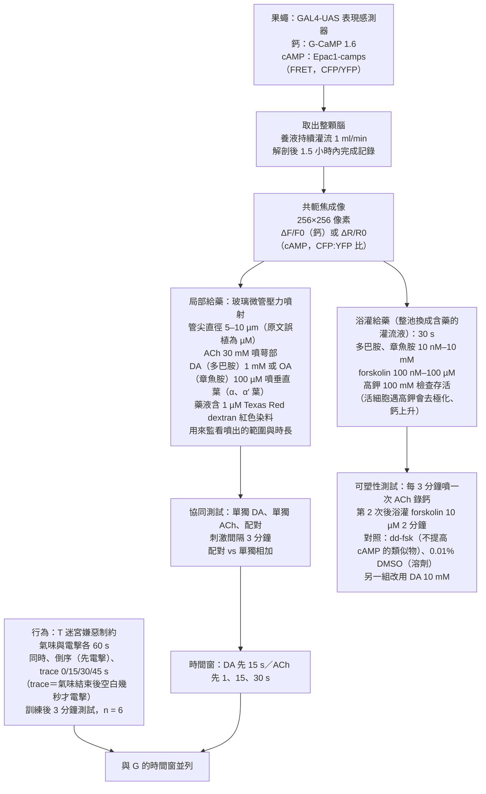
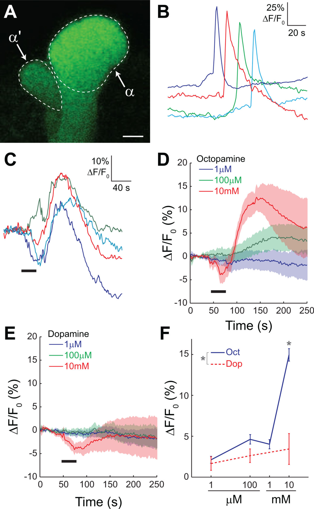
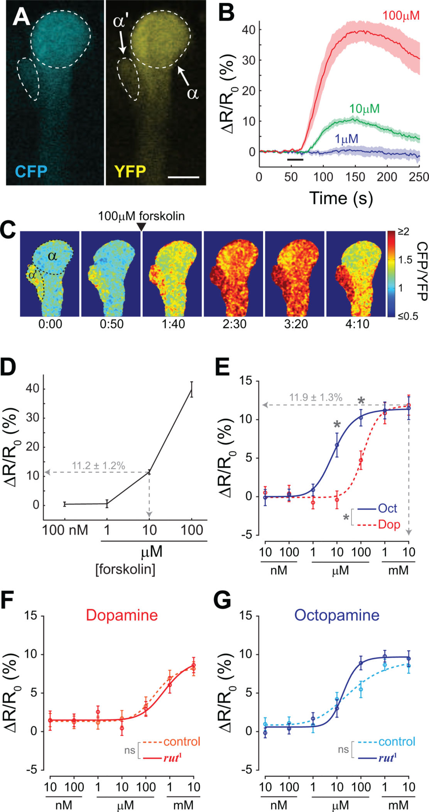
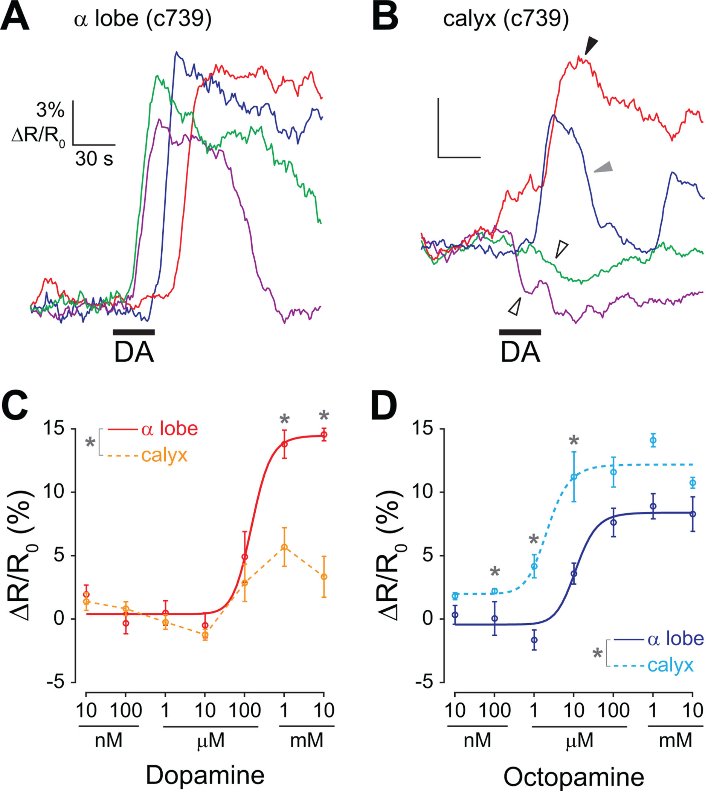
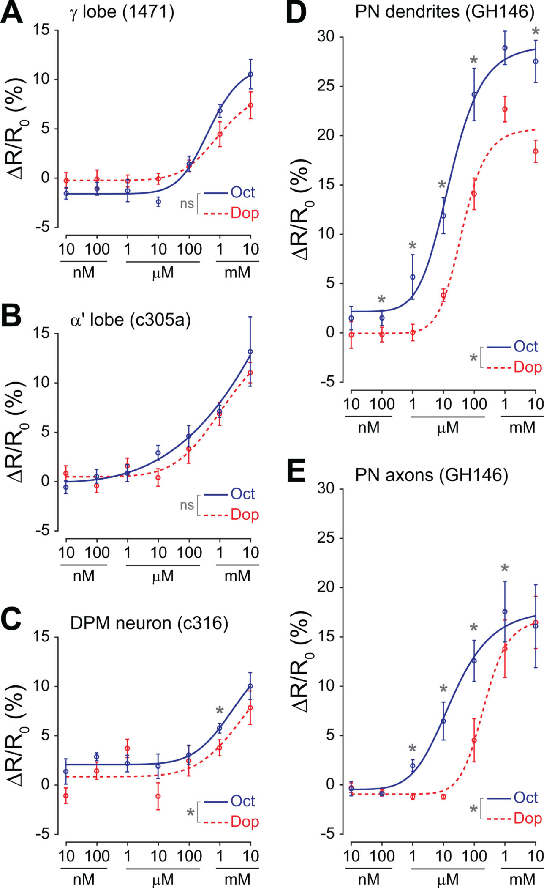
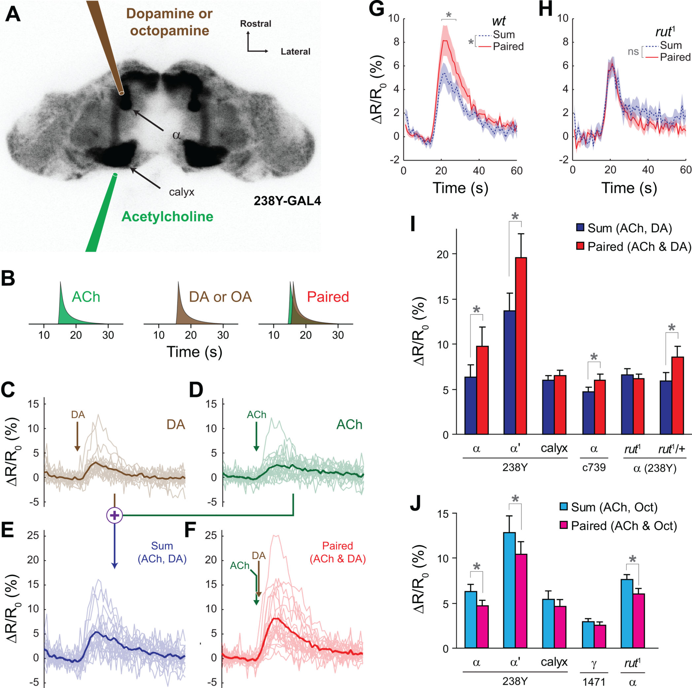
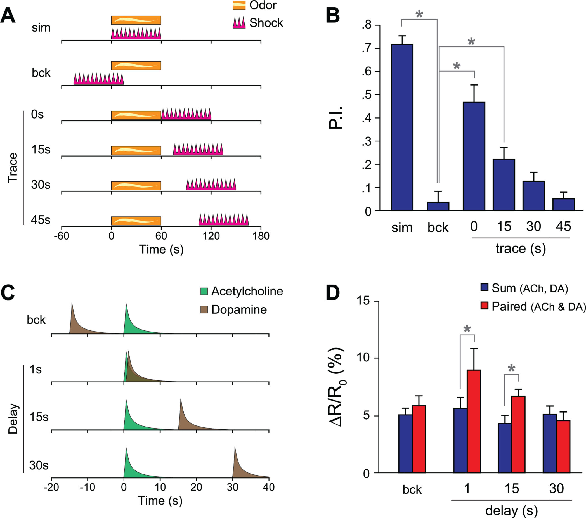
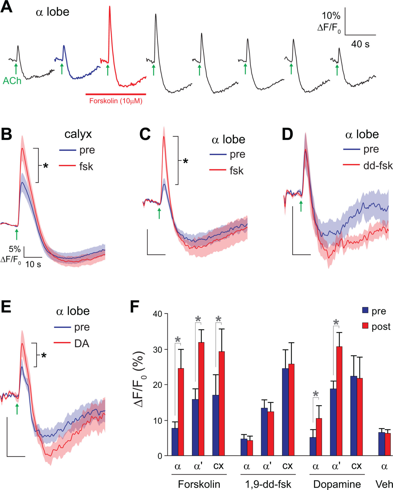

<!-- 本機 PDF：papers/2009-Dynamics%20of%20learning-related%20cAMP%20signaling%20and%20stimulus%20integration%20in%20the%20Drosophila%20olfactory%20pathway.pdf -->

# Dynamics of learning-related cAMP signaling and stimulus integration in the *Drosophila* olfactory pathway

**果蠅嗅覺路徑中與學習相關的 cAMP 訊號動態與刺激整合**

| 項目 | 內容 |
|---|---|
| **出處** | Neuron 64(4), 510–521 (2009). doi: 10.1016/j.neuron.2009.09.029 [全文（PMC 免費閱讀）](https://pmc.ncbi.nlm.nih.gov/articles/PMC4080329/) |
| 日期 | 刊期 2009-11-25（*Neuron* 64(4)）；作者稿於 2014-07-03 在 PMC（PubMed Central，美國國家衛生研究院 NIH 的免費全文論文庫）公開，編號 PMC4080329。線上先行、投稿、修訂、接受日期本 PDF 未載：？待查 |
| 通訊作者 | Seth M. Tomchik（stomchik@scripps.edu）；Ronald L. Davis（rdavis@scripps.edu）。兩人都列為聯絡人 |
| 作者 | 共 2 人：Seth M. Tomchik（第一作者）、Ronald L. Davis |
| 機構 | 美國 Baylor College of Medicine 分子與細胞生物學系、精神醫學與行為科學系（休士頓）；W.M. Keck Center for Interdisciplinary Bioscience Training（休士頓）。Tomchik 發表時已移到 Scripps Florida 神經科學系 |
| 資料庫 | 無（論文沒有釋出資料或程式） |
| 補充資料 | 正文引用了補充圖 2、3、5、8 與「Supplemental Experimental Procedures」（補充方法）。**本 PDF 不含補充資料**，完整的圖號範圍與方法參數：？待查（補充資料未取得） |
| 編輯／審查 | *Neuron* 不公開審查人，無 |

> 與本庫有關的作者：無（兩位作者都不是本庫成員或合作者）。
>
> 付費期刊（版權屬出版社，PDF 首頁載「© 2009 Elsevier Inc. All rights reserved」）。本 PDF 為 NIH PMC 公開的作者稿（未經最後排版校對的版本）。全文請由資料表「出處」列的連結到 PMC 免費閱讀。**本庫不散布全文 PDF。** 本頁的圖擷取自原文，版權屬原出版社，以教學與評論目的引用，每張圖下方標明出處。

---

## 為什麼重要

果蠅學會「某個氣味＝會被電」，靠的是腦中一個叫蘑菇體（mushroom body）的構造。蘑菇體裡的 Kenyon 細胞（Kenyon cell, KC；蘑菇體的主要神經元，每顆只對少數氣味有反應）負責代表氣味；懲罰或獎賞則由釋放多巴胺（dopamine）等物質的神經元送來。1980–2000 年代的遺傳學已經知道：一個叫 *rutabaga*（*rut*）的基因壞掉，果蠅就學不好，而它編碼的是一種腺苷酸環化酶（adenylyl cyclase, AC；製造細胞內訊號分子 cAMP 的酵素）。生化實驗又發現這個酵素同時受鈣離子（神經元被氣味活化時會進來）與 G 蛋白（多巴胺受體活化後會啟動）刺激。於是有一個作者在討論中稱為「長久以來被假設、卻從未被充分檢驗」（long-hypothesized yet never adequately tested）的假說（論文引用的最早生化證據是 Livingstone et al. 1984）：**rut 是一個「巧合偵測器」，只有氣味和懲罰同時到，才會製造大量 cAMP，從而啟動記憶。** 但在本篇之前，這個假說幾乎只有細胞膜碎片上的生化證據，主要來自海兔（*Aplysia*，一種海生軟體動物，是研究學習細胞機制的經典動物；牠的同類酵素也同時受鈣與另一種神經傳遞物刺激）。沒有人在神經迴路還完整的果蠅腦裡直接看過。

本篇用「遺傳編碼的 cAMP 感測器」直接在果蠅腦裡「看見」這件事。這種感測器是一個會隨 cAMP 濃度改變螢光顏色的蛋白質，用基因工程讓 KC 自己製造出來，所以在顯微鏡下就能看到 KC 裡 cAMP 的起落（原理見科普文）。作者把整顆腦取出、保持存活，在蘑菇體上用兩根玻璃細管分別滴乙醯膽鹼（acetylcholine, ACh；把氣味訊號傳給 KC 的神經元所釋放的傳遞物，因此用來模擬氣味輸入）和多巴胺（模擬懲罰），同時錄 cAMP 的變化。他們報告三件事：(1) 先給乙醯膽鹼、1 秒後給多巴胺，cAMP 的上升比兩者分開給的總和還大（「協同」），而這個協同在 *rut* 突變果蠅消失；(2) 協同只在多巴胺「在後」且間隔不超過約 15 秒時出現，順序倒過來或間隔 30 秒就沒有，作者把這個時間窗與行為學習並列（行為上電擊緊接在氣味之後學得最好，間隔 30–45 秒就幾乎學不到）；(3) 人為提高 cAMP 會讓 KC 對乙醯膽鹼的鈣反應變大。作者認為這是「突觸前可塑性」的一種形式：可塑性（plasticity）指神經元的反應或連結強度能被經驗改變，被認為是記憶的細胞基礎；「突觸前」指訊號送出端，也就是 KC 的軸突末梢。作者用這個詞指 KC 本身對輸入的反應增強；本篇沒有量末梢實際送出多少訊號。

對本庫而言，這一篇是「學習的時序規則」與「多巴胺訊號如何被 KC 讀出」兩條線的起點：它把行為上的「先氣味、後懲罰才學得會」對應到 KC 軸突裡的一個分子事件。它的限制也一樣重要：所有細胞層級的實驗都是離體腦加上藥物滴注，刺激的時間尺度（秒）和行為訓練（60 秒的氣味與電擊）並不相同，而且它量的是 KC 內部的 cAMP 與鈣，**沒有量 KC 的輸出突觸**——果蠅的行為最終取決於 KC 傳給下游神經元的訊號，KC 內部的變化要變成輸出的變化才會影響行為，所以這是從分子到行為之間缺的一環。另一個缺口是本篇沒有辨認多巴胺經由哪個受體作用。本庫另外兩篇補上了這兩個缺口的一部分：[[s-hige-2015-heterosynaptic-plasticity]] 直接量了 KC 的輸出突觸，[[s-handler-2019-dopamine-receptor-timing]] 辨認了兩種多巴胺受體。但兩篇與本篇也有說法不同之處，見「未來」一節與 [[syn-contradictions]]。

---

## 論文摘要（原文與中譯）

> **Summary:** Functional imaging with genetically-encoded calcium and cAMP reporters was used to examine the signal integration underlying learning in Drosophila. Dopamine and octopamine modulated intracellular cAMP in spatially-distinct patterns in mushroom body neurons. Pairing of neuronal depolarization with subsequent dopamine application revealed a synergistic increase in cAMP in the mushroom body lobes, which was dependent on the rutabaga adenylyl cyclase. This synergy was restricted to the axons of mushroom body neurons, and occurred only following forward pairing with time intervals similar to those required for behavioral conditioning. In contrast, forward pairing of neuronal depolarization and octopamine produced a sub-additive effect on cAMP. Finally, elevating intracellular cAMP facilitated calcium transients in mushroom body neurons, suggesting that cAMP elevation is sufficient to induce presynaptic plasticity. These data suggest that rutabaga functions as a coincidence detector in an intact neuronal circuit, with dopamine and octopamine bidirectionally influencing the generation of cAMP.

（*Neuron* 的摘要不分 Background／Results／Conclusion 三段，原文即為一段。）

**中譯**（本節為忠實翻譯，非自撰內容；譯文後附名詞註）：

> **摘要：** 本研究以遺傳編碼的鈣與 cAMP 報告分子進行功能性成像，探討果蠅學習背後的訊號整合。多巴胺與章魚胺以空間上不同的樣式調節蘑菇體神經元內的 cAMP。將神經元去極化與其後施加的多巴胺配對，會在蘑菇體各葉中引起 cAMP 的協同性上升，且此上升依賴 rutabaga 腺苷酸環化酶。這種協同只限於蘑菇體神經元的軸突，且只在順向配對、時間間隔與行為制約所需相近時才出現。相對地，神經元去極化與章魚胺的順向配對對 cAMP 產生次加成的效果。最後，提高細胞內 cAMP 會增強蘑菇體神經元的鈣暫態，顯示 cAMP 上升足以誘發突觸前可塑性。這些資料顯示 rutabaga 在完整的神經迴路中扮演巧合偵測器，而多巴胺與章魚胺雙向地影響 cAMP 的生成。

名詞註（非譯文）：**去極化**（depolarization）＝神經元膜電位往正的方向變、也就是神經元被激發，本篇用乙醯膽鹼造成；**章魚胺**（octopamine）＝昆蟲腦中類似腎上腺素的物質，當時被認為傳遞「獎賞」；**空間上不同的樣式**＝在 KC 的樹突與軸突、各類 KC 之間反應不同（見 3.2 節）；**葉**（lobe）＝KC 軸突聚集成的分枝狀構造（見專業文開頭讀前說明）；**順向配對**＝先給 KC 的刺激（乙醯膽鹼）、後給多巴胺，順序與「先氣味、後懲罰」相同；**次加成**（sub-additive）＝配對的反應比兩者單獨反應的總和還小，與「協同」相反；**鈣暫態**（calcium transient）＝神經元被激發時短暫的鈣濃度上升。

---

## 科普文

想像一個只有兩把鑰匙同時插進去才會打開的保險箱。銀行用這種鎖，是因為「一個人單獨行動」不該開得了門，必須兩個條件同時成立。果蠅的學習也需要這樣一把鎖：牠要記住的不是「聞到某個氣味」，也不是「被電了一下」，而是「**聞到這個氣味的時候被電**」。兩件事單獨發生都不該留下記憶，只有湊在一起才該留下。

**難題：鎖在哪裡？**

果蠅腦中負責這種學習的地方叫蘑菇體。氣味進來時，會讓一小群 Kenyon 細胞（蘑菇體裡的主要神經元）興奮，鈣離子湧入這些細胞；電擊這類懲罰，則由另一群神經元釋放多巴胺，灑在 Kenyon 細胞的軸突（神經元往外送訊號的長枝）上。所以每顆 Kenyon 細胞都可能同時收到兩種訊號：「我現在代表的氣味出現了」（鈣）和「剛剛發生了壞事」（多巴胺）。

早在 1980 年代，遺傳學家就找到一個突變果蠅，學習成績特別差，這個基因被取名為 *rutabaga*（蕪菁，果蠅基因常用這種俏皮名字）。後來發現 *rutabaga* 做出來的是一種酵素，專門製造一種叫 cAMP（環腺苷酸）的小分子。cAMP 是細胞內的「傳令兵」：它的濃度一高，就會啟動一連串蛋白質去改變細胞的性質。更巧的是，這個酵素同時受鈣離子和多巴胺受體兩種訊號開啟。於是大家猜：**rutabaga 就是那把雙鑰匙鎖**——氣味給一把鑰匙，多巴胺給另一把，兩把一起插進去，cAMP 就會大量產生。

這個猜想從 1980 年代流傳下來（論文引用 Livingstone et al. 1984），卻一直缺少直接證據。之前的證據多半來自把細胞打碎、只留下細胞膜碎片的生化實驗，那已經不是一個活的神經迴路了。

**解法：讓 cAMP 自己發光。**

本篇作者用了一個前一年才有人在果蠅身上用過的工具（論文引 Shafer et al. 2008）：一種會「看到 cAMP 就變色」的螢光蛋白，叫 Epac1-camps。它由兩個會發不同顏色光（青色與黃色）的蛋白質夾著一段會抓 cAMP 的片段組成；cAMP 一結合上去，兩種顏色的比例就改變。作者利用果蠅的遺傳工具，只讓 Kenyon 細胞做出這個感測器，然後把整顆果蠅腦取出、泡在養液裡保持存活，在顯微鏡下看 cAMP 的起落。

接著他們在腦上放兩根極細的玻璃管：一根對著 Kenyon 細胞接收氣味訊號的地方（萼部，calyx），噴乙醯膽鹼——這是嗅覺神經元傳訊時真正用的物質，用來模擬「聞到氣味」；另一根對著 Kenyon 細胞的軸突（葉部，lobe），噴多巴胺，模擬「被電」。

實驗設計很簡單：同一顆腦，先單獨噴乙醯膽鹼、再單獨噴多巴胺，把兩次的 cAMP 上升量相加；然後兩者一起給（乙醯膽鹼先，多巴胺 1 秒後），看上升量是否**超過**相加的總和。如果只是兩把鑰匙各開一點，結果應該等於總和；如果真的是雙鑰匙鎖，結果應該超出總和。

結果超出了：配對時 cAMP 上升約比總和多五成。而在 *rutabaga* 突變果蠅身上，配對結果剛好等於總和，多出來的那一截消失了。**這是「rutabaga 是雙鑰匙鎖」第一次在一個保留完整迴路的腦中被直接看到。**

作者接著改變兩者的間隔。多巴胺比乙醯膽鹼晚 1 秒或 15 秒，都有協同；晚 30 秒，沒有；多巴胺反過來先到，也沒有。這和果蠅在行為上的學習很像：電擊緊接在氣味之後，學得最好；隔得越久學得越差；先電再聞，幾乎學不到。最後，他們用藥物直接把 cAMP 拉高，發現 Kenyon 細胞對乙醯膽鹼的鈣反應變大了——**cAMP 一高，細胞就變得更容易被同樣的氣味訊號激起**。作者認為這可能是記憶在細胞層級的形式之一；本頁認為證據還不夠，理由見下面「代價」的第三點。

**代價：模擬不等於真實。**

這套方法換來了精準的控制，也付出了代價。第一，腦是取出來的，沒有真的氣味，也沒有真的電擊，兩者都是用化學物質模擬；玻璃管裡的濃度（乙醯膽鹼 30 mM、多巴胺 1 mM）也不等於到達細胞時的濃度。第二，時間尺度不一樣：行為實驗裡氣味和電擊各持續 60 秒，而成像實驗是幾秒鐘的短噴。說兩者的「時間窗相似」，要看從哪一刻開始算間隔：行為實驗的間隔是從 60 秒的氣味**結束**算起，成像實驗是從乙醯膽鹼**開始**算起。如果兩邊都從氣味開始算，行為上電擊晚 60–75 秒仍學得到，成像上多巴胺晚 30 秒就沒有協同了，差了好幾倍（專業文第 3.4 節有對照表）。第三，cAMP 拉高後的鈣反應變大，在洗掉藥物後似乎會慢慢回落，看起來比較像「cAMP 高的時候細胞比較敏感」，還不是一個能維持的記憶。第四，論文量的是 Kenyon 細胞「內部」的 cAMP 與鈣，沒有量它們把訊號傳給下游神經元的那個突觸到底變強還是變弱。

另外有一個出乎意料的結果：章魚胺（octopamine，昆蟲腦中類似腎上腺素的物質，當時被認為負責傳遞「獎賞」）和乙醯膽鹼配對時，cAMP 反而比總和**少**。也就是說，在這個實驗裡，多巴胺和章魚胺把 cAMP 往相反的方向推。這之所以意外，是因為如果章魚胺真的傳遞獎賞，而「巧合放大 cAMP」是形成記憶的方式，那麼獎賞學習就不該壓低 cAMP。作者沒有解決這個矛盾，只提出另一種可能：多巴胺也許同時傳遞懲罰與獎賞，章魚胺另有功能。

**最容易被誤讀的一點：** 這篇證明的是「在 Kenyon 細胞的軸突裡，rutabaga 能把兩個訊號的巧合轉成額外的 cAMP，而且順序和間隔有關」，**不是**「記憶就存在 cAMP 裡」，也不是「行為的時間窗完全由 rutabaga 決定」。從「多出來的 cAMP」到「果蠅改變行為」之間還隔著好幾步，本篇只直接量到了第一步，而那一步本身也是在離體腦、以藥物模擬的條件下量到的。

---

## 專業文

**讀前說明。** (1) 蘑菇體 KC 分三類：α/β、α′/β′、γ。每顆 KC 的樹突在萼部（calyx）接收嗅覺輸入，軸突往外延伸成「葉」（lobe）：α/β 與 α′/β′ KC 的軸突分岔成往上的垂直葉（α、α′ 葉）與往內的水平葉（β、β′ 葉），γ KC 只有水平的 γ 葉。所以「α 葉」量到的是 α/β KC 的軸突。(2) 鈣訊號以 ΔF/F0 表示：螢光比刺激前基線（F0）增加了百分之幾；cAMP 訊號以 ΔR/R0 表示：兩種螢光的比值比基線增加了百分之幾。兩者都是相對變化，只能在同一感測器、同一種實驗準備方式（文中稱「製備」，preparation，例如取出的整顆腦、或打碎後的細胞膜）內比大小。(3) *rut¹* 是 *rut* 基因的一個突變版本（等位基因，allele：同一基因的不同版本）；*rut¹*/+ 是「異型合子」，即一對染色體中一條帶突變、一條正常，學習表現正常（論文引補充圖 3），因此是與突變果蠅遺傳背景最接近的對照。(4) 「⚠️ 單篇不一致」指同一篇論文的摘要、正文、圖之間互相對不上（不是與其他論文矛盾）；「※ 推論」指論文沒有明說、由本頁推得；「※ 從圖判讀」指數值是本頁從圖上量出，有判讀誤差。(5) 「PDF 第 N 頁」指本庫所存作者稿 PDF 的頁碼。

### 一、概述

**主要問題。** 論文在引言中列出三個問題（PDF 第 2 頁）：(i) 條件刺激（conditioned stimulus, CS；在這裡指氣味）或非條件刺激（unconditioned stimulus, US；指電擊或糖）到達時，KC 內的鈣與 cAMP 如何變化？(ii) CS 與 US 同時出現對 cAMP 有什麼影響？(iii) 單是提高 cAMP 是否足以誘發可塑性？三個問題分別對應 3.1–3.2、3.3–3.4、3.5 節。

**重要性。** *rut* 是果蠅學習遺傳學中最早被找到的基因之一，編碼一個與哺乳類第一型腺苷酸環化酶（AC1）相近的酵素，同時受 Gαs（G 蛋白的刺激型 α 次單元；多巴胺受體中會提高 cAMP 的一類稱為 D1 類受體，它活化後就啟動 Gαs）與鈣／攜鈣素（Ca²⁺/CaM；攜鈣素是一種與鈣結合後才去活化下游酵素的蛋白，是鈣訊號的中介）刺激（Livingstone et al. 1984；Levin et al. 1992）。「*rut* 是 CS／US 巧合偵測器」是果蠅學習的核心假說，但論文自己指出（PDF 第 2 頁），在本篇之前「幾乎沒有直接證據」，也「幾乎沒有在神經迴路完整的製備中看到協同性 cAMP 上升的實驗支持」。本篇是第一個在完整的果蠅腦中直接觀察 cAMP 動態並測試這個假說的研究（就論文引言所引文獻的範圍而言；「第一個」的判斷以論文自述為準）。

**發表當時的領域現狀（2009）。** 論文所引的座標包括：
- *rut* 的生化性質：Livingstone et al. 1984（*rut* 突變使 AC 失去 Ca²⁺/CaM 反應性）；哺乳類 AC1 在 HEK 細胞（一種常用來表現外來蛋白的人類培養細胞株）中，只在 Gs（即 Gαs）刺激與鈣同時存在時產生協同 cAMP（Wayman et al. 1994）。
- 海兔的先例：Abrams et al. 1991、Yovell & Abrams 1992 在細胞膜製備中看到鈣與血清素配對的協同 cAMP 上升；Kandel 實驗室（以海兔研究學習機制的代表團隊）在保留完整的神經節（ganglion，無脊椎動物的神經細胞團）上局部滴藥，解析細胞層級的記憶（Martin et al. 1997）。本篇明言其製備「類似」這條路線——同樣是保留迴路、再局部給藥（PDF 第 2 頁）。
- *rut* 在蘑菇體的足夠性：在 *rut* 突變果蠅中，用基因工程只讓成蟲的蘑菇體重新表現正常的 *rut*，就能救回嫌惡性制約（aversive conditioning：氣味配電擊、學會避開該氣味的學習）（Zars et al. 2000；McGuire et al. 2003；Mao et al. 2004）。
- US 的傳遞者：Schwaerzel et al. 2003 主張多巴胺傳遞懲罰、章魚胺傳遞獎賞；但 Kim et al. 2007 發現 D1 類受體 dDA1 在嫌惡與獎賞學習中都需要——也就是多巴胺不只參與懲罰，這動搖了「多巴胺＝懲罰、章魚胺＝獎賞」的分工，與本篇章魚胺的結果（3.3 節）有關。
- 記憶痕跡的成像：DPM 神經元（dorsal paired medial neuron；一對支配整個蘑菇體葉部的大型神經元）、APL 神經元（anterior paired lateral neuron；一對釋放抑制性傳遞物 GABA 的神經元）、觸角葉（antennal lobe，嗅覺的第一站）、α/β 與 α′/β′ KC 都已觀察到學習後的鈣或突觸傳遞改變（Yu et al. 2003、2005、2006；Wang et al. 2008；Liu & Davis 2009）。
- cAMP 感測器：Epac1-camps（Nikolaev et al. 2004）已由 Shafer et al. 2008 用於果蠅。

**體裁。** 原著研究論文：離體腦的鈣與 cAMP 成像，加一組行為實驗。

### 二、方法

**感測器與表現系統。** GAL4-UAS 是果蠅的雙元表現系統：一個「驅動品系」（GAL4 line）決定在哪些細胞表現，一個「報告品系」（UAS）決定表現什麼。本篇用的驅動品系與它們標記的細胞：238Y（三類 KC：α/β、α′/β′、γ）、c739（α/β KC）、c305a（α′/β′ KC）、1471（γ KC）、c316（DPM 神經元）、GH146（觸角葉投射神經元，projection neuron, PN；把嗅覺訊號從觸角葉送到蘑菇體萼部的神經元）。鈣感測器是 G-CaMP 1.6；cAMP 感測器是 Epac1-camps，一個以螢光共振能量轉移（Förster resonance energy transfer, FRET）運作的蛋白。FRET 的原理是：青色螢光蛋白（CFP）與黃色螢光蛋白（YFP）靠得很近時，CFP 吸收的能量會轉給 YFP，於是發黃光多、青光少；cAMP 結合後兩者分開，能量不再轉移，青光相對於黃光上升，因此以「反 FRET 比」（CFP:YFP）的變化率 ΔR/R0 表示 cAMP 上升。

**感測器的驗證。** 作者以 forskolin（直接活化腺苷酸環化酶的藥物）確認 Epac1-camps 在 KC 中有濃度依賴的反應；用 514 nm 雷射只激發 YFP，YFP 螢光沒有下降（若 YFP 自己因褪色等原因變暗，CFP:YFP 比值也會上升，造成假的「cAMP 上升」；這個檢查排除了這種可能）；並以補充圖 2 排除 cGMP（另一種結構相近的細胞內傳訊分子，有報告指出此感測器也會對它反應）的干擾（內容：？待查（補充資料未取得））。

**統計。** 劑量反應曲線以 ANOVA 後接 Fisher's LSD（一種不校正多重比較的兩兩比較）逐濃度比較；整體差異用重複量數 ANOVA；協同測試的「相加 vs 配對」用 t 檢定（從設計看應為配對 t 檢定，但正文只寫「t test」，※ 推論）；行為以 ANOVA 後接 Fisher's LSD。誤差棒為平均值的標準誤（S.E.M.）。

**正文缺的參數。** 成像的取樣頻率、物鏡、果蠅年齡與性別、反應幅度的定義（峰值？固定時間窗內平均？）、ACh 與 DA 噴射的持續時間，正文與圖說都沒有寫（已 grep `frame|Hz|objective|female|male|days old|peak`）。正文明言「更多細節見補充方法」（PDF 第 1 頁）：？待查（補充資料未取得）。

### 三、結果

#### 3.1 多巴胺與章魚胺對鈣幾乎沒有作用，對 cAMP 有

<small>圖片出處：Tomchik SM, Davis RL. *Neuron* 64(4):510–521 (2009)，Figure 1。© 2009 Elsevier Inc. 教學引用；全文見 [PMC](https://pmc.ncbi.nlm.nih.gov/articles/PMC4080329/)。</small>

> **原圖說（Figure 1）：** Dopamine and octopamine have little detectable effect on calcium at low concentrations. (A) Confocal image showing the tips of the α and α' lobes in the brain of a 238Y-GAL4> UAS-G-CaMP fly. The image was collected across 256×256 pixels, the same as used for time series imaging. Scale bar = 5 µm. (B) Examples of calcium responses in the α lobe of four different brains to depolarization with 100 mM K+. The traces are diagonally offset for visibility. (C) Examples of α lobe responses to 10 mM octopamine. There was a robust increase in calcium in the α lobe following stimulation. Horizontal black bar = stimulus application. (D) Mean responses of the lobe to three concentrations of octopamine. The shaded area bracketing the mean response (solid line) indicates the S.E.M. Horizontal black bar = stimulus application. (E) Mean responses of the α lobe to three concentrations of dopamine. There were no consistent or robust responses to dopamine at any of the concentrations tested. Horizontal black bar = stimulus application. (F) Dose-response curves for α lobe calcium responses to dopamine and octopamine (n = 10). Error bars indicate S.E.M.

**圖說中譯：** 多巴胺與章魚胺在低濃度時對鈣的可偵測作用很小。(A) 238Y-GAL4>UAS-G-CaMP 果蠅腦中 α 與 α′ 葉末端的共軛焦影像，以 256×256 像素取像，與時間序列成像相同；比例尺 5 µm。(B) 四顆不同腦的 α 葉對 100 mM K⁺ 去極化的鈣反應範例，曲線斜向錯開以便觀看。(C) α 葉對 10 mM 章魚胺的反應範例，刺激後 α 葉鈣明顯上升；黑色橫條為給藥期間。(D) 葉部對三種濃度章魚胺的平均反應，實線為平均、陰影為 S.E.M.；黑色橫條為給藥期間。(E) α 葉對三種濃度多巴胺的平均反應，任何濃度都沒有一致或明顯的反應；黑色橫條為給藥期間。(F) α 葉鈣反應對多巴胺與章魚胺的劑量反應曲線（n ＝ 10），誤差棒為 S.E.M.

**解讀：**

- **這張圖的作用是「排除」，不是「發現」。** 它支撐後面整個設計的前提：多巴胺本身不會讓 KC 去極化，所以後面看到的 cAMP 變化不是「多巴胺先讓細胞興奮、再經鈣啟動 *rut*」的間接結果。章魚胺只在 10 mM 這種很高的濃度才引起鈣上升（正文 15.0 ± 2.0% ΔF/F0）。
- **E 格與 F 格對不上方向。** E 格 10 mM 多巴胺的平均曲線是先**下降**約 4%（※ 從圖判讀），但 F 格把 10 mM 多巴胺畫成約 +3.5%（※ 從圖判讀）。D 格 10 mM 章魚胺也有一段先降約 4% 的低谷。正文與圖說都沒有定義「反應幅度」怎麼取（峰值、絕對值、固定時間窗？），所以 F 格的數值與 D/E 格的曲線之間不能互相換算。**多巴胺在高濃度引起的鈣「下降」，論文沒有討論。**
- **F 格 10 mM 章魚胺的誤差棒看起來約 ±0.8，而正文寫 ±2.0**（※ 從圖判讀，誤差可能來自判讀；兩者都標為 S.E.M.）。差距不影響結論。
- **踩煞車：** 「不去極化」是以鈣作指標；G-CaMP 1.6 對小幅度的膜電位變化並不敏感，所以這裡的結論只能是「不引起可偵測的鈣上升」，正如圖說標題的措辭。

<small>圖片出處：Tomchik SM, Davis RL. *Neuron* 64(4):510–521 (2009)，Figure 2。© 2009 Elsevier Inc. 教學引用；全文見 [PMC](https://pmc.ncbi.nlm.nih.gov/articles/PMC4080329/)。</small>

> **原圖說（Figure 2）：** Forskolin, dopamine, and octopamine increase cAMP in mushroom body neurons in a rutabaga-independent manner. Error bars in all panels indicate S.E.M. (A) Confocal image showing CFP and YFP emission from the mushroom body α and α' lobes in the brain of a 238Y-GAL4>UAS-epac1-camps fly. The image was collected across 256×256 pixels, the same as used for time series imaging. Scale bar = 10 µm. (B) Responses of the α lobe to three concentrations of forskolin. The data are plotted in terms of the change in inverse FRET ratio (ΔR/R0). (C) Pseudocolor images showing the time course of a representative response to forskolin (100 µM). (D) Dose-response curve for mushroom body α lobe cAMP responses to forskolin in 238Y-GAL4>UAS-epac1-camps flies (n = 7). (E) Dose-response curves for mushroom body α lobe cAMP responses to bathapplied dopamine and octopamine in 238Y-GAL4>UAS-epac1-camps flies (n = 5). Responses were fit with a four parameter logistic curve. Cyclic AMP responses were observed at lower concentrations of dopamine and octopamine than that required to evoke detectable changes in intracellular calcium (Figure 1). The average maximal responses to dopamine and octopamine (11.9 ± 1.3% and 11.5 ± 1.9% ΔR/R0, respectively) were similar to the response to 10 µM forskolin (11.2 ± 1.2% ΔR/R0). (F) Dose-response curves for dopamine from rut1 mutants and heterozygous control flies (n = 13). Responses were recorded in the α lobe of brains from 238Y-GAL4>UAS-epac1-camps rut1 or control flies (rut1 heterozygotes). (G) Dose-response curves for octopamine from rut1 mutants and heterozygous control flies (n = 13). Data are from the same set of flies in panel F.

**圖說中譯：** forskolin、多巴胺與章魚胺以不依賴 rutabaga 的方式提高蘑菇體神經元的 cAMP。各格誤差棒均為 S.E.M.。(A) 238Y-GAL4>UAS-epac1-camps 果蠅腦中蘑菇體 α 與 α′ 葉的 CFP 與 YFP 螢光共軛焦影像，以 256×256 像素取像，與時間序列相同；比例尺 10 µm。(B) α 葉對三種濃度 forskolin 的反應，以反 FRET 比的變化（ΔR/R0）表示。(C) 對 forskolin（100 µM）代表性反應的時間序列偽色影像。(D) 238Y-GAL4>UAS-epac1-camps 果蠅 α 葉 cAMP 對 forskolin 的劑量反應曲線（n ＝ 7）。(E) 同品系 α 葉 cAMP 對浴灌多巴胺與章魚胺的劑量反應曲線（n ＝ 5），以四參數邏輯曲線擬合。引起 cAMP 反應所需的多巴胺與章魚胺濃度低於引起可偵測鈣變化所需（圖 1）。多巴胺與章魚胺的平均最大反應（分別為 11.9 ± 1.3% 與 11.5 ± 1.9% ΔR/R0）與 10 µM forskolin 的反應（11.2 ± 1.2% ΔR/R0）相近。(F) *rut¹* 突變與異型合子對照果蠅對多巴胺的劑量反應曲線（n ＝ 13），記錄自 238Y-GAL4>UAS-epac1-camps *rut¹* 或對照（*rut¹* 異型合子）果蠅腦的 α 葉。(G) 同上，對章魚胺（n ＝ 13），與 F 格為同一批果蠅。

**解讀：**

- **D 格是 E 格的參照尺，而這把尺說明 11.9% 不是感測器的天花板。** 100 µM forskolin 讓 ΔR/R0 達到約 40%（※ 從圖判讀），所以多巴胺在 10 mM 停在約 12%，是 KC 內「多巴胺能啟動的 cAMP 生成」的上限，而不是 Epac1-camps 飽和。這一點對 3.3 節很重要：協同測試要求單獨反應「高於閾值、低於飽和」，因為若單獨反應已經到頂，配對就沒有空間再往上加，協同會被低估。論文說的「飽和約 11.9%」（PDF 第 6 頁）指的是多巴胺作用的飽和。真正會壓低協同的是感測器的上限，而 D 格顯示感測器可到約 40%，所以這個疑慮可以排除。
- **章魚胺比多巴胺敏感約一個數量級。** E 格兩條擬合曲線的半最大濃度，章魚胺約在 5–10 µM、多巴胺約 100–200 µM（※ 從圖判讀）。正文只報告「10 µM 與 100 µM 時章魚胺顯著較大」（p ＝ 0.0085、0.0070），沒有給 EC50（半最大有效濃度）。
- **F、G 格的作用：證明單獨給藥時 *rut* 突變不影響 cAMP 反應，所以 3.3 節配對時的差異才有意義。** 既然 *rut* 會被多巴胺刺激，為什麼突變後單獨給多巴胺的反應不變？作者的解釋是 KC 裡還有其他腺苷酸環化酶負責單獨刺激的反應（討論，PDF 第 9 頁；見第四節第 5 點），*rut* 只負責配對時多出來的那一截。
- **F、G 格的上限比 E 格低。** F 格多巴胺在 10 mM 只到約 8.5%（※ 從圖判讀），E 格同濃度是 11.9%。F、G 格的果蠅（*rut¹* 與 *rut¹*/+）都帶 *rut¹* 等位基因，E 格的果蠅沒有，遺傳背景不同；作者沒有討論這個差距，所以**跨圖比較絕對幅度要小心**。
- **踩煞車：** 「不依賴 *rut*」的依據是重複量數 ANOVA 不顯著（多巴胺 p ＝ 0.59、章魚胺 p ＝ 0.29，n ＝ 13），這是「沒有偵測到差異」，不是「證明相同」。不過兩條曲線在圖上幾乎重疊，證據的方向一致。

#### 3.2 cAMP 反應的空間樣式：軸突與樹突不同，各類 KC 不同

<small>圖片出處：Tomchik SM, Davis RL. *Neuron* 64(4):510–521 (2009)，Figure 3。© 2009 Elsevier Inc. 教學引用；全文見 [PMC](https://pmc.ncbi.nlm.nih.gov/articles/PMC4080329/)。</small>

> **原圖說（Figure 3）：** Dopamine has different effects on cAMP in the dendrites (calyx) and axons (α lobe) of mushroom body α/β neurons. (A) Examples of cAMP responses to 1 mM dopamine in the lobe of brains isolated from c739-GAL4>UAS-epac1-camps flies. Dopamine reliably increased cAMP in recordings. Horizontal black bar = stimulus application. (B) Examples of cAMP responses to 100 µM dopamine in the calyx of brains isolated from c739-GAL4>UAS-epac1-camps flies. Since the epac1-camps reporter was expressed in mushroom body neurons and not projection neurons, these recordings represent the changes in cAMP in the dendrites of mushroom body α/β neurons. The calyx responses were heterogeneous; in some cases, dopamine elevated cAMP (black arrowhead), and in others dopamine decreased cAMP (unfilled arrowheads). In some brains there was an increase, followed by an abrupt decrease and then another increase (gray arrowhead). (C) Dose-response curves for dopamine recorded in the α lobe and calyx (n = 5). In the lobe only increases in cAMP were observed, resulting in a sigmoid dose-response curve. However, in the calyx, the heterogeneity of the responses resulted in a non-sigmoid dose-response relationship (data from the calyx are consequently not fitted with a curve). (D) Dose-response curves for octopamine recorded in the α lobe and calyx (n = 5). In both the α lobe and calyx, consistent increases in cAMP were observed, resulting in a sigmoid dose-response curve. The calyx and α lobe recordings were taken from the same two sets of brains as the calyx and α lobe recordings in panel C (respectively).

**圖說中譯：** 多巴胺對蘑菇體 α/β 神經元樹突（萼部）與軸突（α 葉）的 cAMP 作用不同。(A) c739-GAL4>UAS-epac1-camps 果蠅離體腦葉部對 1 mM 多巴胺的 cAMP 反應範例，多巴胺可靠地提高 cAMP；黑色橫條為給藥期間。(B) 同品系萼部對 100 µM 多巴胺的 cAMP 反應範例。由於 Epac1-camps 表現在蘑菇體神經元而非投射神經元，這些紀錄代表 α/β 神經元樹突內的 cAMP 變化。萼部反應不一致：有時多巴胺提高 cAMP（黑色箭頭），有時降低（空心箭頭）；有些腦先升、再驟降、再升（灰色箭頭）。(C) α 葉與萼部對多巴胺的劑量反應曲線（n ＝ 5）。葉部只見上升，呈 S 形；萼部因反應不一致而非 S 形（故未擬合曲線）。(D) α 葉與萼部對章魚胺的劑量反應曲線（n ＝ 5）。兩處都一致上升，呈 S 形。萼部與 α 葉的紀錄分別來自與 C 格相同的兩組腦。

**解讀：**

- **A 與 B 的濃度不同（1 mM vs 100 µM），所以兩格的範例不能直接比幅度**；要比較兩處，應看 C 格同濃度的點。
- **C 格萼部的「平均」其實是正的。** 萼部在 100 µM 與 1 mM 的平均約 +2.8% 與 +5.6%（※ 從圖判讀），不是零；「不一致」指的是個別腦之間有升有降。正文說萼部與葉部在 1 mM、10 mM 顯著不同（p ＝ 0.0065、< 0.001），這是對的；但讀者不應把「非 S 形」讀成「多巴胺在萼部沒有作用」。
- **D 格萼部在最低濃度（10 nM）就比葉部高約 1.5 個百分點**（※ 從圖判讀，萼部約 1.8%、葉部約 0.3%）。10 nM 是遠低於其他濃度起作用的劑量，此時理應還沒有反應，所以這個差距看起來是萼部紀錄整體偏高（基線偏移），而不是真的對 10 nM 有反應（※ 推論）；而正文報告萼部在 100 nM 時「顯著較大」（p ＝ 0.043），其中有多少來自這個偏移、多少是真正的高敏感度，圖上分不開。1 µM 與 10 µM 的差距（p ＝ 0.0027、0.020）則遠大於偏移，結論「萼部對章魚胺較敏感」仍然成立。
- **「cAMP 的擴散必然在 α/β 神經元內受到空間限制」（PDF 第 5 頁）這個推論方向合理，但證據比字面弱。** 同一種細胞（c739 標記的 α/β KC）、同樣的浴灌給藥，樹突與軸突給出不同結果，代表兩處的 cAMP 沒有混勻。但 D 格圖說最後一句說明，**萼部與葉部的紀錄來自兩組不同的腦**（各 n ＝ 5），所以這是組間比較，不是同一顆腦內兩處的直接對照；而且每個 ROI（region of interest，劃定的量測範圍）平均了數百條 KC 的枝，屬於族群層級的區室化（compartmentalization：cAMP 被侷限在細胞的不同部位、彼此不混），不是單一細胞的證明。

<small>圖片出處：Tomchik SM, Davis RL. *Neuron* 64(4):510–521 (2009)，Figure 4。© 2009 Elsevier Inc. 教學引用；全文見 [PMC](https://pmc.ncbi.nlm.nih.gov/articles/PMC4080329/)。</small>

> **原圖說（Figure 4）：** Dopamine and octopamine elevate cAMP in multiple anatomical loci across the olfactory system. Four parameter logistic curves were fitted to the responses. Error bars in all panels indicate S.E.M., n = 5 each. (A) Axons of γ lobe neurons, recorded in the mushroom body γ lobe of brains from 1471-GAL4>UAS-epac1-camps flies. (B) Axons of α'/β' neurons, recorded in the mushroom body α' lobe of brains from c305a-GAL4>UAS-epac1-camps flies. (C) Neurites of the DPM neuron, recorded in the mushroom body α lobe of brains from c316-GAL4>UAS-epac1-camps flies. (D) Dendrites of projections neurons (PN), recorded in the antennal lobes of brains from GH146-GAL4>UAS-epac1-camps flies. (E) Axons of projection neurons, recorded in the mushroom body calyx in brains from GH146-GAL4>UAS-epac1-camps flies.

**圖說中譯：** 多巴胺與章魚胺在嗅覺系統的多個解剖位置提高 cAMP。各組反應以四參數邏輯曲線擬合；各格誤差棒為 S.E.M.，每組 n ＝ 5。(A) γ 葉神經元的軸突，記錄自 1471-GAL4>UAS-epac1-camps 果蠅腦的 γ 葉。(B) α′/β′ 神經元的軸突，記錄自 c305a-GAL4>UAS-epac1-camps 的 α′ 葉。(C) DPM 神經元的神經突，記錄自 c316-GAL4>UAS-epac1-camps 的 α 葉。(D) 投射神經元（PN）的樹突，記錄自 GH146-GAL4>UAS-epac1-camps 的觸角葉。(E) 投射神經元的軸突，記錄自同品系的蘑菇體萼部。

**解讀：**

- **A、B 格的曲線沒有到頂，四參數擬合的上限與 EC50 因此無法確定**——正文自己也說「在測試範圍內沒有看到漸近線」（PDF 第 5 頁）。圖上的擬合線在 10 mM 之外是外推，不要拿來讀數。
- **為什麼要量 PN 與 DPM：** 作者想知道多巴胺與章魚胺在嗅覺路徑上作用的範圍——PN 是 KC 的上游，DPM 支配 KC 的軸突並可能回饋給 KC；若這些細胞自己的 cAMP 也被調節，KC 上看到的變化就可能部分來自它們（論文沒有進一步檢驗這一點）。
- **「投射神經元的反應是全篇最大」（約 29%，※ 從圖判讀）要打折扣。** ΔR/R0 雖是比值，仍會受感測器表現量、ROI 內的背景與非表現組織比例影響；五個驅動品系的表現強度不同，論文沒有校正。※ 推論：跨品系的絕對幅度比較只能當作大致參考，同一品系內的多巴胺 vs 章魚胺比較才可靠。
- **對本庫最重要的一點：γ 葉與 α′ 葉對多巴胺和章魚胺的反應不分軒輊**（p ＝ 0.95、0.38，n ＝ 5），而 α 葉（圖 2E）與 PN（D、E 格）是章魚胺遠較敏感。也就是說，各類 KC 讀取多巴胺／章魚胺的方式在 cAMP 層級就不一樣。論文沒有往受體層級追（沒有操弄任何受體），這是「多巴胺訊號如何被讀出」的一個開口。
- **DPM 只在 1 mM 與 10 mM 才有反應**（C 格），正文在討論中提出 DPM 可能回饋給 KC（PDF 第 9 頁），但本圖的閾值在 mM 級；論文沒有估計多巴胺在組織內的實際（生理）濃度，所以 DPM 在正常情況下是否被多巴胺調節，本篇回答不了。

#### 3.3 配對產生依賴 *rut* 的協同 cAMP

<small>圖片出處：Tomchik SM, Davis RL. *Neuron* 64(4):510–521 (2009)，Figure 5。© 2009 Elsevier Inc. 教學引用；全文見 [PMC](https://pmc.ncbi.nlm.nih.gov/articles/PMC4080329/)。</small>

> **原圖說（Figure 5）：** Pairing of neuronal depolarization with dopamine induced a rutabaga-dependent synergistic elevation of cAMP in mushroom body neurons, while pairing of neuronal depolarization with octopamine resulted in sub-additive 43 increases in cAMP. Panels C–H show cAMP imaging traces recorded from the α lobe of 238Y-GAL4>UAS-epac1-camps brains. (A) Schematic showing placement of the focal application pipettes. The underlying image is an inverted grayscale confocal image of the brain of a 238Y-GAL4> UAS-epac1-camps fly. The pipettes were placed directly anterior to the α lobe and posterior to the calyx. (B) Schematic of the stimulus paradigm. Each stimulus was presented three minutes apart. (C) Recordings from the α lobe of individual brains (thin lines) and the mean response (thick line) during application of dopamine (DA) to the mushroom body vertical lobes. Arrow indicates the stimulus time. (D) Recordings from the α lobe during application of acetylcholine (ACh) to the calyx. (E) The sum of the responses to application of DA and ACh were calculated for each brain. (F) Recordings in which the application of DA and ACh were paired. ACh was applied 1 s before DA. The data from panels C–F are from the same set of brains. (G) Comparison of the responses from the sum (panel E) and paired (panel F) conditions. The cAMP response to paired application of ACh and DA was synergistic. The shaded area bracketing the mean response (solid line) represents the S.E.M. The horizontal gray bracket denotes an 8 s window in which pairwise tests revealed significantly larger (p < 0.01) paired responses (Fisher's LSD following significant difference with ANOVA). (H) Comparison of the responses from the sum and paired conditions in rut1 mutant flies. The response to paired application of ACh and DA was not synergistic in rut1 mutants. (I) Sum and paired response magnitudes from dopamine/acetylcholine experiments for different driver lines and regions imaged. Error bars indicate S.E.M.; *p<0.05. (J) Sum and paired response magnitudes from octopamine/acetylcholine experiments for different driver lines and regions imaged. Error bars indicate S.E.M.; *p<0.05.

**圖說中譯：** 神經元去極化與多巴胺配對，在蘑菇體神經元中引起依賴 rutabaga 的協同性 cAMP 上升；與章魚胺配對則造成次加成的 cAMP 上升（原文此處多出一個「43」，應為排版殘留）。C–H 格為 238Y-GAL4>UAS-epac1-camps 腦 α 葉的 cAMP 紀錄。(A) 局部給藥微管位置示意；底圖為該品系果蠅腦的反相灰階共軛焦影像；微管分別置於 α 葉正前方與萼部後方。(B) 刺激流程示意，各刺激間隔 3 分鐘。(C) 對垂直葉施加多巴胺（DA）時 α 葉的紀錄，細線為個別腦，粗線為平均；箭頭為給藥時點。(D) 對萼部施加乙醯膽鹼（ACh）時 α 葉的紀錄。(E) 每顆腦對 DA 與 ACh 的反應相加。(F) DA 與 ACh 配對的紀錄，ACh 比 DA 早 1 秒。C–F 格來自同一組腦。(G) 相加（E）與配對（F）的比較，配對反應為協同；實線為平均、陰影為 S.E.M.；灰色橫括號標出一段 8 秒的時間窗，其中逐點檢定顯示配對反應顯著較大（p < 0.01；ANOVA 顯著後接 Fisher's LSD）。(H) *rut¹* 突變果蠅中相加與配對的比較，配對反應沒有協同。(I) 不同驅動品系與成像區域在 DA/ACh 實驗中的相加與配對反應幅度；誤差棒為 S.E.M.，*p<0.05。(J) 同上，章魚胺/ACh 實驗。

**解讀：**

- **I 格是全篇最重要的一張小圖，以下把它與 J 格重製成表，並補上論文沒算的「配對 ÷ 相加」比值。**

| 實驗 | 驅動品系 | 成像處 | n | p（t 檢定） | 相加（%） | 配對（%） | 配對 ÷ 相加 |
|---|---|---|---:|---:|---:|---:|---:|
| ACh ＋ DA | 238Y | α 葉 | 11 | 0.041 | ≈ 6.4 | ≈ 9.8 | **≈ 1.53** |
| ACh ＋ DA | 238Y | α′ 葉 | 11 | 0.0025 | ≈ 13.8 | ≈ 19.6 | **≈ 1.42** |
| ACh ＋ DA（兩者都噴萼部） | 238Y | 萼部 | 12 | 0.36 | ≈ 6.0 | ≈ 6.5 | ≈ 1.08 |
| ACh ＋ DA | c739 | α 葉 | 12 | 0.035 | ≈ 4.8 | ≈ 6.0 | **≈ 1.25** |
| ACh ＋ DA | 238Y；*rut¹* | α 葉 | 9 | 0.53 | ≈ 6.6 | ≈ 6.2 | ≈ 0.94 |
| ACh ＋ DA | 238Y；*rut¹*/+ | α 葉 | 9 | 0.027 | ≈ 5.9 | ≈ 8.6 | **≈ 1.46** |
| ACh ＋ OA | 238Y | α 葉 | 12 | 0.0026 | ≈ 6.3 | ≈ 4.8 | ≈ 0.76 |
| ACh ＋ OA | 238Y | α′ 葉 | 12 | 0.03 | ≈ 12.9 | ≈ 10.5 | ≈ 0.81 |
| ACh ＋ OA（兩者都噴萼部） | 238Y | 萼部 | 12 | 0.29 | ≈ 5.5 | ≈ 4.7 | ≈ 0.85 |
| ACh ＋ OA | 1471 | γ 葉 | 8 | 0.17 | ≈ 3.0 | ≈ 2.6 | ≈ 0.87 |
| ACh ＋ OA | 238Y；*rut¹* | α 葉 | 9 | 0.03 | ≈ 7.7 | ≈ 6.1 | ≈ 0.79 |
| **參照：單獨浴灌多巴胺的最大反應（不是配對值）** | 238Y | α 葉 | 5 | — | 單獨 DA：**11.9 ± 1.3** | — | — |

> 「配對 ÷ 相加」欄的粗體表示配對顯著大於相加（協同）。n 與 p 取自正文 PDF 第 6–7 頁；相加與配對的值由 Figure 5I、5J 的柱高判讀（※ 從圖判讀，誤差約 ±0.3 個百分點），比值為本頁計算。最後一列取自 Figure 2E，為浴灌多巴胺的最大反應；α 葉配對值約 9.8% 低於此上限，而圖 2D 的 forskolin 顯示感測器本身可到約 40%，因此配對反應沒有撞到天花板。表中百分比為 ΔR/R0（見專業文開頭讀前說明），只能在同一品系內比較。

- **協同的幅度是「多約五成」，不是倍增。** 238Y α 葉配對比相加多約 3.4 個百分點（多約 53%）；c739 α 葉只多約 1.2 個百分點（多約 25%）。c739 這一組同時換了兩樣：驅動品系（改用 c739-GAL4），以及感測器 UAS-Epac1-camps 插在第 3 號染色體另一個位置的轉基因品系。換插入位置的目的是：轉基因插入的位置可能影響表現量或干擾附近的基因，只用一個品系，協同可能只是插入造成的假象。換了之後協同仍在，作者據此排除這個假象；c739 組的協同方向與 238Y 組一致，只是幅度較小。
- **論文沒有做最關鍵的那個檢定：基因型 × 條件的交互作用。** 「*rut¹* 中協同消失」的依據是 *rut¹* 組的相加 vs 配對 p ＝ 0.53、異型合子組 p ＝ 0.027——**兩個 p 值一個顯著、一個不顯著，不等於兩組之間有顯著差異**。正確的檢定是比較兩組的「配對 − 相加」差值（異型合子約 +2.7、*rut¹* 約 −0.4 個百分點），論文沒有報告（已 grep `interaction|two-way`，無結果）。從圖上看差距不小，結論的方向大概是對的，但統計上沒有被正式檢驗。
- **G、H 格有一個容易被忽略的對照價值：** *rut¹* 果蠅的單獨反應總和（約 6.6%）與異型合子（約 5.9%）相當。這說明 *rut¹* 中協同的消失**不是**因為突變果蠅整體反應變小，而是「多出來的那一截」專一地不見了。這與圖 2F、G（*rut¹* 不影響單獨給藥的反應）一致，也是整篇論證最乾淨的地方。
- **「協同只限於軸突」這個摘要用語要讀成條件句。** 萼部的測試是「ACh 與 DA 都噴在萼部、在萼部量」（PDF 第 6 頁）；論文沒有測「DA 噴在葉部、在萼部量」或「DA 噴在萼部、在葉部量」。所以能說的是：多巴胺給在萼部時，萼部沒有協同；不能說萼部的 *rut* 不能做巧合偵測。
- **G 格的顯著窗口只有 8 秒**，在刺激後約 20–28 秒（※ 從圖判讀）。協同是一個短暫的峰，之後兩條曲線重合，所以「協同」指的是峰值，不是持續的 cAMP 累積。
- **章魚胺的次加成（J 格）在 *rut¹* 中依然存在**（p ＝ 0.03），作者據此判斷它不經 *rut*。這是一個沒有被追下去的反直覺結果：在當時「章魚胺＝獎賞」的模型下，「氣味（ACh）之後接著獎賞（章魚胺）」的配對反而讓 cAMP 比各自單獨的總和**少**，等於獎賞在氣味之後壓低了 cAMP，與「巧合放大 cAMP」的學習模型方向相反。作者在討論中提出另一種可能：多巴胺同時傳遞獎賞與懲罰，章魚胺另有功能（PDF 第 9–10 頁）。

#### 3.4 協同的時間窗與行為的時間窗

<small>圖片出處：Tomchik SM, Davis RL. *Neuron* 64(4):510–521 (2009)，Figure 6。© 2009 Elsevier Inc. 教學引用；全文見 [PMC](https://pmc.ncbi.nlm.nih.gov/articles/PMC4080329/)。</small>

> **原圖說（Figure 6）：** Synergistic increases in cAMP following dopamine/acetylcholine application exhibit similar temporal pairing requirements as behavioral trace conditioning. (A) Schematic of the behavioral trace conditioning stimulus paradigm. The CS (odor) and US (shock) were presented for 1 m simultaneously (sim), in a backwards order (bck), or with a forward delay (trace conditioning). (B) Performance of flies in a trace conditioning experiment (n = 6) with varying delays between the CS (odor) and US (shock). P.I. = performance index; *p<0.05 (Fisher's LSD following significant differences with ANOVA). (C) Schematic of the acetylcholine/dopamine stimulus paradigm in the imaging experiments. (D) Sum and paired response magnitudes when applying different time delays between the acetylcholine and dopamine applications. *p<0.05 (t test)

**圖說中譯：** 多巴胺／乙醯膽鹼施加後的協同 cAMP 上升，其時間配對要求與行為 trace 制約相近。(A) 行為 trace 制約的刺激流程示意：條件刺激（氣味）與非條件刺激（電擊）各給 1 分鐘，同時給（sim）、倒序給（bck）、或順向延遲給（trace 制約）。(B) 不同 CS–US 間隔下果蠅在 trace 制約中的表現（n ＝ 6）；P.I. 為表現指數；*p<0.05（ANOVA 顯著後接 Fisher's LSD）。(C) 成像實驗中乙醯膽鹼／多巴胺刺激流程示意。(D) 乙醯膽鹼與多巴胺之間施以不同延遲時的相加與配對反應幅度；*p<0.05（t 檢定）。

**名詞先說明：** trace 制約（trace conditioning）是指氣味結束後隔一段空白時間才給電擊，空白期間牠必須在腦中「留著」氣味的痕跡（trace）。表現指數（performance index, P.I.）是 T 迷宮中避開被電氣味的果蠅比例換算出的分數：0 表示一半一半（沒學到），1 表示全部選對。

**解讀：**

- **兩邊的「間隔」不是同一個量。** 行為實驗的 trace 間隔是從**氣味結束**算到電擊開始，而氣味本身持續 60 秒；成像實驗的延遲是從**乙醯膽鹼脈衝開始**算到多巴胺脈衝開始。把兩者換成同一把尺（從 CS 開始到 US 開始）後，對照如下：

| 條件 | 行為：CS 開始 → US 開始 | 行為 P.I.（※ 從圖判讀） | 成像：ACh 開始 → DA 開始 | 成像「配對 − 相加」（※ 從圖判讀） | 成像 n、p |
|---|---:|---:|---:|---:|---|
| 同時 | 0 s | ≈ 0.72 | （未測） | — | — |
| 倒序 | ≈ −45 s（※ 由示意圖量） | ≈ 0.04 | −15 s | ≈ +0.8 | n ＝ 13，p ＝ 0.14 |
| trace 0 s／延遲 1 s | 60 s | ≈ 0.47 | 1 s | ≈ +3.3 | n ＝ 7，p ＝ 0.022 |
| trace 15 s／延遲 15 s | 75 s | ≈ 0.22 | 15 s | ≈ +2.3 | n ＝ 11，p ＝ 0.011 |
| trace 30 s／延遲 30 s | 90 s | ≈ 0.13 | 30 s | ≈ −0.6 | n ＝ 9，p ＝ 0.24 |
| trace 45 s | 105 s | ≈ 0.05 | （未測） | — | — |

> 行為 P.I. 由 Figure 6B 判讀；成像值由 Figure 6D 判讀（倒序 5.1/5.9、1 s 5.7/9.0、15 s 4.4/6.7、30 s 5.2/4.6，相加/配對），n 與 p 取自正文 PDF 第 7 頁。「CS 開始 → US 開始」一欄為本頁依 Figure 6A 的 60 秒刺激長度換算，論文沒有並列這一欄。

- **以「CS 開始」為準，兩個時間窗至少差 2–3 倍**：成像在 30 秒延遲就失去協同，而行為在 CS 開始後 60–75 秒才給電擊仍學得到（P.I. 0.47、0.22）。作者說「相近」，成立的前提是把成像的 ACh 脈衝類比為氣味的**結束**，也就是假設 KC 在氣味結束那一刻的狀態才是關鍵。這個假設論文沒有寫出來。※ 推論：60 秒的氣味會讓 KC 持續放電，鈣與 cAMP 的時間進程都和一個秒級的 ACh 脈衝不同，所以兩個時間窗的對應只能算是定性相似。
- **衰減的形狀也不同。** 行為上 P.I. 隨間隔漸減（0.47 → 0.22 → 0.13 → 0.05）；成像上 1 秒與 15 秒的協同幅度差不多（配對 ÷ 相加 ≈ 1.58 與 ≈ 1.52），到 30 秒才突然消失。成像只取了 3 個順向點，看不出漸減還是陡降。
- **行為部分是 Tully & Quinn 1985 圖 7 的重做。** 本篇方法節說 T 迷宮依 Tully and Quinn 1985，圖 6A 的六組（同時、倒序、trace 0／15／30／45 s）也與該篇圖 7 相同。兩篇的 trace 0 s 與 15 s 都約 0.47 與 0.22，同時組約 0.72 對 0.79、30 s 約 0.13 對 0.05（皆 ※ 從圖判讀），逐列對照見 [[s-tully-1985-classical-conditioning]] 3.5 節。該篇的倒序組電擊在氣味開始前就結束、不重疊，結果同樣接近 0。
- **成像沒有測「同時」**，而行為上「同時」是學得最好的條件（P.I. ≈ 0.72）。最接近的成像條件是 1 秒延遲。
- **倒序也不完全是「先 US 後 CS」。** 依 A 格示意圖，倒序組的 60 秒電擊大約在氣味開始前 45 秒開始、開始後 15 秒才結束（※ 由示意圖量，可能只是示意不精確），兩者有約 15 秒重疊。成像倒序組的配對比相加高約 0.8 個百分點、p ＝ 0.14——**不顯著，但不是零**。
- **1 秒延遲在圖 5 與圖 6 的 n 不同**（圖 5I：n ＝ 11，p ＝ 0.041；圖 6D：n ＝ 7，p ＝ 0.022），幅度也略有不同（圖 5I 相加/配對約 6.4/9.8，圖 6D 約 5.7/9.0）。論文沒有說明兩組是否為獨立資料。
- **行為的 n ＝ 6** 是 6 次 P.I. 測量（果蠅行為實驗一個 n 通常是一群約百隻果蠅的一次測試，但本篇沒寫每群幾隻：？待查（補充資料未取得））。

#### 3.5 提高 cAMP 會增強 KC 的鈣反應

<small>圖片出處：Tomchik SM, Davis RL. *Neuron* 64(4):510–521 (2009)，Figure 7。© 2009 Elsevier Inc. 教學引用；全文見 [PMC](https://pmc.ncbi.nlm.nih.gov/articles/PMC4080329/)。</small>

> **原圖說（Figure 7）：** Elevation of cAMP facilitates responses in mushroom body neurons. Data are from 238Y-GAL4>UAS-G-CaMP flies. Scale bars in panels B–E indicate 5% ΔF/F0 and 10 s. Error bars indicate S.E.M., *p<0.05. (A) The experimental protocol. Acetylcholine was focally applied to the mushroom body calyx and calcium responses recorded in the mushroom body α and α' lobes. Recordings were taken every 3 m. Following the second recording, 10 µM forskolin was applied for 2 m. The third recording was taken in the presence of forskolin, which was subsequently washed out. (B) Acetylcholine-evoked calcium responses in the mushroom body calyx before and after application of 10 µM forskolin. (C) Acetylcholine-evoked calcium responses in the mushroom body α lobe before and after application of 10 µM forskolin. (D) Acetylcholine-evoked calcium responses in the mushroom body α lobe before and after application of 10 µM 1,9-dideoxyforskolin (dd-fsk). (E) Acetylcholine-evoked calcium responses in the mushroom body α lobe before and after application of 10 mM dopamine. (F) Magnitude of acetylcholine-evoked calcium responses in the α lobe, α' lobe, and calyx (cx) (recorded simultaneously in each brain), before (pre) and after (post) application of forskolin (10 µM in 0.01% DMSO; n = 13), 1,9-dideoxyforskolin (10 µM in 0.01% DMSO; n = 11), vehicle control (0.01% DMSO; α lobe; n = 7), and dopamine (10 mM in saline; n = 13). *p < 0.05 (t tests).

**圖說中譯：** 提高 cAMP 增強蘑菇體神經元的反應。資料來自 238Y-GAL4>UAS-G-CaMP 果蠅；B–E 格的比例尺為 5% ΔF/F0 與 10 秒；誤差棒為 S.E.M.，*p<0.05。(A) 實驗流程：對萼部局部施加乙醯膽鹼，在 α 與 α′ 葉記錄鈣反應，每 3 分鐘記錄一次。第二次記錄後浴灌 10 µM forskolin 2 分鐘，第三次記錄在 forskolin 存在下進行，之後洗掉。(B) 施加 10 µM forskolin 前後，萼部對乙醯膽鹼的鈣反應。(C) 同上，α 葉。(D) 施加 10 µM 1,9-dideoxyforskolin（dd-fsk）前後，α 葉的反應。(E) 施加 10 mM 多巴胺前後，α 葉的反應。(F) α 葉、α′ 葉與萼部（cx；每顆腦同時記錄）在施加 forskolin（10 µM，溶於 0.01% DMSO；n ＝ 13）、dd-fsk（10 µM，溶於 0.01% DMSO；n ＝ 11）、溶劑對照（0.01% DMSO；僅 α 葉；n ＝ 7）與多巴胺（10 mM，溶於養液；n ＝ 13）前（pre）後（post）的反應幅度；*p < 0.05（t 檢定）。

**藥物先說明：** forskolin 直接活化腺苷酸環化酶、提高 cAMP；它另有一個與 cAMP 無關的副作用，會阻斷某些電壓門控鉀離子通道。鉀通道負責讓神經元在激發後回到靜止，被阻斷時神經元較容易持續激發，鈣反應本身就可能變大——所以必須排除「鈣反應變大其實是鉀通道被阻斷」的可能。1,9-dideoxyforskolin（dd-fsk）是它的類似物，有同樣的副作用但不提高 cAMP，因此是「排除副作用」的對照。DMSO 是溶劑。

**解讀：**

- **增強的倍數（※ 從 F 格判讀）：** forskolin 使 α 葉由約 7.8% 升到約 24.6%（約 3.2 倍）、α′ 葉約 15.9% → 32%（約 2 倍）、萼部約 17.1% → 29.4%（約 1.7 倍）；多巴胺使 α 葉約 5.2% → 10.6%（約 2 倍）、α′ 葉約 18.9% → 30.8%（約 1.6 倍），萼部不變（約 22.4% → 21.8%）。dd-fsk 與溶劑都沒有變化。對照設計是完整的。
- **A 格透露了一件正文沒說的事：增強是可逆的。** 圖說稱 A 格為「實驗流程」，但它畫的是一顆腦的 α 葉連續八次紀錄的實際曲線（每 3 分鐘一次；第三次在 forskolin 中）。洗掉 forskolin 後，接下來五次紀錄的峰值逐次回落，最後一次接近給藥前的高度（※ 從這一個範例判讀，論文沒說是哪一顆腦）。論文沒有量化增強持續多久。※ 推論：這看起來是「cAMP 高的時候 KC 比較容易被激起」，而不是一個在 cAMP 回落後仍持續的變化；把它稱為「可塑性」時，要記得它的時間尺度是分鐘，而記憶測試在訓練後 3 分鐘（行為實驗）到數小時以上。
- **摘要說「突觸前可塑性」，正文的證據是「大多數腦整個神經元都增強」。** 「突觸前」指 KC 軸突末梢這一側；若增強只發生在突觸前，萼部（樹突，屬於接收端）應該不變。但 forskolin 下萼部也顯著增強（p < 0.001）。作者為了論證「軸突可以獨立增強」，舉出 13 顆腦中有 3 顆只有葉部增強、萼部不變（補充圖 8：？待查（補充資料未取得））。多巴胺的結果較支持軸突特異（萼部不變）；保留之處在於那是浴灌 10 mM 多巴胺，同時作用在整顆腦，無法分辨它是直接作用在 KC 軸突，還是經由其他細胞間接造成。⚠️ 單篇不一致：摘要的「presynaptic」比正文的證據強。
- **「鈣上升」不等於「釋放更多神經傳遞物」。** 軸突的鈣是突觸前活動的間接指標；本篇沒有量 KC 對下游 MBON（mushroom body output neuron，蘑菇體輸出神經元，讀取 KC 訊號並影響行為的神經元）的突觸傳遞。
- **這張圖沒有把配對與增強連起來。** 增強是用 forskolin 或單獨的多巴胺誘發的；論文沒有測「ACh 與 DA 配對之後，KC 對下一次 ACh 的反應是否變大」（已讀遍結果節，3.3–3.5 的實驗都沒有這個組合）。所以「巧合 → 協同 cAMP → 增強」這條鏈的三段，是分別在不同實驗中看到的，沒有在同一個實驗裡串起來。
- **多巴胺的濃度在正文沒寫，只在圖說寫 10 mM**；正文只說「1 分鐘的多巴胺」（PDF 第 8 頁）。而方法節說浴灌給藥是換灌流液 30 秒（PDF 第 11 頁）。⚠️ 單篇不一致：給藥時間 30 秒 vs 1 分鐘，可能是不同實驗用不同時長，論文沒有說明。

### 四、討論

論文的主要主張與本頁的評價：

1. **「*rut* 編碼的 AC 是分子巧合偵測器，本篇提供了強證據。」**（PDF 第 9 頁）在離體腦中，配對比相加多約五成，*rut¹* 中消失，異型合子中保留，換驅動品系與感測器插入位置也重現（見 3.3 節）。**這是本篇最強的主張**，證據的限制在於：(a) 缺交互作用檢定；(b) 刺激是藥物模擬；(c) *rut¹* 是全身突變，不只是 KC 內缺 *rut*（論文沒有做只在 KC 內恢復或剔除 *rut* 的實驗）。
2. **「協同的時間要求與行為制約相似。」** 定性上成立（順向有、倒序無、拉長間隔就消失），定量上兩邊的間隔定義不同（見 3.4 節表）。這是**中等強度、需要附條件**的主張。
3. **「cAMP 對 KC 的可塑性既必要又充分。」**（PDF 第 10 頁）「必要」來自前人的遺傳學，「充分」來自本篇的 forskolin 實驗。「充分」的範圍要限縮為「足以短暫增強 KC 對 ACh 的鈣反應」；它是否足以產生記憶，本篇沒有測。**這是全篇措辭最強、證據相對最弱的一句。**
4. **「巧合（氣味與懲罰同時出現）可能同時在 α/β 與 α′/β′ 兩類 KC 中被記下（平行登錄）。」** 背景：前人發現 α′/β′ KC 的輸出在學習與早期鞏固（把剛形成的記憶轉成較穩定形式的過程）時需要，α/β KC 的輸出則在提取記憶時需要。（PDF 第 10–11 頁）依據是兩處都有協同、兩處都被 cAMP 增強。這是合理的可能性論證；論文自己也列出另一種可能（先在 α′/β′ 記下、鞏固時轉移到 α/β），本篇資料沒有排除它。
5. **「*rut¹* 中仍有 cAMP 反應，代表 KC 內還有其他 AC。」** 論文列出 DAC39E、DAC78C、DAC76E、CG32158、CG32301、CG32305 等候選（PDF 第 9 頁），並提出 DPM 回饋等替代解釋：DPM 被認為會釋放一種能提高 cAMP 的胜肽，若 KC 被激發後 DPM 反過來釋放它，KC 的 cAMP 就能不經 *rut* 上升。這部分是推測，論文沒有檢驗。
6. **「多巴胺與章魚胺雙向影響 cAMP。」** 次加成的結果本身是穩的（五個條件中三個顯著：α 葉、α′ 葉與 *rut¹* 的 α 葉；萼部與 γ 葉不顯著，見 3.3 節表）；但它對學習模型的意涵，作者在「章魚胺＝獎賞」與「多巴胺兼傳兩者」之間沒有選邊。

### 五、問題與限制

**1. 離體製備與藥物模擬（論文自陳其取向，但未列為限制）。** 腦是取出的；CS 用 30 mM ACh 噴萼部、US 用 1 mM DA 噴葉部模擬。微管內濃度不等於組織內濃度，作者是用壓力與管位把反應調到「高於閾值、低於飽和」（PDF 第 6 頁）。這讓「劑量」在各腦之間不可比，也意味著每顆腦的刺激強度是依反應挑過的。因為相加與配對是在同一顆腦內比較，協同的判定本身不受影響；受影響的是外推：本篇無法說協同在多大的組織濃度下出現。

**2. 方法參數缺漏。** 取樣頻率、反應幅度的定義、噴射時長、果蠅年齡與性別都不在正文與圖說：？待查（補充資料未取得）。

**3. 統計。** Fisher's LSD 不校正多重比較；劑量反應曲線在 7–8 個濃度上逐點檢定，n ＝ 5。*rut* 依賴性缺交互作用檢定（3.3 節）。

**4. 只量了 KC 內部，沒有量輸出。** cAMP 與鈣都是 KC 內的訊號；KC→MBON 突觸是增強還是減弱，本篇無從回答。

**5. 受體沒有被辨認。** 論文引用了 DAMB（Han et al. 1996）與 dDA1（Kim et al. 2007）兩種多巴胺受體，但沒有操弄任何受體，所以「多巴胺經哪個受體、哪種 G 蛋白活化 *rut*」在本篇沒有實驗證據。

**6. 本頁稽核出來、論文自己沒處理的問題：**
- **時間窗的比較用了兩把不同的尺**（行為從 CS 結束算、成像從 CS 開始算）；換成同一把尺，行為能學到的間隔（60–75 秒）至少是成像協同消失點（30 秒）的 2–3 倍（3.4 節表）。論文沒有並列這一欄。
- **摘要的「協同只限於軸突」與「突觸前可塑性」都比正文的證據強**：前者只測了「DA 給萼部、量萼部」一種組合，後者在多數腦中是整個神經元一起增強（3.3、3.5 節）。⚠️ 單篇不一致。
- **forskolin 造成的增強在洗掉後回落**（圖 7A，單一範例），論文沒有量化持續時間，卻以「可塑性」稱之。
- **配對 → 增強這一步沒有被測**：增強是用 forskolin 或單獨多巴胺誘發的。
- **圖 1E 與 1F 對多巴胺 10 mM 的方向不一致**（曲線向下、劑量反應點為正），反應幅度的定義未說明。
- **小筆誤**：方法節微管管尖直徑寫「5–10 µM」（PDF 第 11 頁，應為 µm）；圖 5 圖說多一個「43」；討論寫「wild type（野生型，未經突變的正常果蠅）and rut1」（PDF 第 9 頁），圖 5G 也標「wt」，但實驗中沒有真正的野生型組：與 *rut¹* 比較的對照是 *rut¹*/+ 異型合子，其餘實驗用的則是帶 GAL4 與感測器的轉基因果蠅。都不影響結論。

### 六、未來

**論文自陳的方向。** 共三項：

1. 辨認 *rut¹* 中殘餘 cAMP 的來源。候選有四：其他 AC；去極化直接活化 AC；毒蕈鹼型乙醯膽鹼受體（乙醯膽鹼受體中經 G 蛋白作用、可影響 cAMP 的一類）；DPM 的胜肽回饋。
2. cAMP 如何增強 KC 興奮性。可能有三：環核苷酸門控通道（一種被 cAMP 直接打開、讓正離子流入的離子通道）；cAMP 直接作用於某些鉀通道；經 PKA（蛋白質激酶 A，cAMP 最主要的下游酵素）磷酸化鈉與鉀通道。
3. 巧合是在 α/β 與 α′/β′ 平行記下，還是先後轉移。

**本庫關注的後續。** 本庫另兩篇各補上本篇的一個缺口，也各有一處與本篇說法不同：
- **輸出端**：[[s-hige-2015-heterosynaptic-plasticity]] 在活的果蠅上直接量了 KC→MBON 突觸，發現氣味與多巴胺神經元順向配對後，γ1pedc 格的輸出神經元對該氣味的放電少了約八成。該篇在引言中引用本篇，作為「學習後 KC 軸突的鈣訊號增加」的證據。本篇看到的是用 forskolin 拉高 cAMP 後 KC 內的鈣反應**增強**，Hige 2015 看到的是配對後輸出**減弱**；處理方式與量的位置都不同，方向看似相反但不一定矛盾，本庫列為空缺，見 [[syn-contradictions]] 3.2。Hige 2015 的頁名用了「異突觸可塑性」（heterosynaptic plasticity）一詞，指一個突觸的改變由第三方的輸入（這裡是多巴胺）引起；本篇討論也稱 KC 的可塑性是異突觸的（PDF 第 10 頁），「突觸前」講改變的位置，「異突觸」講誘發的來源，兩者不衝突。
- **受體與時序**：[[s-handler-2019-dopamine-receptor-timing]] 辨認了兩種受體：DopR1 製造 cAMP、推動突觸變弱，DopR2 讓內質網放鈣、推動突觸變強。該篇引用本篇，作為「鈣敏感的腺苷酸環化酶是同時性偵測器」的依據。但它量 cAMP 的「上升量」而非本篇的「協同量」，發現順向與逆向都會上升，因而主張 cAMP 分不出先後；本篇則說協同只在順向出現。兩篇的逆向組也不同（本篇多巴胺早 15 秒，該篇早 1.2 秒）。本庫列為待裁決，見 [[syn-contradictions]] 1.2。
- **逆向配對的行為**：本篇倒序組的 P.I. 約 0.04，接近沒學到；Handler 2019 的逆向配對卻讓果蠅學到相反的偏好。本篇倒序組的電擊長 60 秒、與氣味重疊約 15 秒，條件差很多，見 [[syn-contradictions]] 1.1。
- 兩條主題頁把三篇並排：[[t-timing-rules]]、[[t-dopamine-to-plasticity]]。

**尚未被回答的。** (1) 在完整、清醒的果蠅中，真的氣味與真的電擊配對時，KC 軸突的 cAMP 是否同樣出現協同？(2) 協同 cAMP 是否沿 KC 軸突分區（compartment）不同？本篇引用的 Mao & Davis 2009 題為「八種不同的多巴胺神經元支配蘑菇體神經纖維區」；※ 推論：若不同多巴胺神經元支配葉部的不同段落，協同就可能只出現在收到多巴胺的那一段。本篇只量了葉部末端，空間解析度到「葉」為止，無法回答。(3) 協同 cAMP 與 KC 輸出突觸改變之間的因果關係。(4) 60 秒的氣味與秒級的 ACh 脈衝如何對應，行為時間窗的哪一部分由 *rut* 的動力學決定。

---

## 相關

- [[numbers]]（本庫的數字登記簿頁面，列出每個數字的定義與出處）— 本篇的劑量反應、協同測試的 n 與 p、時間窗、行為 P.I.、forskolin 增強倍數
- 本庫已有的相關頁：[[e-epac-camp-sensor]]、[[e-gcamp]]、[[e-kenyon-cell]]、[[c-coincidence-detection]]、[[c-camp-signaling]]、[[c-cs-us-timing]]、[[c-performance-index]]、[[e-mushroom-body]]
- 主題：[[t-timing-rules]]、[[t-dopamine-to-plasticity]]；矛盾與空缺：[[syn-contradictions]]
- 本批（2026-10-25 第二批）已開頁、與本篇相關：[[e-c739-gal4]]
- 2026-10-26 因 [[s-tully-1985-classical-conditioning]] 收錄而過門檻、新開的頁：[[e-rutabaga]]
- 待開頁面（本庫尚未建立的頁面名稱；`e-` 開頭為實體頁，如基因、工具、細胞；`c-` 開頭為概念頁）：`e-238y-gal4`、`e-dpm-neuron`、`c-presynaptic-facilitation`、`c-octopamine-reward-signal`

## 出處

Tomchik SM, Davis RL (2009). Dynamics of learning-related cAMP signaling and stimulus integration in the *Drosophila* olfactory pathway. *Neuron* **64**(4), 510–521. DOI: https://doi.org/10.1016/j.neuron.2009.09.029 （NIH PMC 作者稿 PMC4080329，2014-07-03 公開。）

圖片擷取自原文，版權屬原出版社（© 2009 Elsevier Inc.），本庫以教學與評論目的引用，不代表出版社授權。全文請至 https://pmc.ncbi.nlm.nih.gov/articles/PMC4080329/ 免費閱讀。
