<!-- 本機 PDF：papers/TullyQuinn1985.pdf -->

# Classical conditioning and retention in normal and mutant *Drosophila melanogaster*

**正常與突變果蠅的古典制約與記憶保留**

| 項目 | 內容 |
|---|---|
| **出處** | J Comp Physiol A 157(2), 263–277 (1985). doi: 10.1007/BF01350033 [出版社頁面（付費，無免費全文）](https://doi.org/10.1007/BF01350033) |
| 日期 | 接受 1985-04-01（首頁印「Accepted April 1, 1985」）。投稿、修訂日期首頁未載；刊期為 1985 年第 157 卷第 2 期（期號取自引用本篇的書目；PDF 只印卷與頁），出刊月份：？待查 |
| 通訊作者 | 首頁未標通訊作者，也沒有 email（1985 年的期刊慣例）。William G. Quinn 的星號註記是新址：MIT Whitaker College 與生物系（美國麻州劍橋） |
| 作者 | 共 2 人：Tim Tully（第一作者）、William G. Quinn |
| 機構 | 美國 Princeton University 生物系（紐澤西州 Princeton） |
| 資料庫 | 無。論文說裝置藍圖與使用說明可向 Tully 索取（PDF 第 266 頁） |
| 補充資料 | 無（1985 年的期刊沒有補充資料制度；全文 15 頁含圖 1–10 與表 1） |
| 編輯／審查 | 期刊不公開審查人，無 |

> 與本庫有關的作者：無。「本庫」指這個果蠅蘑菇體知識庫（mb_wiki）。這一欄是本庫每篇來源頁的固定欄位，用來標示作者與本庫成員之間有無合作或利益關係。本篇兩位作者都不是本庫成員或合作者。
>
> 付費期刊（版權屬出版社，PDF 首頁印「© Springer-Verlag 1985」）。**本篇沒有 PMC（美國國家醫學圖書館的免費全文論文庫）或其他免費全文**，資料表「出處」列只能連到出版社的付費頁面。**本庫不散布全文 PDF。** 本庫所存的 PDF 是 300 dpi 的掃描檔，沒有文字層；本頁引用的文字由本庫以光學字元辨識（OCR）轉出、再對照頁面影像校正，頁碼一律用期刊頁碼（263–277）。本頁的圖擷取自原文，版權屬原出版社，以教學與評論目的引用，每張圖下方標明出處。

---

## 為什麼重要

蘑菇體（mushroom body）是果蠅腦中與氣味學習有關的構造（細節見 [[e-mushroom-body]]）。本庫其他八篇論文都在問「果蠅的蘑菇體怎麼學」。可是它們判斷果蠅「學會了沒有」的那把尺，很多都來自這一篇。

1985 年，Tully 與 Quinn 改造了 Quinn 實驗室 1974 年的氣味—電擊學習測驗。舊版是「工具性」程序：果蠅自己走進某個氣味才挨電。新版改成「古典制約」（classical conditioning，又稱巴夫洛夫式制約）：刺激照表給，與動物的反應無關，動物逃不掉也避不開。新流程如下：

1. 約 150 隻果蠅關在一根內壁布滿電網的管子裡。
2. 先聞一個氣味，同時挨 12 下電擊。
3. 再聞另一個氣味，不挨電。
4. 送到一個 T 字形岔路口，讓牠們在兩個氣味之間選邊。

這兩個氣味對果蠅本來都是討厭的。作者事先把兩者的濃度調到一樣討厭，讓沒受訓的果蠅在兩者之間大約五五分（做法見下方科普文）。所以訓練後的偏向，量的是「學來的」那一部分。

結果約九成以上的果蠅會躲開被電過的那個氣味。舊版測驗只有約三分之二的果蠅躲開被電過的氣味，新版強得多。為什麼變強，作者列了三個可能原因，但沒有逐一驗證（見專業文第四節第 1 條）。

本庫的 [[e-t-maze]] 與 [[c-performance-index]] 兩頁描述的就是這套裝置與它的計分法：[[s-tomchik-2009-camp-dynamics]] 的行為實驗明言「依 Tully and Quinn 1985」，[[s-felsenberg-2018-memory-extinction]] 的計分公式也引用本篇（但計分法本身是本篇沿用 Quinn 實驗室 1974 年的定義，不是本篇新創）。

本篇不只是方法論文。它用同一套裝置一次量了後來本庫幾條主題線都會回頭用到的幾件事：電擊要在氣味之後多快來才學得到（[[t-timing-rules]] 的行為起點）、只聞氣味不再挨電能不能讓記憶變弱（[[c-memory-extinction]]）、先學「A 是壞的」再學「B 是壞的」會怎樣（[[t-memory-updating]]），以及 *rutabaga*、*dunce*、*amnesiac* 這幾個學習突變株的記憶隨時間怎麼流失。這三個基因都和細胞內訊號分子 cAMP 有關。

作者在討論中把突變株的結果拿去對照海兔（*Aplysia*）的 cAMP 學習模型，並指出三處對不上（見專業文第四節）。三處之一跟 *rutabaga* 有關。海兔模型的核心是一種製造 cAMP 的酵素（腺苷酸環化酶）：懲罰訊號（US）會啟動它；提示訊號（CS，海兔實驗裡是一個較弱的電擊，換到果蠅就是氣味）讓細胞裡的鈣升高，鈣會讓這個酵素啟動得更猛。兩個訊號同時到，cAMP 就做得特別多，模型把這個「配對放大」當成學習的來源（機制步驟見專業文第一節）。*rutabaga* 突變株的這個酵素，失去了「被鈣催得更猛」的能力。模型認定學習只來自配對放大，沒有放大就沒有學習，所以照模型推，牠應該完全學不會；實際上牠仍學得到一些（專業文第四節第 6 條的 (c)）。二十四年後，[[s-tomchik-2009-camp-dynamics]] 用取出的果蠅腦、以藥物代替氣味與懲罰（乙醯膽鹼模仿氣味讓神經元興奮，多巴胺模仿懲罰訊號），在蘑菇體裡量到「協同」cAMP：兩者配對給時，cAMP 上升超過分開給的總和，也就是出現了海兔模型所說的「配對放大」。這個放大在 *rut¹*（*rutabaga* 的一個突變版本）果蠅中消失，可見它靠的正是 *rutabaga* 的酵素。但 *rutabaga* 突變果蠅仍學得到一些，所以學習還有這個放大以外的路徑——這一點海兔模型沒有涵蓋。因此這個結果偏向「海兔模型不足以解釋果蠅」，但並未完全解決這個問題（細節見專業文第四節第 6 條）。

**但本篇全文沒有提到蘑菇體。** 它是純行為與遺傳的研究，不知道學習發生在腦的哪裡（已用 OCR 文字搜尋 mushroom、calyx、Kenyon，無結果）。calyx（萼部）是蘑菇體的一個部位，Kenyon 細胞是蘑菇體的主要神經元（見 [[e-mushroom-body]]）。本庫收錄它，是因為它是本庫行為量法的源頭，而且它的時序、消退與突變株資料被庫內其他來源直接拿來對照（2026-10-26 使用者決定收錄）。讀這一頁時要記得：**本篇的結論都在「整隻果蠅的行為」層級，沒有一句是關於蘑菇體的。**

---

## 論文摘要（原文與中譯）

> **Summary.** By changing the conditioned discrimination paradigm of Quinn et al. (1974) from an instrumental procedure to a classical (Pavlovian) one, we have demonstrated strong learning in wild-type flies. About 150 flies were sequestered in a closed chamber and trained by explosing [sic] them sequentially to two odors in air currents. Flies received twelve electric shock pulses in the presence of the first odor (CS+) but not in the presence of the second odor (CS–). To test for conditioned avoidance responses, flies were transported to a T-maze choice point, between converging currents of the two odors. Typically, 95% of trained flies avoided the shock-associated odor (CS+).
>
> Acquisition of learning was a function of the number of shock pulses received during CS+ presentation and was asymptotic within one training cycle. Conditioned avoidance increased with increasing shock intensity or odor concentration and was very resistant to extinction. Learning was best when CS+ presentations overlap shock (delay conditioning) and then decreased with increasing CS-US interstimulus intervals. Shocking flies immediately before CS+ presentation (backward conditioning) produced no learning. Nonassociative control procedures (CS Alone, US Alone and Explicitly Unpaired) produced slight decreases in avoidance responses, but these affected both odors equally and did not alter our associative learning index (Λ).
>
> Memory in wild-type flies decayed gradually over the first seven hours after training and still was present 24 h later. The mutants *amnesiac*, *rutabaga* and *dunce* showed appreciable learning acquisition, but their memories decayed very rapidly during the first 30 min. After this, the rates of decay slowed sharply; conditioned avoidance still was measurable at least three hours after training.

（原文為不分標題的三段；「explosing」為原文拼字錯誤，應為 exposing。）

**中譯**（本節為忠實翻譯，非自撰內容；譯文後附名詞註）：

> **摘要。** 我們把 Quinn et al.（1974）的制約區辨範式由工具性程序改為古典（巴夫洛夫式）程序，在野生型果蠅身上展示了強的學習。約 150 隻果蠅被關在一個封閉的訓練室中，在氣流中依序暴露於兩種氣味而受訓練。果蠅在第一個氣味（CS+）出現時受到十二下電擊脈衝，在第二個氣味（CS−）出現時則沒有。為了測試制約後的躲避反應，果蠅被送到 T 迷宮的選擇點，位於兩個氣味氣流的匯合處。通常有 95% 受過訓練的果蠅躲開與電擊相連的氣味（CS+）。
>
> 學習的習得取決於 CS+ 出現期間所受的電擊脈衝數，並在一個訓練循環內達到漸近線。制約躲避隨電擊強度或氣味濃度增加而增加，且非常不易消退。CS+ 與電擊重疊時（延遲制約）學習最好，隨 CS 與 US 之間的間隔拉長而下降。在 CS+ 出現前立即電擊果蠅（逆向制約）不產生學習。非聯結性的對照程序（只給 CS、只給 US、明確不配對）使躲避反應略為下降，但對兩種氣味的影響相同，不改變我們的聯結學習指數（Λ）。
>
> 野生型果蠅的記憶在訓練後頭七小時內逐漸衰退，24 小時後仍然存在。突變株 *amnesiac*、*rutabaga* 與 *dunce* 有可觀的學習習得，但記憶在頭 30 分鐘內衰退得非常快。此後衰退速率急劇變慢；制約躲避在訓練後至少三小時仍可量到。

名詞註（非譯文；括號中的「3.x 節」都指本頁專業文的小節）：**工具性程序**（instrumental procedure）＝增強與否取決於動物自己的反應（例如走進某一邊才挨電）；**古典程序**＝不論動物做什麼，刺激都照表給；**CS／US**＝制約刺激（conditioned stimulus，本篇指氣味）／非制約刺激（unconditioned stimulus，本篇指電擊）；**CS+／CS−**＝訓練時有配電擊／沒配電擊的氣味；**漸近線**＝再多訓練也不再上升的上限；**消退**（extinction）＝學會之後，只給氣味、不再給電擊，躲避逐漸變弱（3.2 節）；**延遲制約**（delay conditioning）＝CS 開始後、結束前 US 就來，兩者重疊；**間隔**（interstimulus interval）＝本篇指 CS+ 結束到電擊開始的空白時間，只用在電擊於 CS+ 結束之後才來的組（延遲制約兩者重疊，不用間隔表示）；**非聯結性**（nonassociative）＝不靠「氣味與電擊湊在一起」的改變，例如單純聞久了變遲鈍、或被電之後變得對什麼都敏感；**只給 CS**＝只聞兩個氣味、不挨電；**只給 US**＝只挨電；**明確不配對**（explicitly unpaired）＝氣味與電擊都給，但電擊在時間上與兩次氣味錯開（3.6 節）。

**區辨**（discrimination）＝兩個氣味只有一個配電擊，看果蠅能否分辨兩者；**範式**（paradigm）＝一套固定的實驗程序。**野生型**（wild-type）＝未經突變的正常品系，本篇用 Canton-Special（簡稱 C-S）。**訓練循環**＝一次 CS+ 配 12 下電擊、再接一次 CS− 的完整流程；「取決於電擊脈衝數」指在一個循環內給少於 12 下時學得較差，給滿 12 下就到頂，再多練幾個循環也不再上升。**Λ**（聯結學習指數）＝躲 CS+ 的果蠅比例 − 躲 CS− 的果蠅比例；0＝沒學到，1＝全部躲 CS+。測驗時兩個氣味各在一臂：跑進 CS− 那一臂就算躲開 CS+，跑進 CS+ 那一臂就算躲開 CS−，留在中央的兩者都不算，所以兩個比例相加不一定等於 1。Λ 與本庫其他論文的「表現指數」（performance index，見 [[c-performance-index]]）是同類分數。因為它是兩個氣味之間的差，對照程序若讓果蠅對兩個氣味的躲避同等下降，差值不變，Λ 也就不變。「同等下降」是作者改用「單一氣味 vs 乾淨空氣」的測驗才量到的（3.6 節）。Λ 與摘要的「95% 躲開」不是同一個數字（兩者的關係見專業文第五節）。

---

## 科普文

想像你要考一個學生有沒有記住「紅燈要停」。如果你只看他過馬路時停了沒有，你分不出他是真的學會了紅燈的意思，還是今天剛好走得慢、或是被前一台車嚇到所以什麼燈都停。好的考法要能把「真的學會」和「其他原因造成的停下來」分開。

**難題：怎麼確定果蠅「學會了」？**

1970 年代，Quinn 實驗室發明了第一套能一次測一大群果蠅的學習測驗：果蠅走進某個氣味的管子就挨電，看牠們之後會不會避開那個氣味。這套測驗讓遺傳學家可以大規模篩選「學不會的突變株」，找出了 *dunce*、*rutabaga*（蕪菁）、*amnesiac* 等基因；本篇後面測的就是這三種突變株。但它有兩個毛病：一是效果弱，訓練後只有大約三分之二的果蠅躲開被電的氣味；二是挨不挨電取決於果蠅自己往哪走（這叫「工具性」學習），所以每隻果蠅挨電的時機和次數都取決於牠自己的走法，受到的訓練並不一樣。這讓人很難判斷改變到底來自「氣味＋電擊」的聯想，還是來自別的原因。

**解法：讓果蠅「逃不掉」。**

Tully 與 Quinn 重新設計了裝置。訓練管的內壁 95% 鋪滿印刷電路做成的電網，氣味由抽氣機帶著空氣流過管子。訓練時，約 150 隻果蠅先聞第一個氣味 60 秒，這段時間每 5 秒挨一下 60 伏特、1.25 秒長的電擊，共 12 下；休息 30 秒後，再聞第二個氣味 60 秒，不挨電。不管果蠅做什麼，牠們都逃不掉這個安排——這就是「古典制約」。接著把果蠅輕輕敲進一個可以滑動的中央小室，推到 T 字形岔路的中間，讓兩個氣味分別從左右兩臂流進來，給牠們 2 分鐘選邊。

分數的算法很簡單：「躲開被電氣味的比例」減去「躲開沒被電氣味的比例」。如果果蠅什麼都沒學到，兩邊應該差不多，分數接近 0；如果全部躲開被電的那個，分數是 1。要注意，這兩種氣味對果蠅都**不是中性的**：沒受訓的果蠅在「一個氣味 vs 乾淨空氣」中，平均約八成會躲開氣味。作者在討論中稱它們為「兩種強烈、但同等程度令果蠅反感的氣味」（PDF 第 273 頁）。作者做的是把兩種氣味調到**一樣討厭**。氣味來自管內一個裝純氣味液體的小杯（氣味杯），杯口越大，散出的氣味越濃。作者固定氣流、改變杯口大小，直到沒受訓的果蠅在兩個氣味之間五五分。所以這個實驗量的不是「喜好」，而是「在兩個本來一樣討厭的氣味之間，是否更躲被電過的那個」。為了再抵消剩下的一點偏好，每次實驗做兩組：一組電第一種氣味（3-辛醇，OCT），另一組電第二種（4-甲基環己醇，MCH），兩組平均成為一個分數。

結果非常強：只訓練一輪，分數就有 0.89，相當於 93% 的果蠅躲開被電的氣味、只有 4% 躲開沒被電的（也就是走錯邊、走向被電的氣味）、3% 留在中間沒選。**這套裝置讓果蠅的學習第一次強到可以拿來細細量各種條件。**

**用這把尺量出來的幾件事。**

第一，時間很重要。電擊和氣味重疊時學得最好（分數約 0.79）。這組實驗把被電的氣味排在第二個出場，這種排法本身就會讓分數低一些（論文只報告這個結果，沒有解釋原因），所以比標準程序的 0.89 低（本頁專業文 3.4 節）。氣味結束後隔 15 秒才電，分數掉到約 0.22；隔 45 秒，幾乎學不到；先電擊、電完才給氣味，完全學不到。

第二，作者刻意做了幾種「不該學到東西」的對照：只聞氣味不挨電、只挨電不聞氣味、氣味和電擊錯開時間。「錯開」組的電擊與兩個氣味在時間上都隔開（3.6 節）；前面「隔 15 秒」那組則不同，電擊仍緊跟在被電的氣味之後，所以還學得到一些。這些對照組的分數都是 0。但作者沒有就此滿足：他們改成讓果蠅在「一個氣味」和「乾淨空氣」之間選，發現這些對照組其實都讓果蠅變得比較不躲氣味。和沒受訓的果蠅相比，躲開氣味的比例少了大約 5–10 個百分點，也就是從約八成降到七成多。只是兩個氣味降得一樣多，在「兩氣味相減」的分數裡互相抵銷了。**這證明了這個分數只量到「氣味和電擊的聯想」，其他原因的改變會被扣掉。**

第三，記憶很耐久。正常果蠅訓練一次後，7 小時還記得一部分，24 小時仍量得到。三種學習突變株（*dunce*、*rutabaga*、*amnesiac*）一開始也學得到一些，但頭半小時就忘掉大半；奇怪的是，半小時後牠們忘的速度突然變慢，3 小時後仍留著一點點。

**代價：一把好尺不等於知道機制。**

這篇論文完全是行為與遺傳：它不知道學習發生在腦的哪一塊，也沒有量任何神經元。氣味的實際濃度量不到，只能用「沒受訓的果蠅有多少躲開這個氣味」來間接代表。季節也會影響分數：作者發現冬天學得比較差，事後才發現是實驗室的加濕器壞了、冬天太乾。突變株的記憶曲線看起來分成兩段，作者推測兩段對應「短期」與「長期」兩種記憶機制，但這是推測，論文沒有做檢定。

**最容易被誤讀的一點：** 「突變株的記憶前 30 分鐘掉得快、之後變慢」不等於「這些基因只管短期記憶」。作者自己就檢查過另一種解釋：突變株族群裡混了一小群果蠅，牠們帶有會抵銷突變效果的其他基因，表現接近正常。如果多數突變果蠅很快忘光、這一小群接近正常的果蠅忘得慢，全體平均起來的曲線就會「先快後慢」，不需要兩種記憶機制。作者用 *rutabaga* 做了檢查：比較三種 *rutabaga* 果蠅在訓練後 3 小時的分數——原品系，以及兩種用雜交把部分染色體換成正常品系、因而帶較少「抵銷基因」的果蠅。如果原品系混了接近正常的果蠅，它的分數應該比另兩種高；結果三者相同（3.7 節）。這個結果不支持族群混雜的解釋，但只用了一種突變株、一個時間點。

另一個問題是起點。這三種突變株在訓練剛結束時就已經學得比正常果蠅差。起點低，頭半小時一掉就到了很低的分數；分數已接近 0 時，能再掉的空間很小，曲線自然看起來「變慢」。所以曲線後段的「變慢」，有一部分可能只是因為分數已經到底，而不是另一種記憶機制在撐著。

---

## 專業文

**讀前說明。** (1) 本篇的分數叫學習指數 Λ（lambda），本庫其他來源多稱表現指數（performance index, P.I. 或 PI），算法的異同見 [[c-performance-index]]。(2) 「N」在本篇指完整實驗數：一次「完整實驗」＝一組以 OCT 為 CS+、一組以 MCH 為 CS+，各約 150 隻，兩組平均為一個 Λ；以「躲避百分比」表示的實驗（例如 3.3 與 3.6 節的「一個氣味 vs 乾淨空氣」測驗），N 則是受測的組數，一組約 150 隻（PDF 第 266 頁）。誤差一律為平均值的標準誤（SEM）。(3) 「※ 從圖判讀」指數值由本頁從圖上讀出，誤差約 ±0.02（Λ）或 ±2 個百分點（躲避百分比）。(4) 本庫所存 PDF 是掃描檔，左緣有書背陰影與裁切；所有引用的文字都已對照頁面影像校正，不是只用 OCR。(5) 「⚠️ 單篇不一致」指本篇自己的摘要、正文、圖之間對不上；「※ 推論」指論文沒有明說、由本頁推得；「？待查」指值得查證、但本庫尚未查到答案。

### 一、概述

**主要問題。** 引言最後一段列出五個目標（PDF 第 264 頁）：(1) 描述古典制約下嗅覺躲避的習得與消退；(2) 量氣味濃度與電擊強度的效果；(3) 劃出氣味與電擊配對的時間限制；(4) 評估非聯結性因素；(5) 顯示制約躲避至少保留 24 小時。另外「開始研究」*amnesiac*、*rutabaga*、*dunce* 三種突變株的學習與記憶。

**重要性。** Quinn et al. 1974 的舊範式能一次測一大群果蠅，因此能篩出學不會的突變株，但「只有約三分之二的果蠅躲開被電的氣味」（PDF 第 264 頁）。作者受 Jellies（1981，碩士論文）以古典制約得到較強學習的報告啟發，改了程序細節、控制氣味濃度、重新設計裝置。**本篇的貢獻是一把夠強、又能證明自己只量聯結學習的尺。** 它也是把 *rut*（*rutabaga*）、*dnc*（*dunce*）、*amn*（*amnesiac*）三種突變株放在同一套學習分數高的測驗下、比較記憶曲線的研究。

**發表當時的領域現狀（1985）。** 論文引的座標：
- 果蠅能學多種聯結作業，包括氣味、色光、地面質地的區辨。增強（reinforcement）是訓練時跟在刺激後面、讓動物學到東西的後果：正增強是獎賞，負增強是懲罰。用過的負增強有電擊、奎寧、搖晃；正增強有蔗糖或「往上爬的機會」（Quinn et al. 1974；Menne & Spatz 1977；Platt et al. 1980；Tempel et al. 1983）。
- 果蠅也能學會壓抑吻伸反射（Medioni & Vaysse 1975；DeJianne et al. 1985）。吻伸反射是果蠅碰到糖水時伸出口器的反射。甚至無頭果蠅能學會收腿以避電（Booker & Quinn 1981）。
- 突變株：至 1985 年已找到五個位於 X 染色體上的隱性學習突變。*dunce*、*rutabaga*、*turnip*、*cabbage* 學不會區辨氣味（Dudai et al. 1976；Aceves-Pina & Quinn 1979）；*amnesiac* 學得會但忘得快（Quinn et al. 1979）。
- 生化：*dunce* 缺第二型磷酸二酯酶（分解 cAMP 的酵素）（Byers et al. 1981）；*rutabaga* 缺受鈣／攜鈣素（calcium/calmodulin）刺激的腺苷酸環化酶活性（製造 cAMP 的酵素）（Livingstone et al. 1984；Dudai 1984）；多巴脫羧酶（*Ddc*）突變株做不出多巴胺與血清素，也學不會（Tempel et al. 1984）。
- 海兔（*Aplysia*）模型：Kandel 等人（1983）提出古典制約的生化模型。實驗中 US 是對海兔尾部的強電擊，CS 是較弱的電擊（施加部位在掃描中被裁掉）。模型中的生化事件都發生在感覺神經元接到縮鰓反射運動神經元的突觸前末梢（PDF 第 274–275 頁）。步驟如下：
  1. US 讓血清素釋放到感覺神經元末梢周圍。
  2. 血清素經 G 蛋白（把受體收到的訊號傳給環化酶的蛋白）活化腺苷酸環化酶，環化酶製造 cAMP。
  3. CS 本身不會啟動環化酶，只會讓感覺神經元內的鈣上升。
  4. 鈣經攜鈣素作用在環化酶上，讓環化酶對 US 的反應變大。
  5. 所以 CS 引起的鈣要先到、US 再來，放大才最多；模型的條件是 CS 稍早於 US。

**體裁。** 原著研究論文：行為範式的建立與參數化，加一組突變株比較。沒有任何神經生理或解剖資料。

### 二、方法

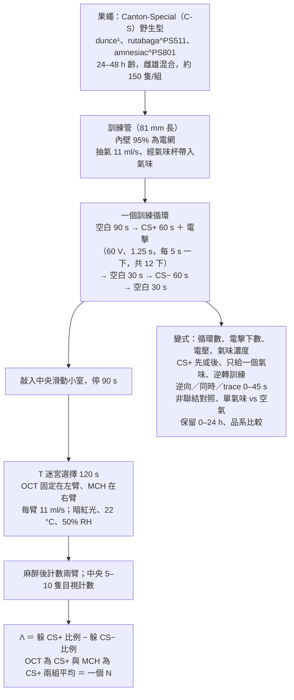

**圖中名詞。** 基因名後的上標（dunce¹ 的「1」、rutabaga^PS511 的「PS511」）是編號，代表同一基因的不同突變版本（等位基因）。RH＝相對濕度。變式一格的名詞：

- 逆向＝電擊先於氣味。
- 同時＝電擊與 CS+ 重疊，這點與標準訓練相同；差別只在圖 7（時序實驗，見 3.5 節）各組把 CS+ 排在 CS− 之後，也就是圖 6 第 2 組的排法（見 3.4 節）。
- trace（痕跡）制約＝氣味結束後空白一段時間才電擊，「0–45 s」是空白的長度。trace 0 s＝電擊在 CS+ 結束那一刻才開始，兩者不重疊（3.5 節再詳述）。
- CS+ 先或後＝訓練時 CS+ 排在 CS− 之前或之後；只給一個氣味＝訓練時只給 CS+，測驗仍是兩個氣味（3.4 節）。
- 逆轉訓練＝第二個循環改電另一個氣味（3.4 節）。

**裝置。** 改自 Dudai et al. 1976 的選擇室，三個設計目標：訓練時氣味與電擊無法逃避；氣味以氣流給、濃度高且從訓練到測驗保持一致；盡量不驚擾果蠅（PDF 第 264 頁）。訓練管是 17×100 mm 聚苯乙烯試管截成 81 mm，內襯 57×81 mm 的柔性印刷電路電網，管口的尼龍網上另有一片圓形電網。兩條收集臂各是一根 17×100 mm 試管。氣味杯深約 10 mm，以 Sigmacote 塗疏水膜，裝純的 OCT 或 MCH。抽氣機為無脈動的旋轉式幫浦。兩套裝置共用一台幫浦，管線分成兩對入口，每套裝置一對：一個接上埠、一個接下埠，共四個入口。每個入口各以鐵氟龍針閥調速：上埠 11 ml/s（訓練）、下埠 22 ml/s（測驗）。下埠的 22 ml/s 平均分到兩臂，各 11 ml/s（PDF 第 265–266 頁）。

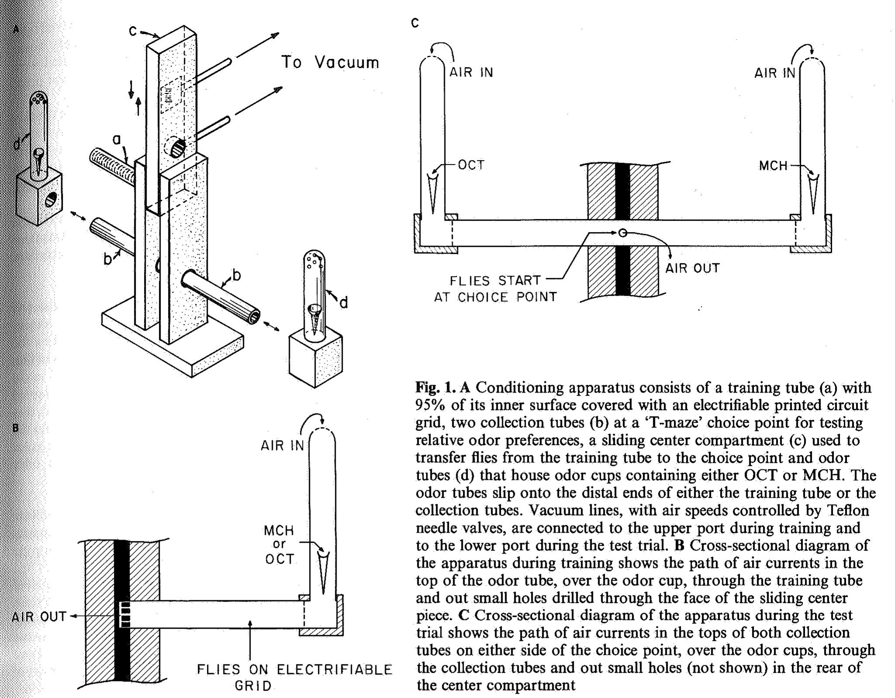

<small>圖片出處：Tully T, Quinn WG. *J Comp Physiol A* 157(2):263–277 (1985)，Figure 1。© 1985 Springer-Verlag。教學引用；本篇無免費全文，原文見 [doi:10.1007/BF01350033](https://doi.org/10.1007/BF01350033)。</small>

> **原圖說（Figure 1）：** A Conditioning apparatus consists of a training tube (a) with 95% of its inner surface covered with an electrifiable printed circuit grid, two collection tubes (b) at a 'T-maze' choice point for testing relative odor preferences, a sliding center compartment (c) used to transfer flies from the training tube to the choice point and odor tubes (d) that house odor cups containing either OCT or MCH. The odor tubes slip onto the distal ends of either the training tube or the collection tubes. Vacuum lines, with air speeds controlled by Teflon needle valves, are connected to the upper port during training and to the lower port during the test trial. B Cross-sectional diagram of the apparatus during training shows the path of air currents in the top of the odor tube, over the odor cup, through the training tube and out small holes drilled through the face of the sliding center piece. C Cross-sectional diagram of the apparatus during the test trial shows the path of air currents in the tops of both collection tubes on either side of the choice point, over the odor cups, through the collection tubes and out small holes (not shown) in the rear of the center compartment

**圖說中譯：** (A) 制約裝置包括：一根訓練管（a），內面 95% 覆有可通電的印刷電路電網；位於「T 迷宮」選擇點的兩根收集管（b），用來測試對兩氣味的相對偏好；一個滑動的中央小室（c），用來把果蠅從訓練管送到選擇點；以及裝有 OCT 或 MCH 氣味杯的氣味管（d）。氣味管可套在訓練管或收集管的遠端。以鐵氟龍針閥控制風速的抽氣管，訓練時接上埠、測驗時接下埠。(B) 訓練時的剖面圖：氣流由氣味管頂端進入、流過氣味杯、穿過訓練管，再從中央滑塊正面鑽的小孔流出。(C) 測驗時的剖面圖：氣流由選擇點兩側兩根收集管的頂端進入、流過氣味杯、穿過收集管，再從中央小室背面的小孔（圖上未畫）流出。

**解讀：**

- **這張圖說明了「T 迷宮」這個名字的由來與它的關鍵設計：訓練與測驗共用同一個中央滑塊。** 果蠅訓練完被敲進滑塊，滑塊一推就對準兩臂的交會點，果蠅不必再被吸取或麻醉，這是作者說「盡量不驚擾」的具體做法。
- **C 格的氣流方向決定了果蠅怎麼選。** 兩臂的空氣都從遠端流向中央，所以果蠅在選擇點同時聞到兩股從不同方向來的氣味，往哪臂走就是逆著哪股氣流走。作者說沒受訓的果蠅會「逆風走進收集管」（PDF 第 266 頁），這是靠逆風趨性（anemotaxis）完成的選擇。※ 推論：所以 Λ 量到的是 2 分鐘內「逆著哪一股氣味風走進哪一臂」的一次性選擇。本庫 [[e-olfactory-arena]] 的四象限競技場是另一種裝置，讀出方式不同（見該頁），兩種分數不宜直接比大小。
- 方法節只描述訓練管有電網；收集管是普通試管，只鑽了進氣的小孔（PDF 第 265 頁）。測驗本身不給增強（不電擊）。※ 推論：這樣測驗本身不會再訓練果蠅。

**氣味濃度的定法。** 實際空氣中的氣味濃度量不到。作者固定氣流、改變氣味杯的口徑，**調到沒受訓的果蠅在 OCT 與 MCH 之間五五分**為止；標準為 MCH 10 mm、OCT 8 mm（內徑）。氣味的「有效濃度」則用「沒受訓的果蠅在『該氣味 vs 乾淨空氣』中躲開該氣味的百分比」間接代表（PDF 第 266、268 頁）。

**訓練細節。**

- 電擊由 Grass S44 刺激器給，1.25 s、60 V 方波，每 5 s 一下。果蠅挨電時會僵住或跳，在兩下之間 3.75 s 的空檔內恢復正常走動。
- 新的管子與電網先讓沒受訓的果蠅過夜「養」過，實驗之間不洗。理由是「被其他果蠅待過的管子」讓果蠅跑得較快、學得較好。
- 訓練時「小心不搖不震」，作者說這是得到最高分的必要條件（PDF 第 266 頁）。
- 測驗時 OCT 固定在左臂、MCH 在右臂；被電的氣味則在連續實驗之間輪替。作者說這是為了減少收集管中費洛蒙（果蠅留下的化學訊號）造成的左右偏向。※ 推論，分兩步：(1) 若果蠅偏向左臂，就是多進 OCT 臂，也就是多躲 MCH。(2) 在電 OCT 的組，這讓 Λ 變低；在電 MCH 的組，這讓 Λ 變高。兩組平均後，偏向的效果互相抵銷。
- 暗紅燈放在裝置後 15 cm、上方 34 cm，光線垂直照到兩臂（PDF 第 266 頁）。

**計分。** 學習指數 Λ 沿用 Quinn et al. 1974 的定義（原文「As in Quinn et al. (1974)」，PDF 第 266 頁）：躲 CS+ 的比例減躲 CS− 的比例，兩組互換 CS+ 後平均。因為測驗時兩個氣味同時出現，**果蠅跑進哪一臂，就算躲開另一臂的氣味**（原文「ran into the opposite collection tube」）。所有果蠅都沒學到時 Λ ＝ 0，全部躲開 CS+ 時 Λ ＝ 1。

**突變株的維持。** 先說明幾個遺傳學名詞：

- 同型合子＝一對同源染色體上，某基因的兩份都是同一版本；異型合子＝兩份不同。
- 自體染色體＝性染色體（X、Y）以外的染色體。
- 修飾基因＝會改變主要突變效果的其他基因。
- 平衡子（balancer）＝帶標記、不會與配對染色體重組的染色體，用來整條搬移染色體。
- 缺失（deficiency，簡寫 Df）＝染色體上少了一段。
- 基因型寫成「A/B」，表示一對同源染色體各帶什麼。例如 *rut*/*rut*＝兩條都帶 *rut* 突變；*rut*/Df(1)KA9＝一條帶 *rut*、另一條是缺失。

作者說同型合子的突變株會慢慢累積修飾基因，讓學習分數往野生型漂移（未發表資料）。為什麼會累積，論文沒說原因。對策有三：

1. 每株維持 12–24 條亞系（同一品系分開飼養的幾條小族群），實驗前先測，只留學得最差的。
2. 必要時用平衡子把突變株的自體染色體換成 C-S 的，去掉自體染色體上的修飾基因。
3. *rut* 另做 *rut*/Df(1)KA9 的雌蠅。Df(1)KA9 是 X 染色體缺了 12E1–13A5 一段（12E1–13A5 是 X 染色體上的區段編號），這一段涵蓋 *rut* 基因。這些雌蠅的兩條 X 染色體來源不同：一條來自 *rut* 品系，一條來自缺失品系。因為缺失那條沒有 *rut* 所在的一段，這些雌蠅唯一的一份 *rut* 是突變的；論文說這等於 *rut* 完全失去功能。同時，*rut* 那條 X 上的修飾基因只剩一份（原文：對 X 上的修飾基因是異型合子），自體染色體則換成 C-S 的。※ 推論：若修飾基因是隱性，只剩一份就不會表現；修飾基因是顯性或隱性，論文沒說明。這樣做是為了確認學習缺陷來自 *rut* 本身，而不是累積的修飾基因（PDF 第 264 頁）。

**統計。** 兩組平均的差異用 Student's t 檢定。三組以上用單因子或二因子 ANOVA（Sokal & Rohlf 1969）。圖 9 另用 Student-Newman-Keuls 事後檢定（α ＝ 0.05）（PDF 第 266、270 頁）。事後檢定是在 ANOVA 顯示各組有差異之後，再逐對比較各組。

**正文缺的參數。** 留在中央的果蠅算不算進比例的分母，方法節沒有明文；但結果節的「93% 躲 CS+、4% 躲 CS−、3% 留在中央」三者相加為 100%（PDF 第 266–267 頁），※ 推論：比例的分母是全部果蠅，含留在中央者。每次實驗的實際果蠅數只說「約 150」，沒有逐組報告。

### 三、結果

#### 3.1 習得：一個循環就到頂，電擊的「下數」是學習的單位（圖 2）

「習得」（acquisition）指學習分數隨訓練量上升的過程。訓練 1、2、3、5 個循環後，Λ 分別為 0.89 ± 0.01（N ＝ 5）、0.90 ± 0.02（N ＝ 5）、0.88 ± 0.01（N ＝ 5）、0.90 ± 0.01（N ＝ 9）。四者幾乎相同，所以一個循環就已經是最大值（PDF 第 266–267 頁）。

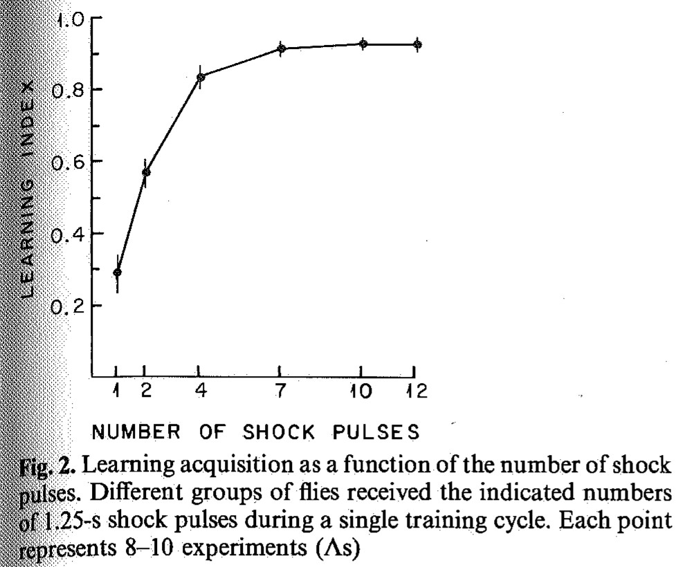

<small>圖片出處：Tully T, Quinn WG. *J Comp Physiol A* 157(2):263–277 (1985)，Figure 2。© 1985 Springer-Verlag。教學引用；本篇無免費全文，原文見 [doi:10.1007/BF01350033](https://doi.org/10.1007/BF01350033)。</small>

> **原圖說（Figure 2）：** Learning acquisition as a function of the number of shock pulses. Different groups of flies received the indicated numbers of 1.25-s shock pulses during a single training cycle. Each point represents 8–10 experiments (Λs)

**圖說中譯：** 學習習得與電擊脈衝數的關係。不同組的果蠅在單一訓練循環中受到所示次數的 1.25 秒電擊脈衝。每一點代表 8–10 次實驗（Λ）。

**解讀：**

- **數值（※ 從圖判讀）：** 1 下 ≈ 0.29、2 下 ≈ 0.57、4 下 ≈ 0.83、7 下 ≈ 0.91、10 與 12 下 ≈ 0.92。前 4 下貢獻了九成的最終分數，之後幾乎平坦。正文說「7–10 下內達漸近線」。
- **單一下電擊就有 Λ ≈ 0.29。** ※ 推論：這等於一次 1.25 秒的電擊配上氣味，就讓約三成的果蠅改變選擇。本庫其他來源（Hige 2015、Aso 2016、Handler 2019）用秒級的短刺激研究時序。這三篇研究的是：多巴胺訊號（腦中代表懲罰或獎賞的訊號）與氣味的先後差幾秒時，學習如何改變（見 [[t-timing-rules]]）。本圖顯示，單次短配對在行為上就已經有效。
- **作者把每一下電擊當成一次「習得試次」**（acquisition trial），這是本圖最重要的概念轉換：一個 60 秒的訓練循環在學習上其實是 12 次配對。
- **下數少於 12 時，電擊怎麼排。** 刺激器設成每分鐘給 k 下，相鄰兩下的間隔是 60/k 秒；第一下的起點落在第一個間隔（0 到 60/k 秒）內的隨機時刻（PDF 第 267 頁）。所以 k 下平均分布在 60 秒的氣味中，下數越少、間隔越長。例如 2 下時間隔 30 秒，12 下時間隔 5 秒。不同下數之間，電擊落在氣味中的時間點也跟著不同。※ 推論：「下數」與「電擊落在 60 秒氣味中的哪個時段」在這張圖裡是綁在一起的，無法分開。
- **這張圖的上限 ≈ 0.92，高於正文的 1 循環 0.89。** 兩者是不同批實驗，差異在誤差範圍附近。

#### 3.2 消退：要到約 60 分鐘才明顯（圖 3）

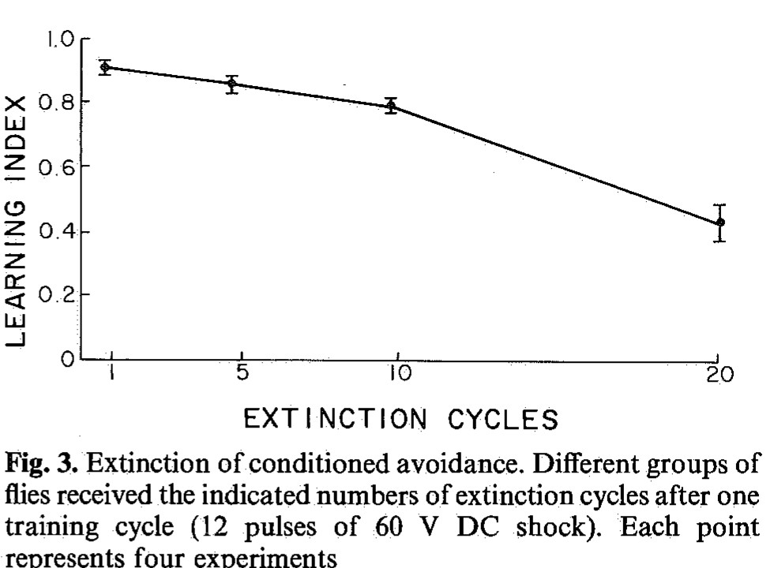

<small>圖片出處：Tully T, Quinn WG. *J Comp Physiol A* 157(2):263–277 (1985)，Figure 3。© 1985 Springer-Verlag。教學引用；本篇無免費全文，原文見 [doi:10.1007/BF01350033](https://doi.org/10.1007/BF01350033)。</small>

> **原圖說（Figure 3）：** Extinction of conditioned avoidance. Different groups of flies received the indicated numbers of extinction cycles after one training cycle (12 pulses of 60 V DC shock). Each point represents four experiments

**圖說中譯：** 制約躲避的消退。不同組的果蠅在一個訓練循環（12 下 60 V 直流電擊）之後，接受所示次數的消退循環。每一點代表四次實驗。

**消退的定義（本篇）：** 消退循環與訓練循環完全相同，只是兩個氣味都不配電擊；從訓練最後的 30 秒休息結束後立即開始（PDF 第 267 頁）。

**解讀：**

- **數值（※ 從圖判讀）：** 1 循環 ≈ 0.91、5 ≈ 0.86、10 ≈ 0.78、20 ≈ 0.43。正文：「20 個消退循環才讓制約躲避降到最大值的 50%」。
- **重點：論文說「非常不易消退」；扣掉同時間的自然遺忘後，前 15 分鐘確實看不出消退，但到 60 分鐘就明顯了。** 分數下降有一部分是時間造成的自然遺忘，不是消退本身的效果。扣掉自然遺忘後，前 15 分鐘的消退看不出額外效果，要到 60 分鐘才明顯。以下說明這個比較。
- **時間換算是這張圖沒說的事。** 一個循環是 60 ＋ 30 ＋ 60 ＋ 30 ＝ 180 秒，所以 5、10、20 個循環分別是約 15、30、60 分鐘的不配電擊暴露。測驗也就在訓練後這麼久才做。
- **對照組來自圖 10。** 圖 10 是本頁 3.7 節的記憶保留曲線：野生型訓練後不做任何處理，隔一段時間再測。拿圖 3 和圖 10 同一時間點的分數比（※ 從兩圖判讀）：

| 訓練後時間 | 圖 3（做消退） | 圖 10（不做處理） |
|---|---|---|
| 約 15 分鐘 | ≈ 0.86 | 10–20 分鐘 ≈ 0.88–0.85 |
| 約 30 分鐘 | ≈ 0.78 | 30 分鐘 ≈ 0.86 |
| 約 60 分鐘 | ≈ 0.43 | 60 分鐘 ≈ 0.82 |

- ※ 推論：前 15 分鐘的消退循環看不出額外效果。30 分鐘時只多降約 0.08，**到 60 分鐘才多降約 0.4**。也就是說，消退效果大部分出現在第 10 到 20 個循環之間。論文沒有做這個扣除。兩圖是不同批實驗，而且圖 10 的果蠅在保留期間放在食物瓶、不是訓練管。圖 3 的果蠅則留在訓練管裡反覆聞氣味。※ 推論：環境不同（食物瓶或訓練管、有沒有反覆聞氣味）可能改變遺忘速度，所以這個對照只是粗略的。
- **這裡的「消退」與本庫 Felsenberg 兩篇（[[s-felsenberg-2017-re-evaluation]]、[[s-felsenberg-2018-memory-extinction]]）的消退不同。** 本篇是訓練後立刻、兩個氣味都重複給、最多給 20 輪；[[s-felsenberg-2018-memory-extinction]] 是訓練後 30 分鐘、只再聞 CS+ 兩次。兩者的消退量不能直接比，見 [[c-memory-extinction]]。

#### 3.3 電擊強度與氣味濃度（圖 4、圖 5）

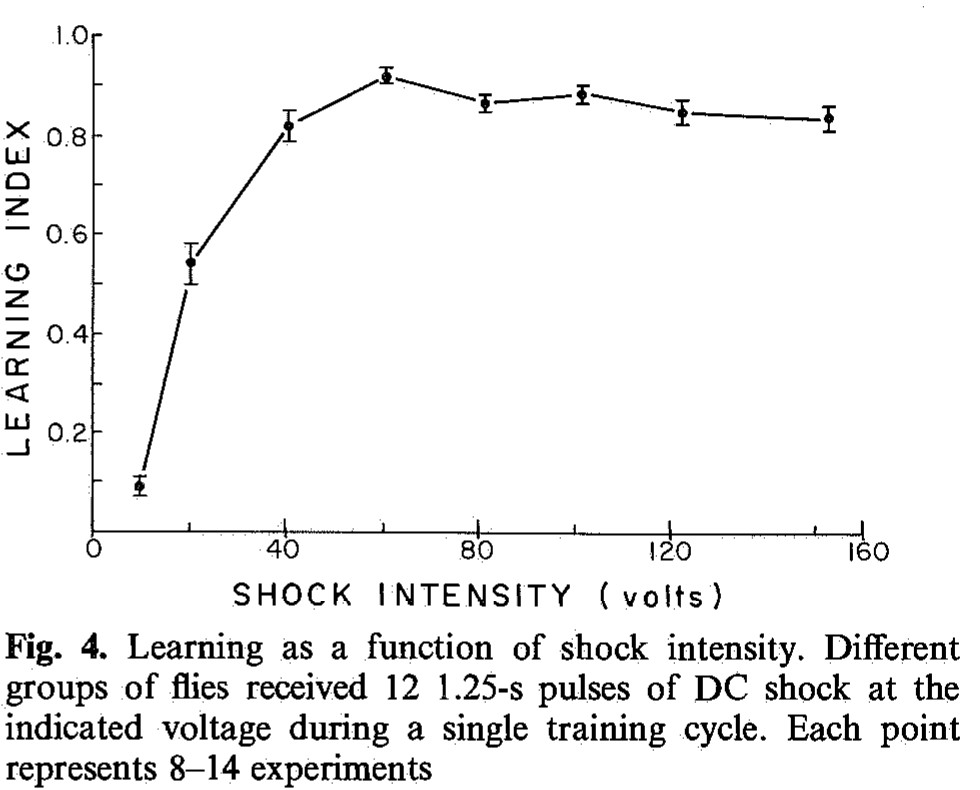

<small>圖片出處：Tully T, Quinn WG. *J Comp Physiol A* 157(2):263–277 (1985)，Figure 4。© 1985 Springer-Verlag。教學引用；本篇無免費全文，原文見 [doi:10.1007/BF01350033](https://doi.org/10.1007/BF01350033)。</small>

> **原圖說（Figure 4）：** Learning as a function of shock intensity. Different groups of flies received 12 1.25-s pulses of DC shock at the indicated voltage during a single training cycle. Each point represents 8–14 experiments

**圖說中譯：** 學習與電擊強度的關係。不同組的果蠅在單一訓練循環中受到 12 下所示電壓的 1.25 秒直流電擊。每一點代表 8–14 次實驗。

**解讀：**

- **數值（※ 從圖判讀）：** 10 V ≈ 0.09、20 V ≈ 0.55、40 V ≈ 0.83、60 V ≈ 0.92、80 V ≈ 0.87、100 V ≈ 0.88、120 V ≈ 0.85、150 V ≈ 0.84。10 V 到 20 V 上升最陡（約 0.09 → 0.55），40 V 已接近頂點。
- **60 V 之後的下降很小（約 0.92 → 0.84），但方向一致。** 作者推測強電擊對果蠅造成干擾或傷害（原文「disruption or damage to the flies」，沒有說明干擾的是什麼）。作者沒有檢定這段下降是否顯著。本庫 [[s-felsenberg-2018-memory-extinction]] 用 90 V；依本圖，90 V 落在平台上、比 60 V 略低一點的位置（※ 推論；兩篇裝置與品系不同，這只是量級的參考）。

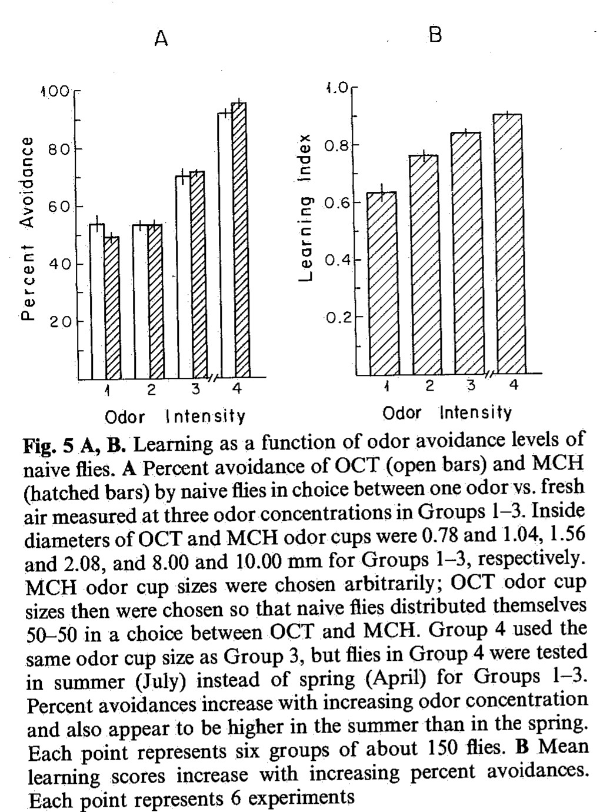

<small>圖片出處：Tully T, Quinn WG. *J Comp Physiol A* 157(2):263–277 (1985)，Figure 5。© 1985 Springer-Verlag。教學引用；本篇無免費全文，原文見 [doi:10.1007/BF01350033](https://doi.org/10.1007/BF01350033)。</small>

> **原圖說（Figure 5）：** A, B. Learning as a function of odor avoidance levels of naive flies. A Percent avoidance of OCT (open bars) and MCH (hatched bars) by naive flies in choice between one odor vs. fresh air measured at three odor concentrations in Groups 1–3. Inside diameters of OCT and MCH odor cups were 0.78 and 1.04, 1.56 and 2.08, and 8.00 and 10.00 mm for Groups 1–3, respectively. MCH odor cup sizes were chosen arbitrarily; OCT odor cup sizes then were chosen so that naive flies distributed themselves 50–50 in a choice between OCT and MCH. Group 4 used the same odor cup size as Group 3, but flies in Group 4 were tested in summer (July) instead of spring (April) for Groups 1–3. Percent avoidances increase with increasing odor concentration and also appear to be higher in the summer than in the spring. Each point represents six groups of about 150 flies. B Mean learning scores increase with increasing percent avoidances. Each point represents 6 experiments

**圖說中譯：** (A, B) 學習與沒受訓果蠅對氣味躲避程度的關係。(A) 沒受訓的果蠅在「一個氣味 vs 乾淨空氣」中對 OCT（空白柱）與 MCH（斜線柱）的躲避百分比，第 1–3 組為三種氣味濃度。第 1–3 組 OCT 與 MCH 氣味杯內徑分別為 0.78 與 1.04、1.56 與 2.08、8.00 與 10.00 mm。MCH 杯口徑任意選定，OCT 杯口徑再選成讓沒受訓的果蠅在 OCT 與 MCH 之間五五分。第 4 組與第 3 組杯口徑相同，但在夏天（7 月）而非春天（4 月）測試。躲避百分比隨氣味濃度上升，夏天看起來也比春天高。每一點代表六組各約 150 隻果蠅。(B) 平均學習分數隨躲避百分比上升。每一點代表 6 次實驗。

**解讀：**

- **數值（※ 從圖判讀）：** A 格 OCT／MCH 躲避百分比：第 1 組 ≈ 53／49、第 2 組 ≈ 53／53、第 3 組 ≈ 70／72、第 4 組 ≈ 93／96。B 格 Λ（依序為第 1–4 組）：≈ 0.63、0.76、0.84、0.91。
- **第 3 組用的就是標準杯口徑（MCH 10 mm、OCT 8 mm），春天躲避約七成。** 科普段的「平均約八成」來自圖 9 的未受訓組（平均 79%，見 3.6 節）。那是另一批實驗，和圖 5 第 3 組不同批，數字不必相等。
- **A 格第 1、2 組的躲避約 50%，等於沒受訓的果蠅分不出「這個氣味」和「乾淨空氣」。** 但這兩組仍學到 Λ ≈ 0.63–0.76。※ 推論：果蠅能學會躲開一個牠「本來不躲」的氣味；「天生的躲避」與「能不能當 CS」是兩回事。論文的敘述只強調兩者正相關，沒點出這一點。
- **杯口徑從 1.04 mm 增為 10 mm（面積約 90 倍），Λ 才由 0.63 升到 0.84。** 意思是：杯口面積大幅增加，Λ 只增加約 0.2。但杯口面積不等於空氣中的氣味濃度，所以不能據此說「濃度增加 90 倍」。論文沒換算面積，也沒宣稱面積與濃度成正比。
- **季節效應後來被歸因於濕度。** 7 月組比 4 月組的躲避高（t 檢定，中括號內是自由度；OCT t[10] ＝ 7.793、MCH t[10] ＝ 17.645，皆 P < 0.001），學習也較好（t[10] ＝ 3.957，P < 0.001）（PDF 第 268 頁）。論文把夏天定義為 5–9 月、冬天定義為 10–4 月（PDF 第 268 頁），所以 4 月屬於作者說的「冬季」期間。作者在方括號補記：事後發現冬天加濕器故障、相對濕度很低，「只要相對濕度在 50–60%，全年都能達到夏天的水準」。第 1–3 組都在 4 月測，所以三種濃度之間的比較沒有季節差；濕度只影響第 4 組（7 月）與第 3 組（4 月）的比較。作者在正文把季節差異解釋為「果蠅的嗅覺敏銳度改變」（changes in olfactory acuity），**這個解釋被作者自己的濕度補記削弱**：7 月組較好，可能只是 4 月的濕度較低。4 月時加濕器是否已經故障，論文沒寫。

#### 3.4 訓練程序的變式與逆轉訓練（圖 6）

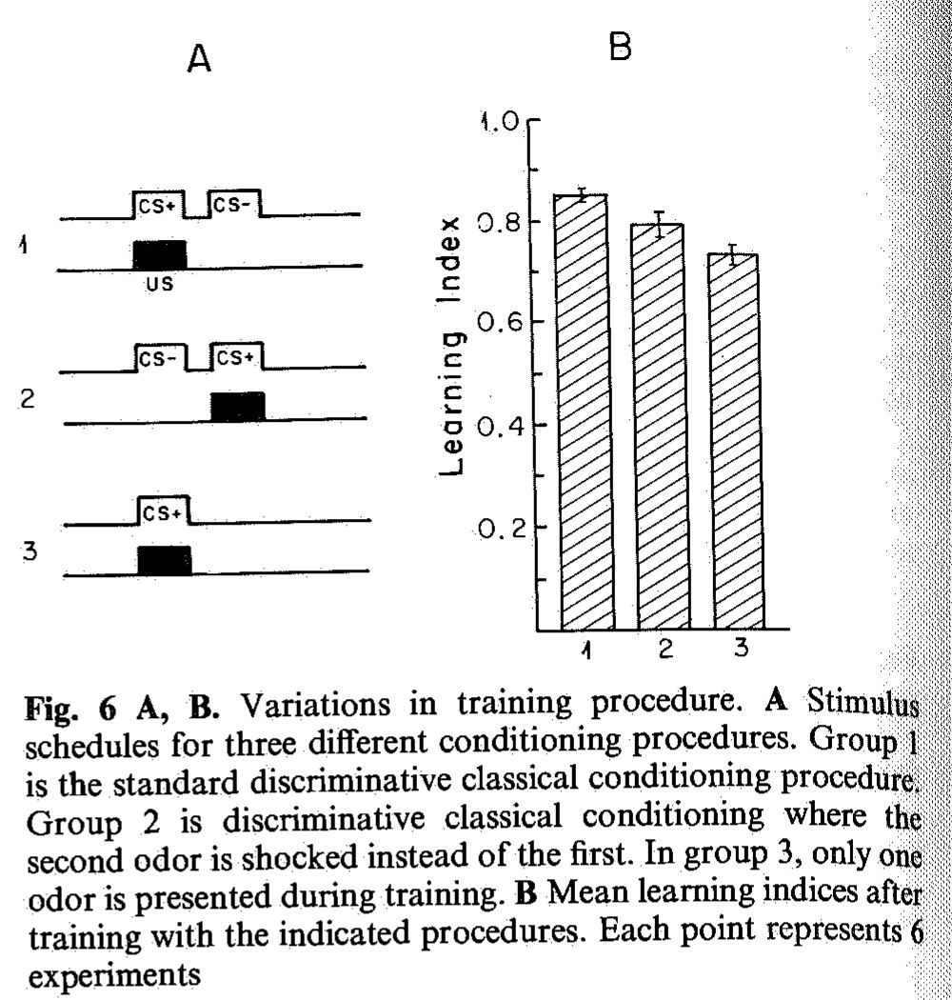

<small>圖片出處：Tully T, Quinn WG. *J Comp Physiol A* 157(2):263–277 (1985)，Figure 6。© 1985 Springer-Verlag。教學引用；本篇無免費全文，原文見 [doi:10.1007/BF01350033](https://doi.org/10.1007/BF01350033)。</small>

> **原圖說（Figure 6）：** A, B. Variations in training procedure. A Stimulus schedules for three different conditioning procedures. Group 1 is the standard discriminative classical conditioning procedure. Group 2 is discriminative classical conditioning where the second odor is shocked instead of the first. In group 3, only one odor is presented during training. B Mean learning indices after training with the indicated procedures. Each point represents 6 experiments

**圖說中譯：** (A, B) 訓練程序的變式。(A) 三種制約程序的刺激時程。第 1 組為標準的區辨性古典制約。第 2 組亦為區辨性古典制約，但電擊配第二個氣味而非第一個。第 3 組訓練時只給一個氣味。(B) 各程序訓練後的平均學習指數。每一點代表 6 次實驗。

**解讀：**（CS、US、CS+、CS−、Λ、延遲制約的定義見摘要的名詞註：CS+＝配電擊的氣味，CS−＝不配電擊的氣味。）

- **數值：** 正文：第 2 組比第 1 組低 7%（t[10] ＝ 2.54，0.02 < P < 0.05），第 3 組低 14%（t[10] ＝ 4.46，P < 0.001）（PDF 第 268–269 頁）。※ 從圖判讀：第 1 組 ≈ 0.86、第 2 組 ≈ 0.79、第 3 組 ≈ 0.73。
- **「低 7%」的意思不確定。** 原文只寫「reduced learning scores by 7%」，沒說是 Λ 絕對值少 0.07，還是相對第 1 組少 7%。用判讀值算：0.86 → 0.79 是絕對差 0.07，相對約少 8%，兩種讀法都說得通。「低 14%」同理。
- **圖 7 該跟誰比：圖 7 各組的 CS+ 都排在第二位。**（圖 7 見 3.5 節。）這一條的用意是提醒：圖 7 同時組的 0.79 不能拿來和 3.1 節的 0.89 比。 圖 7A 的同時組與四個 trace 組都是「CS− 先、CS+ 後」（論文說各組兩氣味的時間關係相同，PDF 第 269 頁），也就是第 2 組的排法。※ 推論：所以圖 7 同時組的 Λ ≈ 0.79 應該拿圖 6 第 2 組（≈ 0.79）來比，兩者相同；不該拿圖 6 第 1 組（≈ 0.86），或 3.1 節單次標準訓練的 0.89 來比，因為這兩者都是 CS+ 排在前面。圖 7 的「延遲制約最好」（延遲制約就是圖 7 的「同時」組：電擊在 CS+ 期間出現，兩者重疊），是在 CS+ 排在後面的排法下成立。
- **第 3 組只給一個氣味，分數仍有 ≈ 0.73。** 第 3 組訓練時唯一出現的氣味就是被電的那個（CS+）；測驗時另一個氣味是第一次聞到。作者用圖 9 的結果解釋為什麼比第 1 組低：CS+ 因為訓練時聞過而「習慣化」（habituation，重複接觸同一刺激後反應變小），果蠅對它少躲一些；另一個氣味是新的，沒有這個效果。兩個氣味因此被不對等地影響，Λ 就下降（PDF 第 271 頁）。這是事後解釋，沒有直接測。
- **逆轉訓練（正文，無圖）：** 連訓兩個標準循環。第一循環電 OCT（或 MCH），第二循環改電另一個。測驗時果蠅偏向躲開**較近一次**被電的氣味，Λ ＝ 0.26 ± 0.03（N ＝ 8）（PDF 第 269 頁）。這裡的 Λ 以第二輪被電的氣味當 CS+ 計算，所以正值表示果蠅躲的是較近一次被電的氣味（※ 論文未明寫計算方式，由「躲較近被電的氣味」與 Λ 為正推得）。※ 推論：若第二次訓練完全蓋掉第一次，分數應接近單次訓練的 0.89；若兩次記憶等強、互相抵銷，應接近 0。0.26 落在兩者之間、偏向 0。一種讀法是**第一次學到的東西大部分還在**，只是比第二次的弱一些；另一種讀法是第二輪緊接在第一輪之後（中間沒有間隔），**第二輪的新記憶本身學得比單輪弱**；也可能兩者都有。這個實驗分不開這兩種讀法（見 [[syn-contradictions]] 3.10）。論文只說「儘管第一循環學到了什麼，果蠅躲開較近配電的氣味」，沒有做這個比較。這筆資料與 [[t-memory-updating]] 的「舊記憶沒被擦掉」有關。

#### 3.5 氣味與電擊的時序（圖 7）

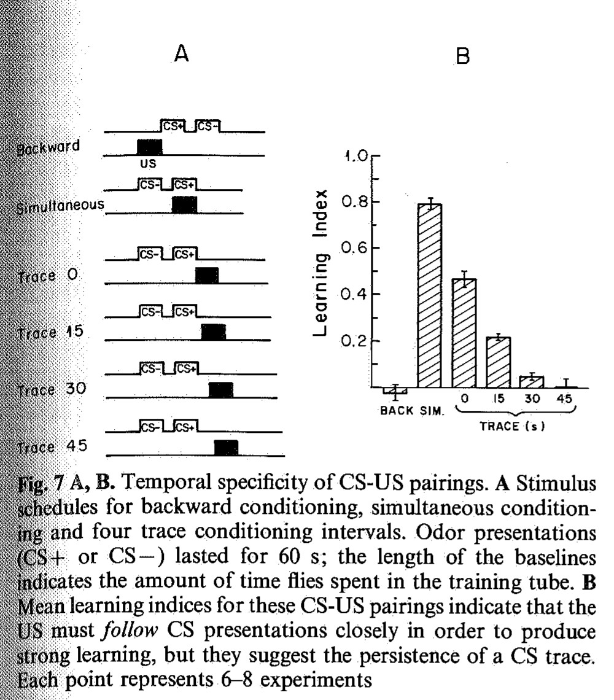

<small>圖片出處：Tully T, Quinn WG. *J Comp Physiol A* 157(2):263–277 (1985)，Figure 7。© 1985 Springer-Verlag。教學引用；本篇無免費全文，原文見 [doi:10.1007/BF01350033](https://doi.org/10.1007/BF01350033)。</small>

> **原圖說（Figure 7）：** A, B. Temporal specificity of CS-US pairings. A Stimulus schedules for backward conditioning, simultaneous conditioning and four trace conditioning intervals. Odor presentations (CS+ or CS−) lasted for 60 s; the length of the baselines indicates the amount of time flies spent in the training tube. B Mean learning indices for these CS-US pairings indicate that the US must *follow* CS presentations closely in order to produce strong learning, but they suggest the persistence of a CS trace. Each point represents 6–8 experiments

**圖說中譯：** (A, B) CS–US 配對的時間專一性。(A) 逆向制約、同時制約與四種 trace 制約間隔的刺激時程。氣味（CS+ 或 CS−）各持續 60 秒；基線的長度表示果蠅待在訓練管中的時間。(B) 這些 CS–US 配對的平均學習指數顯示：US 必須緊接在 CS 之*後*才能產生強的學習，但也顯示 CS 的痕跡會持續一段時間。每一點代表 6–8 次實驗。

**名詞先說明：** 逆向制約（backward conditioning）＝先電擊、後給氣味；同時制約＝電擊在氣味期間出現（即正文說的延遲制約，見 3.4 節）。trace 制約（trace conditioning）是氣味結束後空白一段時間才電擊，空白期間果蠅必須在腦中保留氣味的「痕跡」（trace）。本篇的「間隔」從 CS+ **結束**算到電擊開始。各組電擊持續多久、共幾下，正文與圖說都沒寫；A 格示意圖上的電擊方塊略短於 60 秒的氣味方塊（※ 判讀，示意圖不一定按比例）。

**解讀：**

- **數值（※ 從圖判讀）：** 逆向 ≈ −0.03、同時 ≈ 0.79、trace 0 s ≈ 0.47、15 s ≈ 0.22、30 s ≈ 0.05、45 s ≈ 0.00（45 s 的柱幾乎貼著零線，誤差棒頂端約 0.03）。正文：延遲制約最高；逆向「不產生聯結學習」；trace 隨間隔拉長而變差（PDF 第 269 頁）。**論文對這張圖沒有報告任何檢定**（已讀遍該節正文與圖說），「不產生學習」「變差」都是看平均值與誤差棒。
- **逆向組的電擊在 CS+ 之前就結束了，兩者不重疊**（正文：「the shock (US) ended before the first odor (CS+) was presented」）。
- **這一點關係到本庫的一筆未裁決矛盾。** [[syn-contradictions]] 1.1 記的是：本庫各來源對「懲罰先於氣味」時，果蠅是沒學到、還是學到相反偏好，說法不一。其中一個疑慮是 [[s-tomchik-2009-camp-dynamics]] 的逆向組依其示意圖與氣味重疊約 15 秒，可能不是純逆向。這個混淆在本篇不存在，而本篇的純逆向一樣幾乎是 0。因此這筆資料在矛盾中的作用有兩個。第一，它是「逆向配對學不到」這一方的一筆新資料。第二，它提供了一筆沒有「重疊」干擾的逆向資料（Tomchik 的逆向組有重疊），結果同樣約為 0。但它只有一個時間點，也沒檢查相反方向的學習（見下一條），不足以裁決這筆矛盾。
- **本篇逆向組的兩個限制。** 第一，只測了一個逆向時間點（電擊結束緊接氣味開始）。第二，「學到相反方向」（逆向配對後果蠅反而偏好、不躲該氣味）在 Λ 上會顯示為負值。本篇的 Λ ≈ −0.03 是負的，但在誤差棒範圍內，看不出有相反方向的學習；不過只有一個時間點、沒有檢定，論文也沒有討論這個可能。
- **trace 0 s 已經掉了將近一半（0.79 → 0.47）。** 「trace 0 s」指電擊在 CS+ 結束的那一刻才開始，所以 CS+ 與電擊不重疊，只是緊接著。※ 推論：同時組減 trace 0 s 組（0.79 − 0.47 ≈ 0.3），也就是「電擊與氣味重疊」比「緊接在氣味之後」多出約 0.3 的 Λ。
- **作者排除了「殘留氣味」的解釋：** 拿掉氣味管後，乾淨空氣每 1.54 秒就把訓練管換氣一次（PDF 第 269 頁）。※ 推論：由管容積除以氣流可驗算——依方法節，17 mm 外徑的試管截成 81 mm、氣流 11 ml/s，若內徑約 15 mm，容積約 14 ml，換氣時間約 1.3 秒，與 1.54 秒同量級（內徑是本頁的假設，論文未寫）。所以 15 秒間隔的 Λ ≈ 0.22 很難用管內殘留氣味解釋；但果蠅體表沾附的氣味，作者沒有排除。
- **與 Tomchik 2009 的重做對照。** [[s-tomchik-2009-camp-dynamics]] 圖 6B 用同一組間隔（同時、逆向、trace 0／15／30／45 s）自己重做了一次（氣味組合是 OCT 對苯甲醛，也就是用苯甲醛取代本篇的 MCH；n ＝ 6，訓練後 3 分鐘測）：

| 條件 | 本篇 Λ（※ 圖 7B 判讀，N ＝ 6–8） | Tomchik 2009 P.I.（※ 該篇圖 6B 判讀，n ＝ 6） |
|---|---:|---:|
| 逆向 | ≈ −0.03（不重疊） | ≈ 0.04（重疊約 15 s） |
| 同時 | ≈ 0.79 | ≈ 0.72 |
| trace 0 s | ≈ 0.47 | ≈ 0.47 |
| trace 15 s | ≈ 0.22 | ≈ 0.22 |
| trace 30 s | ≈ 0.05 | ≈ 0.13 |
| trace 45 s | ≈ 0.00 | ≈ 0.05 |

> 兩欄都是判讀值，誤差約 ±0.02；Tomchik 2009 欄取自 [[numbers]] 的 Tomchik 段。兩篇的 CS− 不同（MCH 對苯甲醛），Tomchik 2009 的電擊電壓與每組隻數未在該篇正文寫出。

**24 年後、換一個 CS−，曲線的形狀與 0、15 秒兩點幾乎一樣。** ※ 推論：同一套行為時序實驗被兩個實驗室分別做過、曲線形狀一致，可以當成主題頁 [[t-timing-rules]] 中，行為實驗這一部分可信度較高的資料。但不是每一點都相同：同時組差約 0.07（0.79 對 0.72）、30 秒點差約 0.08（0.05 對 0.13），都超過兩個判讀值相減的誤差（約 ±0.04）。兩篇的 CS− 不同、實驗室不同，又沒有跨篇的統計比較，本庫把它記為差異，不列為矛盾。

#### 3.6 非聯結性對照：分數為 0，不代表沒有改變（圖 8、圖 9）

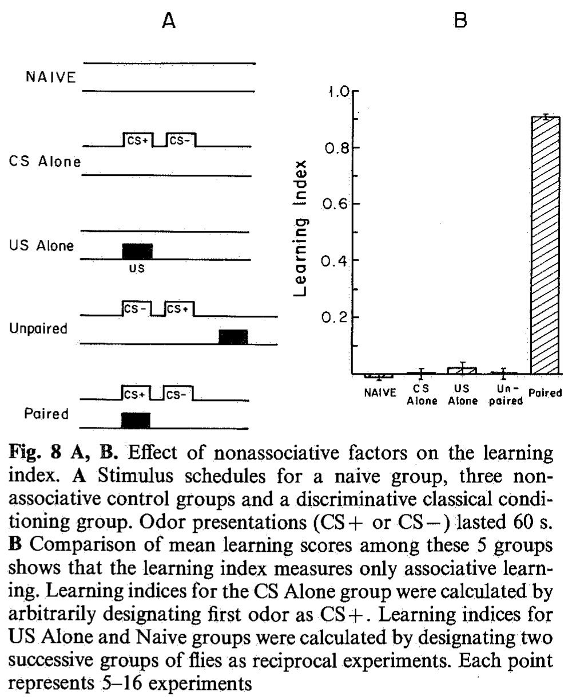

<small>圖片出處：Tully T, Quinn WG. *J Comp Physiol A* 157(2):263–277 (1985)，Figure 8。© 1985 Springer-Verlag。教學引用；本篇無免費全文，原文見 [doi:10.1007/BF01350033](https://doi.org/10.1007/BF01350033)。</small>

> **原圖說（Figure 8）：** A, B. Effect of nonassociative factors on the learning index. A Stimulus schedules for a naive group, three nonassociative control groups and a discriminative classical conditioning group. Odor presentations (CS+ or CS−) lasted 60 s. B Comparison of mean learning scores among these 5 groups shows that the learning index measures only associative learning. Learning indices for the CS Alone group were calculated by arbitrarily designating first odor as CS+. Learning indices for US Alone and Naive groups were calculated by designating two successive groups of flies as reciprocal experiments. Each point represents 5–16 experiments

**圖說中譯：** (A, B) 非聯結性因素對學習指數的影響。(A) 一個未受訓組、三個非聯結性對照組與一個區辨性古典制約組的刺激時程。氣味（CS+ 或 CS−）各持續 60 秒。(B) 五組平均學習分數的比較顯示學習指數只量到聯結學習。「只給 CS」組的學習指數以任意指定第一個氣味為 CS+ 計算。「只給 US」組與未受訓組的學習指數，以連續兩組果蠅當作互為對照的一對實驗來計算。每一點代表 5–16 次實驗。

**解讀：**

- **數值：** 配對組 Λ ＝ 0.89 ± 0.01；其餘四組 ※ 從圖判讀皆在 −0.02 到 +0.03 之間。
- ⚠️ **單篇不一致（組數）：** 圖說說「三個非聯結性對照組」加一個未受訓組；正文說「四個非聯結性對照程序，其中 (1) 既不給氣味也不給電擊（Naive）」（PDF 第 269 頁）。差別只在未受訓組算不算對照，不影響結果。
- **圖 8 五組的訓練程序（正文）：** 除下列差別外，各組訓練與測驗條件相同。
  - 未受訓（Naive）：不給氣味、不給電擊，直接測驗。
  - 只給 CS：只聞兩個氣味，不電擊。
  - 只給 US：只挨電，不聞氣味（圖 9 的同名組不同，見下）。
  - 明確不配對（Unpaired）：兩個氣味與電擊都給，但電擊在時間上與兩次氣味錯開。
  - 配對（Paired）：標準區辨訓練，電擊與 CS+ 同時給。
- **沒有 CS+ 的組，Λ 怎麼算。** Λ 要先知道哪個氣味是 CS+。「只給 CS」組任意指定先出現的氣味為 CS+。「只給 US」與「未受訓」兩組完全沒有氣味配過電擊，作者便把連續兩組果蠅當成一對：一組假設 OCT 是 CS+，另一組假設 MCH 是 CS+，各自照公式算再平均。果蠅若沒學到任何關聯，兩者抵銷為 0。「明確不配對」組雖然也沒有真正配對的氣味，Λ 則以圖 8A 示意圖上標為 CS+ 的那個氣味計算。
- **所以這兩組的 0 本來就是預期的。** 這個 0 只證明側偏（見二、方法：收集管中費洛蒙造成的左右偏向）與天生的氣味偏好被抵銷了。這兩組根本沒聞過氣味，本來就不可能有聯結學習。
- **真正有檢驗力的是「只給 CS」與「明確不配對」兩組。** 這兩組果蠅都聞過兩個氣味，「明確不配對」組還挨了電。若單純聞過氣味或挨過電，就會讓果蠅對某個氣味的躲避改變，這兩組才有機會讓 Λ 不為 0。

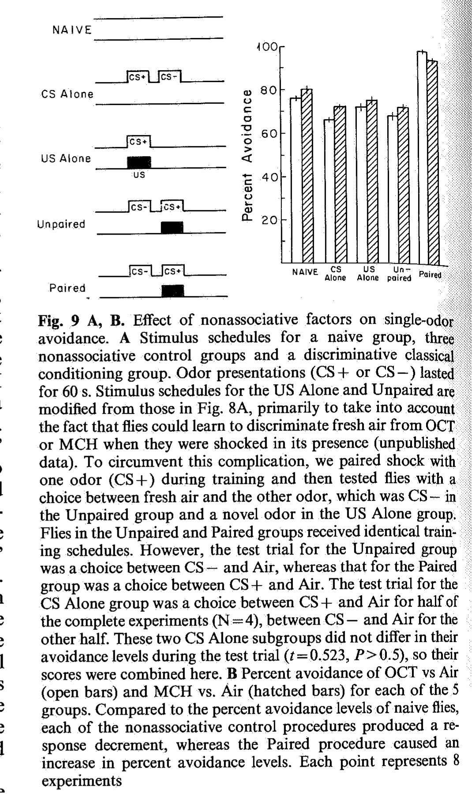

<small>圖片出處：Tully T, Quinn WG. *J Comp Physiol A* 157(2):263–277 (1985)，Figure 9。© 1985 Springer-Verlag。教學引用；本篇無免費全文，原文見 [doi:10.1007/BF01350033](https://doi.org/10.1007/BF01350033)。</small>

> **原圖說（Figure 9）：** A, B. Effect of nonassociative factors on single-odor avoidance. A Stimulus schedules for a naive group, three nonassociative control groups and a discriminative classical conditioning group. Odor presentations (CS+ or CS−) lasted for 60 s. Stimulus schedules for the US Alone and Unpaired are modified from those in Fig. 8A, primarily to take into account the fact that flies could learn to discriminate fresh air from OCT or MCH when they were shocked in its presence (unpublished data). To circumvent this complication, we paired shock with one odor (CS+) during training and then tested flies with a choice between fresh air and the other odor, which was CS− in the Unpaired group and a novel odor in the US Alone group. Flies in the Unpaired and Paired groups received identical training schedules. However, the test trial for the Unpaired group was a choice between CS− and Air, whereas that for the Paired group was a choice between CS+ and Air. The test trial for the CS Alone group was a choice between CS+ and Air for half of the complete experiments (N=4), between CS− and Air for the other half. These two CS Alone subgroups did not differ in their avoidance levels during the test trial (t=0.523, P>0.5), so their scores were combined here. B Percent avoidance of OCT vs Air (open bars) and MCH vs. Air (hatched bars) for each of the 5 groups. Compared to the percent avoidance levels of naive flies, each of the nonassociative control procedures produced a response decrement, whereas the Paired procedure caused an increase in percent avoidance levels. Each point represents 8 experiments

**圖說中譯：** (A, B) 非聯結性因素對單一氣味躲避的影響。(A) 一個未受訓組、三個非聯結性對照組與一個區辨性古典制約組的刺激時程。氣味（CS+ 或 CS−）各持續 60 秒。「只給 US」與「不配對」組的時程由圖 8A 修改而來，主要是因為果蠅若在乾淨空氣中挨電，就能學會區分乾淨空氣與 OCT 或 MCH（未發表資料）。為了繞過這個問題，訓練時把電擊配給一個氣味（CS+），再讓果蠅在乾淨空氣與另一個氣味之間選擇；這另一個氣味在「不配對」組是 CS−，在「只給 US」組是新氣味。「不配對」組與配對組的訓練時程完全相同，但「不配對」組的測驗是 CS− 對空氣，配對組則是 CS+ 對空氣。「只給 CS」組有一半完整實驗（N ＝ 4）測 CS+ 對空氣，另一半測 CS− 對空氣；兩個子組的躲避程度沒有差別（t ＝ 0.523，P > 0.5），因此合併呈現。(B) 五組各自對 OCT vs 空氣（空白柱）與 MCH vs 空氣（斜線柱）的躲避百分比。與未受訓果蠅相比，每一種非聯結性對照程序都造成反應下降，而配對程序造成躲避上升。每一點代表 8 次實驗。

**解讀：**

- **怎麼讀圖 9B：** 每組兩根柱，代表測驗時用的氣味：空白柱是 OCT 對空氣，斜線柱是 MCH 對空氣。

- **為什麼還要做圖 9。** 標準測驗讓 OCT 與 MCH 同時出現，只能看出兩個氣味之間的「相對」變化。如果某個對照程序讓果蠅對兩個氣味都少躲同樣多，Λ 仍會是 0。因此作者改成「單一氣味 vs 乾淨空氣」，分別量對 OCT、MCH 的躲避比例（PDF 第 270 頁）。
- **數值：** 正文：未受訓平均 79% 躲避；「只給 CS」與「不配對」約降 10 個百分點（79% → 約 69%）；「只給 US」約降 5 個百分點（79% → 約 74%）；配對組升 18 個百分點到 97%（PDF 第 270–271 頁）。※ 從圖判讀 OCT／MCH：未受訓 ≈ 77／81、只給 CS ≈ 66／73、只給 US ≈ 72／75、不配對 ≈ 68／72、配對 ≈ 98／96。二因子 ANOVA：氣味 F[1,70] ＝ 7.197（P < 0.01）、訓練程序 F[4,70] ＝ 17.719（P < 0.001）、交互作用 F[4,70] ＝ 3.234（0.01 < P < 0.025）。自由度可驗算：5 組 × 2 氣味 × 8 次 ＝ 80，誤差自由度 80 − 10 ＝ 70。
- **圖 9 的「只給 US」「不配對」和圖 8 的同名組是不同程序。**
  - 改程序的原因：測驗是「氣味 vs 空氣」。果蠅若在乾淨空氣中挨電，會學會躲空氣，測到的躲避比例就被污染。所以有電擊的組，電擊都配在一個氣味上，讓空氣保持「沒被電過」。
  - 「只給 US」：圖 8 是只挨電、不聞氣味；圖 9 是訓練時只給一個氣味（甲）並配電擊，測驗改測另一個氣味（乙）對空氣。乙不是第三種氣味，而是 OCT、MCH 中訓練時**完全沒出現**的那一個。
  - 「不配對」：圖 8 是電擊與氣味時間錯開；圖 9 的訓練與配對組完全相同，只差測驗測 CS− 對空氣（配對組測 CS+ 對空氣）。與圖 9「只給 US」的差別：這裡被測的氣味在訓練時**出現過**（當 CS−，沒被電）。也就是說，圖 9 的「不配對」其實是「標準訓練後的 CS−」。
- **這張圖真正該看的是：圖 9 的「只給 US」與「不配對」都含有一次真正的「氣味＋電擊」配對。** 標籤「US Alone」容易讓讀者以為果蠅沒聞到任何配對的氣味。所以圖 9 的「只給 US」「不配對」嚴格說不是純粹的非聯結性對照，圖說「每一種非聯結性對照程序都造成反應下降」對這兩組要打折扣。
- **「只給 US」為什麼下降。** 作者原本預期只給電擊會造成敏感化（sensitization，挨電後對各種刺激都反應變大），結果反而少躲約 5 個百分點。作者提出三個可能解釋（PDF 第 271 頁）：
  1. 這個程序其實沒有造成敏感化。
  2. 有敏感化，但讓果蠅在測驗時躁動、「混亂」，干擾了「走向空氣、遠離氣味」的選擇。
  3. 訓練氣味與測驗氣味都是醇類，下降來自「類化的習慣化」：對訓練氣味的習慣化（見 3.4 節）延伸到測驗氣味。類化（generalization）指把對一個氣味學到的反應延伸到別的氣味。

  ※ 推論：這 5 個百分點的下降，是在「另一個氣味（甲）剛配過電擊」的條件下量到的，不是「只挨電」。若是把對甲學到的躲避類化到乙，果蠅應該更躲乙；實際卻是少躲。少躲的方向正符合「對甲的習慣化延伸到相似的乙、使果蠅對乙反應變小」，所以這個結果比較接近作者的第三個解釋：兩個醇類氣味之間的類化習慣化。作者的第二個解釋（挨電後躁動、干擾選擇）仍未排除，見六、未來 (3)。
- ⚠️ **單篇不一致（「兩個氣味影響相同」）：** 摘要說非聯結性程序「對兩種氣味的影響相同」，討論說「OCT 與 MCH 的躲避在每一種情況下都下降相同的量」（PDF 第 274 頁）。
  - 但結果節自己報告了顯著的氣味 × 訓練交互作用（PDF 第 270 頁）。
  - 事後檢定（對每個氣味分別比較五組，把彼此沒差別的組歸成一群）分出的群也不同：OCT 的「只給 US」與「只給 CS」「不配對」有差別，MCH 則沒有（PDF 第 270 頁）。
  - 作者把交互作用主要歸給配對組：配對組 OCT 較高、對照組 MCH 較高，「可能表示 OCT 是較顯著的 CS」。這裡的「顯著」原文是 salient，意思是醒目、容易被果蠅注意，不是統計顯著。
  - ※ 推論：對 Λ 的結論影響不大。Λ 看的是兩個氣味的相對變化；以未受訓組為基準，各對照組 OCT 與 MCH 的降幅（※ 從圖判讀：只給 CS 約 11 對 8、只給 US 約 5 對 6、不配對約 9 對 9 個百分點）相差在 0–3 個百分點內，所以兩氣味相減時大致抵銷。但「完全相同」比資料強。
- **配對組的 97% 與摘要的 95%、正文的 93% 是三種不同的量**：97% 是「CS+ 對空氣」的單氣味測驗，93% 是 Λ ＝ 0.89 時「CS+ 對 CS−」測驗中躲 CS+ 的比例，95% 是摘要與討論的概數（見第五節）。
- **條件性抑制（conditioned inhibition）的檢查。** 這裡的「不配對」指圖 9 的程序。作者推論：若「不配對」讓 CS− 變成「安全」的信號，它的躲避應該比「只給 CS」組更低；兩組沒有差別，所以兩種程序都沒有產生可量的條件性抑制（PDF 第 271 頁）。這是一個合理的否定結果，但 N ＝ 8、兩組平均差僅約 1–2 個百分點，檢驗力未報告。
#### 3.7 記憶保留：野生型緩降，突變株兩段式（圖 10）

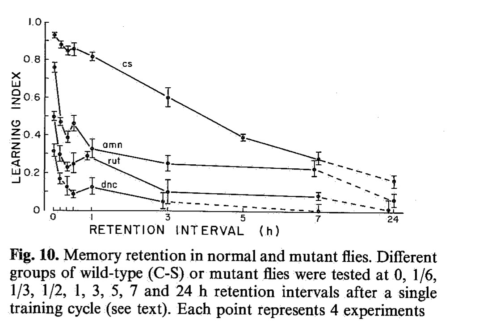

<small>圖片出處：Tully T, Quinn WG. *J Comp Physiol A* 157(2):263–277 (1985)，Figure 10。© 1985 Springer-Verlag。教學引用；本篇無免費全文，原文見 [doi:10.1007/BF01350033](https://doi.org/10.1007/BF01350033)。</small>

> **原圖說（Figure 10）：** Memory retention in normal and mutant flies. Different groups of wild-type (C-S) or mutant flies were tested at 0, 1/6, 1/3, 1/2, 1, 3, 5, 7 and 24 h retention intervals after a single training cycle (see text). Each point represents 4 experiments

**圖說中譯：** 正常與突變果蠅的記憶保留。不同組的野生型（C-S）或突變果蠅，在一個訓練循環之後的 0、1/6、1/3、1/2、1、3、5、7 與 24 小時保留間隔接受測試（見正文）。每一點代表 4 次實驗。

**保留期間的處理：** 訓練後移到含食物的小瓶，22 °C 暗處靜置；測驗前約 2 分鐘吸出，經訓練管直接送入中央小室（PDF 第 271 頁）。

**解讀：**

- **野生型數值（※ 從圖判讀）：** 0 h ≈ 0.93、1/6 h ≈ 0.88、1/3 h ≈ 0.85、1/2 h ≈ 0.86、1 h ≈ 0.82、3 h ≈ 0.60、5 h ≈ 0.38、7 h ≈ 0.27、24 h ≈ 0.15。※ 推論：降到 0 h 值的一半（≈ 0.47）約在 4 小時左右（3 h 與 5 h 之間內插）。
- **突變株 1 h 以後的數值（※ 從圖判讀，曲線有標籤）：** *amn* 1 h ≈ 0.33、3 h ≈ 0.25、7 h ≈ 0.21；*rut* 1 h ≈ 0.29、3 h ≈ 0.10、7 h ≈ 0.07；*dnc* 1 h ≈ 0.12、3 h ≈ 0、7 h ≈ 0.07（※ 3 h 以後的 *dnc* 點與 *rut* 點重疊，判讀不確定）；24 h 三株都約 0.05。*rut* 的 3 h ≈ 0.10，與正文報告的數字相符：正文用三種遺傳背景的 *rut* 測 3 h，Λ 都是 0.10（見下面「修飾基因」一條）。
- **0–1/2 h 的三條突變曲線無法可靠地分辨各屬哪一株。** 0 h 有三個起點 ≈ 0.76、≈ 0.50、≈ 0.31，三條線在 1/6–1/2 h 交錯，掃描影像上分不清連線（※ 判讀限制，不是論文的缺陷）。論文方法節原文說（PDF 第 264 頁）*amnesiac* 在舊測驗（Quinn et al. 1974 的工具性測驗）中學得正常，因此最高的 ≈ 0.76 可能是 *amn*。但這是本頁的猜測：舊測驗的結果不保證在本篇的新測驗也成立，圖上又無法循線確認：？待查（需要較清晰的原版圖）。
- **「頭半小時衰減約為野生型三倍」無法從圖上重現。** 這句是論文正文的說法：突變株在訓練後頭半小時的記憶衰減「nearly three times faster」（將近快三倍），之後才明顯變慢（PDF 第 271–272 頁）。野生型頭 30 分鐘約降 0.07；突變株從 0 h 起點到 1/2 h 約降 0.1–0.3，依哪一株、用絕對或比例計算而不同，可得出 2–6 倍不等（※ 推論）。例：0 h 最高那條約 0.76 → 0.46，絕對降幅 0.30 是野生型 0.07 的約 4 倍；比例降幅約 39% 對野生型約 7.5%，約 5 倍。論文沒寫怎麼算出「nearly three times」。
- **「兩段式」是目視判斷，沒有檢定，也沒有擬合。** 正文用「appear to be composed of two components」（看起來由兩個成分組成），討論則進一步寫成「affect an early memory phase, while leaving a later memory phase substantially intact」（PDF 第 274 頁）。後者措辭較強。※ 推論：突變株在 0 h 就比野生型低很多，後段的「衰減變慢」有一部分是地板效應——分數已經接近 0，能掉的空間本來就少。
- **修飾基因的檢查只做了 *rut*、只看 3 h。** 作者考慮過另一種解釋：兩段式曲線也可能來自族群混雜。突變品系養久了可能累積修飾基因（見二、方法）。若是如此，品系裡大多數果蠅在第一小時內就忘光，少數帶修飾基因、表現接近正常的果蠅忘得慢，兩群加起來就像兩段。為了檢驗，作者比較三種 *rut* 的 3 h 分數：(1) 原來的 *rut* 品系；(2) 自體染色體換成 C-S 的 *rut*，換掉了自體染色體上的修飾基因；(3) 帶一條 *rut*、一條缺失 Df(1)KA9 的雌蠅，自體染色體也是 C-S，另一條 X 來自別的品系，所以 X 上的修飾基因最多只剩一份（見二、方法）。後兩種的修飾基因比原品系少。如果原品系混了接近正常的果蠅，它的 3 h 分數應該比另兩種高。結果三者的 3 h Λ 都是 0.10（± 0.06、0.02、0.03），所以不支持「族群混雜」的解釋。作者說三者「沒有顯著差別」（PDF 第 272 頁），但沒有報告檢定統計量。

#### 3.8 品系比較（表 1，正文無圖）

本節比較幾種「野生型」實驗室品系、帶標記染色體的品系與幾種突變株，目的是看遺傳背景對學習分數的影響。這些品系是在主要實驗進行期間順帶測的，分散在一年中不同時間，儀器狀態有時不理想（PDF 第 272 頁）。因此每測一個品系，都在同一天一起測 C-S 作為基準，即表中「同日 C-S 的 Λ」。C-S 本身那一列的 0.90 是哪些實驗的平均，表中未註明。表中「A/B」與括號「（C-S）」的基因型寫法見二、方法；括號「（C-S）」與「C-S 背景」都指自體染色體換成 C-S 的。

| 品系 | Λ | 同日 C-S 的 Λ | 品系 ÷ 同日 C-S（本頁算） |
|---|---:|---:|---:|
| C-S | 0.90 ± 0.01 | — | — |
| Texas | 0.76 ± 0.04 | 0.90 ± 0.02 | 0.84 |
| T×B | 0.69 ± 0.11 | 0.87 ± 0.03 | 0.79 |
| Oregon-R | 0.55 ± 0.05 | 0.89 ± 0.02 | 0.62 |
| Berlin | 0.52 ± 0.08 | 0.90 ± 0.02 | 0.58 |
| *yf*X^X（C-S 背景） | 0.78 ± 0.02 | 0.77 ± 0.03 | 1.01 |
| FM7a/FM7a（C-S） | 0.83 ± 0.04 | 0.89 ± 0.02 | 0.93 |
| FM7a/C-S | 0.90 ± 0.06 | 0.93 ± 0.01 | 0.97 |
| *rut*/*rut*（C-S） | 0.41 ± 0.01 | 0.87 ± 0.03 | 0.47 |
| KA9/*rut*（C-S） | 0.45 ± 0.03 | 0.87 ± 0.03 | 0.52 |
| FM7a/*rut*（C-S） | 0.88 ± 0.03 | 0.87 ± 0.03 | 1.01 |
| *tur*/*tur* | 0.60 ± 0.02 | 0.93 ± 0.01 | 0.65 |
| *tur*/C-S | 0.87 ± 0.04 | 0.91 ± 0.02 | 0.96 |
| *dnc*^M11/*dnc*^M11 | 0.34 ± 0.04 | 0.84 ± 0.02 | 0.40 |
| *dnc*^M11, *rut*/*dnc*^M11, *rut* | 0.16 ± 0.03 | 0.84 ± 0.02 | 0.19 |
| *sbl* | 0.45 ± 0.01 | 0.82 ± 0.01 | 0.55 |

> 依表 1（PDF 第 272 頁）逐列對照頁面影像抄錄。「*dnc*^M11, *rut*」這種逗號寫法，就是論文所稱同時帶兩個突變的「雙突變株」（double learning mutant）。最右欄為本頁所算，論文沒有。表中共 16 列＝C-S 本身＋正文所說的「15 個品系」。表 1 圖說說明：Texas 由 12 個德州近交系混合育成，T×B 由 Texas 與 Berlin 雜交而來（Vargo 1984）。標記染色體＝帶有容易看見的外觀標記（眼色、剛毛等）的染色體，用來在雜交後辨認果蠅。*yf*X^X 是附著 X 染色體品系（一種特殊構造的 X 染色體，論文未說明其構造；帶 yellow、forked 標記）；FM7a 是 X 染色體平衡子（帶 white、Bar 等標記）；*sbl* 正文未說明：？待查。*dnc*^M11 與方法中用的 *dnc*¹ 是同一基因 *dunce* 的不同突變版本；論文說 *dnc*^M11 較嚴重，但學習缺陷與 *dnc*¹ 相近（PDF 第 273 頁）。

**解讀：**

- **「野生型」之間差很大。** C-S 最好（0.90），Berlin 最差（0.52 ± 0.08，約為同日 C-S 的 0.58）。作者據此強調比較突變株時要控制遺傳背景（PDF 第 272 頁）。
- **標記染色體不影響學習**（*yf*X^X、FM7a 約與同日 C-S 相同），所以可以放心用它們做雜交。
- **群體測驗中個體互不影響。** 若果蠅會跟著同伴走，混在同一群的學得差者與學得好者，分數會被拉近。作者讓 KA9/*rut* 與 FM7a/*rut* 兩種果蠅混在同一群訓練、測驗，事後依外觀標記分開計分。KA9/*rut* 的另一條 X 帶缺失 Df(1)KA9，缺掉的小段正好包含 *rut* 基因，所以沒有正常的 *rut*，應該學得差。FM7a/*rut* 的另一條 X 是平衡子，帶正常的 *rut* 基因；*rut* 是隱性（缺陷要兩份突變才出現，一份正常基因就夠），所以應該學得正常。結果前者 0.45 ≈ 單獨測的 *rut*/*rut* 0.41，後者 0.88 ≈ C-S。兩者各自與分開測時的預期相同，表示沒有互相拉動。這也兼作實驗者盲化（讓實驗者不知道每隻果蠅屬於哪一組，避免預期影響操作）的對照：兩種果蠅要在實驗結束、麻醉後才依外觀標記分開，所以實驗者在實驗進行中分不出牠們（PDF 第 272–273 頁）。**這是全篇設計最漂亮的一個對照**，論文只用兩句話帶過。
- ***turnip* 的學習是隱性、記憶是顯性**（作者語）。學習方面，*tur*/C-S（只帶一份 *tur*）學得正常（0.87），兩份的 *tur*/*tur* 才學得差（0.60），所以說是隱性。記憶方面，30 分鐘內的衰減在一份與兩份時一樣大；缺陷一份就出現，所以說是顯性。數字如下：30 分鐘時 *tur*/*tur* 0.40 ± 0.03、*tur*/C-S 0.68 ± 0.06，各自比表 1 的分數（標準程序、訓練後直接測驗）降約 0.20；C-S 降約 0.07（PDF 第 273 頁）。驗算：0.60 − 0.40 ＝ 0.20、0.87 − 0.68 ＝ 0.19，與「兩者都降 0.20」相符。但這是不同批實驗相減，沒有檢定。
- **雙突變株比兩個單突變都差。** *dnc*^M11, *rut* 為 0.16，而 *dnc*^M11 為 0.34、*rut* 為 0.41（PDF 第 273 頁）。*dunce* 缺分解 cAMP 的酵素、*rutabaga* 缺製造 cAMP 的酵素（見一、概述），兩者對 cAMP 的影響方向相反。作者用雙突變株反駁「兩者應能互相補償」：雙突變株全身 cAMP 接近正常（Livingstone et al. 1984），卻學得更差。※ 推論（本頁計算）：以下改用表 1 最右欄「÷ 同日 C-S」的比值，不用原始 Λ。*rut* 的比值是 0.47（原始 Λ 0.41），*dnc*^M11 是 0.40（原始 Λ 0.34），雙突變株是 0.19（原始 Λ 0.16）。「相乘」的意思是：每個缺陷各自讓分數只剩一定比例（*rut* 剩 47%、*dnc*^M11 剩 40%），兩個都有時就剩 47% × 40%，預期為 0.47 × 0.40 ≈ 0.19。若兩個缺陷會互相補償，雙突變株應該高於這個值；觀察到的 0.19 與預期幾乎相同。也就是說，**在行為上看不到任何補償，兩個突變的效果像是彼此獨立**。這個「相乘」模型是本頁的選擇，論文沒有提出任何定量的預期。若改用「相加」模型（各自扣掉的分數相加），*rut* 扣掉 1 − 0.47 ＝ 0.53、*dnc*^M11 扣掉 1 − 0.40 ＝ 0.60，預期為 1 −（0.53 ＋ 0.60）＝ −0.13。分數不可能小於 0，所以相加模型在這裡給不出可比的預期。要分清兩件事：作者自己的論證（雙突變株比兩個單突變都差）不需要任何模型——若兩者互相補償，雙突變株至少應比其中一個單突變好；只有本頁「0.19 恰等於獨立相乘的預期」這個定量比較，才依賴相乘模型。

### 四、討論

論文的主要主張與本頁的評價：

1. **「改成古典程序，學習就強得多。」**（PDF 第 273 頁）作者列出三個可能的原因：電擊不取決於果蠅的反應；可用更高的氣味濃度（論文沒說明這一點與古典程序的關聯）；暗紅光、不搖晃，減少干擾。並承認「事後也很難確切說出」是哪個細節的作用。**評價：強的現象，弱的歸因。** 本篇沒有做逐一拿掉某個細節的實驗；圖 5 只顯示濃度有影響。
2. **「學習指數只量到聯結學習，不受非聯結性效果影響。」**（PDF 第 273–274 頁）以圖 8 與圖 9 兩層證據支持：圖 8 顯示各對照組的 Λ 都約為 0；圖 9 改用單一氣味對空氣，顯示對照組讓兩個氣味的躲避同等下降，所以在 Λ 中抵銷。**這是本篇最強、也被後來最多研究依賴的主張。** 限制有二。第一，只用了 OCT 與 MCH 一對氣味。第二，「只給 US」組其實含有一次氣味與電擊的配對：訓練時電擊配的是氣味甲，測驗時測的卻是氣味乙（3.6 節）。
3. **「延遲制約最好，逆向制約沒有學習。」** 延遲制約即圖 7 的「同時」組（見 3.5 節）。 圖 7 的平均值支持，但沒有檢定（3.5 節）。逆向只測一個時間點。
4. **「*amn*、*rut*、*dnc* 影響習得與早期記憶，保留後期記憶。」**（PDF 第 274 頁）意思是後期記憶不受影響。依據是圖 10 的兩段式曲線，加上 Block & Tully 未發表的「訓練後 15 分鐘內開始出現對冷休克不敏感的記憶」——冷休克是把果蠅迅速降溫、讓神經活動暫停；若記憶在冷休克後仍在，就代表它已不依賴持續的神經活動。作者說這個時間進程「與突變株衰減速率改變的時間恰好吻合」。（冷休克資料是「15 分鐘內開始出現」，突變株的衰減在頭 30 分鐘之後變慢；兩者是否真的吻合，論文沒有定量比較。作者把「對冷休克不敏感的記憶」視為後期記憶。）**評價：中等偏弱。** 兩段式是目視、無擬合；支持證據是未發表資料；地板效應未排除（3.7 節）。這個主張是 [[c-memory-consolidation]] 一類「早期記憶 vs 後期記憶」區分的早期行為證據，但本篇本身不足以確立它。
5. **「cAMP 系統可能同時參與海兔與果蠅的聯結學習。」**（PDF 第 275 頁）單胺是多巴胺、血清素這類神經傳遞物。「單胺—腺苷酸環化酶路徑」指單胺經 G 蛋白活化腺苷酸環化酶、做出 cAMP，再由磷酸二酯酶分解 cAMP 的這條訊號鏈。依據是四種突變各自卡在這條路徑的不同步驟：*Ddc* 做不出多巴胺與血清素；*tur* 依初步未發表資料，可能改變了 Gs 蛋白（PDF 第 275 頁；Gs 蛋白是 G 蛋白的一種，負責把受體訊號傳給環化酶）；*rut* 缺受鈣／攜鈣素刺激的腺苷酸環化酶；*dnc* 缺分解 cAMP 的磷酸二酯酶。作者說其中三個是在學習篩選中獨立找到的，但沒有點名是哪三個（※ 推論：依引言，應是 *dnc*、*rut*、*tur*，*Ddc* 不是）。作者認為四者都落在同一條路徑上「似乎不只是巧合」。**評價：在 1985 年是合理的方向性主張**，但證據是遺傳與生化的相關，不是機制。
6. **「海兔模型解釋不了果蠅的三個行為結果。」**（PDF 第 275 頁）(a) *dnc* 提高 cAMP、*rut* 降低 cAMP，卻造成相似的學習與記憶缺陷；(b) 雙突變株全身 cAMP 接近正常，學得卻更差；(c) *rut* 缺乏受鈣／攜鈣素刺激的環化酶活性（這是試管中酵素活性的生化測量，PDF 第 275 頁）。在海兔模型裡，CS 與 US 兩個訊號正是在這種環化酶上匯合：CS 帶來的鈣經攜鈣素放大 US 啟動的環化酶反應。少了它，就沒有配對帶來的放大，所以模型預期 *rut* 應該完全學不會。實際上 *rut* 仍能學到 Λ ≈ 0.41。作者給兩個可能：前一種是模型不足以解釋果蠅；後一種是 *rut* 的環化酶在活體內仍能被鈣／攜鈣素刺激。

   **評價：這三點是本篇最有遠見的部分。** 它們指出「全身 cAMP 量」不是適合衡量學習機制的指標，需要在對的細胞、對的時間量。

   後續研究的回應如下。KC（Kenyon cell）是蘑菇體的主要神經元（見 [[e-kenyon-cell]]）。本庫 [[s-tomchik-2009-camp-dynamics]] 在 KC 裡量到「協同」cAMP。該篇用取出的腦，以藥物模擬氣味與懲罰；兩者配對給時，cAMP 上升超過兩者分開給的總和。這個協同依賴 *rut*，在 *rut¹* 突變果蠅中消失。這**不支持** (c) 的後一種可能，也就是「*rut* 的環化酶在活體內仍受鈣／攜鈣素刺激」：若是那樣，*rut¹* 果蠅的協同 cAMP 就不該消失。結果反而比較接近前一種可能（模型不足以解釋果蠅），理由如下。在海兔模型裡，配對帶來的放大全靠這一種受鈣刺激的環化酶。*rut¹* 果蠅 KC 裡的協同消失，表示這個放大不見了。但 *rut* 突變果蠅仍學到一些（本篇 Λ ≈ 0.41），表示學習還有模型沒涵蓋的路徑。那條路徑可能是什麼？[[s-tomchik-2009-camp-dynamics]] 發現 *rut¹* 果蠅的 KC 仍有 cAMP 反應，推測可能來自其他環化酶，但沒有驗證（這就是下面第三個但書所說的「*rut¹* 殘留的 cAMP」）。

   這個判斷有三個但書。第一，Tomchik 2009 是離體、以藥物模擬的結果。第二，兩篇用的 *rut* 等位基因不同（本篇 *rut*^PS511，Tomchik 2009 *rut¹*），是否為同一突變：？待查。第三，*rut¹* 殘留的 cAMP 是否撐起了剩下的學習，沒有人測過。所以 (c) 在本庫仍未完全解決，見 [[c-coincidence-detection]]。

### 五、問題與限制

**1. 沒有任何神經層級的資料。** 本篇不知道學習發生在哪裡。它對 cAMP 的討論全部依賴前人的全身生化測量與海兔模型的類比。

**2. 氣味濃度無法直接量測。** 只能以杯口徑與沒受訓果蠅的躲避程度間接代表（作者自陳）。

**3. 統計不完整。** 圖 7（時序）、圖 10（保留曲線）、表 1（品系比較）都沒有報告檢定；*rut* 三種背景「沒有顯著差別」沒有給檢定統計量；圖 4 的高電壓下降沒有檢定。有檢定的只有圖 5、圖 6、圖 9 與正文少數比較。

**4. 季節與濕度的混淆。** 作者事後發現冬天濕度過低（3.3 節）。論文沒有說明圖 2–4、7–10 各在哪個季節做，所以這個混淆可能影響圖間的比較，例如本頁把圖 3 與圖 10 對照（3.2 節）。

**5. 修飾基因的問題只部分處理。** 作者自陳突變株會累積修飾基因；檢查只用 *rut*、只在 3 h。

**6. 本頁稽核出來、論文自己沒處理的問題：**
- ⚠️ **單篇不一致（躲避比例）：** 摘要與討論說受訓果蠅「通常 95%」「約 95%」躲開 CS+（PDF 第 263、273 頁），結果節說 Λ ＝ 0.89 時「通常 93%」（PDF 第 266 頁）。單氣味測驗的配對組是 97%（3.6 節），是另一種量。
- ⚠️ **單篇不一致（循環數）：** 結果節測了 1、2、3、5 個循環，接著寫「additional training cycles up to four produced neither higher performance levels nor any signs of fatigue」（PDF 第 267 頁），與實際測的 5 個循環對不上。
- ⚠️ **單篇不一致（「兩氣味影響相同」）：** 摘要與討論的說法比結果節自己報告的交互作用強（3.6 節）。
- ⚠️ **單篇不一致（對照組數）：** 圖 8 圖說「三個」、正文「四個」非聯結性對照（3.6 節）。
- **「只給 US」組其實含有對另一氣味的配對**，標籤容易誤導（3.6 節）。
- **圖 7 的上限受 CS+ 排在第二位影響**，同時組的 0.79 應與圖 6 第 2 組（≈ 0.79）比，而不是與第 1 組（≈ 0.86）或標準程序的 0.89 比（3.4 節）。
- **消退效果集中在 30–60 分鐘之間**，「非常不易消退」的描述沒有扣除同時間的自然遺忘（3.2 節）。
- **雙突變株的分數恰等於兩個獨立缺陷相乘的預期**（3.8 節，依模型而定）。作者只說雙突變株學得更差，沒有給任何定量預期。本頁計算顯示，它的分數與「兩個缺陷彼此獨立、效果相乘」相容，也就是行為上看不到補償。
- **小筆誤：** 摘要「explosing」應為 exposing；正文稱 C-S 是「學得最好」的品系，但表 1 的 FM7a/C-S 同為 0.90。都不影響結論。

### 六、未來

**論文自陳的方向。** 繼續用學習突變株找出「受體—腺苷酸環化酶系統」中尚未被認識的性質；作者說寧可有一個具體的生化模型去修正或推翻，也不要沒有模型（PDF 第 275–276 頁）。另外提到 Block 與 Tully 未發表的記憶鞏固實驗（冷休克）。記憶鞏固指剛形成的記憶轉成較穩定、不易被干擾的形式（見 [[c-memory-consolidation]]）。論文也提到 *amnesiac* 的「再學習省時」（savings）實驗（Quinn et al. 1979）。savings 字面意思是再學一次時省下的訓練量；論文只引用這個實驗，沒有說明內容。

**本庫關注的後續。** 本篇留下的幾個開口，由庫內以下幾篇接手：
- **學習發生在哪裡、cAMP 在哪裡起作用：** [[s-tomchik-2009-camp-dynamics]] 把 *rut* 依賴的 cAMP 協同定位到蘑菇體 KC 的軸突；[[s-handler-2019-dopamine-receptor-timing]] 把 cAMP 歸給 DopR1 受體（KC 上的一種多巴胺受體，見 [[e-dopamine-receptor]]），並把它和突觸變弱連起來。本庫其他來源認為，學習改變的是 KC 與輸出神經元之間突觸的強弱。主題頁：[[t-dopamine-to-plasticity]]。
- **時序：** 本篇的 trace 曲線被 [[s-tomchik-2009-camp-dynamics]] 重做並與 cAMP 協同的時間窗並列；[[s-hige-2015-heterosynaptic-plasticity]]、[[s-aso-2016-dan-cell-type-rules]]、[[s-handler-2019-dopamine-receptor-timing]] 把刺激本身縮短到 1–10 秒、時間差以秒計，並在逆向側測了多個時間點（本篇的氣味各長 60 秒，逆向只測一點）。[[syn-contradictions]] 1.1 記錄的是：「懲罰先於氣味」時果蠅是沒學到、還是學到相反偏好，各來源說法不一（見 3.5 節）。本篇的「純逆向、不重疊、Λ ≈ 0」是其中一筆行為資料。主題頁：[[t-timing-rules]]。
- **消退與舊記憶的命運：** [[s-felsenberg-2017-re-evaluation]]、[[s-felsenberg-2018-memory-extinction]] 主張「舊記憶沒被擦掉、而是被新記憶抵銷」。本篇的逆轉訓練（Λ ＝ 0.26）與消退曲線和這個主張相容，但不足以支持它：0.26 也可能只是第二輪學得較弱（3.4 節；[[syn-contradictions]] 3.10）。Felsenberg 2018 引本篇為「果蠅記憶可部分消退」的早期證據之一。主題頁：[[t-memory-updating]]。
- **量法：** [[e-t-maze]] 與 [[c-performance-index]] 記錄了後來各篇如何沿用或改動本篇的協定與公式。

**尚未被回答的。**

(1) 突變株的「兩段式」衰減，是兩種記憶機制，還是地板效應加族群異質？族群異質指族群裡混了一小群表現接近正常的果蠅（見 3.7 節）。本庫沒有任何一篇用現代方法重做這條曲線。

(2) 本篇只測一個純逆向時間點。「逆向是否學到相反方向」指逆向配對後，果蠅會不會反而偏好、不躲該氣味（見 3.5 節）。這在果蠅行為上，要到 [[s-aso-2016-dan-cell-type-rules]] 與 [[s-handler-2019-dopamine-receptor-timing]] 才被直接處理，見 [[syn-contradictions]] 1.1。

(3) 圖 9「只給 US」組對測驗氣味乙少躲約 5 個百分點，原因是什麼？3.6 節已依「少躲而不是多躲」排除了「把對甲學到的躲避延伸到乙」；剩下的候選是作者的第三個解釋（兩個醇類氣味之間的類化習慣化：聞甲之後，對相似的乙反應也變小；習慣化見 3.4 節），或作者的第二個解釋（挨電後躁動、干擾了選擇）。本庫 [[c-odor-generalization]] 只有獎賞記憶（用糖當獎賞學到的記憶）的資料，沒有電擊懲罰的資料，所以無法拿來判斷。

---

## 相關

- [[numbers]]（本庫的數字登記簿）— 本篇的訓練參數、Λ 的各種條件值、時序曲線、非聯結對照、保留曲線與表 1
- 本庫已有的相關頁：[[e-t-maze]]、[[e-olfactory-arena]]、[[c-performance-index]]、[[c-cs-us-timing]]、[[c-memory-extinction]]、[[c-memory-consolidation]]、[[c-camp-signaling]]、[[c-coincidence-detection]]、[[c-odor-generalization]]
- 本篇新開、因本篇而過門檻的頁：[[e-rutabaga]]（原列在 Tomchik 2009 的待開清單，本篇是第二篇使用它的來源）
- 主題：[[t-timing-rules]]、[[t-dopamine-to-plasticity]]、[[t-memory-updating]]；矛盾與空缺：[[syn-contradictions]]
- 待開頁面（本庫尚未建立的頁面名稱；`e-` 開頭為實體頁，`c-` 開頭為概念頁）：`e-dunce`、`e-amnesiac`、`c-nonassociative-learning`

## 出處

Tully T, Quinn WG (1985). Classical conditioning and retention in normal and mutant *Drosophila melanogaster*. *Journal of Comparative Physiology A* **157**(2), 263–277. DOI: https://doi.org/10.1007/BF01350033 （無 PMC 或其他免費全文。）

圖片擷取自原文，版權屬原出版社（© 1985 Springer-Verlag），本庫以教學與評論目的引用，不代表出版社授權。本篇沒有免費全文，原文請見 https://doi.org/10.1007/BF01350033 （出版社付費頁面）。
