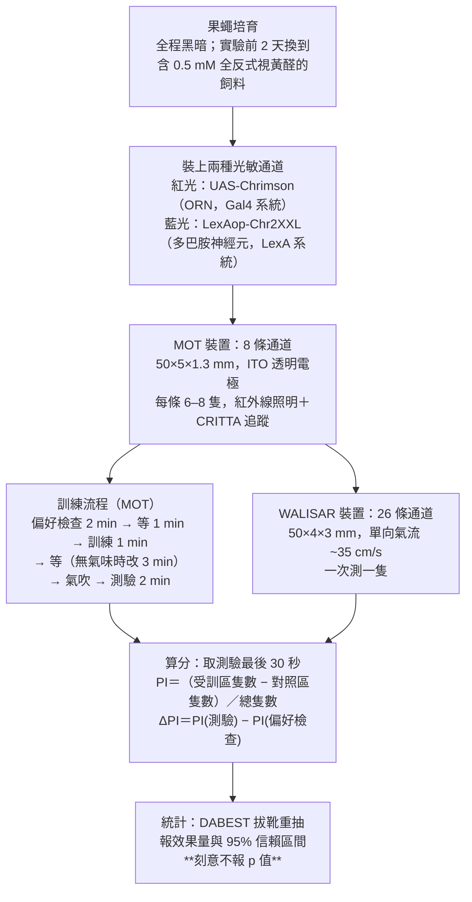

<!-- 本機 PDF：papers/2025-Entirely%20synthetic%20memory%20inception%20via%20dual%20optogenetic%20activation%20of%20sensory%20and%20dopaminergic%20neurons.pdf -->

# Entirely synthetic memory inception via dual optogenetic activation of sensory and dopaminergic neurons

**同時以光遺傳活化感覺神經元與多巴胺神經元，植入全人工的記憶**

| 項目 | 內容 |
|---|---|
| **出處** | iScience 28(10), 113540 (2025). doi: 10.1016/j.isci.2025.113540 [全文（PMC 免費閱讀）](https://pmc.ncbi.nlm.nih.gov/articles/PMC12529362/) |
| 日期 | 線上先行 2025-09-10；刊期 2025-10-17。投稿 2025-05-05・修訂 2025-08-07・接受 2025-09-08。iScience 是單篇編號（113540），沒有起迄頁；PDF 共 16 頁（正文 9 頁、參考文獻 3 頁、STAR Methods 3 頁） |
| 通訊作者 | Adam Claridge-Chang，claridge-chang.adam@duke-nus.edu.sg（PDF 只有英文名） |
| 作者 | 共 5 人：Tayfun Tumkaya、Xianyuan Zhang、Yishan Mai、James Stewart、Adam Claridge-Chang。**PDF 未標示共同第一作者**（已查作者列的上標與註腳，只有 Claridge-Chang 標為 lead contact）。分工（Author contributions）：Tumkaya 與 Claridge-Chang 構思；Tumkaya 負責遺傳、飼養、行為、免疫染色與顯微術；Zhang 負責遺傳、行為、解剖、免疫染色、顯微術；Mai 與 Tumkaya 寫 Python 分析；Stewart 負責儀器與 CRITTA（LabView） |
| 機構 | Institute for Molecular and Cell Biology, A*STAR（新加坡）；Precision Genetics, Data, AI & Genome Sciences, Merck & Co（美國麻州劍橋）；Department of Physiology, National University of Singapore；Program in Neuroscience and Behavioral Disorders, Duke-NUS Medical School（新加坡）；Austrianova Singapore |
| 資料庫 | 行為資料、共軛焦 Z 堆疊影像與分析程式都在 Zenodo：https://doi.org/10.5281/zenodo.13935194 。追蹤軟體 CRITTA 為自製，未釋出（KEY RESOURCES TABLE 的識別碼欄寫 NA） |
| 補充資料 | **無補充圖表**。STAR Methods 在正文之內（PDF 第 e1–e3 頁）。已搜全文的 `Figure S`、`supplement`、`Data S`，只有「視黃醛補充飼料」一處命中，與補充資料無關。所以本頁沒有任何 `？待查（補充資料未取得）` |
| 編輯／審查 | iScience 採不具名審查，PDF 未列編輯或審稿人姓名。致謝提到 Ravinuthula Sruthi Jagannathan（Duke-NUS）在投稿前評閱過原稿，Christian Wegener（University of Würzburg）提供 LexAop-Chr2XXL 品系 |
| 經費 | 新加坡教育部 MOE2017-T2-1-089、MOE2019-T2-1-133、MOE-T2EP30222-0018；A*STAR Joint Council Office 1231AFG030、1431AFG120；Duke-NUS 與 Yong Loo Lin 醫學院獎學金、FY2022-MOET1-0001；BMRC 給 IMCB 的整筆補助 |

> 與本庫有關的作者：通訊作者 Claridge-Chang 是 Claridge-Chang et al. 2009 的第一作者，那篇是本庫多處引用的「以光遺傳活化多巴胺神經元即可取代電擊」的源頭（見 [[s-gervasi-2010-pka-dynamics]]、[[s-felsenberg-2017-re-evaluation]] 的引用）。本篇等於是同一條線十六年後的延伸。
>
> **本篇為 CC BY-NC 4.0 開放取用**（PDF 第 1 頁頁腳：「This is an open access article under the CC BY-NC license」），圖片可在標明出處、**非商業用途**下使用與散布。本庫仍依規定只給全文連結、不放 PDF；每張圖下方標明出處與授權。

---

## 為什麼重要

> 本節假設讀者已略知果蠅嗅覺學習的輪廓。**完全不熟的讀者可以先看「科普文」一節**，那裡從頭解釋這套實驗怎麼做；術語另見「專業文」開頭的「本頁用語」表。

本庫先前收的論文，都保留了實驗裡至少一樣「真的」刺激。Tully 1985（[[s-tully-1985-classical-conditioning]]）建立的 T 迷宮測驗用真氣味配真電擊；Aso 2016（[[s-aso-2016-dan-cell-type-rules]]）、Ichinose 2015（[[s-ichinose-2015-reward-recurrent-circuit]]）把懲罰或獎賞換成光，但氣味仍是真的；Hige 2015（[[s-hige-2015-heterosynaptic-plasticity]]）與 Handler 2019（[[s-handler-2019-dopamine-receptor-timing]]）在離體腦上量突觸，氣味那一端改用電刺激（以電脈衝直接讓代表氣味的神經元放電），懲罰或獎賞那一端用光。換句話說，過去的實驗一次只拆掉一邊。

這篇把兩邊同時拆掉：氣味換成紅光活化嗅覺受體神經元（ORN），懲罰或獎賞換成藍光活化多巴胺神經元，整個學習過程裡沒有任何一樣自然刺激。這樣做能回答一個先前問不出來的問題——**只要兩條路徑同時有活動，就足以指揮記憶形成嗎？** 如果保留了真氣味，就永遠無法排除「氣味本身帶著某種時間節奏或特定細胞組合，而那才是學習的必要條件」。

答案是「足夠」，但代價要看清楚。全人工的記憶確實形成了，效果卻比自然學習小。而且本篇用了兩台原理不同的行為裝置互相驗證——一台一次測一群果蠅（MOT），一台一次只測一隻（WALISAR）——**訓練果蠅躲開的那個版本只在 MOT 成立，換到 WALISAR 就測不到**；訓練果蠅靠近的版本兩台都成功。作者自己也點明，這些實驗沒有直接操作任何一個突觸，所以不能拿來證明「記憶就是突觸權重的改變」。對本庫而言，這篇把「以人工活化取代自然刺激」（見 [[c-us-substitution]]）這條線推到了兩邊同時取代的盡頭，也替 [[t-timing-rules]] 加上一個否定的證據：ORN 放電的精細時間結構，果蠅學不起來。

---

## 論文摘要（原文與中譯）

> Associative conditioning is a fundamental learning paradigm that links salient stimuli to appropriate behavior. The vinegar fly serves as a key model, forming memories by associating odors with reward or punishment through distinct dopaminergic circuits. A critical question is whether simple co-activation of sensory and neuromodulatory dopaminergic neurons is sufficient for memory formation. We addressed this by optogenetically replacing natural stimuli—odor-evoked activity, punishment, and reward signals—either individually or in combination. Notably, even in a full-substitution paradigm where both olfactory and reinforcement signals were replaced, optogenetic activation successfully implanted synthetic memories. Our findings demonstrate that simple coincident activation of sensory and neuromodulatory neurons is enough to instruct associative memory formation—complex temporal or ensemble activity patterns characteristic of natural stimuli are not required. This work provides a framework for controlling and dissecting memory circuits with all-optical approaches, offering new tools for studying the mechanisms of learning and memory.

**中譯**（本節為忠實翻譯，非自撰內容）：

> 聯結式制約是一種基本的學習範式，把顯著的刺激與適當的行為連起來。果蠅是關鍵的模式動物，透過不同的多巴胺迴路，把氣味與獎賞或懲罰聯結起來而形成記憶。一個關鍵的問題是：單純地同時活化感覺神經元與具神經調節作用的多巴胺神經元，是否就足以形成記憶？我們以光遺傳取代自然刺激——氣味引發的活動、懲罰訊號與獎賞訊號——來處理這個問題，取代的方式有單獨取代，也有合併取代。值得注意的是，即使在嗅覺訊號與增強訊號兩者都被取代的全取代範式中，光遺傳活化仍成功植入了合成的記憶。我們的發現顯示，單純讓感覺神經元與神經調節神經元同時活化，就足以指揮聯結式記憶的形成——自然刺激所特有的複雜時間或細胞組合活動樣式，並非必要。這項工作提供了一個以全光學方法控制與解析記憶迴路的架構，為研究學習與記憶的機制提供新的工具。

---

## 科普文

拍電影時，危險的鏡頭會找替身演員上場。如果換了替身，整場戲照樣成立，就表示這場戲真正需要的是動作本身，而不是那位演員的臉。這篇論文做的就是這件事：把果蠅學習時用到的「真演員」一個一個換成替身，看記憶還形不形得成。

**果蠅的嗅覺學習長什麼樣。** 實驗室裡最常用的測驗是：讓果蠅聞到某個氣味的同時給牠電擊，之後果蠅再遇到這個氣味就會躲開。腦裡負責這件事的是[[e-mushroom-body|蕈狀體]]：觸角上的嗅覺受體神經元（olfactory receptor neuron，ORN）把「聞到什麼」送進來，[[e-dopaminergic-neuron|多巴胺神經元]]把「這是好事還是壞事」送進來，兩者在蕈狀體裡交會。神經元之間傳遞訊號的接點叫**突觸**，兩個訊號一起到時，這些突觸的強弱會改變。

改變怎麼變成行為？蕈狀體裡代表氣味的神經元叫 **Kenyon 細胞**，它把訊號交給下游的**輸出神經元**，而輸出神經元分兩種：一種推動果蠅靠近，一種推動果蠅走開，兩邊的力量相抵決定果蠅往哪走。氣味配上懲罰之後，推動「靠近」的那一邊的突觸變弱，靠近的力量就減少，天平倒向走開——果蠅因此躲開那個氣味。

**難題是：怎麼證明「同時有活動」就夠了？** 真實的氣味不只是「有或沒有」。它會讓一群特定的神經元以特定的節奏送出訊號（神經元送訊號的動作叫**放電**）。有人因此懷疑，學習需要的其實是那個節奏或那個特定組合，而不只是「兩邊同時在動」。只要實驗裡還留著真氣味，就永遠分不清楚。

**解法是把兩邊都換成光。** 正常的神經元不會對光有反應，所以要先用基因工程，讓特定的神經元製造一種「照到光就打開」的通道蛋白；通道一開，那顆神經元就放電。這套手法叫**光遺傳**。研究者用了兩種通道蛋白：一種只對紅光有反應，裝在 ORN 上，用紅光代替氣味；另一種只對藍光有反應，裝在多巴胺神經元上，用藍光代替懲罰或獎賞（實驗室常用的懲罰是電擊、獎賞是糖水）。兩種顏色互不干擾，所以可以分別控制。

果蠅被放在一條細長的通道裡，紅光只照通道的一半，另一半維持暗的，果蠅可以自己選要待在哪一邊。訓練時兩盞燈一起亮，果蠅從頭到尾沒聞到任何氣味、也沒被電到。測量的方式是看訓練前後牠待在紅光那半的時間有沒有改變。

**結果是記憶真的形成了。** 用代表懲罰的那群多巴胺神經元，果蠅學會躲開紅光那一半通道；用代表獎賞的那群，果蠅反而學會往紅光那邊走。

光的節奏也被單獨測過，設計是這樣：訓練時給兩種人工氣味，一種是「一直亮的紅光」，另一種是「每秒閃二十次的紅光」，其中一種配電擊、另一種不配；測驗時通道的一半給其中一種光、另一半給另一種，讓果蠅在兩種節奏之間選邊。如果節奏是果蠅分得出來的東西，牠應該會專門躲開被罰過的那一種。**結果是牠分不出來，所以 ORN 放電的精細時間結構不是學習的必要條件。**這個「測不到」的結論之所以可信，是因為同一套裝置在別的實驗裡測得到很大的效果，所以測不到不是裝置不靈敏。

**代價有三個。** 第一，全人工記憶比自然學習弱，大約只有自然學習的一半到四分之三。強弱一律用同一個分數比較：訓練前後，果蠅待在受訓那一區的比例改變了多少（論文稱 ΔPI）。自然學習與人工學習都用這個分數，所以可以直接相除。

第二，這篇用了兩台裝置：一台一次測一群果蠅，另一台一次只測一隻，用來互相驗證。嫌惡版本只在第一台成立，換到第二台就測不到；喜好版本兩台都成功。所以嫌惡那一半的結論要打折。

第三，ORN 並不是記憶真正發生的地方，訊號從 ORN 傳到蕈狀體還要經過至少兩層轉接。這會限制第二點結論的適用範圍：就算研究者給的紅光本身沒有節奏，訊號沿路也可能被加上節奏，所以「節奏不必要」只能說在 ORN 這一層成立，不能推到整條路徑。作者自己把這點列為限制，並建議下一步改成直接活化蕈狀體裡的 Kenyon 細胞——那是氣味訊號在蕈狀體裡的落腳處，已經在記憶形成的位置上，中間不再有轉接，就不會有「沿路長出節奏」的疑慮。

**最容易被誤讀的一點**：這篇證明的是「簡單的同時活化**足以**造出記憶」，不是「自然的記憶就是這樣形成的」。足夠不等於必要，也不等於自然情況下真的只用到這麼少的東西。作者自己在討論裡還加了一句更嚴格的提醒：整套實驗沒有直接碰過任何一個突觸，所以不能拿它來證明「記憶＝突觸強度改變」這個假說。

---

## 專業文

### 本頁用語

本頁各節可單獨查閱，故把反覆出現的詞集中在這裡。

| 詞 | 意思 |
|---|---|
| 光遺傳（optogenetics） | 用基因工程讓特定神經元製造一種「照到光就打開」的通道蛋白，之後用光照就能指定讓那群神經元活動。正常神經元不會對光反應，所以這一步是前提。本篇的果蠅飼料要加視黃醛（retinal），通道蛋白才能作用，也因此要全程養在暗處，免得提前被光打開 |
| 放電（firing） | 神經元送出訊號的動作。「放電率」是每秒送幾次，「放電的時間結構」指這些訊號在時間上排成什麼節奏 |
| 突觸（synapse） | 兩個神經元之間傳遞訊號的接點。「突觸變強／變弱」指同樣的訊號傳過去，下游收到的變多或變少；學習被認為就發生在這裡 |
| ORN | 嗅覺受體神經元（olfactory receptor neuron），長在觸角上，負責把「聞到什麼」送進腦。本篇用紅光直接活化它來代替氣味 |
| KC、MBON | Kenyon 細胞（蕈狀體裡代表氣味的神經元）、蕈狀體輸出神經元（讀出 KC 的訊號，推動果蠅靠近或走開）。學習改變的是 KC→MBON 的突觸 |
| TH、TH⁺ | TH 是酪胺酸羥化酶（tyrosine hydroxylase），製造多巴胺所需的酵素。**TH⁺ 表示「會製造這個酵素的細胞」，也就是多巴胺神經元**。TH-LexA 這個品系標記的是其中一部分，論文自述「含 PPL1 在內」——亦即比 PPL1 更大的一個集合，但大多少沒有交代 |
| 聯結式制約（associative conditioning） | 讓動物把兩件事連在一起的學習：一個原本中性的線索（CS）與一個有好壞意義的結果（US）反覆同時出現之後，動物再遇到那個線索就會預期結果而改變行為。本篇的「聯結式記憶」即由此形成的記憶 |
| 足以指揮（instructive／sufficient） | 本頁說某個訊號「足以指揮」學習，意思是**只要有它就會發生**（充分條件），不代表自然情況下非它不可（必要條件）。兩者是不同的主張，本篇證明的是前者 |
| 神經調節（neuromodulation） | 一般神經元傳的是「有沒有訊號」，調節性神經元（如多巴胺神經元）傳的是「改變別的神經元或突觸怎麼運作」的訊號。本篇強調多巴胺神經元屬於後者 |
| 細胞組合樣式（ensemble pattern） | 指「哪幾顆、哪幾型細胞一起活動」這個組合。自然氣味會活化特定的一小群細胞；本篇的紅光則一口氣活化約 70% 的 ORN，幾乎沒有組合上的選擇性 |
| 品系、轉殖基因、基因型 | **品系**（strain／line）是一群基因組成固定的果蠅，可以穩定繁殖下去。**轉殖基因**是以人工方式插入的外來基因（例如通道蛋白的基因）。**基因型**是某隻果蠅身上帶了哪些轉殖基因的組合，寫法如 `UAS-Chrimson; Orco-Gal4` |
| DAN、PAM、PPL1 | 多巴胺神經元（dopaminergic neuron），送來「這是好事還是壞事」的訊號。**PAM 群多半報告獎賞，PPL1 群多半報告懲罰**；本篇分別用 R58E02-LexA 與 TH-LexA 這兩個品系去活化它們 |
| CS、US、增強訊號 | 條件刺激（conditioned stimulus）＝被學習的線索，本篇原為氣味、後來換成紅光；非條件刺激（unconditioned stimulus）＝好壞結果，本篇原為電擊或糖、後來換成藍光。**「增強訊號」（reinforcement）是懲罰與獎賞的統稱，與 US 同義**，本頁兩種說法都會出現 |
| 驅動品系與效應子 | 光遺傳要兩個零件配成一對才有作用：**驅動品系**（driver，例如 Orco-Gal4、TH-LexA、R58E02-LexA）決定「哪些細胞」會製造通道蛋白；**效應子**（effector，例如 UAS-Chrimson、LexAop-Chr2XXL）帶著通道蛋白的基因本身。只有兩者都在的果蠅才會真的做出通道蛋白——**所以只帶其中一個的果蠅是對照組：牠帶著一半的零件，照光卻不會有光遺傳的作用**。基因型寫成 `UAS-Chrimson; Orco-Gal4`，分號表示同一隻果蠅同時帶這兩者 |
| Gal4 系統與 LexA 系統 | 兩套互不干擾的「驅動品系—效應子」配對機制。本篇要同時而獨立地控制兩群神經元，所以 ORN 走 Gal4 系統（Orco-Gal4 配 UAS-Chrimson），多巴胺神經元走 LexA 系統（TH-LexA 或 R58E02-LexA 配 LexAop-Chr2XXL） |
| Chrimson 與 Chr2XXL（原文亦寫作 ChrXXL） | 兩種通道蛋白，名字相近但**不是同一個**：**Chrimson 對紅光有反應**，裝在 ORN 上；**Chr2XXL 對藍光有反應**，裝在多巴胺神經元上。兩種顏色互不干擾，才能分別控制兩條路徑。表格裡的 `UAS-Chr` 是 `UAS-Chrimson` 的簡寫，`Orco-G4` 是 `Orco-Gal4` 的簡寫。另有抗體名稱 anti-ChR2，那是染色試劑，不是通道本身 |
| 免疫染色、GFP、mVenus | 確認「通道蛋白真的做出來了、長在該長的細胞上」的方法。做法是把腦取出，用會專一黏上目標蛋白的**抗體**去標記，抗體再帶上螢光，顯微鏡下就看得到。**GFP** 是一種綠色螢光蛋白，**mVenus** 是它的改良版，被接在 Chrimson 上當作標籤，所以認 GFP 的抗體也認得它。本篇的另一支抗體 anti-ChR2 同時認得 Chrimson 與 Chr2XXL，因此分不出看到的是哪一種 |
| 共軛焦 Z 堆疊影像 | 顯微鏡逐層對焦拍攝、再疊起來的影像，可以看到整顆腦內部而不只是表面 |
| MOT、WALISAR | 本篇的兩台行為裝置，都是細長通道而非 T 迷宮。**MOT**（Multifly Olfactory Trainer，多果蠅嗅覺訓練器）一次測一群 6–8 隻，天花板是可導電又透明的電極，所以能一邊電擊一邊從下方拍攝追蹤。**WALISAR** 一次只測一隻、氣流單向。兩台是互相驗證的關係：同一個結論在兩台都成立才算穩 |
| 氣吹（air puff） | 測驗開始前從通道兩端吹氣，把果蠅趕回通道中央的選擇點，讓每次測驗從同一個起點開始 |
| 紅外線照明 | 拍攝用的光源。用紅外線是因為果蠅看不見它，不會變成額外的刺激 |
| PI、ΔPI、半 PI | **PI**（preference index，偏好指數）＝（受訓區隻數 − 對照區隻數）／總隻數，取測驗最後 30 秒的平均，落在 −1 到 +1 之間（圖上個別通道的 ΔPI 是兩個 PI 相減，所以可以超出 ±1）。※ 推論：WALISAR 一次只測一隻果蠅，隻數代入上式只會得到 +1 或 −1，所以單隻的分數實際上等於牠在最後 30 秒待在各區的**時間比例**之差；論文的方法一節只寫「逐格計數再平均」，沒有為單隻的情形另外說明：？待查。「受訓區」就是訓練時被紅光照到（或配過氣味）的那一半通道。**ΔPI** ＝ 測驗的 PI 減去訓練前「偏好檢查」的 PI，等於把果蠅的天生偏好扣掉，是本篇的學習分數。**正負號看實驗方向：嫌惡制約學會了就是負值（躲開受訓那區），獎賞制約學會了就是正值。**「半 PI」指兩種氣味（或紅光在左／在右）兩組分開報，不像慣例那樣合併，所以數值不能與庫內其他論文的 PI 直接並排（見 [[c-performance-index]]） |
| `Ns`（樣本數） | **單位依裝置而不同**：MOT 的一個 N 是一條通道（內含 6–8 隻果蠅），WALISAR 的一個 N 是一隻果蠅。所以 MOT 的 N＝27 代表約一百七十隻，與 WALISAR 的 N＝47 不是同一個尺度，兩者的 N 不能直接比大小 |
| 95% 信賴區間與判讀標準 | 本篇不報 p 值，改用 DABEST 這套軟體以拔靴重抽（bootstrap，從資料中反覆隨機取樣以估計不確定性）算出效果量與 95% 信賴區間。**判讀方式：區間不含 0 就視為有效果，含 0 則視為沒有測到效果。** 區間的端點離 0 越近，結論越脆弱 |
| 視覺學習 | 本篇的紅光既是「人工氣味」，也是果蠅眼睛看得見的光。所以果蠅有可能記的是「哪一邊比較亮」而不是「ORN 被活化」。論文排除這種可能的方式是看對照組：對照只帶一半零件，紅光對牠只能是普通的視覺刺激，若對照分數接近 0，就表示學到的主要不是視覺 |
| 陰性結果與靈敏度 | 「陰性結果」指測不到效果。它最大的風險是**靈敏度不足**——真的有效果，但實驗設計或樣本數不足以測出來。判斷方式是看同一套裝置在別的條件下測不測得到大效果；測得到，就表示測不到不是裝置的問題 |
| ※ 推論 | 論文沒有明說、本頁自行推得的內容，並寫出依據 |
| ？待查 | 值得查證但本頁刻意不填的內容（不是論文沒做，而是本庫還沒查到或拿不到資料） |

### 一、概述

**主要問題：** 感覺神經元與具神經調節作用的多巴胺神經元，單純地同時活化，是否足以指揮聯結式記憶形成？

**重要性：** 取代實驗（substitution experiment）是判定「某個訊號是否足夠」的標準作法，但過去在果蠅成蟲身上只做到單邊取代——取代 CS（氣味）或取代 US（增強訊號），不曾兩邊同時取代。只要保留任一邊的自然刺激，就無法排除三種可能：自然刺激特有的時間動態、它活化的特定細胞組合，或是訊號其實還從已知迴路以外的別條路徑漏進腦裡。

**發表當時的領域現狀（2025）：** CS 側的人工取代，在幼蟲上由 Tomasiunaite 2018 等做過；US 側的取代則由 Claridge-Chang 2009（含 PPL1 的 TH⁺ 子集，嫌惡）、Burke 2012（[[s-burke-2012-octopamine-dopamine-reward]]）與 Liu 2012（PAM，獎賞）建立，本庫的 [[s-aso-2016-dan-cell-type-rules]] 與 [[s-ichinose-2015-reward-recurrent-circuit]] 都在這條線上。兩邊都取代的「全合成」實驗，當時只有兩例：Honda 2014 在**果蠅幼蟲**上同時活化 Or24a 神經元與 Tdc2 細胞（Tdc2 製造章魚胺與酪胺，位在 PAM 的上游），以及 Vetere 2019 在**小鼠**上同時活化單一嗅覺絲球與兩條投射到腹側被蓋核的路徑。本篇指出這兩例的共同限制：被人工活化的是多巴胺神經元的**上游**，指揮用的多巴胺迴路本身沒有被直接驅動。

### 二、方法

**刺激參數。** 真電擊為 12 次、60 V，分散在 1 分鐘的訓練期內。氣味用 3-辛醇（OCT）與 4-甲基環己醇（MCH），以質流控制器調整濃度（濃度數值 PDF 未給）。紅光由 PC 控制的 LED 微投影機（Optoma ML750）投出，只照通道的一半，形成選擇圖樣；藍光由 LED（峰值 460 nm）從上方照射。WALISAR 另用 617 nm 紅、530 nm 綠、470 nm 藍的 LED，裝在通道上方 45°。

**嫌惡與獎賞的光脈衝數不同，這是本篇方法上的關鍵轉折。** 嫌惡制約給 12 次藍光脈衝；獎賞制約只在 60 秒訓練期的**最初 3 秒**給一次藍光，理由是 Chr2XXL 通道關閉得慢。作者在討論中說明，沿用傳統的 12 脈衝協定時，嫌惡制約一次就成功，獎賞制約卻完全沒有成功，改成單脈衝才做出來。

**驅動品系。** ORN 用 Orco-Gal4（涵蓋約 70% 的嗅覺受體細胞），另在時間結構實驗中用 Or42b-Gal4 與 Gr21a-Gal4 這兩個窄品系。嫌惡的多巴胺神經元用 TH-LexA——作者描述為「**含 PPL1 在內的 TH⁺ 神經元子集**」，不是 PPL1 專一品系。獎賞用 R58E02-LexA（PAM，見 [[e-r58e02]]）。兩種通道的表現以免疫染色確認（anti-GFP 認 mVenus 標籤，anti-ChR2 同時認 Chr2XXL 與 Chrimson）。

**計分方式與本庫既有頁的接點。** 本篇報的是**半 PI**（half PI），即分開報「反 OCT」與「反 MCH」兩組各自的分數，而不是慣例上把兩組合併的全 PI。分母是通道內的總隻數，取測驗最後 30 秒的平均。這一點直接關係到 [[c-performance-index]] 記錄的分母陷阱：半 PI 與全 PI 的數值不能直接並排比較。圖上的 `Ns` 是**通道數或果蠅數，不是果蠅總數**——MOT 的一個 N 代表一條通道（6–8 隻），WALISAR 的一個 N 代表一隻果蠅。

### 三、結果

**讀這一節的三件事。** 第一，分數是 ΔPI，正負號看實驗方向：嫌惡制約學會了是負值（躲開受訓那區），獎賞制約學會了是正值，絕對值越大表示改變越多。第二，方括號是 95% 信賴區間，**不含 0 才算測到效果**。第三，每個實驗除了「零件齊備」的實驗組，還有只帶部分零件的對照組；對照帶著一半的零件，照光不會產生光遺傳作用，所以對照的分數應該接近 0（各零件的意思見本頁用語表）。3.1 到 3.4 都在 MOT（一次測一群）進行，3.5 與 3.6 兩台裝置都做。

#### 3.1 基準：三個轉殖品系在真氣味＋真電擊下都學得起來（圖 1）

這一步用真氣味配真電擊，只為確認帶著轉殖基因的果蠅本身沒有學習缺陷，所以三組都該學得起來（負值＝躲開被電的氣味）。ΔPI 分別是：只帶驅動品系的 Orco-Gal4 −0.72 [−0.90, −0.45]（N=10）、只帶效應子的 UAS-Chrimson −0.61 [−0.97, −0.33]（N=12）、兩者兼具的 UAS-Chrimson; Orco-Gal4 −0.44 [−0.84, −0.01]（N=11）。三者的未加權平均（不依各組 N 加權，直接取三個數字的平均）是 −0.59；論文後來拿這個 −0.59 當作「自然學習」的基準，去對比全合成記憶的 −0.33，本頁認為該用的是基因型相符的 −0.44（見問題與限制 4d）。

#### 3.2 單邊取代之一：紅光活化 ORN 可以代替氣味（圖 2）

去掉氣味，改以紅光照亮通道的一半當作「人工氣味」，配真電擊。帶齊兩個零件（UAS-Chrimson; Orco-Gal4）的果蠅 ΔPI −0.92 [−1.35, −0.44]；只帶驅動品系的 Orco-Gal4 是 −0.07、只帶效應子的 UAS-Chrimson 是 −0.21（三組各 N=9）。

兩個對照都看得見紅光，卻幾乎沒有改變偏好，而牠們缺的正是「讓 ORN 對紅光有反應」的那半套零件。作者據此認為，實驗組學到的主要不是「哪一邊比較亮」這個視覺線索，視覺學習最多只是次要成分。

#### 3.3 光的時間結構學不起來（圖 3）

這一節的設計與 3.1 相同，只是把兩種氣味換成兩種光的節奏：訓練 1 給「連續光」（下文與圖表亦稱**靜態光**，兩者同義）並配電擊，訓練 2 給「20 Hz 脈衝光」且不配電擊（或兩者對調）；測驗時通道一半給連續光、一半給脈衝光，讓果蠅選邊。**所以這一節的「受訓區」是配過電擊的那一種節奏所在的那一半**，ΔPI 為負代表躲開它。若節奏是果蠅分得出來的特徵，牠應該專門躲開被罰過的那一種。三種 ORN 品系（Orco 廣泛涵蓋、Or42b 與 Gr21a 各只標一類受體神經元）各試兩種節奏，共六組，果蠅大致都學不起來：六組中有五組的實驗組 ΔPI 落在 −0.14 到 +0.14 之間。

**唯一的例外是 Or42b 配靜態光，ΔPI −0.54（N=37）。** 論文承認這個例外，但沒有說明它為什麼出現，也沒有因此修改結論：？待查。作者的結論是，ORN 活動的精確時間編碼，不是嗅覺知覺或聯結學習的關鍵決定因素。

#### 3.4 單邊取代之二：藍光活化多巴胺神經元可以代替電擊與糖（圖 4）

這一節的氣味是真的，換掉的是增強訊號那一端。以藍光活化 TH-LexA 標記的多巴胺神經元（含 PPL1 在內，對應懲罰），果蠅躲開被配光的氣味，ΔPI −0.44 [−0.71, −0.10]；只帶效應子的 LexAop-Chr2XXL 是 +0.01、只帶驅動品系的 TH-LexA 是 −0.18（三組各 N=12）。改用 R58E02-LexA 標記的 PAM 神經元（對應獎賞）則形成喜好，ΔPI +0.64 [+0.38, +0.96]（N=19），唯一的對照（R58E02-LexA; Orco-Gal4，缺效應子）是 −0.24 [−0.54, +0.06]（N=16）。

**「代替糖」是就方向而言，不是有糖的對照組。** 本節沒有真糖訓練的平行實驗；R58E02 的獎賞角色來自庫內既有的來源（見 [[e-r58e02]]），本篇只示範活化它會產生喜好。

#### 3.5 全合成的嫌惡記憶：做出來了，但只在一台儀器上（圖 5）

到這一步，氣味與電擊都被換掉了，所以一隻果蠅身上要同時帶四個零件：紅光那一路的 Orco-Gal4 與 UAS-Chrimson，加上藍光那一路的 TH-LexA 與 LexAop-Chr2XXL。MOT 中四者齊備的果蠅 ΔPI −0.33 [−0.64, −0.01]（N=26），三個各缺一部分的對照為 −0.02、−0.08、+0.05。

同一基因型在 WALISAR 單隻測試中 ΔPI 為 **+0.07** [−0.20, +0.30]（N=41）：方向與預期的嫌惡相反，信賴區間又跨過 0，即沒有測到嫌惡記憶。本篇沒有判斷這是 MOT 的結果不可靠、還是 WALISAR 測不出這個效果，只歸因於取樣誤差或兩台裝置的差異（見問題與限制 4i）。

#### 3.6 全合成的喜好記憶：兩台儀器都成功（圖 6）

把藍光那一路的驅動品系從 TH-LexA 換成 R58E02-LexA（懲罰換成獎賞），其餘不動。MOT ΔPI +0.50 [+0.24, +0.74]（N=27）、WALISAR ΔPI +0.38 [+0.10, +0.63]（N=47），兩台裝置的四個對照都落在 −0.09 到 +0.16 之間。

**喜好方向比嫌惡方向穩健**，理由不只是數值較大，而是這兩點：同一個結論在兩台原理不同的裝置上都成立，而且每一個「各缺一個零件」的對照都接近 0——少掉任何一個零件就學不起來，表示效果必須靠兩種光一起才出現。

### 四、討論

**論文的主要主張與其強弱：**

- **「簡單的同時活化足以指揮聯結記憶形成」**——這是本篇最強的一條。全合成範式下仍出現方向正確、信賴區間不含 0 的效果，喜好版還跨兩台儀器重現。強度：喜好方向為強證據，嫌惡方向為弱證據（見 3.5）。
- **「複雜的時間或細胞組合樣式並非必要」**——證據有兩層：全合成成功（間接），以及時間結構學不起來（直接，圖 3）。後者是陰性結果，但樣本數大（每組 N 在 18–39），且同一套裝置能測到其他條件下 −0.92 的效果，所以不是整體靈敏度不足。不過作者自己在限制一節承認，ORN 的簡單活化傳到下游時可能重新獲得時間結構（下游迴路有自己的動力學，即使輸入是平的，輸出也可能出現節奏），因此這個結論只適用於「在 ORN 與多巴胺神經元這一層」。
- **「速率編碼是指揮性的」**——這是比前兩條更強的推論。神經科學長年有兩種說法在競爭：**速率編碼**認為訊息藏在「一段時間內放電幾次」，**時間編碼**認為還要看每一次放電的精確時刻。論文的推理是：方波刺激（光的開關是乾淨的方形脈衝，不像自然氣味那樣有起伏）本身不帶自然刺激那種精細結構，既然它能教會果蠅，重要的就只是「活動的量」而非「活動的精確樣式」。但這個推理有兩個缺口：本篇沒有記錄任何神經元的放電，所謂的速率是由刺激參數反推的，不是量出來的；而且圖 3 的 20 Hz 脈衝光本身就是一種時間樣式，果蠅學不起來只說明牠分不出這兩種樣式，不等於放電的精確時刻完全不帶訊息。
- **作者主動踩的煞車**：記憶研究有一個主流假說，主張記憶就存放在突觸的強弱裡（**突觸可塑性假說**）。先前有人主張，只活化特定幾型細胞就能植入記憶這件事直接支持了這個假說——理由是記憶既然能靠「讓兩群細胞同時活動」寫進去，改變的就該是這兩群細胞之間的連接強度。本篇明說：這些實驗沒有直接操作突觸，也沒有量過任何突觸，所以無法分辨記憶究竟存在突觸強弱裡還是別的地方；它們不能用來支持或反駁這個假說。對本庫的 [[t-dopamine-to-plasticity]] 而言，這是一句難得的、由作者自己劃出的界線。

### 五、問題與限制

1. **ORN 不是記憶形成的位置**（作者自陳）。訊號要再經過至少兩層轉接（中間還隔著其他神經元）才到蕈狀體，沿路可能獲得時間結構與額外的細胞組合樣式。作者建議改以活化 Kenyon 細胞當 CS 來處理這個問題。
2. **嫌惡的全合成記憶沒有跨儀器重現**（作者自陳）。作者推測可能來自取樣誤差，或兩台裝置的差異：測驗前有沒有氣吹、氣流是雙向還是單向，以及 MOT 一次測 6–8 隻而 WALISAR 只測一隻——論文引用文獻指出成群的果蠅會釋出二氧化碳而增強嗅覺記憶，但也引用另一篇說明單隻訓練同樣做得出記憶。
3. **沒有電生理驗證**（本庫補充，論文未列為限制）。全篇沒有記錄被光活化的 ORN 或多巴胺神經元實際放出什麼樣的脈衝序列；「方波」是對光的描述，不是對神經活動的量測。論文的處理方式是引用他人的六篇紀錄，說光遺傳引發的放電「雖然不是方波，但大致沒有結構」，也就是不像自然刺激那樣有明顯節奏。**這減輕但沒有消除問題**：那六篇量的是別的條件下的別群細胞，本篇自己這套刺激產生什麼樣的活動仍然沒有量過。
4. **以下為本庫稽核出來、論文自己沒有處理的問題：**

   - **（a）同一個數字在兩處正負號相反。** 結果一節寫 WALISAR 的全合成嫌惡 ΔPI 為 **+0.07** [−0.20, +0.30]（與圖 5H 的表格一致），討論一節寫成 **−0.07**（「−0.07 > −0.33」）。這個數字出現在討論的「−0.07 > −0.33」這個比較裡，作者用它來說 WALISAR 的效果比 MOT 小。但 +0.07 與 −0.33 方向相反，不是大小之分，所以正負號寫錯會讓這句話從「方向相反、沒學到」被讀成「同方向而較弱」。⚠️ 這是同一篇論文內部對不起來（本庫稱「單一來源自身不一致」：只有一篇論文、沒有第二篇說法可選，所以記錄下來即可，不必等人判定哪一方為真），本頁以圖與結果一節的 +0.07 為準。
   - **（b）同一個時間樣式被寫成兩個版本。** 這一條之所以是矛盾，關鍵在於論文兩處都聲稱講的是**同一個**樣式：討論一節說傳統的電擊協定是 1 分鐘內 12 次（1.5 秒開、**3.5 秒**關）；方法一節（STAR Methods，*Cell* 系列期刊把方法放在正文末尾的固定欄位）說藍光脈衝「依照傳統嗅覺制約所用的相同時間樣式」給 12 次（1.5 秒開、**4.5 秒**關）。若兩處真是同一個樣式，秒數就該一致。驗算也顯示只有一個版本放得進去：1.5＋3.5＝5 秒，×12＝60 秒，正好是 1 分鐘的訓練期；1.5＋4.5＝6 秒，×12＝72 秒，**超過訓練期**。⚠️ 單一來源自身不一致。
   - **（c）圖號引用錯誤兩處。** 其一，討論寫「comparable with R58E02-induced olfactory learning (+0.50 vs. +0.64, Figures 6E and 2H)」，但 +0.64 出自圖 4H，而圖 2 沒有 H 分格。其二，圖 2 的圖說 C2 寫「The protocol was as for the Red-Left experiment in G1」，應為 C1；圖 2 只有 A、B、C1、C2、D1、D2 六個分格（圖中以字母標示的小圖），沒有 G。本頁已把該頁整頁重新轉成影像核對過，確認是論文原文的筆誤，不是本庫取圖時漏掉了一塊。
   - **（d）「約自然學習的一半」用錯了對照基準。** 討論拿全合成的 −0.33 去比「自然氣味＋電擊記憶（平均 −0.59）」，那個 −0.59 是圖 1 三個基因型的未加權平均。但與全合成實驗基因型相符的那一條（UAS-Chrimson; Orco-Gal4）是 **−0.44**。**該用它當基準的理由**：圖 1 三組的分數相差不小（−0.44 到 −0.72），顯示帶不同的轉殖基因本身就會影響學習表現，所以要比的應該是基因背景相同的果蠅；全合成那組正是在 UAS-Chrimson; Orco-Gal4 這個底盤上再加兩個零件，所以它仍不是完全相同的基因型，只是**可得的最接近者**——圖 1 沒有做四個零件齊備的果蠅配真氣味的對照，這一點本身也是論文的缺口。以它為基準，−0.33／−0.44 ≈ **0.75**，是四分之三而不是一半。論文報告了這三個分數，卻沒有並排算這一個比值。
   - **（e）「視覺學習只是次要」在一處被自己的對照推翻。** 圖 3E（Gr21a、靜態光）中，不帶 Chrimson 的 Gr21a-Gal4 對照 ΔPI 為 **−0.37**，比同組實驗基因型的 −0.14 更大。**為什麼這會動搖論文的說法**：該對照不帶 Chrimson，紅光照在牠身上只能是單純的視覺刺激。而圖 3 的測驗是在「連續光」與「20 Hz 脈衝光」之間選邊，兩半都有紅光，差別只在閃爍——所以這 −0.37 表示**果蠅光靠眼睛就能分辨並學會躲開其中一種閃爍方式**。這有兩層後果：

  其一，論文在圖 2 與圖 5 兩度以「對照的分數小」論證視覺學習只是次要成分，而這一格顯示視覺學習在某些條件下並不小。其二，本節的標題宣稱是「時間結構學不起來」，但學不起來的其實只能說是「**經由 ORN 傳遞的**時間結構」；同一個時間樣式經由視覺，在這一格是學得起來的。論文沒有討論這一格，兩層後果都沒有處理。
   - **（f）有一條結論完全沒有資料支持。** 「沿用 12 脈衝協定時獎賞制約沒有成功」只出現在討論的敘述中，全篇沒有任何圖呈現這批資料，也沒有列為未展示資料（data not shown）。它同時是「嫌惡與獎賞系統可能有差異」這個推測的唯一依據。
   - **（g）標題性宣稱寫 PPL1，使用的品系卻不是 PPL1 專一。** 論文開頭的重點條列（Highlights，期刊要求作者用幾句話標出全文最重要的發現）寫「Co-activating ORNs and PPL1 neurons」，方法則描述 TH-LexA 為「含 PPL1 的 TH⁺ 神經元子集」。該品系實際涵蓋哪些型別、是否包含 PPL1 以外的多巴胺神經元，本篇沒有列出，圖 5B 的 anti-ChR2 染色因為同時認兩種通道蛋白而無法分辨。這與本庫既有的「同一品系各篇寫的涵蓋範圍不同」是同一類問題（見 [[e-dopaminergic-neuron]]、[[e-th-gal4]]）。
   - **（h）對照組的組成在各實驗之間不一致。** 圖 4 由上下兩組實驗構成，以下稱 TH 組與 PAM 組（與「半 PI」無關）。TH 組（圖 4D）有兩個對照，分別只帶驅動品系或只帶效應子；PAM 組（圖 4H）**只有一個對照**（R58E02-LexA; Orco-Gal4，缺少效應子單獨的對照）；圖 5E 有三個、圖 5H 與圖 6 各有四個。論文沒有說明為何 PAM 半的對照較少。
   - **（i）WALISAR 嫌惡實驗中，一個對照的效果大於實驗組。** 圖 5H 第四欄（Orco-G4; TH-LexA; LexAop-Chr2XXL，缺 Chrimson）ΔPI 為 **+0.24**（N=34），大於實驗組的 +0.07。兩者方向都與預期的嫌惡相反。論文只報告實驗組沒形成記憶，沒有處理這個對照。

### 六、未來

**論文自陳的方向。** 全光學制約（即本頁所稱的全合成：CS 與 US 都由光給）讓「精確控制 CS 與 US 的時間」變得可行，作者點名幾種因此能做的訓練範式：**關聯度協定**（contingency，刻意讓線索與結果只在部分時候同時出現，檢驗動物學到的是不是「相關性」而非單純「同時出現」）、**操作型制約**（動物要自己做出某個動作才得到結果，與本篇這種不論動物做什麼都照表給刺激的古典制約相對）、重複試驗，以及記憶的**保留**（過一段時間還在不在）與**消退**（不再給懲罰後會不會淡掉）。他們也提議改用 Kenyon 細胞取代 ORN 當作 CS，以回應限制 1。

**本庫關注的後續。** 這篇留下三個開口，庫內已有論文可以接手：第一，ΔPI 的時間窗。本篇的線索（CS，此處是紅光）與增強訊號（US，此處是藍光）完全同時給，沒有試過一系列不同的間隔，而 [[s-aso-2016-dan-cell-type-rules]] 在行為上、[[s-handler-2019-dopamine-receptor-timing]] 在突觸上都掃過（見 [[t-timing-rules]]）。全光學方法兩端都由光控制、精度可到毫秒，正好適合把行為與突觸這兩個層次的時間窗接起來。第二，突觸那一端。本篇自陳沒碰突觸，而 [[s-hige-2015-heterosynaptic-plasticity]] 的離體膜片鉗（把腦取出、以微電極直接記錄單一神經元的電流）與 [[s-cohn-2015-coordinated-neuromodulation]] 的鈣成像（以螢光指標間接看神經元活動強弱）就是在量這件事；把全合成制約接上離體記錄，可直接檢驗「同時活化」造出的可塑性與自然制約造出的是否相同。第三，嫌惡與獎賞的不對稱。本篇觀察到 12 脈衝對嫌惡有效、對獎賞無效，並推測這反映 PPL1 與 PAM 系統的差異；[[s-aso-2016-dan-cell-type-rules]] 報告的「各型 DAN 有各自的時序規則」正是同一個現象的另一種量法。

**尚未被回答的。** 全合成記憶與自然記憶在腦裡留下的痕跡是不是同一個？本篇只比較了行為分數的大小，沒有比較兩者在 KC（Kenyon 細胞）→MBON（蕈狀體輸出神經元）突觸上的改變、在蕈狀體各**區室**（葉沿長度切成的一格一格，每格由一型多巴胺神經元支配、一型輸出神經元讀取，見 [[c-mb-compartment]]）之間的分布，或在記憶保留與消退上的行為。效果量比較小，可能是記憶較弱，也可能是記憶的性質不同，本篇的資料無法分辨。

---

## 圖

下面六張圖的基本結構是五個部分：圖片、出處行、原圖說（英文照抄）、圖說中譯（忠實翻譯，原文有誤時照譯並於其後以〔本庫註〕標出）、解讀（本庫的產出）。部分圖另有附加段落——圖 1 多一段讀圖說明，圖 3、圖 5、圖 6 各多一張本庫重製的數值表。圖說裡的 A、B、C1、D2 等代號是圖中以字母標示的小圖，本頁稱**分格**；同一個字母後面的 1、2 是上下兩張相關的圖。多數圖的最下方有一張**基因型表**，用圓點標出每一欄的果蠅帶了哪些零件，並列出樣本數 `Ns` 與分數 `Δ`（即 ΔPI）。

<small>圖片出處：Tumkaya, T., Zhang, X., Mai, Y. et al. *iScience* 28(10):113540 (2025)，Figure 1。© 2025 作者，CC BY-NC 4.0；全文見 [PMC](https://pmc.ncbi.nlm.nih.gov/articles/PMC12529362/)。</small>

> **原圖說（Figure 1）：** Shock-paired conditioning induces memories with real odors. (A) Schematic of the key brain regions involved in olfactory learning: a mushroom body (MB), paired-anterior-medial (PAM) neurons, paired-posterior-lateral 1 (PPL1) neurons, the antenna, and ORNs are shown. The shock and odor icons indicate the stimuli used in the experiment. (B) Schematic of the MOT chamber showing odors (OCT and MCH), air flow with air puffs, infrared LEDs for imaging, and glass electrodes for shock. (C1) The anti-OCT training paradigm: Flies (n = 6–8) were loaded into chambers and tested for OCT and MCH preference (Bias check), then exposed to OCT with a foot shock (Train 1), MCH exposure without a shock (Train 2), agitated with an air puff, and finally re-tested for odor preference (Test). (C2) The anti-MCH training protocol: as for the paradigm in C1, except that MCH was paired with a foot shock (Train 1). (D1) Paired plot showing the chamber preference index (PI) before and after conditioning. The ends of the orange and blue lines indicate the PI scores per chamber for MCH and OCT training, respectively; black dots indicate the mean PI, and the error bars represent 95% confidence intervals (CIs). (D2) Change in chamber preference index (ΔPI) between pre- and post-conditioning is shown. The orange and blue triangles indicate the individual pre:post ΔPI values; black dots indicate mean ΔPI values with their 95% CI (black line), and the Δ distributions (gray curve).

**圖說中譯：**（A）嗅覺學習涉及的主要腦區示意圖：蕈狀體（MB）、PAM 神經元、PPL1 神經元、觸角與 ORN。電擊與氣味的圖示代表實驗所用的刺激。（B）MOT 通道示意圖，標出氣味（OCT 與 MCH）、帶氣吹的氣流、成像用紅外線 LED，以及施加電擊的玻璃電極。（C1）反 OCT 訓練範式：果蠅（每通道 6–8 隻）放入通道，先測 OCT 與 MCH 的偏好（偏好檢查），接著在 OCT 出現時施加電擊（訓練 1），再給不配電擊的 MCH（訓練 2），以氣吹擾動，最後重測氣味偏好（測驗）。（C2）反 MCH 訓練協定：同 C1，但訓練 1 改以 MCH 配電擊。（D1）配對圖，顯示制約前後各通道的偏好指數（PI）。橘線與藍線的兩端分別是 MCH 訓練與 OCT 訓練的各通道 PI；黑點為平均 PI，誤差線為 95% 信賴區間。（D2）制約前後偏好指數的變化（ΔPI）。橘色與藍色三角形為各通道的前後 ΔPI 值；黑點為平均 ΔPI 並附 95% 信賴區間（黑線），灰色曲線為 Δ 的分布。

> **讀圖說要知道的三件事**（本庫補充，非原文）：**配對圖**是把同一條通道訓練前、訓練後的兩個分數各畫一點、用一條線連起來，所以線的斜率就是這條通道的學習量，而 D1 每條線的兩端是「訓練前對訓練後」。圖說說橘線是「MCH 訓練」、藍線是「OCT 訓練」：**顏色代表那一組訓練時是哪一種氣味配了電擊**（橘＝MCH 配電擊，即 C2 的「反 MCH」；藍＝OCT 配電擊，即 C1 的「反 OCT」），不是線的兩端。**灰色曲線**畫的是拔靴重抽得到的平均值分布，寬窄代表這個平均值有多不確定，不是果蠅個體之間的差異。

**解讀：** 這是全篇的基準，真正該看的不是「果蠅會學習」，而是 D2 下方那張基因型表：**這張圖其實是三組不同基因型的果蠅各做一次同樣的實驗**，由左到右依序是只帶驅動品系的 Orco-Gal4、只帶效應子的 UAS-Chrimson、兩者兼具的 UAS-Chrimson; Orco-Gal4，分數是 −0.72、−0.61、−0.44，對應的 N 是 10、12、11（圖說本身沒有提到有三組，這個資訊只在基因型表上）。這三組在本圖都是用真氣味配真電擊，所以都該學得起來；**分數越負代表躲得越徹底，所以 −0.72 最強、−0.44 最弱**。**三個數字之間的差距不小，而最弱的那一個（−0.44）正是後面全合成實驗所用的基因型底盤**（UAS-Chrimson; Orco-Gal4）。論文在討論裡改用三者的未加權平均 −0.59 當作「自然學習」的基準，去凸顯全合成記憶只有「約一半」；若改用基因型相符的 −0.44，比值是 0.75。論文報告了這三個分數，但沒有做這個除法（見問題與限制 4d）。另外要注意 D1 與 D2 的縱軸意義不同：D1 是 PI（某個時點的偏好），D2 是 ΔPI（前後之差）。D1 每條線的垂直落差就是該通道的 ΔPI，但**兩張圖上「同樣的高度」代表不同的事**——D1 的一個點是偏好本身，D2 的一個點是偏好改變了多少。

<small>圖片出處：Tumkaya, T., Zhang, X., Mai, Y. et al. *iScience* 28(10):113540 (2025)，Figure 2。© 2025 作者，CC BY-NC 4.0；全文見 [PMC](https://pmc.ncbi.nlm.nih.gov/articles/PMC12529362/)。</small>

> **原圖說（Figure 2）：** Shock-paired conditioning induces memories with a fictive odor-like stimulus. (A) Schematic of the stimuli and targeted brain regions used for shock conditioning of a synthetic optogenetic olfactory-like stimulus. (B) Schematic of the odor-free semi-artificial conditioning experiment, where Chrimson is activated with a red LED. (C1) The Red-Left odor-substitution conditioning protocol: flies were tested between red light and no light (Bias), then trained with red light paired with a foot shock (Conditioning), a no-light interval, and finally a second light-dark choice task (Test). (C2) The Red-Right odor-substitution conditioning experiment. The protocol was as for the Red-Left experiment in G1, but the light pattern was swapped. (D1) Bias and Test PI scores for three genotypes, before and after training. The ends of each line indicate scores from one chamber (6–8 flies). Orange and blue indicate the Red-Right and Red-Left illumination schedules. Error bars are 95% CIs. (D2) The relative ΔPI after conditioning is shown. The orange and blue triangles represent the individual pre:post ΔPI values per chamber where either a Red-Right or Red-Left light pattern was used, respectively. The black dots indicate the mean ΔPI for each group with its 95% CI (black line), and the Δ distribution (gray curve).

**圖說中譯：**（A）以光遺傳合成的類嗅覺刺激進行電擊制約時，所用刺激與目標腦區的示意圖。（B）無氣味的半人工制約實驗示意圖，Chrimson 以紅光 LED 活化。（C1）紅光在左的氣味取代制約協定：先在紅光與無光之間測偏好（偏好檢查），接著以紅光配電擊進行訓練（制約），一段無光的間隔，最後再做一次明暗選擇（測驗）。（C2）紅光在右的氣味取代實驗，協定同 G1 的紅光在左實驗，但光的左右對調。〔本庫註：原文的「G1」應為「C1」，見下方解讀。〕（D1）三個基因型訓練前後的偏好檢查與測驗 PI 分數。每條線的兩端為一條通道（6–8 隻）的分數。橘色與藍色分別代表紅光在右與紅光在左的照光安排。誤差線為 95% 信賴區間。（D2）制約後的相對 ΔPI。橘色與藍色三角形分別為使用紅光在右或紅光在左圖樣時，各通道的前後 ΔPI 值。〔本庫註：原文此處寫 relative ΔPI，與圖 1 的 ΔPI 是同一個量，差別只在用詞。〕黑點為各組平均 ΔPI 並附 95% 信賴區間（黑線），灰色曲線為 Δ 的分布。

**解讀：** 這張圖同樣是三組基因型並排，順序與圖 1 相同：只帶驅動品系的 Orco-Gal4（−0.07）、只帶效應子的 UAS-Chrimson（−0.21）、兩者兼具的實驗組（−0.92）。兩個對照都看得見紅光卻幾乎沒反應，只有零件齊備的那組學會躲開，這個對比是全篇最乾淨的一組，而且 N 全部是 9，不像圖 1 那樣各組不等。值得注意的是 **−0.92 的絕對值比圖 1 任何一個自然學習的分數都大**（圖 1 最強的是 −0.72）：換成光之後，果蠅躲得比躲真氣味還徹底。論文沒有討論這一點，但它至少提醒讀者，ΔPI 的大小不能直接當成「記憶強度」來跨刺激比較——照亮半條通道的紅光是個比氣味更明確、更不會擴散的空間線索。C2 的圖說寫「協定同 G1」，但本圖只有 A、B、C1、C2、D1、D2 六個分格，沒有 G，應為 C1。本頁已把該頁整頁重新轉成影像核對過，確認是論文原文的筆誤，不是本庫取圖時漏掉了一塊。這是本篇兩處圖號引用錯誤之一，另一處見「五、問題與限制」第 4 條的 (c)。

<small>圖片出處：Tumkaya, T., Zhang, X., Mai, Y. et al. *iScience* 28(10):113540 (2025)，Figure 3。© 2025 作者，CC BY-NC 4.0；全文見 [PMC](https://pmc.ncbi.nlm.nih.gov/articles/PMC12529362/)。</small>

> **原圖說（Figure 3，摘錄）：** Temporal structure of the optogenetic stimulus targeting olfactory neurons is unlearnable. (A1) Paired plot showing the chamber preference index (PI) before and after Orco conditioning with a continuous optogenetic-light stimulus. Black dots indicate the mean PI, and the error bars represent 95% CIs. (A2) Change in chamber preference index (ΔPI) between pre- and post-conditioning is shown. The triangles indicate the individual pre:post ΔPI values; black dots indicate mean ΔPI values with their 95% CI (black line), and the Δ distributions (gray curve). (B1) Preference index (PI) before and after conditioning with pulsed optogenetic-light is shown. … (C1)…(F2) 依此類推，依序為 Or42b 靜態、Or42b 脈衝、Gr21a 靜態、Gr21a 脈衝。

**圖說中譯：**（標題）針對嗅覺神經元的光遺傳刺激，其時間結構學不起來。〔本庫註：原圖說各分格只寫「以連續光／脈衝光制約」，沒有寫出配對的懲罰；依正文，訓練時兩種光其中一種配電擊、另一種不配，測驗時讓果蠅在兩種光之間選。〕（A1）配對圖，顯示以連續光刺激進行 Orco 制約前後各通道的偏好指數（PI）。黑點為平均 PI，誤差線為 95% 信賴區間。（A2）制約前後偏好指數的變化（ΔPI）。三角形為各通道的前後 ΔPI 值；黑點為平均 ΔPI 並附 95% 信賴區間（黑線），灰色曲線為 Δ 的分布。（B1）以脈衝光制約前後的偏好指數。（C1–F2）依序為 Or42b 靜態光、Or42b 脈衝光、Gr21a 靜態光、Gr21a 脈衝光的對應圖。

**本庫重製的數值表。** 每一列是一個 ORN 品系配一種光的節奏；三個數字欄依序是三種基因型——**只有驅動品系**（決定哪些細胞該做通道蛋白，但沒有通道蛋白的基因）、**只有 Chrimson**（有通道蛋白的基因，但沒有東西去啟動它，所以細胞實際上不會做出通道蛋白）、**兩者兼具＝實驗組**（唯一真的對紅光有反應的一組）。前兩欄都只帶一半的零件，所以牠們照紅光時只是看到光，這就是它們能當對照的原因。最後一欄是實驗組的樣本數（MOT 的一個 N 是一條通道，內含 6–8 隻果蠅）。**粗體有兩種用途**：實驗組那一欄的數字一律加粗；另外 Gr21a 靜態那一列的對照 −0.37 也加粗，因為下一段要討論它。

| 品系 ＋ 配電擊的光 | 驅動品系單獨 | Chrimson 單獨 | 實驗組 | 實驗組 N |
|---|---:|---:|---:|---:|
| Orco，靜態 | −0.05 | −0.21 | **−0.04** | 35 |
| Orco，20 Hz 脈衝 | −0.02 | −0.09 | **+0.14** | 38 |
| Or42b，靜態 | −0.06 | +0.16 | **−0.54** | 37 |
| Or42b，20 Hz 脈衝 | −0.11 | +0.03 | **+0.09** | 36 |
| Gr21a，靜態 | **−0.37**（下段討論） | +0.17 | **−0.14** | 24 |
| Gr21a，20 Hz 脈衝 | −0.05 | −0.16 | **−0.09** | 26 |

> 依圖 3 的 A2、B2、C2、D2、E2、F2 下方基因型表逐欄讀出。表中「靜態」與圖說中譯的「連續光」是同一件事。**列名指的是該組訓練時配電擊的是哪一種節奏**；ΔPI 為負代表躲開那一種節奏所在的半邊。各對照欄的 N 在 18 到 39 之間（圖上有、本表未逐一列出）。

**解讀：** 這張圖要看的是**陰性結果（測不到效果）的可信度**。陰性結果最大的風險是靈敏度不足——真的有效果，但實驗測不出來。本篇在這一點上站得住，理由有兩個：**同一套裝置在圖 2 測得過 −0.92 的大效果，所以測不到不是裝置的問題**；而且這六組的各欄樣本數在 18 到 39 之間（含對照欄），是圖 1、圖 2 那些 9 到 12 的二到四倍。真正該看的是表中兩個粗體：Or42b 靜態的 −0.54 是論文承認的例外，而 **Gr21a 靜態那一格的對照（−0.37）比它自己的實驗組（−0.14）更大**。對照不帶 Chrimson，紅光照在牠身上只能是視覺刺激，所以那 −0.37 無法由光遺傳解釋。這一格直接鬆動了論文在圖 2 與圖 5 兩度使用的論證——「對照的分數小，所以視覺學習只是次要」。論文沒有討論這一格（見問題與限制 4e）。Gr21a 標記的是二氧化碳受體神經元，而二氧化碳對果蠅本身帶有嫌惡價值，是否與此有關，本篇沒有討論：？待查（本頁刻意不填，表示本庫尚未查到依據，不是論文漏做）。Or42b 標記的是另一類窄範圍的嗅覺受體神經元，本篇沒有說明它為何成為唯一的例外。

<small>圖片出處：Tumkaya, T., Zhang, X., Mai, Y. et al. *iScience* 28(10):113540 (2025)，Figure 4。© 2025 作者，CC BY-NC 4.0；全文見 [PMC](https://pmc.ncbi.nlm.nih.gov/articles/PMC12529362/)。</small>

> **原圖說（Figure 4）：** Optogenetic conditioning with activation of TH-LexA or R58E02 neurons induces olfactory memory. (A) A schematic of the main fly brain regions involved in learning and the stimuli used in the TH-odor conditioning experiments. (B) Conditioning odors with blue-light activation of ChrXXL expressed in TH-LexA cells. (C) The conditioning protocol: the flies' naive odor OCT/MCH preference was tested (Bias) before a real odorant was presented along with a blue-light stimulus and applied 12 times (Train 1). A second odor was presented without a light stimulus (Train 2), and then the conditioned odor preference was tested (Test). Both odor regimens were used, but only anti-OCT is depicted. (D1) Paired plot showing odor preference before and after training. (D2) Dot plot showing the difference between the pre- and post-conditioning learning scores (represented as ΔPI) per chamber with its mean ΔPI values (black dots) and 95% CI (black line). (E) Overview of the experimental design to determine if artificial R58E02 PAM activation can instruct appetitive olfactory-like memories. (F) Optogenetic conditioning in the MOT assay using light and odor. (G) The timeline of a reward-substitution experiment: the protocol was similar to that used for aversive training, but in Train 1, only a single pulse of blue light was delivered. Only one regimen (anti-OCT) is depicted. (H1) Paired line plot showing the odor preference index (PI) before and after conditioning. (H2) The change in preference index (ΔPI) after training is shown. Triangles represent the pre:post ΔPI values per chamber, mean ΔPI values (black dots) with its 95% CI (black line), and the Δ distribution (gray curve). Either MCH (orange) or OCT (blue) was used as an odor stimulus in conditioning.

**圖說中譯：**（A）TH–氣味制約實驗所涉及的果蠅主要腦區與所用刺激示意圖。（B）以藍光活化 TH-LexA 細胞所表現的 ChrXXL，並配合氣味進行制約。（C）制約協定：先測果蠅對 OCT／MCH 的天生偏好（偏好檢查），接著給真實氣味並同時施加藍光刺激，共 12 次（訓練 1）；再給第二種不配光的氣味（訓練 2），最後測制約後的氣味偏好（測驗）。兩種氣味安排都做了，圖中只畫反 OCT。（D1）訓練前後氣味偏好的配對圖。（D2）點圖，顯示各通道制約前後學習分數之差（以 ΔPI 表示），黑點為平均 ΔPI、黑線為 95% 信賴區間。（E）用以判定人工活化 R58E02 PAM 能否指揮欲求型類嗅覺記憶的實驗設計概覽。（F）在 MOT 裝置中以光與氣味進行光遺傳制約。（G）獎賞取代實驗的時間軸：協定與嫌惡訓練相似，但訓練 1 只給單一次藍光脈衝。圖中只畫一種安排（反 OCT）。（H1）制約前後氣味偏好指數的配對線圖。（H2）訓練後偏好指數的變化。三角形為各通道的前後 ΔPI 值，黑點為平均 ΔPI 並附 95% 信賴區間（黑線），灰色曲線為 Δ 的分布。制約時以 MCH（橘）或 OCT（藍）作為氣味刺激。〔本庫註：原圖說的「欲求型」（appetitive）即本頁其他處所稱的「喜好」或「獎賞方向」；「類嗅覺記憶」指由人工手段造出、性質類似嗅覺記憶的記憶。〕

**解讀：** 這張圖上下兩半是兩組實驗：上半（A–D）用 TH-LexA 當懲罰，下半（E–H）用 R58E02-LexA 當獎賞。數字是 TH 組 −0.18／+0.01／**−0.44**（兩個對照與實驗組，各 N=12），PAM 組 −0.24／**+0.64**（一個對照 N=16、實驗組 N=19）。

把 D2 與 H2 的基因型表並排看，會發現**兩組的對照設計不一樣**：TH 組有兩個對照，分別只帶驅動品系或只帶效應子；PAM 組**只有一個對照**（R58E02-LexA; Orco-Gal4，N=16），缺少效應子單獨的對照，也就是沒有「帶著 Chr2XXL 但沒有 PAM 驅動品系」的那一組。論文沒有說明為什麼。這個缺口在本圖影響有限（唯一的對照 −0.24 與實驗組 +0.64 方向相反），但它顯示本篇的對照組成是逐實驗臨時決定的，而不是固定一套（見問題與限制 4h）。另一個該注意的細節藏在 G 的時間軸：獎賞組只給**一次**藍光脈衝，嫌惡組給 12 次。這個差異不是設計上的對稱安排，而是因為 12 脈衝的獎賞制約做不出來（那批資料全篇未呈現，見問題與限制 4f）。H2 的 +0.64 因此是在一個與 D2 不可直接比較的協定下得到的。**這為什麼算問題而不只是調整條件**：換協定本身很常見，問題在於換的依據（12 脈衝做不出來）那批資料全篇沒有呈現，也沒有標成未展示資料，讀者無從判斷「做不出來」是什麼程度。另外，方法一節給的理由是 Chr2XXL 關閉得慢（生理上的推測），討論一節給的理由是 12 脈衝試過無效（經驗上的結果），兩者性質不同，論文把它們並列而沒有說明何者才是決定依據。

<small>圖片出處：Tumkaya, T., Zhang, X., Mai, Y. et al. *iScience* 28(10):113540 (2025)，Figure 5。© 2025 作者，CC BY-NC 4.0；全文見 [PMC](https://pmc.ncbi.nlm.nih.gov/articles/PMC12529362/)。</small>

> **原圖說（Figure 5）：** Optogenetic co-activation of TH-LexA cells and Orco-Gal4 neurons can implant aversive memory. (A) Schematic showing Chr2XXL expression in the TH-LexA neurons and Chrimson expression in the Orco-Gal4 ORNs. (B) Confocal images of a two-opsin transgenic brain stained with antibodies against GFP (anti-GFP, reactive with mVenus; green) and channelrhodopsin (anti-ChR, reactive with both ChrXXL and Chrimson; magenta). (C) Overview of the fully synthetic memory inception experiments with two-opsin optogenetics in the MOT assay. (D) During the MOT assay, flies were first presented with dark and illuminated domains (Bias); then conditioning with red and blue light simultaneously (Train); lastly, their light-dark preference was re-tested (Test). Red light was used on either the left or right side during training, but only the Red-Left regimen is depicted. (E1) Chamber preference index (PI) before and after conditioning; black dots and error bars represent the mean PI and 95% CI, respectively. (E2) Orange and blue triangles indicate the individual pre:post ΔPI values for fully synthetic memory inception where either a Red-Right or Red-Left light pattern was used, respectively. (F) Schematic of the WALISAR assay, which uses unidirectional air flow and tracks individual flies. (G) The WALISAR conditioning regimens were identical to those used during the MOT assay, except that there was no air puff at the start of each test. Red light was used either on the left or right, but only the Red-Left regimen is depicted. (H1) Single-fly PI before and after conditioning with blue and red light. (H2) Individual pre:post ΔPI values per fly are depicted (triangles) with its mean ΔPI (black dot) and 95% CIs (black lines).

**圖說中譯：**（A）示意圖，顯示 Chr2XXL 表現在 TH-LexA 神經元、Chrimson 表現在 Orco-Gal4 的 ORN。（B）帶兩種光敏蛋白的轉殖果蠅腦共軛焦影像，以抗 GFP 抗體（認 mVenus，綠色）與抗通道視紫質抗體（anti-ChR，同時認 ChrXXL 與 Chrimson，洋紅色）染色。（C）在 MOT 裝置中以雙光敏蛋白光遺傳進行全合成記憶植入實驗的概覽。（D）MOT 測試中，果蠅先面對暗區與亮區（偏好檢查）；接著以紅光與藍光同時照射進行制約（訓練）；最後重測明暗偏好（測驗）。訓練時紅光照左側或右側，圖中只畫紅光在左。（E1）制約前後的通道偏好指數（PI）；黑點與誤差線分別為平均 PI 與 95% 信賴區間。（E2）橘色與藍色三角形分別為紅光在右或紅光在左時，全合成記憶植入的各通道前後 ΔPI 值。（F）WALISAR 裝置示意圖，使用單向氣流並追蹤單隻果蠅。（G）WALISAR 的制約安排與 MOT 相同，只是每次測驗開始前沒有氣吹。紅光照左或照右，圖中只畫紅光在左。（H1）以藍光與紅光制約前後的單隻果蠅 PI。（H2）每隻果蠅的前後 ΔPI 值（三角形），以及平均 ΔPI（黑點）與 95% 信賴區間（黑線）。

**本庫重製的數值表**（由 E2 與 H2 下方的基因型表逐欄讀出；兩台裝置的欄位順序不同，本表已依基因型對齊。負值＝躲開紅光那半，正值＝偏好紅光那半）：

| 基因型組成 | MOT ΔPI（N） | WALISAR ΔPI（N） |
|---|---:|---:|
| 只有兩個效應子（LexAop-Chr2XXL; UAS-Chr） | −0.02（20） | −0.05（52） |
| 只有兩個驅動品系（Orco-G4; TH-LexA） | 未做 | −0.02（52） |
| 缺 Chrimson（Orco-G4; TH-LexA; LexAop-Chr2XXL） | −0.08（28） | **+0.24（34）** |
| 缺 Chr2XXL（Orco-G4; TH-LexA; UAS-Chr） | +0.05（18） | −0.02（52） |
| **四者齊備（實驗組）** | **−0.33（26）** | **+0.07（41）** |

> MOT 的一個 N 是一條通道（6–8 隻果蠅），WALISAR 的一個 N 是一隻果蠅，兩欄的 N 不是同一個尺度。粗體為實驗組，以及下段討論的 WALISAR 對照。

**解讀：** 這是全篇的核心結果，也是最該小心讀的一張。MOT 的實驗組 ΔPI −0.33，**95% 信賴區間的上界是 −0.01**。本篇採用的判讀標準是：不報 p 值，看信賴區間含不含 0——不含 0 視為測到效果，含 0 視為沒有測到。上界 −0.01 幾乎貼在 0 上，資料只要稍有變動就會跨過去，所以這是剛好擦過邊的結果。（這個標準與 p<0.05 不是同一回事，但同樣是一條界線，同樣有在界線附近變得脆弱的問題。）把它和 H2 並排：同一基因型在 WALISAR 的 ΔPI 是 +0.07，不但沒有嫌惡，方向還相反。論文的處理方式是把這次失敗歸因於取樣誤差或裝置差異，並在討論裡寫成「四個實驗中有三個成功」——那四個是嫌惡與喜好兩個方向，各在 MOT 與 WALISAR 兩台裝置上做，失敗的是嫌惡方向的 WALISAR 這一組。

H2 還藏著論文沒報告的一欄：**缺 Chrimson 的那個對照 ΔPI 為 +0.24，N=34，比實驗組的 +0.07 更偏離 0**（見問題與限制 4i）。那個對照不帶 Chrimson，紅光對牠只能是普通的視覺刺激，照理應該停在 0 附近；牠卻移動得比實驗組還多，而且兩者的方向都與預期的嫌惡相反。這表示 WALISAR 這一組測到的偏好改變，有一部分與光遺傳無關——可能是裝置本身造成的偏向（例如單向氣流或單隻測試的行為差異）。所以這組實驗真正的訊息，可能不是「全合成記憶沒有重現」，而是「這台裝置在這個基因型背景下測到的主要不是記憶」。

B 分格要注意一個判讀陷阱：anti-ChR 抗體同時認兩種通道蛋白，所以洋紅色遍布全腦**不代表** TH-LexA 標記範圍很廣——那裡面混著 ORN 的 Chrimson 訊號。這張圖因此無法用來判斷 TH-LexA 這個驅動品系實際讓哪些多巴胺神經元做出通道蛋白。**為什麼要知道這件事**：論文的標題性宣稱說活化的是 PPL1，若該品系同時活化了 PPL1 以外的多巴胺神經元，記憶就不能單獨歸因於 PPL1（見問題與限制 4g）。

<small>圖片出處：Tumkaya, T., Zhang, X., Mai, Y. et al. *iScience* 28(10):113540 (2025)，Figure 6。© 2025 作者，CC BY-NC 4.0；全文見 [PMC](https://pmc.ncbi.nlm.nih.gov/articles/PMC12529362/)。</small>

> **原圖說（Figure 6）：** Optogenetic co-activation of Orco and PAM cells elicits appetitive memory. (A) Schematic showing Chr2XXL expression in R58E02-LexA PAM neurons and Chrimson in ORNs. (B) Confocal images of a transgenic brain expressing opsins driven by R58E02-LexA and Orco-Gal4. Anti-ChR2 stained both Chr2XXL and Chrimson (magenta) while anti-GFP stained the mVenus tag on Chrimson (green). (C) Schematic of the optogenetic conditioning protocol via MOT assay. (D) The MOT conditioning protocol, where flies were tested in groups for their red-light preference (Bias), then subjected to red light and a single pulse of blue light (Conditioning) before their red-light preference was tested again (Test). (E1) Red-light preferences before and after conditioning in the MOT assay. Two different timings of the training epoch were used. (E2) Dot plot showing the pre:post ΔPI per chamber in fully artificial appetitive memory conditioning experiments. Either a Red-Right (orange) or Red-Left (blue) light pattern was used in the test. Black dots indicate the mean ΔPI, and the error bars indicate the 95% CIs. (F) Schematic of the optogenetic conditioning protocol via WALISAR assay. (G) The WALISAR conditioning regimen was established as described in D for the MOT assay. (H1) Red-light preferences of individual flies before and after light conditioning. (H2) The change in preference index (ΔPI) of individual flies before and after training is shown. Gray triangles indicate the pre:post ΔPI values per fly in fully synthetic memory implantation experiments in WALISAR. Black dots indicate mean ΔPI values, and the error bars indicate the 95% CIs.

**圖說中譯：**（A）示意圖，顯示 Chr2XXL 表現在 R58E02-LexA 的 PAM 神經元、Chrimson 表現在 ORN。（B）由 R58E02-LexA 與 Orco-Gal4 驅動光敏蛋白表現的轉殖腦共軛焦影像。anti-ChR2 同時染到 Chr2XXL 與 Chrimson（洋紅色），anti-GFP 染到 Chrimson 上的 mVenus 標籤（綠色）。（C）以 MOT 裝置進行光遺傳制約的協定示意圖。（D）MOT 制約協定：先成群測試果蠅對紅光的偏好（偏好檢查），接著給予紅光與單一次藍光脈衝（制約），再重測紅光偏好（測驗）。（E1）MOT 裝置中制約前後的紅光偏好。訓練期使用了兩種不同的時間安排。（E2）點圖，顯示全人工欲求型記憶制約實驗中各通道的前後 ΔPI。測驗使用紅光在右（橘）或紅光在左（藍）的圖樣。黑點為平均 ΔPI，誤差線為 95% 信賴區間。（F）以 WALISAR 裝置進行光遺傳制約的協定示意圖。（G）WALISAR 的制約安排依 D 所述的 MOT 協定建立。（H1）單隻果蠅光制約前後的紅光偏好。（H2）單隻果蠅訓練前後偏好指數的變化。灰色三角形為 WALISAR 全合成記憶植入實驗中各果蠅的前後 ΔPI 值。黑點為平均 ΔPI，誤差線為 95% 信賴區間。

**本庫重製的數值表**（由 E2 與 H2 下方的基因型表逐欄讀出）：

| 基因型組成 | MOT ΔPI（N） | WALISAR ΔPI（N） |
|---|---:|---:|
| 只有兩個效應子（LexAop-Chr2XXL; UAS-Chr） | −0.09（20） | +0.06（52） |
| 只有兩個驅動品系（Orco-G4; R58E02-LexA） | +0.13（22） | −0.05（52） |
| 缺 Chrimson（Orco-G4; R58E02-LexA; LexAop-Chr2XXL） | +0.12（28） | +0.13（52） |
| 缺 Chr2XXL（Orco-G4; R58E02-LexA; UAS-Chr） | +0.16（19） | −0.03（52） |
| **四者齊備（實驗組）** | **+0.50（27）** | **+0.38（47）** |

> 依圖 6 的 E2、H2 下方基因型表逐欄讀出；兩台裝置的欄位順序不同，本表已依基因型對齊。**MOT 的一個 N 是一條通道（6–8 隻果蠅），WALISAR 的一個 N 是一隻果蠅**，所以兩欄的 N 不能直接比大小：MOT 的 27 條通道約是一百七十隻果蠅。

**解讀：** 這是本篇最穩的一組結果，理由不只在於效果量大，而在於**對照的完整度**：四個對照涵蓋了「只有效應子」「只有驅動品系」「各缺一個效應子」四種組合，而且兩台裝置都做滿，WALISAR 的對照 N 一律是 52。把兩欄並排看，四個對照在兩台裝置上都落在 −0.09 到 +0.16 之間，沒有一致偏向正或負的傾向；只有四者齊備時才跳到 +0.50 與 +0.38。**少掉任何一個零件就學不起來，所以這個效果必須靠紅藍兩種光一起才會出現**——這正是對照做滿的價值。相較之下，圖 5 的嫌惡版在 MOT 只有三個對照、WALISAR 的對照之一還跑到 +0.24。**本篇「喜好方向比嫌惡方向可信」的理由，與其說在效果量的大小，不如說在這張表的完整與一致。**

E1 的圖說提到「訓練期使用了兩種不同的時間安排」（Two different timings of the training epoch were used），但 E2 的基因型表只用紅光左右來分組，沒有把這兩種安排分開標示，正文也沒有說明兩者差在哪裡、各佔多少通道：？待查。**這代表 +0.50 可能是兩種訓練方式混在一起算出的平均。** 由於兩種安排的差異未知，無法判斷混合是否掩蓋了其中一種的失敗；但四個對照都接近 0 這一點不受影響，所以本頁仍把這一組視為全篇最穩的結果，只是把這個未知列為待查。

---

## 相關

- [[numbers]] — 本篇貢獻了全合成與半合成制約的 ΔPI 效果量與信賴區間、MOT 與 WALISAR 的裝置參數、以及光刺激的脈衝規格
- 主題：[[t-timing-rules]]（ORN 的時間結構學不起來；CS–US 完全同時）、[[t-dopamine-to-plasticity]]（作者自陳未直接操作突觸）
- 概念：[[c-us-substitution]]、[[c-coincidence-detection]]、[[c-cs-us-timing]]、[[c-performance-index]]（半 PI vs 全 PI）
- 實體：[[e-dopaminergic-neuron]]、[[e-mushroom-body]]、[[e-kenyon-cell]]、[[e-cschrimson]]、[[e-r58e02]]、[[e-th-gal4]]、[[e-t-maze]]（MOT 不是 T 迷宮，見 [[e-t-maze]] 的對照說明）
- 2026-11-13 第一批整合時補上的連結 — 正文提到、相關節原本漏列的來源：[[s-burke-2012-octopamine-dopamine-reward]]
- 待開頁面：`e-mot-assay`（多果蠅嗅覺訓練器）、`e-walisar`（單隻果蠅風光自投裝置）、`e-chr2xxl`、`e-orco-gal4`、`e-th-lexa`、`c-estimation-statistics`（效果量與拔靴信賴區間，不報 p 值）

## 出處

Tumkaya, T., Zhang, X., Mai, Y., Stewart, J., and Claridge-Chang, A. (2025). Entirely synthetic memory inception via dual optogenetic activation of sensory and dopaminergic neurons. *iScience* 28(10), 113540. https://doi.org/10.1016/j.isci.2025.113540

本篇為 CC BY-NC 4.0 開放取用，版權屬作者。圖片擷取自原文，依該授權在標明出處且非商業使用的條件下重製，本庫以教學與評論目的引用。全文請至 https://pmc.ncbi.nlm.nih.gov/articles/PMC12529362/ 免費閱讀。
