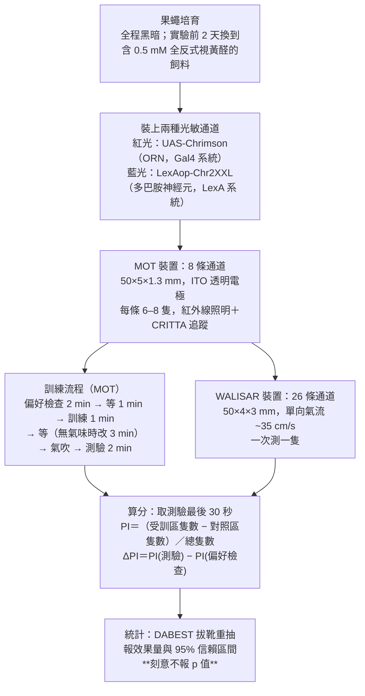
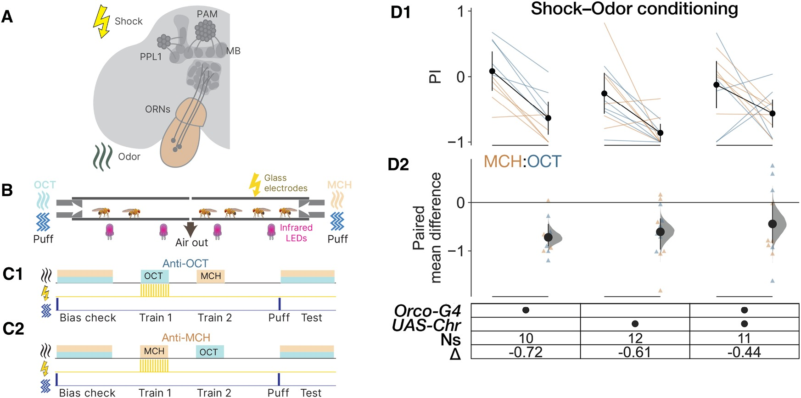
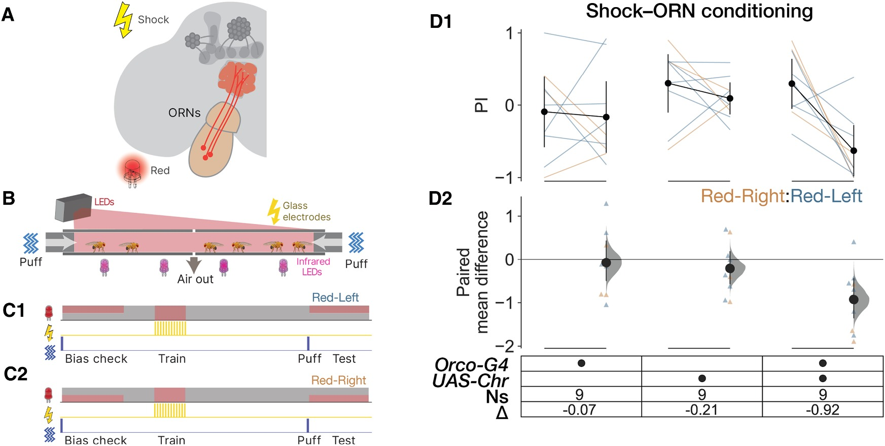
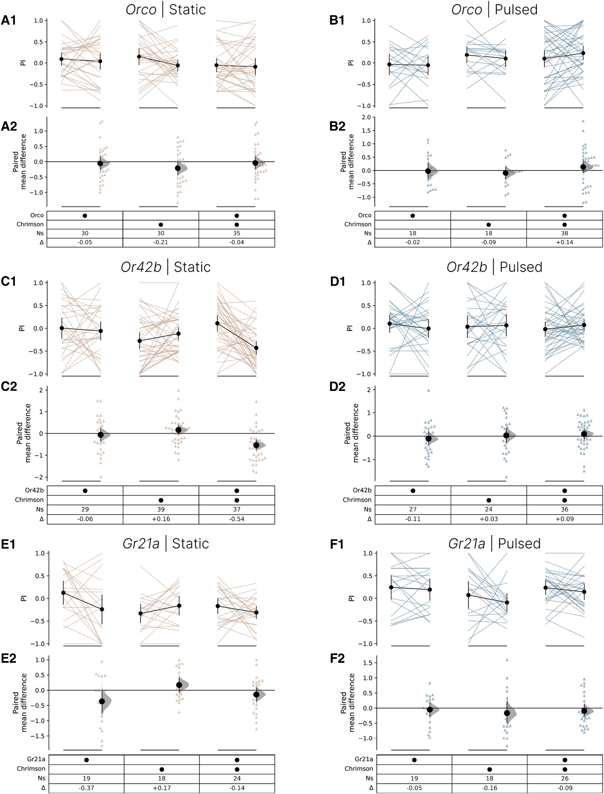
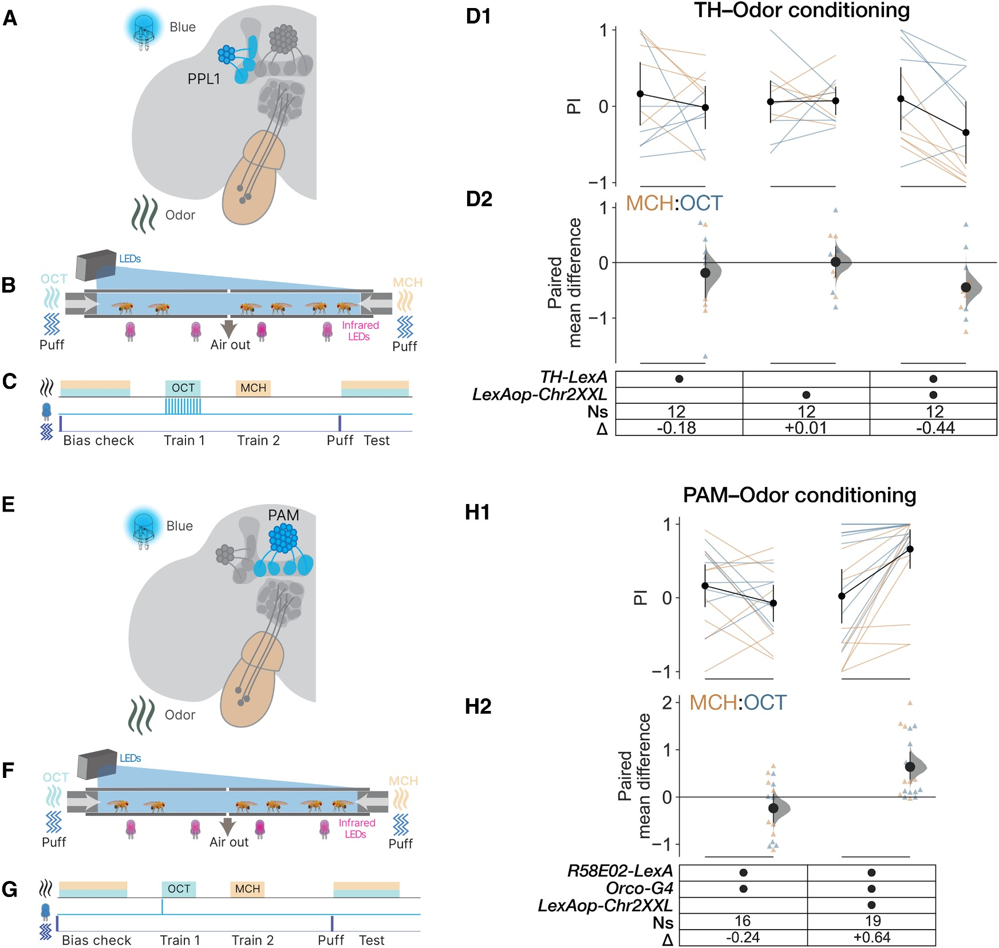
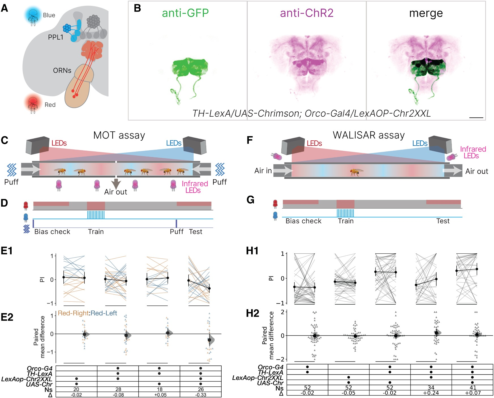
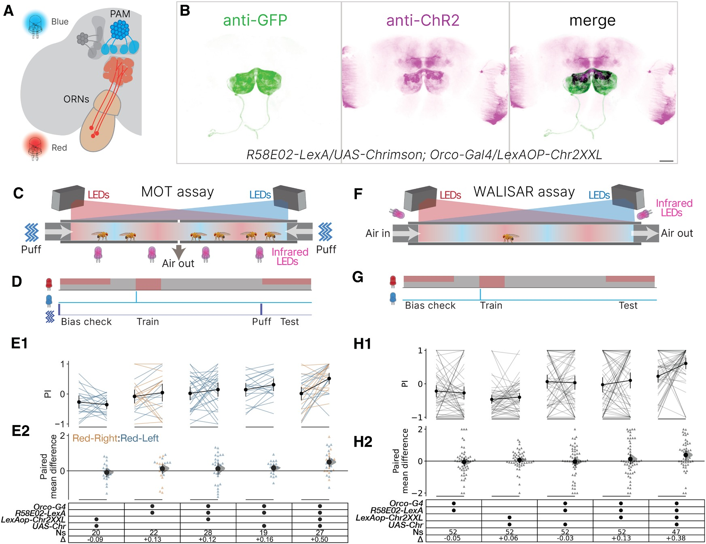

<!-- 本機 PDF：papers/2025-Entirely%20synthetic%20memory%20inception%20via%20dual%20optogenetic%20activation%20of%20sensory%20and%20dopaminergic%20neurons.pdf -->

# Entirely synthetic memory inception via dual optogenetic activation of sensory and dopaminergic neurons

**同時以光遺傳活化感覺神經元與多巴胺神經元，植入全人工的記憶**

| 項目 | 內容 |
|---|---|
| **出處** | iScience 28(10), 113540 (2025). doi: 10.1016/j.isci.2025.113540 [全文（PMC 免費閱讀）](https://pmc.ncbi.nlm.nih.gov/articles/PMC12529362/) |
| 日期 | 線上先行 2025-09-10；刊期 2025-10-17。投稿 2025-05-05・修訂 2025-08-07・接受 2025-09-08。iScience 是單篇編號（113540），沒有起迄頁；PDF 共 16 頁（正文 9 頁、參考文獻 3 頁、STAR Methods 3 頁） |
| 通訊作者 | Adam Claridge-Chang，claridge-chang.adam@duke-nus.edu.sg（PDF 只有英文名） |
| 作者 | 共 5 人：Tayfun Tumkaya、Xianyuan Zhang、Yishan Mai、James Stewart、Adam Claridge-Chang。**PDF 未標示共同第一作者**（已查作者列的上標與註腳，只有 Claridge-Chang 標為 lead contact）。分工（Author contributions）：Tumkaya 與 Claridge-Chang 構思；Tumkaya 負責遺傳、飼養、行為、免疫染色與顯微術；Zhang 負責遺傳、行為、解剖、免疫染色、顯微術；Mai 與 Tumkaya 寫 Python 分析；Stewart 負責儀器與 CRITTA（LabView） |
| 機構 | Institute for Molecular and Cell Biology, A*STAR（新加坡）；Precision Genetics, Data, AI & Genome Sciences, Merck & Co（美國麻州劍橋）；Department of Physiology, National University of Singapore；Program in Neuroscience and Behavioral Disorders, Duke-NUS Medical School（新加坡）；Austrianova Singapore |
| 資料庫 | 行為資料、共軛焦 Z 堆疊影像與分析程式都在 Zenodo：https://doi.org/10.5281/zenodo.13935194 。追蹤軟體 CRITTA 為自製，未釋出（KEY RESOURCES TABLE 的識別碼欄寫 NA） |
| 補充資料 | **無補充圖表**。STAR Methods 在正文之內（PDF 第 e1–e3 頁）。已搜全文的 `Figure S`、`supplement`、`Data S`，只有「視黃醛補充飼料」一處命中，與補充資料無關。所以本頁沒有任何 `？待查（補充資料未取得）` |
| 編輯／審查 | iScience 採不具名審查，PDF 未列編輯或審稿人姓名。致謝提到 Ravinuthula Sruthi Jagannathan（Duke-NUS）在投稿前評閱過原稿，Christian Wegener（University of Würzburg）提供 LexAop-Chr2XXL 品系 |
| 經費 | 新加坡教育部 MOE2017-T2-1-089、MOE2019-T2-1-133、MOE-T2EP30222-0018；A*STAR Joint Council Office 1231AFG030、1431AFG120；Duke-NUS 與 Yong Loo Lin 醫學院獎學金、FY2022-MOET1-0001；BMRC 給 IMCB 的整筆補助 |

> 與本庫有關的作者：通訊作者 Claridge-Chang 是 Claridge-Chang et al. 2009 的第一作者，那篇是本庫多處引用的「以光遺傳活化多巴胺神經元即可取代電擊」的源頭（見 [[s-gervasi-2010-pka-dynamics]]、[[s-felsenberg-2017-re-evaluation]] 的引用）。本篇等於是同一條線十六年後的延伸。
>
> **本篇為 CC BY-NC 4.0 開放取用**（PDF 第 1 頁頁腳：「This is an open access article under the CC BY-NC license」），圖片可在標明出處、**非商業用途**下使用與散布。本庫仍依規定只給全文連結、不放 PDF；每張圖下方標明出處與授權。

---

## 為什麼重要

本庫先前收的論文，都保留了實驗裡至少一樣「真的」刺激。Tully 1985（[[s-tully-1985-classical-conditioning]]）建立的 T 迷宮測驗用真氣味配真電擊；Aso 2016（[[s-aso-2016-dan-cell-type-rules]]）、Ichinose 2015（[[s-ichinose-2015-reward-recurrent-circuit]]）把懲罰或獎賞換成光，但氣味仍是真的；Hige 2015（[[s-hige-2015-heterosynaptic-plasticity]]）與 Handler 2019（[[s-handler-2019-dopamine-receptor-timing]]）在離體腦上量突觸，氣味那一端改用電刺激，增強訊號那一端用光。換句話說，過去的實驗一次只拆掉一邊。

這篇把兩邊同時拆掉：氣味換成紅光活化嗅覺受體神經元（ORN），懲罰或獎賞換成藍光活化多巴胺神經元，整個學習過程裡沒有任何一樣自然刺激。這樣做能回答一個先前問不出來的問題——**只要兩條路徑同時有活動，就足以指揮記憶形成嗎？** 如果保留了真氣味，就永遠無法排除「氣味本身帶著某種時間節奏或特定細胞組合，而那才是學習的必要條件」。

答案是「足夠」，但代價要看清楚。全人工的記憶確實形成了，效果卻比自然學習小，嫌惡版本換到第二台儀器上就測不到。作者自己也點明，這些實驗沒有直接操作任何一個突觸，所以不能拿來證明「記憶就是突觸權重的改變」。對本庫而言，這篇補上的是 [[c-us-substitution]] 這條線的終點，也替 [[t-timing-rules]] 加上一個否定的證據：ORN 放電的精細時間結構，果蠅學不起來。

---

## 論文摘要（原文與中譯）

> Associative conditioning is a fundamental learning paradigm that links salient stimuli to appropriate behavior. The vinegar fly serves as a key model, forming memories by associating odors with reward or punishment through distinct dopaminergic circuits. A critical question is whether simple co-activation of sensory and neuromodulatory dopaminergic neurons is sufficient for memory formation. We addressed this by optogenetically replacing natural stimuli—odor-evoked activity, punishment, and reward signals—either individually or in combination. Notably, even in a full-substitution paradigm where both olfactory and reinforcement signals were replaced, optogenetic activation successfully implanted synthetic memories. Our findings demonstrate that simple coincident activation of sensory and neuromodulatory neurons is enough to instruct associative memory formation—complex temporal or ensemble activity patterns characteristic of natural stimuli are not required. This work provides a framework for controlling and dissecting memory circuits with all-optical approaches, offering new tools for studying the mechanisms of learning and memory.

**中譯**（本節為忠實翻譯，非自撰內容）：

> 聯結式制約是一種基本的學習範式，把顯著的刺激與適當的行為連起來。果蠅是關鍵的模式動物，透過不同的多巴胺迴路，把氣味與獎賞或懲罰聯結起來而形成記憶。一個關鍵的問題是：單純地同時活化感覺神經元與具神經調節作用的多巴胺神經元，是否就足以形成記憶？我們以光遺傳取代自然刺激——氣味引發的活動、懲罰訊號與獎賞訊號——來處理這個問題，取代的方式有單獨取代，也有合併取代。值得注意的是，即使在嗅覺訊號與增強訊號兩者都被取代的全取代範式中，光遺傳活化仍成功植入了合成的記憶。我們的發現顯示，單純讓感覺神經元與神經調節神經元同時活化，就足以指揮聯結式記憶的形成——自然刺激所特有的複雜時間或細胞組合活動樣式，並非必要。這項工作提供了一個以全光學方法控制與解析記憶迴路的架構，為研究學習與記憶的機制提供新的工具。

---

## 科普文

拍電影時，危險的鏡頭會找替身演員上場。如果換了替身，整場戲照樣成立，就表示這場戲真正需要的是動作本身，而不是那位演員的臉。這篇論文做的就是這件事：把果蠅學習時用到的「真演員」一個一個換成替身，看記憶還形不形得成。

**果蠅的嗅覺學習長什麼樣。** 實驗室裡最常用的測驗是：讓果蠅聞到某個氣味的同時給牠電擊，之後果蠅再遇到這個氣味就會躲開。腦裡負責這件事的是[[e-mushroom-body|蕈狀體]]：鼻子上的嗅覺受體神經元（ORN）把「聞到什麼」送進來，[[e-dopaminergic-neuron|多巴胺神經元]]把「這是好事還是壞事」送進來，兩者在蕈狀體裡交會，接點的強弱因此改變。

**難題是：怎麼證明「同時有活動」就夠了？** 真實的氣味不只是「有或沒有」，它會讓一群特定的神經元以特定的節奏放電。有人因此懷疑，學習需要的其實是那個節奏或那個特定組合，而不只是「兩邊同時在動」。只要實驗裡還留著真氣味，就永遠分不清楚。

**解法是把兩邊都換成光。** 研究者用了兩種光敏感蛋白：一種只對紅光有反應，裝在 ORN 上，用紅光代替氣味；另一種只對藍光有反應，裝在多巴胺神經元上，用藍光代替電擊或糖。兩種顏色互不干擾，所以可以分別控制。訓練時兩盞燈一起亮，果蠅從頭到尾沒聞到任何氣味、也沒被電到。

**結果是記憶真的形成了。** 用代表懲罰的那群多巴胺神經元，果蠅學會躲開「紅光照到的那一半通道」；用代表獎賞的那群，果蠅反而學會往紅光那邊走。光的節奏也被測過：連續亮和每秒閃二十次的光，果蠅分不出哪一種被罰過。**這表示 ORN 放電的精細時間結構不是學習的必要條件。**

**代價有三個。** 第一，全人工記憶的強度比自然學習小，大約是自然的四分之三到一半。第二，嫌惡版本換到另一台測單隻果蠅的儀器上就測不到了，喜好版本才兩台都成功。第三，ORN 並不是記憶真正發生的地方，訊號從 ORN 傳到蕈狀體還要經過至少兩層轉接，沿路可能自己長出時間結構。

**最容易被誤讀的一點**：這篇證明的是「簡單的同時活化**足以**造出記憶」，不是「自然的記憶就是這樣形成的」。足夠不等於必要，也不等於自然情況下真的只用到這麼少的東西。作者自己在討論裡還加了一句更嚴格的提醒：整套實驗沒有直接碰過任何一個突觸，所以不能拿它來證明「記憶＝突觸強度改變」這個假說。

---

## 專業文

### 一、概述

**主要問題：** 感覺神經元與具神經調節作用的多巴胺神經元，單純地同時活化，是否足以指揮聯結式記憶形成？

**重要性：** 取代實驗（substitution experiment）是判定「某個訊號是否足夠」的標準作法，但過去在果蠅成蟲身上只做到單邊取代——取代 CS（氣味）或取代 US（增強訊號），不曾兩邊同時取代。只要保留任一邊的自然刺激，就無法排除自然刺激特有的時間動態、細胞組合、或主要迴路以外的旁路在暗中供輸。

**發表當時的領域現狀（2025）：** CS 側的人工取代，在幼蟲上由 Tomasiunaite 2018 等做過；US 側的取代則由 Claridge-Chang 2009（含 PPL1 的 TH⁺ 子集，嫌惡）、Burke 2012 與 Liu 2012（PAM，獎賞）建立，本庫的 [[s-aso-2016-dan-cell-type-rules]] 與 [[s-ichinose-2015-reward-recurrent-circuit]] 都在這條線上。兩邊都取代的「全合成」實驗，當時只有兩例：Honda 2014 在**果蠅幼蟲**上同時活化 Or24a 神經元與 Tdc2 細胞（Tdc2 製造章魚胺與酪胺，位在 PAM 的上游），以及 Vetere 2019 在**小鼠**上同時活化單一嗅覺絲球與兩條投射到腹側被蓋核的路徑。本篇指出這兩例的共同限制：被人工活化的是多巴胺神經元的**上游**，指揮用的多巴胺迴路本身沒有被直接驅動。

### 二、方法

**刺激參數。** 真電擊為 12 次、60 V，分散在 1 分鐘的訓練期內。氣味用 3-辛醇（OCT）與 4-甲基環己醇（MCH），以質流控制器調整濃度（濃度數值 PDF 未給）。紅光由 PC 控制的 LED 微投影機（Optoma ML750）投出，只照通道的一半，形成選擇圖樣；藍光由 LED（峰值 460 nm）從上方照射。WALISAR 另用 617 nm 紅、530 nm 綠、470 nm 藍的 LED，裝在通道上方 45°。

**嫌惡與獎賞的光脈衝數不同，這是本篇方法上的關鍵轉折。** 嫌惡制約給 12 次藍光脈衝；獎賞制約只在 60 秒訓練期的**最初 3 秒**給一次藍光，理由是 Chr2XXL 通道關閉得慢。作者在討論中說明，沿用傳統的 12 脈衝協定時，嫌惡制約一次就成功，獎賞制約卻完全沒有成功，改成單脈衝才做出來。

**驅動品系。** ORN 用 Orco-Gal4（涵蓋約 70% 的嗅覺受體細胞），另在時間結構實驗中用 Or42b-Gal4 與 Gr21a-Gal4 這兩個窄品系。嫌惡的多巴胺神經元用 TH-LexA——作者描述為「**含 PPL1 在內的 TH⁺ 神經元子集**」，不是 PPL1 專一品系。獎賞用 R58E02-LexA（PAM，見 [[e-r58e02]]）。兩種通道的表現以免疫染色確認（anti-GFP 認 mVenus 標籤，anti-ChR2 同時認 Chr2XXL 與 Chrimson）。

**計分方式與本庫既有頁的接點。** 本篇報的是**半 PI**（half PI），即分開報「反 OCT」與「反 MCH」兩組各自的分數，而不是慣例上把兩組合併的全 PI。分母是通道內的總隻數，取測驗最後 30 秒的平均。這一點直接關係到 [[c-performance-index]] 記錄的分母陷阱：半 PI 與全 PI 的數值不能直接並排比較。圖上的 `Ns` 是**通道數或果蠅數，不是果蠅總數**——MOT 的一個 N 代表一條通道（6–8 隻），WALISAR 的一個 N 代表一隻果蠅。

### 三、結果

#### 3.1 基準：三個轉殖品系在真氣味＋真電擊下都學得起來（圖 1）

ΔPI 分別是 Orco-Gal4 −0.72 [−0.90, −0.45]（N=10）、UAS-Chrimson −0.61 [−0.97, −0.33]（N=12）、兩者兼具的 UAS-Chrimson; Orco-Gal4 −0.44 [−0.84, −0.01]（N=11），未加權平均 −0.59。這一步只為確認帶著轉殖基因的果蠅沒有學習缺陷。

#### 3.2 單邊取代之一：紅光活化 ORN 可以代替氣味（圖 2）

去掉氣味，改以紅光照亮通道的一半當作「人工氣味」，配真電擊。帶齊兩個轉殖基因的果蠅 ΔPI −0.92 [−1.35, −0.44]，兩個對照只有 −0.07 與 −0.21（各 N=9）。作者據此認為視覺學習最多只是次要成分。

#### 3.3 光的時間結構學不起來（圖 3）

把「連續紅光」與「20 Hz 脈衝紅光」當成兩種人工氣味，其中一種配電擊。三種 ORN 品系、各兩種圖樣，共六組，果蠅大致都學不起來（實驗組 ΔPI 從 −0.14 到 +0.14）。**唯一的例外是 Or42b 的靜態光，ΔPI −0.54（N=37）。** 作者的結論是：ORN 活動的精確時間編碼，不是嗅覺知覺或聯結學習的關鍵決定因素。

#### 3.4 單邊取代之二：藍光活化多巴胺神經元可以代替電擊與糖（圖 4）

配真氣味，以藍光活化 TH-LexA 細胞，果蠅躲開被罰的氣味，ΔPI −0.44 [−0.71, −0.10]；兩個對照為 +0.01 與 −0.18（各 N=12）。改用 R58E02-LexA（PAM）則形成喜好，ΔPI +0.64 [+0.38, +0.96]（N=19），對照 −0.24 [−0.54, +0.06]（N=16）。

#### 3.5 全合成的嫌惡記憶：做出來了，但只在一台儀器上（圖 5）

MOT 裝置中，四個轉殖基因齊備的果蠅 ΔPI −0.33 [−0.64, −0.01]（N=26），三個對照為 −0.02、−0.08、+0.05。同一基因型在 WALISAR 單隻測試中 ΔPI 為 **+0.07** [−0.20, +0.30]（N=41），方向與預期相反且信賴區間跨過 0，即沒有測到嫌惡記憶。

#### 3.6 全合成的喜好記憶：兩台儀器都成功（圖 6）

以 R58E02-LexA 取代 TH-LexA，MOT ΔPI +0.50 [+0.24, +0.74]（N=27）、WALISAR ΔPI +0.38 [+0.10, +0.63]（N=47），四個對照都在 −0.09 到 +0.16 之間。喜好方向的全合成記憶因此比嫌惡方向穩健。

### 四、討論

**論文的主要主張與其強弱：**

- **「簡單的同時活化足以指揮聯結記憶形成」**——這是本篇最強的一條。全合成範式下仍出現方向正確、信賴區間不含 0 的效果，喜好版還跨兩台儀器重現。強度：喜好方向為強證據，嫌惡方向為弱證據（見 3.5）。
- **「複雜的時間或細胞組合樣式並非必要」**——證據有兩層：全合成成功（間接），以及時間結構學不起來（直接，圖 3）。後者是陰性結果，但樣本數大（每組 N 在 18–39），且同一套裝置能測到其他條件下 −0.92 的效果，所以不是整體靈敏度不足。不過作者自己在限制一節承認，ORN 的簡單活化傳到下游時可能重新獲得時間結構，因此這個結論只適用於「在 ORN 與多巴胺神經元這一層」。
- **「速率編碼是指揮性的」**——這是比前兩條更強的推論。論文由「方波刺激能教會果蠅」推到「rate coding is instructive」，但本篇沒有記錄任何神經元的放電，速率是由刺激參數反推的。
- **作者主動踩的煞車**：曾有人主張全合成的細胞型專一光遺傳制約直接支持記憶形成的突觸可塑性假說，本篇明說「這些實驗沒有直接操作突觸，因此不能對突觸權重改變本身說話」。對本庫的 [[t-dopamine-to-plasticity]] 而言，這是一句難得的、由作者自己劃出的界線。

### 五、問題與限制

1. **ORN 不是記憶形成的位置**（作者自陳）。訊號要經過至少兩個序列突觸才到蕈狀體，沿路可能獲得時間結構與額外的細胞組合樣式。作者建議改以活化 Kenyon 細胞當 CS 來處理這個問題。
2. **嫌惡的全合成記憶沒有跨儀器重現**（作者自陳）。作者推測可能來自取樣誤差，或兩台裝置在氣吹、氣流方向、群體社交線索上的差異。
3. **沒有電生理驗證。** 全篇沒有記錄被光活化的 ORN 或多巴胺神經元實際放出什麼樣的脈衝序列；「方波刺激」是對光的描述，不是對神經活動的量測。作者引用他人的紀錄（6 篇）來支持「光遺傳引發的放電大致沒有結構」。
4. **以下為本庫稽核出來、論文自己沒有處理的問題：**

   - **（a）同一個數字在兩處正負號相反。** 結果一節寫 WALISAR 的全合成嫌惡 ΔPI 為 **+0.07** [−0.20, +0.30]（與圖 5H 的表格一致），討論一節寫成 **−0.07**（「−0.07 > −0.33」）。⚠️ 單一來源自身不一致，本頁以圖與結果一節的 +0.07 為準。
   - **（b）電擊脈衝的間隔有兩個版本。** 討論一節說傳統協定是 1 分鐘內 12 次（1.5 秒開、**3.5 秒**關）；STAR Methods 說光脈衝「依照傳統嗅覺制約所用的相同時間樣式」給 12 次（1.5 秒開、**4.5 秒**關）。兩者都自稱是同一個樣式。驗算：1.5＋3.5＝5 秒，×12＝60 秒，正好是 1 分鐘的訓練期；1.5＋4.5＝6 秒，×12＝72 秒，**放不進 60 秒的訓練期**。⚠️ 單一來源自身不一致。
   - **（c）圖號引用錯誤兩處。** 其一，討論寫「comparable with R58E02-induced olfactory learning (+0.50 vs. +0.64, Figures 6E and 2H)」，但 +0.64 出自圖 4H，而圖 2 沒有 H 分格。其二，圖 2 的圖說 C2 寫「The protocol was as for the Red-Left experiment in G1」，應為 C1；圖 2 也沒有 G 分格（已以整頁渲染確認，不是抽圖造成的缺漏）。
   - **（d）「約自然學習的一半」用錯了對照基準。** 討論拿全合成的 −0.33 去比「自然氣味＋電擊記憶（平均 −0.59）」，那個 −0.59 是圖 1 三個基因型的未加權平均。但與全合成實驗基因型相近的那一條（UAS-Chrimson; Orco-Gal4）是 **−0.44**。以它為基準，−0.33／−0.44 ≈ **0.75**，是四分之三而不是一半。論文報告了這三個分數，卻沒有並排算這一個比值。
   - **（e）「視覺學習只是次要」在一處被自己的對照推翻。** 圖 3E（Gr21a、靜態光）中，不帶 Chrimson 的 Gr21a-Gal4 對照 ΔPI 為 **−0.37**，比同組實驗基因型的 −0.14 更大。那一格的偏好變化無法由光遺傳解釋。論文沒有討論這一格。
   - **（f）有一條結論完全沒有資料支持。** 「沿用 12 脈衝協定時獎賞制約沒有成功」只出現在討論的敘述中，全篇沒有任何圖呈現這批資料，也沒有列為未展示資料（data not shown）。它同時是「嫌惡與獎賞系統可能有差異」這個推測的唯一依據。
   - **（g）標題性宣稱寫 PPL1，使用的品系卻不是 PPL1 專一。** Highlights 寫「Co-activating ORNs and PPL1 neurons」，方法則描述 TH-LexA 為「含 PPL1 的 TH⁺ 神經元子集」。該品系實際涵蓋哪些型別、是否包含 PPL1 以外的多巴胺神經元，本篇沒有列出，圖 5B 的 anti-ChR2 染色因為同時認兩種通道蛋白而無法分辨。這與本庫既有的「同一品系各篇寫的涵蓋範圍不同」是同一類問題（見 [[e-dopaminergic-neuron]]、[[e-th-gal4]]）。
   - **（h）對照組的組成在各實驗之間不一致。** 圖 4D（TH 半）有兩個對照，各帶一個轉殖基因；圖 4H（PAM 半）**只有一個對照**（R58E02-LexA; Orco-Gal4，缺少效應子單獨的對照）；圖 5E 有三個、圖 5H 與圖 6 各有四個。論文沒有說明為何 PAM 半的對照較少。
   - **（i）WALISAR 嫌惡實驗中，一個對照的效果大於實驗組。** 圖 5H 第四欄（Orco-G4; TH-LexA; LexAop-Chr2XXL，缺 Chrimson）ΔPI 為 **+0.24**（N=34），大於實驗組的 +0.07。兩者方向都與預期的嫌惡相反。論文只報告實驗組沒形成記憶，沒有處理這個對照。

### 六、未來

**論文自陳的方向。** 全光學制約讓「精確控制 CS 與 US 的時間」變得可行，作者點名幾種因此能做的範式：contingency 協定、操作型制約、重複試驗、保留與消退。他們也提議改用 Kenyon 細胞取代 ORN 當作 CS，以回應限制 1。

**本庫關注的後續。** 這篇留下三個開口，庫內已有論文可以接手：第一，ΔPI 的時間窗。本篇的 CS 與 US 完全同時給，沒有掃過刺激間隔，而 [[s-aso-2016-dan-cell-type-rules]] 在行為上、[[s-handler-2019-dopamine-receptor-timing]] 在突觸上都掃過（見 [[t-timing-rules]]）。全光學方法正好適合把這兩個尺度接起來。第二，突觸那一端。本篇自陳沒碰突觸，而 [[s-hige-2015-heterosynaptic-plasticity]] 的離體膜片鉗與 [[s-cohn-2015-coordinated-neuromodulation]] 的鈣成像就是在量這件事；把全合成制約接上離體記錄，可直接檢驗「同時活化」造出的可塑性與自然制約造出的是否相同。第三，嫌惡與獎賞的不對稱。本篇觀察到 12 脈衝對嫌惡有效、對獎賞無效，並推測這反映 PPL1 與 PAM 系統的差異；[[s-aso-2016-dan-cell-type-rules]] 報告的「各型 DAN 有各自的時序規則」正是同一個現象的另一種量法。

**尚未被回答的。** 全合成記憶與自然記憶在腦裡留下的痕跡是不是同一個？本篇只比較了行為分數的大小，沒有比較兩者在 KC→MBON 突觸上的改變、在區室間的分布、或在保留與消退上的行為。效果量比較小，可能是記憶較弱，也可能是記憶的性質不同，本篇的資料無法分辨。

---

## 圖

<small>圖片出處：Tumkaya, T., Zhang, X., Mai, Y. et al. *iScience* 28(10):113540 (2025)，Figure 1。© 2025 作者，CC BY-NC 4.0；全文見 [PMC](https://pmc.ncbi.nlm.nih.gov/articles/PMC12529362/)。</small>

> **原圖說（Figure 1）：** Shock-paired conditioning induces memories with real odors. (A) Schematic of the key brain regions involved in olfactory learning: a mushroom body (MB), paired-anterior-medial (PAM) neurons, paired-posterior-lateral 1 (PPL1) neurons, the antenna, and ORNs are shown. The shock and odor icons indicate the stimuli used in the experiment. (B) Schematic of the MOT chamber showing odors (OCT and MCH), air flow with air puffs, infrared LEDs for imaging, and glass electrodes for shock. (C1) The anti-OCT training paradigm: Flies (n = 6–8) were loaded into chambers and tested for OCT and MCH preference (Bias check), then exposed to OCT with a foot shock (Train 1), MCH exposure without a shock (Train 2), agitated with an air puff, and finally re-tested for odor preference (Test). (C2) The anti-MCH training protocol: as for the paradigm in C1, except that MCH was paired with a foot shock (Train 1). (D1) Paired plot showing the chamber preference index (PI) before and after conditioning. The ends of the orange and blue lines indicate the PI scores per chamber for MCH and OCT training, respectively; black dots indicate the mean PI, and the error bars represent 95% confidence intervals (CIs). (D2) Change in chamber preference index (ΔPI) between pre- and post-conditioning is shown. The orange and blue triangles indicate the individual pre:post ΔPI values; black dots indicate mean ΔPI values with their 95% CI (black line), and the Δ distributions (gray curve).

**圖說中譯：**（A）嗅覺學習涉及的主要腦區示意圖：蕈狀體（MB）、PAM 神經元、PPL1 神經元、觸角與 ORN。電擊與氣味的圖示代表實驗所用的刺激。（B）MOT 通道示意圖，標出氣味（OCT 與 MCH）、帶氣吹的氣流、成像用紅外線 LED，以及施加電擊的玻璃電極。（C1）反 OCT 訓練範式：果蠅（每通道 6–8 隻）放入通道，先測 OCT 與 MCH 的偏好（偏好檢查），接著在 OCT 出現時施加電擊（訓練 1），再給不配電擊的 MCH（訓練 2），以氣吹擾動，最後重測氣味偏好（測驗）。（C2）反 MCH 訓練協定：同 C1，但訓練 1 改以 MCH 配電擊。（D1）配對圖，顯示制約前後各通道的偏好指數（PI）。橘線與藍線的兩端分別是 MCH 訓練與 OCT 訓練的各通道 PI；黑點為平均 PI，誤差線為 95% 信賴區間。（D2）制約前後偏好指數的變化（ΔPI）。橘色與藍色三角形為各通道的前後 ΔPI 值；黑點為平均 ΔPI 並附 95% 信賴區間（黑線），灰色曲線為 Δ 的分布。

**解讀：** 這是全篇的基準，真正該看的不是「果蠅會學習」，而是 D2 下方那張基因型表提供的三個數字：−0.72、−0.61、−0.44，對應的 N 是 10、12、11。**三個數字之間的差距不小，而最弱的那一個（−0.44）正是後面全合成實驗所用的基因型底盤**（UAS-Chrimson; Orco-Gal4）。論文在討論裡改用三者的未加權平均 −0.59 當作「自然學習」的基準，去凸顯全合成記憶只有「約一半」；若改用基因型相符的 −0.44，比值是 0.75。論文報告了這三個分數，但沒有做這個除法（見問題與限制 4d）。另外要注意 D1 的縱軸是 PI 而 D2 是 ΔPI，兩張圖的縱軸意義不同，不能把 D1 的線段長度當成 D2 的效果量。

<small>圖片出處：Tumkaya, T., Zhang, X., Mai, Y. et al. *iScience* 28(10):113540 (2025)，Figure 2。© 2025 作者，CC BY-NC 4.0；全文見 [PMC](https://pmc.ncbi.nlm.nih.gov/articles/PMC12529362/)。</small>

> **原圖說（Figure 2）：** Shock-paired conditioning induces memories with a fictive odor-like stimulus. (A) Schematic of the stimuli and targeted brain regions used for shock conditioning of a synthetic optogenetic olfactory-like stimulus. (B) Schematic of the odor-free semi-artificial conditioning experiment, where Chrimson is activated with a red LED. (C1) The Red-Left odor-substitution conditioning protocol: flies were tested between red light and no light (Bias), then trained with red light paired with a foot shock (Conditioning), a no-light interval, and finally a second light-dark choice task (Test). (C2) The Red-Right odor-substitution conditioning experiment. The protocol was as for the Red-Left experiment in G1, but the light pattern was swapped. (D1) Bias and Test PI scores for three genotypes, before and after training. The ends of each line indicate scores from one chamber (6–8 flies). Orange and blue indicate the Red-Right and Red-Left illumination schedules. Error bars are 95% CIs. (D2) The relative ΔPI after conditioning is shown. The orange and blue triangles represent the individual pre:post ΔPI values per chamber where either a Red-Right or Red-Left light pattern was used, respectively. The black dots indicate the mean ΔPI for each group with its 95% CI (black line), and the Δ distribution (gray curve).

**圖說中譯：**（A）以光遺傳合成的類嗅覺刺激進行電擊制約時，所用刺激與目標腦區的示意圖。（B）無氣味的半人工制約實驗示意圖，Chrimson 以紅光 LED 活化。（C1）紅光在左的氣味取代制約協定：先在紅光與無光之間測偏好（偏好檢查），接著以紅光配電擊進行訓練（制約），一段無光的間隔，最後再做一次明暗選擇（測驗）。（C2）紅光在右的氣味取代實驗，協定同 G1 的紅光在左實驗，但光的左右對調。（D1）三個基因型訓練前後的偏好檢查與測驗 PI 分數。每條線的兩端為一條通道（6–8 隻）的分數。橘色與藍色分別代表紅光在右與紅光在左的照光安排。誤差線為 95% 信賴區間。（D2）制約後的相對 ΔPI。橘色與藍色三角形分別為使用紅光在右或紅光在左圖樣時，各通道的前後 ΔPI 值。黑點為各組平均 ΔPI 並附 95% 信賴區間（黑線），灰色曲線為 Δ 的分布。

**解讀：** 三個數字 −0.07、−0.21、−0.92 的對比是全篇最乾淨的一組，而且 N 全部是 9，不像圖 1 那樣各組不等。值得注意的是 **−0.92 比圖 1 任何一個自然學習的分數都大**：換成光之後，果蠅躲得比躲真氣味還徹底。論文沒有討論這一點，但它至少提醒讀者，ΔPI 的大小不能直接當成「記憶強度」來跨刺激比較——照亮半條通道的紅光是個比氣味更明確、更不會擴散的空間線索。C2 的圖說寫「協定同 G1」，但本圖只有 A、B、C1、C2、D1、D2 六個分格，沒有 G，應為 C1（已以整頁渲染確認，不是抽圖造成的缺漏）。這是本篇兩處圖號引用錯誤之一，另一處見問題與限制 4c。

<small>圖片出處：Tumkaya, T., Zhang, X., Mai, Y. et al. *iScience* 28(10):113540 (2025)，Figure 3。© 2025 作者，CC BY-NC 4.0；全文見 [PMC](https://pmc.ncbi.nlm.nih.gov/articles/PMC12529362/)。</small>

> **原圖說（Figure 3，摘錄）：** Temporal structure of the optogenetic stimulus targeting olfactory neurons is unlearnable. (A1) Paired plot showing the chamber preference index (PI) before and after Orco conditioning with a continuous optogenetic-light stimulus. Black dots indicate the mean PI, and the error bars represent 95% CIs. (A2) Change in chamber preference index (ΔPI) between pre- and post-conditioning is shown. The triangles indicate the individual pre:post ΔPI values; black dots indicate mean ΔPI values with their 95% CI (black line), and the Δ distributions (gray curve). (B1) Preference index (PI) before and after conditioning with pulsed optogenetic-light is shown. … (C1)…(F2) 依此類推，依序為 Or42b 靜態、Or42b 脈衝、Gr21a 靜態、Gr21a 脈衝。

**圖說中譯：**（標題）針對嗅覺神經元的光遺傳刺激，其時間結構學不起來。（A1）配對圖，顯示以連續光刺激進行 Orco 制約前後各通道的偏好指數（PI）。黑點為平均 PI，誤差線為 95% 信賴區間。（A2）制約前後偏好指數的變化（ΔPI）。三角形為各通道的前後 ΔPI 值；黑點為平均 ΔPI 並附 95% 信賴區間（黑線），灰色曲線為 Δ 的分布。（B1）以脈衝光制約前後的偏好指數。（C1–F2）依序為 Or42b 靜態光、Or42b 脈衝光、Gr21a 靜態光、Gr21a 脈衝光的對應圖。

**本庫重製的數值表**（逐格由圖下方的基因型表讀出；每格三欄依序為「只有驅動品系」「只有 Chrimson」「兩者兼具＝實驗組」）：

| 品系 ＋ 光圖樣 | 驅動品系單獨 | Chrimson 單獨 | 實驗組 | 實驗組 N |
|---|---:|---:|---:|---:|
| Orco，靜態 | −0.05 | −0.21 | **−0.04** | 35 |
| Orco，20 Hz 脈衝 | −0.02 | −0.09 | **+0.14** | 38 |
| Or42b，靜態 | −0.06 | +0.16 | **−0.54** | 37 |
| Or42b，20 Hz 脈衝 | −0.11 | +0.03 | **+0.09** | 36 |
| Gr21a，靜態 | **−0.37** | +0.17 | **−0.14** | 24 |
| Gr21a，20 Hz 脈衝 | −0.05 | −0.16 | **−0.09** | 26 |

> 依圖 3 的 A2、B2、C2、D2、E2、F2 下方基因型表逐欄讀出。粗體為實驗組，以及下段討論的 Gr21a 靜態對照。

**解讀：** 這張圖要看的是**陰性結果的可信度**，而陰性結果最怕的是靈敏度不足。本篇在這一點上站得住：同一套裝置在圖 2 測得 −0.92，而這裡每組 N 在 18–39 之間，比圖 1、圖 2 的 9–12 大上數倍。真正該看的是表中兩個粗體：Or42b 靜態的 −0.54 是論文承認的例外，而 **Gr21a 靜態那一格的對照（−0.37）比它自己的實驗組（−0.14）更大**。對照不帶 Chrimson，紅光照在牠身上只能是視覺刺激，所以那 −0.37 無法由光遺傳解釋。這一格直接鬆動了論文在圖 2 與圖 5 兩度使用的論證——「對照的分數小，所以視覺學習只是次要」。論文沒有討論這一格（見問題與限制 4e）。Gr21a 標記的是二氧化碳受體神經元，而二氧化碳對果蠅本身帶有嫌惡價值，是否與此有關，本篇沒有討論：？待查。

<small>圖片出處：Tumkaya, T., Zhang, X., Mai, Y. et al. *iScience* 28(10):113540 (2025)，Figure 4。© 2025 作者，CC BY-NC 4.0；全文見 [PMC](https://pmc.ncbi.nlm.nih.gov/articles/PMC12529362/)。</small>

> **原圖說（Figure 4）：** Optogenetic conditioning with activation of TH-LexA or R58E02 neurons induces olfactory memory. (A) A schematic of the main fly brain regions involved in learning and the stimuli used in the TH-odor conditioning experiments. (B) Conditioning odors with blue-light activation of ChrXXL expressed in TH-LexA cells. (C) The conditioning protocol: the flies' naive odor OCT/MCH preference was tested (Bias) before a real odorant was presented along with a blue-light stimulus and applied 12 times (Train 1). A second odor was presented without a light stimulus (Train 2), and then the conditioned odor preference was tested (Test). Both odor regimens were used, but only anti-OCT is depicted. (D1) Paired plot showing odor preference before and after training. (D2) Dot plot showing the difference between the pre- and post-conditioning learning scores (represented as ΔPI) per chamber with its mean ΔPI values (black dots) and 95% CI (black line). (E) Overview of the experimental design to determine if artificial R58E02 PAM activation can instruct appetitive olfactory-like memories. (F) Optogenetic conditioning in the MOT assay using light and odor. (G) The timeline of a reward-substitution experiment: the protocol was similar to that used for aversive training, but in Train 1, only a single pulse of blue light was delivered. Only one regimen (anti-OCT) is depicted. (H1) Paired line plot showing the odor preference index (PI) before and after conditioning. (H2) The change in preference index (ΔPI) after training is shown. Triangles represent the pre:post ΔPI values per chamber, mean ΔPI values (black dots) with its 95% CI (black line), and the Δ distribution (gray curve). Either MCH (orange) or OCT (blue) was used as an odor stimulus in conditioning.

**圖說中譯：**（A）TH–氣味制約實驗所涉及的果蠅主要腦區與所用刺激示意圖。（B）以藍光活化 TH-LexA 細胞所表現的 ChrXXL，並配合氣味進行制約。（C）制約協定：先測果蠅對 OCT／MCH 的天生偏好（偏好檢查），接著給真實氣味並同時施加藍光刺激，共 12 次（訓練 1）；再給第二種不配光的氣味（訓練 2），最後測制約後的氣味偏好（測驗）。兩種氣味安排都做了，圖中只畫反 OCT。（D1）訓練前後氣味偏好的配對圖。（D2）點圖，顯示各通道制約前後學習分數之差（以 ΔPI 表示），黑點為平均 ΔPI、黑線為 95% 信賴區間。（E）用以判定人工活化 R58E02 PAM 能否指揮欲求型類嗅覺記憶的實驗設計概覽。（F）在 MOT 裝置中以光與氣味進行光遺傳制約。（G）獎賞取代實驗的時間軸：協定與嫌惡訓練相似，但訓練 1 只給單一次藍光脈衝。圖中只畫一種安排（反 OCT）。（H1）制約前後氣味偏好指數的配對線圖。（H2）訓練後偏好指數的變化。三角形為各通道的前後 ΔPI 值，黑點為平均 ΔPI 並附 95% 信賴區間（黑線），灰色曲線為 Δ 的分布。制約時以 MCH（橘）或 OCT（藍）作為氣味刺激。

**解讀：** 把 D2 與 H2 的基因型表並排看，會發現**兩半的對照設計不一樣**：D2（嫌惡）有兩個對照，分別只帶驅動品系或只帶效應子；H2（獎賞）**只有一個對照**（R58E02-LexA; Orco-Gal4，N=16），缺少效應子單獨的對照，也就是沒有「帶著 Chr2XXL 但沒有 PAM 驅動」的那一組。論文沒有說明為什麼。這個缺口在本圖影響有限（唯一的對照 −0.24 與實驗組 +0.64 方向相反），但它顯示本篇的對照組成是逐實驗臨時決定的，而不是固定一套（見問題與限制 4h）。另一個該注意的細節藏在 G 的時間軸：獎賞組只給**一次**藍光脈衝，嫌惡組給 12 次。這個差異不是設計上的對稱安排，而是因為 12 脈衝的獎賞制約做不出來（那批資料全篇未呈現，見問題與限制 4f）。H2 的 +0.64 因此是在一個與 D2 不可直接比較的協定下得到的。

<small>圖片出處：Tumkaya, T., Zhang, X., Mai, Y. et al. *iScience* 28(10):113540 (2025)，Figure 5。© 2025 作者，CC BY-NC 4.0；全文見 [PMC](https://pmc.ncbi.nlm.nih.gov/articles/PMC12529362/)。</small>

> **原圖說（Figure 5）：** Optogenetic co-activation of TH-LexA cells and Orco-Gal4 neurons can implant aversive memory. (A) Schematic showing Chr2XXL expression in the TH-LexA neurons and Chrimson expression in the Orco-Gal4 ORNs. (B) Confocal images of a two-opsin transgenic brain stained with antibodies against GFP (anti-GFP, reactive with mVenus; green) and channelrhodopsin (anti-ChR, reactive with both ChrXXL and Chrimson; magenta). (C) Overview of the fully synthetic memory inception experiments with two-opsin optogenetics in the MOT assay. (D) During the MOT assay, flies were first presented with dark and illuminated domains (Bias); then conditioning with red and blue light simultaneously (Train); lastly, their light-dark preference was re-tested (Test). Red light was used on either the left or right side during training, but only the Red-Left regimen is depicted. (E1) Chamber preference index (PI) before and after conditioning; black dots and error bars represent the mean PI and 95% CI, respectively. (E2) Orange and blue triangles indicate the individual pre:post ΔPI values for fully synthetic memory inception where either a Red-Right or Red-Left light pattern was used, respectively. (F) Schematic of the WALISAR assay, which uses unidirectional air flow and tracks individual flies. (G) The WALISAR conditioning regimens were identical to those used during the MOT assay, except that there was no air puff at the start of each test. Red light was used either on the left or right, but only the Red-Left regimen is depicted. (H1) Single-fly PI before and after conditioning with blue and red light. (H2) Individual pre:post ΔPI values per fly are depicted (triangles) with its mean ΔPI (black dot) and 95% CIs (black lines).

**圖說中譯：**（A）示意圖，顯示 Chr2XXL 表現在 TH-LexA 神經元、Chrimson 表現在 Orco-Gal4 的 ORN。（B）帶兩種光敏蛋白的轉殖果蠅腦共軛焦影像，以抗 GFP 抗體（認 mVenus，綠色）與抗通道視紫質抗體（anti-ChR，同時認 ChrXXL 與 Chrimson，洋紅色）染色。（C）在 MOT 裝置中以雙光敏蛋白光遺傳進行全合成記憶植入實驗的概覽。（D）MOT 測試中，果蠅先面對暗區與亮區（偏好檢查）；接著以紅光與藍光同時照射進行制約（訓練）；最後重測明暗偏好（測驗）。訓練時紅光照左側或右側，圖中只畫紅光在左。（E1）制約前後的通道偏好指數（PI）；黑點與誤差線分別為平均 PI 與 95% 信賴區間。（E2）橘色與藍色三角形分別為紅光在右或紅光在左時，全合成記憶植入的各通道前後 ΔPI 值。（F）WALISAR 裝置示意圖，使用單向氣流並追蹤單隻果蠅。（G）WALISAR 的制約安排與 MOT 相同，只是每次測驗開始前沒有氣吹。紅光照左或照右，圖中只畫紅光在左。（H1）以藍光與紅光制約前後的單隻果蠅 PI。（H2）每隻果蠅的前後 ΔPI 值（三角形），以及平均 ΔPI（黑點）與 95% 信賴區間（黑線）。

**解讀：** 這是全篇的核心結果，也是最該小心讀的一張。MOT 的實驗組 ΔPI −0.33，**95% 信賴區間的上界是 −0.01**——以本篇採用的估計統計標準（不報 p 值、以信賴區間是否含 0 判斷），這是剛好擦過邊的結果。把它和 H2 並排：同一基因型在 WALISAR 的 ΔPI 是 +0.07，不但沒有嫌惡，方向還相反。論文的處理方式是把這次失敗歸因於取樣誤差或裝置差異，並在討論裡寫成「四個實驗中有三個成功」。

H2 還藏著論文沒報告的一欄：**第四欄的對照（Orco-G4; TH-LexA; LexAop-Chr2XXL，缺 Chrimson）ΔPI 為 +0.24，N=34，比實驗組的 +0.07 更偏離 0**（見問題與限制 4i）。兩者方向相同且都與預期相反，所以 WALISAR 這一組實驗真正的訊息，可能不是「全合成記憶沒有重現」，而是「這台裝置在這個基因型背景下測到的是別的東西」。

B 分格要注意一個判讀陷阱：anti-ChR 抗體同時認兩種通道蛋白，所以洋紅色遍布全腦**不代表** TH-LexA 標記範圍很廣——那裡面混著 ORN 的 Chrimson 訊號。這張圖因此無法用來判斷 TH-LexA 涵蓋哪些多巴胺神經元（見問題與限制 4g）。

<small>圖片出處：Tumkaya, T., Zhang, X., Mai, Y. et al. *iScience* 28(10):113540 (2025)，Figure 6。© 2025 作者，CC BY-NC 4.0；全文見 [PMC](https://pmc.ncbi.nlm.nih.gov/articles/PMC12529362/)。</small>

> **原圖說（Figure 6）：** Optogenetic co-activation of Orco and PAM cells elicits appetitive memory. (A) Schematic showing Chr2XXL expression in R58E02-LexA PAM neurons and Chrimson in ORNs. (B) Confocal images of a transgenic brain expressing opsins driven by R58E02-LexA and Orco-Gal4. Anti-ChR2 stained both Chr2XXL and Chrimson (magenta) while anti-GFP stained the mVenus tag on Chrimson (green). (C) Schematic of the optogenetic conditioning protocol via MOT assay. (D) The MOT conditioning protocol, where flies were tested in groups for their red-light preference (Bias), then subjected to red light and a single pulse of blue light (Conditioning) before their red-light preference was tested again (Test). (E1) Red-light preferences before and after conditioning in the MOT assay. Two different timings of the training epoch were used. (E2) Dot plot showing the pre:post ΔPI per chamber in fully artificial appetitive memory conditioning experiments. Either a Red-Right (orange) or Red-Left (blue) light pattern was used in the test. Black dots indicate the mean ΔPI, and the error bars indicate the 95% CIs. (F) Schematic of the optogenetic conditioning protocol via WALISAR assay. (G) The WALISAR conditioning regimen was established as described in D for the MOT assay. (H1) Red-light preferences of individual flies before and after light conditioning. (H2) The change in preference index (ΔPI) of individual flies before and after training is shown. Gray triangles indicate the pre:post ΔPI values per fly in fully synthetic memory implantation experiments in WALISAR. Black dots indicate mean ΔPI values, and the error bars indicate the 95% CIs.

**圖說中譯：**（A）示意圖，顯示 Chr2XXL 表現在 R58E02-LexA 的 PAM 神經元、Chrimson 表現在 ORN。（B）由 R58E02-LexA 與 Orco-Gal4 驅動光敏蛋白表現的轉殖腦共軛焦影像。anti-ChR2 同時染到 Chr2XXL 與 Chrimson（洋紅色），anti-GFP 染到 Chrimson 上的 mVenus 標籤（綠色）。（C）以 MOT 裝置進行光遺傳制約的協定示意圖。（D）MOT 制約協定：先成群測試果蠅對紅光的偏好（偏好檢查），接著給予紅光與單一次藍光脈衝（制約），再重測紅光偏好（測驗）。（E1）MOT 裝置中制約前後的紅光偏好。訓練期使用了兩種不同的時間安排。（E2）點圖，顯示全人工欲求型記憶制約實驗中各通道的前後 ΔPI。測驗使用紅光在右（橘）或紅光在左（藍）的圖樣。黑點為平均 ΔPI，誤差線為 95% 信賴區間。（F）以 WALISAR 裝置進行光遺傳制約的協定示意圖。（G）WALISAR 的制約安排依 D 所述的 MOT 協定建立。（H1）單隻果蠅光制約前後的紅光偏好。（H2）單隻果蠅訓練前後偏好指數的變化。灰色三角形為 WALISAR 全合成記憶植入實驗中各果蠅的前後 ΔPI 值。黑點為平均 ΔPI，誤差線為 95% 信賴區間。

**本庫重製的數值表**（由 E2 與 H2 下方的基因型表逐欄讀出）：

| 基因型組成 | MOT ΔPI（N） | WALISAR ΔPI（N） |
|---|---:|---:|
| 只有兩個效應子（LexAop-Chr2XXL; UAS-Chr） | −0.09（20） | +0.06（52） |
| 只有兩個驅動品系（Orco-G4; R58E02-LexA） | +0.13（22） | −0.05（52） |
| 缺 Chrimson（Orco-G4; R58E02-LexA; LexAop-Chr2XXL） | +0.12（28） | +0.13（52） |
| 缺 Chr2XXL（Orco-G4; R58E02-LexA; UAS-Chr） | +0.16（19） | −0.03（52） |
| **四者齊備（實驗組）** | **+0.50（27）** | **+0.38（47）** |

> 依圖 6 的 E2、H2 下方基因型表逐欄讀出；兩台裝置的欄位順序不同，本表已依基因型對齊。

**解讀：** 這是本篇最穩的一組結果，理由不只在於效果量大，而在於**對照的完整度**：四個對照涵蓋了「只有效應子」「只有驅動品系」「各缺一個效應子」四種組合，而且兩台裝置都做滿，WALISAR 的對照 N 一律是 52。把兩欄並排看，四個對照在兩台裝置上都落在 −0.09 到 +0.16 之間，沒有系統性的偏向；只有四者齊備時才跳到 +0.50 與 +0.38。相較之下，圖 5 的嫌惡版在 MOT 只有三個對照、WALISAR 的對照之一還跑到 +0.24。**本篇「喜好方向比嫌惡方向可信」的理由，與其說在效果量的大小，不如說在這張表的完整與一致。**

E1 的圖說提到「訓練期使用了兩種不同的時間安排」（Two different timings of the training epoch were used），但 E2 的基因型表只用紅光左右來分組，沒有把這兩種時間安排分開標示，正文也沒有說明兩者差在哪裡、各佔多少通道：？待查。

---

## 相關

- [[numbers]] — 本篇貢獻了全合成與半合成制約的 ΔPI 效果量與信賴區間、MOT 與 WALISAR 的裝置參數、以及光刺激的脈衝規格
- 主題：[[t-timing-rules]]（ORN 的時間結構學不起來；CS–US 完全同時）、[[t-dopamine-to-plasticity]]（作者自陳未直接操作突觸）
- 概念：[[c-us-substitution]]、[[c-coincidence-detection]]、[[c-cs-us-timing]]、[[c-performance-index]]（半 PI vs 全 PI）
- 實體：[[e-dopaminergic-neuron]]、[[e-mushroom-body]]、[[e-kenyon-cell]]、[[e-cschrimson]]、[[e-r58e02]]、[[e-th-gal4]]、[[e-t-maze]]（MOT 不是 T 迷宮，見 [[e-t-maze]] 的對照說明）
- 待開頁面：`e-mot-assay`（多果蠅嗅覺訓練器）、`e-walisar`（單隻果蠅風光自投裝置）、`e-chr2xxl`、`e-orco-gal4`、`e-th-lexa`、`c-estimation-statistics`（效果量與拔靴信賴區間，不報 p 值）

## 出處

Tumkaya, T., Zhang, X., Mai, Y., Stewart, J., and Claridge-Chang, A. (2025). Entirely synthetic memory inception via dual optogenetic activation of sensory and dopaminergic neurons. *iScience* 28(10), 113540. https://doi.org/10.1016/j.isci.2025.113540

本篇為 CC BY-NC 4.0 開放取用，版權屬作者。圖片擷取自原文，依該授權在標明出處且非商業使用的條件下重製，本庫以教學與評論目的引用。全文請至 https://pmc.ncbi.nlm.nih.gov/articles/PMC12529362/ 免費閱讀。
