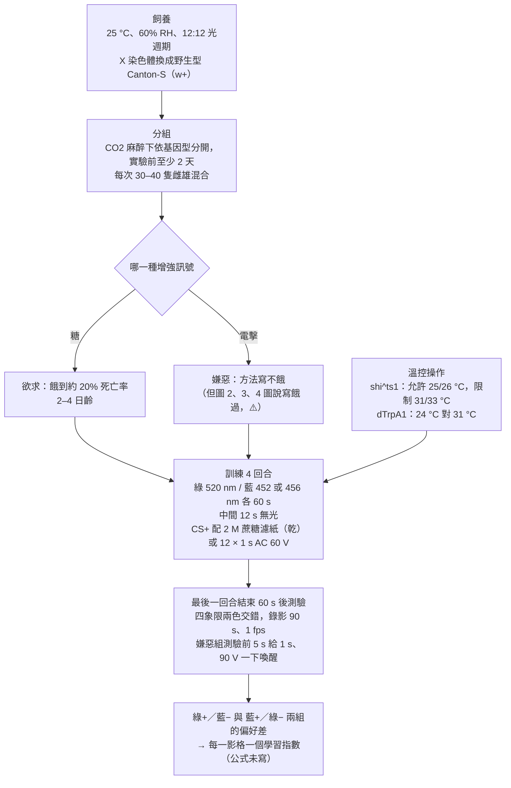
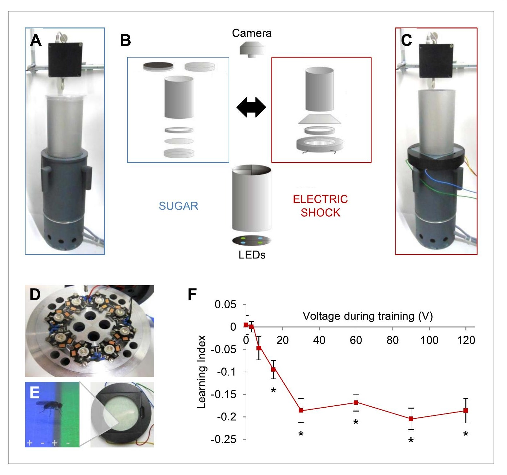
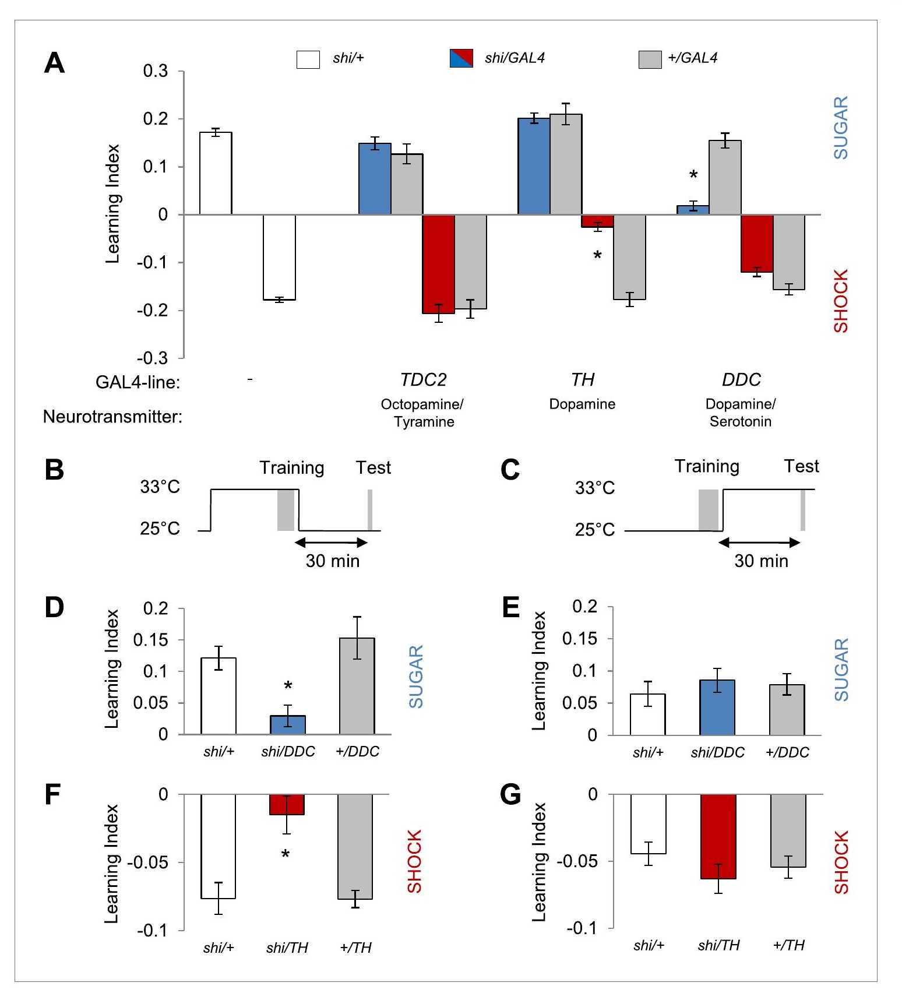
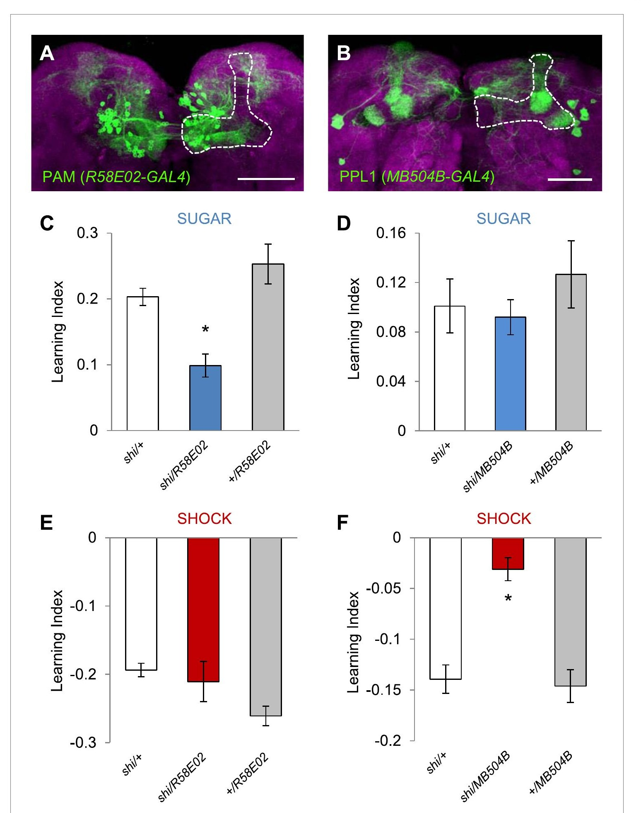
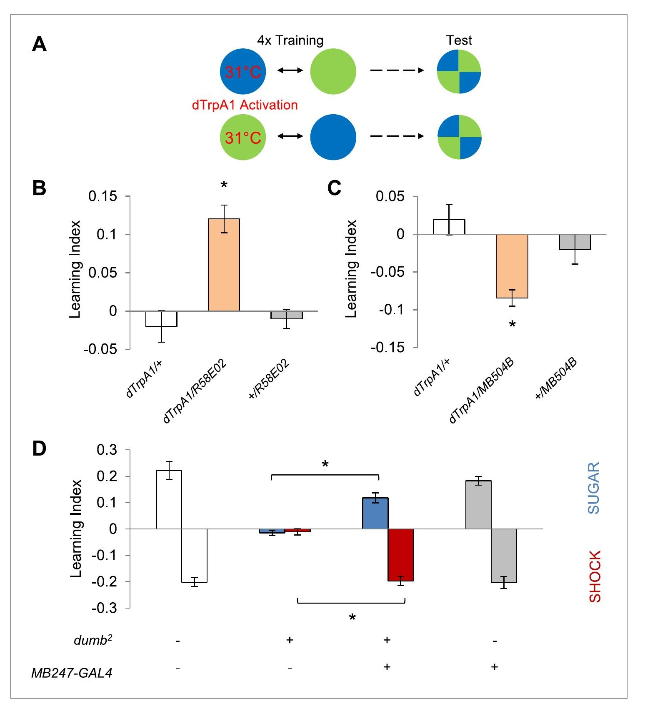
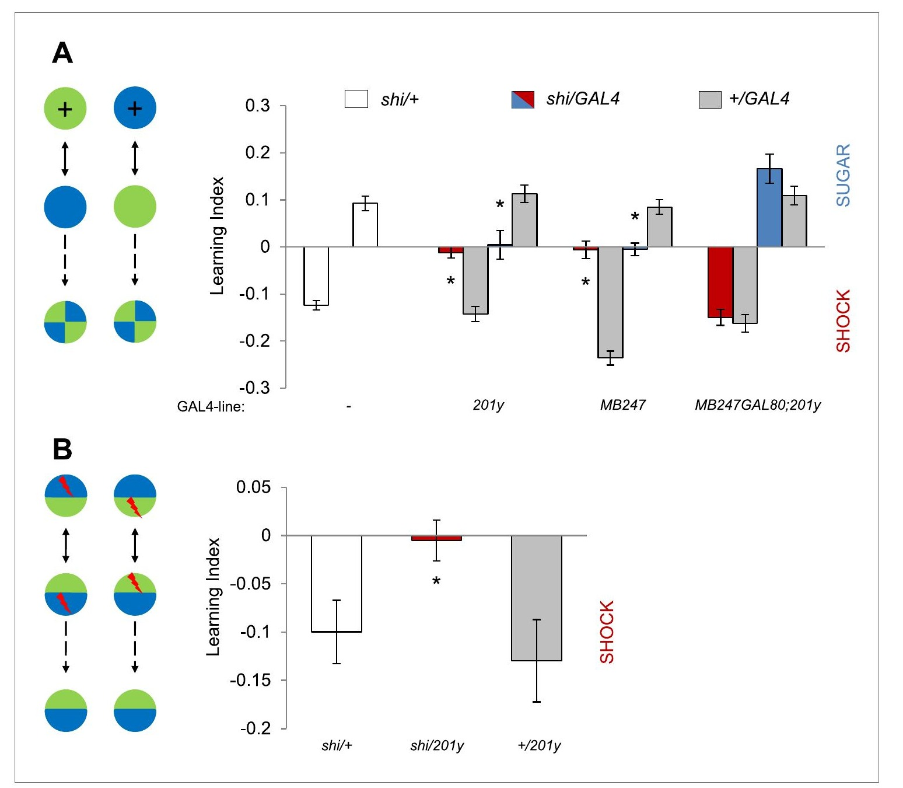
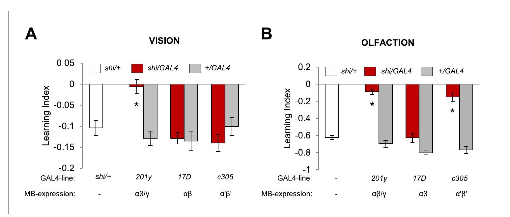
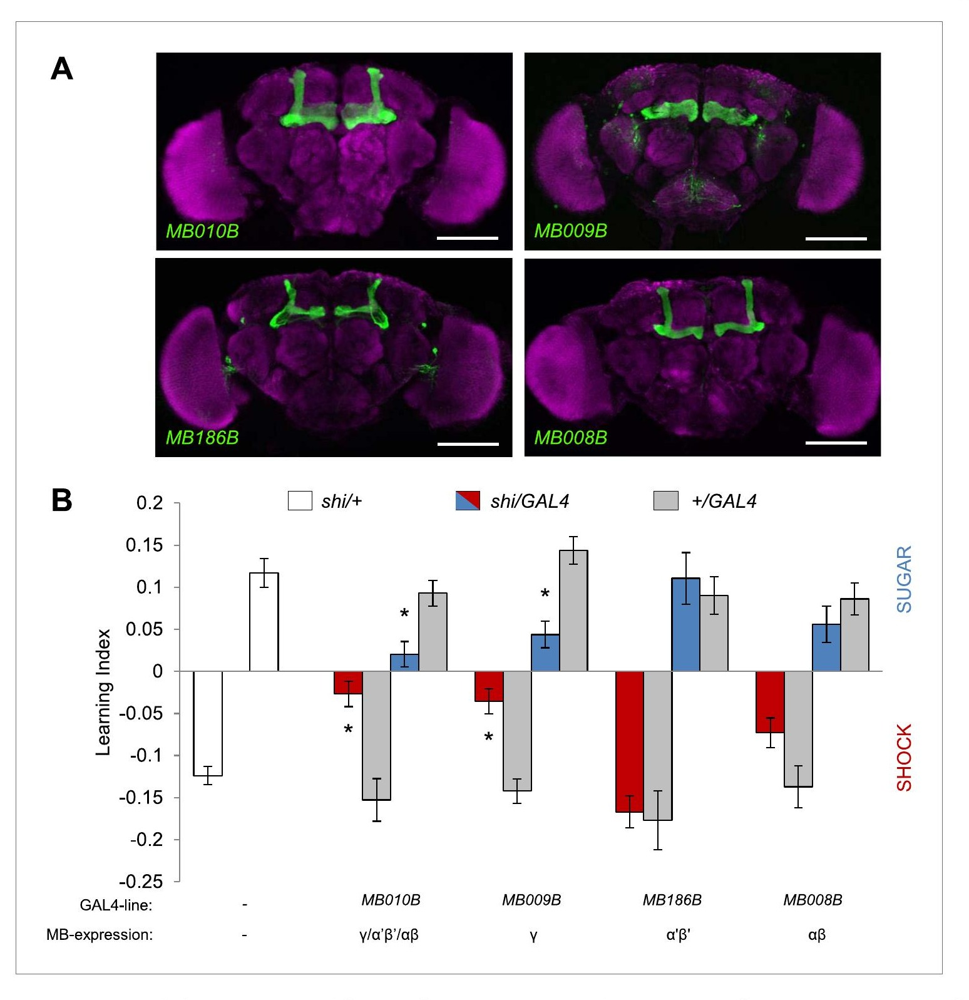
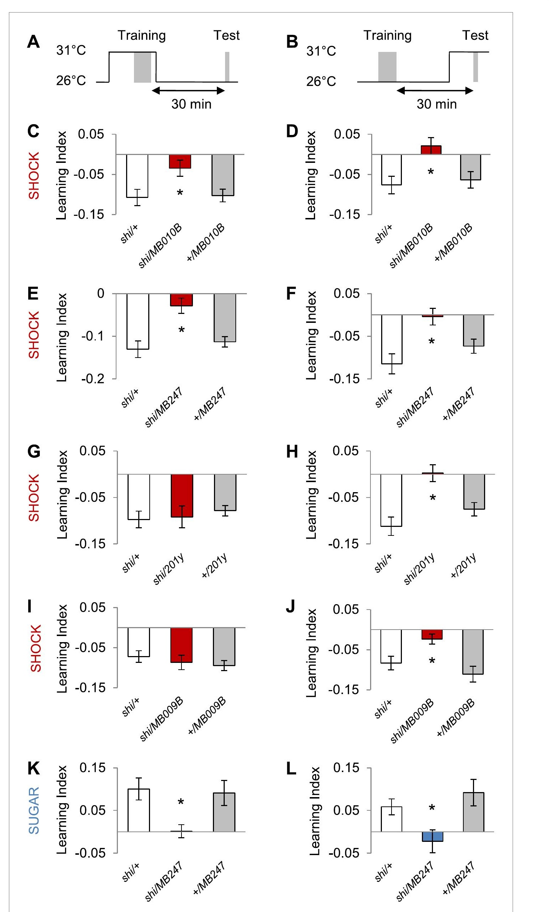
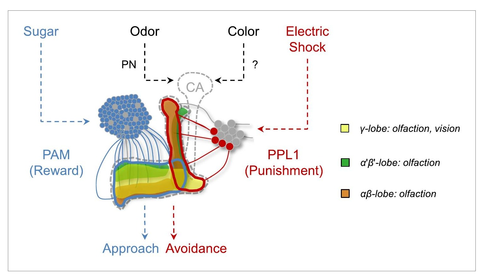

<!-- 本機 PDF：papers/2014-Shared%20mushroom%20body%20circuits%20underlie%20visual%20and%20olfactory%20memories%20in%20Drosophila.pdf -->

# Shared mushroom body circuits underlie visual and olfactory memories in *Drosophila*

**視覺記憶與嗅覺記憶在果蠅體內共用同一套蕈狀體迴路**

| 項目 | 內容 |
|---|---|
| **出處** | eLife 3, e02395 (2014). doi: 10.7554/eLife.02395 [全文（PMC 免費閱讀）](https://pmc.ncbi.nlm.nih.gov/articles/PMC4135349/) |
| 日期 | 收稿 2014-01-26・接受 2014-07-07・刊出 2014-08-19（PDF 第 1 頁）。eLife 為單篇編號（e02395），沒有起迄頁；PDF 共 22 頁 |
| 通訊作者 | Hiromu Tanimoto（谷本拓，hiromut@m.tohoku.ac.jp）。PDF 只印英文名 |
| 作者 | 共 7 人：**Katrin Vogt**†、**Christopher Schnaitmann**†、**Kristina V Dylla**、Stephan Knapek、**Yoshinori Aso**、**Gerald M Rubin**、Hiromu Tanimoto。†＝共同第一作者（PDF 第 1 頁註「These authors contributed equally to this work」）。粗體為與本庫其他頁有關的人：Vogt 與 Schnaitmann 是 [[s-aso-2014-mbon-valence]] 裡做顏色記憶的那兩位；Dylla 是 [[s-dylla-2017-trace-conditioning-dan-plasticity]] 的第一作者；Aso 與 Rubin 見 [[s-aso-2014-mb-architecture]]、[[s-aso-2016-dan-cell-type-rules]]、[[s-aso-2019-nitric-oxide-cotransmitter]]。分工（PDF 第 18 頁）：Vogt、Schnaitmann 構思設計＋取得資料＋分析＋撰稿；Dylla、Knapek 取得資料＋分析＋撰稿；Aso、Rubin 撰稿＋提供未發表的重要資料或材料（即 split-GAL4 品系）；Tanimoto 構思設計＋分析＋撰稿 |
| 機構 | Max-Planck-Institute of Neurobiology, Martinsried, 德國；Janelia Farm Research Campus, Howard Hughes Medical Institute, Ashburn, 美國；Graduate School of Life Sciences, Tohoku University, 仙台, 日本。現職異動：Schnaitmann 轉 Albert-Ludwigs-Universität Freiburg；Dylla 轉 University of Konstanz |
| 資料庫 | **無。** 沒有釋出資料庫、原始資料或程式碼（PDF 的 Additional information 只有經費、作者分工與參考文獻）。本篇新建的 split-GAL4 品系有完整的構築式（見二、方法），但沒有品系編號或寄存處 |
| 補充資料 | 圖補充共 5 張：圖 1 有 1 張、圖 4 有 1 張、圖 5 有 2 張、圖 7 有 1 張（圖 2、3、6、8、9 沒有）。**本機 PDF 只印出它們的標題與 DOI，內容一張都不在**，本庫未取得；凡依賴它們的內容一律標 `？待查` |
| 編輯／審查 | Reviewing editor：Mani Ramaswami（Trinity College Dublin, 愛爾蘭）。eLife 不具名列出審查人 |

> **與本庫的關係：** 本篇是本庫第一篇以**視覺**為條件刺激的學習論文，也是 `visual-learning` 這個研究問題群的第一塊。它用的五條 split-GAL4 品系（MB504B、MB010B、MB009B、MB008B、MB186B）出自同一批 Janelia 材料，正文稱其方法「將另文發表（Aso et al., in preparation）」——那篇就是本庫的 [[s-aso-2014-mb-architecture]]。本篇也是本庫目前**唯一**寫出 MB504B 標到哪四型 PPL1 的原始描述（見 3.2 與 [[e-mb504b]]）。
>
> **本篇為 CC BY 開放取用**（PDF 第 1 頁：「Copyright Vogt et al. This article is distributed under the terms of the Creative Commons Attribution License」），圖片與 PDF 可自由使用與散布；本庫仍逐圖標明出處與授權。

---

## 為什麼重要

> 本節會用到幾個術語，每一個的白話解釋都在下面〈科普文〉的名詞表裡。最低限度先記住三組：**制約**＝訓練動物把一個線索和它的後果連在一起；**欲求型**＝給好處的版本（本篇給糖）、**嫌惡型**＝給壞處的版本（本篇給電擊）；**感覺模態**＝感官的種類（本篇只牽涉視覺與嗅覺兩種）。

**它把「視覺記憶要不要蕈狀體」這個吵了將近三十年的問題，換成一個可以回答的形式。** 1985 年起的一系列研究說蕈狀體（mushroom body, MB）對視覺學習不是必要的（本篇引 Heisenberg et al. 1985、Wolf et al. 1998、Tang & Guo 2001、Zhang et al. 2007）；另一系列說視覺訊息確實在蕈狀體裡被處理（本篇引 Barth & Heisenberg 1997、Liu et al. 1999、Brembs & Wiener 2006、van Swinderen et al. 2009）。本篇在引言裡把歧異歸因於一件現實的事：這些研究用的行為作業與制約設計都不一樣，原文舉的例子是「飛行定向」（把果蠅拴在支架上讓牠飛，看牠想往哪個方向轉）對上「走路果蠅的二選一」（讓果蠅在平面上走，看牠走到哪一邊）。所以本篇不去直接反駁任何一方，而是先把「可以比較」這件事本身做出來。

**它統一了什麼、沒統一什麼，要分開講，因為摘要在這裡寫得比實驗寬。** 本篇真正統一起來、因而可以互相對照的，是**同一個感覺模態內部的兩種增強訊號**：本篇標準協定下的顏色配糖與顏色配電擊共用同一座場地、同一組藍綠 LED、同樣四回合、同樣的分數算法，只換「給好處還是給壞處」（能對照的是「需要哪些細胞」這個結論，不是柱狀圖上柱子的絕對高度——柱高就是下面要講的學習指數，理由見〈科普文〉）。**本篇沒有統一的是視覺與嗅覺之間**：嗅覺那一側用的是 T 迷宮（[[e-t-maze]]）、氣味是 3-辛醇與苯甲醛、電擊是 DC 100 V（視覺是 AC 60 V），而且本篇**完全沒有做欲求嗅覺制約**。摘要寫兩套測驗「共用了關鍵的特徵，例如增強刺激（糖獎賞與電擊懲罰）」，就增強訊號的**種類**而言成立，就**參數與裝置**而言不成立（見第五節第 3 條）。

**它做出來的關鍵硬體是一塊透明的電擊格柵。** 這套場地的光是從地板底下往上打的，所以地板必須透光。地板上永遠鋪著一張濾紙，它的作用是把 LED 的點光源散成一整片均勻的顏色（原文就叫它 screen，螢幕）；糖版的那張濾紙同時兼任糖的載體，光直接穿過它。電擊版的難處不在糖，而在**傳統的電擊格柵是金屬的，擺在果蠅底下會把下方的光擋掉**（本篇引言的原話）。作者把氧化銦錫（indium tin-oxide, ITO）鍍在 9 × 9 cm 的玻璃板上、用雷射蝕出一條條交錯的正負電極（原文 alternating stripes；電極道寬 1.6 mm、絕緣縫 0.1 mm，相鄰兩道之間靠蝕出來的縫絕緣），濾紙改夾在格柵下方繼續當螢幕，於是「給電擊」和「從下方給顏色」第一次能同時做到。※ 推論：果蠅是因為身體同時跨在相鄰的一正一負兩道電極上才會被電到，所以電極必須做得這麼密——論文沒有說明導電的方式。本篇在引言明寫，在此之前**沒有一套成熟的嫌惡視覺學習測驗，能像嫌惡嗅覺制約那樣使用電擊這個被廣泛使用的強力懲罰訊號**（PDF 第 2 頁）；同組原有的嫌惡版視覺制約用的懲罰是**酸**（本篇對 Schnaitmann et al. 2010 的描述，PDF 第 2 頁）。

**它在本庫中的位置是一條新線的起點，而不是既有線的補充。** 本庫其他的行為來源幾乎全部以氣味為 CS（條件刺激，也就是要被記住的那個線索）；用視覺線索的只有 [[s-ofstad-2011-visual-place-learning]] 的位置學習。多巴胺、KC（Kenyon 細胞，組成蕈狀體的細胞）、MBON（蕈狀體的輸出神經元）的規則都是在嗅覺裡量出來的。本篇說：在嗅覺記憶裡傳遞獎賞的那群多巴胺神經元（PAM 群）、傳遞懲罰的那群（PPL1 群）裡的四顆、接收多巴胺的受體 DopR、以及 KC 的 γ 葉（KC 的軸突併成三束，γ 是其中一束），顏色記憶也要用到；另一束 α′/β′ 在顏色作業上**沒有偵測到需求**。本篇由此推論蕈狀體在聯結學習裡的角色「不限於單一感覺模態或單一增強訊號」（討論原文）。

**這條證據鏈的強弱很不平均，而最薄的一節正是「γ 葉」。** 本篇測 γ 葉只測了顏色，沒有測氣味——全篇唯一只標 γ 葉的品系，從頭到尾沒有用在氣味實驗上。所以「γ 葉是兩種記憶共用的那一段」是把兩張圖拼起來的推論，作者自己的句子用的也是「可能」。逐層的強弱評估見〈科普文〉的「『共用迴路』這個結論有多強」，以及本頁第四、第五節。

> ⚠️ **矛盾 1.13｜視覺記憶需不需要蕈狀體｜未裁決。** [[s-ofstad-2011-visual-place-learning]] 的結論相反：視覺**位置**學習不需要蕈狀體。兩篇的**作業類型不同**（本篇記的是「哪個顏色會怎樣」，Ofstad 2011 記的是「涼磚在哪裡」），這是目前裁決不了的已知障礙之一。本庫不自行裁決，把它掛著當待辦；逐項對照與「什麼條件下算解決」見 [[syn-contradictions]] 1.13。
---

## 論文摘要（原文與中譯）

> In nature, animals form memories associating reward or punishment with stimuli from different sensory modalities, such as smells and colors. It is unclear, however, how distinct sensory memories are processed in the brain. We established appetitive and aversive visual learning assays for *Drosophila* that are comparable to the widely used olfactory learning assays. These assays share critical features, such as reinforcing stimuli (sugar reward and electric shock punishment), and allow direct comparison of the cellular requirements for visual and olfactory memories. We found that the same subsets of dopamine neurons drive formation of both sensory memories. Furthermore, distinct yet partially overlapping subsets of mushroom body intrinsic neurons are required for visual and olfactory memories. Thus, our results suggest that distinct sensory memories are processed in a common brain center. Such centralization of related brain functions is an economical design that avoids the repetition of similar circuit motifs.

**中譯**（本節為忠實翻譯，非自撰內容）：

> 在自然界中，動物會把獎賞或懲罰與來自不同感覺模態的刺激（例如氣味與顏色）聯結成記憶。然而，不同的感覺記憶在腦中如何被處理，目前並不清楚。我們為果蠅建立了欲求型與嫌惡型的視覺學習測驗，與廣泛使用的嗅覺學習測驗可以相比。這些測驗共用了關鍵的特徵，例如增強刺激（糖獎賞與電擊懲罰），因而允許直接比較視覺記憶與嗅覺記憶所需的細胞。我們發現，同一批多巴胺神經元子集驅動了這兩種感覺記憶的形成。此外，視覺記憶與嗅覺記憶所需的蕈狀體內在神經元子集，彼此相異但部分重疊。因此，我們的結果顯示不同的感覺記憶是在一個共同的腦中樞被處理的。這種把相關腦功能集中起來的作法是一種經濟的設計，避免了相似迴路模組的重複。

---

## 科普文

> 本節的「**本篇**」一律指這篇 2014 年的論文，「**本庫**」指這個知識庫自己的核對、計算或判斷。術語的白話解釋都在下面〈先把名詞講白〉那張表裡，隨時可以回頭查。

**先記住一件事，整篇都靠它。** 這篇論文從頭到尾只做一種操作：把某一群神經元暫時關掉（或暫時打開），再看果蠅還學不學得會。它沒有量過任何一顆細胞對藍色或綠色的反應——全篇沒有任何活體的細胞活動量測（既沒有把電極插進去記錄電訊號，也沒有用螢光指示劑拍細胞的活動），只有行為分數，加上把腦取出來固定、染色、拍照的影像，而那些影像的用途只是看哪些細胞被遺傳工具標到。所以「顏色記憶和氣味記憶共用同一套迴路」這句話，在本篇的資料裡只能讀成「少掉同幾群細胞，兩種記憶都做不成」。那幾群細胞可能真的帶著顏色訊息，也可能只是訊息必經的一段路：拆掉一座橋，兩岸的車都過不去，但橋上並沒有寫著車要去哪裡。本篇分不出這兩種情況，而作者自己在圖 9 的模型圖上，也把「顏色訊息從哪裡進蕈狀體」畫成一個問號。

### 先把名詞講白

| 詞 | 白話 |
|---|---|
| 制約（conditioning） | 訓練動物把兩件事連在一起的實驗做法：先讓牠遇到某個線索，接著給牠好處或壞處；下次牠遇到同一個線索就會靠近或躲開 |
| 感覺模態（sensory modality） | 感官的種類。本篇只牽涉兩種：視覺（看顏色）與嗅覺（聞氣味） |
| 欲求型（appetitive）／嫌惡型（aversive） | **欲求型＝給好處的版本**（本篇給的是糖），**嫌惡型＝給壞處的版本**（本篇給的是電擊） |
| 條件刺激（CS） | 要被記住的那個線索。本篇是顏色（藍或綠），或氣味。CS+ 是配了糖或電擊的那一個，CS− 是同樣出現但不配的那一個 |
| 增強訊號（US） | 好處或壞處本身。本篇是蔗糖，或電擊 |
| 蕈狀體（mushroom body, MB） | 果蠅腦裡左右各一的一對構造，負責把「剛才看到或聞到什麼」與「結果是好事還是壞事」連起來 |
| Kenyon 細胞（Kenyon cell, KC） | 組成蕈狀體的細胞。它們伸出去的長線（軸突）併成幾束，束的名字叫「**葉**」，分成 α/β、α′/β′、γ 三類 |
| 區室（compartment） | 葉再往下切出來的小格。**本篇只做到「葉」這一層，沒有做到區室**（見 [[c-mb-compartment]]） |
| 多巴胺神經元（dopaminergic neuron, DAN） | 把「現在是獎賞還是懲罰」送進蕈狀體的細胞。本篇用到兩群：PAM 群與 PPL1 群 |
| 受體 | 細胞表面接收訊號分子的零件。本篇關心的是接收多巴胺的那一種，叫 DopR |
| 單胺類（monoamine）傳遞物 | 多巴胺、章魚胺、酪胺、血清素都屬於這一類訊號分子。本篇開頭寫，這一類的神經元先前已被報告在嗅覺記憶形成時傳遞增強訊號（引 Schwaerzel et al. 2003、Sitaraman et al. 2012 等六篇），所以本篇一開始把它們一併測過。酪胺與章魚胺是由同一條品系（TDC2-GAL4）一起標到的 |
| 驅動品系（GAL4 品系） | 決定下面兩個開關裝在哪些細胞上的遺傳工具。本頁說「某條品系**標到**某些細胞」，意思就是只有那些細胞裝得上開關。**不同品系標到的細胞範圍差很多，這是讀本篇時最容易混淆的一點** |
| split-GAL4 | 一種讓驅動品系更精準的做法：把 GAL4 拆成兩半，各由一段不同的 DNA 開關序列負責，**只有兩半同時出現的細胞**才組得回完整的 GAL4、才會表現。兩段序列各自管的細胞範圍很寬，交集就窄很多。本篇用了五條（MB504B、MB010B、MB009B、MB008B、MB186B） |
| GAL80 | 把 GAL4 擋下來的抑制元件（擋的是 GAL4，不是下面兩個開關）。本篇用的 MB247-GAL80 只在蕈狀體裡作用，於是**蕈狀體裡的細胞裝不上開關、蕈狀體以外照舊**。用途是檢查「損害到底來自蕈狀體還是蕈狀體以外」 |
| shibire^ts1（shi^ts1） | 第一個開關：把果蠅加溫，被標到的神經元就暫時送不出訊號，降溫恢復。用來問「少了它行不行」 |
| dTrpA1 | 第二個開關，方向相反：加溫就讓被標到的神經元放電。用來問「光有它夠不夠」 |
| 學習指數（learning index, LI） | 顏色實驗所有柱狀圖的縱軸，也就是柱子的高度。正值＝靠近配過 US 的顏色，負值＝避開它，0 ＝沒有偏好。**「顏色偏好」怎麼量**：測驗時每秒拍一張照，看果蠅分布在藍、綠象限上的隻數（原文把分數說成「自由移動果蠅的分布改變」；確切的算式論文沒有寫）。**為什麼要兩組相減**：本篇一定成對做兩組果蠅，一組綠配 US、另一組藍配 US。若訓練有效，第一組會偏綠、第二組會偏藍；把兩組對同一個顏色（例如綠）的偏好相減，剩下的就是「因為配過 US 才產生的那一份偏好」，而兩組共有的天生顏色偏好方向相同、相減會抵銷掉。**本篇沒有寫出公式**，只寫了「兩組之間視覺刺激偏好的差，用來算出每一個影格的學習指數」並引 Schnaitmann et al. 2010；※ 推論：上面「為什麼相減」的解釋是依這句話與原文「增強訊號配第一或第二個顏色各半，以抵銷順序效應」推得，論文沒有明說 |
| 偏好指數（preference index） | **另一個分數，和學習指數不是同一把尺。** 量的是**沒受過訓**的果蠅對糖或電擊本身的反應：把場地分兩半，一半有糖（或通電）、一半沒有，看果蠅站哪邊，錄 60 秒。用來檢查果蠅是不是根本嘗不到糖、感覺不到電。表 1 的數值方向是**糖為正（愈正＝愈愛糖）、電擊為負（愈負＝躲得愈徹底）**。⚠️ 本篇是少數**有**寫出公式的分數，但方法節印的那個公式（「對照那半的隻數 − 有 US 那半的隻數，再除以總隻數」）照字面算，正負號會和表 1 的每一個數字相反；本頁一律照表 1 的方向解讀（單篇自身不一致，不需裁決） |
| 獲得（acquisition）／提取（retrieval） | 獲得＝把記憶寫進去（訓練的時候）；提取＝把記憶叫出來（測驗的時候） |
| 星號 | 圖上標在柱子旁邊的 `*`，表示統計檢定判定這個差異「顯著」。本篇的顯著水準是 0.05 |
| 功效（power）分析 | 事先算一件事：「以我手上這個樣本數和這個雜訊，多大的效果才有機會被測出來？」沒做這件事，就無法判斷一個「沒測到差異」是真的沒差，還是裝置不夠靈敏 |
| 表徵（representation） | 細胞的活動本身就帶著「現在是什麼顏色」這個訊息。和「這顆細胞是訊息必經之路」是兩件不同的事 |

### 難題：兩邊各說各話，而裝置也各不相同

果蠅記住一個氣味和記住一個顏色，用的是同一套腦迴路還是兩套？本篇把問題寫成這個形式。在 2014 年以前，光是「視覺學習要不要蕈狀體」就有兩種答案：一批研究說不要，另一批研究說視覺訊息確實在蕈狀體裡被處理。本篇在引言裡指出一個現實的障礙：這些研究用的裝置與制約設計都不一樣，一邊是把果蠅拴住讓牠飛、看牠往哪個方向轉，一邊是讓牠在平面上走、二選一。裝置不同，結論不同，到底是腦不同還是機器不同，分不出來。

> ⚠️ **矛盾 1.13｜視覺記憶需不需要蕈狀體｜未裁決。** 本庫另有一篇來源 [[s-ofstad-2011-visual-place-learning]] 的結論與本篇相反。那一篇的果蠅在一塊發燙的地板上走，要靠四周一圈 LED 構成的全景，找出唯一一塊涼的磚；把蕈狀體的細胞靜音（用遺傳工具讓它們不再發出電訊號）、甚至用藥物（羥基脲）把整個蕈狀體化學性地去除，果蠅照樣學得會（細節見那一頁）。本篇的果蠅學的是「藍色會被電」這種事，而關掉 KC 的輸出就學不成。**兩篇的作業類型不同**：一邊記的是「涼磚在哪裡」，一邊記的是「哪個顏色會怎樣」。這個差異是目前裁決不了的主要障礙之一，所以本庫把它掛著當成待辦，等論文或實驗把分界講清楚，不自己選一邊（逐項對照見 [[syn-contradictions]] 1.13）。本篇作者在討論裡點了 Ofstad 2011 的名，說可能是實驗典範的差異，並明白寫下「任何其他差異都可能造成腦區需求的不同」——沒有宣稱對方錯。（本庫另註：本篇把 Ofstad 2011 歸進「飛行模擬器」那一類並不準確，那一篇的果蠅是走路的。）

### 場地長什麼樣，以及「情境變換」是怎麼一回事

顏色實驗的場地是一個圓形的小競技場，地板會發光：LED 裝在場地下方 144 mm 處，把圓形地板切成四等份（每一份叫一個**象限**），每一個象限底下配一顆藍、一顆綠 LED，彼此用遮光壁隔開。所以**同一塊地板既可以整片發同一個顏色，也可以按象限分開發不同顏色**。本篇標準的協定就利用了這一點：

- **訓練時全場同一色**——先整片綠 60 秒，再整片藍 60 秒，其中一色配上糖或電擊。
- **測驗時切成四象限**——藍、綠各佔對角的兩個象限，看果蠅往哪種顏色的地板上站。

好處是測驗時果蠅得做一個二選一；代價是**果蠅看到的畫面在訓練和測驗之間變了**。這就是本篇所說的「情境變換」（context change）：訓練時眼前是一整片單色，測驗時眼前是兩色拼成的格子。有人主張蕈狀體只在情境改變時才派得上用場（本篇引 Liu et al. 1999、Peng et al. 2007）。**如果那個主張成立，那麼本篇測到的「少了蕈狀體就學不成」就可能只是因為畫面前後變了，而不是因為顏色記憶本身需要蕈狀體**——所以這個變換是個真的漏洞。本篇補的辦法是第 4 套實驗：讓兩色在訓練和測驗時**都**同時各佔場地的一半，畫面前後一致，情境變換就消失了。

### 五套實驗：三種裝置、五種協定，柱子不要跨套比

本篇的柱狀圖來自五套實驗。裝置只有三種——圓形場地（第 1、2、4 套共用，只換地板）、兩支塑膠管（第 3 套訓練用）、T 迷宮（第 5 套）——但協定有五種。它們彼此**可以互相比的是結論**（哪些細胞是必要的），**不可以互相比的是柱子的絕對高度**——因為裝置、分數的算法、甚至懲罰的電性都不同。（順帶一提，連同一套之內、不同圖之間的絕對高度也不能比：本篇同一個對照基因型在不同批次之間可以差到一倍，見本頁〈圖〉節對圖 3 的解讀。可靠的比較永遠是「實驗組對同一格裡的那兩個對照組」。）

| 哪一套 | 裝置與果蠅要做的事 | 增強訊號 | 訓練 | 測驗 | 用在哪幾張圖 |
|---|---|---|---|---|---|
| 第 1 套：顏色—電擊 | 圓形場地，地板是那塊透明電擊格柵。牆壁與蓋子塗了果蠅踩不住的 Fluon 塗層，場地高度又刻意降低，所以果蠅只能待在格柵上、躲不開電 | 1 秒的 **AC 60 V**（交流電），在 CS+ 的 60 秒內給 12 次 | 一回合＝整片綠、整片藍各 60 秒交替出現，兩色之間插 12 秒全暗；重複 **4 回合** | 最後一回合結束 **60 秒**後開始（本頁稱為「立即測驗」），兩色各佔對角兩象限，錄影 90 秒、每秒一格。**例外：圖 2F、2G 與圖 8C–8J 改在訓練後 30 到 40 分鐘才測** | 圖 1、2A、2F、2G、3E、3F、4D、5A、6A、7B、8C–8J |
| 第 2 套：顏色—糖 | 同一座場地、同一組 LED，地板換成裝了濾紙的培養皿 | 浸過高濃度（原文 2 M）蔗糖、再**烘乾**的濾紙（為什麼要烘乾、果蠅怎麼取得糖，論文沒有說明） | 同上 4 回合 | 同上。**例外：圖 2D、2E 與圖 8K、8L 改在訓練後 30 到 40 分鐘才測** | 圖 2A、2D、2E、3C、3D、4D、5A、7B、8K、8L |
| 第 3 套：顏色—人工獎懲（用加溫當開關，不是用熱當懲罰） | **訓練不在場地裡，而在兩支塑膠管裡**：每支管子擺在一台打光的裝置上，所以一支管子被打上綠光、另一支被打上藍光，兩支的溫度也不同（24 °C 與 31 °C）。果蠅在管子裡**不需要做選擇**，只是同時經歷一個顏色與一個溫度；視覺刺激開始前 5 秒把牠們輕敲進對應的那支管子 | 沒有糖也沒有電。31 °C 的用途是讓帶 dTrpA1 的那群細胞放電，**由細胞自己冒充獎賞或懲罰訊號** | 4 回合；每回合的兩次 CS 之間插 60 秒的 24 °C | 回到 24 °C：先在搬運果蠅用的管子裡待 60 秒，再在不打光的測驗裝置裡待 60 秒，然後在 24 °C 下測（※ 推論：測驗裝置應該就是顏色實驗的四象限場地，原文只寫 test apparatus） | 圖 4B、4C |
| 第 4 套：顏色—電擊，取消情境變換的「操作」版 | 同一座場地，但兩色在訓練與測驗時**同時**各佔場地一半。**「操作」（operant）的意思是果蠅自己的動作能改變結果**——牠可以靠走到另一半去躲電 | AC 60 V，只有 CS+ 那一半通電 | 每回合讓果蠅自由選邊 20 秒，重複 **8 回合**，間隔 20 秒無刺激 | 兩半照樣打光但不通電。測驗長度這一段沒有另寫；若沿用通則應是 90 秒（※ 推論） | 圖 5B |
| 第 5 套：氣味—電擊 | **完全不同的裝置：T 迷宮**（[[e-t-maze]]）。果蠅在兩條氣味管之間二選一 | **DC 100 V**（直流電），12 下 | 兩種氣味（3-辛醇與苯甲醛）各 60 秒，其中一種配電擊。**重複幾回合，論文沒有寫：`？待查`** | 訓練後立刻測條件化的氣味迴避 | 圖 6B |

第 5 套是本篇唯一的嗅覺實驗，也是唯一一次在同一篇論文裡並排量兩種感覺模態（圖 6）。關於它要記住三件事：它用的是另一台機器、另一種電（直流 100 伏，不是交流 60 伏），而且**本篇沒有做過任何「氣味配糖」的實驗**。

**為什麼一定要做透明的格柵。** 這座場地的光是從地板底下往上打的，所以地板必須透光。地板上永遠鋪著一張濾紙，作用是把 LED 的點光源散成一整片均勻的顏色（原文就叫它 screen，螢幕）。糖版沒問題：那張濾紙同時兼任糖的載體，光直接穿過它。電擊版就卡住了——傳統的電擊格柵是金屬的，擺在果蠅底下會把下方的光完全擋掉。本篇的解法是讓格柵本身變透明（氧化銦錫鍍膜玻璃），濾紙改夾在格柵下方繼續當螢幕。**所以「透明」要解決的不是糖，是金屬擋光。**

**同一個「加溫」在本篇有兩種剛好相反的用途，這是最容易繞不出來的地方。** (1) 在第 1、2、4 套裡，加溫是用來**關掉**細胞的（因為那些果蠅身上裝的是 shi^ts1）；(2) 在第 3 套裡，加溫是用來**打開**細胞的（裝的是 dTrpA1）。同一個動作、相反的效果，差別只在果蠅身上裝了哪一個開關。

**另外有一個容易誤會的地方：第 3 套名字裡的「熱」不是要教給果蠅的壞事。** 熱在這裡只是扳開關的那隻手，被教給果蠅的是「某群細胞放電」這件事——整套設計的意圖就是把真正的糖或電擊，換成某群細胞的放電。但這裡有一個先天的混淆：顏色與溫度在訓練時完全共變（看綠色的時候就是變熱的時候），所以光憑實驗組無法排除「果蠅學到的其實是熱」。本篇用兩組對照果蠅來排除：一組只帶驅動品系、一組只帶開關，兩組都湊不成完整的工具，所以加溫不會讓牠們的細胞放電。**這兩組果蠅一樣經歷了「顏色＋變熱」，事後卻沒有表現出條件化的顏色偏好**（原文明寫了這一點），所以「看到顏色的同時變熱」本身不足以造出記憶。

**兩個開關的工作溫度，以及一個沒交代的地方。** shi^ts1 的「允許」溫度（細胞正常工作）是 25 或 26 °C、「限制」溫度（阻斷）是 31 或 33 °C。論文把兩組並列寫出來，**但沒有說哪一個實驗用哪一組，也沒有說為什麼有兩組**（圖 2 的溫度示意標 33 °C 對 25 °C，圖 8 標 31 °C 對 26 °C）。dTrpA1 用的是 24 °C 對 31 °C。測驗的時間點也有兩種：大部分圖是訓練結束 60 秒後就測（立即測驗），圖 2D–2G 與圖 8 則是**訓練後 30 到 40 分鐘**才測。

### 結果一：裝置會動（圖 1，第 1 套）

電壓從 0 伏往上加，果蠅對被電過那個顏色的躲避愈來愈強，約 **30 伏**到達高原，30 到 120 伏之間彼此沒有差異；原文寫果蠅**從 15 伏起就有顯著的記憶**。作者接著寫「因此後續實驗一律使用 60 伏」——**為什麼是 60 伏而不是 30 伏或 90 伏，論文沒有交代**（圖上 90 伏的分數還略深於 60 伏）。順帶一提，圖上量過的電壓是 0、5、10、15、30、60、90、120 伏，從 15 伏直接跳到 30 伏，中間沒有量過。

這條曲線真正的用處是給出一把尺：**在這個顏色作業上，能被分辨出來的最小效果大約落在 0.05 到 0.10 個學習指數單位之間**（15 伏那一點的分數約 −0.10 且有星號，10 伏那一點約 −0.05 且沒有星號；※ 從圖 1F 判讀）。後面所有「沒有偵測到差異」的結論，都要放在這把尺上讀。**用的時候要先把百分比換回絕對分數**，例如下面〈結果三〉表格裡顏色那一欄的兩個例子：201y 的實驗組與對照相差約 0.11（在尺的上方，所以測得出來），c305a 只相差約 0.04（在尺的下方，所以測不出來）。**這把尺只在顏色作業內部有效**——它是同一台機器、同一個分數的自我校準，所以可以用來讀同一台機器上的其他結果；一旦要跨到第 5 套的氣味作業，機器和分數都換了，就不能再用（見下面〈「共用迴路」這個結論有多強〉）。

### 結果二：送獎懲訊號的細胞，和嗅覺學習裡的是同兩群（圖 2、3、4）

先用 shi^ts1 全程關掉三條標記範圍很寬的品系（圖 2A；顏色配糖與顏色配電擊各測一次，也就是第 2 套與第 1 套）：

- **TDC2-GAL4**（標到製造章魚胺與酪胺的神經元）：兩種顏色記憶都**沒有偵測到**顯著影響。
- **TH-GAL4**（本篇原文稱「一大部分的多巴胺神經元」）：顏色配電擊的記憶受損，顏色配糖的不受影響。
- **DDC-GAL4**（另一批多巴胺神經元，外加製造血清素的神經元）：顏色配糖的受損，顏色配電擊的不受影響。

**TH-GAL4 這一組單獨看是讀不出結論的**，而圖上看不出這一點。本篇的表 1 用偏好指數量了沒受訓果蠅對電擊本身的反應（負得愈多＝躲得愈徹底），結果這一組的果蠅連天生的電擊迴避都變弱了：−0.189，而兩個對照是 −0.429 與 −0.386。

**「迴避分數變弱」有兩種完全不同的解釋，必須分清楚。** 第一種是這些果蠅感覺不到電——若真是這樣，牠們在顏色實驗裡學不會「藍色會被電」，就只是因為根本沒被電痛，和多巴胺無關，整個結論就垮了。第二種是牠們感覺得到電，但被電過之後會持續亢奮、動得比較多（原文 prolonged arousal、hyperactivity），所以在二選一的場地裡不會乖乖停在沒電的那一半，分數因此偏低。作者引 Lebestky et al. 2009 主張的是第二種，原文把它寫成「可能的原因」（likely cause）而非定論。不管採哪一種讀法，真正撐住「電擊訊號走多巴胺」這個結論的是下一段的 MB504B 那一組：牠們的天生電擊迴避是 −0.382，和自己那一批的兩個對照（−0.385 與 −0.429）幾乎一樣，也就是正常。

再把範圍縮小到兩條窄譜品系（圖 3，第 1 套與第 2 套）：

- **R58E02-GAL4** 標到 **PAM 群**。本篇的原文只寫「傳遞嗅覺記憶獎賞的 PAM 群神經元」，**沒有給型別，也沒有給顆數**。它與 DDC-GAL4 大量重疊、與 TH-GAL4「很少」重疊（原文 rarely）。關掉它，顏色配糖的記憶掉到約四成四，顏色配電擊的不受影響。
- **MB504B** 是本篇做出來的 split-GAL4，正文寫它專一標到 **PPL1 群裡的四顆**多巴胺神經元（MB-MP1、MB-MV1、MB-V1，以及投射到 α 葉尖端的那一顆）。關掉這四顆，顏色配電擊的記憶掉到約兩成一，顏色配糖的不受影響。

這兩群在嗅覺學習的前人文獻裡，正是分別負責獎賞（本篇引 Liu et al. 2012）與懲罰（引 Aso et al. 2012）的同兩群。**不過這組「鏡像」並不對稱**：糖那一側還留著約四成四的記憶，電擊那一側只留約兩成一（兩個比例都是本庫由柱高計算的，論文兩邊都只寫「受損」）。

然後反過來做（圖 4B、4C，第 3 套）：不給糖也不給電，只在果蠅看某一個顏色的同時把溫度升到 31 °C，讓帶 dTrpA1 的細胞放電。活化 R58E02 標到的細胞，果蠅事後偏好那個顏色；活化 MB504B 標到的四顆，果蠅事後躲避那個顏色。**「少了不行」與「光有它就夠」兩面都做到了，這是本篇最紮實的一組證據。**

最後是受體（圖 4D，第 1 套與第 2 套）：多巴胺受體 DopR 失效的突變果蠅（*dumb²*），兩種顏色記憶都幾乎歸零；只在 KC 裡把 DopR 補回去，電擊那一側回到野生型的約 97%，糖那一側只回到約 58%（兩個比例都是本庫由柱高計算，論文沒有算也沒有檢定，只寫「兩種視覺記憶都回復」）。這一段有一處做得很乾淨：*dumb²* 與補回去的那一組**都**有天生電擊迴避變弱的問題（表 1），但補回去的那一組記憶回來了——**所以「記憶變差其實只是感覺不到電」這個替代解釋，是被資料本身排除掉的**，不是靠論證排除。

### 結果三：接收訊號的細胞只有一部分共用（圖 5、6、7）

先確認蕈狀體整體有份。關掉 KC 的輸出（201y-GAL4 與 MB247-GAL4，兩條都同時標到 α/β 與 γ），兩種顏色記憶都受損（圖 5A）。這裡最有力的一組是對照：加上 **MB247-GAL80** 可以讓蕈狀體裡的細胞裝不上開關、蕈狀體以外照舊；加上它之後記憶**完全回復**，所以損害不是來自 201y 標到的蕈狀體以外的細胞。作者接著用第 4 套（操作版）一次拆掉兩個長年被用來解釋歧異的差異——訓練與測驗之間的情境變換，以及果蠅能不能靠自己的動作避開懲罰——結果記憶仍然需要蕈狀體。

接下來是全篇的核心主張。它由兩張圖拼起來，而兩張圖涵蓋的細胞範圍不同：

| 品系 | 本篇說它標到 | 顏色記憶（電擊版） | 氣味記憶（電擊版） |
|---|---|---|---|
| 201y-GAL4 | α/β 與 γ | 受損，殘存約 6% | 受損，殘存約 14% |
| 17D-GAL4 | α/β | 沒有偵測到差異（約 107%） | 沒有偵測到差異（約 87%） |
| c305a-GAL4（圖 6 的圖說與橫軸寫 c305） | α′/β′ | 沒有偵測到差異（約 137%，也就是負得更多、躲得更兇） | 受損，殘存約 22% |
| MB009B（split-GAL4） | γ | 受損，殘存約 26% | **本篇沒有測** |
| MB186B（split-GAL4） | α′/β′ | 沒有偵測到差異（約 111%） | **本篇沒有測** |
| MB008B（split-GAL4） | α/β | 殘存約 55%，不顯著；正文寫「有受損的傾向」 | **本篇沒有測** |

> 前三條品系用在圖 6（顏色與氣味並排），後三條用在圖 7（只有顏色）。這兩張圖的阻斷都**沒有分段**——圖說只寫「在制約期間阻斷」，把訓練與測驗切開的是下一節的圖 8，所以本表的數字不要拿去和〈結果四〉的數字對照（這一點對 201y 和 MB009B 都成立）。
>
> **「殘存」這個詞怎麼讀。** 殘存比例是**本庫**由柱高計算的：實驗組的分數 ÷ 同一格那兩個對照組分數的平均，論文只寫「受損」或「沒有顯著擾動」。100% 代表實驗組和對照一樣，也就是關掉那些細胞完全沒有影響；**所以這個數字會超過 100%**（例如 137%），意思是實驗組的分數反而比對照更強——這時候「殘存」只是沿用同一個算式的名字，不是「剩下多少」的意思。

從這張表可以看出「共用」這個結論實際上長什麼樣，有四點：

1. **真正兩邊並排測過的只有三條品系（圖 6），而其中唯一提供分離資訊的是 c305a**：它只壞氣味、不壞顏色。17D 兩邊都沒有偵測到差異，所以它不提供任何分離資訊。論文在這裡的敘述是「201y 與 17D 兩條品系造成的後果，在視覺與嗅覺記憶上是相同的」——意思是**每一條品系自己在兩種模態上的結果一致**（201y 兩邊都壞、17D 兩邊都沒偵測到差異），不是說這兩條品系彼此結果相同。而 17D 那一半的「一致」是陰性對陰性，也就是兩邊都只是沒測到差異，用它當一致性的證據是弱的。
2. **「γ 葉是兩種記憶共用的那一段」是把圖 6 與圖 7 拼起來的推論，不是直接測出來的。** 唯一只標 γ 的品系是 MB009B，而它只做過顏色記憶。氣味那一側的 γ 證據來自 201y，而 201y 同時標到 α/β。作者自己的寫法保留了這一層：「鑑於 γ 葉神經元不分作業都被需要，視覺與嗅覺線索**可能**都在 γ 神經元裡被代表」——用的是「可能」。
3. **「α′/β′ 只管氣味」靠的是一個沒有偵測到差異的結果**，而這種結果只能說「量不出來」，不能說「沒有」。這裡有一點是加分的：兩條互不相干的 α′/β′ 品系（c305a 與 MB186B）在顏色作業上都量不出差異，等於重複了一次。（加分和「這一層最弱」兩句話並不衝突，它們講的是兩件事：**重複過**指這個觀察不是單一品系的意外，**本質上弱**指再怎麼重複，量不出來的結果仍然不能證明「沒有」。）
4. **「α/β 不需要」把兩種不同的結果歸成了一類**：17D 與 MB186B 的殘存接近或超過 100%（真的沒有效果），MB008B 卻只剩約 55%（一半的記憶不見了，只是不顯著）。而圖 9 的模型圖把 α/β 直接標成「嗅覺」，本篇唯一測過 α/β 對氣味記憶需求的那次實驗（圖 6B 的 17D）卻是量不出差異的。

### 結果四：寫進去和叫出來，需要的範圍不一樣（圖 8，第 1 套與第 2 套）

這一節把阻斷的時間切開：一組只在訓練時關（看記憶寫不寫得進去），另一組只在測驗時關（看記憶叫不叫得出來），兩組都在訓練後 30 到 40 分鐘測。結果是：MB010B（標全部葉）與 MB247（標 α/β 與 γ）在訓練與測驗兩段都必要；201y 與 MB009B 只在**測驗**時測得到需求，訓練時沒有偵測到差異。

**論文對這個差別給的唯一解釋，在本篇內無法檢驗。** 原文說後面那一組阻斷的是「**較小的一組** KC」。可是 201y 與 MB247 在本篇的描述裡標的是同樣的兩束葉（α/β 與 γ），**而本篇從頭到尾沒有量過任何一條品系各標了幾顆 KC，也沒有引用任何這樣的數字**，所以「較大」「較小」這個說法在本篇內既不能證實也不能否證：`？待查`。

論文的結語寫「不同的 KC 介導視覺記憶的獲得與提取」，但資料支持的是比較弱的版本：**獲得時必要的集合比較大，提取時必要的集合比較小，而小的那個包含在大的裡面。** 要支持「兩組不同的 KC」，需要找到一條「只在獲得時必要、提取時不必要」的品系，本篇沒有。另外，MB009B 的兩格（只在訓練時關、只在測驗時關）樣本數都只有 8，是全篇最小的。

**本節和〈結果三〉的數字不能直接對起來看**，201y 與 MB009B 兩條都是如此。〈結果三〉表格裡的「殘存約 6%」（201y）與「約 26%」（MB009B）來自圖 6、圖 7，那裡的阻斷沒有分段、而且是立即測驗；本節圖 8 的阻斷分成訓練段與測驗段，又隔了 30 到 40 分鐘才測。所以「〈結果三〉說關掉 201y 記憶就壞了、本節說訓練時關掉它沒有差」並不是互相矛盾——前者包含了測驗那一段的阻斷在內。

### 「共用迴路」這個結論有多強

分三層看，強度差很多。

- **最強的一層是多巴胺神經元那一側。** 「少了不行」與「光有它就夠」兩面都做了，寬譜與窄譜兩個解析度都做了，而且兩條窄譜品系對應的正是嗅覺文獻裡的同兩群。作者自己仍然留了一句限制：嗅覺的嫌惡記憶「可能動用到更大的一組」多巴胺神經元。
- **中間一層是「蕈狀體對顏色記憶是必要的」。** 這一層有正面證據，也排除了情境變換與操作成分兩個替代解釋。而且它通過了一個**本來有機會把結論推翻、結果沒有推翻**的檢驗：如果記憶的損害其實來自 201y 標到的蕈狀體以外的細胞，那麼只讓蕈狀體裡的細胞裝不上開關（加 MB247-GAL80）應該**不會**讓記憶回來；實際上記憶完全回來了。
- **最弱的一層正是標題那句話——「共用同一套迴路」。** 它靠的是一個沒有偵測到差異的結果（α′/β′ 在顏色上量不出差異），而顏色作業的柱高比氣味作業小約六倍（圖 6 兩格的對照組約 −0.10 對 −0.63，※ 從圖判讀），所以同樣比例的損害在顏色那一側更難被測出來，而論文沒有做任何功效分析。

**注意「六倍」這個數字本身也不能當真。** 顏色那一側與氣味那一側用的是兩台機器、兩個分數，而**兩個分數的公式論文都沒有寫出來**，所以「六倍」只是兩根柱子的高度比，它到底代表多少實質差距，本庫標為 `？待查`。這和前面〈結果一〉那把尺不衝突：那把尺是在**同一台機器、同一個分數**內部校準出來的，所以可以用來讀同一台機器上的其他結果；一旦跨到另一台機器、另一個分數，就沒有共同的刻度可用。

**摘要比圖強，值得指出來。** 論文摘要用的動詞是「suggest」：我們的結果**顯示**不同的感覺記憶是在一個共同的腦中樞被處理的。eLife 自己的科普摘要（PDF 第 2 頁的 eLife digest）用的卻是「shows」：Vogt、Schnaitmann 等人的工作**證明**聯結記憶是由一個同時接收視覺與嗅覺輸入的集中化迴路處理的。同一篇論文的兩段摘要，一段說顯示、一段說證明，而底下的圖只做到「少了這幾群細胞就學不成」。

### 代價

四件事值得記住。

**第一，顏色作業的分數本來就小。** 圖 6 裡顏色那一格的對照約 −0.10，氣味那一格約 −0.63（※ 從圖判讀）。分數小，能偵測到的差異就小；而本篇好幾個結論建立在「沒有偵測到差異」上面。

**第二，兩種模態的電擊不是同一種電**：顏色用交流 60 伏，氣味用直流 100 伏（兩者都是 12 下、分布在 60 秒內）。摘要把「共用增強刺激」當成本篇設計的核心優勢，就電擊這一項而言並不成立。

**第三，視覺訊息怎麼進到蕈狀體，本篇完全沒有答案。** 作者引 Otsuna & Ito 2006 與 Mu et al. 2012 指出，果蠅的視葉與蕈狀體之間**沒有已報告的直接連結**，並以其他昆蟲身上找到的這類連結推測果蠅的視覺輸入可能是間接的；圖 9 把這一段路畫成一個問號。

**第四，本篇只做到「葉」這一層，時間也只拉到訓練後 30 到 40 分鐘。** 它沒有做到更細的區室，所以「γ 葉」還不能收斂到某一格；更久之後的視覺記憶本篇沒有測，作者只在討論裡寫「嗅覺記憶比視覺記憶持久（資料未示）」。

**最容易被誤讀的一句話，回到開頭那件事：本篇講的是「哪些細胞少了就不行」，不是「顏色訊息長什麼樣子」。** 沒有人看過一顆 KC 對藍色或綠色的反應——這篇論文裡沒有；本庫目前所有量過 KC 活動的來源，用的刺激也都不是顏色。**必要性不等於表徵。** 這個區別在引用本篇時最常被模糊掉。
---

## 專業文

### 本頁用語

本頁各節可單獨查閱，故把反覆出現的詞集中在這裡。

| 詞 | 意思 |
|---|---|
| 蕈狀體（mushroom body, MB） | 果蠅腦中把刺激與獎懲連起來的構造，左右各一。見 [[e-mushroom-body]] |
| KC（Kenyon cell） | 蕈狀體的內在神經元，本篇稱「MB intrinsic neurons」。依軸突走進哪一條葉分成 α/β、α′/β′、γ 三類。見 [[e-kenyon-cell]] |
| 葉（lobe） | KC 軸突併成的平行纖維束。本篇出現 α、β、α′、β′、γ 五個葉名，但**只用到「葉」這一層，沒有用到區室（compartment）這一層**——這是本篇與本庫多數來源最大的解析度差異，見 [[c-mb-compartment]] |
| MBON | 蕈狀體輸出神經元。**本篇完全沒有操作或記錄 MBON**，只在最後的模型圖裡隱含；見 [[e-mbon]] |
| DAN（dopaminergic neuron） | 多巴胺神經元。PAM 群多半傳遞獎賞、PPL1 群多半傳遞懲罰。見 [[e-dopaminergic-neuron]] |
| CS、CS+、CS−、US | CS＝條件刺激（本篇是顏色或氣味）；CS+ 是配了糖或電擊的那一個，CS− 是同樣呈現但不配的對照；US＝增強刺激本身（糖或電擊） |
| 學習指數（learning index, LI） | 本篇所有柱狀圖的縱軸。**本篇沒有寫出它的公式**，只寫「兩組（綠＋／藍−、藍＋／綠−）之間視覺刺激偏好的差，用來算出每一個影格的學習指數」並引 Schnaitmann et al. 2010（PDF 第 16–17 頁）。正值＝偏向 CS+，所以糖的實驗為正、電擊的實驗為負。見 [[c-performance-index]] |
| 偏好指數（preference index） | **另一個量，與 LI 不同**：量的是沒受訓果蠅對糖或電擊本身的反射性反應（表 1）。本篇**有**寫公式：（對照半邊的隻數 − 有 US 那半邊的隻數）÷ 總隻數。**⚠️ 單篇自身不一致（2026-11-26 新發現）：這個公式與表 1 的正負號全面相反。** 照字面算（對照半 − US 半），愛糖的果蠅會跑到有糖那半邊、所以該得**負值**，怕電的該得**正值**；但表 1 的糖全是正值（0.436–0.739）、電擊全是負值（−0.189 至 −0.471），而且表 1 註腳用 `reduced avoidance` 描述 shi/TH 的 −0.189，可見表 1 實際採的方向是「US 半 − 對照半」。本頁一律照**表 1** 的方向解讀 |
| shi^ts1 | shibire^ts1，升溫時暫時擋住神經元輸出的工具，降溫恢復。本篇用它問「必要性」。見 [[e-shibire-ts]] |
| dTrpA1 | 升溫時打開的陽離子通道，用加熱讓神經元放電。本篇用它問「充分性」。見 [[e-dtrpa1]] |
| split-GAL4 | 把 GAL4 拆成 AD 與 DBD 兩半、分由兩段調控序列驅動，兩半都在的細胞才表現。見 [[e-split-gal4]] |
| *dumb²* | DopR（D1 型多巴胺受體）的 PiggyBac 插入突變；插入片段帶 UAS，所以同一個等位基因既是突變、又能被 GAL4 叫回來表現。見 [[e-dopamine-receptor]] |
| ITO | 氧化銦錫（indium tin-oxide），透明的導電材料，本篇用它做電擊格柵 |
| ※ 從圖判讀 | 柱高或點位由 300 dpi 圖上估讀，誤差約 ±0.01 個 LI 單位 |

### 一、概述

**主要問題。** 不同感覺模態的聯結記憶，是各有專屬迴路，還是在同一群神經元上被同一套增強訊號調製？本篇把它窄化成一個可操作的版本：**在裝置、增強訊號、訓練結構都盡量相同的條件下**，視覺記憶與嗅覺記憶所需的細胞重疊多少。

**重要性。** 蕈狀體在嗅覺學習裡的角色已有共識，但視覺學習的文獻長年分裂。本篇的價值不只在結論（γ 葉共用、α′/β′ 專屬嗅覺），更在於它示範了**比較的前提**：兩個作業要能比，必須先把增強訊號、場地與讀數統一。Discussion 的最後一句是「因此，設計可比較的記憶典範是關鍵的」——這是作者自己對這篇最準確的定位。

**發表當時的領域現狀（2014）。** 支持「蕈狀體不管視覺」的一側：Heisenberg et al. 1985（蕈狀體缺陷突變株的嗅覺學習受損而非視覺）、Wolf et al. 1998（飛行模擬器，蕈狀體對視覺、觸覺、運動學習皆可有可無）、Ofstad et al. 2011。**更正 2026-11-26**：本頁先前把「視覺位置學習靠中央複合體」歸給 Ofstad et al. 2011，但本篇把中央複合體歸給 Wolf et al. 1998、Liu et al. 2006、Pan et al. 2009（原文 `'Flight simulator' visual learning was shown to require the central complex but not the MBs`）；Ofstad et al. 2011 在本篇只出現兩次——引言的「各家作業不同」清單，以及討論裡與 Wolf 1998 並列說「蕈狀體曾被報告為非必需，尤其在飛行模擬器」。本篇沒有說過 Ofstad 2011 的結論是中央複合體。支持「蕈狀體參與視覺」的一側：Liu et al. 1999（情境類化需要蕈狀體）、Peng et al. 2007、Brembs & Wiener 2006（情境與場合設定）、van Swinderen et al. 2009（視覺注意力）。增強訊號這一側則已相當清楚：Schwaerzel et al. 2003 把多巴胺與章魚胺分給嫌惡與欲求（本庫 [[s-burke-2012-octopamine-dopamine-reward]] 後來把這條分層修正了）、Claridge-Chang et al. 2009、Aso et al. 2010／2012 定出 PPL1 的懲罰角色、Liu et al. 2012 與 Burke et al. 2012 定出 PAM 的獎賞角色。昆蟲比較研究方面，Unoki et al. 2005／2006 在蟋蟀身上以藥理學顯示同一套傳遞物同時支援嗅覺與視覺記憶，但藥理學無法再往下拆迴路——本篇在引言裡明確以此為對照。本篇自己的視覺制約平台則來自同組的 Schnaitmann et al. 2010（欲求版）與 2013（LED 與色覺）。

### 二、方法

**視覺場地與光源。** 圓形場地，Fluon 塗層（防止果蠅走上壁與蓋）。欲求版的底部是可換的培養皿，放糖水或清水浸過的濾紙；嫌惡版的底部是 ITO 電擊格柵，濾紙夾在格柵下方當投影幕。LED 置於場地下方 144 mm，每象限一藍一綠：藍 452 nm（Seoul Z-Power RGB）或 456 nm（Roithner H-HP803NB），綠 520 nm；亮度以 BM-9 亮度計或 PR-655 光譜輻射計校正為**藍 14.1 cd/m²·s、綠 70.7 cd/m²·s**（原文單位照抄）。每象限另有 850 nm 紅外 LED 做背景照明與錄影。嫌惡版的場地高度**刻意降低**，使果蠅無法躲開電擊。

**ITO 電擊格柵（本篇的硬體貢獻）。** 9 × 9 cm 的 ITO 鍍膜玻璃板（Diamond Coatings Ltd., 英國），以雷射（Lasermicronics GmbH, 德國）蝕出格線使正負電極絕緣；**電極道寬 1.6 mm、間隔 0.1 mm**。施加**交流電**，兩半可獨立控制。觸發器為 Universal-Impulsgenerator UPG 100，與控制 LED 的同一套自製軟體連動。錄影用 CMOS 相機 Firefly MV（Point Grey）。四套裝置並行。

**制約協定。** 一回合＝綠、藍各 60 s 交替呈現，其中一色配增強訊號；連續的 CS+ 與 CS− 之間插入 12 s 無光間隔。**欲求**：2 M 蔗糖浸過並**烘乾**的濾紙。**嫌惡**：CS+ 的 60 s 內給 12 次 1 s 的 **AC 60 V**。若無另外說明，訓練重複 **4 回合**。測驗在最後一次訓練結束 **60 s** 後開始，兩色各佔對角兩象限，錄影 **90 s、1 fps**，測驗期不給 US。嫌惡測驗前 5 s 給一下 1 s、**90 V** 的電擊喚醒果蠅（33 °C 測驗時此步可省，見圖 5—圖補充 2）。綠+／藍− 與 藍+／綠− 兩組在同一套裝置上連續訓練，相減得學習指數；增強訊號配第一個或第二個顏色的實驗各半，以抵銷順序效應。

**無情境變換的操作版協定（圖 5B）。** 訓練與測驗時兩色**同時**呈現在場地的兩半，CS+ 那一半通電；果蠅自由選邊 20 s，重複 8 回合，回合間隔 20 s 無刺激；CS+ 的左右以偽隨機安排。測驗時兩半照樣打光但不通電。這個設計同時取消了情境變換、並引入了操作（operant）成分。

**嗅覺制約（圖 6B）。** 「標準」協定，引 Tully & Quinn 1985（本庫 [[s-tully-1985-classical-conditioning]]）與 Schwaerzel et al. 2002：3-辛醇與苯甲醛兩氣味差別制約，每個氣味 60 s，其中一個配 **12 下 100 V 直流電擊**，訓練後立刻在 T 迷宮（[[e-t-maze]]）測條件化的氣味迴避。**訓練重複幾回合，PDF 沒有寫：`？待查`。**

**熱活化取代增強訊號（圖 4）。** 果蠅在兩個塑膠管之間轉移，兩管各有一種顏色與一個溫度（24 °C 與 31 °C），視覺刺激開始前 5 s 把果蠅輕敲入對應的管；每回合的兩次 CS 之間插 60 s 的 24 °C 間隔。4 回合後在 24 °C 的轉移管與暗測驗場各待 60 s，再於 24 °C 測驗。見 [[c-us-substitution]]。

**溫度操作。** shi^ts1 實驗把溫度由允許（25/26 °C）切到限制（31/33 °C）或反向，切換期間果蠅放在潤濕的空管裡避光；測驗在訓練後 30–40 min 進行，重新放入後 60 s 開始。**圖 2B/C 標 33 °C 對 25 °C，圖 8A/B 標 31 °C 對 26 °C**——同一篇用了兩組溫度，方法節把兩組並列寫成「25/26 °C」與「31/33 °C」，但**沒有說哪個實驗用哪一組、也沒有說為什麼不同**。shi^ts1 的阻斷程度對溫度很敏感（本庫 [[e-shibire-ts]] 記錄其他來源多用 29–32 °C），31 °C 與 33 °C 的阻斷完整度可能不同：`？待查`。

**品系與構築。** 親本雌（UAS-dTrpA1／UAS-shi^ts／MB247-GAL80;UAS-shi^ts／UAS-mCD8::GFP／野生型）× 親本雄（TH-GAL4、DDC-GAL4、R58E02-GAL4、TDC2-GAL4、MB247-GAL4、c305a-GAL4、17D-GAL4、201y-GAL4 或 Canton-S）的 F1。**本篇寫出全部五條 split-GAL4 的構築式**（皆依 Pfeiffer et al. 2010 的載體）：

| 品系 | AD 半（插入 attP40） | DBD 半（插入 attP2） | 本篇說它標到什麼 |
|---|---|---|---|
| MB504B | R52H03-p65ADZp | TH-ZpGAL4DBD | PPL1 群的四顆 DAN |
| MB010B | R13F02-p65ADZp | R52H09-ZpGAL4DBD | 蕈狀體全部的葉 |
| MB009B | R13F02-p65ADZp | R45H04-ZpGAL4DBD | γ 葉 |
| MB008B | R13F02-p65ADZp | R44E04-ZpGAL4DBD | α/β 葉 |
| MB186B | R52H09-p65ADZp | R34A03-ZpGAL4DBD | α′/β′ 葉 |

> 由方法節第 685–689 行逐條讀出。MB504B 的兩半與本庫 [[e-mb504b]] 由 Handler 2019 基因型表記下的「52H03-p65.AD ＋ TH-Gal4.DBD」完全一致。MB010B 與 MB186B 另引 Bräcker et al. 2013 為出處。

**免疫組織化學。** 全腦固定染色（依 Aso et al. 2009）；抗 Synapsin（Klagges et al. 1996）＋Cy3 羊抗鼠標神經氈，抗 GFP（兔多株，Invitrogen）＋Alexa Fluor 488 羊抗兔增強 GFP 訊號；Olympus FV1000 共軛焦取正面切面；Fiji 分析。**物鏡倍率、數值孔徑、體素大小、步距一律沒寫：`？待查`。**

**統計。** Prism5（GraphPad）。先以 Shapiro–Wilk 檢常態、Bartlett 檢變異數同質；通過者用單一樣本 t 檢定或單因子 ANOVA＋Bonferroni 計畫性兩兩比較，不通過者用 Mann–Whitney 或 Kruskal–Wallis＋Dunn。顯著水準 0.05。**「多重兩兩比較只標示最保守的那一個結果」**——這句話出現在方法節與圖 2 圖說，意思是圖上的單一星號可能掩蓋了組間差異很大的 p 值。

### 三、結果

#### 3.1 透明格柵確實造出嫌惡視覺記憶（圖 1）

四回合訓練後，果蠅躲避配過電擊的顏色，且躲避隨電壓上升：約 30 V 到達高原，30–120 V 之間彼此沒有差異（兩兩比較 p > 0.05，n = 16–30），15 V 起即顯著（單一樣本 t 檢定 p < 0.001，n = 15）。作者據此一律使用 60 V。※ 從圖 1F 判讀的各點 LI：0 V ≈ +0.01、5 V ≈ 0.00、10 V ≈ −0.05、15 V ≈ −0.10、30 V ≈ −0.19、60 V ≈ −0.17、90 V ≈ −0.21、120 V ≈ −0.19。

測驗期的錄影分析顯示選擇行為約 20 s 內穩定，90 s 全程中對配過電擊的顏色偏好降低（圖 1—圖補充 1C，本庫未取得）。

#### 3.2 兩群多巴胺神經元分別是欲求與嫌惡視覺記憶的必要條件（圖 2、圖 3）

以 shi^ts1 全程阻斷三條胺類品系（圖 2A）：**TDC2-GAL4**（章魚胺／酪胺）對兩種記憶都沒有顯著影響；**TH-GAL4**（大部分多巴胺神經元，[[e-th-gal4]]）選擇性地破壞嫌惡記憶（LI 由約 −0.18 升到約 −0.03）；**DDC-GAL4**（另一批多巴胺神經元＋血清素神經元）選擇性地破壞欲求記憶（由約 0.16 降到約 0.02）。時段拆分（圖 2D–G）顯示兩者都**只在訓練時需要**，測驗時阻斷無影響。

再把範圍縮小（圖 3）：**R58E02-GAL4** 標 PAM 群（[[e-r58e02]]），阻斷後欲求記憶由約 0.23 降到 0.10（殘存約 44%），嫌惡記憶不受影響；**MB504B** 阻斷後嫌惡記憶由約 −0.14 升到 −0.03（殘存約 21%），欲求記憶不受影響。**本篇對 MB504B 的原始描述是「我們做出來專一標記 PPL1 群四顆個別多巴胺神經元的 split-GAL4：MB-MP1、MB-MV1、MB-V1，以及投射到 α 葉尖端的那一顆」**（第 309–311 行）。依 [[s-aso-2014-mb-architecture]] 表 1 的新舊名對照，這四顆就是 PPL1-γ1pedc（[[e-ppl1-gamma1pedc]]）、PPL1-γ2α′1（[[e-ppl1-gamma2alpha1]]）、PPL1-α′2α2（[[e-ppl1-alpha2alpha2]]）與 PPL1-α3（[[e-ppl1-alpha3]]）。

以 dTrpA1 把熱當成增強訊號（圖 4B、C）：活化 R58E02 足以造出欲求視覺記憶（LI ≈ +0.12），活化 MB504B 足以造出嫌惡視覺記憶（≈ −0.09）。**必要性與充分性兩面都做齊。**

#### 3.3 多巴胺受體 DopR 作用在 KC 上（圖 4D）

DopR 失效突變 *dumb²* 的兩種視覺記憶幾乎歸零（糖 ≈ −0.01、電 ≈ −0.01，野生型 ≈ +0.22／−0.21）。以 MB247-GAL4 在 KC 中補回 DopR⁺，兩種記憶都顯著回復（糖 ≈ +0.12、電 ≈ −0.20）。**嫌惡的回復是完全的（約 97% 的野生型水準），欲求只回到約 58%**——這個差別論文沒有算，也沒有檢定（見 3.7 與第五節）。

#### 3.4 KC 的輸出是視覺記憶的必要條件，而且不是情境或操作成分造成的（圖 5）

以 201y-GAL4（α/β 與 γ）或 MB247-GAL4（α/β 與 γ）全程阻斷 KC 輸出，欲求與嫌惡視覺記憶都顯著受損（圖 5A）。關鍵對照是 **MB247-GAL80**：把 201y 在蕈狀體裡的 GAL4 活性壓掉之後，記憶完全回復（圖 5A 最右組，糖 ≈ +0.17、電 ≈ −0.15）。這排除了 201y 在蕈狀體外的表現。

作者接著拆掉兩個長期被用來解釋「蕈狀體對視覺可有可無」的差異：**情境變換**（本協定訓練時全場同色、測驗時四象限兩色，確實存在情境變換）與**操作成分**（飛行模擬器的果蠅可以主動避開）。圖 5B 的協定讓兩色在訓練與測驗時都同時出現在場地的兩半，果蠅可以靠走開避電——情境一致、而且是操作式的。結果 201y 阻斷組仍然沒有記憶（LI ≈ 0.00 對兩個對照的 −0.10 與 −0.13）。另外，測驗前的喚醒電擊也不是必要條件（圖 5—圖補充 2，未取得）。

#### 3.5 視覺與嗅覺記憶所需的 KC 子集部分重疊（圖 6）

這是全篇**唯一**一次在同一篇論文裡並排量兩種模態。三條 KC 品系，皆測嫌惡記憶：

| 品系 | 標到 | 視覺（圖 6A） | 嗅覺（圖 6B） |
|---|---|---|---|
| 201y | α/β＋γ | **受損**：LI 由 −0.10 升到 −0.01（殘存約 6%） | **受損**：由 −0.63 升到 −0.10（殘存約 14%） |
| 17D | α/β | 無影響（−0.13 對 −0.10／−0.14） | 無影響（−0.63 對 −0.63／−0.82） |
| c305（正文與方法寫 c305a） | α′/β′ | 無影響（−0.14 對 −0.10／−0.10） | **受損**：由 −0.63 升到 −0.15（殘存約 22%） |

> 柱高皆 ※ 從圖判讀。殘存比例＝實驗組 ÷（shi/+ 與 +/GAL4 兩對照的平均），為本庫計算，論文只寫 impaired／no significant perturbation。

作者的結論是「視覺與嗅覺記憶徵用部分重疊的 KC 子集」，並引 Turner et al. 2008（α′/β′ 的氣味調諧最廣、閾值最低）解釋 α′/β′ 的嗅覺專屬性。

#### 3.6 γ 葉是視覺記憶所需的那一段（圖 7）

四條 split-GAL4 逐葉阻斷，同時測欲求與嫌惡：

| 品系 | 標到 | 嫌惡殘存 | 欲求殘存 | 顯著 |
|---|---|---|---|---|
| MB010B | 全部葉 | 約 19% | 約 20% | 是（兩者） |
| MB009B | γ | 約 26% | 約 34% | 是（兩者） |
| MB186B | α′/β′ | 約 111% | 約 107% | 否 |
| MB008B | α/β | 約 55% | 約 55% | 否（正文寫「有受損的傾向」） |

> 同前，殘存比例為本庫由圖 7B 柱高計算。欲求 n = 10–23、嫌惡 n = 8–23。

作者的結論是「γ 葉是專一需要的」，並指出欲求與嫌惡所需的 KC 子集**高度相似**，因而推論同一群代表視覺訊息的 KC，其輸出被獎賞或懲罰以不同方向調製。

#### 3.7 寫入與讀出需要的 KC 範圍不同（圖 8）

把阻斷切成「只在訓練」與「只在測驗」兩段（31 °C／26 °C，30 min 保留）：

| 品系 | 標到 | 訓練時阻斷 | 測驗時阻斷 | n |
|---|---|---|---|---|
| MB010B | 全部葉 | **受損**（−0.11 → −0.04） | **受損**（−0.07 → +0.03） | 7–13 |
| MB247 | α/β＋γ（嫌惡） | **受損**（−0.13 → −0.02） | **受損**（−0.12 → 0.00） | 10–16 |
| 201y | α/β＋γ | 無影響（−0.10 對 −0.10） | **受損**（−0.11 → 0.00） | 20–22／12–17 |
| MB009B | γ | 無影響（−0.06 對 −0.07） | **受損**（−0.08 → −0.03） | 8／8 |
| MB247 | α/β＋γ（欲求） | **受損**（+0.10 → 0.00） | **受損**（+0.06 → −0.03） | 10–28 |

作者的結語是「不同的 KC 介導視覺記憶的獲得與提取」。**這句話超出資料所能支持的範圍**：被證明在獲得時必要的集合（MB247、MB010B）包含了只在提取時必要的集合（201y、MB009B），所以資料支持的是「獲得需要較大的集合、提取需要較小的集合」，不是「兩組不同的 KC」。

### 四、討論

**主張一：同一批多巴胺神經元傳遞兩種模態的增強訊號。** 這是全篇最強的主張，有必要性（圖 2、3）與充分性（圖 4）兩面，且在兩個解析度上成立（廣譜的 TH/DDC 與窄譜的 R58E02/MB504B）。弱點在**對稱性是假的**：PAM 阻斷留下約 44% 的欲求記憶，PPL1 阻斷只留下約 21% 的嫌惡記憶，論文把兩者並列為鏡像。另外，TH-GAL4 那一組的果蠅**反射性電擊迴避本身就受損**（表 1：−0.189 對 −0.429／−0.386，校正後 p = 0.006／0.037），作者歸因於持續性的過度活躍（引 Lebestky et al. 2009）；這一組若單獨存在是無法解讀的，真正撐住結論的是電擊迴避正常的 MB504B 組（−0.382 對 −0.385／−0.429）。

**主張二：DopR 在 KC 上接收這個訊號。** 證據是 *dumb²* 的雙重缺陷加上 MB247 驅動的救援（圖 4D）。這裡作者用了一個漂亮的邏輯：*dumb²* 與救援組**都**有受損的電擊迴避（表 1），但救援組的記憶回來了——**所以記憶的缺陷不可能只是「感覺不到電」**。這一步做得乾淨。但 MB247 驅動的是「KC」而非某一類 KC，所以受體的定位只到蕈狀體這一層；而且欲求記憶只救回約 58%，論文未處理。

**主張三：視覺與嗅覺徵用部分重疊的 KC。** 這是標題的主張，而它的支柱是一個**陰性結果**：c305a 阻斷在嗅覺作業上造成約 78% 的損害，在視覺作業上造成 0%。雙重分離（201y 兩邊都壞、c305a 只壞一邊）本身是有力的設計。但兩個作業的動態範圍差了六倍（嗅覺對照 LI ≈ −0.63，視覺 ≈ −0.10），而論文沒有做任何功效（power）分析，也沒有用效果量標準化後比較。**在視覺作業上要偵測到與嗅覺同等比例的損害，需要的樣本數遠大於嗅覺作業**，而兩者的 n 相近（12–19 對 10–22）。

**主張四：γ 葉在各模態都負責短期記憶。** 作者把圖 6、7 與嗅覺文獻（Zars et al. 2000、Isabel et al. 2004、Blum et al. 2009、Trannoy et al. 2011、Qin et al. 2012）並列，推出「γ 葉在各感覺模態都負責短時程記憶」的通則。本篇的視覺記憶只測到 30 min，所以「短期」這個限定在本篇內無法被檢驗——沒有長時程的視覺記憶資料可以對照。作者自己也提到「嗅覺記憶比視覺記憶持久（資料未示；Schnaitmann et al. 2010）」。

**主張五：與飛行模擬器的衝突可以用典範差異解釋。** 作者誠實地處理了這一點：承認他們控制了情境一致性與操作成分，但「任何其他差異都可能造成腦區需求的不同」，並提出飛行時章魚胺調控視葉（Suver et al. 2012）這種狀態依賴的機制。**這是把矛盾留在原地、不強行圓說的寫法**，值得照抄。

**一處引用自己資料時指錯圖。** 討論寫「PAM 群的 MB-M3 神經元似乎專門參與嫌惡**嗅覺**記憶（圖 2A，資料未示）」。圖 2A 裡只有 TDC2、TH、DDC 三條廣譜品系，**沒有任何 M3 專一的品系**；這個主張實際上只有「資料未示」與前人文獻（Aso et al. 2010、2012）支撐，圖 2A 的引用是錯的。

### 五、問題與限制

**1. 沒有任何生理記錄。** 全篇只有行為與解剖染色。沒有人量過 KC、DAN 或 MBON 對顏色的反應，所以「γ 葉代表視覺訊息」是由必要性推論而來。KC 若只是下游必經的通道，同樣會得到這個結果。作者自陳「視覺輸入到蕈狀體的路徑尚未被鑑定」（圖 9 的問號）。

**2. 視覺輸入路徑完全未知。** 作者引 Otsuna & Ito 2006、Mu et al. 2012 指出果蠅視葉與蕈狀體之間沒有已報告的直接連結，並以其他昆蟲（蜜蜂、蟋蟀、蟑螂、豉甲）的證據推測可能是間接的。這是本篇最大的空白。

**3. 兩種模態的電擊參數不同。** 視覺用 **AC 60 V**，嗅覺用 **DC 100 V**（兩者都是 12 下、60 s）。摘要與討論都把「增強刺激相同」當成本篇設計的核心優勢，但在電擊這一項上並不成立。糖那一側則根本沒有並排比較——**本篇完全沒有做欲求嗅覺制約**，圖 6 只有嫌惡。

**4. 「學習指數」的公式全篇未寫。** 柱狀圖的縱軸在每一張圖上出現，公式卻委託給 Schnaitmann et al. 2010；相對地，只用於表 1 的偏好指數公式反而寫得清清楚楚。嗅覺那一邊的指數算法也沒有寫。兩個模態的指數是否同一個刻度，無法從本篇確認：`？待查`。

**5. 餵食狀態在圖與方法之間對不上（⚠️ 單篇不一致）。** 方法節寫「嫌惡制約不施行飢餓，除非另有明確說明」（第 700 行），但圖 2、3、4 的圖說都寫「所有果蠅在實驗前都經過飢餓」——這三張圖都含嫌惡panel。圖 5、6、7、8 的圖說則沒有這句話，而它們也含欲求 panel（圖 5A、7B、8K/L），依方法欲求組必須餓過。兩種讀法都說不通：若圖說是方法所說的「另有說明」，則圖 2–4 的嫌惡果蠅餓過、圖 5–8 的沒餓過，兩批的嫌惡分數不能並排；若圖說是制式句子，則它與方法矛盾。※ 推論：前一種讀法有數字支持——嫌惡的 shi/+ 對照在圖 2A（有飢餓句）為 −0.18、圖 3E 為 −0.19，在圖 5A（無飢餓句）為 −0.13、圖 6A 為 −0.10、圖 7B 為 −0.12。但這只是相關，論文沒有交代。

**6. 兩套限制溫度，沒有說明。** 圖 2B/C 用 33 °C／25 °C，圖 8A/B 用 31 °C／26 °C。shi^ts1 的阻斷完整度在這個區間內變化很大，而圖 8 正是全篇**陰性結果最多**的一張圖（201y 與 MB009B 在訓練時阻斷無效）。若圖 8 用的是較低的限制溫度，那些陰性結果就可能是阻斷不完全。論文沒有討論：`？待查`（圖 8 與圖 2 之間的溫度差是否影響結論）。

**7. 陰性結果沒有功效分析，而全篇三個主要結論都建立在陰性結果上。** 「α′/β′ 只管嗅覺」（圖 6A 的 c305a 無效）、「γ 葉專一」（圖 7B 的 MB186B、MB008B 無效）、「小集合 KC 只在提取時必要」（圖 8G、8I 無效）。其中圖 8I/J 的 n = 8，是全篇最小的樣本，卻承載了圖 7 標題「γ 葉是視覺記憶所需」的時段細節。

**8. 「γ 葉專一需要」把 45% 的損害與 0% 的損害歸為同一類。** 由圖 7B 柱高計算，MB008B（α/β）阻斷後兩種記憶都只剩約 55%，MB186B（α′/β′）則是 107–111%（即完全沒有效果）。論文把兩者一律寫成「沒有顯著降低」，只在正文補一句 MB008B「有受損的傾向」。圖 9 的模型圖則把 α/β 直接標成「olfaction」，等於把這個傾向抹掉（見第 9 條）。

**9. 圖 9 的模型把 α/β 標成嗅覺專屬，但本篇沒有任何正面證據（⚠️）。** 圖 9 的圖例是「γ-lobe: olfaction, vision／α′β′-lobe: olfaction／αβ-lobe: olfaction」。α′/β′ 的嗅覺歸屬有圖 6B 的 c305a 支持；**α/β 的嗅覺歸屬則沒有**——本篇唯一一次測 α/β 對嗅覺記憶的需求（圖 6B 的 17D）是**陰性**的（−0.63 對 −0.63）。該歸屬只能來自前人文獻（McGuire et al. 2003、Isabel et al. 2004 等關於長時程記憶的結果），而圖 9 的圖說並未說明這一點。

**10. 圖 3 的圖說把 E、F 兩格的品系寫反（⚠️ 本頁稽核出來、論文自己沒處理的問題）。** 圖說寫「(E and F) 阻斷 MB504B-GAL4（E）而非 R58E02-GAL4（F）的多巴胺神經元子集會損害嫌惡記憶」。但圖上 **E 格的橫軸是 shi/+、shi/R58E02、+/R58E02**（沒有星號），**F 格才是 shi/+、shi/MB504B、+/MB504B**（有星號）。圖說的字母與圖上的字母對調了。生物學結論（MB504B→嫌惡、R58E02→欲求）在正文與其他各處都正確，所以這是圖說的排版錯誤而非結論錯誤；但照圖說引用「圖 3E」會指到錯誤的那一格。同一圖說的 C、D 兩格則標對了。另外 C–D 與 E–F 兩句都用了 "respectively"，而每句只有一組受損，這個副詞沒有指涉對象。

**11. 圖 7A 的影像顯示 split-GAL4 有蕈狀體外的表現，而本篇沒有做對應的對照。** MB009B 的影像在腦的腹側正中有明顯的綠色神經突，MB186B 的影像在兩側近視葉處有數顆綠色細胞體與神經突。圖說只寫「專一標記不同的葉」。相對地，201y 這條舊品系作者**做了** MB247-GAL80 的對照（圖 5A）來排除蕈狀體外的表現；五條 split-GAL4 沒有任何等價的對照。`？待查`：這些蕈狀體外的訊號是什麼細胞、是否參與行為。

**12. 圖 6 的兩條額外品系沒有感覺功能對照。** 表 1 列出的對照涵蓋圖 2、3、4、5、7 的基因型，**17D 與 c305 一條都沒有**；圖補充也只做到圖 1、4、5、7。由於這兩條在視覺作業上都是陰性結果，缺少對照不會製造假陽性，但 c305 在嗅覺作業上的**陽性**結果（殘存 22%）同樣沒有對應的氣味感覺對照：`？待查`（c305a/shi^ts1 果蠅對 3-辛醇與苯甲醛的天生迴避是否正常）。

**13. 圖 8D 與 8L 的實驗組越過了零點，論文未置一詞。** 測驗時阻斷 MB010B，嫌惡 LI 變成 **+0.03**（偏向被電過的顏色）；測驗時阻斷 MB247，欲求 LI 變成 **−0.03**（避開配過糖的顏色）。檢定只做了「實驗組 vs 兩個對照」，沒有做「實驗組 vs 零」，所以無法判斷這是雜訊還是真的翻號。※ 推論：若是真的翻號，單純的「記憶讀不出來」解釋不足，需要另一個機制（例如殘存的對側偏好）；但本篇的資料無法分辨。

### 六、未來

**論文自陳的方向。** 第一，鑑定視覺訊息進入蕈狀體的路徑——作者推測是經由原腦（protocerebrum）的間接路徑，依據是蟑螂的多模態傳入（Li & Strausfeld 1997）與果蠅視葉—蕈狀體無直接連結的解剖報告。第二，在單細胞層級分辨欲求記憶中 PAM 的哪些細胞型參與視覺、哪些參與嗅覺。第三，檢驗蕈狀體的視覺記憶迴路是否同時負責感覺運動閘控與視覺注意力（van Swinderen & Greenspan 2003、Xi et al. 2008）。第四，α/β 可能在特定的視覺作業（情境類化、操作學習的促進、場合設定）中擔任調控角色。

**本庫關注的後續。** 本篇留下的開口，庫內有三條線可以接。（1）**區室解析度**：本篇只做到「葉」，而本庫的 [[s-aso-2014-mbon-valence]] 用同一套顏色制約協定（同樣的 452/456 nm 與 520 nm、同樣的 12 × 1 s AC 60 V、同樣 2 M 蔗糖、同樣四回合）逐型阻斷 MBON，找到嫌惡顏色記憶需要 MBON-γ1pedc——**那正是本篇 MB504B 所含 PPL1-γ1pedc 的下游格**。兩篇合起來把本篇的「γ 葉」收斂到 γ1pedc 一格（[[c-mb-compartment]]）。（2）**分子層**：本篇把 DopR 定位到 KC，[[s-handler-2019-dopamine-receptor-timing]] 把 DopR1／DopR2 兩條路徑的時序分工定位到 γ4/γ5 的 KC 軸突，[[s-kaldun-2025-dop1r2-memory-phases]] 把 Dop1R2 的需求定位到 α/β 與 α′/β′ 葉；三者合起來可以問「視覺記憶是不是也走同一組受體分工」——本篇沒有碰時序。（3）**讀出層**：本篇完全沒有 MBON，而 [[t-mbon-to-action]] 的三篇都以氣味為 CS。顏色記憶被叫出來之後走哪一條動作通路，庫內無人回答。

**尚未被回答的。** 第一，**KC 到底帶不帶顏色訊息**——這需要成像或電生理，本篇與本庫既有各篇都沒有做（本庫 [[e-kenyon-cell]] 的「庫內誰用了它」表中，所有量過 KC 活動的來源用的刺激都是氣味或乙醯膽鹼）。第二，**兩種模態在同一顆 KC 上是收斂還是分居**——「部分重疊」的結論停在葉的層級，無法分辨「同一群 γ KC 同時收兩種訊號」與「γ 葉裡有兩群互不重疊的 KC」。第三，**視覺記憶的時間歷程**：本篇只測到 30 min，而嗅覺那一側本庫已有 0、2、24 小時的完整曲線（[[s-kaldun-2025-dop1r2-memory-phases]]）。第四，**顏色與氣味的交互**：若兩者共用 γ 葉，先學會的顏色記憶會不會干擾後學的氣味記憶？本篇沒有做跨模態的實驗，而它的結論正預測應該會有干擾。

---

## 圖

> 本篇主圖 9 張全部收錄，另有表 1（重製為中文表，見下）。所有圖都由 300 dpi 整頁渲染裁切，裁切後逐張檢查分格字母、座標軸與星號皆在。5 張圖補充不在本機 PDF 內，本庫未取得。

<small>圖片出處：Vogt K, Schnaitmann C, Dylla KV et al. *eLife* 3:e02395 (2014)，Figure 1。© 2014 Vogt et al.，依 Creative Commons Attribution License（CC BY）授權使用；全文見 [PMC](https://pmc.ncbi.nlm.nih.gov/articles/PMC4135349/)。</small>

> **原圖說（Figure 1）：** Modular appetitive and aversive visual learning. (**A–C**) Experimental setups for appetitive and aversive visual learning. Scheme shows single components (**B**) of exchangeable conditioning arenas for sugar reward (**A**) and electric shock punishment (**C**) that share the same light source and video camera (**B**). (**B**) Appetitive setup: cylindrical Fluon-coated arena closed from top with opaque lid during training or transparent lid during test. Exchangeable Petri dish on the bottom to present sugar or water soaked filter paper during training and neutral filter paper during test. Filter paper is clamped in the dish by a plastic ring. Aversive setup: the circular arena consists of a transparent electric shock grid, removable Fluon-coated plastic ring and transparent lid. The cylinder on top isolates each setup from the others and creates a similar closed visual scene as in the appetitive setup. (**D**) Visual stimulus source with one blue and one green high power LED per quadrant. (**E**) The conditioning arena with the transparent electric shock grid and a magnification with visual stimulation and a fly. Alternating stripes marked by + and − symbols indicate electric shock application. (**F**) Aversive visual memory depends on shock intensity (One-way ANOVA, p < 0.001). Flies show significant memory from 15 V (One sample t test, p < 0.001) n = 15. No difference in performance is found among 30–120 V (post-hoc pairwise comparisons p > 0.05) n = 16–30.

**圖說中譯：** 模組化的欲求與嫌惡視覺學習。(A–C) 欲求與嫌惡視覺學習的實驗裝置。示意圖顯示可互換的制約場地的個別元件 (B)：糖獎賞版 (A) 與電擊懲罰版 (C) 共用同一套光源與錄影機 (B)。(B) 欲求版：圓柱形、塗佈 Fluon 的場地，訓練時以不透光蓋封頂、測驗時換透明蓋。底部為可更換的培養皿，訓練時放糖水或清水浸過的濾紙，測驗時放中性濾紙；濾紙以塑膠環夾在皿中。嫌惡版：圓形場地由透明電擊格柵、可拆的 Fluon 塗層塑膠環與透明蓋構成。上方的圓筒使各套裝置彼此隔離，並營造與欲求版相似的封閉視覺場景。(D) 視覺刺激源，每象限一顆藍色與一顆綠色高功率 LED。(E) 帶透明電擊格柵的制約場地，以及含視覺刺激與一隻果蠅的放大圖；以 + 與 − 標示的交錯條紋表示電擊的施加處。(F) 嫌惡視覺記憶隨電擊強度變化（單因子 ANOVA，p < 0.001）。果蠅自 15 V 起顯示顯著記憶（單一樣本 t 檢定，p < 0.001），n = 15。30–120 V 之間表現沒有差異（事後兩兩比較 p > 0.05），n = 16–30。

**解讀：**

- **F 圖的高原位置決定了全篇的天花板，而這個天花板很低。** 高原的 LI 約 −0.19。本篇後續各圖的嫌惡對照組落在 −0.10 到 −0.19 之間，而圖 6B 的嗅覺對照是 −0.63。**也就是說，視覺作業在最佳電壓下的最大效果，仍不到嗅覺作業基準水準的三分之一。** 論文沒有並列這兩個數字，但它決定了所有陰性結果的可信度（見第五節第 7 條）。
- **E 圖的放大照同時解釋了裝置與它的限制。** 條紋的 +／− 交錯間隔 1.6 mm、絕緣縫 0.1 mm；果蠅體長約 2.5 mm，所以一隻果蠅身上大致跨過一組電極。**這同時意味著電擊強度會隨果蠅的姿勢與落點變動**，而嗅覺用的管狀柵極是均勻纏繞的。論文把兩者當成等價的懲罰。
- **第四個點（約 10 V，LI ≈ −0.05）沒有星號，第五個點（15 V，≈ −0.10）有。** 顯著性的門檻落在一個絕對值僅 0.1 的分數上，而本篇後續用來宣告「記憶被破壞」的實驗組，數值多半在 −0.01 到 −0.04 之間——**低於這條本圖自己畫出的偵測下限的一半**。這是支持結論的：被破壞組確實落在「測不到記憶」的區間裡。
- **選 60 V 而不是 90 V 是一個保守但未說明的選擇。** 圖上 90 V 的效果（−0.21）略大於 60 V（−0.17）。作者只說 30 V 以上無差異。※ 推論：選較低電壓可減少非聯結性的活動改變，但論文沒有給理由。
- **這張圖沒有「不配對」對照。** 整篇沒有任何一組「給顏色也給電擊、但兩者錯開」的非聯結對照（對照 [[s-tully-1985-classical-conditioning]] 的圖 8）。本篇靠的是「兩組互換 CS+ 相減」來抵銷非聯結效應，這能抵銷對兩色的**共同**影響，但抵銷不了只影響其中一色的效應（見 [[c-performance-index]] 陷阱 6）。

<small>圖片出處：Vogt K, Schnaitmann C, Dylla KV et al. *eLife* 3:e02395 (2014)，Figure 2。© 2014 Vogt et al.，依 CC BY 授權使用；全文見 [PMC](https://pmc.ncbi.nlm.nih.gov/articles/PMC4135349/)。</small>

> **原圖說（Figure 2）：** Different dopamine neurons are required for appetitive and aversive memory acquisition. (**A**) Different aminergic neurons are continuously blocked with corresponding GAL4 drivers. The blockade with *TH-GAL4* and *DDC-GAL4* selectively impaired aversive (one-way ANOVA, post-hoc pairwise comparisons, p < 0.001) and appetitive memories (Kruskal–Wallis test, post-hoc pairwise comparisons, p < 0.001), respectively. Blocking octopamine and tyramine neurons does not significantly impair memory (post hoc pairwise comparisons p > 0.05). n = 8–45. (**B and C**) Scheme of the temperature shift to block the output of corresponding neurons during training (**B**) or test (**C**). (**D and E**) Output of *DDC-GAL4* labeled neurons is only necessary in appetitive training (one-way ANOVA, post hoc pairwise comparisons, p < 0.05) but dispensable during test (one-way ANOVA, p > 0.05). n = 13–38. (**F and G**) Similarly, output of *TH-GAL4* labeled neurons is only necessary during aversive training (Kruskal–Wallis test, post hoc pairwise comparisons, p < 0.01) but dispensable during test (one-way ANOVA, p > 0.05). n = 12–16. All flies were starved prior to the experiments. Memory of the experimental group is compared to performances of the corresponding control groups. Only the most conservative statistical result of multiple pairwise comparisons is stated.

**圖說中譯：** 不同的多巴胺神經元分別是欲求與嫌惡記憶獲得所必需。(A) 以對應的 GAL4 驅動品系持續阻斷不同的胺類神經元。以 TH-GAL4 與 DDC-GAL4 阻斷分別選擇性地損害了嫌惡記憶（單因子 ANOVA，事後兩兩比較，p < 0.001）與欲求記憶（Kruskal–Wallis 檢定，事後兩兩比較，p < 0.001）。阻斷章魚胺與酪胺神經元不會顯著損害記憶（事後兩兩比較 p > 0.05）。n = 8–45。(B 與 C) 在訓練期 (B) 或測驗期 (C) 阻斷對應神經元輸出的溫度切換示意。(D 與 E) DDC-GAL4 標記的神經元，其輸出只在欲求訓練時必要（單因子 ANOVA，事後兩兩比較，p < 0.05），測驗時可有可無（單因子 ANOVA，p > 0.05）。n = 13–38。(F 與 G) 同樣地，TH-GAL4 標記神經元的輸出只在嫌惡訓練時必要（Kruskal–Wallis 檢定，事後兩兩比較，p < 0.01），測驗時可有可無（單因子 ANOVA，p > 0.05）。n = 12–16。所有果蠅在實驗前都經過飢餓。實驗組的記憶與對應的對照組表現相比。多重兩兩比較只列出最保守的統計結果。

**解讀：**

- **A 格與 D–G 格的縱軸相差一倍以上，而它們不是同一種記憶。** A 格是訓練後立刻測的（縱軸 ±0.3，shi/+ 為 +0.17／−0.18），D–G 是 30 min 保留（縱軸 0–0.2 與 0 到 −0.1，shi/+ 為 +0.12／−0.08）。**嫌惡視覺記憶在 30 min 內掉了超過一半。** 論文沒有並列這個保留曲線，也沒有討論；它是本庫目前唯一能拿到的視覺記憶衰減數字。
- **D–G 四格各用不同的縱軸上限，等高的柱子代表不同的值。** D、E 的上限是 0.2，F、G 的下限是 −0.1。視覺上 F 格的 shi/+ 柱子看起來比 E 格的任何一柱都高，實際上 F 的 −0.077 與 E 的 0.064 大小相近。
- **「只在訓練時需要」這個結論在 E 與 G 兩格是以沒有差異來宣告的，而兩格的對照本身就很低。** E 格三柱是 0.064／0.085／0.079，G 格是 −0.045／−0.063／−0.056。在這麼小的分數上宣告「測驗時可有可無」，等於宣告「在一個本來就接近偵測下限的範圍內看不到差異」。※ 推論：若測驗時的阻斷真的有 30% 的效果，本設計也偵測不到。
- **G 格的實驗組比對照組更負。** shi/TH 為 −0.063，shi/+ 為 −0.045。方向與「阻斷會減損記憶」相反。這種對照組之間的擺盪，是判讀本篇所有陰性結果時的實際雜訊尺度（約 ±0.02）。
- **TH 組的嫌惡結果不能單獨成立，而圖上看不出這一點。** 表 1 顯示 shi/TH 的天生電擊迴避受損（−0.189 對 −0.429／−0.386）。圖 2A 的 TH 嫌惡柱因此有兩種讀法：少了多巴胺的增強訊號，或少了對電擊的感覺。**真正排除第二種的是圖 3F 的 MB504B（電擊迴避正常）**，但圖 2A 自己不帶這個資訊。
- **n = 8–45 跨了 5.6 倍，而論文沒有說哪一柱是 8、哪一柱是 45。** 同一張圖裡誤差棒的長短因此不能互相比較。

<small>圖片出處：Vogt K, Schnaitmann C, Dylla KV et al. *eLife* 3:e02395 (2014)，Figure 3。© 2014 Vogt et al.，依 CC BY 授權使用；全文見 [PMC](https://pmc.ncbi.nlm.nih.gov/articles/PMC4135349/)。</small>

> **原圖說（Figure 3）：** Different sets of dopamine neurons projecting to the MB are necessary for appetitive and aversive memories. (**A and B**) Expression patterns of *R58E02-GAL4* (PAM-Cluster) and *MB504B-GAL4* (PPL1-Cluster) in the MB region (outlined) are visualized by mCD8::GFP (green). Neuropil counterstaining with antibody against Synapsin (magenta). Scalebar = 50 µm. (**C and D**) Blocking *R58E02-GAL4* (**C**), but not *MB504B-GAL4* (**D**) subsets of dopamine neurons impairs appetitive memories, respectively (one-way ANOVA, post-hoc pairwise comparisons, p < 0.001). n = 10–21. (**E and F**) Blocking *MB504B-GAL4* (**E**), but not *R58E02-GAL4* (**F**) subsets of dopamine neurons impairs aversive memories, respectively (one-way ANOVA, post-hoc pairwise comparisons, p < 0.001). n = 11–21. All flies were starved prior to the experiments.

**圖說中譯：** 投射到蕈狀體的不同多巴胺神經元群，分別是欲求與嫌惡記憶所必需。(A 與 B) R58E02-GAL4（PAM 群）與 MB504B-GAL4（PPL1 群）在蕈狀體區域（以虛線框出）的表現樣式，以 mCD8::GFP（綠）顯示；神經氈以抗 Synapsin 抗體複染（洋紅）。比例尺 ＝ 50 µm。(C 與 D) 阻斷 R58E02-GAL4 (C) 而非 MB504B-GAL4 (D) 的多巴胺神經元子集會損害欲求記憶（單因子 ANOVA，事後兩兩比較，p < 0.001）。n = 10–21。(E 與 F) 阻斷 MB504B-GAL4 (E) 而非 R58E02-GAL4 (F) 的多巴胺神經元子集會損害嫌惡記憶（單因子 ANOVA，事後兩兩比較，p < 0.001）。n = 11–21。所有果蠅在實驗前都經過飢餓。

**解讀：**

- **⚠️ 圖說把 E 與 F 兩格的品系寫反了（單篇自身不一致，不需裁決）。** 圖上 E 格的橫軸是 shi/+、shi/R58E02、+/R58E02（沒有星號），F 格才是 shi/+、shi/MB504B、+/MB504B（有星號）。圖說卻說「阻斷 MB504B-GAL4（E）而非 R58E02-GAL4（F）」。正文與其他各處的生物學結論都正確（MB504B→嫌惡、R58E02→欲求），所以這是圖說排版的錯誤；但**照圖說引用「圖 3E」會指到錯誤的那一格**。同圖說的 C、D 兩格標對了。
- **C 與 F 這兩個「鏡像」結果其實不對稱，而這是論文沒有算的量。** 阻斷 PAM 後欲求記憶殘存約 **44%**（0.100 ÷ 兩對照均值 0.230），阻斷 PPL1 四顆後嫌惡記憶殘存約 **21%**（0.030 ÷ 0.144）。論文兩邊都只寫 impairs。**一半的記憶在 PAM 被關掉後仍然存在，表示欲求視覺記憶還有 R58E02 以外的來源**（本庫 [[s-burke-2012-octopamine-dopamine-reward]] 的分層獎賞訊號是一個候選，但本篇圖 2A 的 TDC2 阻斷無效，※ 推論：若章魚胺有貢獻，本篇的糖是有熱量的蔗糖，依 Burke 2012 章魚胺只傳遞甜味那一份）。
- **C 與 D 兩格的 shi/+ 對照相差一倍，而它們是同一個基因型。** C 格的 shi/+ 是 0.205，D 格是 0.101。縱軸上限也跟著換（0.3 對 0.16），所以視覺上看不出這個落差。**這是批次之間的擺盪尺度，說明本篇的絕對分數不能跨格比較**——只能拿實驗組對同格的兩個對照。E（−0.193）與 F（−0.140）同樣相差約三成。
- **A、B 兩格的影像沒有量化，而它們承擔了「專一性」的全部重量。** 圖上只有虛線框出的蕈狀體輪廓與綠色訊號，沒有細胞計數、沒有涵蓋區室的列表。A 格可見大片 PAM 細胞體與水平葉上的密集訊號；B 格可見少數幾顆細胞體與垂直葉、γ 區的訊號。**本篇對 MB504B 的細胞型描述只在正文（四顆 PPL1：MB-MP1、MB-MV1、MB-V1、投射到 α 葉尖端者），圖上無從驗證。** 這一條正文句子是本庫目前能找到的、對 MB504B 標記範圍的最早描述，見 [[e-mb504b]]。
- **D 格的 MB504B 對欲求記憶「無影響」，但三柱都偏低（0.101／0.093／0.126）。** 相較於 C 格的 0.205／0.254，整組的學習水準只有一半。在一個整體偏低的批次裡宣告「沒有影響」，偵測力比 C 格差。論文未提。

<small>圖片出處：Vogt K, Schnaitmann C, Dylla KV et al. *eLife* 3:e02395 (2014)，Figure 4。© 2014 Vogt et al.，依 CC BY 授權使用；全文見 [PMC](https://pmc.ncbi.nlm.nih.gov/articles/PMC4135349/)。</small>

> **原圖說（Figure 4）：** Different sets of dopamine neurons projecting to the MB are sufficient for appetitive and aversive memories. (**A**) Scheme of reinforcement replacement. One visual stimulus is paired with temperature elevation (31°C) during training, leading to activation of *dTrpA1*-expressing neurons. (**B and C**) Thermo-activation with *R58E02-GAL4* (PAM) and *MB504B-GAL4* (PPL1) induces appetitive (one-way ANOVA, post-hoc pairwise comparisons test, p < 0.01) and aversive visual memories (Kruskal–Wallis test, post-hoc pairwise comparisons test, p < 0.05), respectively. n = 6–18. (**D**) DopR null mutant *dumb²* (which also allows *dumb* expression via GAL4) shows a strong defect in appetitive and aversive memory (Kruskal–Wallis test, post-hoc pairwise comparisons test, p < 0.001). Expression of DopR⁺ in the MB restores both forms of visual memory of the *dumb²* mutant (Kruskal–Wallis test, post-hoc pairwise comparisons test, p < 0.05). n = 8–16.

**圖說中譯：** 投射到蕈狀體的不同多巴胺神經元群，足以造出欲求與嫌惡記憶。(A) 增強訊號取代的示意。訓練時把其中一個視覺刺激與升溫（31 °C）配對，使表現 dTrpA1 的神經元被活化。(B 與 C) 以 R58E02-GAL4（PAM）與 MB504B-GAL4（PPL1）進行熱活化，分別誘發欲求（單因子 ANOVA，事後兩兩比較檢定，p < 0.01）與嫌惡視覺記憶（Kruskal–Wallis 檢定，事後兩兩比較檢定，p < 0.05）。n = 6–18。(D) DopR 無效突變 *dumb²*（它同時允許以 GAL4 驅動 *dumb* 的表現）在欲求與嫌惡記憶上都有嚴重缺陷（Kruskal–Wallis 檢定，事後兩兩比較檢定，p < 0.001）。在蕈狀體中表現 DopR⁺ 可使 *dumb²* 突變的兩種視覺記憶都回復（Kruskal–Wallis 檢定，事後兩兩比較檢定，p < 0.05）。n = 8–16。

**解讀：**

- **D 格的兩個救援不一樣完整，而「restores both forms」這個寫法把差別抹平了。** 嫌惡：救援組 −0.200，野生型 −0.207、只帶 MB247 者 −0.207——**回復到 97%**。欲求：救援組 +0.118，兩個未突變組為 +0.224 與 +0.185——**只回到約 58%**。星號的括號只畫在「突變組 vs 救援組」之間，論文沒有檢定「救援組 vs 野生型」。※ 推論：欲求的部分救援可能是 MB247 不涵蓋全部 KC、或 DopR 在蕈狀體外也參與欲求記憶；本篇的資料分不出來。
- **D 格的邏輯有一處做得很漂亮，值得單獨指出。** 表 1 顯示 *dumb²* 與救援基因型**都**有受損的天生電擊迴避（−0.289 與 −0.255，對野生型 −0.471），但救援組的記憶回來了。**於是「記憶缺陷其實是感覺缺陷」這個最常見的替代解釋被資料本身排除掉**，而不是靠論證排除。表 1 的註腳明確寫出了這一點。
- **B 格的 dTrpA1/+ 對照是負的（−0.023），C 格的 dTrpA1/+ 對照是正的（+0.019）。** 兩格的對照落在零的兩側，幅度與雜訊相當。但要注意 B、C 是兩個獨立的實驗，**不能由此推論「熱本身沒有價性」**——若熱本身帶有嫌惡價性，B 格的欲求效果會被低估、C 格的嫌惡效果會被高估。本篇沒有做「不表現 dTrpA1 的野生型在同一溫度協定下」的獨立檢驗（圖說只寫 control flies not expressing dTrpA1 and wild-type flies did not show conditioned visual preference，但這些資料沒有畫在圖上，n 也沒有分開列）。
- **熱活化造出的記憶比真增強訊號弱，而弱的方向兩邊不同。** 欲求：熱活化 +0.12，真糖（圖 3C 的 shi/+）+0.21——約六成。嫌惡：熱活化 −0.085，真電擊（圖 3F 的 shi/+）−0.14——約六成。**兩邊的折扣幅度一致**，這是支持「熱活化確實在模仿同一條路徑」的一個論文沒有算的量。
- **A 格的協定圖隱含一個本篇沒有控制的混淆：溫度與顏色完全共變。** 綠色在 31 °C、藍色在 24 °C（或對調）。果蠅對溫度本身有偏好，而顏色與溫度在訓練期是同一件事。本篇靠的是「只帶 GAL4」與「只帶 UAS」兩個對照來分離，與本庫 [[s-burke-2012-octopamine-dopamine-reward]] 的 dTrpA1 協定是同一個結構（見 [[c-us-substitution]]）。

<small>圖片出處：Vogt K, Schnaitmann C, Dylla KV et al. *eLife* 3:e02395 (2014)，Figure 5。© 2014 Vogt et al.，依 CC BY 授權使用；全文見 [PMC](https://pmc.ncbi.nlm.nih.gov/articles/PMC4135349/)。</small>

> **原圖說（Figure 5）：** MBs are necessary for visual memories. (**A**) Blocking output of KCs labeled with *201y-GAL4* and *MB247-GAL4* leads to significant impairment in both appetitive and aversive memories (one-way ANOVA, post-hoc pairwise comparisons, p < 0.05). n = 10–14. *MB247-GAL80* restores impaired memory with *201y-GAL4* (post-hoc pairwise comparisons, p > 0.05). n = 10–14. Visual cue discrimination of these genotypes is shown in Figure 5—figure supplement 1. (**B**) Conditioning protocol with operant component and with visual context maintained between training and test (compare to protocol in **A**). Visual memories with the modified protocol require intact MBs (one-way ANOVA, post-hoc pairwise comparisons, p < 0.05). n = 14–15. Figure 5—figure supplement 2 shows another example for the requirement of MBs with a modified aversive conditioning protocol.

**圖說中譯：** 蕈狀體是視覺記憶所必需。(A) 阻斷 201y-GAL4 與 MB247-GAL4 標記的 KC 輸出，會使欲求與嫌惡記憶都顯著受損（單因子 ANOVA，事後兩兩比較，p < 0.05）。n = 10–14。MB247-GAL80 可回復 201y-GAL4 造成的記憶損害（事後兩兩比較，p > 0.05）。n = 10–14。這些基因型的視覺線索辨別能力見圖 5—圖補充 1。(B) 帶操作成分、且訓練與測驗之間維持相同視覺情境的制約協定（與 A 的協定對照）。以此修改後的協定測得的視覺記憶同樣需要完整的蕈狀體（單因子 ANOVA，事後兩兩比較，p < 0.05）。n = 14–15。圖 5—圖補充 2 顯示另一個以修改後的嫌惡制約協定得到的蕈狀體需求實例。

**解讀：**

- **A 格最右邊那一組（MB247-GAL80;201y）是全篇最有力的一組資料，而它最容易被略過。** 它不是「又一個對照」，而是一個**可以失敗而沒有失敗**的檢驗：把 201y 在蕈狀體內的活性單獨壓掉，如果記憶的損害原本來自蕈狀體以外的細胞，加上 GAL80 應該**不會**讓記憶回來。結果兩種記憶都完全回復（糖 +0.167、電 −0.152），甚至略高於 shi/+（+0.093／−0.125）。
- **B 格的設計改掉了兩件事，所以它排除的是兩件事的聯集、不是任一件。** 新協定同時取消了情境變換**並且**引入了操作成分。若結果是陰性（記憶不需要蕈狀體），就無法判斷是哪一項造成的；因為結果是陽性（仍然需要），兩項都被排除。**這是一個運氣好的設計**，論文沒有指出這一點。
- **B 格的雜訊大得多，而縱軸的壓縮讓它看起來一樣乾淨。** A 格的誤差棒多在 ±0.01–0.02，B 格的 +/201y 是 −0.130 ± 0.042。B 格的縱軸只有 −0.2 到 +0.05，所以同樣長度的誤差棒代表更大的不確定性。n = 14–15 與 A 格的 10–14 相當，差別來自操作式協定本身較吵。
- **A 格的 +/MB247 嫌惡對照（−0.235）是全篇最深的一根柱子，比 shi/+（−0.125）深了近一倍。** 驅動品系本身帶來的背景效應可以達到這個量級。**這也是為什麼「實驗組對同組兩個對照」是唯一可用的比較方式**，而論文的統計正是這樣做的。
- **A 格的 201y 與 MB247 兩組，欲求柱都落在 0 附近且微微為負**（+0.005 與 −0.005）。與圖 8K/L 的翻號一致（見該圖）。論文一律寫成「受損」，沒有處理越過零點的可能。

<small>圖片出處：Vogt K, Schnaitmann C, Dylla KV et al. *eLife* 3:e02395 (2014)，Figure 6。© 2014 Vogt et al.，依 CC BY 授權使用；全文見 [PMC](https://pmc.ncbi.nlm.nih.gov/articles/PMC4135349/)。</small>

> **原圖說（Figure 6）：** Overlapping, yet distinct sets of MB-lobes are needed for aversive visual and olfactory learning. (**A**) Only blocking output of neurons labeled with *201y-GAL4* (α/β and γ lobes) during visual conditioning leads to memory impairment (one-way ANOVA, post-hoc pairwise comparison, p < 0.01), n = 12–19. (**B**) In contrast, in aversive olfactory memory, blocking output of neurons labeled with *201y-GAL4* (α/β and γ lobes) and *c305-GAL4* (αʹ/βʹ lobes) leads to significant memory impairment (one-way ANOVA, post-hoc pairwise comparison, p < 0.001). n = 10–22.

**圖說中譯：** 嫌惡視覺學習與嫌惡嗅覺學習所需的蕈狀體葉彼此重疊但不相同。(A) 在視覺制約中，只有阻斷 201y-GAL4（α/β 與 γ 葉）標記神經元的輸出會造成記憶損害（單因子 ANOVA，事後兩兩比較，p < 0.01），n = 12–19。(B) 相對地，在嫌惡嗅覺記憶中，阻斷 201y-GAL4（α/β 與 γ 葉）與 c305-GAL4（α′/β′ 葉）標記神經元的輸出都會造成顯著的記憶損害（單因子 ANOVA，事後兩兩比較，p < 0.001）。n = 10–22。

**解讀：**

- **兩格的縱軸差了六倍，而這是全篇最重要、論文從未寫出的一個數字。** A 的 shi/+ 是 −0.104，B 是 −0.625。論文把兩格並排，讀者的眼睛會比較柱子的**相對高度**，而相對高度在兩個刻度完全不同的座標上是不可比的。**真正該問的是：在 A 格的刻度上，要多大的損害才測得出來？** 由圖 1F，本裝置的偵測下限約在 LI 0.05–0.10；A 格裡 c305a 的實驗組與對照相差 0.04，落在下限之下。所以 A 格的陰性結果應該讀成「若有效果，小於本裝置能分辨的幅度」，而不是「沒有效果」。
- **兩格的學習指數不只刻度不同，公式也可能不同。** 視覺用四象限場地逐影格計算、兩組互換相減；嗅覺用 T 迷宮（[[e-t-maze]]）。本篇**兩個公式都沒有寫**（見本頁用語）。因此「嗅覺記憶比視覺記憶強六倍」這句話在本篇內不可驗證：`？待查`。
- **真正構成雙重分離的只有一條品系。** 201y 兩邊都壞、c305a 只壞嗅覺——這是分離。但 17D（α/β）**兩邊都沒有效果**，所以它不提供任何分離資訊；而論文的敘述「17D 與 201y 的阻斷結果在視覺與嗅覺中相同」把一個陰性×陰性寫成了一致性的證據。
- **這張圖的電擊不是同一種。** 視覺是 AC 60 V（12 下／60 s），嗅覺是 DC 100 V（12 下／60 s）。摘要宣稱兩種測驗「共用了增強刺激」，在這張唯一並排兩模態的圖上並不成立（見第五節第 3 條）。
- **保留時間其實有寫，由方法節的通則涵蓋（2026-11-26 更正）。** 方法節寫「In the test, administered 60 s after the end of the last training session…」，而圖 6 不是溫度切換實驗（30–40 分鐘那個時間點只適用溫度切換那幾組），所以圖 6 的測驗是在最後一輪訓練結束後 60 秒。本頁先前寫「圖說與正文都沒有說」並據此標 ※ 推論，屬於把「我沒找到」寫成「論文沒有」。以下原本的推論保留作為旁證：※ 推論：對照值（−0.104）接近圖 5A、7B 的立即測驗值（−0.125、−0.124）、遠高於圖 2D–G 的 30 min 值（−0.077），所以圖 6 應是立即測驗；但論文未明說。
- **品系名在同一篇裡有兩種寫法。** 正文與方法寫 c305a-GAL4（本庫 [[e-c305a-gal4]]），圖 6 的圖說與橫軸寫 c305-GAL4。⚠️ 單篇自身不一致（書寫層面）。

<small>圖片出處：Vogt K, Schnaitmann C, Dylla KV et al. *eLife* 3:e02395 (2014)，Figure 7。© 2014 Vogt et al.，依 CC BY 授權使用；全文見 [PMC](https://pmc.ncbi.nlm.nih.gov/articles/PMC4135349/)。</small>

> **原圖說（Figure 7）：** MB γ lobes are required for visual memory. (**A**) Partial projections of expression patterns of Split GAL4 lines are visualized by mCD8::GFP (green). Neuropil counterstaining with antibody against Synapsin (magenta). Scalebar = 100 µm. *MB010B-GAL4* labels all lobes of the MB, *MB009B-GAL4* labels γ lobes, *MB186B-GAL4* labels α′/β′ lobes, *MB008B-GAL4* labels α/β lobes. (**B**) Blocking output of specific MB-lobe subsets during appetitive conditioning showed that γ lobes are specifically required (Kruskal–Wallis test, post-hoc pairwise comparisons, p < 0.05). n = 10–23. In aversive conditioning we found similar requirement of the γ lobes (one-way ANOVA, post-hoc pairwise comparisons, p < 0.05). n = 8–23. Visual cue discrimination of these genotypes is shown in Figure 7—figure supplement 1.

**圖說中譯：** 蕈狀體 γ 葉是視覺記憶所需。(A) split-GAL4 品系表現樣式的部分投影，以 mCD8::GFP（綠）顯示；神經氈以抗 Synapsin 抗體複染（洋紅）。比例尺 ＝ 100 µm。MB010B-GAL4 標記蕈狀體的全部葉，MB009B-GAL4 標記 γ 葉，MB186B-GAL4 標記 α′/β′ 葉，MB008B-GAL4 標記 α/β 葉。(B) 在欲求制約期間阻斷特定蕈狀體葉子集的輸出，顯示 γ 葉是專一需要的（Kruskal–Wallis 檢定，事後兩兩比較，p < 0.05）。n = 10–23。在嫌惡制約中我們發現 γ 葉有相似的需求（單因子 ANOVA，事後兩兩比較，p < 0.05）。n = 8–23。這些基因型的視覺線索辨別能力見圖 7—圖補充 1。

**解讀：**

- **A 格的影像顯示兩條 split-GAL4 有蕈狀體以外的表現，而圖說寫的是「標記不同的葉」。** MB009B 那一張在腦的腹側正中有一束清楚的綠色神經突；MB186B 那一張在兩側接近視葉處有數顆綠色細胞體與向內的神經突。**201y 這條舊品系作者做了 MB247-GAL80 的對照來排除蕈狀體外的表現（圖 5A），五條 split-GAL4 沒有任何等價對照。** 這一點在 MB009B 上尤其重要，因為全篇標題的主張（γ 葉）就靠它。
- **「γ 葉是專一需要的」把 45% 的損害與 0% 的損害歸成同一類。** 由柱高計算的殘存比例：MB186B（α′/β′）嫌惡 111%、欲求 107%——完全沒有效果；MB008B（α/β）兩者都約 55%——**一半的記憶不見了**，只是不顯著。正文承認 MB008B「有受損的傾向」，圖說的「specifically required」與圖 9 的模型圖則沒有保留這個傾向。
- **MB010B（全部葉）與 MB009B（只有 γ）的效果幾乎一樣大。** 殘存比例 19%／20% 對 26%／34%。※ 推論：若 α/β 真的貢獻約 45%，把 γ 與 α/β 一起關掉應該比單關 γ 明顯更差；實測的差距（約 7–14 個百分點）方向一致但很小，而本篇沒有做統計比較不同品系之間的損害幅度。所以 α/β 的貢獻在本篇內無法定案。
- **MB186B 那一組的兩根柱子都比 shi/+ 更極端。** 嫌惡 −0.167 與 −0.178 對 shi/+ 的 −0.124。阻斷 α′/β′ 之後視覺記憶不但沒變差，看起來還更好。這與圖 6A 的 c305a（−0.141 對 −0.104）方向一致。**兩條互不相干的 α′/β′ 品系給出同方向的結果，使「α′/β′ 完全不參與視覺記憶」的陰性結論比單一品系時更可信**——這是本篇少數可以靠重複來加強的陰性結果。
- **A 格的四張影像是「部分投影」（partial projections），不是整腦投影。** 圖說寫明了這一點，意思是只把部分切面疊起來。**所以這四張圖不能用來判斷「這條品系有沒有標到其他地方」**——看得到的蕈狀體外訊號是下限，不是全貌。要評估專一性必須看完整的共軛焦堆疊，而本篇沒有提供。

<small>圖片出處：Vogt K, Schnaitmann C, Dylla KV et al. *eLife* 3:e02395 (2014)，Figure 8。© 2014 Vogt et al.，依 CC BY 授權使用；全文見 [PMC](https://pmc.ncbi.nlm.nih.gov/articles/PMC4135349/)。</small>

> **原圖說（Figure 8）：** MB output is needed during visual memory acquisition and retrieval. (**A and B**) Scheme of the temperature shift to block the output of corresponding neurons during training (**A**) or test (**B**). (**C and D**) Output of neurons labeled with *MB010B-GAL4* is necessary during aversive training and test (one-way ANOVA, post-hoc pairwise comparisons, p < 0.05), n = 7–13. (**E and F**) Output of neurons labeled with *MB247-GAL4* is necessary during aversive training and test (one-way ANOVA, post-hoc pairwise comparison, p < 0.05). n = 10–16. (**G and H**) Output of neurons labeled with *201y-GAL4* is dispensable during training (one-way ANOVA, p > 0.05), n = 20–22, but necessary during aversive test (one-way ANOVA, post-hoc pairwise comparisons, p < 0.01) n = 12–17. (**I and J**) Output of neurons labeled with *MB009B-GAL4* is dispensable during training (one-way ANOVA, p > 0.1), n = 8, but necessary during aversive test (one-way ANOVA, post-hoc pairwise comparisons, p < 0.05) n = 8. (**K and L**) Output of *MB247*-labeled neurons is needed during appetitive training and test (one-way ANOVA, post-hoc pairwise comparison, p < 0.05). n = 10–28.

**圖說中譯：** 蕈狀體的輸出在視覺記憶的獲得與提取期間都需要。(A 與 B) 在訓練期 (A) 或測驗期 (B) 阻斷對應神經元輸出的溫度切換示意。(C 與 D) MB010B-GAL4 標記的神經元，其輸出在嫌惡訓練與測驗時都必要（單因子 ANOVA，事後兩兩比較，p < 0.05），n = 7–13。(E 與 F) MB247-GAL4 標記的神經元，其輸出在嫌惡訓練與測驗時都必要（單因子 ANOVA，事後兩兩比較，p < 0.05）。n = 10–16。(G 與 H) 201y-GAL4 標記的神經元，其輸出在訓練時可有可無（單因子 ANOVA，p > 0.05），n = 20–22，但在嫌惡測驗時必要（單因子 ANOVA，事後兩兩比較，p < 0.01），n = 12–17。(I 與 J) MB009B-GAL4 標記的神經元，其輸出在訓練時可有可無（單因子 ANOVA，p > 0.1），n = 8，但在嫌惡測驗時必要（單因子 ANOVA，事後兩兩比較，p < 0.05），n = 8。(K 與 L) MB247 標記神經元的輸出在欲求訓練與測驗時都需要（單因子 ANOVA，事後兩兩比較，p < 0.05）。n = 10–28。

**解讀：**

- **正文的結語「不同的 KC 介導視覺記憶的獲得與提取」比資料走得遠。** 在訓練時必要的兩條品系（MB010B＝全部葉、MB247＝α/β＋γ）**包含**了只在提取時必要的兩條（201y＝α/β＋γ、MB009B＝γ）。資料支持的是「獲得需要較大的集合，提取需要較小的集合」；要支持「不同的 KC」，需要找到一條**只在獲得時必要、提取時不必要**的品系，本篇沒有。
- **MB247 與 201y 被正文寫成標記同一組葉（α/β 與 γ），卻在訓練時給出相反的結果。** E 格（MB247，訓練）顯著受損，G 格（201y，訓練）完全沒有效果。正文給的解釋只有一句「用 201y 與 MB009B 阻斷**較小的一組** KC」——但**本篇從頭到尾沒有量過這兩條品系各標了幾顆 KC，也沒有引用任何數字**。這個解釋在本篇內不可檢驗：`？待查`。
- **D 與 L 兩格的實驗組越過了零點，論文沒有提。** D：測驗時阻斷 MB010B，嫌惡 LI 為 **+0.03**（偏向被電過的顏色）。L：測驗時阻斷 MB247，欲求 LI 為 **−0.03**（避開配過糖的顏色）。檢定只比較了實驗組與兩個對照，沒有比較實驗組與零，所以無法判斷是雜訊還是翻號。
- **I 與 J 兩格的 n ＝ 8，是全篇最小的樣本，而它們承載了「γ 葉只在提取時必要」這個結論。** I 格（訓練）的 p > 0.1，J 格（測驗）的 p < 0.05。在 n = 8、效果量約 0.05 個 LI 單位的條件下，「訓練時不必要」這個陰性結論的可信度低於其他各格。
- **六組的縱軸不統一（E 格是 0 到 −0.2，C、D、F–J 是 +0.05 到 −0.15，K、L 是 +0.15 到 −0.05）。** 掃過整張圖時柱子的視覺高度不可互比。
- **A、B 兩格的溫度是 31 °C／26 °C，圖 2B/C 是 33 °C／25 °C。** 同一篇用了兩套溫度而沒有說明。本圖又正好是陰性結果最多的一張；若這裡用的是較弱的阻斷條件，G、I 兩格的「訓練時可有可無」就有另一種解釋（見第五節第 6 條）。

<small>圖片出處：Vogt K, Schnaitmann C, Dylla KV et al. *eLife* 3:e02395 (2014)，Figure 9。© 2014 Vogt et al.，依 CC BY 授權使用；全文見 [PMC](https://pmc.ncbi.nlm.nih.gov/articles/PMC4135349/)。</small>

> **原圖說（Figure 9）：** Circuit model of olfactory and visual short-term memories. Visual and olfactory information is conveyed to partially overlapping sets (γ lobe neurons) of KCs. Olfactory input to the calyx (CA) via projection neurons (PN) is well characterized, whereas the visual input to the MB has not been identified yet. Output of KCs, representing olfactory and visual information is locally modulated by the different subsets of dopamine neurons (PAM, PPL1) to form appetitive and aversive memories.

**圖說中譯：** 嗅覺與視覺短期記憶的迴路模型。視覺與嗅覺資訊被送到部分重疊的 KC 集合（γ 葉神經元）。經由投射神經元（PN）進入萼部（CA）的嗅覺輸入已被充分描述，而蕈狀體的視覺輸入尚未被鑑定。代表嗅覺與視覺資訊的 KC 輸出，被不同的多巴胺神經元子集（PAM、PPL1）在局部調製，以形成欲求與嫌惡記憶。

**解讀：**

- **⚠️ 圖例把 α/β 標成「olfaction」，但本篇沒有任何正面證據支持。** 本篇唯一一次測試 α/β 對嗅覺記憶的需求是圖 6B 的 17D，結果是**陰性**（−0.625 對 −0.625 與 −0.815）。α′/β′ 的「olfaction」有圖 6B 的 c305a 支持（殘存 22%），γ 的「olfaction, vision」有圖 6A/6B 的 201y 與圖 7B 的 MB009B 支持。**三個圖例裡有一個沒有本篇的資料**，而圖說沒有說明它來自前人文獻。
- **圖例也把 α/β 在視覺上 45% 的損害傾向抹掉了。** 圖 7B 的 MB008B 兩種記憶都只剩約 55%（見該圖解讀）。模型圖用「有／無」的二元標示，把一個介於兩者之間的結果歸到「無」那一邊。
- **「Color → CA」那一支是全圖唯一標了問號的箭頭，而它是整個模型最沒有根據的一筆。** 本篇沒有任何解剖或生理資料指出視覺輸入進入萼部；作者在討論中甚至引述果蠅視葉與蕈狀體**沒有**已報告的直接連結。畫成「進萼部」是一個與嗅覺平行的類推，不是本篇的發現。※ 推論：若視覺輸入是經由原腦間接進入，入口也可能在葉而非萼部（蟑螂的多模態傳入即落在葉上，Li & Strausfeld 1997），模型圖沒有保留這個可能。
- **PPL1 那一側畫了四顆紅色細胞、四條紅線，與正文對 MB504B 的描述（四顆 PPL1）數目一致。** 這是圖上少見的、可以逐一對回正文的細節。PAM 那一側畫的細胞體團則沒有數目的意涵。
- **模型沒有畫 MBON，也沒有畫任何輸出路徑的細節，只有「Approach / Avoidance」兩個箭頭。** 這忠實反映了本篇的資料範圍（全篇沒有碰 MBON），但也意味著**這張圖不能被引用為「視覺記憶經由某條輸出路徑表現」的依據**。本庫的 [[s-aso-2014-mbon-valence]] 才是顏色記憶在 MBON 層級的資料來源。

### 表 1（重製）：記憶受損品系的糖與電擊反射性反應

論文的表 1 量的是**沒受訓果蠅對 US 本身的反應**（偏好指數＝（對照半邊隻數 − US 半邊隻數）÷ 總隻數。**⚠️ 單篇自身不一致（2026-11-26 新發現）：這個公式與表 1 的正負號全面相反。** 照字面算（對照半 − US 半），愛糖的果蠅會跑到有糖那半邊、所以該得**負值**，怕電的該得**正值**；但表 1 的糖全是正值（0.436–0.739）、電擊全是負值（−0.189 至 −0.471），而且表 1 註腳用 `reduced avoidance` 描述 shi/TH 的 −0.189，可見表 1 實際採的方向是「US 半 − 對照半」。本頁一律照**表 1** 的方向解讀），用來排除「記憶缺陷其實是感覺缺陷」。重製時補上最右一欄「同篇該圖的學習指數結論」，讓讀者能直接檢驗這個排除是否成立。

| 基因型 | 糖反應（平均 ± SEM） | 電擊反應（平均 ± SEM） | 顯著異常 | 對應圖 | 該圖的記憶結論（本庫補） |
|---|---|---|---|---|---|
| shi/+ | — | −0.429 ± 0.056 | | 圖 2、3 共用對照 | 正常 |
| shi/TH | — | −0.189 ± 0.019 | **是**（p = 0.006／0.037） | 圖 2 | 嫌惡記憶受損 |
| +/TH | — | −0.386 ± 0.060 | | 圖 2 | 正常 |
| shi/MB504B | — | −0.382 ± 0.041 | | 圖 3 | 嫌惡記憶受損 |
| +/MB504B | — | −0.385 ± 0.051 | | 圖 3 | 正常 |
| shi/+ | 0.718 ± 0.020 | — | | 圖 2 | 正常 |
| shi/DDC | 0.729 ± 0.027 | — | | 圖 2 | 欲求記憶受損 |
| +/DDC | 0.725 ± 0.017 | — | | 圖 2 | 正常 |
| shi/+ | 0.436 ± 0.053 | — | | 圖 3 | 正常 |
| shi/R58E02 | 0.544 ± 0.033 | — | | 圖 3 | 欲求記憶受損 |
| +/R58E02 | 0.563 ± 0.036 | — | | 圖 3 | 正常 |
| CS（野生型） | 0.547 ± 0.041 | −0.471 ± 0.044 | | 圖 4 | 正常 |
| *dumb²* | 0.634 ± 0.042 | −0.289 ± 0.031 | **是**（p = 0.01） | 圖 4 | 兩種記憶皆近乎零 |
| *dumb²*/MB247, *dumb²*（救援） | — | −0.255 ± 0.028 | **是**（p = 0.0492） | 圖 4 | **兩種記憶皆回復** |
| +/MB247 | — | −0.452 ± 0.067 | | 圖 4 | 正常 |
| shi/+ | 0.569 ± 0.039 † | −0.359 ± 0.034 | | 圖 5 | 正常 |
| shi/201y | 0.444 ± 0.039 | −0.401 ± 0.033 | | 圖 5 | 兩種記憶皆受損 |
| +/201y | 0.649 ± 0.064 | −0.353 ± 0.033 | | 圖 5 | 正常 |
| shi/+ | 0.569 ± 0.039 † | −0.387 ± 0.029 | | 圖 5 | 正常 |
| shi/MB247 | 0.535 ± 0.018 | −0.297 ± 0.038 | | 圖 5 | 兩種記憶皆受損 |
| +/MB247 | 0.575 ± 0.048 | −0.384 ± 0.028 | | 圖 5 | 正常 |
| shi/+ | 0.548 ± 0.024 | −0.366 ± 0.031 | | 圖 7 | 正常 |
| shi/MB010B | 0.526 ± 0.061 | −0.393 ± 0.052 | | 圖 7 | 兩種記憶皆受損 |
| +/MB010B | 0.591 ± 0.048 | −0.353 ± 0.040 | | 圖 7 | 正常 |
| shi/MB009B | 0.689 ± 0.067 | −0.368 ± 0.028 | | 圖 7 | 兩種記憶皆受損 |
| +/MB009B | 0.739 ± 0.017 | −0.373 ± 0.035 | | 圖 7 | 正常 |

> 依 PDF 第 6 頁的表 1 逐列抄錄。† 標示的兩列是同一份資料，因為兩組測量是並行做的（原註）。糖反應 n = 4–8、電擊反應 n = 6–10。星號的校正後 p 值：shi/TH vs shi/+ p = 0.006、shi/TH vs +/TH p = 0.037；CS vs *dumb²* p = 0.01；*dumb²*/MB247,*dumb²* vs CS/MB247 p = 0.0492。

**解讀：**

- **這張表最有價值的一列是救援組。** *dumb²* 與救援組的電擊迴避**都**異常（−0.289 與 −0.255），但救援組的記憶回來了（圖 4D）。原註自己寫出了這個論證：「DopR⁺ 在蕈狀體中的表現可使視覺記憶回復，即使電擊迴避仍不完整。」**這是全篇處理混淆變項最乾淨的一處。**
- **補上最右欄之後可以看到一個規律：除了 TH 與 *dumb²* 兩組之外，所有「記憶受損」的基因型，感覺反應都正常。** **九個**記憶受損的基因型裡只有兩個伴隨感覺異常（2026-11-26 更正：回去數最右欄，標為受損或近乎零的基因型是 shi/TH、shi/MB504B、shi/DDC、shi/R58E02、*dumb²*、shi/201y、shi/MB247、shi/MB010B、shi/MB009B 共 9 個，本頁先前寫十二個），而這兩個都另有不依賴感覺的證據（MB504B 與救援組）。這使論文的主要結論不受感覺缺陷的威脅。
- **表 1 完全不涵蓋圖 6 與圖 8。** 圖 6 的 17D 與 c305 兩條品系在表上一列都沒有（圖 8 用的四條品系則都在表上，列在圖 5 或圖 7 底下）。c305 在嗅覺上是**陽性**結果，卻沒有對應的氣味感覺對照：`？待查`。
- **糖反應的 shi/+ 對照在不同批次之間由 0.436 擺盪到 0.718。** 與學習指數在不同圖之間的擺盪（圖 3C 的 0.205 對 3D 的 0.101）是同一個現象，進一步說明本篇的絕對值只能在組內比較。

---

## 相關

- [[numbers]] — 本篇貢獻了電壓—記憶曲線、八張圖的全部學習指數與 n、表 1 的全部反射性反應、顏色與電擊的物理參數（452/456 nm、520 nm、14.1／70.7 cd m⁻²s⁻¹、AC 60 V、ITO 格柵 1.6/0.1 mm），以及五條 split-GAL4 的完整構築式
- 主題：[[t-dopamine-to-plasticity]]（把 DopR 的作用點定在 KC 上，但只到「蕈狀體」這一層；本篇沒有碰 cAMP 或任何第二傳訊者）、[[t-timing-rules]]（本篇只切「訓練 vs 測驗」兩段，沒有任何 CS–US 時間差的操作，是這條線上解析度最低的一篇）、[[t-mbon-to-action]]（本篇完全沒有 MBON，但它指出顏色記憶需要 γ 葉，為該線留下「顏色記憶走哪條輸出路徑」的開口）
- 概念：[[c-performance-index]]（本篇的學習指數公式未寫，且與嗅覺指數的刻度差六倍）、[[c-us-substitution]]（dTrpA1 熱活化取代糖與電擊）、[[c-appetitive-memory]]、[[c-valence-coding]]、[[c-mb-compartment]]（本篇只做到「葉」，沒有做到區室）、[[c-coincidence-detection]]、[[c-kc-mbon-plasticity]]、[[c-sparse-coding]]、[[c-nonassociative-learning]]（本篇沒有非聯結對照）
- 實體：[[e-mushroom-body]]、[[e-kenyon-cell]]、[[e-dopaminergic-neuron]]、[[e-mb504b]]（本篇是它的原始描述）、[[e-r58e02]]、[[e-th-gal4]]、[[e-c305a-gal4]]、[[e-split-gal4]]、[[e-shibire-ts]]、[[e-dtrpa1]]、[[e-dopamine-receptor]]、[[e-t-maze]]、[[e-olfactory-arena]]、[[e-ppl1-gamma1pedc]]、[[e-ppl1-gamma2alpha1]]、[[e-ppl1-alpha2alpha2]]、[[e-ppl1-alpha3]]、[[e-mbon-gamma1pedc]]
- **同一批一起收錄、直接相關的兩篇：** [[s-ofstad-2011-visual-place-learning]]（*Nature* 474, 204–207；視覺**位置**學習不需要蕈狀體，必要節點在橢球體的 R1 環〔[[e-ellipsoid-body]]〕。本篇在討論中點名了它，歸因於典範差異並明說「任何其他差異都可能造成腦區需求的不同」；**但本篇把它歸進「flight simulator」那一類並不準確——它用的是走路的、群體自由的熱—視覺競技場**）、[[s-ganguly-2024-visual-inputs-to-kc]]（*Nat Commun* 15, 5698；在 FlyWire 全腦連結體裡逐顆數出視覺訊息怎麼進蕈狀體，填上本篇最大的空白〔本篇圖 9 的問號〕的**供給面**那一半——但它完全沒有測功能，所以「γ 葉代表視覺訊息」仍然沒有量測支持）
- ⚠️ **矛盾 1.13｜視覺記憶需不需要蕈狀體｜未裁決**：本篇與 Ofstad 2011 的兩邊協定（作業類型、蕈狀體操作涵蓋哪些 KC、工具的時間解析度、訓練強度、讀數刻度）逐項對照，以及「什麼條件下算解決」，見 [[syn-contradictions]] 1.13
- 主題：[[t-visual-learning-circuits]] — 本篇是這條線的另一端（顏色記憶需要蕈狀體 γ 葉）
- 同一套顏色制約協定的另一篇：[[s-aso-2014-mbon-valence]]（Vogt 與 Schnaitmann 負責該篇的顏色記憶部分；LED 波長、亮度、12 × 1 s AC 60 V、2 M 蔗糖、四回合、33 °C 都相同）。本篇做到「葉」，該篇做到「MBON 型別」，兩篇可以直接接起來
- 品系的來源：[[s-aso-2014-mb-architecture]]（本篇正文稱的「Aso et al., in preparation」）
- 矛盾與空缺：見 [[syn-contradictions]]。本篇不與庫內任何既有頁面直接牴觸；它提供的是一個新的比較軸（感覺模態），以及對 [[e-mb504b]] 標記範圍的第四份獨立描述
- 待開頁面：`e-201y-gal4`、[[e-mb247-gal4]]（2026-11-21 已開頁）、`e-mb247-gal80`、`e-17d-gal4`、`e-mb009b`、`e-mb010b`、[[e-mb008b]]（2026-11-21 已開頁）、`e-mb186b`、`e-ddc-gal4`、`e-tdc2-gal4`、[[e-dumb2]]（2026-11-21 已開頁）、`e-ito-shock-grid`（透明電擊格柵）、[[e-color-conditioning-arena]]（四象限顏色制約場地，2026-11-21 已開頁）、`c-visual-learning`（視覺聯結學習）、`c-cross-modal-memory`（跨模態記憶）、`c-operant-vs-classical`（操作式與古典式制約）、`c-context-generalization`（情境類化）、[[c-acquisition-vs-retrieval]]（獲得與提取的時段拆分，2026-11-21 已開頁）、`c-mb-lobe`（葉這一層的分法）

## 出處

Vogt, K., Schnaitmann, C., Dylla, K. V., Knapek, S., Aso, Y., Rubin, G. M., and Tanimoto, H. (2014). Shared mushroom body circuits underlie visual and olfactory memories in *Drosophila*. *eLife* 3, e02395. https://doi.org/10.7554/eLife.02395

本篇依 Creative Commons Attribution License（CC BY）開放取用，版權屬作者（© 2014 Vogt et al.）。圖片擷取自原文，依該授權在標明出處的條件下重製，本庫以教學與評論目的引用。全文請至 https://pmc.ncbi.nlm.nih.gov/articles/PMC4135349/ 免費閱讀。
