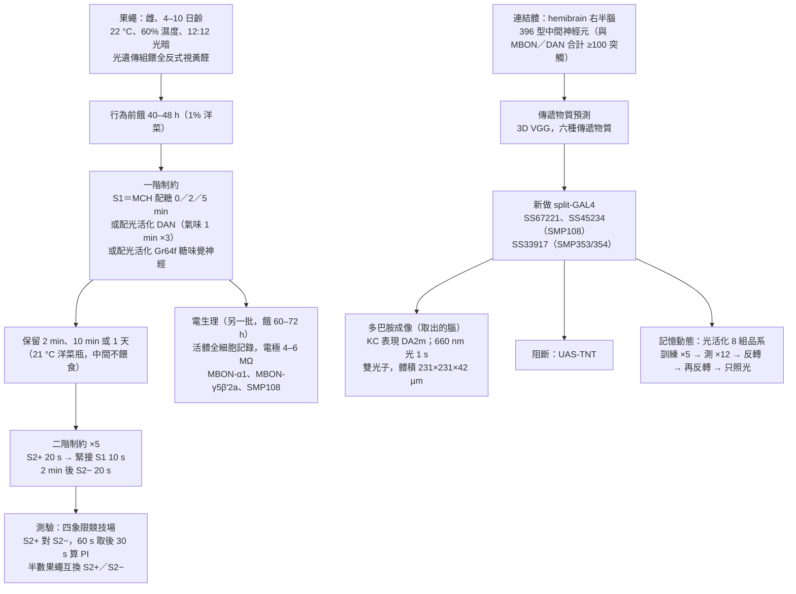
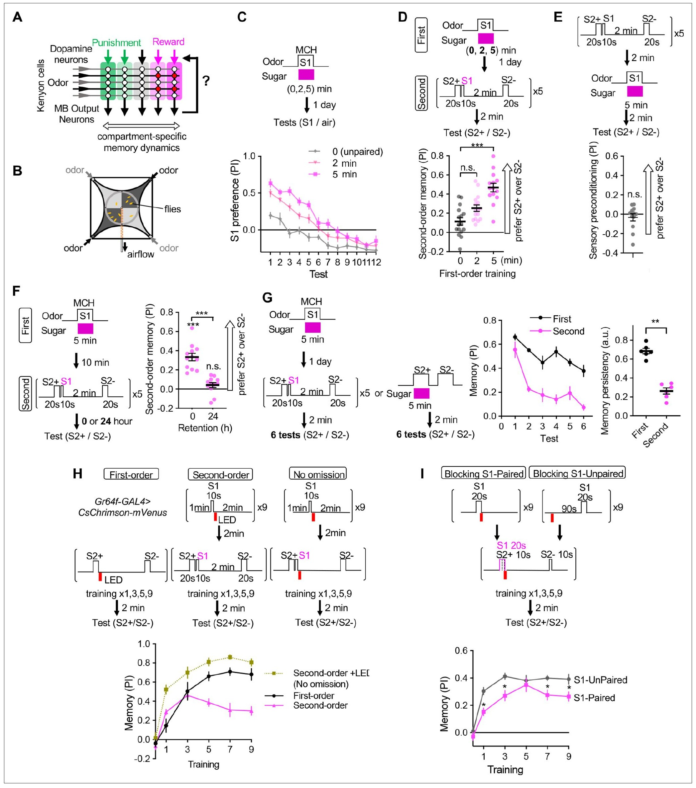
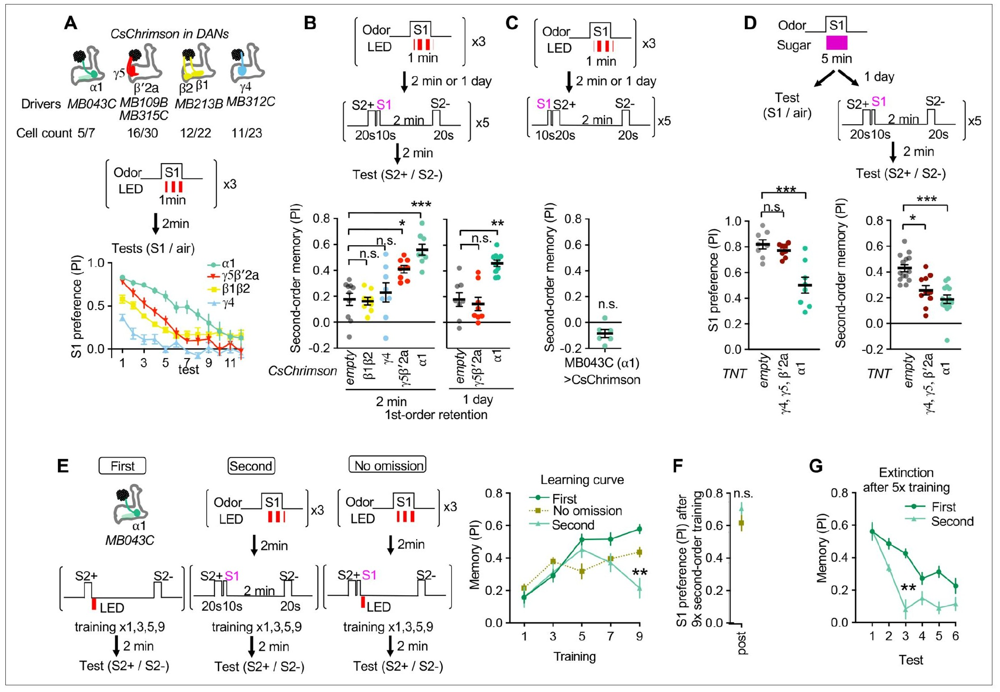
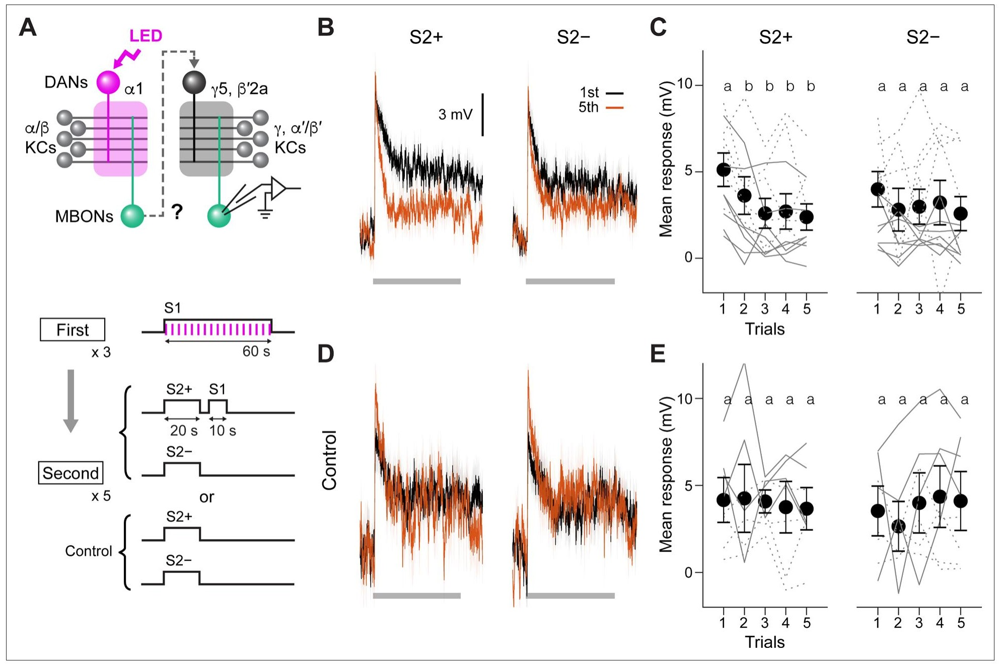
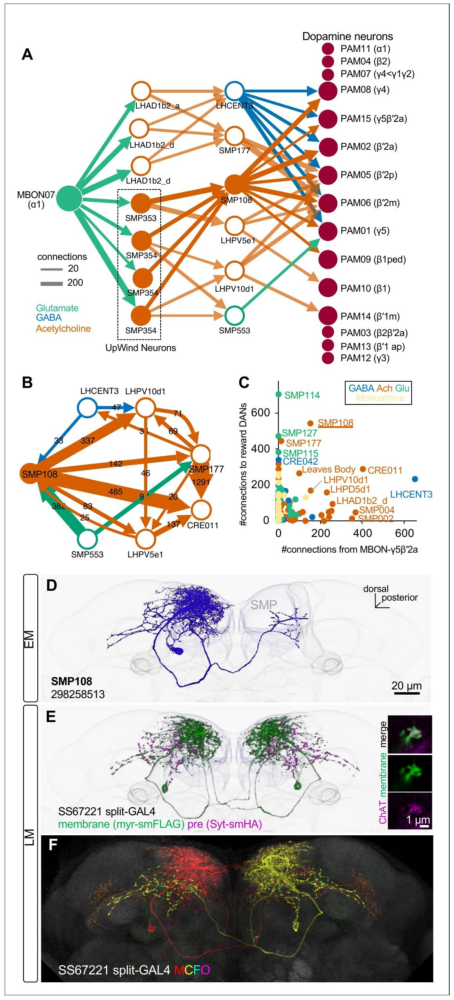
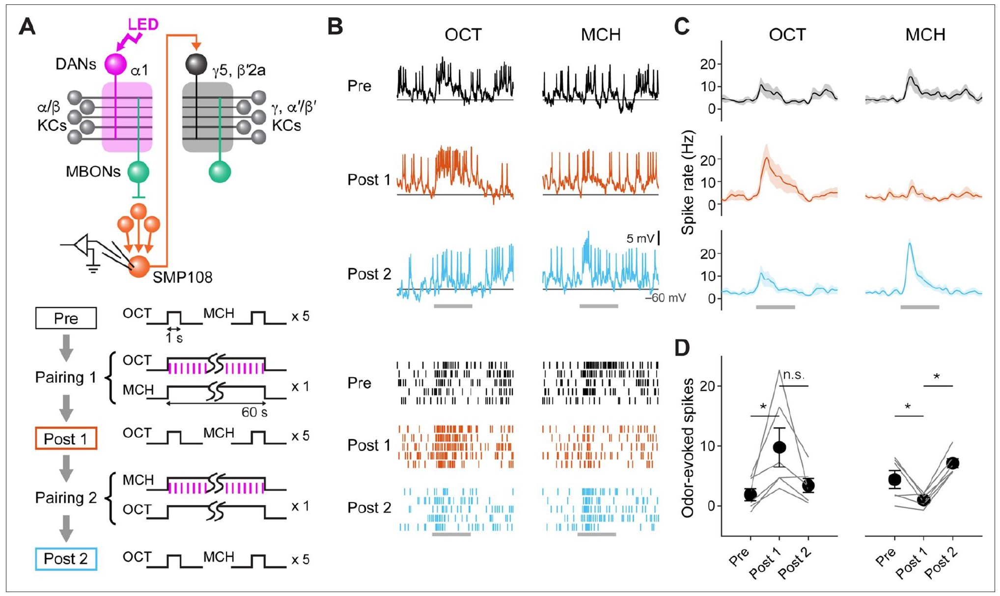
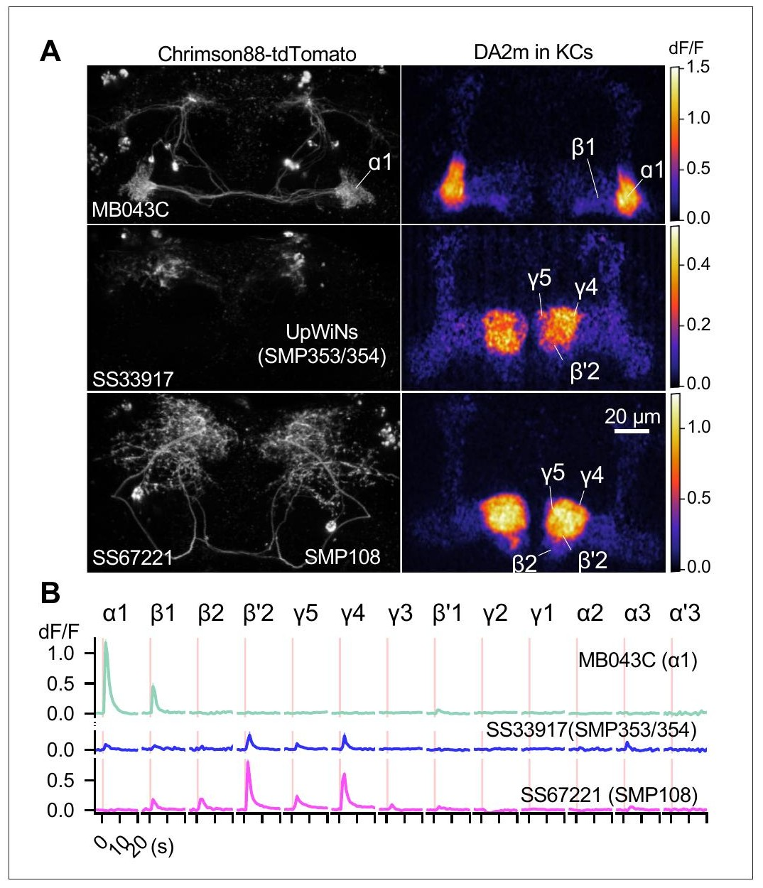
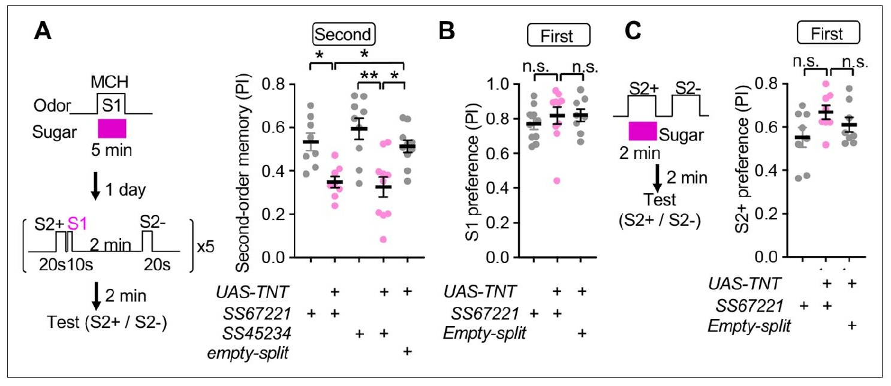
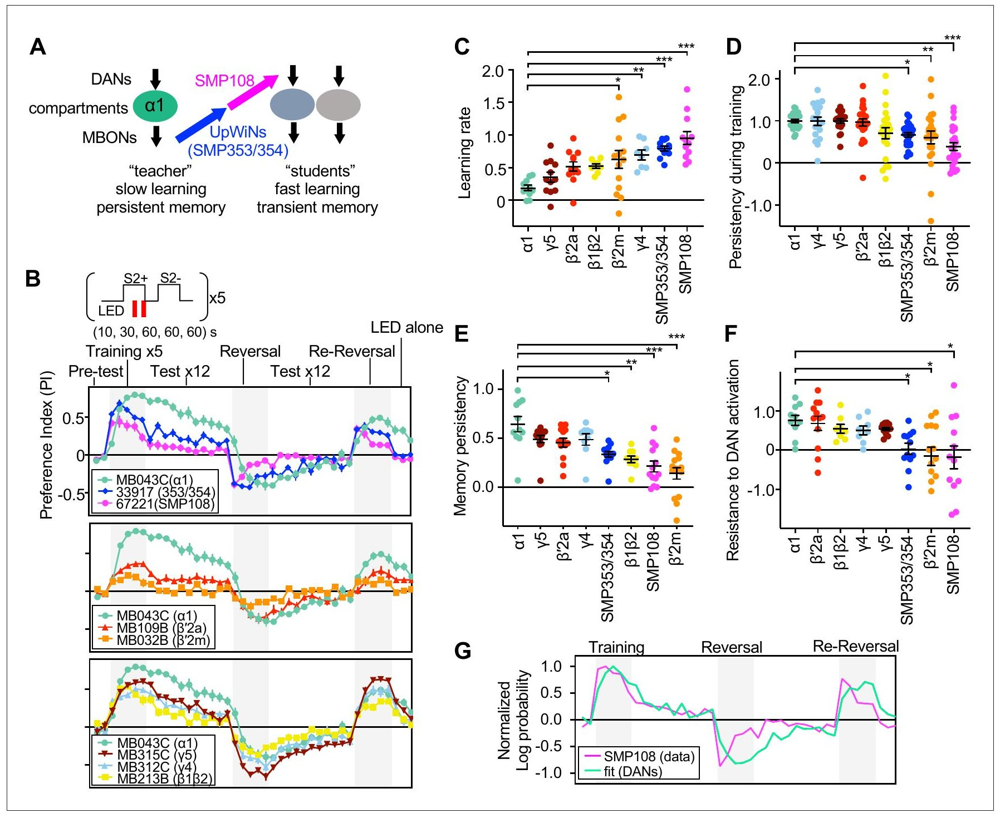

<!-- 本機 PDF：papers/2023-Hierarchical%20architecture%20of%20dopaminergic%20circuits%20enables%20second-order%20conditioning%20in%20Drosophila.pdf -->

# Hierarchical architecture of dopaminergic circuits enables second-order conditioning in *Drosophila*

**多巴胺迴路的階層架構讓果蠅能做二階制約**

| 項目 | 內容 |
|---|---|
| **出處** | eLife 12, e79042 (2023). doi: 10.7554/eLife.79042 [全文（PMC 免費閱讀）](https://pmc.ncbi.nlm.nih.gov/articles/PMC9937650/) |
| 日期 | 投稿 2022-03-28；預印本 2022-03-31；接受 2023-01-23；刊出 2023-01-24（PDF 第 1 頁）。eLife 文章是單篇編號（e79042），沒有起迄頁；PDF 共 30 頁。修訂日期 PDF 未印 |
| 通訊作者 | Toshihide Hige（hige@email.unc.edu）、Yoshinori Aso（asoy@janelia.hhmi.org）。PDF 只有英文名 |
| 作者 | 共 9 人：Daichi Yamada、Daniel Bushey、Feng Li、Karen L Hibbard、Megan Sammons、Jan Funke、Ashok Litwin-Kumar、Toshihide Hige、Yoshinori Aso。分工（Author contributions）：Yamada 負責形式分析、實驗、視覺化與初稿；Bushey 負責軟體、分析與視覺化；Li 負責資料整理、軟體與分析；Hibbard 提供資源；Sammons 負責資料整理與視覺化；Funke 負責神經傳遞物質預測所需的資料與軟體；Litwin-Kumar 負責迴歸分析與督導；Hige、Aso 共同構思、督導與撰寫 |
| 機構 | Department of Biology、Department of Cell Biology and Physiology、Integrative Program for Biological and Genome Sciences（University of North Carolina at Chapel Hill）；Janelia Research Campus, Howard Hughes Medical Institute（Ashburn）；Department of Neuroscience（Columbia University） |
| 資料庫 | 新做的 split-GAL4 品系的共軛焦影像在 http://www.janelia.org/split-gal4 ；連結資料取自 neuPrint 的 hemibrain（https://neuprint.janelia.org/ ，資料集 DOI 10.25378/janelia.12818645.v1）。論文說各圖的原始數據（Source data）包含在稿件中，但本 PDF 只列出名稱 |
| 補充資料 | 圖 1 補充圖 1、圖 3 補充圖 1–3、圖 4 補充圖 1–3、圖 6 補充圖 1、圖 7 補充圖 1、圖 8 補充圖 1；Supplementary file 1（396 型中間神經元的連結矩陣與傳遞物質預測）；各圖的 Source data；MDAR 檢核表。**本 PDF 只有這些項目的標題，內容全部未取得**（PDF 內含附錄 1 的關鍵資源表）。本頁凡依賴它們的內容一律標 ？待查 |
| 編輯／審查 | 審查編輯（Reviewing Editor）Ilona C Grunwald Kadow（University of Bonn）。她是本篇所引 Siju et al. 2020、Lewis et al. 2015 兩篇 DAN 研究的作者。審查信與作者回覆另有 DOI（eLife.79042.sa1、sa2），本庫未讀 |
| 經費 | NIH、NSF、BSF、UNC（Hige）；Burroughs Wellcome、Gatsby、McKnight、Simons、NIH、NSF（Litwin-Kumar）；HHMI（Janelia 各作者）；Toyobo 生技基金會與日本學術振興會（Yamada） |

> 與本庫有關的作者：本庫沒有「與本庫有關的作者」名單。Hige 是 [[s-hige-2015-heterosynaptic-plasticity]] 的第一作者；Aso 是 [[s-aso-2016-dan-cell-type-rules]]、[[s-aso-2014-mbon-valence]] 的第一作者，也是 Hige 2015、[[s-ichinose-2015-reward-recurrent-circuit]] 的共同作者。本篇的行為裝置與協定沿用 Aso 2016，電生理沿用 Hige 2015。
>
> **本篇為 CC BY 開放取用**（PDF 第 1 頁：「This article is distributed under the terms of the Creative Commons Attribution License, which permits unrestricted use and redistribution provided that the original author and source are credited」；未註明授權版本號），版權屬作者（Copyright Yamada et al.）。圖片可在標明出處的條件下自由使用與散布。本庫仍依規定只給全文連結、不放 PDF；每張圖下方標明出處與授權。

---

## 為什麼重要

> 本節假設讀者已略知果蠅嗅覺學習的輪廓。**完全不熟的讀者可以先看「科普文」一節**；術語另見「專業文」開頭的「本頁用語」表。

本庫先前收的學習研究，增強訊號都是「外來的」：糖、電擊，或以光直接活化多巴胺神經元（DAN）。二階制約（second-order conditioning）不同：先讓氣味 S1 預告糖，再讓新氣味 S2 只配 S1、不給糖，果蠅也會偏好 S2。這時教學訊號來自腦中已經存在的記憶。本篇第一次在果蠅腦內指出這個訊號的路徑：蕈狀體 α1 區室的一階記憶，經由兩層中間神經元（SMP353/354 與 SMP108），活化 β′2、γ4、γ5 等其他區室的獎賞型 DAN。

第二，它把本庫兩條線接起來。一條是「各區室的學習速度與記憶長短不同」（[[s-aso-2016-dan-cell-type-rules]]：α1 學得慢、記得久）；另一條是「MBON 回頭影響 DAN」（[[t-mbon-dan-feedback]]）。本篇主張：記得久的一格當「老師」，經前饋路徑教記得短的幾格（「學生」）；二階記憶短命、容易消退，是因為它寫在學生格裡。這與 [[s-huang-2024-dopamine-memory-dynamics]] 是同一種圖案的兩個例子——一格的 MBON 因學習而對受訓氣味反應變小，下游少了抑制，DAN 於是對該氣味放電——只是 Huang 2024 的路徑是 MBON 直接抑制 DAN、方向是懲罰，本篇的路徑隔了兩個中間神經元、方向是獎賞。

第三，它補上本庫一個空缺的一半。[[syn-contradictions]] 第 3.6 條問：獎賞訓練後，MBON-α1 對受訓氣味的反應是變大還是變小？Ichinose 2015 的迴圈模型需要它還能驅動 PAM-α1。本篇正文報告，以光活化 PAM-α1 配對氣味之後，MBON-α1 對該氣味的放電**減少**（資料在未取得的補充圖 3-2）。但本篇整套機制又建立在一個沒有直接測過的假設上：MBON-α1 放出的麩胺酸對下游是抑制。詳見專業文第五節。

---

## 論文摘要（原文與中譯）

> Dopaminergic neurons with distinct projection patterns and physiological properties compose memory subsystems in a brain. However, it is poorly understood whether or how they interact during complex learning. Here, we identify a feedforward circuit formed between dopamine subsystems and show that it is essential for second-order conditioning, an ethologically important form of higher-order associative learning. The *Drosophila* mushroom body comprises a series of dopaminergic compartments, each of which exhibits distinct memory dynamics. We find that a slow and stable memory compartment can serve as an effective 'teacher' by instructing other faster and transient memory compartments via a single key interneuron, which we identify by connectome analysis and neurotransmitter prediction. This excitatory interneuron acquires enhanced response to reward-predicting odor after first-order conditioning and, upon activation, evokes dopamine release in the 'student' compartments. These hierarchical connections between dopamine subsystems explain distinct properties of first- and second-order memory long known by behavioral psychologists.

（*eLife* 的摘要不分 Background／Results／Conclusion 段，照原樣一段。）

**中譯**（本節為忠實翻譯，非自撰內容）：

> 投射樣式與生理性質各異的多巴胺神經元，在腦中組成多個記憶子系統。然而，它們在複雜學習中是否、以及如何交互作用，仍所知甚少。本文找出多巴胺子系統之間形成的一條前饋迴路，並顯示它對二階制約不可或缺；二階制約是一種在動物行為學上重要的高階聯結學習。果蠅的蕈狀體由一連串多巴胺區室組成，每個區室的記憶動態各不相同。我們發現，一個學得慢、記憶穩定的區室，可以經由單一個關鍵中間神經元，指導其他學得快、記憶短暫的區室，扮演有效的「老師」；這個中間神經元是我們以連結體分析與神經傳遞物質預測找出的。這個興奮性中間神經元在一階制約之後，對預告獎賞的氣味反應增強；活化它時，會在「學生」區室引起多巴胺釋放。多巴胺子系統之間的這種階層連結，解釋了行為心理學家早已知道的一階與二階記憶的不同性質。

---

## 科普文

想像一間補習班。資深老師上課慢，但教過的東西學生記得很久；年輕助教上手快，教的東西卻過幾天就忘。有一天老師不直接教新內容，而是對助教說「這件事也很重要」，助教再轉教給學生。學生學得很快，但因為是助教教的，也忘得快。這篇論文說，果蠅腦中的蕈狀體（mushroom body）就有這樣一位老師和幾位助教，而「助教轉教」正好對應一種叫二階制約的學習。

**先交代果蠅怎麼學。** 果蠅聞到氣味時，蕈狀體裡一小群 Kenyon 細胞（KC）會放電，哪一群放電就代表哪個氣味。KC 把訊號交給蕈狀體輸出神經元（MBON），MBON 的活動推動果蠅靠近或走開。第三種角色是多巴胺神經元（DAN），它送來「好事」或「壞事」的訊號；本篇的 DAN 都屬於主要傳獎賞的 PAM 群。氣味和多巴胺一起出現時，KC 與 MBON 之間的連接點（突觸）會改變，下次再聞到同一個氣味，MBON 的反應就不同。蕈狀體沿著 KC 的長纖維分成一格一格的區室，每格由一型 DAN 管、一型 MBON 讀。各格的脾氣不同：α1 這一格學得慢、記得久；γ5、β′2 等幾格學得快、忘得快（本庫 Aso 2016 量過）。

**難題：二階制約的教學訊號從哪裡來？** 一般的學習叫一階制約：氣味 S1 配糖，果蠅學會喜歡 S1。二階制約多一步：學會 S1 之後，讓另一個氣味 S2 只配 S1、不再給糖，果蠅也學會喜歡 S2。巴夫洛夫（Pavlov）在狗身上就看過這種學習，心理學家也早知道它有兩個怪脾氣：練了幾次之後效果反而下降，而且記憶不持久。這時明明沒有糖，是誰告訴 DAN「S2 是好的」？

**作者先把現象做穩。** 他們用一個四個角落各送一種氣味的圓形競技場（直徑 9 公分），讓約 20 隻餓過的果蠅在裡面選邊。S1 用 4-甲基環己醇（MCH），配糖 5 分鐘；一天後，讓 S2+ 聞 20 秒、緊接著 S1 聞 10 秒，另一個氣味 S2− 單獨聞，共五回合。果蠅明顯偏好 S2+：偏好指數（PI；0 代表沒偏好，正值越大代表越多果蠅選 S2+）約 0.46，不配對的對照組約 0.12。S1 只配糖 2 分鐘時，二階記憶和對照組沒有顯著差別。心理學家說的兩個怪脾氣在果蠅身上也看得到：二階記憶一天後就消失；連續測驗六次，二階記憶掉得比一階記憶快很多。另外，若把 S1 排在 S2+ 之前，果蠅就學不到，和一階制約一樣要「新的在前、舊的在後」。

**解法一：找老師。** 作者把糖換成光：讓特定的 DAN 帶上照紅光就會放電的通道蛋白 CsChrimson，S1 配光，等於只在那幾格寫下「S1 是好的」。四組獎賞型 DAN 裡，只有 α1 那一組寫下的 S1 記憶，在一天後仍能教出二階記憶；γ5 與 β′2a 那一組只在剛訓練完的 2 分鐘時有效。用破傷風毒素讓 PAM-α1 放不出傳遞物質，一天後的 S1 偏好與二階記憶都變弱。所以老師是 α1。

**解法二：證明學生真的被教了。** 作者在活的果蠅腦中，用玻璃電極直接記錄 γ5β′2a 格的輸出神經元（MBON-γ5β′2a）的電位。先用光在 α1 寫下 S1 的記憶，再做二階制約：配過 S1 的 S2+ 引起的反應，從第二回合起就降低；沒配 S1 的 S2− 五回合都沒有顯著改變。對照組不給 S1，兩種氣味都不變。**老師那一格的記憶，讓學生那一格的突觸跟著改了。**

**解法三：找出傳話的人。** α1 格的輸出神經元 MBON-α1 很特別：在電子顯微鏡畫出的全腦接線圖（連結體，本篇用 hemibrain 這一份）上，它不直接連到別格的 DAN，只連回同一格的 PAM-α1。作者於是找「隔兩個神經元」的路，並用一個訓練好的電腦程式，從電子顯微鏡影像判斷每個突觸用哪一種神經傳遞物質。最突出的路是：MBON-α1 → SMP353/354 → SMP108 → 多個獎賞型 DAN。SMP108 用乙醯膽鹼（興奮性），在所有用乙醯膽鹼的細胞裡，它連到獎賞型 DAN 的連結數最多。

為什麼「MBON-α1 的反應變小」會變成「DAN 被叫醒」？MBON-α1 放出的是麩胺酸，而麩胺酸在果蠅腦中常是抑制性的。所以學會 S1 之後，MBON-α1 對 S1 的反應變小，對下游的抑制就鬆開，下游反而對 S1 更興奮。這一步是作者的推論，他們沒有直接量過 MBON-α1 對 SMP353/354 的作用是抑制還是興奮。

**解法四：逐一檢驗 SMP108。** 作者為 SMP108 做了專屬的驅動品系，做了四個測試：

- 用光活化 PAM 群、配氣味 OCT 之後，SMP108 對 OCT 的放電從每次約 2 下增加到約 10 下；反過來改配 MCH 之後，OCT 的反應退回、MCH 的反應升高。所以 SMP108 會追蹤「哪個氣味預告獎賞」。
- 在取出的腦裡用光叫醒 SMP108，用多巴胺感測器看 KC 上的多巴胺：β′2、γ4 兩格亮得最明顯，γ5、β1、β2 較小，α1 不亮。
- 用破傷風毒素關掉 SMP108，二階記憶下降約三到四成半，但一階記憶（2 分鐘與 1 天）完全正常。
- 用光叫醒 SMP108 當獎賞來訓練，記憶來得快、去得也快：訓練後段與反覆測驗時就掉，最後「只照光、不給氣味」幾乎把它抹掉；直接叫醒 PAM-α1 寫下的記憶則來得慢、留得住。

**代價與需要小心的地方。** 第一，關掉 SMP108 只讓二階記憶少了三到四成半，剩下的部分走別的路；但摘要寫的是「單一個關鍵中間神經元」「不可或缺」。第二，破傷風毒素從發育期就開始作用；作者試過只在二階制約期間用溫度暫時關掉 SMP108，但在 32 °C 下連對照組的一階記憶都迅速消退，做不成。第三，多巴胺成像是在取出的腦裡、沒有氣味時用光叫醒 SMP108，不是學習時的實況。第四，用電極證明「學生被教」的那一格是 γ5β′2a，但在第八張圖裡，直接叫醒 γ5 或 β′2a 的 DAN 所寫下的記憶，持久程度與 α1 沒有顯著差別；最能解釋 SMP108 那種快來快去的是 β′2m、β1/β2、γ4 這幾組。老師與學生的分工，在不同實驗裡指向不完全相同的格。

**最容易被誤讀的一點：這篇沒有說二階記憶「不需要多巴胺」，也沒有說記憶存在 SMP108 裡。** SMP108 只是傳話的人：它把老師格裡已經寫下的 S1 記憶，轉成學生格的多巴胺訊號，二階記憶仍寫在學生格的 KC→MBON 突觸上（這一點由 MBON-γ5β′2a 的記錄支持）。另外，「老師」的意思是「它的記憶被拿來當增強訊號」，不是說 α1 在一階學習裡比較重要。

---
## 專業文

### 本頁用語

本頁各節可單獨查閱，故把反覆出現的詞集中在這裡。

| 詞 | 意思 |
|---|---|
| 蕈狀體（mushroom body, MB） | 果蠅腦中負責嗅覺學習與記憶的結構，左右各一 |
| KC（Kenyon cell） | 蕈狀體的主要神經元，論文說約 2,000 顆。每個氣味活化一小群 KC |
| MBON（mushroom body output neuron） | 蕈狀體輸出神經元，讀出 KC 的訊號。學習改變的是 KC→MBON 的突觸 |
| DAN（dopaminergic neuron） | 多巴胺神經元。**PAM 群多半傳獎賞，PPL1 群多半傳懲罰**。本篇的老師與學生都在 PAM 群 |
| 區室（compartment） | KC 軸突成束分成幾個「葉」（α/β、α′/β′、γ），每葉沿長度再分成幾格。論文說 DAN 與 MBON 在 KC 軸突上形成 16 個互相對應的區室，每格是一個學習單元。見 [[c-mb-compartment]] |
| 細胞型別的名字 | 以區室命名，例如 PAM-α1、MBON-γ5β′2a（橫跨 γ5 與 β′2a 兩格）。圖 4 用 hemibrain 的編號：MBON07 ＝ MBON-α1；PAM11 ＝ α1、PAM15 ＝ γ5β′2a、PAM02 ＝ β′2a、PAM06 ＝ β′2m、PAM05 ＝ β′2p、PAM08 ＝ γ4、PAM01 ＝ γ5、PAM04 ＝ β2、PAM10 ＝ β1、PAM09 ＝ β1ped、PAM07 ＝ γ4<γ1γ2、PAM14 ＝ β′1m、PAM03 ＝ β2β′2a、PAM13 ＝ β′1ap、PAM12 ＝ γ3（依圖 4A 的標示） |
| 一階制約（first-order conditioning） | 氣味直接配獎賞：糖、以光活化 DAN、或以光活化糖的味覺神經元 |
| 二階制約（second-order conditioning） | 先讓 S1 預告獎賞（一階），再讓新氣味 S2 配 S1、不給獎賞，果蠅學會偏好 S2 |
| S1、S2+、S2− | S1：一階制約學過的氣味，本篇固定用 MCH。S2+：二階制約時配 S1 的氣味；S2−：同樣聞但不配 S1 的對照氣味。S2 用 PA 與 EL，兩者在半數實驗中互換 |
| 感覺預制約（sensory preconditioning） | 另一種高階學習：先讓 S2 配 S1，之後才讓 S1 配獎賞。本篇用它當對照 |
| 老師區室、學生區室 | 作者的模型用語。老師：一階記憶寫在這裡，而且這份記憶被拿來當二階制約的增強訊號（α1）。學生：二階記憶實際寫入的區室（γ5、β′2a、β′2m、β1/β2、γ4 等） |
| 省略（omission） | 二階制約時，S1 後面不再跟著獎賞。「不省略」組在 S1 之後照樣給光，當對照 |
| 消退（extinction） | 反覆測驗或再聞氣味而沒有獎賞，記憶變弱。見 [[c-memory-extinction]] |
| PI（performance／preference index，偏好指數） | 四象限競技場的分數：(兩個對角象限中某一氣味那側的果蠅數 − 另兩象限的果蠅數) ÷ 總數，取 60 秒測驗的最後 30 秒。圖上的值是兩組互換氣味的實驗的平均。見 [[c-performance-index]] |
| 四象限競技場 | Aso 2016 改良的圓形嗅覺競技場，四臂各送一種氣味或空氣，底下有紅光 LED 板。見 [[e-olfactory-arena]] |
| 驅動品系、split-GAL4、split-LexA | 決定外加基因只在哪幾型細胞表現的品系。本篇新做了 SMP108 的 SS67221 與 SS45234、SMP353/354 的 SS33917、PAM-α1 的 MB043-split-LexA。見 [[e-split-gal4]] |
| CsChrimson、ChrimsonR、Chrimson88 | 照紅光就讓神經元放電的通道蛋白的幾個版本。見 [[e-cschrimson]] |
| TNT（破傷風毒素輕鏈） | 讓神經元放不出神經傳遞物質；**從發育期起一直作用**。論文中寫成 TNT 或 TeNT |
| shibire^ts | 升溫時暫時阻斷神經元輸出的工具。本篇試過但做不成（見方法）。見 [[e-shibire-ts]] |
| 全細胞記錄（whole-cell recording） | 以玻璃電極貼上細胞、打通細胞膜，直接量細胞內電位。本篇在活的果蠅上記錄 MBON-α1、MBON-γ5β′2a 與 SMP108。見 [[c-whole-cell-patch-clamp]] |
| 次閾值反應 | 沒有形成放電、只是膜電位上升（去極化）的反應。MBON-γ5β′2a 的放電與突觸電位分不開，所以作者量的是氣味開始後 20.6 秒內的平均去極化 |
| DA2m | 一種遇到多巴胺會變亮的螢光感測器（Sun et al. 2020）。本篇讓它表現在 KC 上，看多巴胺落在哪一格 |
| hemibrain、neuPrint | hemibrain 是以電子顯微鏡重建的果蠅半腦連結體；neuPrint 是查詢它的網站。本篇只用右半腦的連結，因為左半腦重建不完整 |
| 一跳、兩跳路徑 | 兩個神經元之間隔一個（一跳）或兩個（兩跳）中間神經元 |
| 神經傳遞物質預測 | 以訓練好的 3D 卷積神經網路（VGG 架構），從每個突觸前位點的電子顯微鏡影像，判斷它用 GABA、麩胺酸、乙醯膽鹼、血清素、多巴胺、章魚胺六者中的哪一種（Eckstein et al. 2020 的方法移用到 hemibrain） |
| SMP108、SMP353/354、UpWiNs | SMP 是上內側前腦（superior medial protocerebrum）。SMP353 一顆與 SMP354 三顆形態相似，同屬作者另一篇論文（本篇引用時為 2022 年的預印本，後於 2023 年刊出，即 [[s-aso-2023-upwind-neurons]]）命名的 UpWind Neurons（UpWiNs，把習得的氣味價值轉成逆風轉向的神經元）。SMP108 是本篇的主角 |
| 學習速率、訓練中的持久度、記憶持久度、對 DAN 活化的抵抗 | 圖 8C–F 的四個比值，定義見 3.6 |
| 對數機率比（log-probability ratio） | R ＝ log(p ÷ (1 − p))，p 是選受訓氣味的機率。圖 8G 以它做迴歸 |
| 統計記號 | `*` p < 0.05、`**` p < 0.01、`***` p < 0.001；n.s. 不顯著。行為多用 Kruskal–Wallis 加 Dunn 事後檢定；電生理用重複量數二因子變異數分析加 Tukey 事後檢定 |
| ※ 推論 | 論文沒有明說、本頁自行推得的內容，並寫出依據 |
| ？待查 | 值得查證但本頁刻意不填的內容 |

### 一、概述

**主要問題。** 二階制約在許多物種都看得到，迴路機制卻幾乎無人知道。作者問三件事：一階與二階記憶的不同性質（二階記憶短命、容易消退、訓練次數多了反而下降）從哪裡來？兩種記憶是不是存在不同的迴路？若是，一階記憶的迴路怎麼去教二階記憶的迴路？

**重要性。** 若成立，它給「各區室規則不同」（Aso 2016）一個功能上的理由：學得慢、記得久的區室，它的記憶可以當成教別格的增強訊號，而且在教的過程中自己不會被消退掉。它也給了一條具體的跨區室前饋路徑「MBON → 中間神經元 → DAN」，這是本庫回饋迴路主題（[[t-mbon-dan-feedback]]）原本缺的類型：先前收錄的都是 MBON 直接接到 DAN。

**發表當時的領域現狀（2022 投稿、2023 刊出）。**

- 行為：果蠅能以嗅覺或視覺線索配懲罰做二階制約（Brembs & Heisenberg 2001、Tabone & de Belle 2011），但沒有人研究過迴路。König et al. 2019 發現，暫時讓 MBON-γ1pedc 安靜（模擬嫌惡學習造成的突觸變弱）可以當增強訊號，是「MBON 的改變充當教學訊號」的光遺傳類比。
- 嫌惡的單一感覺型態感覺預制約在果蠅上有報告（Martinez-Cervantes et al. 2022，與本篇同年同刊）。
- 脊椎動物：大鼠的二階制約需要基底外側杏仁核與 DAN（Gewirtz & Davis 1997）；Maes et al. 2020 以光遺傳抑制證明「線索引起的多巴胺短暫上升」是必要的。不同亞型 DAN 之間在二階制約時怎麼互動，作者說「完全沒有研究」。
- 連結體：hemibrain（Scheffer et al. 2020）與蕈狀體連結體（Li et al. 2020）列出了大量 MBON 到 DAN 的連線；幼蟲與成蟲 DAN 的突觸輸入有很大一部分來自蕈狀體本身（Eschbach et al. 2020、Li et al. 2020）。
- 本庫內：[[s-ichinose-2015-reward-recurrent-circuit]] 提出 α1 的同格回饋迴路；[[s-aso-2016-dan-cell-type-rules]] 量了各型 DAN 的學習速度與記憶保留；[[s-felsenberg-2017-re-evaluation]]、[[s-felsenberg-2018-memory-extinction]] 的消退回饋；[[s-dylla-2017-trace-conditioning-dan-plasticity]] 在嫌惡的痕跡制約後看到 DAN 對 CS 出現習得反應，並推測它可能支援二階制約，但沒有測。

### 二、方法

流程圖有兩條起點：上方是行為與電生理（先做一階、再做二階），中間是連結體分析——由它找出 SMP108、做出專屬品系，再接三種檢驗（多巴胺成像、阻斷、記憶動態）。

**果蠅與行為裝置。**

- 雌蠅、4–10 日齡（分揀後 2–4 天），22 °C、60% 濕度、12 小時明暗、標準玉米粉飼料。帶 Chrimson 的果蠅在羽化前餵 0.2 mM 全反式視黃醛、羽化後 0.4 mM。
- 約 20 隻一組，在 Aso 2016 改良的四象限競技場裡訓練與測驗（原始設計引 Pettersson 1970）。底下是 627 nm LED 板，在果蠅位置的強度 34.9 µW/mm²。四臂各進氣 100 mL/min，中央抽氣 400 mL/min，以電磁閥切換氣味。錄影每秒 30 張，用 Fiji 分析。
- 氣味以石蠟油稀釋：OCT（3-辛醇）1:1000、MCH（4-甲基環己醇）1:750、PA（乙酸戊酯）1:10000、EL（乳酸乙酯）1:10000。
- 糖制約在管中進行，用吸了蔗糖的 Whatman 3MM 濾紙；制約前在 1% 洋菜上餓 40–48 小時。要測 1 天後的記憶時，一階制約後把果蠅放在 21 °C 的洋菜瓶裡。

**協定是怎麼挑出來的（方法「二階制約的最佳化」一節）。**

- 作者先量各氣味的先天偏好在 12 次重複測驗中怎麼變（補充圖 1-1，未取得）。在 Tully & Quinn 1985（[[s-tully-1985-classical-conditioning]]）選定的濃度下，餓過的果蠅第一次略偏好 MCH，之後逐漸轉為迴避；OCT 不論飽餓都被迴避，迴避程度逐次減弱。**OCT 的先天迴避可能妨礙獎賞型的二階制約，所以 S1 全篇固定用 MCH。**
- S2 用 PA 與 EL，理由是兩者引起的 KC 活動樣式不同、容易分辨（引 Campbell et al. 2013），而且先天反應在 12 次測驗中相對穩定。
- 一階制約用 2 分鐘就能形成獎賞記憶（引 Krashes & Waddell 2008、Tempel et al. 1983），但 5 分鐘在前五次測驗中略強（圖 1C），所以**二階制約的回合數限定為 5 次**——也就是說，回合數是依「一階記憶在前五次測驗中還穩」來決定的。
- 依一階制約「感覺線索要在增強訊號之前」的規則（Aso & Rubin 2016、Tanimoto et al. 2004），二階制約排成 S2+ 20 秒、緊接 S1 10 秒。
- 每組實驗有一半把 PA 與 EL 的角色對調，圖上報兩半的平均；作者說這樣可以抵銷位置偏差、先天偏好，以及 S1（MCH）類化到 PA 或 EL 的成分。
- 實驗者沒有對基因型盲化，但刺激由程式自動給；只要質量流量計的紀錄正常，資料全部納入。樣本數不是依前導實驗預先決定的。

**光遺傳的三種協定。**

- 圖 2A–C、2E–G：S1 聞 1 分鐘，期間給紅光，重複 3 次，間隔 2 分鐘。
- 圖 1H、1I：以 Gr64f-GAL4 讓糖的味覺神經元帶 CsChrimson，S1 10 秒配光，共 9 次。「不省略」組在 S1 之後立刻補 3 下 1 秒紅光（間隔 1 秒）。圖 1I 的「阻斷」協定：先讓 S1 配光 9 次（配對組）或與光相隔 90 秒（未配對組），再測 S2+ 配光的學習。
- 圖 8：訓練 5 次，氣味配光的時長依序為 10、30、60、60、60 秒，另一氣味不配光；每次訓練後測一次。接著不給光連測 12 次（消退期）；反轉配對再訓練 5 次、測 12 次（反轉期）；再反轉一次；最後只照光、不給氣味（這種不配對的 DAN 活化已知會抹除記憶，引 Berry 2012、Plaçais 2012）。

**電生理。** 果蠅收集於羽化當天，餵 0.5 mM 視黃醛飼料、避光 48–72 小時；做二階制約的另外餓 60–72 小時。活體全細胞記錄沿用 Hige 2015（[[s-hige-2015-heterosynaptic-plasticity]]）：電極阻抗 4–6 MΩ，細胞以注入超極化電流維持在約 −60 mV（通常 < 100 pA），訊號 5 kHz 低通、10 kHz 取樣。氣味的飽和蒸氣以空氣稀釋成 0.5%（二階制約實驗）或 2%（其他實驗）。光刺激用 625 nm LED，經物鏡送到腦上，強度 17 mW/mm²；一階配對是 1 ms 脈衝、2 Hz、120 次（即 60 秒）。瞬時放電率以標準差 50 ms 的高斯核平滑；次閾值反應與氣味引起的放電取氣味開始後 1.2 秒（1 秒氣味）或 20.6 秒（20 秒氣味）的窗，並扣掉自發放電。

**多巴胺成像。** 處女雌蠅帶 10XUAS-Chrimson88-tdTomato、R13F02-LexAp65、LexAop2-DA2m，與各 split-GAL4 雜交；25 °C、0.2 mM 視黃醛飼料、避光，羽化後 3–7 天取腦。**在取出的腦上做**：解剖後泡在 20 °C 的生理鹽水中，以共振掃描雙光子顯微鏡（激發 920 nm、19 mW，25× 物鏡）掃描 231 × 231 × 42 µm 的體積，步進 2 µm，512 × 512 畫素，約每秒 1.07 個體積。光刺激用 660 nm LED 配數位微鏡裝置，1 秒、12 µW/mm²；每次試驗先取 30 秒基線，刺激後再記 30 秒，重複 10 次。以 python 腳本在時間最大值投影上，依區室畫感興趣區（ROI），扣掉背景 ROI 後除以刺激前 30 秒的平均亮度得 ΔF/F。多重比較用 Kruskal–Wallis 檢定，事後用 Wilcoxon 等級和檢定。

**連結體與傳遞物質預測。** 連結資料取自 neuPrint 的 hemibrain；**只用右半腦**，因為左半腦的連結不完整。圖用 Cytoscape 產生、再以 Illustrator 完稿；神經元的 3D 繪製用 NeuTu 或 VVD viewer。傳遞物質預測沿用 Eckstein et al. 2020 在全腦 FAFB 資料上的 3D VGG 網路，因解析度不同而改成等向性：四層降採樣、池化大小一律 2 × 2 × 2，輸入是以突觸為中心、邊長 80 體素的 3D 小塊。輸出為 GABA、麩胺酸、乙醯膽鹼、血清素、多巴胺、章魚胺六類。整理出的 396 型中間神經元（與 MBON 及 DAN 合計至少 100 個突觸者）放在補充檔 1（未取得）。SMP108 的 2,753 個突觸前位點中，有 2,416 個被預測為乙醯膽鹼。

**做不成的實驗（作者自陳）。** 作者想用 shibire^ts 只在二階制約期間關掉 SMP108，但在 32 °C 的限制溫度下，連對照基因型的果蠅都很快把一階記憶消退掉、做不成二階制約（正文寫 data not shown）。所以阻斷只能用從發育期就作用的 TNT。

**統計。** 行為多用 Kruskal–Wallis 加 Dunn 事後檢定（部分用 t 檢定、Wilcoxon 符號等級檢定、Mann–Whitney 檢定）；電生理用重複量數二因子變異數分析加 Tukey 事後檢定。作者說行為測驗預設使用無母數檢定，因為預期部分資料不呈常態或變異數不相等。

### 三、結果

#### 3.1 把二階制約在果蠅上做穩（圖 1）

一階制約用糖，S1 固定是 MCH；一天後做五回合二階制約，隨即測 S2+ 對 S2− 的偏好。

- **一階訓練要夠長。** 二階記憶的 PI：一階 0 分鐘（不配對對照，糖在氣味前 2 分鐘給）約 0.12、2 分鐘約 0.25、5 分鐘約 0.47（※ 從圖 1D 判讀；N ＝ 14–16）。0 對 2 分鐘不顯著（p ＝ 0.152），0 對 5 分鐘 p < 0.0001。
- **不是感覺預制約。** 把順序對調（先 S2–S1 配對、之後才 S1 配糖），結果與機率水準沒有差別（圖 1E，N ＝ 12）。作者據此排除「S2 只是跟 S1 被連在一起」。他們也指出，單一感覺型態的感覺預制約在嫌惡學習裡有人報告過（Martinez-Cervantes 2022）。
- **二階記憶撐不過一天。** 一階制約後 10 分鐘做二階制約：立刻測約 0.33，24 小時後約 0.05、與 0 沒有顯著差別（圖 1F，N ＝ 12）。
- **二階記憶比較禁不起反覆測驗。** 連測六次，一階記憶由約 0.66 降到約 0.37，二階由約 0.55 降到約 0.07。作者定義的「記憶持久度」＝第 3–6 次測驗的 PI 平均 ÷ 第 1 次的 PI，一階約 0.69、二階約 0.26（p ＝ 0.0022，N ＝ 6；※ 曲線值為從圖 1G 判讀）。
- **訓練越多反而越差，而且只在「省略獎賞」時發生。** 以光活化糖味覺神經元（Gr64f）當增強訊號：一階記憶在 9 次訓練中持續上升（到約 0.68）；二階記憶在第 3 次達到高點（約 0.46）後下降（到約 0.29）；若在 S1 之後照樣補光（不省略），記憶升到約 0.80 以上且不下降（圖 1H，N ＝ 8）。
- **已經預告獎賞的 S1 會擋住新的學習。** 先讓 S1 配光（配對組）或與光隔開 90 秒（未配對組），再用 S2+ 配光做一階學習：S1 配對過的那組學得比較差（圖 1I，N ＝ 12）。這對應心理學的阻斷（blocking）現象（論文未以這個詞稱呼它——全文的 blocking 都指阻斷神經傳遞；※ 推論，依「已預告獎賞的線索擋住新線索的學習」這個定義）。

#### 3.2 老師是 α1（圖 2）

作者把糖換成光，分別只活化四組獎賞型 DAN，看哪一組寫下的 S1 記憶能教出二階記憶。

| 驅動品系 | 標到的 DAN | 本篇標出的細胞數 | 2 分鐘後做二階 | 1 天後做二階 |
|---|---|---|---|---|
| MB043C | PAM-α1 | 5／7 | 約 0.56（p < 0.001） | 約 0.46（p ＝ 0.0046） |
| MB109B ＋ MB315C | PAM-γ5、β′2a | 16／30 | 約 0.41（p ＝ 0.0330） | 約 0.14（n.s.） |
| MB213B | PAM-β1、β2 | 12／22 | 約 0.17（n.s.） | 未測 |
| MB312C | PAM-γ4 | 11／23 | 約 0.23（n.s.） | 未測 |
| empty-split（對照） | 無 | — | 約 0.18 | 約 0.18 |

> 依圖 2A、2B 整理。細胞數一欄是圖 2A 的「Cell count」，圖說的說明是「各驅動品系每個半腦中表現 CsChrimson-mVenus 的細胞數，以及 hemibrain 裡對應 DAN 型別的細胞總數」；※ 推論：所以 5／7 的意思是「該品系標到 5 顆，而這一型在 hemibrain 裡共 7 顆」。PI 值為 ※ 從圖 2B 判讀，N ＝ 8–10。

其他結果：

- **順序一樣重要。** 把 S1 提前到 S2+ 之前 10 秒，二階記憶與 0 沒有差別（約 −0.09；圖 2C，N ＝ 6）。
- **阻斷的結果與活化一致。** 用 TNT 關掉 PAM-α1（MB043C），一天後的 S1 偏好（約 0.50 對 0.81）與二階記憶（約 0.19 對 0.43）都下降；關掉 MB196B 標的 γ4、γ4<γ1γ2、γ5、β′2a 的 PAM（約 27 顆／半腦），**二階記憶下降（約 0.25）但 S1 偏好不變**（圖 2D；S1 偏好 N ＝ 8，二階 N ＝ 10–14）。
- **以 α1 寫下的一階記憶推出的二階記憶，重現了糖實驗的兩個特徵**：學習曲線在第 5 次達到高點後下降（不省略組不下降），以及反覆測驗時掉得比一階快（圖 2 的 E 與 G 分格，N ＝ 8–10）。九次二階制約之後，S1 的偏好沒有顯著下降（圖 2 的 F 分格，N ＝ 8）。

作者的結論是：α1 是存放「能當增強訊號的一階記憶」的首選區室，γ5/β′2a 可能在一階制約後不久有輔助作用。

#### 3.3 學生格的突觸真的被改了（圖 3）

以新做的 MB043-split-LexA 只在 PAM-α1 表現 ChrimsonR，再用 split-GAL4（SS01308）標出 MBON-γ5β′2a 做活體全細胞記錄。

- 先做三次一階制約（S1 配光 1 分鐘）。這個協定在 MBON-α1 造成氣味專一的反應抑制（補充圖 3-2，未取得）。
- 接著做五回合二階制約。**MBON-γ5β′2a 對 S2+ 的反應在第一回合之後就下降**（第 1 回合約 5.1 mV，第 2–5 回合約 2.4–3.6 mV，事後檢定把第 1 回合與其餘分成兩組）；對 S2− 的反應五回合都沒有顯著差別（二因子變異數分析 p ＝ 0.003；n ＝ 14，含互換 S2 的實驗）。峰值振幅沒有顯著改變（p ＝ 0.87）。
- 對照組（一階照做、二階時不給 S1）：S2+ 與 S2− 都沒變（p ＝ 0.28，n ＝ 4 ＋ 4）。

MBON-γ5β′2a 的放電與突觸電位分不開（補充圖 3-3），所以量的是次閾值的去極化。

#### 3.4 從連結體找出 SMP108（圖 4）

- **α1 是個孤立的區室。** MBON-α1 是 α1 唯一的輸出，也是**唯一一型不直接接到其他區室 DAN 的 MBON**；它只接回同格的 PAM-α1（補充圖 4-1A，引 Li et al. 2020）。隔一個中間神經元（一跳）的路徑也很少（補充圖 4-1B）。所以作者去找隔兩個中間神經元（兩跳）的路徑。
- 在 hemibrain 裡查 MBON-α1 到 DAN 的兩跳路徑，再用傳遞物質預測，找到的主路是 **MBON-α1 →（SMP353／SMP354）→ SMP108 → 多型獎賞 DAN**（γ5、γ4、β′2a、β′2m、β′2p 等），兩層都是乙醯膽鹼（興奮性）。SMP353 一顆與 SMP354 三顆形態相近、都匯聚到 SMP108，屬於作者另一篇論文命名的 UpWiNs（[[s-aso-2023-upwind-neurons]]）。
- **SMP108 在幾個指標上都突出**：在所有乙醯膽鹼神經元中，它與獎賞 DAN 的連結數最多（補充圖 4-3）；它也連到第二層的另外三型乙醯膽鹼中間神經元（SMP177、LHPV5e1、LHPV10d1），其中 LHPV10d1 是它最大的下游（圖 4B）；而且它同時是接收 MBON-γ5β′2a 直接輸入、又輸出到獎賞 DAN 的少數幾型之一（圖 4C）。
- 作者為 SMP108 做了兩個 split-GAL4（SS67221、SS45234）。免疫染色顯示 SMP108 的軸突末梢帶有膽鹼乙醯轉移酶（ChAT，製造乙醯膽鹼的酵素），與預測一致：2,753 個突觸前位點中有 2,416 個被預測為乙醯膽鹼。

作者由此列出四個可檢驗的預測：SMP108 在一階制約後對 S1 的反應應增強；活化它應在獎賞區室引起多巴胺釋放；它的輸出應為二階記憶所必需；它誘發的記憶應該短暫而不穩。3.5 與 3.6 逐一檢驗。

#### 3.5 SMP108 學會對「預告獎賞的氣味」反應（圖 5）、並在學生格放出多巴胺（圖 6）

- **可塑性（圖 5）。** 以 R58E02-LexA 在 PAM 群（含 PAM-α1）表現 ChrimsonR，對 SMP108 做活體全細胞記錄。配對 1：OCT 配光 1 分鐘，之後單獨給 MCH 1 分鐘；配對 2 把兩個氣味對調。氣味引起的放電數：OCT 由配對前約 2 下升到配對 1 後約 10 下，配對 2（改配 MCH）之後退回約 3.5 下；MCH 則由約 4.5 下先降到約 1.2 下、再升到約 7 下（二因子變異數分析 p ＝ 0.0001，Tukey 事後 `*`p < 0.05；n ＝ 6；※ 數值從圖 5D 判讀）。所以 SMP108 不只會增強，還會隨配對關係更新。
- **多巴胺釋放（圖 6）。** 在取出的腦上，KC 表現 DA2m，以光活化三種品系：直接活化 PAM-α1（MB043C）→ α1 格亮（ΔF/F 約 1.1）；活化 SMP353/354（SS33917）→ β′2、γ4、γ5 亮（約 0.2 以下）；活化 SMP108（SS67221）→ β′2（約 0.8）、γ4（約 0.6）最亮，γ5、β2、β1 較小，**α1 不亮**（※ 數值從圖 6B 判讀；N ＝ 8–12）。正文另稱，活化 SMP108 之後，調控懲罰的 γ2 格多巴胺訊號**顯著下降**（補充圖 6-1C，未取得，數值 ？待查）；PAM-γ3、PPL1-γ1pedc、PPL1-α3 等嫌惡型 DAN 的反應「即使有也很弱」。

#### 3.6 SMP108 是二階記憶所需，且它誘發的記憶短暫（圖 7、圖 8）

- **阻斷（圖 7）。** 以 TNT 關掉 SMP108：二階記憶由 SS67221/+ 的約 0.53 降到約 0.35、由 SS45234/+ 的約 0.60 降到約 0.33（empty-split ＋ TNT 對照約 0.51；N ＝ 10–12）。**一階記憶完全不受影響**：一天後對 S1 的偏好（N ＝ 8–10）與 S2+ 配糖 2 分鐘的即時記憶（N ＝ 8）都與對照沒有差別。作者據此說，阻斷組的果蠅聞得到氣味、嚐得到糖，一階記憶的形成、鞏固與提取都正常。
- **行為上的另一條線索（補充圖 7-1，未取得）。** 以光活化 SMP108 會讓果蠅轉向逆風走；但阻斷 SMP108 並不影響果蠅對「配過糖的氣味」的逆風轉向，作者推測有多餘的（redundant）迴路負責這個行為。
- **記憶動態（圖 8）。** 比較以光活化 SMP108、SMP353/354 與六組 DAN 品系所寫下的記憶，四個比值如下（定義見圖 8 圖說）：

| 比值 | 定義 | α1（MB043C） | SMP108（SS67221） | SMP353/354（SS33917） |
|---|---|---|---|---|
| 學習速率 | 第一次 10 秒訓練後的 PI ÷ 前五次訓練中的 PI 最高值 | 約 0.18 | 約 0.95（`***`） | 約 0.80（`***`） |
| 訓練中的持久度 | 第五次訓練後的 PI ÷ 前五次中的最高值 | 約 1.0 | 約 0.4（`***`） | 約 0.7 |
| 記憶持久度 | 訓練後 12 次測驗的 PI 平均 ÷ 前五次中的最高值 | 約 0.63 | 約 0.22（`***`） | 約 0.34（`*`） |
| 對 DAN 活化的抵抗 | 只照光（不給氣味）後最後三次測驗的 PI 平均 ÷ 再反轉期第五次訓練後的 PI | 約 0.75 | 約 −0.2（`*`） | 約 0.02（`*`） |

> 數值為 ※ 從圖 8C–F 判讀，星號是與 α1 相比的顯著性（Kruskal–Wallis 加 Dunn 事後檢定，N ＝ 8–14）。四個比值在圖上各自以不同的順序排列細胞型別，讀圖時要看橫軸標籤而不是位置。

- 直接活化 SMP108 下游的 DAN，也得到類似的短暫記憶：MB032B（β′2m）、MB213B（β1/β2）同樣學得快、掉得快。把 SMP108 的記憶動態用六組 DAN 品系的資料做非負最小平方迴歸（對數機率比），最佳權重是 MB032B 0.57、MB213B 0.46、MB312C（γ4）0.157，而 MB043C（α1）、MB109B（β′2a）、MB315C（γ5）都是 0。
- **迴歸擬合不了的地方，作者自己指出來：**第一次 10 秒訓練後 SMP108 的記憶分數很高，線性相加擬合不出來。作者推測是多格同時被活化、或 γ2 的 DAN 被抑制，產生了加成以上的效果。

### 四、討論

**主張一：二階制約的行為特徵在果蠅身上重現，而且可以用「老師—學生」模型解釋。** 行為證據強：一階訓練要夠長、S2 必須在 S1 之前、省略獎賞時訓練越多記憶越差、二階記憶撐不過一天、反覆測驗掉得快，五項都有對照（圖 1、圖 2）。但「可以用老師—學生模型解釋」是詮釋：模型預測二階記憶寫在學生格，而論文只在一格（γ5β′2a）直接量到學生格的突觸改變，其餘靠光活化各格 DAN 所得的記憶動態間接支持。

**主張二：α1 是老師區室。** 證據中等偏強，而且活化與阻斷方向一致（圖 2B、2D）。三點要注意：(1) α1 之外，γ5/β′2a 在一階制約後 2 分鐘也能教，所以「老師」不是唯一的；(2) 阻斷 PAM-α1 同時削弱了一階記憶本身，所以二階記憶變差可以只是「沒有東西可教」；相較之下，阻斷 MB196B 那組不影響 S1 偏好卻削弱二階記憶，是比較乾淨的結果，但它標的是 γ4、γ5、β′2a 等**學生側**的 DAN，與「老師」無關；(3) 作者用來說明 α1 適合當老師的理由（PAM-α1 對糖的反應較弱、α1 學習最慢但記憶最抗消退）部分引自別人（Siju et al. 2020）與自己的圖 8。

**主張三：MBON-α1 的記憶經 SMP353/354 與 SMP108 轉成下游的多巴胺訊號。** 這是全篇最長的推論鏈，每一環的證據種類不同：連結體（解剖）→ 傳遞物質預測（演算法）→ 離體多巴胺成像（人工活化）→ 活體電生理（SMP108 的可塑性）→ TNT 阻斷（行為）。**沒有任何一個實驗直接量到「MBON-α1 的活動改變了 SMP353/354 或 SMP108」。** 其中「MBON-α1 的麩胺酸是抑制性，所以它的反應變小會讓下游反應變大」這一步，作者自己寫成條件句（「if glutamate is inhibitory」），並引了麩胺酸性 MBON 可能經其他受體或間接路徑對 DAN 產生淨興奮的文獻（Cohn 2015、Ichinose 2015 等）。

**主張四：SMP108 是二階制約「不可或缺」的關鍵中間神經元。** 阻斷的效果顯著但不完全（見 3.6 的數字），所以「不可或缺」應讀成「需要它才能達到完整的二階記憶」，不是「沒有它就完全學不到」。作者自己在圖 4C 也列出了另一個離群的細胞型別 CRE011（接收 MBON-γ5β′2a 的直接輸入、輸出到獎賞 DAN），以及 GABA 型的 LHCENT3，都沒有做功能檢驗。

**主張五：二階制約學到的是「廣義的正價值」，不是特定的獎賞。** 這是作者由迴路反推的論證：二階記憶跨多個區室，而各區室分別調的是不同種類的獎賞（α1 管營養價值、γ4 與 β′2 在渴的果蠅對水有反應、γ4/γ5/β′2 也代表醋的訊號、β′2a 在「預期的懲罰沒來」時有反應），所以 S2 不太可能被連到某一種特定的獎賞上。他們再引行為心理學的結果佐證（二階記憶通常不受事後「貶值」影響；鴿子對食物與水這兩種獎賞的制約反應在 S1 上不同、在 S2 上相同）。**這一段完全建立在本篇沒有做的貶值實驗與別的物種上，屬於延伸推論。**

**主張六：可推廣到脊椎動物。** 作者引猴子尾狀核頭／尾部兩群 DAN 的動態不同、嚙齒類 DAN 有不同學習速率、以及大鼠二階制約需要線索引起的多巴胺上升，推測脊椎動物也可能有「快慢兩種 DAN 的階層互動」。本篇沒有任何脊椎動物資料。

**作者順帶提出的一個預測。** 圖 4C 的 GABA 型離群細胞 LHCENT3 接收麩胺酸性的 MBON-γ5β′2a、輸出到獎賞 DAN，作者推測它可能負責「扣掉預期中的獎賞」這一步，類比脊椎動物腹側被蓋區的 GABA 神經元。本篇沒有測。

### 五、問題與限制

**1. 阻斷是從發育期起的長期阻斷。** TNT 從發育期就讓 SMP108 放不出傳遞物質，不能排除發育或訓練前狀態的影響。作者試過只在二階制約期間用 shibire^ts 關掉它，但 32 °C 下對照組的一階記憶迅速消退，實驗做不成（正文寫 data not shown）。

**2. 「不可或缺」與資料的幅度不符。** 阻斷 SMP108 之後二階記憶還剩約六到七成（0.35／0.53、0.325／0.60），摘要與標題卻寫 essential、single key interneuron。殘餘的部分走哪條路，論文沒有討論。

**3. 多巴胺成像是在取出的腦上、以人工活化做的。** 離體製備（見 [[c-ex-vivo-explant]]）中 DAN 的自發活動已知大幅減少（本庫 Cohn 2015），而且成像時沒有氣味、沒有 KC 的配對活動。所以「SMP108 活化 → 學生格有多巴胺」只說明這條路能走通，不代表二階制約進行時多巴胺就是這樣分布的。

**4. 老師與學生的名單在不同實驗裡不一致。** 直接量到二階可塑性的學生格是 γ5β′2a（圖 3），但圖 8G 的迴歸給 γ5（MB315C）與 β′2a（MB109B）的權重都是 0，把 SMP108 的記憶動態歸給 β′2m、β1/β2、γ4。圖 8E 的記憶持久度上，γ5（約 0.50）、β′2a（約 0.46）與 α1（約 0.63）沒有顯著差別——也就是說，**圖 3 用來示範「學生」的那一格，在圖 8 裡並不表現出「學生」該有的短暫記憶。** 論文沒有並排討論這一點。

**5. 連結體與行為的半腦不對稱。** 連結分析只用 hemibrain 的右半腦（作者說左半腦重建不完整），而行為與生理是雙側的腦。SMP108 的跨側投射在圖 4E、4F 很明顯（兩側各一顆、軸突分枝遍及兩側 SMP），但連結數只取自單側。

**6. 傳遞物質是預測，不是量測。** 整條路的興奮性來自演算法對電子顯微鏡影像的分類，只有 SMP108 一型以 ChAT 免疫染色驗證。SMP353/354 的乙醯膽鹼、以及 MBON-α1 麩胺酸的作用方向都沒有生理驗證。

**7. ※ 推論：本篇與 Ichinose 2015 對「MBON-α1 的輸出做什麼」給了兩種不相容的直覺。** Ichinose 2015 主張 MBON-α1 用麩胺酸回頭**興奮**同格的 PAM-α1，構成長期記憶所需的正回饋（本庫 [[s-ichinose-2015-reward-recurrent-circuit]]）；本篇的機制則需要 MBON-α1 的麩胺酸對下游是**抑制**，學習讓它反應變小、抑制鬆開，下游才活起來。兩者的下游不同（PAM-α1 對 SMP353/354），所以不是直接牴觸，**本頁不列為跨篇矛盾**；但兩篇都沒有量過 MBON-α1 的輸出對任一下游的正負號。另一方面，本篇正文報告 PAM-α1 配對後 MBON-α1 對該氣味的反應**下降**（補充圖 3-2，未取得），這正是 [[syn-contradictions]] 3.6 所要的那個量測的一半——它支持「訓練後 MBON-α1 對 CS+ 的驅動變小」，與 Ichinose 2015 的迴圈模型所需的方向相反。詳見第六節。

**8. 行為的 n 與統計。** 多數行為組 N ＝ 6–16（一個 N 是一群約 20 隻果蠅的一次實驗）；比較多組時用 Kruskal–Wallis 加 Dunn 事後檢定。圖 1G 的記憶持久度只有 N ＝ 6。

**9. 補充資料全部未取得。** 連結矩陣與傳遞物質預測（補充檔 1）、MBON-α1 的配對後反應（補充圖 3-2）、各格多巴胺釋放的量化與 γ2 下降的數值（補充圖 6-1）、驅動品系的表現範圍（補充圖 3-1、8-1）、品系在腹神經索的表現（補充圖 8-1）都不在 PDF 內，本頁相關內容一律標 ？待查。這也表示**本頁無法檢查「SS67221 與 SS45234 除了 SMP108 之外還標到誰」**。

**10. 本庫稽核：圖 2 圖說的分格字母與圖面差一格。** 圖面有 A–G 七格，圖說卻寫成 (A)(B)(C)(D)(F)(G)(H) ——沒有 (E)，而且從第五格起字母比圖面多一個：圖說的 (F)「學習曲線」對應圖面的 E，圖說的 (G)「九次二階制約後的 S1 偏好」對應圖面的 F，圖說的 (H)「反覆測驗後的記憶衰退」對應圖面的 G。⚠️ 單篇自身不一致，不影響結論，但引用圖號時要注意。本頁一律以**圖面的**字母為準。

**11. 本庫稽核：圖 6 的樣本數，圖說與方法對不上。** 圖 6 圖說寫 N ＝ 8–12，方法寫「每個品系 4–6 個樣本」。⚠️ 單篇自身不一致。※ 推論：方法的 4–6 可能是腦的隻數，圖說的 8–12 是左右半腦各算一個 ROI（4–6 隻 × 2 ＝ 8–12），但論文沒有說明計數單位。

**12. 本庫稽核：圖 6 裡 MB043C 不只點亮 α1。** 正文說直接活化 DAN 時，多巴胺釋放「大致侷限在表現 Chrimson 的 DAN 所支配的區室」。但圖 6A 的 MB043C 影像上標出了 β1，圖 6B 的 MB043C 曲線在 β1 也有一個明顯的次高峰（約 0.45，約為 α1 峰值的四成；※ 從圖判讀）。論文沒有討論這個 β1 訊號（grep 全文含圖說，「β1」只出現在 SMP108 的段落與圖 4、圖 8 的品系標示）。這會影響「MB043C ＝ 只活化 α1」這個前提：以它當老師的實驗，可能也在 β1 寫了一點東西。

### 六、未來

**論文自陳的方向。**

- 找出老師與學生區室動態不同的分子與微迴路基礎（作者寫「future studies are required」）。
- 以連結體加上計算模型（引 Gkanias 2022、Jiang 2021）繼續研究區室之間的互動。
- 檢驗 LHCENT3 是否負責「扣掉預期中的獎賞」。
- 在脊椎動物模式中尋找快慢 DAN 的階層互動。

**本庫關注的後續。**

- **[[syn-contradictions]] 3.6 的一半被本篇填上。** 該條問「獎賞訓練後 MBON-α1 對 CS+ 的反應怎麼變」。本篇正文報告以光活化 PAM-α1 配對後，MBON-α1 對該氣味的反應降低；但數據在未取得的補充圖 3-2，且用的是光活化而非真糖。要完全解決該條，仍需要在真糖訓練前後記錄 MBON-α1，或記錄 PAM-α1 在訓練後的活動。
- **[[t-mbon-dan-feedback]] 多了一種類型。** 本篇是庫內第一條「MBON → 中間神經元 → 別格 DAN」的跨格**前饋**路徑（作者自己用 feedforward 一詞），與 Huang 2024 的「MBON 直接抑制別格 DAN」、Ichinose 2015 的同格迴圈並列。三者的共同形狀是：學習讓 MBON 對受訓氣味的反應變小，下游 DAN 因而改變。
- **與 [[s-dylla-2017-trace-conditioning-dan-plasticity]] 的預測對照。** Dylla 2017 推測 DAN 對 CS 的習得反應可能是二階制約的基礎，並提出「在 CS2–CS1 配對時阻斷這些 DAN」的檢驗。本篇做的是獎賞版、而且阻斷的是中間神經元而非 DAN，所以只能說方向一致，不算完成該預測。兩篇的增強訊號（電擊對糖）、區室（PPL1 對 PAM）都不同。
- **與 [[s-aso-2016-dan-cell-type-rules]] 的接續。** Aso 2016 發現 α1 的記憶不會被「只活化 DAN、不給氣味」削弱，是五組中的例外；本篇圖 8F 用同樣的操作，再次看到 α1 的抵抗（約 0.75）而 SMP108 的記憶幾乎被抹掉（約 −0.2）。兩篇的協定與品系相同（MB043C），可以並讀。

**尚未被回答的。** 二階制約時，學生格的 DAN 實際放電嗎（本篇只在離體看多巴胺釋放）？阻斷 SMP108 後剩下的二階記憶走哪條路？嫌惡的二階制約是否有鏡像的迴路（Huang 2024 的 MBON-γ1pedc>α/β → PPL1-α3 是候選，但沒有人以二階制約測過）？「老師」身分是由記憶的穩定度決定，還是由解剖上有沒有這條外送路徑決定（α1 是唯一不直接接別格 DAN 的 MBON，卻是最有效的老師）？

---

## 圖

> 本篇主圖 8 張全部收錄（補充圖不在 PDF 內，無從收錄）。所有圖都從 300 dpi 整頁渲染裁切。圖 2 的分格字母以**圖面**為準，圖說的字母從第五格起比圖面多一個（見第五節第 10 條）。

<small>圖片出處：Yamada D, Bushey D, Li F et al. *eLife* 12:e79042 (2023)，Figure 1。© 2023 Yamada et al.，依 Creative Commons Attribution License（CC BY）授權使用；全文見 [PMC](https://pmc.ncbi.nlm.nih.gov/articles/PMC9937650/)。</small>

> **原圖說（Figure 1）：** Appetitive olfactory second-order conditioning in *Drosophila*. (A) A simplified diagram of the mushroom body circuit. Identity of odors are encoded by patterns of activity in ~2000 Kenyon cells. Contingent activity of Kenyon cells and dopamine release leads to plasticity of excitatory synapses from Kenyon cells to MB output neurons with compartment-specific dynamics. (B) A diagram of the four-armed olfactory arena. Flies were confined in the 9 cm diameter circular area above the LED board. For odor-sugar conditioning, flies were first trained in a tube by pairing an odor with dried sugar paper, and then introduced to the olfactory arena. Performance index was calculated by counting the number of flies in each quadrant (see Methods). (C) Dynamics of MCH preference after various 2 or 5 min of first-order conditioning with sugar. Flies were trained after 40–48 hr of starvation and memories were tested 20–24 hr later without feeding in between by examining preference to MCH over air for 12 times. Unpaired group received 5 min of sugar 2 min prior to 5 min exposure to MCH. Mean performance index of the first 5 tests after 5 min training was higher than that of 2 min. p<0.01; unpaired t-test; N=10–12. (D) Second-order memory performance by wild type flies. n.s., not significant (p=0.152); \*\*\*, p<0.0001; Dunn's multiple comparison tests following Kruskal-Wallis test; N=14–16. Means and SEMs are displayed with individual data points. (E) The odor preference following the sensory preconditioning protocol, in which the order of the first and second-order conditioning was swapped. n.s., not significantly different from the chance level; Wilcocxon signed-rank test; N=12. (F) Retention of second-order memory. After 24 hr, the second-order memory decayed to the chance level. \*\*\*, p<0.001; Wilcocxon signed-rank test or Mann-Whiteney test; N=12. (G) Odor preference between two S2 odors after the second-order or first-order conditioning was measured for six times by alternative position of two odorants with 2 min intervals. Memory persistency, a mean of PIs for 3rd-6th tests divided by PI of 1st test, was significantly smaller for second-order memory. \*\*; p<0.0022; Mann-Whitney test; N=6. Means and SEMs are displayed with individual data points. (H) Learning curves by first-order, second-order, or second-order without omission of optogenetic reward. Flies expressing CsChrimson in sugar sensory neurons with Gr64f-GAL4 were trained by pairing S2+ odor with activation of LED (First) or S1 odor that was previously paired with LED (Second). In the no omission protocol, sugar sensory neurons were activated immediately after S1 by repeating 1 s red LED illumination with 1 s intervals for three times. Preference between S2+ and S2− odors was tested after 1st, 3rd, 5th, 7th, and 9th training sessions. After 9th training, memory by second-order protocol was lower than other protocols and its peak at 3rd training (p<0.05); Dunn's multiple comparison tests following Kruskal-Wallis test; N=8. (I) Learning of S2 odors was compromised when S1 odor paired with Gr64f>CsChrimson precedes S2+ odor. \*, p<0.05 by Dunn's tests following Kruskal-Wallis test; N=12.

**圖說中譯：** 果蠅的獎賞型嗅覺二階制約。(A) 蕈狀體迴路的簡化示意圖。氣味的身分由約 2,000 顆 Kenyon 細胞的活動樣式編碼。Kenyon 細胞的活動與多巴胺釋放同時發生（contingent）時，Kenyon 細胞到蕈狀體輸出神經元的興奮性突觸會發生可塑性，各區室的動態不同。(B) 四臂嗅覺競技場的示意圖。果蠅被限制在 LED 板上方直徑 9 公分的圓形區域內。做氣味—糖制約時，果蠅先在管中以氣味配乾燥糖紙訓練，再放進競技場。表現指數由各象限的果蠅數計算（見方法）。(C) 以糖做 2 或 5 分鐘一階制約後，對 MCH 偏好的變化。果蠅餓 40–48 小時後訓練，20–24 小時後（中間不餵食）測驗，比較 MCH 與空氣的偏好共 12 次。不配對組在接觸 MCH 5 分鐘的 2 分鐘前先吃 5 分鐘糖。5 分鐘訓練組前 5 次測驗的平均表現指數高於 2 分鐘組。p<0.01；非配對 t 檢定；N＝10–12。(D) 野生型果蠅的二階記憶表現。n.s. 不顯著（p＝0.152）；\*\*\* p<0.0001；Kruskal–Wallis 檢定後的 Dunn 多重比較；N＝14–16。圖上為平均、標準誤與個別資料點。(E) 把一階與二階制約的順序對調（感覺預制約協定）後的氣味偏好。n.s. 與機率水準無顯著差異；Wilcoxon 符號等級檢定；N＝12。(F) 二階記憶的保留。24 小時後二階記憶衰退到機率水準。\*\*\* p<0.001；Wilcoxon 符號等級檢定或 Mann–Whitney 檢定；N＝12。(G) 二階或一階制約後，兩種 S2 氣味之間的偏好共測六次，兩氣味的位置交替、間隔 2 分鐘。記憶持久度（第 3–6 次測驗的 PI 平均 ÷ 第 1 次的 PI）在二階記憶顯著較小。\*\* p<0.0022；Mann–Whitney 檢定；N＝6。圖上為平均、標準誤與個別資料點。(H) 一階、二階，以及不省略光遺傳獎賞的二階三種協定的學習曲線。以 Gr64f-GAL4 讓糖味覺神經元表現 CsChrimson 的果蠅，訓練方式是 S2+ 氣味配 LED 活化（一階），或配先前與 LED 配過的 S1 氣味（二階）。不省略協定在 S1 之後立刻以 1 秒紅光、間隔 1 秒、重複三次活化糖味覺神經元。在第 1、3、5、7、9 次訓練後測 S2+ 與 S2− 的偏好。第 9 次訓練後，二階協定的記憶低於其他協定，其高點在第 3 次訓練（p<0.05）；Kruskal–Wallis 檢定後的 Dunn 多重比較；N＝8。(I) 當配過 Gr64f>CsChrimson 的 S1 氣味排在 S2+ 之前時，S2 氣味的學習受損。\* p<0.05，Kruskal–Wallis 檢定後的 Dunn 檢定；N＝12。

**解讀：**

- **C 圖的用途常被略過：它決定了全篇的回合數。** 一階記憶在前五次測驗中還站得住，第 6 次以後三組幾乎重疊、甚至轉負（※ 從圖判讀）。方法裡明寫「因此我們把二階制約的次數限制在五次」。所以「五回合」不是任意選的，而是「老師的記憶還沒被測驗消耗掉」的上限——這也提醒：二階制約的每一回合都在消耗一階記憶。
- **D 圖的對照組不是零。** 不配對組（一階 0 分鐘）的 PI 約 0.12 而非 0，作者在方法中歸因於餓過的果蠅對 MCH 的先天偏好。所以該看的是三組之間的差，不是「5 分鐘組有 0.47」這個絕對值。本篇全部的二階實驗都該這樣讀。
- **H 圖是全篇最有力的一張，因為它把「省略獎賞」單獨拉出來當變數。** 一階（黑）持續上升、二階（粉紅）先升後降，兩者差在訓練時 S1 後面有沒有獎賞；而只要把獎賞補回去（黃綠虛線），曲線不但不降，還高於一階。**所以二階記憶的「越練越差」不是果蠅學不動，而是「預期的獎賞沒出現」本身造成的。** 這一點用行為就做出來了，不需要任何神經操作。
- **拿論文自己的數字算一個它沒報的量。** G 圖的記憶持久度（第 3–6 次 ÷ 第 1 次）一階約 0.69、二階約 0.26；H 圖「越練越差」的幅度是由高點約 0.46 降到約 0.29（約降 37%）。兩者相比可以看出：**二階記憶在「反覆測驗」下掉得比在「反覆訓練」下更多**（持久度 0.26 代表掉掉約 74%）。論文把這兩件事分開報告，沒有並列。
- **I 圖的結果論文沒有給它一個名字。** 「已經預告獎賞的 S1 擋住 S2+ 的新學習」正是行為心理學的阻斷（blocking）；全文含圖說 grep「blocking／blocked」，六處都指「阻斷神經傳遞」（TNT 阻斷 PAM-α1 或 SMP108），沒有一處用在這個行為現象上。※ 推論：若視為阻斷，它和二階制約是同一個協定的兩面——S2+ 在 S1 之前學到喜好（二階），在 S1 之後則學不到新的一階聯結。
- **A 圖畫了一個問號。** 右側 MBON 回到 DAN 的箭頭上標著「?」，那就是本篇要填的那條路。圖上把 DAN 畫成懲罰（綠）與獎賞（粉紅）兩組，但本篇做的全部是獎賞側。

<small>圖片出處：Yamada D, Bushey D, Li F et al. *eLife* 12:e79042 (2023)，Figure 2。© 2023 Yamada et al.，依 Creative Commons Attribution License（CC BY）授權使用；全文見 [PMC](https://pmc.ncbi.nlm.nih.gov/articles/PMC9937650/)。</small>

> **原圖說（Figure 2）：** Identification of the teacher compartment(s). (A) Dynamics of S1 odor (MCH) preference after pairing 1 min of S1 odor with activation of different PAM-cluster DANs for three times. Numbers of CsChrimson-mVenus in each driver per hemisphere and total number of corresponding DAN cell types in EM hemibrain data are indicated. At 3rd-7th tests, MCH preference of MB043C>CsChrimson flies was higher than all other genotypes. p<0.05; Dunn's multiple comparison tests following Kruskal-Wallis test; N=6. (B) The second-order conditioning 2 min or 1 day after the first-order conditioning with optogenetic activation of various DAN types. Second-order memory was tested immediately after pairing S2+ odor with S1 odor (MCH) five times. n.s., not significant; \*, p=0.0330; \*\*, p=0.0046 \*\*\*, p<0.001; Dunn's multiple comparison tests following Kruskal-Wallis test; N=8–10. (C) The second-order memory immediately after backward second-order conditioning. Flies expressing CsChrimon-mVenus by MB043C split-GAL4 were trained with identical protocol as in B, except that the onset of S1 odor was shifted to the 10 second before the onset of the first S2 odor. n.s., not significant from zero; Wilcocxon signed-rank test; N=6. (D) Preference to the S1 odor (left) and second-order memory (right) by flies expressing TNT with empty, MB196B or MB043C split-GAL4. MB196B labels ~ 27 cells per hemisphere, including PAM-γ4, PAM-γ4<γ1γ2, γ5 and β′2a. \*, p=0.0126; \*\*\*, p<0.001; Dunn's multiple comparison tests following Kruskal-Wallis test; N=8 for S1 preference; N=10–14 for second-order. (F) Learning curves by first-order, second-order, or second-order without omission of optogenetic reward. Flies expressing CsChrimson with MB043C split-GAL4 were trained by pairing S2+ odor directly with optogenetic activation of DANs (First) or S1 odor that was previously paired with DAN activation (Second). In the no omission protocol, DANs were activated immediately after S1 by repeating 1 s red LED illumination with 1 s intervals for three times. Preference between S2+ and S2− odors was tested after 1st, 3rd, 5th, 7th, and 9th training sessions. After 9th training, memory by second-order protocol was lower than other protocols and its peak at 5th training. \*\*, p<0.01; Dunn's multiple comparison tests following Kruskal-Wallis test; N=8–10. (G) The preference for the S1 odor (MCH) after the 9th session of second-order conditioning as in F. n.s., not significant; Mann-Whitney test; N=8. (H) Comparison of memory decay after repetitive tests. Flies were trained five times with first or second-order conditioning protocol as in F but without tests. Immediately after the 5th training, preference between two S2 odors was measured repeatedly without training. At third test, second-order memory was significantly lower than first-order memory. \*\*, p=0.0036; Dunn's multiple comparison tests following Kruskal-Wallis test; N=8.

**圖說中譯：** 找出老師區室。(A) 以 1 分鐘 S1 氣味（MCH）配不同 PAM 群 DAN 的活化、重複三次之後，S1 偏好的變化。圖上標出各驅動品系每個半腦中 CsChrimson-mVenus 的細胞數，以及電顯 hemibrain 資料中對應 DAN 型別的細胞總數。在第 3–7 次測驗，MB043C>CsChrimson 果蠅的 MCH 偏好高於所有其他基因型。p<0.05；Kruskal–Wallis 檢定後的 Dunn 多重比較；N＝6。(B) 以光遺傳活化各型 DAN 做一階制約後 2 分鐘或 1 天，再做二階制約。S2+ 與 S1（MCH）配對五次後立即測二階記憶。n.s. 不顯著；\* p＝0.0330；\*\* p＝0.0046；\*\*\* p<0.001；Kruskal–Wallis 檢定後的 Dunn 多重比較；N＝8–10。(C) 逆序二階制約後立即測得的二階記憶。以 MB043C split-GAL4 表現 CsChrimson-mVenus 的果蠅，用與 B 相同的協定訓練，只是把 S1 氣味的起點移到第一個 S2 氣味起點之前 10 秒。n.s. 與零無顯著差異；Wilcoxon 符號等級檢定；N＝6。(D) 以 empty、MB196B 或 MB043C split-GAL4 表現 TNT 的果蠅，對 S1 氣味的偏好（左）與二階記憶（右）。MB196B 每個半腦標約 27 顆細胞，含 PAM-γ4、PAM-γ4<γ1γ2、γ5 與 β′2a。\* p＝0.0126；\*\*\* p<0.001；Kruskal–Wallis 檢定後的 Dunn 多重比較；S1 偏好 N＝8，二階記憶 N＝10–14。(F)〔對應圖面的 E〕一階、二階，以及不省略光遺傳獎賞的二階三種協定的學習曲線。以 MB043C split-GAL4 表現 CsChrimson 的果蠅，訓練方式是 S2+ 氣味直接配 DAN 的光活化（一階），或配先前與 DAN 活化配過的 S1 氣味（二階）。不省略協定在 S1 之後立刻以 1 秒紅光、間隔 1 秒、重複三次活化 DAN。在第 1、3、5、7、9 次訓練後測 S2+ 與 S2− 的偏好。第 9 次訓練後，二階協定的記憶低於其他協定，其高點在第 5 次訓練。\*\* p<0.01；Kruskal–Wallis 檢定後的 Dunn 多重比較；N＝8–10。(G)〔對應圖面的 F〕如 F 所述，第 9 次二階制約後對 S1 氣味（MCH）的偏好。n.s. 不顯著；Mann–Whitney 檢定；N＝8。(H)〔對應圖面的 G〕反覆測驗後記憶衰退的比較。果蠅以 F 的一階或二階協定訓練五次，中間不測驗；第 5 次訓練後立即反覆測量兩種 S2 氣味之間的偏好，不再訓練。在第 3 次測驗時，二階記憶顯著低於一階記憶。\*\* p＝0.0036；Kruskal–Wallis 檢定後的 Dunn 多重比較；N＝8。

**解讀：**

- **A 圖的細胞數那一行值得單獨看。** 四組品系標到的細胞數分別是 5／7、16／30、12／22、11／23，也就是**除了 α1 的 5／7 之外，其餘三組都只標到該型別半數左右的細胞**。這削弱了陰性結果的說服力：β1β2 與 γ4 沒能教出二階記憶，可能只是活化的細胞不夠多。論文沒有討論這一點。
- **A 圖同時解釋了一件事：一階記憶的強弱順序與二階能力的順序一致。** α1（青綠）的 S1 偏好在 11 次測驗中掉得最慢，γ5β′2a（紅）次之，β1β2（黃）與 γ4（藍）掉得最快——和 B 圖能不能教出二階記憶的排序相同。所以「哪一格能當老師」也可以只是「哪一格的一階記憶撐得久」，不需要額外假設老師有特殊的外送路徑。※ 推論：這兩種解釋在本篇分不開，因為最耐久的那一格剛好就是有 SMP108 路徑的那一格。
- **D 圖右半的 MB196B 那一組，是全篇對「學生格」最乾淨的證據。** 它不碰 α1，一階的 S1 偏好不變（左半 n.s.），二階記憶卻顯著下降。意思是：**二階記憶需要 γ4/γ5/β′2a 的 DAN 在二階制約當下作用，而不只是需要老師格的記憶存在。**
- **D 圖左半也提醒 α1 那組的解讀有陷阱。** 阻斷 PAM-α1 之後 S1 偏好本身就掉到約 0.50（對照約 0.81），所以同組二階記憶下降（約 0.19 對 0.43）不能單獨算成「老師的輸出被切斷」，也可能只是「沒有東西可教」。兩個效果在這個實驗裡分不開。
- **圖面的 E 與 G 兩格把圖 1H、1G 的結果在光遺傳版重做一次，結論一致，但高點位置不同**：糖神經元版的高點在第 3 次訓練，α1 版在第 5 次。※ 推論：高點位置取決於一階記憶被消耗的速度，而兩者的一階訓練強度不同，所以不宜把「第 3 次」或「第 5 次」當成二階制約的常數。
- **圖面的 F 格是一個容易被跳過的對照：**做完九次二階制約（期間 S1 從來沒有再配過獎賞）之後，果蠅對 S1 的偏好仍與對照沒有差別。也就是說，**在這九次裡 S1 本身並沒有被消退掉**，二階記憶的下降不能歸因於「老師的記憶被測驗洗掉了」。這與 A 圖（α1 的 S1 偏好掉得最慢）一致。

<small>圖片出處：Yamada D, Bushey D, Li F et al. *eLife* 12:e79042 (2023)，Figure 3。© 2023 Yamada et al.，依 Creative Commons Attribution License（CC BY）授權使用；全文見 [PMC](https://pmc.ncbi.nlm.nih.gov/articles/PMC9937650/)。</small>

> **原圖說（Figure 3）：** Second-order conditioning induces cross-compartmental plasticity. (A) Experimental design and protocol. ChrimsonR-mVenus was selectively expressed in PAM-α1 using MB043-split-LexA (*58E02-ZpLexADBD in JK22C; 32D11-p65ADZp in JK73A*; see Figure 3—figure supplement 1 for expression pattern), and in vivo whole-cell recordings were made from MBON-γ5β′2a, which was labeled by mScarlet using a split-GAL4 driver *SS01308*. For the first-order conditioning, 1 min presentation of S1 (MCH) was paired with LED stimulation (1ms, 2 Hz, 120 times), which caused odor-specific suppression of responses in MBON-α1 (Figure 3—figure supplement 2). After repeating first-order conditioning three times with 2 min intervals, second-order conditioning was performed by presenting S2+ (either PA or EL) for 20 s, and then S1 for 10 s with 5 s delay. S2− was presented alone 2 min later. Second-order conditioning was repeated five times, and the responses to S2 were recorded. In control experiments, first-order conditioning was performed in the same manner, but the presentation of S1 was omitted during second-order conditioning. Reciprocal experiments were performed by swapping S2+ and S2− in separate flies. (B) Mean responses ( ± SEM in light colors) to S2+ and S2− in the first (black) and fifth trials (red) during second-order conditioning (n=14, including reciprocal experiments). Horizontal gray bars indicate 20 s odor presentation period. (C) Mean response magnitudes ( ± SEM) evoked by S2+ and S2−. The response magnitude was calculated by averaging the depolarization during the response window (0–20.6 s from odor onset). Each solid (PA used as S2+; n=7) and dashed line (EL as S2+; n=7) indicates data from a single fly. Responses to S2+ underwent depression after the first trial, while those to S2− did not change. Different letters indicate significant differences detected by Tukey's post hoc multiple comparisons test (p<0.05) following repeated-measures two-way ANOVA (p=0.003). There was no significant change in the peak amplitude (p=0.87). (D, E) Same as (B) and (C) except that the data are from control experiments (n=4 each with PA or EL used as S2+, respectively). Neither responses to S2+ nor S2− changed (p=0.28; repeated-measures two-way ANOVA). The peak response did not change either (p=0.22).

**圖說中譯：** 二階制約誘發跨區室的可塑性。(A) 實驗設計與協定。以 MB043-split-LexA（*58E02-ZpLexADBD 在 JK22C；32D11-p65ADZp 在 JK73A*；表現範圍見補充圖 3-1）只在 PAM-α1 表現 ChrimsonR-mVenus，並對以 split-GAL4 品系 *SS01308* 用 mScarlet 標記的 MBON-γ5β′2a 做活體全細胞記錄。一階制約是 S1（MCH）呈現 1 分鐘，期間配 LED 刺激（1 毫秒、2 Hz、120 次），這會造成 MBON-α1 的氣味專一反應抑制（補充圖 3-2）。一階制約以 2 分鐘間隔重複三次之後，進行二階制約：S2+（PA 或 EL）呈現 20 秒，延遲 5 秒後呈現 S1 10 秒；2 分鐘後單獨呈現 S2−。二階制約重複五次，記錄對 S2 的反應。對照實驗的一階制約相同，但二階制約時不給 S1。另有一組果蠅把 S2+ 與 S2− 對調（互換實驗）。(B) 二階制約期間第 1 次（黑）與第 5 次（紅）試驗中對 S2+ 與 S2− 的平均反應（淺色為標準誤）（n＝14，含互換實驗）。水平灰條為 20 秒氣味呈現期。(C) S2+ 與 S2− 引起的平均反應大小（± 標準誤）。反應大小是反應窗（氣味開始後 0–20.6 秒）內去極化的平均。實線（以 PA 當 S2+；n＝7）與虛線（以 EL 當 S2+；n＝7）各代表一隻果蠅。對 S2+ 的反應在第 1 次試驗之後下降，對 S2− 的反應沒有改變。不同字母表示重複量數二因子變異數分析（p＝0.003）後，Tukey 事後多重比較檢出的顯著差異（p<0.05）。峰值振幅沒有顯著改變（p＝0.87）。(D、E) 同 (B)、(C)，但資料來自對照實驗（以 PA 或 EL 當 S2+ 者各 n＝4）。對 S2+ 與 S2− 的反應都沒有改變（p＝0.28；重複量數二因子變異數分析）。峰值反應也沒有改變（p＝0.22）。

**解讀：**

- **這是全篇唯一一次直接量到二階記憶寫在哪裡。** 其餘的證據都是行為或離體成像。該看的是 C 圖的字母：S2+ 的五次試驗被分成 a（第 1 次）與 b（第 2–5 次）兩組，S2− 五次全是 a。也就是說，**改變在第一回合之後就完成了**，後面四回合沒有再往下掉。這與行為上「二階記憶在第 3 到第 5 次訓練達到高點後下降」可以對照：突觸層面一次就夠，之後的訓練只剩消耗。論文沒有把這兩件事並列。
- **峰值沒變、平均變了，差別在哪裡。** 圖說兩次強調峰值振幅不顯著（p＝0.87、0.22）。從 B 圖看，第 5 次（紅）的曲線在氣味開始的瞬間與第 1 次（黑）幾乎重疊，差別出現在之後持續的平台期。※ 推論：所以被改的不是 KC→MBON 的初始傳遞強度，而是氣味持續期間維持的去極化；這和一般以峰值 ΔF/F 報告突觸抑制的研究不是同一個量，跨篇比較時要注意。
- **n 要看清楚指什麼。** C 圖的 n＝14 是 7 隻（PA 當 S2+）加 7 隻（EL 當 S2+），每隻一條線；對照組只有 4 ＋ 4。**對照組的 n 是實驗組的一半多一點**，而對照組要支持的是陰性結論（兩種氣味都沒變），檢力因此較弱。
- **E 圖的個別曲線起伏很大。** 對照組五次試驗之間上下擺動約 0–10 mV，與實驗組 S2+ 下降的幅度（約 5.1 → 2.4 mV）相當。這一組的「沒有改變」靠的是平均，不是每隻果蠅都平穩。
- **一階制約是用光活化 α1 做的，不是糖。** 所以這張圖證明的是「α1 的人工記憶能教 γ5β′2a」，與圖 1 的糖實驗不是同一條鏈。真糖訓練後 MBON-γ5β′2a 會不會一樣改變，本篇沒有測。
- **A 圖的虛線箭頭是本篇的假說，不是結果。** α1 到 γ5β′2a 之間標著「?」，本圖只證明 α1 的活動配合 S1 能改變 γ5β′2a 的反應，中間是哪條路要到圖 4 才回答。

<small>圖片出處：Yamada D, Bushey D, Li F et al. *eLife* 12:e79042 (2023)，Figure 4。© 2023 Yamada et al.，依 Creative Commons Attribution License（CC BY）授權使用；全文見 [PMC](https://pmc.ncbi.nlm.nih.gov/articles/PMC9937650/)。</small>

> **原圖說（Figure 4）：** SMP108 is a key interneuron between MBON-ɑ1 and DANs. (A) The connections from MBON-ɑ1 to PAM cluster DANs with two interneurons identified in the hemibrain EM data (*Scheffer et al., 2020*). The width of arrows indicate number of connections. The colors of circles and arrows indicate type of putative neurotransmitter. Single SMP353 and three SMP354s have similar morphology and projection patterns and converge on to SMP108. Cholinergic interneurons SMP353/SMP354 and SMP108 are shown as filled orange circles and arrows. Other cholinergic connections are shown in transparent orange. See Supplementary file 1 for a full connectivity matrix and neurotransmitter predictions. See Figure 4—figure supplement 2 for the SMP108's connections with subtypes of DANs. (B) Connections between the six neurons in the second layer in A and CRE011. SMP108 outputs to all three other putative cholinergic interneurons. LHPV10d1 is the top target of SMP108. SMP553 send its first and second strongest outputs to SMP108 and SMP177. (C) Total number of connections to reward DANs (PAM01, 02, 04, 06, 07, 08, 10, 11, 15) which can induce appetitive memory with optogenetic activation, plotted against number of inputs from MBON-γ5β′2a. Each circle represents one of 396 interneuron cell types that have at least 100 total connections with MBONs and DANs. Similar to SMP108, CRE011 is an outlier cell type in terms of the high number of direct inputs from MBON-γ5β′2a and outputs to reward DANs. See Figure 4—figure supplement 3 for other kinds of connections between these interneurons and DANs/MBONs. (D) A projection of a reconstructed SMP108 neuron in the hemibrain EM images aligned to a standard brain with outline of the brain and the MB lobes. (E) Confocal microscope images of SS67221 split-GAL4 driver with membrane-targeted reporter myr-smFLAG and presynaptic reporter Syt-smHA. Inset shows anti-ChAT immunoreactivity of SMP108's axon terminals. (F) Morphology of individual SMP108 visualized by multi-color flip out of SS67221 split-GAL4.

**圖說中譯：** SMP108 是 MBON-α1 與 DAN 之間的關鍵中間神經元。(A) 在 hemibrain 電顯資料（*Scheffer et al., 2020*）中找到的、從 MBON-α1 經兩個中間神經元到 PAM 群 DAN 的連結。箭頭寬度代表連結數，圓圈與箭頭的顏色代表推定的神經傳遞物質。一顆 SMP353 與三顆 SMP354 形態與投射樣式相似，並匯聚到 SMP108。乙醯膽鹼性的中間神經元 SMP353/SMP354 與 SMP108 以實心橘圓與橘箭頭表示，其他乙醯膽鹼連結以半透明橘色表示。完整的連結矩陣與傳遞物質預測見補充檔 1。SMP108 與各亞型 DAN 的連結見補充圖 4-2。(B) A 圖第二層的六個神經元與 CRE011 之間的連結。SMP108 輸出到其他三型推定為乙醯膽鹼的中間神經元。LHPV10d1 是 SMP108 最大的下游。SMP553 最強與次強的輸出分別送到 SMP108 與 SMP177。(C) 對獎賞 DAN（PAM01、02、04、06、07、08、10、11、15；以光遺傳活化可誘發獎賞記憶者）的連結總數，對來自 MBON-γ5β′2a 的輸入數作圖。每個圓代表 396 型與 MBON 及 DAN 合計至少有 100 個連結的中間神經元之一。與 SMP108 類似，CRE011 在「接收 MBON-γ5β′2a 的直接輸入多、且輸出到獎賞 DAN 多」這一點上也是離群的細胞型別。這些中間神經元與 DAN／MBON 之間其他種類的連結見補充圖 4-3。(D) hemibrain 電顯影像中重建的一顆 SMP108，對齊到標準腦後的投影，另畫出腦與蕈狀體葉的輪廓。(E) SS67221 split-GAL4 驅動膜標記 myr-smFLAG 與突觸前標記 Syt-smHA 的共軛焦影像。插圖為 SMP108 軸突末梢的抗 ChAT 免疫反應。(F) 以 SS67221 split-GAL4 的多色翻出（multi-color flip out）顯示單顆 SMP108 的形態。

**解讀：**

- **C 圖的橫軸不是 MBON-α1。** 它是「來自 MBON-γ5β′2a 的輸入數」。所以這張圖證明的是 SMP108 同時收**學生格**的輸出、又接到獎賞 DAN；**A 圖才是老師那條路**。兩張圖合起來才是作者的論證：SMP108 同時站在 α1（兩跳）與 γ5β′2a（直接）的下游。這一點很容易被讀成「SMP108 在 MBON-α1 的下游最突出」。
- **C 圖的縱軸冠軍不是 SMP108。** 圖上最高的是 SMP114（綠色，麩胺酸），約 690 個連結；SMP127、SMP115 也是綠色。SMP108（橘色，乙醯膽鹼）約 480。圖說的措辭「在所有乙醯膽鹼神經元中，SMP108 與獎賞 DAN 的連結數最多」因此是正確的，但**要配色看才成立**——只看高度會挑錯細胞。這也表示有幾型麩胺酸（可能是抑制性）的神經元對獎賞 DAN 的連結更多，本篇沒有探討。
- **C 圖上與 SMP108 同樣離群的 CRE011 沒有被做功能檢驗。** 圖說自己點名了它。GABA 型的 LHCENT3（藍）在橫軸上甚至更右（約 650），作者在討論中推測它可能負責「扣掉預期中的獎賞」。所以**「單一關鍵中間神經元」是在做過實驗的那幾型裡的單一**，不是連結體上唯一的候選。
- **A 圖右側的 DAN 名單值得對照圖 6。** 圖上畫出 SMP108 接到 PAM08（γ4）、PAM15（γ5β′2a）、PAM02（β′2a）、PAM05（β′2p）、PAM06（β′2m）、PAM01（γ5）等；圖 6 的多巴胺成像亮的是 β′2、γ4、γ5，與連結體一致，β1、β2 的小訊號作者歸於間接連結。
- **B 圖的數字密集但配對不易判讀。** 多數數值（47、33、337、142、485、46、9、20、71、69、137、382、63、25、1291）印在箭頭旁，有些箭頭交叉，單憑圖面難以把每個數字指派給唯一一對細胞。本頁因此不引用 B 圖的個別數值（※ 判讀限制，不是論文的缺陷）。
- **E 與 F 顯示 SMP108 是兩側對稱的一對。** F 圖的多色標記把左右兩顆染成紅與黃，軸突各自跨到對側。**連結體的連結數只取自右半腦**（見方法），所以圖上的連結數是單側的；跨側的輸入在這份資料裡看不到。
- **D 圖該注意的是它和蕈狀體葉的位置關係。** SMP108 的樹突叢集在上內側前腦（SMP），不是在蕈狀體裡；它的輸出伸向 DAN 的樹突區，而不是進到區室裡面。這和 MBON→DAN 的直接回饋在解剖上是不同的安排（※ 推論，依 D 圖的輪廓判讀）。

<small>圖片出處：Yamada D, Bushey D, Li F et al. *eLife* 12:e79042 (2023)，Figure 5。© 2023 Yamada et al.，依 Creative Commons Attribution License（CC BY）授權使用；全文見 [PMC](https://pmc.ncbi.nlm.nih.gov/articles/PMC9937650/)。</small>

> **原圖說（Figure 5）：** SMP108 acquires enhanced responses to reward-predicting odors. (A) Experimental design and protocol. ChrimsonR-mVenus was expressed in PAM-cluster DANs, which include PAM-α1, using R58E02-LexA. In vivo whole-cell recordings were made from SMP108, which was labeled by GFP using a split-GAL4 driver SS45234. In the first pairing (Pairing 1), 1 min presentation of OCT was paired with LED stimulation (1ms, 2 Hz, 120 times), followed by 1 min presentation of MCH alone. Odors were flipped in the second round of pairing (Pairing 2). Responses to each odor (1 s presentation) were measured before (Pre) and after pairing 1 (Post 1), and after pairing 2 (Post 2). (B) Membrane voltage (upper panels) and spike data (lower panels) from a single representative neuron. Gray bars indicate 1 s odor presentation. (C) Time courses of instantaneous spike rate (mean ± SEM; n=6). (D) Summary data of mean odor-evoked spike counts ( ± SEM). Gray lines indicate data from individual neurons. After each pairing, responses to paired odors were potentiated, while those to unpaired odors tended to decrease. Repeated-measures two-way ANOVA (p=0.0001) followed by Tukey's post hoc multiple comparisons test. \*p<0.05.

**圖說中譯：** SMP108 對預告獎賞的氣味取得增強的反應。(A) 實驗設計與協定。以 R58E02-LexA 在 PAM 群 DAN（含 PAM-α1）表現 ChrimsonR-mVenus。對以 split-GAL4 品系 SS45234 用 GFP 標記的 SMP108 做活體全細胞記錄。第一次配對（配對 1）中，OCT 呈現 1 分鐘並配 LED 刺激（1 毫秒、2 Hz、120 次），接著單獨呈現 MCH 1 分鐘。第二次配對（配對 2）把兩種氣味對調。在配對前（Pre）、配對 1 之後（Post 1）、配對 2 之後（Post 2），測量對各氣味（呈現 1 秒）的反應。(B) 一顆代表性神經元的膜電位（上）與放電資料（下）。灰條為 1 秒氣味呈現期。(C) 瞬時放電率的時間歷程（平均 ± 標準誤；n＝6）。(D) 氣味引起的平均放電數（± 標準誤）彙整。灰線為個別神經元的資料。每次配對之後，對配對氣味的反應增強，對未配對氣味的反應則傾向下降。重複量數二因子變異數分析（p＝0.0001）後進行 Tukey 事後多重比較檢定。\*p<0.05。

**解讀：**

- **D 圖的兩半要一起看才看得出「更新」而不只是「增強」。** OCT（左）在配對 1 後上升、配對 2（改配 MCH）後退回；MCH（右）在配對 1 後**下降**、配對 2 後上升。所以 SMP108 追蹤的是「目前哪個氣味預告獎賞」的相對關係，這也是作者說它能 flexibly tracking updates 的依據。
- **「未配對氣味傾向下降」只是趨勢。** 圖說自己寫 tended to decrease；D 圖左半 Pre → Post 1 有 `*`，但那是配對氣味 OCT；MCH 那半 Pre → Post 1 也標了 `*`（即下降顯著）。※ 判讀：兩半的星號位置要對著橫軸看，容易看錯是哪一對在比較。
- **n＝6，而且是「顆」不是「隻」。** 圖說寫 individual neurons。SMP108 每個半腦一顆（圖 4F），所以 6 顆至少來自 6 隻果蠅（※ 推論）。這是全篇樣本最小的一組生理資料，而它是「SMP108 會取得習得反應」這個關鍵主張的唯一直接證據。
- **用的是 R58E02-LexA，不是 α1 專一的品系。** 這個品系涵蓋大片 PAM 群（本庫 [[e-r58e02]] 記錄了各篇對它涵蓋範圍的不同說法，[[syn-contradictions]] 1.5）。所以這張圖證明的是「PAM 群活化配氣味，會讓 SMP108 對該氣味的反應增強」，**沒有證明這個增強來自 α1**。本篇用 α1 專一品系（MB043-split-LexA）的場合是圖 3，不是這裡。
- **氣味只給 1 秒，與二階制約協定的 20 秒不同。** 圖 3 量 MBON 用 20 秒窗、這裡用 1 秒窗；兩張圖的「反應」不是同一個量，不能互相換算。
- **B 圖的膜電位軌跡顯示 SMP108 的自發放電相當密。** 在沒有氣味時就持續放電（※ 從圖判讀），所以「對氣味的反應」是在高自發活動之上的增量；圖 C 的基線約每秒 3–5 Hz。

<small>圖片出處：Yamada D, Bushey D, Li F et al. *eLife* 12:e79042 (2023)，Figure 6。© 2023 Yamada et al.，依 Creative Commons Attribution License（CC BY）授權使用；全文見 [PMC](https://pmc.ncbi.nlm.nih.gov/articles/PMC9937650/)。</small>

> **原圖說（Figure 6）：** SMP108 promotes dopamine release in multiple compartments. (A) Representative images of Chrimson88-tdTtomato expression patterns (left) and maximum intensity projections of DA2m dF/F in the MB lobes (right). Release of dopamine upon activation of DANs or SMP108 pathways, measured with dopamine sensor DA2m expressed in Kenyon cells. *10XUAS-Syn21-Chrimson88-tdTtomato-3.1 in attP18* was driven with designated split-GAL4 driver lines. Fluorescence of DA2m in response to one second of 660 nm LED light was measured in dissected brains with two-photon imaging of volume containing MB lobes (see Materials and methods). (B) Mean DA2m dF/F in ROIs defined for each MB compartment. SEMs are shown as shading, although they are often within width of lines representing means. N=8–12. See Figure 6—figure supplement 1 for quantification and the data with direct simulation of DANs.

**圖說中譯：** SMP108 促使多個區室釋放多巴胺。(A) Chrimson88-tdTomato 表現樣式的代表性影像（左），以及蕈狀體葉中 DA2m dF/F 的最大強度投影（右）。以表現在 Kenyon 細胞中的多巴胺感測器 DA2m，量測活化 DAN 或 SMP108 路徑時的多巴胺釋放。*10XUAS-Syn21-Chrimson88-tdTomato-3.1（attP18）* 由指定的 split-GAL4 驅動品系驅動。在解剖出的腦上，以雙光子顯微鏡掃描含蕈狀體葉的體積，量測 DA2m 對 1 秒 660 nm LED 光的螢光反應（見方法）。(B) 各蕈狀體區室所定義的感興趣區（ROI）中 DA2m dF/F 的平均。標準誤以陰影表示，但多半落在代表平均的線寬之內。N＝8–12。量化與直接活化 DAN 的資料見補充圖 6-1。

**解讀：**

- **B 圖的三條曲線不能比高度。** 三排的縱軸刻度不同（MB043C 那排到 1.0，SS33917 那排到 0.5 以下，SS67221 那排到 1.0），A 圖右側的色階上限也分別是 1.5、0.5、1.2。**所以「SMP353/354 的訊號比 SMP108 小」在圖上要看刻度才看得出來**，直接比顏色會誤判。
- **直接活化 α1 的 DAN 不只點亮 α1。** MB043C 那排在 β1 也有明顯的次峰（約 0.45，約 α1 峰值的四成；※ 從圖 6B 判讀），A 圖的影像也標出了 β1。正文的措辭是「大致侷限在」（largely restricted），沒有討論這個 β1 訊號。**這對「MB043C ＝ 只在 α1 寫記憶」這個前提是個保留**：圖 2、圖 3、圖 8 都以 MB043C 當 α1 的代表。
- **這是離體腦、沒有氣味的實驗。** KC 沒有被氣味活化，所以這張圖回答的是「SMP108 能把多巴胺送到哪幾格」，不是「二階制約時哪幾格收到多巴胺」。本庫 [[s-cohn-2015-coordinated-neuromodulation]] 指出離體時 DAN 的自發活動大減，所以離體的絕對值不宜外推。
- **γ2 的下降只有正文與未取得的補充圖。** 正文說活化 SMP108 之後 γ2（調控懲罰的那一格）的多巴胺訊號顯著下降，這是作者解釋圖 8G 擬合不良的理由之一。B 圖的 γ2 位置在三條曲線上都看不出明顯的下降（※ 從圖判讀，但曲線的縱向尺度小，判讀不可靠）；量化在補充圖 6-1C，本庫未取得（？待查）。
- **ROI 是人為畫的。** 方法說以 python 腳本在時間最大值投影上，依區室手動畫 ROI。相鄰區室（例如 γ4 與 γ5、β′2 的幾個亞區）在葉上緊鄰，訊號外溢到鄰格的可能性論文沒有討論。
- **樣本數 N＝8–12 與方法的「每個品系 4–6 個樣本」對不上**（⚠️ 單篇自身不一致，見第五節第 11 條）。

<small>圖片出處：Yamada D, Bushey D, Li F et al. *eLife* 12:e79042 (2023)，Figure 7。© 2023 Yamada et al.，依 Creative Commons Attribution License（CC BY）授權使用；全文見 [PMC](https://pmc.ncbi.nlm.nih.gov/articles/PMC9937650/)。</small>

> **原圖說（Figure 7）：** SMP108 is required for second-order memory. (A) Second-order memory immediately after five training sessions as in Figure 1D following 5-min first-order conditioning a day before. Blocking SMP108 by expressing TNT with SS67221 or SS45234 impaired the second-order memory compared to genetic controls. N=10–12. (B) Preference to the S1 (MCH) odor over the air one day after pairing with sugar for 5 min. N=8–10. (C) First-order memory immediately after pairing S2+ odor with sugar for 2 min. N=8. \*, p<0.05; \*\*, p<0.01; Dunn's multiple comparison tests following Kruskal-Wallis test.

**圖說中譯：** 二階記憶需要 SMP108。(A) 前一天做 5 分鐘一階制約之後，如圖 1D 做五回合訓練，隨即測得的二階記憶。以 SS67221 或 SS45234 表現 TNT 阻斷 SMP108，二階記憶比遺傳對照組受損。N＝10–12。(B) 與糖配對 5 分鐘一天之後，對 S1（MCH）相對於空氣的偏好。N＝8–10。(C) S2+ 氣味與糖配對 2 分鐘後立即測得的一階記憶。N＝8。\* p<0.05；\*\* p<0.01；Kruskal–Wallis 檢定後的 Dunn 多重比較。

**解讀：**

- **拿論文自己的數字算它沒報的量：阻斷後還剩多少。** A 圖的兩組阻斷分別是約 0.35（對自身對照 0.53）與約 0.325（對自身對照 0.60），也就是**仍保有約 66% 與 54%**；與帶 TNT 的 empty-split 對照（約 0.51）相比則為 69% 與 64%（※ 從圖判讀）。摘要寫 essential、標題寫 a single key interneuron，但資料的幅度是「少了三到四成半」。殘餘的部分由誰負責，論文沒有討論；圖 4C 上同樣離群的 CRE011 是現成的候選。
- **B 與 C 兩格是這張圖最重要的對照，而它們是陰性結果。** 阻斷 SMP108 後，一天後的 S1 偏好（B）與 2 分鐘的一階記憶（C）都與對照沒有差別。這排除了「聞不到氣味、嚐不到糖、一階學習壞掉」等替代解釋，使 A 圖的下降可以歸給二階制約這一步。陰性結果的 N＝8–10，比 A 圖小。
- **兩個品系的對照值不同（0.53 對 0.60），而且都高於 empty-split ＋ TNT（0.51）。** 這表示帶著驅動品系但沒有 TNT 的果蠅，分數略高於帶 TNT 的空對照。比較時要看配對的那一條，不要跨組比絕對值。
- **A 圖用了兩個獨立的驅動品系，這是解剖專一性的主要防線。** SS67221 與 SS45234 都標 SMP108，但各自可能另外標到別的細胞；兩者都造成同向的缺損，使「兩個品系共同標到的 SMP108」成為最可能的原因。**但兩個品系的完整表現範圍在未取得的補充圖裡**（？待查），所以本頁無法檢查它們的交集是否真的只有 SMP108。
- **TNT 的時序問題在這張圖上無解。** 阻斷從發育期就開始，而 B、C 顯示一階學習正常，只能說明「不是所有學習都壞掉」，不能排除發育或長期代償的影響。作者自己說 shibire^ts 的限時阻斷試過、做不成（見方法）。

<small>圖片出處：Yamada D, Bushey D, Li F et al. *eLife* 12:e79042 (2023)，Figure 8。© 2023 Yamada et al.，依 Creative Commons Attribution License（CC BY）授權使用；全文見 [PMC](https://pmc.ncbi.nlm.nih.gov/articles/PMC9937650/)。</small>

> **原圖說（Figure 8）：** SMP108 pathway induces transient memory. (A) Teacher-student compartments model of second-order conditioning hypothesizes that 'teacher' compartment with slow learning rate and persistent memory instructs other compartments with faster learning rate and transient memory dynamics via SMP353/SMP354 and SMP108. (B) Dynamics of memory with optogenetic activation of SMP108 (SS67221), SMP353/354 (SS33917) or various types of DANs. See texts and Materials and methods for explanation of the protocol, and Figure 8—figure supplement 1 for specificity of expression pattern in the central brain and the ventral nerve cord. Means and SEM are displayed. N=8–14. (C) Learning rate defined as a (PI after first 10 s training)/(peak PI during the first 5 training trials) for each driver line. (D) Persistency during training defined as (PI after 5th training)/(peak PI during the first 5 training trials). (E) Persistency of memory defined as (mean of PIs during 12 tests after first training trials)/(peak PI during the first 5 x training trials). (F) Resistance to DAN activation defined as (mean of last three tests following activation LED without odors)/(PI after 5th conditioning in re-reversal phase), which measures both transiency during training and extinction during 12 tests. p<0.05; \*\*, p<0.01; \*\*\*, p<0.01; Dunn's multiple comparison tests following Kruskal-Wallis test; N=8–14. (G) The log-probability ratio of choosing the S2+ against S2− for SS67221 (SMP108) data were fitted best with weights of (0.57, 0.46,0.157,0,0,0) for data of DAN driver lines (MB032B, MB213B, MB312C, MB043C, MB109B, and MB315C).

**圖說中譯：** SMP108 路徑誘發短暫的記憶。(A) 二階制約的「老師—學生區室」模型假設：學習速率慢、記憶持久的「老師」區室，經由 SMP353/SMP354 與 SMP108 指導其他學習速率較快、記憶較短暫的區室。(B) 以光遺傳活化 SMP108（SS67221）、SMP353/354（SS33917）或各型 DAN 時的記憶動態。協定的說明見正文與方法；各品系在中樞腦與腹神經索的表現專一性見補充圖 8-1。圖上為平均與標準誤。N＝8–14。(C) 學習速率，定義為（第一次 10 秒訓練後的 PI）÷（前五次訓練中的 PI 最高值）。(D) 訓練中的持久度，定義為（第五次訓練後的 PI）÷（前五次訓練中的最高值）。(E) 記憶的持久度，定義為（第一階段訓練後 12 次測驗的 PI 平均）÷（前五次訓練中的最高值）。(F) 對 DAN 活化的抵抗，定義為（只照 LED、不給氣味之後最後三次測驗的 PI 平均）÷（再反轉期第五次制約後的 PI），同時反映訓練期間的短暫性與 12 次測驗期間的消退。p<0.05；\*\* p<0.01；\*\*\* p<0.01；Kruskal–Wallis 檢定後的 Dunn 多重比較；N＝8–14。(G) 對 SS67221（SMP108）資料而言，選擇 S2+ 而非 S2− 的對數機率比，以各 DAN 驅動品系（MB032B、MB213B、MB312C、MB043C、MB109B、MB315C）資料的權重 (0.57, 0.46, 0.157, 0, 0, 0) 擬合得最好。

**解讀：**

- **C–F 四格的橫軸排序各不相同。** 每一格都把 α1 放在最左，其餘七個細胞型別依該指標排序，所以同一個型別在四格的位置會跳動（例如 β′2m 在 C 圖排第五、在 E 圖排最右）。**讀的時候要看標籤，不要看位置。**
- **E 圖與正文的「學生」名單對不上。** 記憶持久度上，γ5（約 0.50）、β′2a（約 0.46）、γ4（約 0.48）與 α1（約 0.63）之間沒有標示顯著差異；顯著較低的是 SMP353/354、β1β2、SMP108、β′2m。而圖 3 直接量到二階可塑性的那一格正是 γ5β′2a。也就是說，**用來示範「老師教學生」的那一格，在這張圖裡並不特別短暫**（見第五節第 4 條）。
- **G 圖的權重是本篇最具體的量化結論，也最容易被過度解讀。** 0.57／0.46／0.157 分別給 β′2m、β1β2、γ4，α1 為 0。要注意三件事：(1) 這是把 SMP108 的行為曲線拆成六組 DAN 曲線的非負線性組合，不是量到的多巴胺量；(2) 權重和為 1.19，沒有被限制為 1，所以不能讀成百分比；(3) 作者自己說訓練初期（第一次 10 秒之後）擬合得不好，推測有加成以上的效果或 γ2 抑制的貢獻。
- **A 圖是模型圖，不是結果。** 兩個灰色橢圓沒有標名字，正是因為「學生是哪幾格」在本篇沒有定論。
- **B 圖的設計本身就值得看：同一群果蠅連跑五個階段。** 訓練 ×5 →（不給光）測 ×12 → 反轉訓練 ×5 → 測 ×12 → 再反轉 →「只照光」。每一條曲線在反轉期都掉到負值再回升，顯示這套協定確實能反覆改寫記憶。α1（青綠）在每個階段都比別組高且掉得慢。
- **F 圖的分母是「再反轉期第五次制約後的 PI」，不是第一階段的高點。** 所以它量的是果蠅在經歷了兩次反轉之後的記憶，對 DAN 活化的抵抗；α1 約 0.75，SMP108 約 −0.2（負值表示偏好翻到了另一邊）。這個指標混合了多個效果，圖說自己也寫它「同時反映訓練期間的短暫性與 12 次測驗期間的消退」。
- **圖說的星號定義印錯了。** `**` 寫 p<0.01、`***` 也寫 p<0.01（原文「\*\*\*, p<0.01」），且 `*` 那一項漏了星號本身（只寫 p<0.05）。⚠️ 單篇自身不一致，不影響結論。

---

## 相關

- [[numbers]] — 本篇貢獻了二階記憶的行為分數（一階訓練長度、保留、反覆測驗、學習曲線）、四組 DAN 品系的二階教學能力與細胞數、MBON-γ5β′2a 的次閾值反應、SMP108 的氣味引起放電數、各區室的多巴胺釋放、阻斷 SMP108 的效果、圖 8 的四個記憶動態比值與迴歸權重
- 主題：[[t-mbon-dan-feedback]]（MBON-α1 → SMP353/354 → SMP108 → 多型獎賞 DAN，本庫第一條跨格的前饋路徑）、[[t-memory-updating]]（二階記憶的消退與反轉；「省略獎賞」造成的衰退）、[[t-dopamine-to-plasticity]]（學生格的 KC→MBON 突觸被跨格的教學訊號改變）
- 概念：[[c-mb-compartment]]、[[c-kc-mbon-plasticity]]、[[c-memory-extinction]]、[[c-performance-index]]、[[c-us-substitution]]（以光活化 DAN 或糖味覺神經元代替糖）、[[c-whole-cell-patch-clamp]]、[[c-ex-vivo-explant]]（多巴胺成像）、[[c-odor-generalization]]（互換 S2+／S2− 以抵銷 S1 的類化）、[[c-memory-consolidation]]（一階記憶隔夜鞏固）
- 實體：[[e-pam-alpha1]]（老師格的 DAN，MB043C）、[[e-mbon-gamma5beta2a]]（學生格的 MBON，SS01308 記錄）、[[e-r58e02]]（圖 5 的 PAM 群活化）、[[e-olfactory-arena]]、[[e-cschrimson]]、[[e-split-gal4]]、[[e-shibire-ts]]（試過但做不成）、[[e-mbon]]、[[e-dopaminergic-neuron]]、[[e-mushroom-body]]、[[e-kenyon-cell]]、[[e-tnt]]
- 與本庫其他來源的關係：[[s-ichinose-2015-reward-recurrent-circuit]]（MBON-α1 的另一條輸出與相反的正負號假設）、[[s-aso-2016-dan-cell-type-rules]]（區室規則、同一批品系與協定）、[[s-huang-2024-dopamine-memory-dynamics]]（同一種「MBON 反應變小 → 下游 DAN 改變」的圖案，懲罰側）、[[s-dylla-2017-trace-conditioning-dan-plasticity]]（預測 DAN 對 CS 的習得反應支援二階制約）、[[s-aso-2014-mbon-valence]]（MBON 的傳遞物質與行為方向）、[[s-aso-2023-upwind-neurons]]（SMP353/354 ＝ UpWiNs 的功能研究）、[[s-hige-2015-heterosynaptic-plasticity]]（電生理方法來源）
- 空缺：[[syn-contradictions]] 3.6（本篇填上一半：配對後 MBON-α1 對該氣味的反應下降，但資料在未取得的補充圖，且用光活化而非真糖）
- 2026-11-13 第一批整合時補上的連結 — 正文提到、相關節原本漏列的來源：[[s-tully-1985-classical-conditioning]]；新開的主題頁：[[t-mbon-to-action]]（MBON 學到的價值怎麼變成動作）
- 待開頁面：[[c-second-order-conditioning]]（二階制約；本篇與 [[s-dylla-2017-trace-conditioning-dan-plasticity]] 都用到它，已達兩篇門檻）、`e-smp108`、`e-smp353-354`（UpWiNs）、`e-mb043c`、`e-mb196b`、`e-da2m`（多巴胺感測器）、[[e-hemibrain]]、`c-neurotransmitter-prediction`（由電顯影像預測傳遞物質）、`c-sensory-preconditioning`（感覺預制約）、`c-blocking`（阻斷效應）、`e-gr64f-gal4`、[[e-mbon-alpha1]]

## 出處

Yamada, D., Bushey, D., Li, F., Hibbard, K. L., Sammons, M., Funke, J., Litwin-Kumar, A., Hige, T., & Aso, Y. (2023). Hierarchical architecture of dopaminergic circuits enables second-order conditioning in *Drosophila*. *eLife*, 12, e79042. https://doi.org/10.7554/eLife.79042

本篇以 Creative Commons Attribution License（CC BY）發表，版權屬作者（Copyright Yamada et al.），在標明原作者與出處的條件下可自由使用與再散布（PDF 未註明授權版本號）。本頁的圖擷取自原文，依此授權使用並逐圖標明出處。全文請至 https://pmc.ncbi.nlm.nih.gov/articles/PMC9937650/ 免費閱讀。
